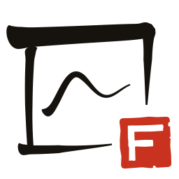
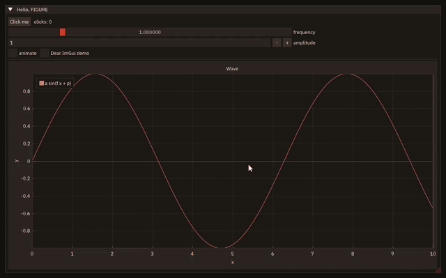

<p align="center">
  <picture>
    <source media="(prefers-color-scheme: dark)" srcset="docs/public/logo-dark.svg">
    
  </picture>
</p>

# FIGURE

**F**ortran **I**mmediate-mode **G**UI for **U**ser interfaces, **R**endering and **E**xploration.

[](#copyrights)
[](https://github.com/szaghi/figure/actions/workflows/ci.yml)
[](https://github.com/szaghi/figure/actions/workflows/platforms.yml)
[](https://szaghi.github.io/figure)

Interactive windows, widgets and plots for Fortran programs: [Dear ImGui](https://github.com/ocornut/imgui) and
[ImPlot](https://github.com/epezent/implot) on [SDL3](https://github.com/libsdl-org/SDL) and OpenGL 3, on Linux, macOS
and Windows, with gfortran and nvfortran. Immediate mode: no widget objects, handles or callbacks; the interface is
declared every frame, and its state is the program's own variables.

<p align="center"></p>

## A program

```fortran
!< readme, the example of README.md: a window, a slider and a plot that follows it.
program readme
!< readme, the example of README.md: a window, a slider and a plot that follows it.
use, intrinsic :: iso_fortran_env, only : int32, real64
use figure, only : app_object, ig_begin, ig_end, ig_set_next_window, ig_slider, ip_begin_plot, ip_end_plot, ip_line

implicit none
type(app_object) :: app           !< Application.
real(real64)     :: x(200)        !< Abscissae.
real(real64)     :: frequency     !< Set by the slider.
integer(int32)   :: i             !< Counter.

x = [(0.05_real64 * i, i = 0, 199)]
frequency = 1.0_real64
call app%init('FIGURE', 800, 500)
do while (app%next_frame())                 ! the interface is declared every frame
   call ig_set_next_window(20.0_real64, 20.0_real64, 760.0_real64, 460.0_real64)
   if (ig_begin('Wave')) then
      if (ig_slider('frequency', frequency, 0.1_real64, 5.0_real64)) continue
      if (ip_begin_plot('sin(f x)', height=-1.0_real64)) then
         call ip_line('y', x, sin(frequency * x))
         call ip_end_plot()
      endif
   endif
   call ig_end()
enddo
call app%destroy()
endprogram readme
```

Built against the static library (below), it is `docs/examples/src/readme.F90`:

```sh
gfortran -I lib/mod readme.F90 lib/libfigure.a -L lib $(python3 scripts/check_sync.py --link-flags) -o readme
```

## What it does

- **Widgets and plots**: buttons, sliders, numeric and text fields, drop-down lists, check boxes, tables, tabs,
  headers; lines, scatter, bars, shaded areas, subplots with linked axes, logarithmic axes, heatmaps with colour bars,
  GPU textures, all read from Fortran arrays in place.
- **Menus and dialogs**: menu bars, keyboard shortcuts, popups and modals, a question before quitting, the system's
  file dialogs.
- **Docking**: windows dock into one another as tabs and splits; layouts set by the program, or arranged by the user,
  saved to a file and loaded back.
- **Themes**: seven built-in styles (`seal`, `paper` for publication, `high-contrast`, ...), every colour and size of
  Dear ImGui and ImPlot by name, theme files, fonts and their size, changed at run time.
- **Lazy redraw**: an idle window sleeps (about 0.4 % of a core); live data redraws when it changes.
- **Remote mode**: `app%init_remote()` serves the same interface to a web browser, with an access token: no display or
  GPU on the program's side, e.g. a cluster node through an SSH tunnel. Unchanged frames are not sent, frames are
  capped and compressed when the link is slow.
- **Pictures**: `app%save_image` writes a plot or a panel as a PNG; every frame can be recorded, with scripted input.
- **Headless testing**: `app%init_headless` and the `figure_testing` module drive the interface with synthetic input,
  in CI without a display.

Built with it: [tools for a CFD solver](https://szaghi.github.io/figure/guide/showcase), a run checker and two input
editors.

## Install

```sh
curl -fsSL https://github.com/szaghi/figure/releases/latest/download/install.sh | bash -s -- --gnu
```

builds the latest release with gfortran (`--nvidia` for nvfortran), installs it into `~/.local` and compiles a test
program with `pkg-config --cflags --libs figure`, the line your programs use. On Linux, when SDL3's development
packages are missing, it prints the `apt`/`dnf` command that installs them and stops; `--deps` runs that command
(with `sudo`, after showing it). Options, what is installed and `--uninstall`:
[installation guide](https://szaghi.github.io/figure/guide/install#the-one-line-installer).

**By hand:** FIGURE has a **native layer** (C/C++: Dear ImGui, ImPlot, cimgui, cimplot, miniz, SDL3 and FIGURE's glue), built by
CMake, and the **Fortran library**, built by [FoBiS](https://github.com/szaghi/FoBiS) or
[fpm](https://fpm.fortran-lang.org). Linux needs the X11/Wayland/DBus development packages for SDL3 windows
([installation guide](https://szaghi.github.io/figure/guide/install)).

**FoBiS** (the primary build):

```sh
git clone https://github.com/szaghi/figure && cd figure
scripts/build_native.sh                              # once: the native layer, into lib/
fobis build --mode figure-static-gnu                 # lib/libfigure.a and lib/mod/ (or figure-static-nvf)
fobis build --mode tests-gnu && scripts/run_tests.sh # the tests, headless
fobis build --mode examples-gnu && exe/figure_hello  # the examples (also figure_mandelbrot)
```

**fpm**, as a dependency of your project: each release publishes a self-contained package as the tag
`vX.Y.Z-fpm`, where fpm compiles the native layer itself; only SDL3 comes from the system (`libsdl3-dev`,
`brew install sdl3`, MSYS2's `mingw-w64-ucrt-x86_64-sdl3`):

```toml
[dependencies]
figure = { git = "https://github.com/szaghi/figure", tag = "v0.2.0-fpm" }
```

Inside this repository, `scripts/fpm.sh test` runs fpm on the native layer CMake built.

**WSL2 (WSLg):** set `GALLIUM_DRIVER=d3d12` (e.g. in `~/.bashrc`), or Mesa renders in software and every frame costs
CPU ([details](https://szaghi.github.io/figure/guide/install#wsl2-wslg)).

## Documentation

[szaghi.github.io/figure](https://szaghi.github.io/figure): a [tutorial](https://szaghi.github.io/figure/manual/),
a [cookbook](https://szaghi.github.io/figure/manual/cookbook), the [guide](https://szaghi.github.io/figure/guide/features)
(widgets, plots, styles, docking, remote mode, [performance](https://szaghi.github.io/figure/guide/performance),
testing) and the API reference. Every picture there is recorded from the program it describes.

**Status:** v0.2.0, released 2026-11-06 ([changelog](CHANGELOG.md),
[roadmap](https://szaghi.github.io/figure/guide/roadmap)); the API can still change before v1.0.

## Copyrights

FIGURE is released under the [MIT licence](LICENSE.mit.md). Its native layer compiles Dear ImGui, ImPlot, cimgui,
cimplot and miniz (MIT) and SDL3 (zlib), and embeds the IBM Plex Sans font (OFL-1.1) and the Lucide icons (ISC): see
[THIRD_PARTY.md](THIRD_PARTY.md) for what a program built with FIGURE must carry when it is distributed.
