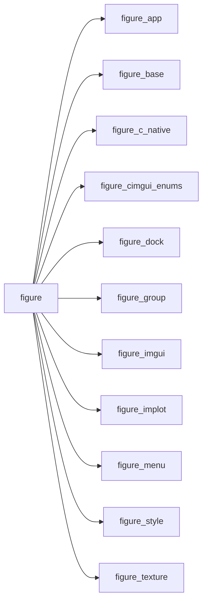

# figure

> FIGURE, Fortran Immediate-mode GUI for User interfaces, Rendering and Exploration.

 Umbrella module: `use figure` gives the application loop (figure_app), the Dear ImGui widgets (figure_imgui),
 menus, popups and shortcuts (figure_menu), groups of widgets (figure_group: child regions, collapsing headers, tabs,
 tables, id scopes, disabled blocks), docking (figure_dock), the style colours and variables by name (figure_style),
 the ImPlot plots (figure_implot): items, heatmaps, images, their style (`ip_spec`) and ImPlot's constants, and the
 GPU textures (figure_texture) that `ig_image` and `ip_image` draw.

**Source**: `src/lib/figure.F90`

**Dependencies**

