# figure

> FIGURE, Fortran Immediate-mode GUI for User interfaces, Rendering and Exploration.

 Umbrella module: `use figure` gives the application loop (figure_app), the Dear ImGui widgets (figure_imgui),
 numbers and choices (figure_numbers: fields, drag boxes and sliders of any kind, vectors, radio buttons, list boxes),
 a canvas and drawing primitives (figure_canvas: an area taking the mouse, lines, shapes, text and images on a layer),
 menus, popups and shortcuts (figure_menu), groups of widgets (figure_group: child regions, collapsing headers, tabs,
 tables, trees, id scopes, disabled blocks), docking (figure_dock), the style colours and variables by name (figure_style),
 the ImPlot plots (figure_implot): items, heatmaps, images, their style (`ip_spec`) and ImPlot's constants, and the
 GPU textures (figure_texture) that `ig_image` and `ip_image` draw, PNG and JPEG files read (`fig_read_image`,
 `tex%load`), and the Lucide icons by name, `ICON_*`
 (figure_icons), UTF-8 strings for any label: `ig_button(ICON_PLAY//' Run')`; programs started from the program and
 a view of their output (figure_process: `process_object`, `log_view_object`); Fortran procedures run on a worker
 thread (figure_task: `task_object`, `task_handle_object`); 3-D views of meshes (figure_view3d: `view3d_object`);
 a player for snapshots (figure_player: `player_object`, `ig_player`); a code editor and a text diff (figure_editor:
 `code_editor_object`, `language_object`, `code_language`, `code_diff`, `code_diff_lines`); Markdown in the window
 (figure_markdown: `ig_markdown`, `markdown_view_object`).

**Source**: `src/lib/figure.F90`

**Dependencies**

```mermaid
graph LR
  figure["figure"] --> figure_app["figure_app"]
  figure["figure"] --> figure_base["figure_base"]
  figure["figure"] --> figure_c_native["figure_c_native"]
  figure["figure"] --> figure_canvas["figure_canvas"]
  figure["figure"] --> figure_cimgui_enums["figure_cimgui_enums"]
  figure["figure"] --> figure_dock["figure_dock"]
  figure["figure"] --> figure_editor["figure_editor"]
  figure["figure"] --> figure_files["figure_files"]
  figure["figure"] --> figure_group["figure_group"]
  figure["figure"] --> figure_icons["figure_icons"]
  figure["figure"] --> figure_imgui["figure_imgui"]
  figure["figure"] --> figure_implot["figure_implot"]
  figure["figure"] --> figure_implot3d["figure_implot3d"]
  figure["figure"] --> figure_markdown["figure_markdown"]
  figure["figure"] --> figure_menu["figure_menu"]
  figure["figure"] --> figure_numbers["figure_numbers"]
  figure["figure"] --> figure_player["figure_player"]
  figure["figure"] --> figure_process["figure_process"]
  figure["figure"] --> figure_style["figure_style"]
  figure["figure"] --> figure_task["figure_task"]
  figure["figure"] --> figure_texture["figure_texture"]
  figure["figure"] --> figure_view3d["figure_view3d"]
  click figure_app href "figure_app.html" "figure_app"
  click figure_base href "figure_base.html" "figure_base"
  click figure_c_native href "figure_c_native.html" "figure_c_native"
  click figure_canvas href "figure_canvas.html" "figure_canvas"
  click figure_cimgui_enums href "figure_cimgui_enums.html" "figure_cimgui_enums"
  click figure_dock href "figure_dock.html" "figure_dock"
  click figure_editor href "figure_editor.html" "figure_editor"
  click figure_files href "figure_files.html" "figure_files"
  click figure_group href "figure_group.html" "figure_group"
  click figure_icons href "figure_icons.html" "figure_icons"
  click figure_imgui href "figure_imgui.html" "figure_imgui"
  click figure_implot href "figure_implot.html" "figure_implot"
  click figure_implot3d href "figure_implot3d.html" "figure_implot3d"
  click figure_markdown href "figure_markdown.html" "figure_markdown"
  click figure_menu href "figure_menu.html" "figure_menu"
  click figure_numbers href "figure_numbers.html" "figure_numbers"
  click figure_player href "figure_player.html" "figure_player"
  click figure_process href "figure_process.html" "figure_process"
  click figure_style href "figure_style.html" "figure_style"
  click figure_task href "figure_task.html" "figure_task"
  click figure_texture href "figure_texture.html" "figure_texture"
  click figure_view3d href "figure_view3d.html" "figure_view3d"
```

## Re-exports

| Name | Kind | Module | Description |
|------|------|--------|-------------|
| [`app_object`](/api/src/lib/figure_app#app-object) | type | [figure_app](/api/src/lib/figure_app) | A FIGURE application (one per program). |
| [`fig_read_image`](/api/src/lib/figure_texture#fig-read-image) | subroutine | [figure_texture](/api/src/lib/figure_texture) | Read a PNG or JPEG file into RGBA pixels: `rgba` is allocated to `rgba(4, width, height)`, `rgba(:, i, j)` the red, green, blue and alpha bytes of the pixel in column `i` (left to right) and row `j` (**top to bottom**, the file's order), the layout `tex%update` takes. A grey image gives R = G = B; an image without alpha gives A = 255 (-1_int8). Draws nothing: a task may call it. On a failure `rgba` is left unallocated. |
| [`figure_last_error`](/api/src/lib/figure_base#figure-last-error) | function | [figure_base](/api/src/lib/figure_base) | Message of the last failed call. |
| [`figure_time`](/api/src/lib/figure_base#figure-time) | function | [figure_base](/api/src/lib/figure_base) | Seconds since the first call of `figure_time` in the program, on a monotonic clock (`clock_gettime` of `CLOCK_MONOTONIC` on Linux, `mach_absolute_time` on macOS, `QueryPerformanceCounter` on Windows): never decreasing, not stepped when the system sets its time, as `system_clock` is under nvfortran. Resolution: the counter's tick, 1 ns on Linux, 1 ns or 42 ns on macOS (Intel, Apple silicon), usually 100 ns on Windows; the first call returns (about) 0. Callable at any time (before `init*`, after `destroy`) and from any thread, a task included; the same in every mode. |
| [`figure_file_exists`](/api/src/lib/figure_files#figure-file-exists) | function | [figure_files](/api/src/lib/figure_files) | Whether `path` exists, a file or a folder (what `inquire(file=)` says of a folder is the compiler's choice). |
| [`figure_file_time`](/api/src/lib/figure_files#figure-file-time) | function | [figure_files](/api/src/lib/figure_files) | The modification time of the file or folder `path`, local, `'YYYY-MM-DD hh:mm:ss'`; blank on a failure. |
| [`figure_make_folder`](/api/src/lib/figure_files#figure-make-folder) | subroutine | [figure_files](/api/src/lib/figure_files) | Make the folder `path`, and its missing parents unless `parents=.false.`; a folder already there is no error, a file there is (`FIG_ERR_FAILED`). |
| [`figure_remove`](/api/src/lib/figure_files#figure-remove) | subroutine | [figure_files](/api/src/lib/figure_files) | Remove the file or empty folder `path`, or with `recursive=.true.` a folder and everything in it; a path that does not exist is no error (as `rm -f`), so a program clears without testing first. |
| [`figure_set_file_time`](/api/src/lib/figure_files#figure-set-file-time) | subroutine | [figure_files](/api/src/lib/figure_files) | Set the modification time of the file or folder `path` to `time`, a local time `'YYYY-MM-DD hh:mm'` or `'YYYY-MM-DD hh:mm:ss'` (as `touch -t`): a listing shows the same time on every machine set to that time zone. |
| [`FIG_OK`](/api/src/lib/figure_c_native#variables) | parameter | [figure_c_native](/api/src/lib/figure_c_native) | Success. |
| [`FIG_ERR_STATE`](/api/src/lib/figure_c_native#variables) | parameter | [figure_c_native](/api/src/lib/figure_c_native) | Call not allowed in the current state. |
| [`FIG_ERR_ARGUMENT`](/api/src/lib/figure_c_native#variables) | parameter | [figure_c_native](/api/src/lib/figure_c_native) | Invalid argument. |
| [`FIG_ERR_FAILED`](/api/src/lib/figure_c_native#variables) | parameter | [figure_c_native](/api/src/lib/figure_c_native) | The platform (SDL, OpenGL) reported a failure. |
| [`FIG_ERR_EXCEPTION`](/api/src/lib/figure_c_native#variables) | parameter | [figure_c_native](/api/src/lib/figure_c_native) | A C++ exception was caught at the boundary. |
| [`ig_splitter`](/api/src/lib/figure_imgui#ig-splitter) | function | [figure_imgui](/api/src/lib/figure_imgui) | A bar between two panes that the user drags to share the space between them: `sizes(1)` and `sizes(2)` are the panes' widths (side by side, the default) or heights (`vertical`: one above the other) [pixels], changed by the drag (their sum kept, neither below `min_size`); true on the frames they change. Call it between the two panes, at the cursor: side by side, after the first pane and `ig_same_line()`, then `ig_same_line()` again before the second; one above the other, between them. The bar is the style's item spacing thick (Dear ImGui's `SplitterBehavior`) and runs to the end of the region (give the panes the region's other extent: 0 for a child fills it). `id` names it in the window (a path finds it by it). Three panes: two splitters, each with its pair (`sizes(1:2)`, `sizes(2:3)`). Statuses: `FIG_ERR_ARGUMENT` when `sizes` is not two values, `FIG_ERR_STATE` with no frame open or from a task. The same in every mode. |
| [`ig_begin`](/api/src/lib/figure_imgui#ig-begin) | function | [figure_imgui](/api/src/lib/figure_imgui) | Begin a window; always pair with `ig_end`. With `open`, the window has a close button that sets it false. Without `open`, a window registered with `app%add_window` (closable, the default) has the close button, which hides it: `app%window_visible(name)` turns false. `flags` combine `ImGuiWindowFlags_*` with `ior` (`NoTitleBar`, `NoResize`, `NoMove`, `AlwaysAutoResize`, `NoBackground`, `NoDecoration`, `NoDocking`, ...). |
| [`ig_begin_side_bar`](/api/src/lib/figure_imgui#ig-begin-side-bar) | function | [figure_imgui](/api/src/lib/figure_imgui) | Begin a bar along one side of the display: a toolbar, a status bar. `side` is `'left'`, `'right'`, `'top'` or `'bottom'`; `size` its width (left, right) or height (top, bottom) [pixels]. It is a window without title bar, not movable, not resizable, not dockable, which the work area leaves out: a dock space (`ig_dock_space`) and the main menu bar's neighbours fill the rest. Declare it every frame, after the main menu bar and before the dock space; always pair with `ig_end`. An unknown side is taken as `'left'`. |
| [`ig_button`](/api/src/lib/figure_imgui#ig-button) | function | [figure_imgui](/api/src/lib/figure_imgui) | A button; true on the frame it is clicked. |
| [`ig_checkbox`](/api/src/lib/figure_imgui#ig-checkbox) | function | [figure_imgui](/api/src/lib/figure_imgui) | A check box bound to `value`; true when the user toggled it. |
| [`ig_end`](/api/src/lib/figure_imgui#ig-end) | subroutine | [figure_imgui](/api/src/lib/figure_imgui) | End the window opened by `ig_begin` or `ig_begin_side_bar` (whatever it returned). Refused (`FIG_ERR_STATE`, reported by `app%next_frame`) when the innermost open scope is not a window: errors.md, "Pairing and frames". |
| [`ig_input`](/api/src/lib/figure_numbers#ig-input) | interface | [figure_numbers](/api/src/lib/figure_numbers) | A field for a number or a vector of numbers, typed: `ig_input(label, value [, step] [, format] [, enter_returns] [, read_only] [, stat]) → logical`. `value` `int32`, `int64`, `real32` or `real64`, scalar or rank 1 (one field per component). `step` (> 0, the kind of `value`) adds - and + buttons (ctrl: 10 steps). `format` default: `'%d'` for integers, `'%.6g'` for reals. True on the frame the user changes the value: when the field is left (enter, tab, a click elsewhere) after an edit, or a button is pressed; with `enter_returns=.true.`, only on the frame enter is pressed. `read_only=.true.`: shown, selectable, not editable. |
| [`ig_item_rect`](/api/src/lib/figure_imgui#ig-item-rect) | subroutine | [figure_imgui](/api/src/lib/figure_imgui) | Screen rectangle of the last item [pixels] (tests, custom layout). |
| [`ig_same_line`](/api/src/lib/figure_imgui#ig-same-line) | subroutine | [figure_imgui](/api/src/lib/figure_imgui) | Put the next item on the same line as the previous one; with `offset`, at that distance [pixels] from the window's left edge (aligned columns of labels and fields). |
| [`ig_separator`](/api/src/lib/figure_imgui#ig-separator) | subroutine | [figure_imgui](/api/src/lib/figure_imgui) | Horizontal separator. |
| [`ig_set_next_window`](/api/src/lib/figure_imgui#ig-set-next-window) | subroutine | [figure_imgui](/api/src/lib/figure_imgui) | Position (and size) of the next window [pixels]: on first use only, or every frame if `always`. |
| [`ig_show_demo_window`](/api/src/lib/figure_imgui#ig-show-demo-window) | subroutine | [figure_imgui](/api/src/lib/figure_imgui) | The Dear ImGui demo window (a live catalogue of every widget). |
| [`ig_slider`](/api/src/lib/figure_numbers#ig-slider) | interface | [figure_numbers](/api/src/lib/figure_numbers) | A slider for a number or a vector: `ig_slider(label, value, vmin, vmax [, format] [, scale] [, clamp] [, stat]) → logical`. A click or a drag sets `value` in [vmin, vmax] (vmin > vmax: a reversed slider); ctrl-click types one (`clamp=.true.`: clamped too). `scale='log'`: the middle of the slider is the geometric mean of positive ends. `vmin`, `vmax` within half the range of the kind. Reals are rounded to the precision `format` shows. |
| [`ig_text`](/api/src/lib/figure_imgui#ig-text) | subroutine | [figure_imgui](/api/src/lib/figure_imgui) | Plain text (no formatting: compose it with Fortran internal writes). |
| [`ig_image`](/api/src/lib/figure_imgui#ig-image) | subroutine | [figure_imgui](/api/src/lib/figure_imgui) | A texture, pixel row 1 at the top (screen and image-file convention), `width` x `height` pixels (default: the texture's size). |
| [`ig_drag`](/api/src/lib/figure_numbers#ig-drag) | interface | [figure_numbers](/api/src/lib/figure_numbers) | A drag box for a number or a vector: `ig_drag(label, value [, speed] [, vmin] [, vmax] [, format] [, scale] [, clamp] [, stat]) → logical`. Dragged sideways, `value` changes by `speed` per pixel (default 1; shift: 10 times, alt: a hundredth); a double click or ctrl-click types a value. `vmin`, `vmax` (the kind of `value`) stop the drag; `clamp=.true.` clamps a typed value too. `scale='log'` (with `vmin` and `vmax`): equal drags multiply the value by equal factors. Reals are rounded to the precision `format` shows. |
| [`ig_slider_angle`](/api/src/lib/figure_numbers#ig-slider-angle) | interface | [figure_numbers](/api/src/lib/figure_numbers) | A slider for an angle kept in radians and shown in degrees: `ig_slider_angle(label, radians [, deg_min] [, deg_max] [, format] [, stat]) → logical` (`SliderAngle`), `real32` or `real64`; bounds in degrees (default -360 and 360), `format` of the degrees (default `'%.0f deg'`). Edited in single precision: `radians` is written only on the frames it changes. |
| [`ig_drag_range`](/api/src/lib/figure_numbers#ig-drag-range) | interface | [figure_numbers](/api/src/lib/figure_numbers) | Two drag boxes for the ends of a range [lo, hi] and one label: `ig_drag_range(label, lo, hi [, speed] [, vmin] [, vmax] [, format] [, stat]) → logical` (`DragFloatRange2`, `DragIntRange2` for any kind). `lo` stays in [vmin, hi] and `hi` in [lo, vmax], typed values too. |
| [`ig_radio`](/api/src/lib/figure_numbers#ig-radio) | function | [figure_numbers](/api/src/lib/figure_numbers) | A radio button of a group sharing `current`: drawn chosen when `current == value`; a click sets `current = value` and returns true (on that frame; also when it was chosen already). One call per option, each with its own `value` (`RadioButton`). |
| [`ig_list_box`](/api/src/lib/figure_numbers#ig-list-box) | function | [figure_numbers](/api/src/lib/figure_numbers) | A list of `items` shown at once, in a box that scrolls; `current` is the index of the one chosen (1 to `size(items)`; any other value shows none chosen). True on the frame the user picks an item (`current` is then its index); a pick is reported as an edit by `ig_last_item`. Only the rows in view are drawn. Trailing blanks of the items are not shown; items may repeat a text (they are told apart by their index). |
| [`canvas_event_object`](/api/src/lib/figure_canvas#canvas-event-object) | type | [figure_canvas](/api/src/lib/figure_canvas) | What happened over a canvas on a frame, as `ig_canvas` found it: a plain value. Per button the arrays are (left, right, middle). The event states (`clicked`, `double_clicked`, `released`) are true on one frame; `drag` and `delta` are zero unless a button pressed over the canvas is held (and `drag` also on its release); the wheel is zero unless the pointer is over the canvas. Positions: `mouse` in the canvas's pixels (from its top-left, x right, y down; outside the canvas too, then below 0 or beyond its size); `origin` on the screen. |
| [`ig_canvas`](/api/src/lib/figure_canvas#ig-canvas) | subroutine | [figure_canvas](/api/src/lib/figure_canvas) | An area of `width` x `height` pixels that takes the mouse (Dear ImGui's `InvisibleButton` with the three buttons): `ev` receives what happened over it on this frame (`canvas_event_object`). While the pointer is over it the canvas owns the wheel (`SetItemKeyOwner`): a scrolling window or child holding it does not scroll. With `texture`, the texture is drawn over the whole canvas first, so that primitives drawn after it are on top. A size <= 0 is the space left plus it (0: all of it, -10: all but 10 pixels), at least 1 pixel. The canvas is one item: `ig_last_item`, `ig_same_line` and the context menus apply to it. Draw on it with the `ig_draw_*` primitives at `ev%origin + [cx, cy]`. A NaN or infinite size, or a texture not initialized: nothing placed, `ev` empty, `FIG_ERR_ARGUMENT` in `stat` (or `error stop` without it). No frame open or a task: `FIG_ERR_STATE`. The same in window, headless and remote mode. |
| [`ig_cursor_screen_pos`](/api/src/lib/figure_canvas#ig-cursor-screen-pos) | subroutine | [figure_canvas](/api/src/lib/figure_canvas) | Where the next item goes, on the screen [pixels] (Dear ImGui's `GetCursorScreenPos`): the top-left of the next widget or canvas, the origin to draw from with the `ig_draw_*` primitives before placing an item there. No frame open or a task: zeros (a usage error, reported by `app%next_frame`). |
| [`ig_invisible_button`](/api/src/lib/figure_canvas#ig-invisible-button) | function | [figure_canvas](/api/src/lib/figure_canvas) | A button that draws nothing (Dear ImGui's `InvisibleButton`): true on the frame it is clicked with the left button (pressed and released over it). It is an item like any other (`ig_last_item` gives its hovered and active states and its rectangle): a hot zone over something drawn with the `ig_draw_*` primitives. A size <= 0 is the space left plus it, at least 1 pixel. A NaN or infinite size: false, `FIG_ERR_ARGUMENT` in `stat` (or `error stop` without it); no frame open or a task: `FIG_ERR_STATE`. The same in window, headless and remote mode. |
| [`ig_draw_line`](/api/src/lib/figure_canvas#ig-draw-line) | subroutine | [figure_canvas](/api/src/lib/figure_canvas) | A segment from (`x1`, `y1`) to (`x2`, `y2`) (`ImDrawList::AddLine`): screen pixels, or plot units on the `'plot'` layer. Refusals: see `ig_draw_polyline`. |
| [`ig_draw_rect`](/api/src/lib/figure_canvas#ig-draw-rect) | subroutine | [figure_canvas](/api/src/lib/figure_canvas) | A rectangle with opposite corners (`x1`, `y1`) and (`x2`, `y2`), in any order (`ImDrawList::AddRect`, `AddRectFilled`): its outline, or filled. Screen pixels, or plot units on the `'plot'` layer. Refusals: see `ig_draw_polyline`. |
| [`ig_draw_circle`](/api/src/lib/figure_canvas#ig-draw-circle) | subroutine | [figure_canvas](/api/src/lib/figure_canvas) | A circle centred at (`x`, `y`) (`ImDrawList::AddCircle`, `AddCircleFilled`): its outline, or filled. The centre in screen pixels, or plot units on the `'plot'` layer; the radius always in pixels (a marker, not a shape in plot units: a circle in plot units is a polygon of its points). Refusals: see `ig_draw_polyline`, and a radius below 0 or not finite. |
| [`ig_draw_polyline`](/api/src/lib/figure_canvas#ig-draw-polyline) | subroutine | [figure_canvas](/api/src/lib/figure_canvas) | A polyline through the points (`x(i)`, `y(i)`) (`ImDrawList::AddPolyline`); `closed` joins the last point to the first. Screen pixels, or plot units on the `'plot'` layer. `x` and `y` are passed to the native layer without a copy when contiguous (a strided section is packed by the compiler). Refused with `FIG_ERR_ARGUMENT` in `stat` (or `error stop` without it), nothing drawn, for every primitive: `x` and `y` of different sizes or fewer points than the primitive needs (2 here), a coordinate NaN, infinite or beyond single precision, a colour not of 3 or 4 components in [0, 1], a thickness not above 0, an unknown layer. A `'plot'` layer outside a plot (between a true `ip_begin_plot` and `ip_end_plot`), no frame open or a task: `FIG_ERR_STATE`, a usage error. The same in window, headless and remote mode. |
| [`ig_draw_polygon`](/api/src/lib/figure_canvas#ig-draw-polygon) | subroutine | [figure_canvas](/api/src/lib/figure_canvas) | A closed polygon through the points (`x(i)`, `y(i)`) (`ImDrawList::AddPolyline` closed, or `AddConcavePolyFilled`): its outline, or filled (convex or not; not self-intersecting). Screen pixels, or plot units on the `'plot'` layer. At least 3 points. Refusals: see `ig_draw_polyline`. |
| [`ig_draw_text`](/api/src/lib/figure_canvas#ig-draw-text) | subroutine | [figure_canvas](/api/src/lib/figure_canvas) | `text` with its top-left at (`x`, `y`) (`ImDrawList::AddText`), in the current font: screen pixels, or plot units on the `'plot'` layer. One line per LF. Refusals: see `ig_draw_polyline`. |
| [`ig_draw_image`](/api/src/lib/figure_canvas#ig-draw-image) | subroutine | [figure_canvas](/api/src/lib/figure_canvas) | A texture stretched over the rectangle with opposite corners (`x1`, `y1`) and (`x2`, `y2`), in any order (`ImDrawList::AddImage`), its pixel row 1 at the top; `color` multiplies its pixels (default white: as they are). Screen pixels, or plot units on the `'plot'` layer. Refusals: see `ig_draw_polyline`, and a texture not initialized. |
| [`ig_input_text`](/api/src/lib/figure_imgui#ig-input-text) | function | [figure_imgui](/api/src/lib/figure_imgui) | A text field bound to `value`; true when the user edited it. The text can be as long as `value` (its length is the field's capacity); trailing blanks are not part of the text (Fortran pads with them). `hint` is shown while the field is empty; `flags` combine `ImGuiInputTextFlags_*` with `ior` (`CharsNoBlank`, `CharsDecimal`, `CharsScientific`, `ReadOnly`, `EnterReturnsTrue`, ...). |
| [`ig_set_next_item_width`](/api/src/lib/figure_imgui#ig-set-next-item-width) | subroutine | [figure_imgui](/api/src/lib/figure_imgui) | Width of the next widget's field [pixels]; negative: up to that distance from the window's right edge. |
| [`ig_combo`](/api/src/lib/figure_imgui#ig-combo) | function | [figure_imgui](/api/src/lib/figure_imgui) | A drop-down list of `items`; `current` is the index of the one chosen (1 to `size(items)`; any other value shows none chosen). True on the frame the user picks an item (`current` is then its index). |
| [`ig_tooltip`](/api/src/lib/figure_imgui#ig-tooltip) | subroutine | [figure_imgui](/api/src/lib/figure_imgui) | A tooltip on the previous widget: `text` shows while the pointer rests on it (after Dear ImGui's usual delay). |
| [`ig_drag_source`](/api/src/lib/figure_imgui#ig-drag-source) | function | [figure_imgui](/api/src/lib/figure_imgui) | Make the last item a source of drag and drop: pressed and dragged, it carries `payload` (text: an id, a name, a path) under the type `type`, shown under the pointer as `preview` (default: the payload itself). Call it right after the item, every frame. Only a target of the same type (`ig_drop_target`, `ip_drop_target`) receives the payload. Items without an id (`ig_text`) can be sources too. Statuses: `FIG_ERR_ARGUMENT` for a type of no or more than 32 characters, or one starting with `_` (Dear ImGui's own); `FIG_ERR_STATE` outside a frame or from a task. |
| [`ig_drop_target`](/api/src/lib/figure_imgui#ig-drop-target) | function | [figure_imgui](/api/src/lib/figure_imgui) | Make the last item a target of drag and drop for payloads of type `type`: true on the frame one is dropped on it, `payload` then holding it (as `ig_drag_source` gave it). While a payload of the type is dragged over the item, Dear ImGui outlines it. Call it right after the item, every frame. Statuses: as `ig_drag_source`. |
| [`ig_dragging`](/api/src/lib/figure_imgui#ig-dragging) | function | [figure_imgui](/api/src/lib/figure_imgui) | True while a payload of type `type` is being dragged (anywhere): a program can show its drop zones then. |
| [`ig_selectable`](/api/src/lib/figure_imgui#ig-selectable) | function | [figure_imgui](/api/src/lib/figure_imgui) | A line of a list, highlighted when `selected`; true on the frame it is clicked (the program then updates what is selected: the line does not change `selected` itself). With `index` (from 1), the line is item `index` of the multi-selection open (`ig_begin_multi_select`): clicks, shift and ctrl clicks, ctrl+a and box-selection update the selection object, and `selected` is its `is_selected(index)`. Statuses (only with `index`): `FIG_ERR_STATE` with no multi-selection open, `FIG_ERR_ARGUMENT` for an index outside the selection's items. |
| [`ig_text_wrapped`](/api/src/lib/figure_imgui#ig-text-wrapped) | subroutine | [figure_imgui](/api/src/lib/figure_imgui) | Text wrapped at the right edge of the window or region (help text, long messages). |
| [`ig_text_disabled`](/api/src/lib/figure_imgui#ig-text-disabled) | subroutine | [figure_imgui](/api/src/lib/figure_imgui) | Text in the style's disabled colour (a default value, a hint, something that does not apply). |
| [`ig_text_colored`](/api/src/lib/figure_imgui#ig-text-colored) | subroutine | [figure_imgui](/api/src/lib/figure_imgui) | Text in `color` ([r, g, b] or [r, g, b, a] in [0, 1]); pair a colour with a mark or a word (an error marker), so that it does not rest on colour alone. |
| [`ig_begin_child`](/api/src/lib/figure_group#ig-begin-child) | function | [figure_group](/api/src/lib/figure_group) | A region inside the window, scrolling on its own (a list that scrolls while a help panel stays); always pair with `ig_end_child`, whatever this returned. `width`/`height` [pixels]: 0 or absent fills what is left, negative leaves that much. |
| [`ig_end_child`](/api/src/lib/figure_group#ig-end-child) | subroutine | [figure_group](/api/src/lib/figure_group) | End the region opened by `ig_begin_child` (whatever it returned). |
| [`ig_collapsing_header`](/api/src/lib/figure_group#ig-collapsing-header) | function | [figure_group](/api/src/lib/figure_group) | A header that shows or hides what follows it; true while open (then draw the content). No end call. |
| [`ig_begin_tab_bar`](/api/src/lib/figure_group#ig-begin-tab-bar) | function | [figure_group](/api/src/lib/figure_group) | Begin a bar of tabs; when true, declare the tabs (`ig_begin_tab`) and close it with `ig_end_tab_bar`. |
| [`ig_end_tab_bar`](/api/src/lib/figure_group#ig-end-tab-bar) | subroutine | [figure_group](/api/src/lib/figure_group) | End a bar of tabs (only after `ig_begin_tab_bar` returned true). |
| [`ig_begin_tab`](/api/src/lib/figure_group#ig-begin-tab) | function | [figure_group](/api/src/lib/figure_group) | A tab of the current bar; true when it is the selected one: draw its content, then `ig_end_tab`. With `open`, the tab has a close button that sets it false. |
| [`ig_end_tab`](/api/src/lib/figure_group#ig-end-tab) | subroutine | [figure_group](/api/src/lib/figure_group) | End the content of a tab (only after `ig_begin_tab` returned true). |
| [`ig_push_id`](/api/src/lib/figure_group#ig-push-id) | interface | [figure_group](/api/src/lib/figure_group) | Open an id scope, by a string or an integer. |
| [`ig_pop_id`](/api/src/lib/figure_group#ig-pop-id) | subroutine | [figure_group](/api/src/lib/figure_group) | Close the id scope opened by the last `ig_push_id`. |
| [`ig_begin_disabled`](/api/src/lib/figure_group#ig-begin-disabled) | subroutine | [figure_group](/api/src/lib/figure_group) | Widgets up to `ig_end_disabled` are greyed out and ignore input (when `disabled`, default true). |
| [`ig_end_disabled`](/api/src/lib/figure_group#ig-end-disabled) | subroutine | [figure_group](/api/src/lib/figure_group) | End the block opened by `ig_begin_disabled`. |
| [`ig_begin_table`](/api/src/lib/figure_group#ig-begin-table) | function | [figure_group](/api/src/lib/figure_group) | Begin a table of `columns` columns (`BeginTable`); when true, fill it and close it with `ig_end_table` (only after true). `flags` combine `ImGuiTableFlags_*` with `ior` (default: borders, alternating row background, resizable columns); the logical arguments then set (true) or clear (false) one flag each: `sortable` (a click on a header asks an order, `ig_table_sort`), `hideable` (the headers' context menu hides columns, `ig_table_column_enabled`), `reorderable` (headers dragged to reorder the columns), `scroll_x` (horizontal scrolling: columns keep their width). `height` [pixels] fixes the table's height (with `ImGuiTableFlags_ScrollY`, the rows scroll inside it). `freeze_rows` rows at the top (the headers row: 1) and `freeze_cols` columns at the left stay in view while the rest scrolls (`TableSetupScrollFreeze`): a frozen row turns vertical scrolling on, a frozen column horizontal scrolling; without `height`, a scrolling table fills the height left in its window. Out-of-range `columns` (1 to 511), `freeze_rows` (0 to 127) or `freeze_cols` (0 to `columns`): nothing begun, false, `FIG_ERR_ARGUMENT` in `stat` (or `error stop` without it); a task or no frame open: `FIG_ERR_STATE`. The same in window, headless and remote mode. |
| [`ig_end_table`](/api/src/lib/figure_group#ig-end-table) | subroutine | [figure_group](/api/src/lib/figure_group) | End a table (only after `ig_begin_table` returned true). |
| [`ig_table_setup_column`](/api/src/lib/figure_group#ig-table-setup-column) | subroutine | [figure_group](/api/src/lib/figure_group) | Declare the next column (`TableSetupColumn`; before the first row, one call per column, in order): its header label and its width: `width` [pixels] fixed, or `stretch` a weight [relative] of the width left (default: weight 1, the stretched columns share it equally). In a sortable table: `sort=.false.` keeps a click on its header from sorting; `default_sort` makes it the key of the first order (default: the first sortable column); `descending` sorts it from the largest first on its first click (and as the default key). In a hideable table: `hidden` hides it the first time the table is shown (the user shows it from the headers' context menu, the program with `ig_table_column_enabled`); `no_hide` keeps it shown. Dear ImGui keeps the order, the widths and the hidden columns between frames (and in the settings file): `default_sort` and `hidden` act only the first time. `width` and `stretch` together, a negative or NaN `width`, or a `stretch` not above 0: nothing declared, `FIG_ERR_ARGUMENT` in `stat` (or `error stop` without it). Outside a table: Dear ImGui's usage error. The same in window, headless and remote mode. |
| [`ig_table_headers_row`](/api/src/lib/figure_group#ig-table-headers-row) | subroutine | [figure_group](/api/src/lib/figure_group) | A row with the labels of the columns declared by `ig_table_setup_column` (click a header to resize, ...). |
| [`ig_table_next_row`](/api/src/lib/figure_group#ig-table-next-row) | subroutine | [figure_group](/api/src/lib/figure_group) | Start a new row. |
| [`ig_table_next_column`](/api/src/lib/figure_group#ig-table-next-column) | subroutine | [figure_group](/api/src/lib/figure_group) | Move to the next cell of the row (the first after `ig_table_next_row`); the widgets that follow go in it. |
| [`ig_table_set_column`](/api/src/lib/figure_group#ig-table-set-column) | subroutine | [figure_group](/api/src/lib/figure_group) | Move to cell `column` (1 to the number of columns) of the current row. |
| [`list_clipper_object`](/api/src/lib/figure_group#list-clipper-object) | type | [figure_group](/api/src/lib/figure_group) | Only the rows of a long list that are in view are drawn: `call clip%begin(n)`, then `do while (clip%step())`, drawing rows `clip%first` to `clip%last` (rows of equal height; in a window, a child region or a table). The loop ends by itself; a clipper left before its end is closed when it is begun again or goes out of scope. |
| [`selection_object`](/api/src/lib/figure_group#selection-object) | type | [figure_group](/api/src/lib/figure_group) | What is selected in a list, a table or a tree of `n` items (`call sel%resize(n)`), under a multi-selection (`ig_begin_multi_select(sel)` ... `ig_end_multi_select(sel)`): one flag per item, updated by the user's clicks, shift and ctrl clicks, ctrl+a and box-selection; the program reads them (`is_selected`, `indices`) and may set them (`set`, `clear`). |
| [`ig_begin_multi_select`](/api/src/lib/figure_group#ig-begin-multi-select) | subroutine | [figure_group](/api/src/lib/figure_group) | Begin a multi-selection (`BeginMultiSelect`) over the items of `sel` (`sel%resize(n)` first): the items drawn until `ig_end_multi_select(sel)` with `index=` (`ig_selectable`, `ig_tree_node`) are selected as in a file manager: a click selects one, shift+click a range, ctrl+click (cmd on macOS) toggles one, ctrl+a all, the arrows move with shift extending; `box_select` adds selection by a drag from an empty part of the window, `clear_on_escape` lets escape deselect all, `single` keeps one item at most, `no_select_all` refuses ctrl+a. Always paired with `ig_end_multi_select`. One at a time. Statuses: `FIG_ERR_STATE` inside another, outside a frame or from a task. |
| [`ig_end_multi_select`](/api/src/lib/figure_group#ig-end-multi-select) | subroutine | [figure_group](/api/src/lib/figure_group) | End the multi-selection begun with `ig_begin_multi_select(sel)`: what the user did on its items is in `sel`. |
| [`ig_table_sort`](/api/src/lib/figure_group#ig-table-sort) | function | [figure_group](/api/src/lib/figure_group) | The order the user asks of the current sortable table (`TableGetSortSpecs`): true on the frame a new order is asked (a click on a header, and the first frame, which gives the default order); `column` is the key (1-based, the column's place in the declaration, whatever the user's reordering) and `descending` its direction, on every frame. FIGURE does not sort: on a true return the program sorts its rows (an index permutation, widgets.md, "Tables") and draws them in that order. Call it after the columns are declared (after `ig_table_setup_column`, before or after `ig_table_headers_row`). Only the first key is reported (`ImGuiTableFlags_SortMulti`'s others are not); `column` 0 when no order is asked (`ImGuiTableFlags_SortTristate`'s third click: the program's own order). No table, a table not sortable, or columns not all declared yet: false, `FIG_ERR_STATE`, a usage error. The same in window, headless and remote mode. |
| [`ig_table_row_color`](/api/src/lib/figure_group#ig-table-row-color) | subroutine | [figure_group](/api/src/lib/figure_group) | A colour behind the current row (`TableSetBgColor`, over the alternating background) or, with `cell`, behind that cell of it: call it in the row, after `ig_table_next_row`; it lasts that frame. `rgba` is `[r, g, b]` or `[r, g, b, a]` in [0, 1]; pair the colour with a mark or a word, so that the row's state does not rest on colour alone. A colour of another size or out of [0, 1], or a `cell` out of 1 to the columns: nothing done, `FIG_ERR_ARGUMENT` in `stat` (or `error stop` without it); no table or no row begun: `FIG_ERR_STATE`, a usage error. The same in window, headless and remote mode. |
| [`ig_table_hovered_column`](/api/src/lib/figure_group#ig-table-hovered-column) | function | [figure_group](/api/src/lib/figure_group) | The column of the current table under the pointer (`TableGetHoveredColumn`), headers included: 1-based, 0 when the pointer is not over a column of it. No table: 0, `FIG_ERR_STATE`, a usage error. The same in window, headless and remote mode. |
| [`ig_table_column_enabled`](/api/src/lib/figure_group#ig-table-column-enabled) | subroutine | [figure_group](/api/src/lib/figure_group) | Show (`enabled`) or hide a column of the current hideable table from the program (`TableSetColumnEnabled`), as the headers' context menu does; it acts from the next frame and Dear ImGui keeps it. A column declared `no_hide` stays shown. A `column` out of 1 to the columns: `FIG_ERR_ARGUMENT` in `stat` (or `error stop` without it); no table or a table not hideable: `FIG_ERR_STATE`, a usage error. The same in window, headless and remote mode. |
| [`ig_tree_node`](/api/src/lib/figure_group#ig-tree-node) | function | [figure_group](/api/src/lib/figure_group) | A node of a tree (`TreeNodeEx`); true while open: draw its children, then `ig_tree_pop` (only after true). The arrow, or a double-click on the label, opens and closes the node; a single click on the label is reported by `clicked` (`IsItemClicked` and not `IsItemToggledOpen`), so choosing a node and expanding it stay different. A leaf has no arrow and is always open: it too is popped. In a table, `span_all_columns` makes the node's row its hit area and highlight across every column (a hierarchy with values in the columns to its right). With `index` (from 1) the node is item `index` of the multi-selection open (`ig_begin_multi_select`), as `ig_selectable`'s; statuses then as `ig_selectable`'s. |
| [`ig_tree_pop`](/api/src/lib/figure_group#ig-tree-pop) | subroutine | [figure_group](/api/src/lib/figure_group) | Close the children of a node (only after `ig_tree_node` returned true). |
| [`ig_set_next_item_open`](/api/src/lib/figure_group#ig-set-next-item-open) | subroutine | [figure_group](/api/src/lib/figure_group) | Open or close the next tree node (or collapsing header) from the program: the first time it is shown, or, with `always`, on this frame whatever its state (an "expand all" button calls it with `always` once per node). |
| [`ig_tool_button`](/api/src/lib/figure_imgui#ig-tool-button) | function | [figure_imgui](/api/src/lib/figure_imgui) | A workspace button, as Fusion 360's: `icon` (an `ICON_*`) above `label`, larger than it, on a framed, rounded button that shades under the pointer. `selected`: framed and tinted in the accent colour, the icon drawn in it (`accent` `[r, g, b]` in [0, 1]; default: the style's CheckMark colour). `width`, `height` [pixels]: default as wide as the label (at least 4.6 font sizes) and tall enough for the icon (1.8 font sizes) above the label. The text before `##` is shown, all of `label` is the id. True on the frame it is clicked; `ig_tooltip` and `ig_item_rect` apply to it as to any widget. |
| [`ig_focus_window`](/api/src/lib/figure_imgui#ig-focus-window) | function | [figure_imgui](/api/src/lib/figure_imgui) | Bring window `name` forward and give it the keyboard (a docked window: its tab is shown). Not while a popup or a modal is open, since focusing another window would close it: then nothing happens and the result is false; ask again on a later frame. A window not drawn yet (this frame or before) is not found: ask after its `ig_begin`. |
| [`ig_align_text_to_frame_padding`](/api/src/lib/figure_imgui#ig-align-text-to-frame-padding) | subroutine | [figure_imgui](/api/src/lib/figure_imgui) | The text that follows on this line is lowered to the text of framed widgets (fields, buttons): a label or a value beside fields, in a table row of fields. |
| [`ig_text_size`](/api/src/lib/figure_imgui#ig-text-size) | function | [figure_imgui](/api/src/lib/figure_imgui) | The size a text takes in the current font [pixels]: width and height (the text before `##` when it is a label): buttons of one width, a column as wide as its longest value. |
| [`ig_progress_bar`](/api/src/lib/figure_imgui#ig-progress-bar) | subroutine | [figure_imgui](/api/src/lib/figure_imgui) | A progress bar (`ProgressBar`), `fraction` of it filled, in [0, 1] (clamped); `fraction` < 0 gives an indeterminate bar, a band sliding along it (animated by FIGURE with the frame clock: draw it every frame). `label` is written over it (default: the percentage; none for an indeterminate bar); `width` [pixels] (default: the width left; negative: up to that distance from the right edge). The same in every mode. |
| [`ig_input_text_multiline`](/api/src/lib/figure_imgui#ig-input-text-multiline) | function | [figure_imgui](/api/src/lib/figure_imgui) | A multi-line text field (`InputTextMultiline`) over `buffer`; true on the frame the user edited the text. Enter inserts a newline; the field scrolls when the text is longer than it. Keys (cmd for ctrl on macOS): ctrl+z undoes, ctrl+y or ctrl+shift+z redoes, ctrl+a selects all, ctrl+c, ctrl+x and ctrl+v copy, cut and paste. `width`, `height` [pixels]: absent or 0, the item width and 8 lines; negative, up to that distance from the region's right or bottom edge. `read_only`: the text can be selected and copied, not changed. `tab_input`: Tab inserts a tab character (default: it moves to the next widget). `flags` add `ImGuiInputTextFlags_*` with `ior` (`WordWrap`, `NoUndoRedo`, ...). The same in every mode; from a task it draws nothing and returns false (the task's status becomes `FIG_ERR_STATE`). |
| [`text_buffer_object`](/api/src/lib/figure_imgui#text-buffer-object) | type | [figure_imgui](/api/src/lib/figure_imgui) | Text of any length, edited by `ig_input_text_multiline`: a file shown or edited as text, notes, a read-only view. The text is kept by FIGURE's native layer, which grows it while the user types or pastes (no capacity to choose, no copy per frame); `set` replaces it, `text` returns a copy. Lines end with LF (`set` turns CRLF into LF). Usable before `init*` and from a task (it draws nothing). Not to be copied: the copy would share the text, and the first of the two to end would take it away from the other. |
| [`ig_set_clipboard`](/api/src/lib/figure_imgui#ig-set-clipboard) | subroutine | [figure_imgui](/api/src/lib/figure_imgui) | Put `text` (UTF-8, trailing blanks included: pass `trim` of a padded variable) on the clipboard, as a copy in a field does. Window mode: the system's clipboard (SDL's). Headless mode: a clipboard of the program's own. Remote mode: the program's own on the server, also written to the browser's clipboard where the browser allows it (a page reached as https or localhost, and in a few browsers only right after a click or a key). Status: `FIG_ERR_STATE` before `init*` or from a task (`stat` optional: absent, `error stop` with the message). |
| [`ig_get_clipboard`](/api/src/lib/figure_imgui#ig-get-clipboard) | function | [figure_imgui](/api/src/lib/figure_imgui) | The clipboard's text (UTF-8), as a paste in a field reads it: the system's in window mode, the program's own in headless mode; in remote mode the program's own, which a paste in the page (ctrl+v, cmd+v) sets from the browser's clipboard first. `''` before `init*`, for an empty clipboard, or from a task. |
| [`item_status_object`](/api/src/lib/figure_imgui#item-status-object) | type | [figure_imgui](/api/src/lib/figure_imgui) | What happened to an item, as `ig_last_item` found it right after the item was drawn: a snapshot, a plain value the program keeps (later items do not change it). The event states (`activated`, `edited`, `deactivated`, `deactivated_after_edit`, `toggled_open`, `clicked`, `double_clicked`) are true on one frame only, the frame of the event; the others (`hovered`, `active`, `focused`, `visible`) last as long as the condition. Which widgets report which states: widgets.md, "What happened to an item". |
| [`ig_last_item`](/api/src/lib/figure_imgui#ig-last-item) | function | [figure_imgui](/api/src/lib/figure_imgui) | What happened to the item drawn last (Dear ImGui's `IsItem*`, `IsMouseDoubleClicked`, `GetItemRect*`), in one call: hovered, active, focused, visible, activated, edited, deactivated, deactivated_after_edit, toggled_open, clicked and double_clicked per button, its rectangle. Call it right after the item: the next item drawn replaces "the last item", the snapshot does not change. Event states are true on one frame. The same in window, headless and remote mode. No frame open or a task: all false (a usage error, reported by `app%next_frame`). |
| [`ig_item_hovered`](/api/src/lib/figure_imgui#ig-item-hovered) | function | [figure_imgui](/api/src/lib/figure_imgui) | True while the pointer is over the item drawn last (Dear ImGui's `IsItemHovered`), and no other item is held. `delay`: `'none'` (default) at once; `'short'` (0.15 s) and `'normal'` (0.40 s) once the pointer has been over the item that long (Dear ImGui's `ImGuiHoveredFlags_DelayShort`/`DelayNormal`). The time counts only on frames that make a delayed call, so call it every frame; it is shared between items (moving to a neighbour keeps it) and cleared 0.25 s after the last delayed call over an item. An unknown delay: false, `FIG_ERR_ARGUMENT` in `stat` (or `error stop` without it); no frame open or a task: `FIG_ERR_STATE`. The same in window, headless and remote mode. |
| [`ig_any_item_hovered`](/api/src/lib/figure_imgui#ig-any-item-hovered) | function | [figure_imgui](/api/src/lib/figure_imgui) | True while the pointer is over any item (Dear ImGui's `IsAnyItemHovered`): a click there goes to a widget, not to the window's background. No frame open or a task: false (a usage error, reported by `app%next_frame`). |
| [`ig_any_item_active`](/api/src/lib/figure_imgui#ig-any-item-active) | function | [figure_imgui](/api/src/lib/figure_imgui) | True while any item is active (Dear ImGui's `IsAnyItemActive`): a text field edited, a slider dragged, a button held. No frame open or a task: false (a usage error, reported by `app%next_frame`). |
| [`ig_scroll_here`](/api/src/lib/figure_imgui#ig-scroll-here) | subroutine | [figure_imgui](/api/src/lib/figure_imgui) | Scroll the current window or region so that the line drawn last (the last item's line) is at `ratio` of its visible height: 0 top, 0.5 centre (default), 1 bottom (Dear ImGui's `SetScrollHereY`; `axis='x'`: `SetScrollHereX`, the last item at `ratio` of the visible width). Call it after the item, inside the window or region that scrolls. The scroll moves when that window or region is begun on the next frame: the item is in place one frame later. A ratio outside [0, 1] or an unknown axis: nothing done, `FIG_ERR_ARGUMENT` in `stat` (or `error stop` without it); no frame open or a task: `FIG_ERR_STATE`. The same in window, headless and remote mode. |
| [`ig_get_scroll`](/api/src/lib/figure_imgui#ig-get-scroll) | subroutine | [figure_imgui](/api/src/lib/figure_imgui) | The scroll of the current window or region [pixels] (Dear ImGui's `GetScrollY`, `GetScrollMaxY`, `GetScrollX`, `GetScrollMaxX`): `y` from 0 (top) to `ymax` (bottom; 0: nothing to scroll), `x` from 0 (left) to `xmax`. The values of the last layout: a scroll asked for on this frame is not in them yet. No frame open or a task: zeros (a usage error, reported by `app%next_frame`). The same in window, headless and remote mode. |
| [`ig_set_scroll`](/api/src/lib/figure_imgui#ig-set-scroll) | subroutine | [figure_imgui](/api/src/lib/figure_imgui) | Scroll the current window or region to `y` (and/or `x`) [pixels] (Dear ImGui's `SetScrollY`, `SetScrollX`): clamped to [0, the largest scroll] when applied, on the next frame (one frame late, as `ig_scroll_here`). An absent coordinate is left as it is. No frame open or a task: nothing done (a usage error, reported by `app%next_frame`). The same in window, headless and remote mode. |
| [`ig_scroll_to_pos`](/api/src/lib/figure_imgui#ig-scroll-to-pos) | subroutine | [figure_imgui](/api/src/lib/figure_imgui) | Scroll the current window or region so that the point `pos` [pixels] of its content is at `ratio` of its visible height: 0 top, 0.5 centre (default), 1 bottom (Dear ImGui's `SetScrollFromPosY`; `axis='x'`: `SetScrollFromPosX` and the width). `pos` is measured from the top (left) of the content, where its first item starts, whatever the scroll is now: row `i` of a list of rows `h` pixels apart starts at `(i - 1) * h`. It reaches a row that is not drawn on this frame (a list clipper's). Applied on the next frame, as `ig_scroll_here`. A ratio outside [0, 1] or an unknown axis: nothing done, `FIG_ERR_ARGUMENT` in `stat` (or `error stop` without it); no frame open or a task: `FIG_ERR_STATE`. The same in window, headless and remote mode. |
| [`ig_focus_here`](/api/src/lib/figure_imgui#ig-focus-here) | subroutine | [figure_imgui](/api/src/lib/figure_imgui) | Give the keyboard focus to the next item (Dear ImGui's `SetKeyboardFocusHere`): call it before the item, on one frame (the frame a dialog opens, a button asks for it), not on every frame. A text or number field is then edited as if clicked: typed keys go into it, from the next frame. `offset` 1 is the item after the next, 2 the one after that; -1 is the item drawn last. The window or region is scrolled to show the item. An offset below -1: nothing done, `FIG_ERR_ARGUMENT` in `stat` (or `error stop` without it); no frame open or a task: `FIG_ERR_STATE`. The same in window, headless and remote mode. |
| [`ig_default_focus`](/api/src/lib/figure_imgui#ig-default-focus) | subroutine | [figure_imgui](/api/src/lib/figure_imgui) | Make the item drawn last the one that has the keyboard focus when its window appears (Dear ImGui's `SetItemDefaultFocus`): a dialog's safe button, the field a form starts from. Call it after the item; it acts on the frame the window (a modal, a popup, a window opened by the program) appears, and does nothing on the others, so it may be called on every frame. The item is focused, not activated: enter or space presses it (keyboard navigation), a field is edited after enter. No frame open or a task: nothing done (a usage error, reported by `app%next_frame`). The same in window, headless and remote mode. |
| [`ig_font_size`](/api/src/lib/figure_imgui#ig-font-size) | function | [figure_imgui](/api/src/lib/figure_imgui) | The size of the current font [pixels] (Dear ImGui's `GetFontSize`): the size set by `app%set_font` (or pushed by `ig_push_font`) times the display's content scale (`app%content_scale()`), the height of a line of text without spacing. The unit of `ig_em`. No frame open or a task: 0 (a usage error, reported by `app%next_frame`). The same in window, headless and remote mode (headless and remote: content scale 1). |
| [`ig_line_height`](/api/src/lib/figure_imgui#ig-line-height) | function | [figure_imgui](/api/src/lib/figure_imgui) | The height of a line of text [pixels] (Dear ImGui's `GetTextLineHeight`): the font size; with `spacing`, plus the style's vertical item spacing, the distance between two lines of text (`GetTextLineHeightWithSpacing`). No frame open or a task: 0 (a usage error, reported by `app%next_frame`). |
| [`ig_frame_height`](/api/src/lib/figure_imgui#ig-frame-height) | function | [figure_imgui](/api/src/lib/figure_imgui) | The height of a framed widget (a button, a field, a combo) [pixels] (Dear ImGui's `GetFrameHeight`): the font size plus twice the style's vertical frame padding; with `spacing`, plus the vertical item spacing, the distance between two rows of fields (`GetFrameHeightWithSpacing`). No frame open or a task: 0 (a usage error). |
| [`ig_em`](/api/src/lib/figure_imgui#ig-em) | interface | [figure_imgui](/api/src/lib/figure_imgui) | A length of `x` em [pixels]: `x` times the current font size, so that a size given in lines of text follows the font and the display's scale. |
| [`ig_available`](/api/src/lib/figure_imgui#ig-available) | subroutine | [figure_imgui](/api/src/lib/figure_imgui) | The space left in the current window or region from where the next item goes [pixels] (Dear ImGui's `GetContentRegionAvail`): to the right edge of its content (`width`) and to its bottom (`height`); in a table cell, to the cell's right edge. A side bar or a child region drawn beside takes its width out of it. No frame open or a task: zeros (a usage error, reported by `app%next_frame`). |
| [`ig_spacing`](/api/src/lib/figure_imgui#ig-spacing) | subroutine | [figure_imgui](/api/src/lib/figure_imgui) | A vertical gap of the style's item spacing before the next item (Dear ImGui's `Spacing`). |
| [`ig_dummy`](/api/src/lib/figure_imgui#ig-dummy) | subroutine | [figure_imgui](/api/src/lib/figure_imgui) | An empty item `width` x `height` pixels (Dear ImGui's `Dummy`): a gap of a given size, a place kept for something drawn later; it counts for `ig_same_line`, groups and the window's size like any item. |
| [`ig_new_line`](/api/src/lib/figure_imgui#ig-new-line) | subroutine | [figure_imgui](/api/src/lib/figure_imgui) | End the line (after `ig_same_line`), or add an empty line of text's height (Dear ImGui's `NewLine`). |
| [`ig_indent`](/api/src/lib/figure_imgui#ig-indent) | subroutine | [figure_imgui](/api/src/lib/figure_imgui) | Move the left edge of the lines that follow right by `width` pixels (default, or 0: the style's indent spacing), until `ig_unindent` with the same width (Dear ImGui's `Indent`). Not a scope: the program keeps the two balanced (a window's indent is reset when it begins). |
| [`ig_unindent`](/api/src/lib/figure_imgui#ig-unindent) | subroutine | [figure_imgui](/api/src/lib/figure_imgui) | Move the left edge of the lines that follow back left by `width` pixels (default, or 0: the style's indent spacing) (Dear ImGui's `Unindent`). |
| [`ig_separator_text`](/api/src/lib/figure_imgui#ig-separator-text) | subroutine | [figure_imgui](/api/src/lib/figure_imgui) | A horizontal separator with `label` written in it, at its left (Dear ImGui's `SeparatorText`): the title of a part of a form. The text before `##` is shown. No frame open or a task: nothing drawn (a usage error, reported by `app%next_frame`). The same in window, headless and remote mode. |
| [`ig_push_item_width`](/api/src/lib/figure_imgui#ig-push-item-width) | subroutine | [figure_imgui](/api/src/lib/figure_imgui) | Width of the fields of every widget that follows in the current window [pixels] (Dear ImGui's `PushItemWidth`), until `ig_pop_item_width`; always paired, the pop in the same window and scope (a pop closes the innermost scope, as `ig_pop_id`). Negative: up to that distance from the right edge of the window or region; 0: the window's default. `ig_set_next_item_width` still sets the next widget's alone. No frame open or a task: nothing done (a usage error, reported by `app%next_frame`). The same in window, headless and remote mode. |
| [`ig_pop_item_width`](/api/src/lib/figure_imgui#ig-pop-item-width) | subroutine | [figure_imgui](/api/src/lib/figure_imgui) | Back to the width of the fields before the last `ig_push_item_width` (Dear ImGui's `PopItemWidth`). |
| [`ig_begin_tooltip`](/api/src/lib/figure_imgui#ig-begin-tooltip) | function | [figure_imgui](/api/src/lib/figure_imgui) | Begin a tooltip with any content (Dear ImGui's `BeginTooltip`): a window that follows the pointer, drawn this frame whatever is hovered; declare its content (text, a table, a plot), then `ig_end_tooltip`. Call it on the frames it must show, e.g. after `ig_last_item()` reported the item hovered. True in every frame (Dear ImGui's begin cannot fail today), but `ig_end_tooltip` only after true, as for every "after true" pair. No frame open or a task: false, refused (`FIG_ERR_STATE`). The same in window, headless and remote mode. |
| [`ig_begin_item_tooltip`](/api/src/lib/figure_imgui#ig-begin-item-tooltip) | function | [figure_imgui](/api/src/lib/figure_imgui) | Begin a tooltip on the item drawn just before (Dear ImGui's `BeginItemTooltip`): true while the pointer rests on it, after Dear ImGui's tooltip delay (`ig_tooltip`'s: still for 0.15 s, the style's `HoverStationaryDelay`, and hovered for 0.15 s, `HoverDelayShort`); declare the content, then `ig_end_tooltip` only after true. No frame open or a task: false, refused (`FIG_ERR_STATE`). The same in window, headless and remote mode. |
| [`ig_end_tooltip`](/api/src/lib/figure_imgui#ig-end-tooltip) | subroutine | [figure_imgui](/api/src/lib/figure_imgui) | End a tooltip (only after `ig_begin_tooltip` or `ig_begin_item_tooltip` returned true). A wrong end (after a false begin, or with another scope innermost) is refused and reported (`FIG_ERR_STATE`; errors.md, "Pairing and frames"). |
| [`ig_text_link`](/api/src/lib/figure_imgui#ig-text-link) | function | [figure_imgui](/api/src/lib/figure_imgui) | Text drawn as a link (Dear ImGui's `TextLink`: the style's `TextLink` colour, underlined, a hand pointer over it); true on the frame it is clicked. The text before `##` is shown, all of `label` is the id. No frame open or a task: false, refused (`FIG_ERR_STATE`). The same in window, headless and remote mode. |
| [`ig_text_link_url`](/api/src/lib/figure_imgui#ig-text-link-url) | subroutine | [figure_imgui](/api/src/lib/figure_imgui) | A link that opens `url` when clicked (Dear ImGui's `TextLinkOpenURL`): a window opens it with the system's handler (SDL_OpenURL: the browser, or the program a file's type is given to); remote mode sends it to the page, which opens it in a new tab of the browser (where the browser allows pop-ups); headless mode opens nothing (`test_opened_url` reads it). The pointer resting on it shows the URL; a right click offers "Copy Link". FIGURE does not check the URL: pass a link of your own, not text a user typed. No frame open or a task: refused (`FIG_ERR_STATE`). |
| [`ig_begin_group`](/api/src/lib/figure_group#ig-begin-group) | subroutine | [figure_group](/api/src/lib/figure_group) | Begin a group (Dear ImGui's `BeginGroup`): the items up to `ig_end_group` are laid out as usual, then count as one item, their bounding rectangle: `ig_same_line` after `ig_end_group` puts the next item beside the whole group, `ig_last_item` reports its rectangle (hovered when one of its items is, edited when one of them changed). Always paired with `ig_end_group`, in the same window; a group nests and closes innermost first. No frame open or a task: nothing done (a usage error, reported by `app%next_frame`). The same in window, headless and remote mode. |
| [`ig_end_group`](/api/src/lib/figure_group#ig-end-group) | subroutine | [figure_group](/api/src/lib/figure_group) | End the group begun by the last `ig_begin_group`. |
| [`ig_align_begin`](/api/src/lib/figure_group#ig-align-begin) | subroutine | [figure_group](/api/src/lib/figure_group) | Begin a group centred (`where='centre'`) or right-aligned (`'right'`) in the space left on the line of the current window or region: buttons at the right of a dialog, a title in the middle. The group's width is the one it had on the previous frame, kept in Dear ImGui's storage of the window under `id` (a name unique in the window): on the first frame it is drawn where a group starts (at the left), and FIGURE asks for one more frame (under lazy redraw too), which draws it in place; so does a frame on which its width changed (a font size). Always paired with `ig_align_end`, as `ig_begin_group`; the group counts as one item. An unknown `where`: the group is begun, not moved, and `FIG_ERR_ARGUMENT` is returned in `stat` (or `error stop` without it). No frame open or a task: nothing begun, `FIG_ERR_STATE` (end it neither). The same in window, headless and remote mode. |
| [`ig_align_end`](/api/src/lib/figure_group#ig-align-end) | subroutine | [figure_group](/api/src/lib/figure_group) | End the group begun by the last `ig_align_begin`; its width is kept for the next frame. |
| [`ig_align_next`](/api/src/lib/figure_group#ig-align-next) | subroutine | [figure_group](/api/src/lib/figure_group) | Centre (`where='centre'`) or right-align (`'right'`) the next item, `width` pixels wide, in the space left on the line: for an item whose width the program knows (`ig_set_next_item_width`, a button of a given width, `ig_text_size` of a text), right on the first frame. Nothing moves when the item is wider than the space. A negative or NaN `width` or an unknown `where`: nothing done, `FIG_ERR_ARGUMENT` in `stat` (or `error stop` without it); no frame open or a task: `FIG_ERR_STATE`. The same in window, headless and remote mode. |
| [`ImGuiTableFlags_None`](/api/src/lib/figure_cimgui_enums#variables) | parameter | [figure_cimgui_enums](/api/src/lib/figure_cimgui_enums) |  |
| [`ImGuiTableFlags_Resizable`](/api/src/lib/figure_cimgui_enums#variables) | parameter | [figure_cimgui_enums](/api/src/lib/figure_cimgui_enums) |  |
| [`ImGuiTableFlags_Reorderable`](/api/src/lib/figure_cimgui_enums#variables) | parameter | [figure_cimgui_enums](/api/src/lib/figure_cimgui_enums) |  |
| [`ImGuiTableFlags_Hideable`](/api/src/lib/figure_cimgui_enums#variables) | parameter | [figure_cimgui_enums](/api/src/lib/figure_cimgui_enums) |  |
| [`ImGuiTableFlags_Sortable`](/api/src/lib/figure_cimgui_enums#variables) | parameter | [figure_cimgui_enums](/api/src/lib/figure_cimgui_enums) |  |
| [`ImGuiTableFlags_NoSavedSettings`](/api/src/lib/figure_cimgui_enums#variables) | parameter | [figure_cimgui_enums](/api/src/lib/figure_cimgui_enums) |  |
| [`ImGuiTableFlags_ContextMenuInBody`](/api/src/lib/figure_cimgui_enums#variables) | parameter | [figure_cimgui_enums](/api/src/lib/figure_cimgui_enums) |  |
| [`ImGuiTableFlags_RowBg`](/api/src/lib/figure_cimgui_enums#variables) | parameter | [figure_cimgui_enums](/api/src/lib/figure_cimgui_enums) |  |
| [`ImGuiTableFlags_BordersInnerH`](/api/src/lib/figure_cimgui_enums#variables) | parameter | [figure_cimgui_enums](/api/src/lib/figure_cimgui_enums) |  |
| [`ImGuiTableFlags_BordersOuterH`](/api/src/lib/figure_cimgui_enums#variables) | parameter | [figure_cimgui_enums](/api/src/lib/figure_cimgui_enums) |  |
| [`ImGuiTableFlags_BordersInnerV`](/api/src/lib/figure_cimgui_enums#variables) | parameter | [figure_cimgui_enums](/api/src/lib/figure_cimgui_enums) |  |
| [`ImGuiTableFlags_BordersOuterV`](/api/src/lib/figure_cimgui_enums#variables) | parameter | [figure_cimgui_enums](/api/src/lib/figure_cimgui_enums) |  |
| [`ImGuiTableFlags_BordersH`](/api/src/lib/figure_cimgui_enums#variables) | parameter | [figure_cimgui_enums](/api/src/lib/figure_cimgui_enums) |  |
| [`ImGuiTableFlags_BordersV`](/api/src/lib/figure_cimgui_enums#variables) | parameter | [figure_cimgui_enums](/api/src/lib/figure_cimgui_enums) |  |
| [`ImGuiTableFlags_BordersInner`](/api/src/lib/figure_cimgui_enums#variables) | parameter | [figure_cimgui_enums](/api/src/lib/figure_cimgui_enums) |  |
| [`ImGuiTableFlags_BordersOuter`](/api/src/lib/figure_cimgui_enums#variables) | parameter | [figure_cimgui_enums](/api/src/lib/figure_cimgui_enums) |  |
| [`ImGuiTableFlags_Borders`](/api/src/lib/figure_cimgui_enums#variables) | parameter | [figure_cimgui_enums](/api/src/lib/figure_cimgui_enums) |  |
| [`ImGuiTableFlags_NoBordersInBody`](/api/src/lib/figure_cimgui_enums#variables) | parameter | [figure_cimgui_enums](/api/src/lib/figure_cimgui_enums) |  |
| [`ImGuiTableFlags_NoBordersInBodyUntilResize`](/api/src/lib/figure_cimgui_enums#variables) | parameter | [figure_cimgui_enums](/api/src/lib/figure_cimgui_enums) |  |
| [`ImGuiTableFlags_SizingFixedFit`](/api/src/lib/figure_cimgui_enums#variables) | parameter | [figure_cimgui_enums](/api/src/lib/figure_cimgui_enums) |  |
| [`ImGuiTableFlags_SizingFixedSame`](/api/src/lib/figure_cimgui_enums#variables) | parameter | [figure_cimgui_enums](/api/src/lib/figure_cimgui_enums) |  |
| [`ImGuiTableFlags_SizingStretchProp`](/api/src/lib/figure_cimgui_enums#variables) | parameter | [figure_cimgui_enums](/api/src/lib/figure_cimgui_enums) |  |
| [`ImGuiTableFlags_SizingStretchSame`](/api/src/lib/figure_cimgui_enums#variables) | parameter | [figure_cimgui_enums](/api/src/lib/figure_cimgui_enums) |  |
| [`ImGuiTableFlags_NoHostExtendX`](/api/src/lib/figure_cimgui_enums#variables) | parameter | [figure_cimgui_enums](/api/src/lib/figure_cimgui_enums) |  |
| [`ImGuiTableFlags_NoHostExtendY`](/api/src/lib/figure_cimgui_enums#variables) | parameter | [figure_cimgui_enums](/api/src/lib/figure_cimgui_enums) |  |
| [`ImGuiTableFlags_NoKeepColumnsVisible`](/api/src/lib/figure_cimgui_enums#variables) | parameter | [figure_cimgui_enums](/api/src/lib/figure_cimgui_enums) |  |
| [`ImGuiTableFlags_PreciseWidths`](/api/src/lib/figure_cimgui_enums#variables) | parameter | [figure_cimgui_enums](/api/src/lib/figure_cimgui_enums) |  |
| [`ImGuiTableFlags_NoClip`](/api/src/lib/figure_cimgui_enums#variables) | parameter | [figure_cimgui_enums](/api/src/lib/figure_cimgui_enums) |  |
| [`ImGuiTableFlags_PadOuterX`](/api/src/lib/figure_cimgui_enums#variables) | parameter | [figure_cimgui_enums](/api/src/lib/figure_cimgui_enums) |  |
| [`ImGuiTableFlags_NoPadOuterX`](/api/src/lib/figure_cimgui_enums#variables) | parameter | [figure_cimgui_enums](/api/src/lib/figure_cimgui_enums) |  |
| [`ImGuiTableFlags_NoPadInnerX`](/api/src/lib/figure_cimgui_enums#variables) | parameter | [figure_cimgui_enums](/api/src/lib/figure_cimgui_enums) |  |
| [`ImGuiTableFlags_ScrollX`](/api/src/lib/figure_cimgui_enums#variables) | parameter | [figure_cimgui_enums](/api/src/lib/figure_cimgui_enums) |  |
| [`ImGuiTableFlags_ScrollY`](/api/src/lib/figure_cimgui_enums#variables) | parameter | [figure_cimgui_enums](/api/src/lib/figure_cimgui_enums) |  |
| [`ImGuiTableFlags_SortMulti`](/api/src/lib/figure_cimgui_enums#variables) | parameter | [figure_cimgui_enums](/api/src/lib/figure_cimgui_enums) |  |
| [`ImGuiTableFlags_SortTristate`](/api/src/lib/figure_cimgui_enums#variables) | parameter | [figure_cimgui_enums](/api/src/lib/figure_cimgui_enums) |  |
| [`ImGuiTableFlags_HighlightHoveredColumn`](/api/src/lib/figure_cimgui_enums#variables) | parameter | [figure_cimgui_enums](/api/src/lib/figure_cimgui_enums) |  |
| [`ImGuiInputTextFlags_None`](/api/src/lib/figure_cimgui_enums#variables) | parameter | [figure_cimgui_enums](/api/src/lib/figure_cimgui_enums) |  |
| [`ImGuiInputTextFlags_CharsDecimal`](/api/src/lib/figure_cimgui_enums#variables) | parameter | [figure_cimgui_enums](/api/src/lib/figure_cimgui_enums) |  |
| [`ImGuiInputTextFlags_CharsScientific`](/api/src/lib/figure_cimgui_enums#variables) | parameter | [figure_cimgui_enums](/api/src/lib/figure_cimgui_enums) |  |
| [`ImGuiInputTextFlags_CharsUppercase`](/api/src/lib/figure_cimgui_enums#variables) | parameter | [figure_cimgui_enums](/api/src/lib/figure_cimgui_enums) |  |
| [`ImGuiInputTextFlags_CharsNoBlank`](/api/src/lib/figure_cimgui_enums#variables) | parameter | [figure_cimgui_enums](/api/src/lib/figure_cimgui_enums) |  |
| [`ImGuiInputTextFlags_EnterReturnsTrue`](/api/src/lib/figure_cimgui_enums#variables) | parameter | [figure_cimgui_enums](/api/src/lib/figure_cimgui_enums) |  |
| [`ImGuiInputTextFlags_ReadOnly`](/api/src/lib/figure_cimgui_enums#variables) | parameter | [figure_cimgui_enums](/api/src/lib/figure_cimgui_enums) |  |
| [`ImGuiInputTextFlags_Password`](/api/src/lib/figure_cimgui_enums#variables) | parameter | [figure_cimgui_enums](/api/src/lib/figure_cimgui_enums) |  |
| [`ImGuiInputTextFlags_AutoSelectAll`](/api/src/lib/figure_cimgui_enums#variables) | parameter | [figure_cimgui_enums](/api/src/lib/figure_cimgui_enums) |  |
| [`ImGuiInputTextFlags_WordWrap`](/api/src/lib/figure_cimgui_enums#variables) | parameter | [figure_cimgui_enums](/api/src/lib/figure_cimgui_enums) |  |
| [`ImGuiInputTextFlags_NoUndoRedo`](/api/src/lib/figure_cimgui_enums#variables) | parameter | [figure_cimgui_enums](/api/src/lib/figure_cimgui_enums) |  |
| [`ig_dock_id`](/api/src/lib/figure_dock#ig-dock-id) | function | [figure_dock](/api/src/lib/figure_dock) | The dock id of a name: the same name gives the same id in every frame and every run. |
| [`ig_dock_layout_begin`](/api/src/lib/figure_dock#ig-dock-layout-begin) | function | [figure_dock](/api/src/lib/figure_dock) | True when the dock space `id` has no layout yet (its first frame, without an ini file keeping one), or must be laid out again (`app%switch_layout` to a layout not arranged yet, `app%reset_layout`): then lay it out (the layout `app%layout()`, if the program has several) with `ig_dock_split` and `ig_dock_window`, and close with `ig_dock_layout_end`. Call it before `ig_dock_space`. |
| [`ig_dock_layout_end`](/api/src/lib/figure_dock#ig-dock-layout-end) | subroutine | [figure_dock](/api/src/lib/figure_dock) | Finish the layout started by `ig_dock_layout_begin`. |
| [`ig_dock_space`](/api/src/lib/figure_dock#ig-dock-space) | subroutine | [figure_dock](/api/src/lib/figure_dock) | A dock space covering the display, every frame, before the windows docked into it. Where nothing is docked it is transparent: floating windows and the window background show through. |
| [`ig_dock_split`](/api/src/lib/figure_dock#ig-dock-split) | subroutine | [figure_dock](/api/src/lib/figure_dock) | Split the node `id` in two: `id_at_dir` takes `fraction` of it on the side `direction` (`'left'`, `'right'`, `'up'`, `'down'`), `id_other` the rest. Split the new nodes again for more areas. |
| [`ig_dock_window`](/api/src/lib/figure_dock#ig-dock-window) | subroutine | [figure_dock](/api/src/lib/figure_dock) | Dock the window `name` (as passed to `ig_begin`) into the node `id` of a layout being built. |
| [`ig_window_dock`](/api/src/lib/figure_dock#ig-window-dock) | subroutine | [figure_dock](/api/src/lib/figure_dock) | Inside a window (between `ig_begin` and `ig_end`): the dock node it is in (0 if none) and whether it is docked. |
| [`ig_set_next_window_dock`](/api/src/lib/figure_dock#ig-set-next-window-dock) | subroutine | [figure_dock](/api/src/lib/figure_dock) | Dock the next window (the next `ig_begin`) into the node `id`: the first time it appears (a window created after the layout was built), or every frame with `always`. |
| [`ig_get_style_color`](/api/src/lib/figure_style#ig-get-style-color) | subroutine | [figure_style](/api/src/lib/figure_style) | The Dear ImGui colour `name`, as `[r, g, b, a]` in [0, 1]. |
| [`ig_get_style_var`](/api/src/lib/figure_style#ig-get-style-var) | subroutine | [figure_style](/api/src/lib/figure_style) | A Dear ImGui style variable: its value(s) and how many it has (1, or 2 for a pair); a logical reads 0 or 1. |
| [`ig_set_style_color`](/api/src/lib/figure_style#ig-set-style-color) | interface | [figure_style](/api/src/lib/figure_style) | Set a Dear ImGui colour, by hex string or by components. |
| [`ig_set_style_var`](/api/src/lib/figure_style#ig-set-style-var) | interface | [figure_style](/api/src/lib/figure_style) | Set a Dear ImGui style variable: a number, a pair, a logical or an integer. |
| [`ig_show_style_editor`](/api/src/lib/figure_style#ig-show-style-editor) | subroutine | [figure_style](/api/src/lib/figure_style) | Dear ImGui's and ImPlot's style editors, in a window titled "Style editor": every colour and size, live; with `open`, the window has a close button that sets it false. Keep a look with `app%save_style`. |
| [`ig_push_font`](/api/src/lib/figure_style#ig-push-font) | subroutine | [figure_style](/api/src/lib/figure_style) | Switch the font and/or its size for the widgets that follow, until `ig_pop_font`: `font` as `app%set_font` (`''` keeps the current one), `size` in logical pixels (absent: keep). Pair every push with a pop. |
| [`ig_pop_font`](/api/src/lib/figure_style#ig-pop-font) | subroutine | [figure_style](/api/src/lib/figure_style) | Back to the font before the last `ig_push_font`. |
| [`ig_push_style_color`](/api/src/lib/figure_style#ig-push-style-color) | interface | [figure_style](/api/src/lib/figure_style) | Change a Dear ImGui colour until `ig_pop_style_color`, by hex string or by components. |
| [`ig_pop_style_color`](/api/src/lib/figure_style#ig-pop-style-color) | subroutine | [figure_style](/api/src/lib/figure_style) | Undo the `n` newest colour pushes (default 1); colours pushed by `ig_push_style_color` and `ip_push_style_color` share one stack. |
| [`ig_push_style_var`](/api/src/lib/figure_style#ig-push-style-var) | interface | [figure_style](/api/src/lib/figure_style) | Change a Dear ImGui style variable until `ig_pop_style_var`: a number, a pair, a logical or an integer. |
| [`ig_pop_style_var`](/api/src/lib/figure_style#ig-pop-style-var) | subroutine | [figure_style](/api/src/lib/figure_style) | Undo the `n` newest variable pushes (default 1); variables pushed by `ig_push_style_var` and `ip_push_style_var` share one stack. |
| [`ip_push_style_color`](/api/src/lib/figure_style#ip-push-style-color) | interface | [figure_style](/api/src/lib/figure_style) | Change an ImPlot colour until `ip_pop_style_color`, by hex string or by components. |
| [`ip_pop_style_color`](/api/src/lib/figure_style#ip-pop-style-color) | subroutine | [figure_style](/api/src/lib/figure_style) | Undo the `n` newest colour pushes (default 1): the same stack as `ig_pop_style_color`. |
| [`ip_push_style_var`](/api/src/lib/figure_style#ip-push-style-var) | interface | [figure_style](/api/src/lib/figure_style) | Change an ImPlot style variable until `ip_pop_style_var`: a number, a pair or a logical. |
| [`ip_pop_style_var`](/api/src/lib/figure_style#ip-pop-style-var) | subroutine | [figure_style](/api/src/lib/figure_style) | Undo the `n` newest variable pushes (default 1): the same stack as `ig_pop_style_var`. |
| [`ImGuiWindowFlags_None`](/api/src/lib/figure_cimgui_enums#variables) | parameter | [figure_cimgui_enums](/api/src/lib/figure_cimgui_enums) |  |
| [`ImGuiWindowFlags_NoTitleBar`](/api/src/lib/figure_cimgui_enums#variables) | parameter | [figure_cimgui_enums](/api/src/lib/figure_cimgui_enums) |  |
| [`ImGuiWindowFlags_NoResize`](/api/src/lib/figure_cimgui_enums#variables) | parameter | [figure_cimgui_enums](/api/src/lib/figure_cimgui_enums) |  |
| [`ImGuiWindowFlags_NoMove`](/api/src/lib/figure_cimgui_enums#variables) | parameter | [figure_cimgui_enums](/api/src/lib/figure_cimgui_enums) |  |
| [`ImGuiWindowFlags_NoScrollbar`](/api/src/lib/figure_cimgui_enums#variables) | parameter | [figure_cimgui_enums](/api/src/lib/figure_cimgui_enums) |  |
| [`ImGuiWindowFlags_NoScrollWithMouse`](/api/src/lib/figure_cimgui_enums#variables) | parameter | [figure_cimgui_enums](/api/src/lib/figure_cimgui_enums) |  |
| [`ImGuiWindowFlags_NoCollapse`](/api/src/lib/figure_cimgui_enums#variables) | parameter | [figure_cimgui_enums](/api/src/lib/figure_cimgui_enums) |  |
| [`ImGuiWindowFlags_AlwaysAutoResize`](/api/src/lib/figure_cimgui_enums#variables) | parameter | [figure_cimgui_enums](/api/src/lib/figure_cimgui_enums) |  |
| [`ImGuiWindowFlags_NoBackground`](/api/src/lib/figure_cimgui_enums#variables) | parameter | [figure_cimgui_enums](/api/src/lib/figure_cimgui_enums) |  |
| [`ImGuiWindowFlags_NoSavedSettings`](/api/src/lib/figure_cimgui_enums#variables) | parameter | [figure_cimgui_enums](/api/src/lib/figure_cimgui_enums) |  |
| [`ImGuiWindowFlags_NoMouseInputs`](/api/src/lib/figure_cimgui_enums#variables) | parameter | [figure_cimgui_enums](/api/src/lib/figure_cimgui_enums) |  |
| [`ImGuiWindowFlags_HorizontalScrollbar`](/api/src/lib/figure_cimgui_enums#variables) | parameter | [figure_cimgui_enums](/api/src/lib/figure_cimgui_enums) |  |
| [`ImGuiWindowFlags_NoFocusOnAppearing`](/api/src/lib/figure_cimgui_enums#variables) | parameter | [figure_cimgui_enums](/api/src/lib/figure_cimgui_enums) |  |
| [`ImGuiWindowFlags_NoBringToFrontOnFocus`](/api/src/lib/figure_cimgui_enums#variables) | parameter | [figure_cimgui_enums](/api/src/lib/figure_cimgui_enums) |  |
| [`ImGuiWindowFlags_AlwaysVerticalScrollbar`](/api/src/lib/figure_cimgui_enums#variables) | parameter | [figure_cimgui_enums](/api/src/lib/figure_cimgui_enums) |  |
| [`ImGuiWindowFlags_AlwaysHorizontalScrollbar`](/api/src/lib/figure_cimgui_enums#variables) | parameter | [figure_cimgui_enums](/api/src/lib/figure_cimgui_enums) |  |
| [`ImGuiWindowFlags_NoNav`](/api/src/lib/figure_cimgui_enums#variables) | parameter | [figure_cimgui_enums](/api/src/lib/figure_cimgui_enums) |  |
| [`ImGuiWindowFlags_NoDecoration`](/api/src/lib/figure_cimgui_enums#variables) | parameter | [figure_cimgui_enums](/api/src/lib/figure_cimgui_enums) |  |
| [`ImGuiWindowFlags_NoInputs`](/api/src/lib/figure_cimgui_enums#variables) | parameter | [figure_cimgui_enums](/api/src/lib/figure_cimgui_enums) |  |
| [`ImGuiWindowFlags_NoDocking`](/api/src/lib/figure_cimgui_enums#variables) | parameter | [figure_cimgui_enums](/api/src/lib/figure_cimgui_enums) |  |
| [`ImGuiWindowFlags_MenuBar`](/api/src/lib/figure_cimgui_enums#variables) | parameter | [figure_cimgui_enums](/api/src/lib/figure_cimgui_enums) |  |
| [`ig_begin_main_menu_bar`](/api/src/lib/figure_menu#ig-begin-main-menu-bar) | function | [figure_menu](/api/src/lib/figure_menu) | Begin the menu bar along the top of the display; when true, declare menus, then `ig_end_main_menu_bar`. |
| [`ig_end_main_menu_bar`](/api/src/lib/figure_menu#ig-end-main-menu-bar) | subroutine | [figure_menu](/api/src/lib/figure_menu) | End the main menu bar (only after `ig_begin_main_menu_bar` returned true). |
| [`ig_begin_menu_bar`](/api/src/lib/figure_menu#ig-begin-menu-bar) | function | [figure_menu](/api/src/lib/figure_menu) | Begin the current window's menu bar (the window needs `ImGuiWindowFlags_MenuBar`); then `ig_end_menu_bar`. |
| [`ig_end_menu_bar`](/api/src/lib/figure_menu#ig-end-menu-bar) | subroutine | [figure_menu](/api/src/lib/figure_menu) | End the window's menu bar (only after `ig_begin_menu_bar` returned true). |
| [`ig_begin_menu`](/api/src/lib/figure_menu#ig-begin-menu) | function | [figure_menu](/api/src/lib/figure_menu) | A menu of a menu bar (or a submenu of a menu); true while it is open: declare its items, then `ig_end_menu`. |
| [`ig_end_menu`](/api/src/lib/figure_menu#ig-end-menu) | subroutine | [figure_menu](/api/src/lib/figure_menu) | End a menu (only after `ig_begin_menu` returned true). |
| [`ig_menu_item`](/api/src/lib/figure_menu#ig-menu-item) | function | [figure_menu](/api/src/lib/figure_menu) | An item of an open menu; true on the frame it is picked (the menu then closes). `shortcut` is shown on the right (the keys themselves are read with `ig_shortcut`); with `selected`, the item shows a check mark and a pick toggles it; a disabled item (`enabled=.false.`) is greyed out and cannot be picked. |
| [`ig_set_next_item_shortcut`](/api/src/lib/figure_menu#ig-set-next-item-shortcut) | subroutine | [figure_menu](/api/src/lib/figure_menu) | The next item owns the key chord `keys` (as `ig_shortcut`'s, e.g. `'ctrl+r'`): the chord presses it (a button reports the press, a text field takes the keyboard), and its tooltip shows the chord. Call it just before the item, every frame. `scope` (Dear ImGui's `ImGuiInputFlags_Route*`): `'focused'` (default) while the item's window has the focus, `'global'` wherever the focus is; while a text field is edited, a focused chord of a key alone or with shift (other than f1-f24) is not given. An unknown key or scope (`'item'` and `'always'` included: the item owns the chord through a route) is refused with `FIG_ERR_ARGUMENT` in `stat` (or `error stop` without it), and the item has no chord; no frame open or a task: `FIG_ERR_STATE`. The same in window, headless and remote mode. |
| [`ig_shortcut`](/api/src/lib/figure_menu#ig-shortcut) | function | [figure_menu](/api/src/lib/figure_menu) | True on the frame the key chord `keys` is pressed and routed to this call, e.g. `'ctrl+s'`, `'ctrl+shift+z'`, `'f5'`, `'escape'`: modifiers (`ctrl`, `shift`, `alt`, `super`) and one key, by the names of `test_key`, joined by `+`. On macOS `ctrl` is the cmd key (Dear ImGui follows the platform), so `'ctrl+s'` is cmd+s there. Call it every frame (a route is taken for the next frame), outside menus. |
| [`ig_open_popup`](/api/src/lib/figure_menu#ig-open-popup) | subroutine | [figure_menu](/api/src/lib/figure_menu) | Open the popup `id` (call once, on the event that opens it: a click, a quit request; not every frame). |
| [`ig_begin_popup`](/api/src/lib/figure_menu#ig-begin-popup) | function | [figure_menu](/api/src/lib/figure_menu) | A popup (no title bar), declared every frame; true while open: declare its content, then `ig_end_popup`. It closes when the user clicks outside it. |
| [`ig_begin_popup_modal`](/api/src/lib/figure_menu#ig-begin-popup-modal) | function | [figure_menu](/api/src/lib/figure_menu) | A modal dialog titled `title` (also its id), declared every frame; true while open: the rest of the interface is greyed out and ignores input until it closes (`ig_close_current_popup`, inside it). With `open`, a close button in its title bar sets it false. Its size fits its content. |
| [`ig_end_popup`](/api/src/lib/figure_menu#ig-end-popup) | subroutine | [figure_menu](/api/src/lib/figure_menu) | End a popup, context menu or modal (only after its begin returned true). |
| [`ig_close_current_popup`](/api/src/lib/figure_menu#ig-close-current-popup) | subroutine | [figure_menu](/api/src/lib/figure_menu) | Close the popup or modal being declared (call it inside, e.g. when its OK button is pressed). |
| [`ig_begin_popup_context`](/api/src/lib/figure_menu#ig-begin-popup-context) | function | [figure_menu](/api/src/lib/figure_menu) | A context menu (Dear ImGui's `BeginPopupContextItem`, `BeginPopupContextWindow`, `BeginPopupContextVoid`): declared every frame, it opens itself when the user releases `button` over the place `on` says, and is true while open: declare its entries (`ig_menu_item`, any widget), then `ig_end_popup` only after true. It closes on a pick of an `ig_menu_item`, on `ig_close_current_popup`, or on a click outside it. |
| [`ip_get_style_color`](/api/src/lib/figure_style#ip-get-style-color) | subroutine | [figure_style](/api/src/lib/figure_style) | The ImPlot colour `name`, as `[r, g, b, a]` in [0, 1]; ImPlot's automatic colours (derived from Dear ImGui's) are returned as ImPlot draws them. |
| [`ip_get_style_var`](/api/src/lib/figure_style#ip-get-style-var) | subroutine | [figure_style](/api/src/lib/figure_style) | An ImPlot style variable: its value(s) and how many it has (1, or 2 for a pair); a logical reads 0 or 1. |
| [`ip_set_style_color`](/api/src/lib/figure_style#ip-set-style-color) | interface | [figure_style](/api/src/lib/figure_style) | Set an ImPlot colour, by hex string or by components. |
| [`ip_set_style_var`](/api/src/lib/figure_style#ip-set-style-var) | interface | [figure_style](/api/src/lib/figure_style) | Set an ImPlot style variable: a number, a pair or a logical. |
| [`ImGuiDockNodeFlags_None`](/api/src/lib/figure_cimgui_enums#variables) | parameter | [figure_cimgui_enums](/api/src/lib/figure_cimgui_enums) |  |
| [`ImGuiDockNodeFlags_NoDockingOverCentralNode`](/api/src/lib/figure_cimgui_enums#variables) | parameter | [figure_cimgui_enums](/api/src/lib/figure_cimgui_enums) |  |
| [`ImGuiDockNodeFlags_NoDockingSplit`](/api/src/lib/figure_cimgui_enums#variables) | parameter | [figure_cimgui_enums](/api/src/lib/figure_cimgui_enums) |  |
| [`ImGuiDockNodeFlags_NoResize`](/api/src/lib/figure_cimgui_enums#variables) | parameter | [figure_cimgui_enums](/api/src/lib/figure_cimgui_enums) |  |
| [`ImGuiDockNodeFlags_AutoHideTabBar`](/api/src/lib/figure_cimgui_enums#variables) | parameter | [figure_cimgui_enums](/api/src/lib/figure_cimgui_enums) |  |
| [`ImGuiDockNodeFlags_NoUndocking`](/api/src/lib/figure_cimgui_enums#variables) | parameter | [figure_cimgui_enums](/api/src/lib/figure_cimgui_enums) |  |
| [`ip_bars`](/api/src/lib/figure_implot#ip-bars) | interface | [figure_implot](/api/src/lib/figure_implot) | Bars of height y(i) centred at x(i). |
| [`ip_begin_plot`](/api/src/lib/figure_implot#ip-begin-plot) | function | [figure_implot](/api/src/lib/figure_implot) | Begin a plot; if true, declare its content and call `ip_end_plot`. |
| [`ip_end_plot`](/api/src/lib/figure_implot#ip-end-plot) | subroutine | [figure_implot](/api/src/lib/figure_implot) | End the plot (only after `ip_begin_plot` returned true). |
| [`ip_line`](/api/src/lib/figure_implot#ip-line) | interface | [figure_implot](/api/src/lib/figure_implot) | Line through the points (x(i), y(i)); or through y(i) at uniformly spaced x, from a vector or from a row of a matrix. Arrays of any stride are read in place (plots.md, "Data in place"); x may be `int32` or `int64`. |
| [`ip_scatter`](/api/src/lib/figure_implot#ip-scatter) | interface | [figure_implot](/api/src/lib/figure_implot) | Markers at the points (x(i), y(i)). |
| [`ip_setup_axes`](/api/src/lib/figure_implot#ip-setup-axes) | subroutine | [figure_implot](/api/src/lib/figure_implot) | Labels of the axes X1 and Y1 (call right after `ip_begin_plot`, before any item); with `auto_fit=.true.` both axes fit the data every frame (data that grows while the user watches), instead of once on first use. `xscale`/`yscale`: `'linear'` (default), `'log'` (base 10: values <= 0 are not shown), `'symlog'` (symmetric log: linear within [-1, 1], logarithmic beyond, both signs) or `'time'` (x only: UNIX seconds, labelled as dates and times). `xlog`/`ylog` (deprecated, kept from v0.3): `.true.` is `'log'`. `xformat`/`yformat`: a C printf format of the tick labels (`'%.6f'`, `'%.2e'`, `'%g s'`), checked: one conversion `f`, `e`, `g` or `a`, with optional flags, width and precision, and any `%%`. Statuses: `FIG_ERR_ARGUMENT` for any other format, an unknown scale, `'time'` on y, or `xlog` and `xscale` that disagree (nothing is set up); `FIG_ERR_STATE` outside a plot, after its setup is over (an item, `ip_set_axes`, `ip_plot_limits`), or from a task; `stat` absent: `error stop` with the message (a usage error: as `app%set_checks` says). |
| [`ip_shaded`](/api/src/lib/figure_implot#ip-shaded) | interface | [figure_implot](/api/src/lib/figure_implot) | Area between two curves y1(x) and y2(x), or between a curve y(x) and the line y = yref. |
| [`ip_spec`](/api/src/lib/figure_implot#ip-spec) | function | [figure_implot](/api/src/lib/figure_implot) | Item style: ImPlot's defaults, with the given properties overridden. Colours are RGBA in [0, 1]; an absent colour stays automatic (from the colormap). |
| [`plot_spec_object`](/api/src/lib/figure_implot#plot-spec-object) | type | [figure_implot](/api/src/lib/figure_implot) | Style of a plot item: colours, line weight, markers, flags. Build it with `ip_spec`. |
| [`ip_colormap_scale`](/api/src/lib/figure_implot#ip-colormap-scale) | subroutine | [figure_implot](/api/src/lib/figure_implot) | A colour bar for [scale_min, scale_max], next to a heatmap (outside `ip_begin_plot`/`ip_end_plot`). Statuses: `FIG_ERR_ARGUMENT` for a colormap id that is not registered, or a `label_format` that is not a printf format of one real. |
| [`ip_heatmap`](/api/src/lib/figure_implot#ip-heatmap) | interface | [figure_implot](/api/src/lib/figure_implot) | A 2D field f(i, j) as coloured cells: i along x, j along y, j = 1 at the bottom. |
| [`ip_image`](/api/src/lib/figure_implot#ip-image) | subroutine | [figure_implot](/api/src/lib/figure_implot) | A texture over [xmin, xmax] x [ymin, ymax], pixel row 1 at ymin (plot convention: y up). |
| [`texture_object`](/api/src/lib/figure_texture#texture-object) | type | [figure_texture](/api/src/lib/figure_texture) | An RGBA texture, 8 bits per channel. |
| [`ip_colormap`](/api/src/lib/figure_implot#ip-colormap) | function | [figure_implot](/api/src/lib/figure_implot) | The colormap `name` as an ImPlot id, for the `colormap` argument of `ip_heatmap` and `ip_colormap_scale`: a bundled map (`'cividis'`, `'batlow'`, `'cool-warm'`, ...), one of ImPlot's own (`'Viridis'`, `'Jet'`, ...) or a map loaded with `ip_load_colormap`; names are case-sensitive, their trailing blanks ignored (`ip_colormap_names` lists them). `_r` is the map reversed; `levels` gives that many discrete bands of equal width, each coloured as the map at its centre. A map is registered with ImPlot (`AddColormap`) at its first use, and the same id is returned after; ids hold for the application's life (a new `init` registers the maps again). Statuses: `FIG_ERR_ARGUMENT` for an unknown name or `levels` outside [2, 256], `FIG_ERR_STATE` before `init*` and from a task; the id is then -1 (and `ip_heatmap` refuses it). The same in every mode. |
| [`ip_colormap_names`](/api/src/lib/figure_implot#ip-colormap-names) | subroutine | [figure_implot](/api/src/lib/figure_implot) | The names `ip_colormap` knows: the bundled maps (alphabetical), ImPlot's own (in ImPlot's order), then the maps loaded with `ip_load_colormap` (in load order); reversed and discrete maps are not listed. From a task: none. |
| [`ip_load_colormap`](/api/src/lib/figure_implot#ip-load-colormap) | subroutine | [figure_implot](/api/src/lib/figure_implot) | Read a colormap from `file` and register it under `name` for `ip_colormap`. The file is a CSV table, one colour a row, `r, g, b` (or `x, r, g, b`, with `x` a position: resampled to 256 uniform positions), separated by commas, semicolons, blanks or tabs, components in [0, 1] (or [0, 255] when one exceeds 1), `#` comments and a header line allowed; or a ParaView JSON preset (a file of ParaView's "Export" of presets, or one preset): the one whose `Name` is `name`, or the only one, its `RGBPoints` sampled at 256 positions in its `ColorSpace` (RGB, Lab, Diverging, HSV or Step). The map is kept for the program's life. Statuses: `FIG_ERR_FAILED` if the file cannot be read, `FIG_ERR_ARGUMENT` if it is malformed (the message gives the line) or the name is taken (a map, or the reverse of one: ImPlot cannot replace a colormap), empty, holds `\|` or starts with `'FIGURE '`; `FIG_ERR_STATE` from a task. The same in every mode, before `init*` too. |
| [`ip_colormap_stops`](/api/src/lib/figure_implot#ip-colormap-stops) | subroutine | [figure_implot](/api/src/lib/figure_implot) | The stops of the colormap `name`, sorted by position: as `ig_gradient_edit` shows and edits them. A map not edited yet has stops derived from its colours: every key of a short table (ImPlot's own maps, a CSV of up to 16 rows), else some of its 256 colours, each the farthest from the last between which the map is linear within 2 levels of 0-255 per channel (10 to 21 stops for the bundled maps). A CSV file of the rows `x, r, g, b` written from them is read back by `ip_load_colormap` as the same map. Statuses as `ig_gradient_edit` (`FIG_ERR_STATE` before `init*` and from a task); on a failure the arrays have size 0. |
| [`ig_gradient_edit`](/api/src/lib/figure_implot#ig-gradient-edit) | function | [figure_implot](/api/src/lib/figure_implot) | A gradient editor of the colormap named `colormap` (ImGuizmo's ImGradient): the map's strip, its stops below it (a square each, of the stop's colour), and on their right the selected stop's colour and a Remove button. A stop dragged along the strip moves, a double click on the stops' row adds one there (the map's colour at that point), a click selects one, whose colour the colour button changes (Dear ImGui's picker) and Remove removes (a map keeps two). Each change resamples the map from its stops, linearly between them and constant beyond the first and the last: its table (256 colours for a bundled or loaded map, its keys for one of ImPlot's) and every variant registered (`_r`, discrete levels), so heatmaps, fields, legends and 3-D views drawn with it show the new colours from this frame on (fields and views are coloured again). True on the frame the map changed. The stops are those `ip_colormap_stops` gives; the edit lasts for the program's life. An item of the current window. Sizes [pixels]: `width` positive given, else the space left plus it (default 0: all of it); `height` the strip and the stops' row (default: two rows of a frame). Statuses: `FIG_ERR_ARGUMENT` for an unknown name, a reversed (`_r`) or discrete map or a qualitative one (Deep, Dark, Pastel, Paired: lists of colours); `FIG_ERR_STATE` outside a frame and from a task. The same in every mode. |
| [`ip_error_bars`](/api/src/lib/figure_implot#ip-error-bars) | interface | [figure_implot](/api/src/lib/figure_implot) | Vertical error bars at the points (x(i), y(i)): from y(i) - err(i) to y(i) + err(i), or to y(i) + err_high(i). |
| [`ip_annotation`](/api/src/lib/figure_implot#ip-annotation) | subroutine | [figure_implot](/api/src/lib/figure_implot) | A text at the point (x, y) of the current plot (between `ip_begin_plot` and `ip_end_plot`), drawn when the plot ends, over its items and kept inside the plot area. Without `color`: the text alone, in the plot's text colour; with it: in a box of that colour, the text black or white for contrast. `offset` moves it [pixels] from the point, with a leader line to it (x right, y down); a zero component centres it on the point along that axis (the default). Statuses: `FIG_ERR_ARGUMENT` for a colour of size /= 4 or an offset of size /= 2, `FIG_ERR_STATE` outside a plot and from a task. |
| [`ip_drag_line_x`](/api/src/lib/figure_implot#ip-drag-line-x) | function | [figure_implot](/api/src/lib/figure_implot) | A vertical line at `x` in the current plot that the user drags along x (between `ip_begin_plot` and `ip_end_plot`): `x` is updated in place, and the result is true in the frames it moves. `id` tells the drag tools of a plot apart (any integer, unique in the plot). Statuses: `FIG_ERR_ARGUMENT` for a colour of size /= 4, `FIG_ERR_STATE` outside a plot (a usage error, from v0.4.0) and from a task. |
| [`ip_drag_line_y`](/api/src/lib/figure_implot#ip-drag-line-y) | function | [figure_implot](/api/src/lib/figure_implot) | A horizontal line at `y` in the current plot that the user drags along y: as `ip_drag_line_x`. |
| [`ip_drag_point`](/api/src/lib/figure_implot#ip-drag-point) | function | [figure_implot](/api/src/lib/figure_implot) | A point at (x, y) in the current plot that the user drags: as `ip_drag_line_x`, both coordinates updated. |
| [`ip_contour`](/api/src/lib/figure_implot#ip-contour) | interface | [figure_implot](/api/src/lib/figure_implot) | Contour lines of a 2D field f(i, j), sampled at uniformly spaced points, i along x, j along y. |
| [`ip_contour_lines`](/api/src/lib/figure_implot#ip-contour-lines) | interface | [figure_implot](/api/src/lib/figure_implot) | The segments of the contour lines of a 2D field (marching squares), without drawing them. |
| [`ip_contour_levels`](/api/src/lib/figure_implot#ip-contour-levels) | interface | [figure_implot](/api/src/lib/figure_implot) | Contour levels at round numbers ("nice" steps: 1, 2, 2.5 or 5 times a power of ten) inside a field's range. |
| [`ip_colormap_legend`](/api/src/lib/figure_implot#ip-colormap-legend) | subroutine | [figure_implot](/api/src/lib/figure_implot) | A colour-scale legend: a bar coloured by `colormap` from `vmin` to `vmax` (bottom to top, or left to right with `horizontal=.true.`), with ticks and their values on its right (or below). An item of the current window, outside a plot: beside any plot (`ig_same_line`), above or below it, or in any window. With `levels`: that many bands of equal width, each the map's colour at its centre (as `ip_colormap(name, levels)` colours a field), the ticks at the bands' edges, labelled with the digits they need to show the edge (`label_format`'s precision raised, up to 6 decimals for `%f` or 7 significant digits for `%e` and `%g`: 87.5 with `'%.0f'`, as `ip_contour` labels it); without: a continuous bar, ticks at round values (a step of 1, 2, 2.5 or 5 times a power of ten) about every 40 pixels (100 horizontal), labelled with `label_format` as it is. `scale` (`'linear'`, `'log'`, `'symlog'`) puts the ticks where `ip_field_image` with that scale puts the values' colours: decades on `'log'`, 0 and the signed decades on `'symlog'` (thinned to the room their labels need), band edges equally spaced in the scale. `vmin > vmax` turns the scale over. Sizes [pixels]: positive given, negative the space left in the window, absent the default (vertical: 300 long, as wide as the bar and the labels; horizontal: the space left, as tall as the bar and a line of labels). The user cannot change the range: `ip_colormap_legend_edit` is the same legend, dragged and scrolled. Statuses: `FIG_ERR_ARGUMENT` for a colormap that is not registered, equal or non-finite `vmin`/`vmax`, ends not above 0 on `'log'`, an unknown scale, `levels` outside [2, 256], a `label_format` with a conversion that is not one of a real (a format without conversion is text, printed as it is; `''` is the default); `FIG_ERR_STATE` outside a window and from a task. The same in every mode. |
| [`ip_colormap_legend_edit`](/api/src/lib/figure_implot#ip-colormap-legend-edit) | function | [figure_implot](/api/src/lib/figure_implot) | `ip_colormap_legend` whose range the user changes (ImPlotExtra.jl's `colorbar!`): dragging along the bar moves [vmin, vmax] with the pointer, the mouse wheel over it zooms the range about the value under the pointer (10% a step; wheel up narrows it), both in the scale's space (on `'log'` the range moves by factors and stays positive). `vmin` and `vmax` are updated in place; true on the frame they changed: pass them to `ip_field_image`, which colours the field again. The wheel is the legend's while the pointer is over it (a scrolling window does not scroll). The program keeps its own reset (a button setting vmin and vmax back). Arguments, statuses and modes as `ip_colormap_legend`; on a failure the range is unchanged and the result false. |
| [`ip_field_image`](/api/src/lib/figure_implot#ip-field-image) | interface | [figure_implot](/api/src/lib/figure_implot) | A field through a colormap, kept as a texture: `real32` or `real64`. |
| [`ig_color_edit`](/api/src/lib/figure_imgui#ig-color-edit) | function | [figure_imgui](/api/src/lib/figure_imgui) | A colour editor (`ColorEdit4`) bound to `rgba`, components in [0, 1]: a swatch that opens a picker (a saturation-value square and a hue bar) when clicked, and one field per component, dragged or typed (0-255). A `rgba` of 3 components is RGB; of 4, RGBA, with the alpha shown unless `alpha=.false.` (then `rgba(4)` is left alone). True on the frames the user changes the colour; `rgba` is written only then (Dear ImGui edits single precision: an untouched colour keeps its double precision bits). Right-click on the swatch: Dear ImGui's options (RGB, HSV or hexadecimal fields, copy as text). Statuses: `FIG_ERR_ARGUMENT` for a size other than 3 or 4, `FIG_ERR_STATE` from a task. The same in every mode. |
| [`process_object`](/api/src/lib/figure_process#process-object) | type | [figure_process](/api/src/lib/figure_process) | A program started from the program: `p%start(args)`, then `p%poll(lines)` every frame while `p%running()`. Not to be copied: the copy would own the same child. |
| [`log_view_object`](/api/src/lib/figure_process#log-view-object) | type | [figure_process](/api/src/lib/figure_process) | Lines of text kept in a ring buffer (`set_cap`, default 10000 lines: the oldest go first) and drawn in a region of their own, only those in view. The view follows the end while it is scrolled to the bottom; a click chooses a line, shift+click extends the choice, ctrl+c (cmd+c on macOS) or the right-click menu copies it. |
| [`task_object`](/api/src/lib/figure_task#task-object) | type | [figure_task](/api/src/lib/figure_task) | A procedure of the program run on a worker thread. Not to be copied. An object that ends while its task runs asks the task to stop and waits for it (until its next safe point). |
| [`task_handle_object`](/api/src/lib/figure_task#task-handle-object) | type | [figure_task](/api/src/lib/figure_task) | What a running task knows of itself: given to its `work` procedure. |
| `task_work` | interface | [figure_task](/api/src/lib/figure_task) |  |
| [`view3d_object`](/api/src/lib/figure_view3d#view3d-object) | type | [figure_view3d](/api/src/lib/figure_view3d) | A 3-D view: `v%init`, meshes added, then `v%draw` every frame. Not to be copied (the copy would share the view). |
| [`player_object`](/api/src/lib/figure_player#player-object) | type | [figure_player](/api/src/lib/figure_player) | The state of a player of `count` snapshots, drawn by `ig_player`: a plain value the program keeps (one per player) and may set at any time, as the player does when the user acts on it. `index` is the snapshot shown, 1 to `count`; `playing` true while it advances by itself, `speed` snapshots per second; `mode` what it does at the last snapshot: `'once'` stops there, `'loop'` goes on from the first, `'bounce'` turns back (and again at the first). Usable before `init*` and from a task (it draws nothing). |
| [`ig_player`](/api/src/lib/figure_player#ig-player) | function | [figure_player](/api/src/lib/figure_player) | A player for `player%count` snapshots, on one line: previous, play/pause, next, and a slider over the snapshots that shows `labels(player%index)` (default: `index / count`). True on the frame the player changed `player%index`: a button, the slider, or the time while it plays; the program then shows that snapshot. Previous and next step one snapshot and stop the playing (in mode `'loop'` they wrap around, in the others they stop at the ends); a drag of the slider stops it too; play at the last snapshot in mode `'once'` starts again from the first. A right click on the player opens its menu: the speed (snapshots per second, typed; a value <= 0 is not taken) and the mode (`'once'`, `'loop'`, `'bounce'`). |
| [`code_editor_object`](/api/src/lib/figure_editor#code-editor-object) | type | [figure_editor](/api/src/lib/figure_editor) | A code editor: `ed%init([language])`, `ed%set_text`, then `ed%draw` every frame. Not to be copied (the copy would share the editor). No finaliser, as `texture_object`: an assignment or a function result would finalise a copy and destroy the editor the original still uses; `destroy` releases it (at the program's end the system does). |
| [`language_object`](/api/src/lib/figure_editor#language-object) | type | [figure_editor](/api/src/lib/figure_editor) | A language the editor highlights: `lang%init(name, ...)`, or one of `code_language`'s. Default: plain text. |
| [`code_language`](/api/src/lib/figure_editor#code-language) | function | [figure_editor](/api/src/lib/figure_editor) | A shipped language by name, in any case: `'fortran'` (free form, any case, `!` comments, both quotes, kinds and exponents in numbers, `#` preprocessor lines), `'input'` (key = value files: `[section]` lines, keys, `!` and `#` comments, the words `true`, `false`, `yes`, `no`, `on`, `off`), `'text'` or `''` (plain), and the fork's own: `'angelscript'`, `'c'`, `'c++'`, `'c#'`, `'glsl'`, `'hlsl'`, `'json'`, `'julia'`, `'lua'`, `'markdown'`, `'python'`, `'sql'`, `'wgsl'`. Status: `FIG_ERR_ARGUMENT` for another name (plain text returned). Any thread. |
| [`code_diff`](/api/src/lib/figure_editor#code-diff) | subroutine | [figure_editor](/api/src/lib/figure_editor) | Draw the difference of two texts (UTF-8, lines ended by LF or CR LF) as a widget at the cursor, `width` x `height` pixels (0: the available region; negative: up to that distance from its edge), read-only, in IBM Plex Mono: one column with each removed line of `left` (tinted red, marked `-`) before the added line of `right` (green, `+`), or `side_by_side`. Lines compared whole, by the diff's algorithm (dtl, the shortest edit script). Drawn by id, as a widget: the comparison is made again only when a text or the language changes; a diff not drawn for 600 frames is forgotten. Statuses: `FIG_ERR_ARGUMENT` for an empty id, `FIG_ERR_STATE` with no frame open and from a task. The same in every mode. |
| [`code_diff_lines`](/api/src/lib/figure_editor#code-diff-lines) | subroutine | [figure_editor](/api/src/lib/figure_editor) | The lines that differ between two texts, as `code_diff` shows them: `added`, the lines of `right` not in `left`, and `removed`, the lines of `left` not in `right` (from 1, ascending; a changed line is one of each). No frame needed, any mode; a task may call it. Status: always `FIG_OK` (`FIG_ERR_EXCEPTION` if the native layer fails). |
| [`ig_markdown`](/api/src/lib/figure_markdown#ig-markdown) | function | [figure_markdown](/api/src/lib/figure_markdown) | Draw `text` (Markdown, UTF-8, lines ended by LF or CR LF) at the cursor, inside a window, as wide as the window and as tall as it needs (the window scrolls). True on the frame one of its links is clicked: its URL in `link` (`''` on the other frames); nothing is opened. A link to a heading of the same text (`[units](#units)`) scrolls the window there instead, and is not reported; one to a heading it does not have is (`'#units'`). The text can be selected with the mouse and copied (ctrl+c; a right click: Copy, Copy as Markdown, Copy Link). Statuses: `FIG_ERR_STATE` with no frame open and from a task; `FIG_ERR_FAILED` if the fonts cannot be loaded. The same in every mode. |
| [`markdown_view_object`](/api/src/lib/figure_markdown#markdown-view-object) | type | [figure_markdown](/api/src/lib/figure_markdown) | A Markdown document: its text kept by FIGURE, drawn in a scroll area of its own with a table of contents beside it (from three headings) and a search (ctrl+f, or `find`). `view%init`, `view%set_text` or `view%load`, then `view%draw` every frame. Not to be copied (the copy would share the view); `destroy` releases it. |
| [`ip_plot_limits`](/api/src/lib/figure_implot#ip-plot-limits) | subroutine | [figure_implot](/api/src/lib/figure_implot) | Axis ranges of the current plot, as the user has panned and zoomed them (between `ip_begin_plot` and `ip_end_plot`; ends the setup phase: call `ip_setup_*` before): of the axes the items use now (X1 and Y1, or those of the last `ip_set_axes`), or of `xaxis` (`'x1'`, `'x2'`, `'x3'`) and `yaxis` (`'y1'`, `'y2'`, `'y3'`). Statuses: `FIG_ERR_ARGUMENT` for a name that is not an axis of its direction; `FIG_ERR_STATE` outside a plot, for an axis not set up, from a task (the limits are then 0). |
| [`ip_plot_size`](/api/src/lib/figure_implot#ip-plot-size) | subroutine | [figure_implot](/api/src/lib/figure_implot) | Size of the current plot's data area [pixels] (between `ip_begin_plot` and `ip_end_plot`). |
| [`ip_setup_axes_limits`](/api/src/lib/figure_implot#ip-setup-axes-limits) | subroutine | [figure_implot](/api/src/lib/figure_implot) | Initial ranges of the axes X1 and Y1 (call right after `ip_begin_plot`): applied on first use only, so the user can pan and zoom afterwards, or every frame with `always=.true.`. Statuses: `FIG_ERR_STATE` outside a plot, after its setup is over, or from a task. |
| [`ip_begin_subplots`](/api/src/lib/figure_implot#ip-begin-subplots) | function | [figure_implot](/api/src/lib/figure_implot) | A grid of `rows` x `cols` plots in one figure; when true, declare the plots (`ip_begin_plot`/`ip_end_plot`, one per cell, row by row), then `ip_end_subplots`. `link_x`/`link_y`: the plots share the x (y) range, so zooming one zooms all. Size as `ip_begin_plot` (a negative `height` fills the space left). The first time a figure is drawn, its plots fit to their data; linked axes take the range of the last plot (the common abscissa, in practice). |
| [`ip_end_subplots`](/api/src/lib/figure_implot#ip-end-subplots) | subroutine | [figure_implot](/api/src/lib/figure_implot) | End the grid of plots (only after `ip_begin_subplots` returned true). |
| [`ip_setup_axis`](/api/src/lib/figure_implot#ip-setup-axis) | subroutine | [figure_implot](/api/src/lib/figure_implot) | Set up one axis of the plot being declared (`SetupAxis`): `axis` is `'x1'`, `'x2'`, `'x3'`, `'y1'`, `'y2'` or `'y3'`. X1 and Y1 always exist; X2, X3, Y2 and Y3 exist on the frames this is called for them. Call it right after `ip_begin_plot`, before any item, every frame. `scale`: `'linear'` (default), `'log'`, `'symlog'`, `'time'` (x axes only). The secondary axes (2 and 3) are drawn on the opposite side (top, right) without grid lines unless `opposite`/`no_grid` say otherwise. `lock`: the user cannot pan or zoom it. Statuses: `FIG_ERR_ARGUMENT` for an unknown axis or scale, `'time'` on a y axis, a bad format (nothing set up); `FIG_ERR_STATE` outside a plot, after its setup is over, or from a task. |
| [`ip_set_axes`](/api/src/lib/figure_implot#ip-set-axes) | subroutine | [figure_implot](/api/src/lib/figure_implot) | The axes the next items of the plot being declared use (`SetAxes`), until the next call or the plot's end (each plot starts on X1 and Y1): `x` one of `'x1'`, `'x2'`, `'x3'`, `y` one of `'y1'`, `'y2'`, `'y3'`, each set up (`ip_setup_axis`) on this frame. It ends the setup: call every `ip_setup_*` first. Statuses: `FIG_ERR_ARGUMENT` for a name that is not an axis of its direction; `FIG_ERR_STATE` outside a plot, for an axis not set up, from a task. |
| [`ip_setup_axis_limits`](/api/src/lib/figure_implot#ip-setup-axis-limits) | subroutine | [figure_implot](/api/src/lib/figure_implot) | Initial range of one axis (`SetupAxisLimits`), applied on first use only (the user pans and zooms afterwards), or every frame with `always=.true.`. After `ip_setup_axis` for that axis, before any item. Statuses: `FIG_ERR_ARGUMENT` for an unknown axis, a NaN end, `vmin >= vmax`; `FIG_ERR_STATE` outside a plot, after its setup is over, for an axis not set up, from a task. |
| [`ip_setup_axis_ticks`](/api/src/lib/figure_implot#ip-setup-axis-ticks) | subroutine | [figure_implot](/api/src/lib/figure_implot) | Ticks of one axis at the given values instead of the automatic ones (`SetupAxisTicks`), labelled `labels` (as given, trailing blanks dropped) or, without them, by the axis's format. After `ip_setup_axis` (and its `format`) for that axis, before any item. Statuses: `FIG_ERR_ARGUMENT` for an unknown axis, a NaN or infinite value, labels not one per value, more values than a C `int` counts; `FIG_ERR_STATE` outside a plot, after its setup is over, for an axis not set up, from a task. |
| [`ip_setup_axis_constraints`](/api/src/lib/figure_implot#ip-setup-axis-constraints) | subroutine | [figure_implot](/api/src/lib/figure_implot) | Bounds the user cannot pan or zoom one axis past (`SetupAxisLimitsConstraints`, `SetupAxisZoomConstraints`): the range stays within [`vmin`, `vmax`], its width within [`zoom_min`, `zoom_max`]; an end not given keeps its bound (none, or the scale's: a log axis stays above 0). After `ip_setup_axis` (and its `scale`) for that axis, before any item, every frame. Statuses: `FIG_ERR_ARGUMENT` for an unknown axis, a NaN, `vmin >= vmax`, `zoom_min > zoom_max`, a negative zoom width, `vmin <= 0` on a log axis; `FIG_ERR_STATE` outside a plot, after its setup is over, for an axis not set up, from a task. |
| [`ip_setup_legend`](/api/src/lib/figure_implot#ip-setup-legend) | subroutine | [figure_implot](/api/src/lib/figure_implot) | Where the plot's legend goes (`SetupLegend`): `location` a compass point, `'n'`, `'ne'`, `'e'`, `'se'`, `'s'`, `'sw'`, `'w'`, `'nw'` (default, ImPlot's) or `'c'` (centre); `outside=.true.` puts it outside the plot area, on that side, and the plot area shrinks to make room; `horizontal=.true.` lays the entries out in a row. Right after `ip_begin_plot`, before any item. Statuses: `FIG_ERR_ARGUMENT` for an unknown location; `FIG_ERR_STATE` outside a plot, after its setup is over, from a task. |
| [`ImPlotMarker_None`](/api/src/lib/figure_cimplot_enums#variables) | parameter | [figure_cimplot_enums](/api/src/lib/figure_cimplot_enums) |  |
| [`ImPlotMarker_Auto`](/api/src/lib/figure_cimplot_enums#variables) | parameter | [figure_cimplot_enums](/api/src/lib/figure_cimplot_enums) |  |
| [`ImPlotMarker_Circle`](/api/src/lib/figure_cimplot_enums#variables) | parameter | [figure_cimplot_enums](/api/src/lib/figure_cimplot_enums) |  |
| [`ImPlotMarker_Square`](/api/src/lib/figure_cimplot_enums#variables) | parameter | [figure_cimplot_enums](/api/src/lib/figure_cimplot_enums) |  |
| [`ImPlotMarker_Diamond`](/api/src/lib/figure_cimplot_enums#variables) | parameter | [figure_cimplot_enums](/api/src/lib/figure_cimplot_enums) |  |
| [`ImPlotMarker_Up`](/api/src/lib/figure_cimplot_enums#variables) | parameter | [figure_cimplot_enums](/api/src/lib/figure_cimplot_enums) |  |
| [`ImPlotMarker_Down`](/api/src/lib/figure_cimplot_enums#variables) | parameter | [figure_cimplot_enums](/api/src/lib/figure_cimplot_enums) |  |
| [`ImPlotMarker_Left`](/api/src/lib/figure_cimplot_enums#variables) | parameter | [figure_cimplot_enums](/api/src/lib/figure_cimplot_enums) |  |
| [`ImPlotMarker_Right`](/api/src/lib/figure_cimplot_enums#variables) | parameter | [figure_cimplot_enums](/api/src/lib/figure_cimplot_enums) |  |
| [`ImPlotMarker_Cross`](/api/src/lib/figure_cimplot_enums#variables) | parameter | [figure_cimplot_enums](/api/src/lib/figure_cimplot_enums) |  |
| [`ImPlotMarker_Plus`](/api/src/lib/figure_cimplot_enums#variables) | parameter | [figure_cimplot_enums](/api/src/lib/figure_cimplot_enums) |  |
| [`ImPlotMarker_Asterisk`](/api/src/lib/figure_cimplot_enums#variables) | parameter | [figure_cimplot_enums](/api/src/lib/figure_cimplot_enums) |  |
| [`ImPlotMarker_Vertical`](/api/src/lib/figure_cimplot_enums#variables) | parameter | [figure_cimplot_enums](/api/src/lib/figure_cimplot_enums) |  |
| [`ImPlotMarker_Horizontal`](/api/src/lib/figure_cimplot_enums#variables) | parameter | [figure_cimplot_enums](/api/src/lib/figure_cimplot_enums) |  |
| [`ImPlotItemFlags_None`](/api/src/lib/figure_cimplot_enums#variables) | parameter | [figure_cimplot_enums](/api/src/lib/figure_cimplot_enums) |  |
| [`ImPlotItemFlags_NoLegend`](/api/src/lib/figure_cimplot_enums#variables) | parameter | [figure_cimplot_enums](/api/src/lib/figure_cimplot_enums) |  |
| [`ImPlotItemFlags_NoFit`](/api/src/lib/figure_cimplot_enums#variables) | parameter | [figure_cimplot_enums](/api/src/lib/figure_cimplot_enums) |  |
| [`ImPlotLineFlags_Segments`](/api/src/lib/figure_cimplot_enums#variables) | parameter | [figure_cimplot_enums](/api/src/lib/figure_cimplot_enums) |  |
| [`ImPlotLineFlags_Loop`](/api/src/lib/figure_cimplot_enums#variables) | parameter | [figure_cimplot_enums](/api/src/lib/figure_cimplot_enums) |  |
| [`ImPlotLineFlags_SkipNaN`](/api/src/lib/figure_cimplot_enums#variables) | parameter | [figure_cimplot_enums](/api/src/lib/figure_cimplot_enums) |  |
| [`ImPlotLineFlags_NoClip`](/api/src/lib/figure_cimplot_enums#variables) | parameter | [figure_cimplot_enums](/api/src/lib/figure_cimplot_enums) |  |
| [`ImPlotLineFlags_Shaded`](/api/src/lib/figure_cimplot_enums#variables) | parameter | [figure_cimplot_enums](/api/src/lib/figure_cimplot_enums) |  |
| [`ImPlotScatterFlags_NoClip`](/api/src/lib/figure_cimplot_enums#variables) | parameter | [figure_cimplot_enums](/api/src/lib/figure_cimplot_enums) |  |
| [`ImPlotBarsFlags_Horizontal`](/api/src/lib/figure_cimplot_enums#variables) | parameter | [figure_cimplot_enums](/api/src/lib/figure_cimplot_enums) |  |
| [`ip_plot_hovered`](/api/src/lib/figure_implot#ip-plot-hovered) | function | [figure_implot](/api/src/lib/figure_implot) | Whether the pointer is over the data area of the plot being declared (`IsPlotHovered`), on this frame. Between `ip_begin_plot` and `ip_end_plot`; it ends the setup. Statuses: `FIG_ERR_STATE` outside a plot, from a task. |
| [`ip_plot_mouse`](/api/src/lib/figure_implot#ip-plot-mouse) | subroutine | [figure_implot](/api/src/lib/figure_implot) | The pointer's position in plot units (`GetPlotMousePos`), on the axes the items use now or on `xaxis`/`yaxis`: wherever the pointer is (`ip_plot_hovered` tells whether it is over the plot); `-huge(1.0_real64)` for both when there is no pointer (no mouse event yet). Between `ip_begin_plot` and `ip_end_plot`; it ends the setup. Statuses: `FIG_ERR_ARGUMENT` for a name that is not an axis of its direction; `FIG_ERR_STATE` outside a plot, for an axis not set up, from a task (x and y are then 0). |
| [`ip_plot_to_pixels`](/api/src/lib/figure_implot#ip-plot-to-pixels) | subroutine | [figure_implot](/api/src/lib/figure_implot) | The display pixel of the plot point (x, y) (`PlotToPixels`), on the axes the items use now or on `xaxis`/`yaxis`: where `test_click` aims, where `ig_draw_*` draw on the window's layer. Between `ip_begin_plot` and `ip_end_plot`; it ends the setup. Statuses: `FIG_ERR_ARGUMENT` for a NaN coordinate or a name that is not an axis of its direction; `FIG_ERR_STATE` outside a plot, for an axis not set up, from a task (px and py are then 0). |
| [`ip_pixels_to_plot`](/api/src/lib/figure_implot#ip-pixels-to-plot) | subroutine | [figure_implot](/api/src/lib/figure_implot) | The plot point at the display pixel (px, py) (`PixelsToPlot`), on the axes the items use now or on `xaxis`/`yaxis`: the inverse of `ip_plot_to_pixels`. Between `ip_begin_plot` and `ip_end_plot`; it ends the setup. Statuses: `FIG_ERR_ARGUMENT` for a NaN pixel or a name that is not an axis of its direction; `FIG_ERR_STATE` outside a plot, for an axis not set up, from a task (x and y are then 0). |
| [`ip_plot_selection`](/api/src/lib/figure_implot#ip-plot-selection) | function | [figure_implot](/api/src/lib/figure_implot) | The box the user is dragging with the right button (ImPlot's box selection, `IsPlotSelected`, `GetPlotSelection`): true on the frames the box is drawn, with its extent in plot units on the axes the items use now or on `xaxis`/`yaxis` (a locked axis spans its whole range). When the button is released ImPlot zooms to the box; a program that takes the box as its own window calls `ip_cancel_selection` on the frame it takes it. Between `ip_begin_plot` and `ip_end_plot`; it ends the setup. Statuses: `FIG_ERR_ARGUMENT` for a name that is not an axis of its direction; `FIG_ERR_STATE` outside a plot, for an axis not set up, from a task (the extent is 0). |
| [`ip_cancel_selection`](/api/src/lib/figure_implot#ip-cancel-selection) | subroutine | [figure_implot](/api/src/lib/figure_implot) | End the box the user is dragging (`CancelPlotSelection`) without the zoom ImPlot applies on release: the program keeps the box (`ip_plot_selection` on this frame) as its own choice. Nothing happens without a box. Between `ip_begin_plot` and `ip_end_plot`; it ends the setup. Statuses: `FIG_ERR_STATE` outside a plot, from a task. |
| [`ip_drop_target`](/api/src/lib/figure_implot#ip-drop-target) | function | [figure_implot](/api/src/lib/figure_implot) | Make the plot being declared a target of drag and drop for payloads of type `type` (as `ig_drop_target`): true on the frame one is dropped, `payload` then holding it and (x, y) the point it was dropped at, in plot units. With `axis` (`'x1'`, ..., `'y3'`) only that axis receives it, with `legend` only the legend. Call it after the plot's items, before `ip_end_plot`, every frame. Statuses: `FIG_ERR_ARGUMENT` for a bad type (as `ig_drag_source`), an unknown axis or both `axis` and `legend`; `FIG_ERR_STATE` outside a plot, for an axis not set up, or from a task. |
| [`ip_link_axis`](/api/src/lib/figure_implot#ip-link-axis) | subroutine | [figure_implot](/api/src/lib/figure_implot) | Link `axis` (`'x1'`..`'y3'`) of the plot being set up to the group `group` (`SetupAxisLinks`): every plot linked to a group shows the same range, and a pan or a zoom in any of them moves all. FIGURE keeps the group's range; a new group takes the range its first plot fits on its first frame. Call it in the setup, after `ip_setup_axes`/`ip_setup_axis`, every frame. Statuses: `FIG_ERR_ARGUMENT` for an unknown axis or an empty group name; `FIG_ERR_STATE` outside a plot, after its setup is over, for an axis not set up, from a task. |
| [`ip_begin_aligned`](/api/src/lib/figure_implot#ip-begin-aligned) | function | [figure_implot](/api/src/lib/figure_implot) | Begin a group of aligned plots (`BeginAlignedPlots`): the plots begun until `ip_end_aligned` have their plot areas start and end at the same pixels, whatever the width of their tick labels (stacked plots: the same left and right edges; `horizontal=.true.`, side by side: the same top and bottom). When true, close it with `ip_end_aligned`. One group at a time. Statuses: `FIG_ERR_STATE` inside another group, outside a frame or from a task. |
| [`ip_end_aligned`](/api/src/lib/figure_implot#ip-end-aligned) | subroutine | [figure_implot](/api/src/lib/figure_implot) | End a group of aligned plots (only after `ip_begin_aligned` returned true). |
| [`ip_legend_hovered`](/api/src/lib/figure_implot#ip-legend-hovered) | function | [figure_implot](/api/src/lib/figure_implot) | True while the pointer is on the legend entry of the item `label` (`IsLegendEntryHovered`): a program shows more about the item then (a tooltip). After the item, before `ip_end_plot`. Statuses: `FIG_ERR_STATE` outside a plot or from a task. |
| [`ip_begin_legend_popup`](/api/src/lib/figure_implot#ip-begin-legend-popup) | function | [figure_implot](/api/src/lib/figure_implot) | A popup of the legend entry of the item `label` (`BeginLegendPopup`), opened by a click of `button` (`'right'`, default, `'left'` or `'middle'`) on the entry: when true, draw its contents (widgets), then `ip_end_legend_popup`. After the item, before `ip_end_plot`. Statuses: `FIG_ERR_ARGUMENT` for an unknown button; `FIG_ERR_STATE` outside a plot or from a task. |
| [`ip_end_legend_popup`](/api/src/lib/figure_implot#ip-end-legend-popup) | subroutine | [figure_implot](/api/src/lib/figure_implot) | End a legend entry's popup (only after `ip_begin_legend_popup` returned true). |
| [`ip_hide_next_item`](/api/src/lib/figure_implot#ip-hide-next-item) | subroutine | [figure_implot](/api/src/lib/figure_implot) | Hide (default) or show the next item (`HideNextItem`): its legend entry stays, greyed while hidden, and a click on it shows it again. The first time the item is drawn only, unless `always=.true.`: then on this frame, whatever the user did (the program decides, every frame it calls it). Before the item, inside a plot. Statuses: `FIG_ERR_STATE` outside a plot or from a task. |
| [`ip_digital`](/api/src/lib/figure_implot#ip-digital) | interface | [figure_implot](/api/src/lib/figure_implot) | A digital signal: y(i) at x(i), drawn as bars of the signal's height in a band at the bottom of the plot. |
| [`ip_bar_groups`](/api/src/lib/figure_implot#ip-bar-groups) | interface | [figure_implot](/api/src/lib/figure_implot) | Items in groups of bars: `values(g, i)`, item i in group g. |
| [`ip_drag_rect`](/api/src/lib/figure_implot#ip-drag-rect) | function | [figure_implot](/api/src/lib/figure_implot) | A rectangle [xmin, xmax] x [ymin, ymax] in the current plot that the user drags (`DragRect`): by its centre to move it, by a corner or an edge to resize it; the four values are updated in place and the result is true in the frames it changes. An edge dragged past the opposite one crosses it while the button is held; the values are put in order when it is released. A rectangle of no width and no height cannot be grabbed. `id` as the other drag tools. Statuses: `FIG_ERR_ARGUMENT` for a colour of size /= 4 or a NaN; `FIG_ERR_STATE` outside a plot, from a task. |
| [`ip_tag`](/api/src/lib/figure_implot#ip-tag) | subroutine | [figure_implot](/api/src/lib/figure_implot) | A tag on an axis of the current plot (`TagX`, `TagY`): a box at `value` over the axis, holding `text` or, without it, the value labelled as the axis labels its ticks (its format). Drawn when the plot ends, over the axis's tick labels. Default colour: that of the last item drawn (a tag after a line marks the line's last value). `axis` is one of `'x1'`..`'x3'`, `'y1'`..`'y3'`, set up on this frame. Statuses: `FIG_ERR_ARGUMENT` for an unknown axis, a colour of size /= 4 or a NaN value; `FIG_ERR_STATE` outside a plot, for an axis not set up, from a task. |
| [`ip_inf_lines`](/api/src/lib/figure_implot#ip-inf-lines) | interface | [figure_implot](/api/src/lib/figure_implot) | Lines across the whole plot at given x (or y) values: `real32`, `real64`, `int32` or `int64` positions. |
| [`ip_text`](/api/src/lib/figure_implot#ip-text) | subroutine | [figure_implot](/api/src/lib/figure_implot) | A text centred on the plot point (x, y) of the current plot (`PlotText`), in the plot's inlay text colour, clipped to the plot area; `offset` moves it [pixels] (x right, y down), `vertical=.true.` writes it bottom to top. Not an item: no legend entry; it takes part in fitting the axes. Statuses: `FIG_ERR_ARGUMENT` for a NaN coordinate or an offset of size /= 2; `FIG_ERR_STATE` outside a plot, from a task. |
| [`ip_stairs`](/api/src/lib/figure_implot#ip-stairs) | interface | [figure_implot](/api/src/lib/figure_implot) | A staircase through the points (x(i), y(i)): y(i) held until x(i+1). Arrays read in place (plots.md, "Data in place"); x may be `int32` or `int64`. |
| [`ip_stems`](/api/src/lib/figure_implot#ip-stems) | interface | [figure_implot](/api/src/lib/figure_implot) | Stems from y = ref to the points (x(i), y(i)), each with a marker. |
| [`ip_histogram`](/api/src/lib/figure_implot#ip-histogram) | interface | [figure_implot](/api/src/lib/figure_implot) | A histogram of values: bars as high as the values in each bin. |
| [`ip_histogram2d`](/api/src/lib/figure_implot#ip-histogram2d) | interface | [figure_implot](/api/src/lib/figure_implot) | A 2-D histogram of points: cells coloured by how many points fall in each. |
| [`ImPlotStairsFlags_PreStep`](/api/src/lib/figure_cimplot_enums#variables) | parameter | [figure_cimplot_enums](/api/src/lib/figure_cimplot_enums) |  |
| [`ImPlotStairsFlags_Shaded`](/api/src/lib/figure_cimplot_enums#variables) | parameter | [figure_cimplot_enums](/api/src/lib/figure_cimplot_enums) |  |
| [`ImPlotStemsFlags_Horizontal`](/api/src/lib/figure_cimplot_enums#variables) | parameter | [figure_cimplot_enums](/api/src/lib/figure_cimplot_enums) |  |
| [`ImPlotInfLinesFlags_Horizontal`](/api/src/lib/figure_cimplot_enums#variables) | parameter | [figure_cimplot_enums](/api/src/lib/figure_cimplot_enums) |  |
| [`ImPlotHistogramFlags_Horizontal`](/api/src/lib/figure_cimplot_enums#variables) | parameter | [figure_cimplot_enums](/api/src/lib/figure_cimplot_enums) |  |
| [`ImPlotHistogramFlags_Cumulative`](/api/src/lib/figure_cimplot_enums#variables) | parameter | [figure_cimplot_enums](/api/src/lib/figure_cimplot_enums) |  |
| [`ImPlotHistogramFlags_Density`](/api/src/lib/figure_cimplot_enums#variables) | parameter | [figure_cimplot_enums](/api/src/lib/figure_cimplot_enums) |  |
| [`ImPlotHistogramFlags_NoOutliers`](/api/src/lib/figure_cimplot_enums#variables) | parameter | [figure_cimplot_enums](/api/src/lib/figure_cimplot_enums) |  |
| [`ImPlotBin_Sqrt`](/api/src/lib/figure_cimplot_enums#variables) | parameter | [figure_cimplot_enums](/api/src/lib/figure_cimplot_enums) |  |
| [`ImPlotBin_Sturges`](/api/src/lib/figure_cimplot_enums#variables) | parameter | [figure_cimplot_enums](/api/src/lib/figure_cimplot_enums) |  |
| [`ImPlotBin_Rice`](/api/src/lib/figure_cimplot_enums#variables) | parameter | [figure_cimplot_enums](/api/src/lib/figure_cimplot_enums) |  |
| [`ImPlotBin_Scott`](/api/src/lib/figure_cimplot_enums#variables) | parameter | [figure_cimplot_enums](/api/src/lib/figure_cimplot_enums) |  |
| [`ImPlotColormap_Deep`](/api/src/lib/figure_cimplot_enums#variables) | parameter | [figure_cimplot_enums](/api/src/lib/figure_cimplot_enums) |  |
| [`ImPlotColormap_Dark`](/api/src/lib/figure_cimplot_enums#variables) | parameter | [figure_cimplot_enums](/api/src/lib/figure_cimplot_enums) |  |
| [`ImPlotColormap_Pastel`](/api/src/lib/figure_cimplot_enums#variables) | parameter | [figure_cimplot_enums](/api/src/lib/figure_cimplot_enums) |  |
| [`ImPlotColormap_Paired`](/api/src/lib/figure_cimplot_enums#variables) | parameter | [figure_cimplot_enums](/api/src/lib/figure_cimplot_enums) |  |
| [`ImPlotColormap_Viridis`](/api/src/lib/figure_cimplot_enums#variables) | parameter | [figure_cimplot_enums](/api/src/lib/figure_cimplot_enums) |  |
| [`ImPlotColormap_Plasma`](/api/src/lib/figure_cimplot_enums#variables) | parameter | [figure_cimplot_enums](/api/src/lib/figure_cimplot_enums) |  |
| [`ImPlotColormap_Hot`](/api/src/lib/figure_cimplot_enums#variables) | parameter | [figure_cimplot_enums](/api/src/lib/figure_cimplot_enums) |  |
| [`ImPlotColormap_Cool`](/api/src/lib/figure_cimplot_enums#variables) | parameter | [figure_cimplot_enums](/api/src/lib/figure_cimplot_enums) |  |
| [`ImPlotColormap_Pink`](/api/src/lib/figure_cimplot_enums#variables) | parameter | [figure_cimplot_enums](/api/src/lib/figure_cimplot_enums) |  |
| [`ImPlotColormap_Jet`](/api/src/lib/figure_cimplot_enums#variables) | parameter | [figure_cimplot_enums](/api/src/lib/figure_cimplot_enums) |  |
| [`ImPlotColormap_Twilight`](/api/src/lib/figure_cimplot_enums#variables) | parameter | [figure_cimplot_enums](/api/src/lib/figure_cimplot_enums) |  |
| [`ImPlotColormap_RdBu`](/api/src/lib/figure_cimplot_enums#variables) | parameter | [figure_cimplot_enums](/api/src/lib/figure_cimplot_enums) |  |
| [`ImPlotColormap_BrBG`](/api/src/lib/figure_cimplot_enums#variables) | parameter | [figure_cimplot_enums](/api/src/lib/figure_cimplot_enums) |  |
| [`ImPlotColormap_PiYG`](/api/src/lib/figure_cimplot_enums#variables) | parameter | [figure_cimplot_enums](/api/src/lib/figure_cimplot_enums) |  |
| [`ImPlotColormap_Spectral`](/api/src/lib/figure_cimplot_enums#variables) | parameter | [figure_cimplot_enums](/api/src/lib/figure_cimplot_enums) |  |
| [`ImPlotColormap_Greys`](/api/src/lib/figure_cimplot_enums#variables) | parameter | [figure_cimplot_enums](/api/src/lib/figure_cimplot_enums) |  |
| [`ip3_begin_plot`](/api/src/lib/figure_implot3d#ip3-begin-plot) | function | [figure_implot3d](/api/src/lib/figure_implot3d) | Begin a 3-D plot; if true, declare its content and call `ip3_end_plot`. |
| [`ip3_end_plot`](/api/src/lib/figure_implot3d#ip3-end-plot) | subroutine | [figure_implot3d](/api/src/lib/figure_implot3d) | End the 3-D plot (only after `ip3_begin_plot` returned true). |
| [`ip3_setup_axes`](/api/src/lib/figure_implot3d#ip3-setup-axes) | subroutine | [figure_implot3d](/api/src/lib/figure_implot3d) | Labels of the three axes (call right after `ip3_begin_plot`, before any item); with `auto_fit=.true.` the axes fit the data every frame, instead of once on first use. `limits` = [xmin, xmax, ymin, ymax, zmin, zmax]: the initial ranges (set once; the user zooms and pans from them). `elevation` and `azimuth` [degrees], both or neither: the initial rotation of the box (set once; a right double click goes back to it). Statuses: `FIG_ERR_ARGUMENT` for `limits` of size /= 6 or with a minimum not below its maximum, or one angle without the other (nothing is set up); `FIG_ERR_STATE` outside a 3-D plot, after its first item, or from a task. |
| [`ip3_line`](/api/src/lib/figure_implot3d#ip3-line) | interface | [figure_implot3d](/api/src/lib/figure_implot3d) | A line through the points (x(i), y(i), z(i)). |
| [`ip3_scatter`](/api/src/lib/figure_implot3d#ip3-scatter) | interface | [figure_implot3d](/api/src/lib/figure_implot3d) | Markers at the points (x(i), y(i), z(i)). |
| [`ip3_surface`](/api/src/lib/figure_implot3d#ip3-surface) | interface | [figure_implot3d](/api/src/lib/figure_implot3d) | A surface z(i, j) over a grid: x(i), y(j) (a rectilinear grid) or x(i, j), y(i, j) (any grid of quadrilaterals). |
| [`ip3_mesh`](/api/src/lib/figure_implot3d#ip3-mesh) | interface | [figure_implot3d](/api/src/lib/figure_implot3d) | A mesh of triangles: vertices (x(i), y(i), z(i)), triangles(:, k) the vertices of the k-th (from 1). |
| [`ip3_text`](/api/src/lib/figure_implot3d#ip3-text) | subroutine | [figure_implot3d](/api/src/lib/figure_implot3d) | A text centred on the point (x, y, z) of the current 3-D plot (`PlotText`), in the plot's inlay text colour, hidden when the point is outside the box; `angle` turns it [radians, counter-clockwise], `offset` moves it [pixels] (x right, y down). Not an item: no legend entry, no part in fitting the axes. Statuses: `FIG_ERR_ARGUMENT` for a NaN coordinate or an offset of size /= 2; `FIG_ERR_STATE` outside a 3-D plot, from a task. |
| [`ip3_spec`](/api/src/lib/figure_implot3d#ip3-spec) | function | [figure_implot3d](/api/src/lib/figure_implot3d) | 3-D item style: ImPlot3D's defaults, with the given properties overridden. Colours are RGBA in [0, 1]; an absent colour stays automatic (the next colour of the colormap; a surface's fill: its colormap). |
| [`plot3d_spec_object`](/api/src/lib/figure_implot3d#plot3d-spec-object) | type | [figure_implot3d](/api/src/lib/figure_implot3d) | Style of a 3-D plot item: colours, line weight, markers, flags. Build it with `ip3_spec`. |
| [`ip3_triangles`](/api/src/lib/figure_implot3d#ip3-triangles) | interface | [figure_implot3d](/api/src/lib/figure_implot3d) | Triangles: each three points (x(i), y(i), z(i)) in a row are one. |
| [`ip3_quads`](/api/src/lib/figure_implot3d#ip3-quads) | interface | [figure_implot3d](/api/src/lib/figure_implot3d) | Quadrilaterals: each four points in a row are one. |
| [`ip3_image`](/api/src/lib/figure_implot3d#ip3-image) | subroutine | [figure_implot3d](/api/src/lib/figure_implot3d) | An image on a quadrilateral of the box (`PlotImage`): `corners(:, k)` the x, y, z of its four corners, in the image's top-left, top-right, bottom-right, bottom-left order (a rectangle on a plane: a field on a cut, a picture on the floor); `tint` multiplies its colours (RGBA, default white). An item: a legend entry, part of the fit. Drawn as two triangles, sorted with the other items. Statuses: `FIG_ERR_ARGUMENT` for `corners` not 3 x 4, a tint without 4 components, a texture not initialized; `FIG_ERR_STATE` outside a 3-D plot, from a task. |
| [`ip3_setup_axis`](/api/src/lib/figure_implot3d#ip3-setup-axis) | subroutine | [figure_implot3d](/api/src/lib/figure_implot3d) | Set up one axis of the 3-D plot being declared (`SetupAxis`, `SetupAxisScale`): `axis` `'x'`, `'y'` or `'z'`; `scale` `'linear'` (default), `'log'` (base 10: values <= 0 are not shown) or `'symlog'`; `auto_fit` fits the data every frame; `invert` grows the axis the other way; `lock` fixes its range against the mouse; `no_grid`: no grid lines. After `ip3_begin_plot` (and `ip3_setup_axes`, which it overrides for that axis), before any item. Statuses: `FIG_ERR_ARGUMENT` for an unknown axis or scale; `FIG_ERR_STATE` outside a 3-D plot, after its first item, from a task. |
| [`ip3_setup_box`](/api/src/lib/figure_implot3d#ip3-setup-box) | subroutine | [figure_implot3d](/api/src/lib/figure_implot3d) | The box of the 3-D plot being declared: `scale` its x, y, z sides relative to each other (`SetupBoxScale`, default 1, 1, 1: a cube); `elevation` and `azimuth` [degrees], both or neither, turn it to that view on this frame (`SetupBoxRotation`: a "top view" button calls it once; called every frame, the user cannot turn it), `animate=.true.` turning it there smoothly. Before any item. Statuses: `FIG_ERR_ARGUMENT` for a scale without 3 positive values, one angle without the other; `FIG_ERR_STATE` outside a 3-D plot, after its first item, from a task. |
| [`ip3_setup_legend`](/api/src/lib/figure_implot3d#ip3-setup-legend) | subroutine | [figure_implot3d](/api/src/lib/figure_implot3d) | Where the 3-D plot's legend goes (`SetupLegend`): `location` a compass point, `'n'`, `'ne'`, `'e'`, `'se'`, `'s'`, `'sw'`, `'w'`, `'nw'` (default, ImPlot3D's) or `'c'`; `horizontal=.true.`: entries in a row; `no_buttons=.true.`: a click on an entry does not hide its item. Before any item. Statuses: `FIG_ERR_ARGUMENT` for an unknown location; `FIG_ERR_STATE` outside a 3-D plot, after its first item, from a task. |
| [`ip3_mouse_ray`](/api/src/lib/figure_implot3d#ip3-mouse-ray) | function | [figure_implot3d](/api/src/lib/figure_implot3d) | The ray under the pointer, in the 3-D plot's coordinates (`PixelsToPlotRay`): every point of the box drawn under the pointer is `origin + t direction` for some `t` (`direction` of length 1). True when the pointer is over the plot. A program picks with it: where the ray meets a plane (the floor: `t = -origin(3) / direction(3)`), the nearest of its points. Linear axes: on a log axis the ray is in the transformed space. Statuses: `FIG_ERR_STATE` outside a 3-D plot, from a task. |
| [`ip3_plot_to_pixels`](/api/src/lib/figure_implot3d#ip3-plot-to-pixels) | subroutine | [figure_implot3d](/api/src/lib/figure_implot3d) | The pixel (px, py) where the point (x, y, z) of the 3-D plot being declared is drawn (`PlotToPixels`), as the box is turned now: a label beside a point, a test's click. Statuses: `FIG_ERR_STATE` outside a 3-D plot, from a task. |
| [`ImPlot3DMarker_None`](/api/src/lib/figure_cimplot3d_enums#variables) | parameter | [figure_cimplot3d_enums](/api/src/lib/figure_cimplot3d_enums) |  |
| [`ImPlot3DMarker_Auto`](/api/src/lib/figure_cimplot3d_enums#variables) | parameter | [figure_cimplot3d_enums](/api/src/lib/figure_cimplot3d_enums) |  |
| [`ImPlot3DMarker_Circle`](/api/src/lib/figure_cimplot3d_enums#variables) | parameter | [figure_cimplot3d_enums](/api/src/lib/figure_cimplot3d_enums) |  |
| [`ImPlot3DMarker_Square`](/api/src/lib/figure_cimplot3d_enums#variables) | parameter | [figure_cimplot3d_enums](/api/src/lib/figure_cimplot3d_enums) |  |
| [`ImPlot3DMarker_Diamond`](/api/src/lib/figure_cimplot3d_enums#variables) | parameter | [figure_cimplot3d_enums](/api/src/lib/figure_cimplot3d_enums) |  |
| [`ImPlot3DMarker_Up`](/api/src/lib/figure_cimplot3d_enums#variables) | parameter | [figure_cimplot3d_enums](/api/src/lib/figure_cimplot3d_enums) |  |
| [`ImPlot3DMarker_Down`](/api/src/lib/figure_cimplot3d_enums#variables) | parameter | [figure_cimplot3d_enums](/api/src/lib/figure_cimplot3d_enums) |  |
| [`ImPlot3DMarker_Left`](/api/src/lib/figure_cimplot3d_enums#variables) | parameter | [figure_cimplot3d_enums](/api/src/lib/figure_cimplot3d_enums) |  |
| [`ImPlot3DMarker_Right`](/api/src/lib/figure_cimplot3d_enums#variables) | parameter | [figure_cimplot3d_enums](/api/src/lib/figure_cimplot3d_enums) |  |
| [`ImPlot3DMarker_Cross`](/api/src/lib/figure_cimplot3d_enums#variables) | parameter | [figure_cimplot3d_enums](/api/src/lib/figure_cimplot3d_enums) |  |
| [`ImPlot3DMarker_Plus`](/api/src/lib/figure_cimplot3d_enums#variables) | parameter | [figure_cimplot3d_enums](/api/src/lib/figure_cimplot3d_enums) |  |
| [`ImPlot3DMarker_Asterisk`](/api/src/lib/figure_cimplot3d_enums#variables) | parameter | [figure_cimplot3d_enums](/api/src/lib/figure_cimplot3d_enums) |  |
| [`ImPlot3DItemFlags_None`](/api/src/lib/figure_cimplot3d_enums#variables) | parameter | [figure_cimplot3d_enums](/api/src/lib/figure_cimplot3d_enums) |  |
| [`ImPlot3DItemFlags_NoLegend`](/api/src/lib/figure_cimplot3d_enums#variables) | parameter | [figure_cimplot3d_enums](/api/src/lib/figure_cimplot3d_enums) |  |
| [`ImPlot3DItemFlags_NoFit`](/api/src/lib/figure_cimplot3d_enums#variables) | parameter | [figure_cimplot3d_enums](/api/src/lib/figure_cimplot3d_enums) |  |
| [`ImPlot3DLineFlags_Segments`](/api/src/lib/figure_cimplot3d_enums#variables) | parameter | [figure_cimplot3d_enums](/api/src/lib/figure_cimplot3d_enums) |  |
| [`ImPlot3DLineFlags_Loop`](/api/src/lib/figure_cimplot3d_enums#variables) | parameter | [figure_cimplot3d_enums](/api/src/lib/figure_cimplot3d_enums) |  |
| [`ImPlot3DLineFlags_SkipNaN`](/api/src/lib/figure_cimplot3d_enums#variables) | parameter | [figure_cimplot3d_enums](/api/src/lib/figure_cimplot3d_enums) |  |
| [`ImPlot3DSurfaceFlags_NoLines`](/api/src/lib/figure_cimplot3d_enums#variables) | parameter | [figure_cimplot3d_enums](/api/src/lib/figure_cimplot3d_enums) |  |
| [`ImPlot3DSurfaceFlags_NoFill`](/api/src/lib/figure_cimplot3d_enums#variables) | parameter | [figure_cimplot3d_enums](/api/src/lib/figure_cimplot3d_enums) |  |
| [`ImPlot3DSurfaceFlags_NoMarkers`](/api/src/lib/figure_cimplot3d_enums#variables) | parameter | [figure_cimplot3d_enums](/api/src/lib/figure_cimplot3d_enums) |  |
| [`ImPlot3DMeshFlags_NoLines`](/api/src/lib/figure_cimplot3d_enums#variables) | parameter | [figure_cimplot3d_enums](/api/src/lib/figure_cimplot3d_enums) |  |
| [`ImPlot3DMeshFlags_NoFill`](/api/src/lib/figure_cimplot3d_enums#variables) | parameter | [figure_cimplot3d_enums](/api/src/lib/figure_cimplot3d_enums) |  |
| [`ImPlot3DMeshFlags_NoMarkers`](/api/src/lib/figure_cimplot3d_enums#variables) | parameter | [figure_cimplot3d_enums](/api/src/lib/figure_cimplot3d_enums) |  |
| [`ICON_ACCESSIBILITY`](/api/src/lib/figure_icons#variables) | parameter | [figure_icons](/api/src/lib/figure_icons) | U+E297. |
| [`ICON_ACTIVITY`](/api/src/lib/figure_icons#variables) | parameter | [figure_icons](/api/src/lib/figure_icons) | U+E038. |
| [`ICON_ACTIVITY_SQUARE`](/api/src/lib/figure_icons#variables) | parameter | [figure_icons](/api/src/lib/figure_icons) | U+E4B4. |
| [`ICON_AD`](/api/src/lib/figure_icons#variables) | parameter | [figure_icons](/api/src/lib/figure_icons) | U+E700. |
| [`ICON_AIRPLAY`](/api/src/lib/figure_icons#variables) | parameter | [figure_icons](/api/src/lib/figure_icons) | U+E039. |
| [`ICON_AIR_VENT`](/api/src/lib/figure_icons#variables) | parameter | [figure_icons](/api/src/lib/figure_icons) | U+E34D. |
| [`ICON_ALARM_CHECK`](/api/src/lib/figure_icons#variables) | parameter | [figure_icons](/api/src/lib/figure_icons) | U+E1EC. |
| [`ICON_ALARM_CLOCK`](/api/src/lib/figure_icons#variables) | parameter | [figure_icons](/api/src/lib/figure_icons) | U+E03A. |
| [`ICON_ALARM_CLOCK_CHECK`](/api/src/lib/figure_icons#variables) | parameter | [figure_icons](/api/src/lib/figure_icons) | U+E1EC. |
| [`ICON_ALARM_CLOCK_MINUS`](/api/src/lib/figure_icons#variables) | parameter | [figure_icons](/api/src/lib/figure_icons) | U+E1ED. |
| [`ICON_ALARM_CLOCK_OFF`](/api/src/lib/figure_icons#variables) | parameter | [figure_icons](/api/src/lib/figure_icons) | U+E23B. |
| [`ICON_ALARM_CLOCK_PLUS`](/api/src/lib/figure_icons#variables) | parameter | [figure_icons](/api/src/lib/figure_icons) | U+E1EE. |
| [`ICON_ALARM_MINUS`](/api/src/lib/figure_icons#variables) | parameter | [figure_icons](/api/src/lib/figure_icons) | U+E1ED. |
| [`ICON_ALARM_PLUS`](/api/src/lib/figure_icons#variables) | parameter | [figure_icons](/api/src/lib/figure_icons) | U+E1EE. |
| [`ICON_ALARM_SMOKE`](/api/src/lib/figure_icons#variables) | parameter | [figure_icons](/api/src/lib/figure_icons) | U+E57B. |
| [`ICON_ALBUM`](/api/src/lib/figure_icons#variables) | parameter | [figure_icons](/api/src/lib/figure_icons) | U+E03B. |
| [`ICON_ALERT_CIRCLE`](/api/src/lib/figure_icons#variables) | parameter | [figure_icons](/api/src/lib/figure_icons) | U+E077. |
| [`ICON_ALERT_OCTAGON`](/api/src/lib/figure_icons#variables) | parameter | [figure_icons](/api/src/lib/figure_icons) | U+E127. |
| [`ICON_ALERT_TRIANGLE`](/api/src/lib/figure_icons#variables) | parameter | [figure_icons](/api/src/lib/figure_icons) | U+E193. |
| [`ICON_ALIGN_CENTER`](/api/src/lib/figure_icons#variables) | parameter | [figure_icons](/api/src/lib/figure_icons) | U+E182. |
| [`ICON_ALIGN_CENTER_HORIZONTAL`](/api/src/lib/figure_icons#variables) | parameter | [figure_icons](/api/src/lib/figure_icons) | U+E26C. |
| [`ICON_ALIGN_CENTER_VERTICAL`](/api/src/lib/figure_icons#variables) | parameter | [figure_icons](/api/src/lib/figure_icons) | U+E26D. |
| [`ICON_ALIGN_END_HORIZONTAL`](/api/src/lib/figure_icons#variables) | parameter | [figure_icons](/api/src/lib/figure_icons) | U+E26E. |
| [`ICON_ALIGN_END_VERTICAL`](/api/src/lib/figure_icons#variables) | parameter | [figure_icons](/api/src/lib/figure_icons) | U+E26F. |
| [`ICON_ALIGN_HORIZONTAL_DISTRIBUTE_CENTER`](/api/src/lib/figure_icons#variables) | parameter | [figure_icons](/api/src/lib/figure_icons) | U+E03C. |
| [`ICON_ALIGN_HORIZONTAL_DISTRIBUTE_END`](/api/src/lib/figure_icons#variables) | parameter | [figure_icons](/api/src/lib/figure_icons) | U+E03D. |
| [`ICON_ALIGN_HORIZONTAL_DISTRIBUTE_START`](/api/src/lib/figure_icons#variables) | parameter | [figure_icons](/api/src/lib/figure_icons) | U+E03E. |
| [`ICON_ALIGN_HORIZONTAL_JUSTIFY_CENTER`](/api/src/lib/figure_icons#variables) | parameter | [figure_icons](/api/src/lib/figure_icons) | U+E272. |
| [`ICON_ALIGN_HORIZONTAL_JUSTIFY_END`](/api/src/lib/figure_icons#variables) | parameter | [figure_icons](/api/src/lib/figure_icons) | U+E273. |
| [`ICON_ALIGN_HORIZONTAL_JUSTIFY_START`](/api/src/lib/figure_icons#variables) | parameter | [figure_icons](/api/src/lib/figure_icons) | U+E274. |
| [`ICON_ALIGN_HORIZONTAL_SPACE_AROUND`](/api/src/lib/figure_icons#variables) | parameter | [figure_icons](/api/src/lib/figure_icons) | U+E275. |
| [`ICON_ALIGN_HORIZONTAL_SPACE_BETWEEN`](/api/src/lib/figure_icons#variables) | parameter | [figure_icons](/api/src/lib/figure_icons) | U+E276. |
| [`ICON_ALIGN_JUSTIFY`](/api/src/lib/figure_icons#variables) | parameter | [figure_icons](/api/src/lib/figure_icons) | U+E184. |
| [`ICON_ALIGN_LEFT`](/api/src/lib/figure_icons#variables) | parameter | [figure_icons](/api/src/lib/figure_icons) | U+E185. |
| [`ICON_ALIGN_RIGHT`](/api/src/lib/figure_icons#variables) | parameter | [figure_icons](/api/src/lib/figure_icons) | U+E183. |
| [`ICON_ALIGN_START_HORIZONTAL`](/api/src/lib/figure_icons#variables) | parameter | [figure_icons](/api/src/lib/figure_icons) | U+E270. |
| [`ICON_ALIGN_START_VERTICAL`](/api/src/lib/figure_icons#variables) | parameter | [figure_icons](/api/src/lib/figure_icons) | U+E271. |
| [`ICON_ALIGN_VERTICAL_DISTRIBUTE_CENTER`](/api/src/lib/figure_icons#variables) | parameter | [figure_icons](/api/src/lib/figure_icons) | U+E27E. |
| [`ICON_ALIGN_VERTICAL_DISTRIBUTE_END`](/api/src/lib/figure_icons#variables) | parameter | [figure_icons](/api/src/lib/figure_icons) | U+E27F. |
| [`ICON_ALIGN_VERTICAL_DISTRIBUTE_START`](/api/src/lib/figure_icons#variables) | parameter | [figure_icons](/api/src/lib/figure_icons) | U+E280. |
| [`ICON_ALIGN_VERTICAL_JUSTIFY_CENTER`](/api/src/lib/figure_icons#variables) | parameter | [figure_icons](/api/src/lib/figure_icons) | U+E277. |
| [`ICON_ALIGN_VERTICAL_JUSTIFY_END`](/api/src/lib/figure_icons#variables) | parameter | [figure_icons](/api/src/lib/figure_icons) | U+E278. |
| [`ICON_ALIGN_VERTICAL_JUSTIFY_START`](/api/src/lib/figure_icons#variables) | parameter | [figure_icons](/api/src/lib/figure_icons) | U+E279. |
| [`ICON_ALIGN_VERTICAL_SPACE_AROUND`](/api/src/lib/figure_icons#variables) | parameter | [figure_icons](/api/src/lib/figure_icons) | U+E27A. |
| [`ICON_ALIGN_VERTICAL_SPACE_BETWEEN`](/api/src/lib/figure_icons#variables) | parameter | [figure_icons](/api/src/lib/figure_icons) | U+E27B. |
| [`ICON_AMBULANCE`](/api/src/lib/figure_icons#variables) | parameter | [figure_icons](/api/src/lib/figure_icons) | U+E5BB. |
| [`ICON_AMPERSAND`](/api/src/lib/figure_icons#variables) | parameter | [figure_icons](/api/src/lib/figure_icons) | U+E49C. |
| [`ICON_AMPERSANDS`](/api/src/lib/figure_icons#variables) | parameter | [figure_icons](/api/src/lib/figure_icons) | U+E49D. |
| [`ICON_AMPHORA`](/api/src/lib/figure_icons#variables) | parameter | [figure_icons](/api/src/lib/figure_icons) | U+E61B. |
| [`ICON_ANCHOR`](/api/src/lib/figure_icons#variables) | parameter | [figure_icons](/api/src/lib/figure_icons) | U+E03F. |
| [`ICON_ANGLE`](/api/src/lib/figure_icons#variables) | parameter | [figure_icons](/api/src/lib/figure_icons) | U+E732. |
| [`ICON_ANGRY`](/api/src/lib/figure_icons#variables) | parameter | [figure_icons](/api/src/lib/figure_icons) | U+E2FC. |
| [`ICON_ANNOYED`](/api/src/lib/figure_icons#variables) | parameter | [figure_icons](/api/src/lib/figure_icons) | U+E2FD. |
| [`ICON_ANTENNA`](/api/src/lib/figure_icons#variables) | parameter | [figure_icons](/api/src/lib/figure_icons) | U+E4E2. |
| [`ICON_ANVIL`](/api/src/lib/figure_icons#variables) | parameter | [figure_icons](/api/src/lib/figure_icons) | U+E580. |
| [`ICON_APERTURE`](/api/src/lib/figure_icons#variables) | parameter | [figure_icons](/api/src/lib/figure_icons) | U+E040. |
| [`ICON_APPLE`](/api/src/lib/figure_icons#variables) | parameter | [figure_icons](/api/src/lib/figure_icons) | U+E34E. |
| [`ICON_APP_WINDOW`](/api/src/lib/figure_icons#variables) | parameter | [figure_icons](/api/src/lib/figure_icons) | U+E426. |
| [`ICON_APP_WINDOW_MAC`](/api/src/lib/figure_icons#variables) | parameter | [figure_icons](/api/src/lib/figure_icons) | U+E5D2. |
| [`ICON_ARCHIVE`](/api/src/lib/figure_icons#variables) | parameter | [figure_icons](/api/src/lib/figure_icons) | U+E041. |
| [`ICON_ARCHIVE_RESTORE`](/api/src/lib/figure_icons#variables) | parameter | [figure_icons](/api/src/lib/figure_icons) | U+E2CD. |
| [`ICON_ARCHIVE_X`](/api/src/lib/figure_icons#variables) | parameter | [figure_icons](/api/src/lib/figure_icons) | U+E50C. |
| [`ICON_AREA_CHART`](/api/src/lib/figure_icons#variables) | parameter | [figure_icons](/api/src/lib/figure_icons) | U+E4D3. |
| [`ICON_ARMCHAIR`](/api/src/lib/figure_icons#variables) | parameter | [figure_icons](/api/src/lib/figure_icons) | U+E2C0. |
| [`ICON_ARMENIAN_DRAM`](/api/src/lib/figure_icons#variables) | parameter | [figure_icons](/api/src/lib/figure_icons) | U+E791. |
| [`ICON_ARROWS_UP_FROM_LINE`](/api/src/lib/figure_icons#variables) | parameter | [figure_icons](/api/src/lib/figure_icons) | U+E4D4. |
| [`ICON_ARROW_BIG_DOWN`](/api/src/lib/figure_icons#variables) | parameter | [figure_icons](/api/src/lib/figure_icons) | U+E1E1. |
| [`ICON_ARROW_BIG_DOWN_DASH`](/api/src/lib/figure_icons#variables) | parameter | [figure_icons](/api/src/lib/figure_icons) | U+E41D. |
| [`ICON_ARROW_BIG_LEFT`](/api/src/lib/figure_icons#variables) | parameter | [figure_icons](/api/src/lib/figure_icons) | U+E1E2. |
| [`ICON_ARROW_BIG_LEFT_DASH`](/api/src/lib/figure_icons#variables) | parameter | [figure_icons](/api/src/lib/figure_icons) | U+E41E. |
| [`ICON_ARROW_BIG_RIGHT`](/api/src/lib/figure_icons#variables) | parameter | [figure_icons](/api/src/lib/figure_icons) | U+E1E3. |
| [`ICON_ARROW_BIG_RIGHT_DASH`](/api/src/lib/figure_icons#variables) | parameter | [figure_icons](/api/src/lib/figure_icons) | U+E41F. |
| [`ICON_ARROW_BIG_UP`](/api/src/lib/figure_icons#variables) | parameter | [figure_icons](/api/src/lib/figure_icons) | U+E1E4. |
| [`ICON_ARROW_BIG_UP_DASH`](/api/src/lib/figure_icons#variables) | parameter | [figure_icons](/api/src/lib/figure_icons) | U+E420. |
| [`ICON_ARROW_DOWN`](/api/src/lib/figure_icons#variables) | parameter | [figure_icons](/api/src/lib/figure_icons) | U+E042. |
| [`ICON_ARROW_DOWN_01`](/api/src/lib/figure_icons#variables) | parameter | [figure_icons](/api/src/lib/figure_icons) | U+E413. |
| [`ICON_ARROW_DOWN_0_1`](/api/src/lib/figure_icons#variables) | parameter | [figure_icons](/api/src/lib/figure_icons) | U+E413. |
| [`ICON_ARROW_DOWN_10`](/api/src/lib/figure_icons#variables) | parameter | [figure_icons](/api/src/lib/figure_icons) | U+E414. |
| [`ICON_ARROW_DOWN_1_0`](/api/src/lib/figure_icons#variables) | parameter | [figure_icons](/api/src/lib/figure_icons) | U+E414. |
| [`ICON_ARROW_DOWN_AZ`](/api/src/lib/figure_icons#variables) | parameter | [figure_icons](/api/src/lib/figure_icons) | U+E415. |
| [`ICON_ARROW_DOWN_A_Z`](/api/src/lib/figure_icons#variables) | parameter | [figure_icons](/api/src/lib/figure_icons) | U+E415. |
| [`ICON_ARROW_DOWN_CIRCLE`](/api/src/lib/figure_icons#variables) | parameter | [figure_icons](/api/src/lib/figure_icons) | U+E078. |
| [`ICON_ARROW_DOWN_FROM_LINE`](/api/src/lib/figure_icons#variables) | parameter | [figure_icons](/api/src/lib/figure_icons) | U+E454. |
| [`ICON_ARROW_DOWN_LEFT`](/api/src/lib/figure_icons#variables) | parameter | [figure_icons](/api/src/lib/figure_icons) | U+E043. |
| [`ICON_ARROW_DOWN_LEFT_FROM_CIRCLE`](/api/src/lib/figure_icons#variables) | parameter | [figure_icons](/api/src/lib/figure_icons) | U+E3F7. |
| [`ICON_ARROW_DOWN_LEFT_FROM_SQUARE`](/api/src/lib/figure_icons#variables) | parameter | [figure_icons](/api/src/lib/figure_icons) | U+E5A1. |
| [`ICON_ARROW_DOWN_LEFT_SQUARE`](/api/src/lib/figure_icons#variables) | parameter | [figure_icons](/api/src/lib/figure_icons) | U+E4B5. |
| [`ICON_ARROW_DOWN_NARROW_WIDE`](/api/src/lib/figure_icons#variables) | parameter | [figure_icons](/api/src/lib/figure_icons) | U+E044. |
| [`ICON_ARROW_DOWN_RIGHT`](/api/src/lib/figure_icons#variables) | parameter | [figure_icons](/api/src/lib/figure_icons) | U+E045. |
| [`ICON_ARROW_DOWN_RIGHT_FROM_CIRCLE`](/api/src/lib/figure_icons#variables) | parameter | [figure_icons](/api/src/lib/figure_icons) | U+E3F8. |
| [`ICON_ARROW_DOWN_RIGHT_FROM_SQUARE`](/api/src/lib/figure_icons#variables) | parameter | [figure_icons](/api/src/lib/figure_icons) | U+E5A2. |
| [`ICON_ARROW_DOWN_RIGHT_SQUARE`](/api/src/lib/figure_icons#variables) | parameter | [figure_icons](/api/src/lib/figure_icons) | U+E4B6. |
| [`ICON_ARROW_DOWN_SQUARE`](/api/src/lib/figure_icons#variables) | parameter | [figure_icons](/api/src/lib/figure_icons) | U+E427. |
| [`ICON_ARROW_DOWN_TO_DOT`](/api/src/lib/figure_icons#variables) | parameter | [figure_icons](/api/src/lib/figure_icons) | U+E44D. |
| [`ICON_ARROW_DOWN_TO_LINE`](/api/src/lib/figure_icons#variables) | parameter | [figure_icons](/api/src/lib/figure_icons) | U+E455. |
| [`ICON_ARROW_DOWN_UP`](/api/src/lib/figure_icons#variables) | parameter | [figure_icons](/api/src/lib/figure_icons) | U+E046. |
| [`ICON_ARROW_DOWN_WIDE_NARROW`](/api/src/lib/figure_icons#variables) | parameter | [figure_icons](/api/src/lib/figure_icons) | U+E047. |
| [`ICON_ARROW_DOWN_ZA`](/api/src/lib/figure_icons#variables) | parameter | [figure_icons](/api/src/lib/figure_icons) | U+E416. |
| [`ICON_ARROW_DOWN_Z_A`](/api/src/lib/figure_icons#variables) | parameter | [figure_icons](/api/src/lib/figure_icons) | U+E416. |
| [`ICON_ARROW_LEFT`](/api/src/lib/figure_icons#variables) | parameter | [figure_icons](/api/src/lib/figure_icons) | U+E048. |
| [`ICON_ARROW_LEFT_CIRCLE`](/api/src/lib/figure_icons#variables) | parameter | [figure_icons](/api/src/lib/figure_icons) | U+E079. |
| [`ICON_ARROW_LEFT_FROM_LINE`](/api/src/lib/figure_icons#variables) | parameter | [figure_icons](/api/src/lib/figure_icons) | U+E456. |
| [`ICON_ARROW_LEFT_RIGHT`](/api/src/lib/figure_icons#variables) | parameter | [figure_icons](/api/src/lib/figure_icons) | U+E24A. |
| [`ICON_ARROW_LEFT_SQUARE`](/api/src/lib/figure_icons#variables) | parameter | [figure_icons](/api/src/lib/figure_icons) | U+E428. |
| [`ICON_ARROW_LEFT_TO_LINE`](/api/src/lib/figure_icons#variables) | parameter | [figure_icons](/api/src/lib/figure_icons) | U+E457. |
| [`ICON_ARROW_RIGHT`](/api/src/lib/figure_icons#variables) | parameter | [figure_icons](/api/src/lib/figure_icons) | U+E049. |
| [`ICON_ARROW_RIGHT_CIRCLE`](/api/src/lib/figure_icons#variables) | parameter | [figure_icons](/api/src/lib/figure_icons) | U+E07A. |
| [`ICON_ARROW_RIGHT_FROM_LINE`](/api/src/lib/figure_icons#variables) | parameter | [figure_icons](/api/src/lib/figure_icons) | U+E458. |
| [`ICON_ARROW_RIGHT_LEFT`](/api/src/lib/figure_icons#variables) | parameter | [figure_icons](/api/src/lib/figure_icons) | U+E417. |
| [`ICON_ARROW_RIGHT_SQUARE`](/api/src/lib/figure_icons#variables) | parameter | [figure_icons](/api/src/lib/figure_icons) | U+E429. |
| [`ICON_ARROW_RIGHT_TO_LINE`](/api/src/lib/figure_icons#variables) | parameter | [figure_icons](/api/src/lib/figure_icons) | U+E459. |
| [`ICON_ARROW_UP`](/api/src/lib/figure_icons#variables) | parameter | [figure_icons](/api/src/lib/figure_icons) | U+E04A. |
| [`ICON_ARROW_UP_01`](/api/src/lib/figure_icons#variables) | parameter | [figure_icons](/api/src/lib/figure_icons) | U+E418. |
| [`ICON_ARROW_UP_0_1`](/api/src/lib/figure_icons#variables) | parameter | [figure_icons](/api/src/lib/figure_icons) | U+E418. |
| [`ICON_ARROW_UP_10`](/api/src/lib/figure_icons#variables) | parameter | [figure_icons](/api/src/lib/figure_icons) | U+E419. |
| [`ICON_ARROW_UP_1_0`](/api/src/lib/figure_icons#variables) | parameter | [figure_icons](/api/src/lib/figure_icons) | U+E419. |
| [`ICON_ARROW_UP_AZ`](/api/src/lib/figure_icons#variables) | parameter | [figure_icons](/api/src/lib/figure_icons) | U+E41A. |
| [`ICON_ARROW_UP_A_Z`](/api/src/lib/figure_icons#variables) | parameter | [figure_icons](/api/src/lib/figure_icons) | U+E41A. |
| [`ICON_ARROW_UP_CIRCLE`](/api/src/lib/figure_icons#variables) | parameter | [figure_icons](/api/src/lib/figure_icons) | U+E07B. |
| [`ICON_ARROW_UP_DOWN`](/api/src/lib/figure_icons#variables) | parameter | [figure_icons](/api/src/lib/figure_icons) | U+E37D. |
| [`ICON_ARROW_UP_FROM_DOT`](/api/src/lib/figure_icons#variables) | parameter | [figure_icons](/api/src/lib/figure_icons) | U+E44E. |
| [`ICON_ARROW_UP_FROM_LINE`](/api/src/lib/figure_icons#variables) | parameter | [figure_icons](/api/src/lib/figure_icons) | U+E45A. |
| [`ICON_ARROW_UP_LEFT`](/api/src/lib/figure_icons#variables) | parameter | [figure_icons](/api/src/lib/figure_icons) | U+E04B. |
| [`ICON_ARROW_UP_LEFT_FROM_CIRCLE`](/api/src/lib/figure_icons#variables) | parameter | [figure_icons](/api/src/lib/figure_icons) | U+E3F9. |
| [`ICON_ARROW_UP_LEFT_FROM_SQUARE`](/api/src/lib/figure_icons#variables) | parameter | [figure_icons](/api/src/lib/figure_icons) | U+E5A3. |
| [`ICON_ARROW_UP_LEFT_SQUARE`](/api/src/lib/figure_icons#variables) | parameter | [figure_icons](/api/src/lib/figure_icons) | U+E4B7. |
| [`ICON_ARROW_UP_NARROW_WIDE`](/api/src/lib/figure_icons#variables) | parameter | [figure_icons](/api/src/lib/figure_icons) | U+E04C. |
| [`ICON_ARROW_UP_RIGHT`](/api/src/lib/figure_icons#variables) | parameter | [figure_icons](/api/src/lib/figure_icons) | U+E04D. |
| [`ICON_ARROW_UP_RIGHT_FROM_CIRCLE`](/api/src/lib/figure_icons#variables) | parameter | [figure_icons](/api/src/lib/figure_icons) | U+E3FA. |
| [`ICON_ARROW_UP_RIGHT_FROM_SQUARE`](/api/src/lib/figure_icons#variables) | parameter | [figure_icons](/api/src/lib/figure_icons) | U+E5A4. |
| [`ICON_ARROW_UP_RIGHT_SQUARE`](/api/src/lib/figure_icons#variables) | parameter | [figure_icons](/api/src/lib/figure_icons) | U+E4B8. |
| [`ICON_ARROW_UP_SQUARE`](/api/src/lib/figure_icons#variables) | parameter | [figure_icons](/api/src/lib/figure_icons) | U+E42A. |
| [`ICON_ARROW_UP_TO_LINE`](/api/src/lib/figure_icons#variables) | parameter | [figure_icons](/api/src/lib/figure_icons) | U+E45B. |
| [`ICON_ARROW_UP_WIDE_NARROW`](/api/src/lib/figure_icons#variables) | parameter | [figure_icons](/api/src/lib/figure_icons) | U+E41B. |
| [`ICON_ARROW_UP_ZA`](/api/src/lib/figure_icons#variables) | parameter | [figure_icons](/api/src/lib/figure_icons) | U+E41C. |
| [`ICON_ARROW_UP_Z_A`](/api/src/lib/figure_icons#variables) | parameter | [figure_icons](/api/src/lib/figure_icons) | U+E41C. |
| [`ICON_ASTERISK`](/api/src/lib/figure_icons#variables) | parameter | [figure_icons](/api/src/lib/figure_icons) | U+E1EF. |
| [`ICON_ASTERISK_SQUARE`](/api/src/lib/figure_icons#variables) | parameter | [figure_icons](/api/src/lib/figure_icons) | U+E168. |
| [`ICON_ASTROID`](/api/src/lib/figure_icons#variables) | parameter | [figure_icons](/api/src/lib/figure_icons) | U+E6F0. |
| [`ICON_ATOM`](/api/src/lib/figure_icons#variables) | parameter | [figure_icons](/api/src/lib/figure_icons) | U+E3D7. |
| [`ICON_AT_SIGN`](/api/src/lib/figure_icons#variables) | parameter | [figure_icons](/api/src/lib/figure_icons) | U+E04E. |
| [`ICON_AUDIO_LINES`](/api/src/lib/figure_icons#variables) | parameter | [figure_icons](/api/src/lib/figure_icons) | U+E55A. |
| [`ICON_AUDIO_LINES_OFF`](/api/src/lib/figure_icons#variables) | parameter | [figure_icons](/api/src/lib/figure_icons) | U+E737. |
| [`ICON_AUDIO_LINES_X`](/api/src/lib/figure_icons#variables) | parameter | [figure_icons](/api/src/lib/figure_icons) | U+E72E. |
| [`ICON_AUDIO_WAVEFORM`](/api/src/lib/figure_icons#variables) | parameter | [figure_icons](/api/src/lib/figure_icons) | U+E55B. |
| [`ICON_AVOCADO`](/api/src/lib/figure_icons#variables) | parameter | [figure_icons](/api/src/lib/figure_icons) | U+E7B2. |
| [`ICON_AWARD`](/api/src/lib/figure_icons#variables) | parameter | [figure_icons](/api/src/lib/figure_icons) | U+E04F. |
| [`ICON_AXE`](/api/src/lib/figure_icons#variables) | parameter | [figure_icons](/api/src/lib/figure_icons) | U+E050. |
| [`ICON_AXIS_3D`](/api/src/lib/figure_icons#variables) | parameter | [figure_icons](/api/src/lib/figure_icons) | U+E2FE. |
| [`ICON_AXIS_3_D`](/api/src/lib/figure_icons#variables) | parameter | [figure_icons](/api/src/lib/figure_icons) | U+E2FE. |
| [`ICON_A_ARROW_DOWN`](/api/src/lib/figure_icons#variables) | parameter | [figure_icons](/api/src/lib/figure_icons) | U+E585. |
| [`ICON_A_ARROW_UP`](/api/src/lib/figure_icons#variables) | parameter | [figure_icons](/api/src/lib/figure_icons) | U+E586. |
| [`ICON_A_LARGE_SMALL`](/api/src/lib/figure_icons#variables) | parameter | [figure_icons](/api/src/lib/figure_icons) | U+E587. |
| [`ICON_BABY`](/api/src/lib/figure_icons#variables) | parameter | [figure_icons](/api/src/lib/figure_icons) | U+E2CE. |
| [`ICON_BACKPACK`](/api/src/lib/figure_icons#variables) | parameter | [figure_icons](/api/src/lib/figure_icons) | U+E2C8. |
| [`ICON_BACON`](/api/src/lib/figure_icons#variables) | parameter | [figure_icons](/api/src/lib/figure_icons) | U+E7B3. |
| [`ICON_BADGE`](/api/src/lib/figure_icons#variables) | parameter | [figure_icons](/api/src/lib/figure_icons) | U+E474. |
| [`ICON_BADGE_ALERT`](/api/src/lib/figure_icons#variables) | parameter | [figure_icons](/api/src/lib/figure_icons) | U+E475. |
| [`ICON_BADGE_CENT`](/api/src/lib/figure_icons#variables) | parameter | [figure_icons](/api/src/lib/figure_icons) | U+E50F. |
| [`ICON_BADGE_CHECK`](/api/src/lib/figure_icons#variables) | parameter | [figure_icons](/api/src/lib/figure_icons) | U+E241. |
| [`ICON_BADGE_DOLLAR_SIGN`](/api/src/lib/figure_icons#variables) | parameter | [figure_icons](/api/src/lib/figure_icons) | U+E476. |
| [`ICON_BADGE_EURO`](/api/src/lib/figure_icons#variables) | parameter | [figure_icons](/api/src/lib/figure_icons) | U+E510. |
| [`ICON_BADGE_HELP`](/api/src/lib/figure_icons#variables) | parameter | [figure_icons](/api/src/lib/figure_icons) | U+E47B. |
| [`ICON_BADGE_INDIAN_RUPEE`](/api/src/lib/figure_icons#variables) | parameter | [figure_icons](/api/src/lib/figure_icons) | U+E511. |
| [`ICON_BADGE_INFO`](/api/src/lib/figure_icons#variables) | parameter | [figure_icons](/api/src/lib/figure_icons) | U+E477. |
| [`ICON_BADGE_JAPANESE_YEN`](/api/src/lib/figure_icons#variables) | parameter | [figure_icons](/api/src/lib/figure_icons) | U+E512. |
| [`ICON_BADGE_MINUS`](/api/src/lib/figure_icons#variables) | parameter | [figure_icons](/api/src/lib/figure_icons) | U+E478. |
| [`ICON_BADGE_PERCENT`](/api/src/lib/figure_icons#variables) | parameter | [figure_icons](/api/src/lib/figure_icons) | U+E479. |
| [`ICON_BADGE_PLUS`](/api/src/lib/figure_icons#variables) | parameter | [figure_icons](/api/src/lib/figure_icons) | U+E47A. |
| [`ICON_BADGE_POUND_STERLING`](/api/src/lib/figure_icons#variables) | parameter | [figure_icons](/api/src/lib/figure_icons) | U+E513. |
| [`ICON_BADGE_QUESTION_MARK`](/api/src/lib/figure_icons#variables) | parameter | [figure_icons](/api/src/lib/figure_icons) | U+E47B. |
| [`ICON_BADGE_RUSSIAN_RUBLE`](/api/src/lib/figure_icons#variables) | parameter | [figure_icons](/api/src/lib/figure_icons) | U+E514. |
| [`ICON_BADGE_SWISS_FRANC`](/api/src/lib/figure_icons#variables) | parameter | [figure_icons](/api/src/lib/figure_icons) | U+E515. |
| [`ICON_BADGE_TURKISH_LIRA`](/api/src/lib/figure_icons#variables) | parameter | [figure_icons](/api/src/lib/figure_icons) | U+E67E. |
| [`ICON_BADGE_X`](/api/src/lib/figure_icons#variables) | parameter | [figure_icons](/api/src/lib/figure_icons) | U+E47C. |
| [`ICON_BAGGAGE_CLAIM`](/api/src/lib/figure_icons#variables) | parameter | [figure_icons](/api/src/lib/figure_icons) | U+E2C9. |
| [`ICON_BALLOON`](/api/src/lib/figure_icons#variables) | parameter | [figure_icons](/api/src/lib/figure_icons) | U+E6AF. |
| [`ICON_BAN`](/api/src/lib/figure_icons#variables) | parameter | [figure_icons](/api/src/lib/figure_icons) | U+E051. |
| [`ICON_BANANA`](/api/src/lib/figure_icons#variables) | parameter | [figure_icons](/api/src/lib/figure_icons) | U+E34F. |
| [`ICON_BANDAGE`](/api/src/lib/figure_icons#variables) | parameter | [figure_icons](/api/src/lib/figure_icons) | U+E61D. |
| [`ICON_BANGLADESHI_TAKA`](/api/src/lib/figure_icons#variables) | parameter | [figure_icons](/api/src/lib/figure_icons) | U+E78D. |
| [`ICON_BANKNOTE`](/api/src/lib/figure_icons#variables) | parameter | [figure_icons](/api/src/lib/figure_icons) | U+E052. |
| [`ICON_BANKNOTE_ARROW_DOWN`](/api/src/lib/figure_icons#variables) | parameter | [figure_icons](/api/src/lib/figure_icons) | U+E64C. |
| [`ICON_BANKNOTE_ARROW_UP`](/api/src/lib/figure_icons#variables) | parameter | [figure_icons](/api/src/lib/figure_icons) | U+E64D. |
| [`ICON_BANKNOTE_CHECK`](/api/src/lib/figure_icons#variables) | parameter | [figure_icons](/api/src/lib/figure_icons) | U+E70C. |
| [`ICON_BANKNOTE_X`](/api/src/lib/figure_icons#variables) | parameter | [figure_icons](/api/src/lib/figure_icons) | U+E64E. |
| [`ICON_BARCODE`](/api/src/lib/figure_icons#variables) | parameter | [figure_icons](/api/src/lib/figure_icons) | U+E533. |
| [`ICON_BARREL`](/api/src/lib/figure_icons#variables) | parameter | [figure_icons](/api/src/lib/figure_icons) | U+E675. |
| [`ICON_BAR_CHART`](/api/src/lib/figure_icons#variables) | parameter | [figure_icons](/api/src/lib/figure_icons) | U+E06A. |
| [`ICON_BAR_CHART_2`](/api/src/lib/figure_icons#variables) | parameter | [figure_icons](/api/src/lib/figure_icons) | U+E068. |
| [`ICON_BAR_CHART_3`](/api/src/lib/figure_icons#variables) | parameter | [figure_icons](/api/src/lib/figure_icons) | U+E2A3. |
| [`ICON_BAR_CHART_4`](/api/src/lib/figure_icons#variables) | parameter | [figure_icons](/api/src/lib/figure_icons) | U+E2A4. |
| [`ICON_BAR_CHART_BIG`](/api/src/lib/figure_icons#variables) | parameter | [figure_icons](/api/src/lib/figure_icons) | U+E4A9. |
| [`ICON_BAR_CHART_HORIZONTAL`](/api/src/lib/figure_icons#variables) | parameter | [figure_icons](/api/src/lib/figure_icons) | U+E2A2. |
| [`ICON_BAR_CHART_HORIZONTAL_BIG`](/api/src/lib/figure_icons#variables) | parameter | [figure_icons](/api/src/lib/figure_icons) | U+E4A7. |
| [`ICON_BASELINE`](/api/src/lib/figure_icons#variables) | parameter | [figure_icons](/api/src/lib/figure_icons) | U+E285. |
| [`ICON_BATH`](/api/src/lib/figure_icons#variables) | parameter | [figure_icons](/api/src/lib/figure_icons) | U+E2AB. |
| [`ICON_BATTERY`](/api/src/lib/figure_icons#variables) | parameter | [figure_icons](/api/src/lib/figure_icons) | U+E053. |
| [`ICON_BATTERY_CHARGING`](/api/src/lib/figure_icons#variables) | parameter | [figure_icons](/api/src/lib/figure_icons) | U+E054. |
| [`ICON_BATTERY_FULL`](/api/src/lib/figure_icons#variables) | parameter | [figure_icons](/api/src/lib/figure_icons) | U+E055. |
| [`ICON_BATTERY_LOW`](/api/src/lib/figure_icons#variables) | parameter | [figure_icons](/api/src/lib/figure_icons) | U+E056. |
| [`ICON_BATTERY_MEDIUM`](/api/src/lib/figure_icons#variables) | parameter | [figure_icons](/api/src/lib/figure_icons) | U+E057. |
| [`ICON_BATTERY_PLUS`](/api/src/lib/figure_icons#variables) | parameter | [figure_icons](/api/src/lib/figure_icons) | U+E63E. |
| [`ICON_BATTERY_WARNING`](/api/src/lib/figure_icons#variables) | parameter | [figure_icons](/api/src/lib/figure_icons) | U+E3AC. |
| [`ICON_BEAKER`](/api/src/lib/figure_icons#variables) | parameter | [figure_icons](/api/src/lib/figure_icons) | U+E058. |
| [`ICON_BEAN`](/api/src/lib/figure_icons#variables) | parameter | [figure_icons](/api/src/lib/figure_icons) | U+E38F. |
| [`ICON_BEAN_OFF`](/api/src/lib/figure_icons#variables) | parameter | [figure_icons](/api/src/lib/figure_icons) | U+E390. |
| [`ICON_BED`](/api/src/lib/figure_icons#variables) | parameter | [figure_icons](/api/src/lib/figure_icons) | U+E2C1. |
| [`ICON_BED_DOUBLE`](/api/src/lib/figure_icons#variables) | parameter | [figure_icons](/api/src/lib/figure_icons) | U+E2C2. |
| [`ICON_BED_SINGLE`](/api/src/lib/figure_icons#variables) | parameter | [figure_icons](/api/src/lib/figure_icons) | U+E2C3. |
| [`ICON_BEEF`](/api/src/lib/figure_icons#variables) | parameter | [figure_icons](/api/src/lib/figure_icons) | U+E3A5. |
| [`ICON_BEEF_OFF`](/api/src/lib/figure_icons#variables) | parameter | [figure_icons](/api/src/lib/figure_icons) | U+E6DC. |
| [`ICON_BEER`](/api/src/lib/figure_icons#variables) | parameter | [figure_icons](/api/src/lib/figure_icons) | U+E2CF. |
| [`ICON_BEER_OFF`](/api/src/lib/figure_icons#variables) | parameter | [figure_icons](/api/src/lib/figure_icons) | U+E5D9. |
| [`ICON_BELARUSIAN_RUBLE`](/api/src/lib/figure_icons#variables) | parameter | [figure_icons](/api/src/lib/figure_icons) | U+E7A6. |
| [`ICON_BELL`](/api/src/lib/figure_icons#variables) | parameter | [figure_icons](/api/src/lib/figure_icons) | U+E059. |
| [`ICON_BELL_CHECK`](/api/src/lib/figure_icons#variables) | parameter | [figure_icons](/api/src/lib/figure_icons) | U+E6EF. |
| [`ICON_BELL_DOT`](/api/src/lib/figure_icons#variables) | parameter | [figure_icons](/api/src/lib/figure_icons) | U+E42B. |
| [`ICON_BELL_ELECTRIC`](/api/src/lib/figure_icons#variables) | parameter | [figure_icons](/api/src/lib/figure_icons) | U+E57C. |
| [`ICON_BELL_MINUS`](/api/src/lib/figure_icons#variables) | parameter | [figure_icons](/api/src/lib/figure_icons) | U+E1F0. |
| [`ICON_BELL_OFF`](/api/src/lib/figure_icons#variables) | parameter | [figure_icons](/api/src/lib/figure_icons) | U+E05A. |
| [`ICON_BELL_PLUS`](/api/src/lib/figure_icons#variables) | parameter | [figure_icons](/api/src/lib/figure_icons) | U+E1F1. |
| [`ICON_BELL_RING`](/api/src/lib/figure_icons#variables) | parameter | [figure_icons](/api/src/lib/figure_icons) | U+E224. |
| [`ICON_BETWEEN_HORIZONAL_END`](/api/src/lib/figure_icons#variables) | parameter | [figure_icons](/api/src/lib/figure_icons) | U+E591. |
| [`ICON_BETWEEN_HORIZONAL_START`](/api/src/lib/figure_icons#variables) | parameter | [figure_icons](/api/src/lib/figure_icons) | U+E592. |
| [`ICON_BETWEEN_HORIZONTAL_END`](/api/src/lib/figure_icons#variables) | parameter | [figure_icons](/api/src/lib/figure_icons) | U+E591. |
| [`ICON_BETWEEN_HORIZONTAL_START`](/api/src/lib/figure_icons#variables) | parameter | [figure_icons](/api/src/lib/figure_icons) | U+E592. |
| [`ICON_BETWEEN_VERTICAL_END`](/api/src/lib/figure_icons#variables) | parameter | [figure_icons](/api/src/lib/figure_icons) | U+E593. |
| [`ICON_BETWEEN_VERTICAL_START`](/api/src/lib/figure_icons#variables) | parameter | [figure_icons](/api/src/lib/figure_icons) | U+E594. |
| [`ICON_BICEPS_FLEXED`](/api/src/lib/figure_icons#variables) | parameter | [figure_icons](/api/src/lib/figure_icons) | U+E5EB. |
| [`ICON_BIKE`](/api/src/lib/figure_icons#variables) | parameter | [figure_icons](/api/src/lib/figure_icons) | U+E1D2. |
| [`ICON_BINARY`](/api/src/lib/figure_icons#variables) | parameter | [figure_icons](/api/src/lib/figure_icons) | U+E1F2. |
| [`ICON_BINOCULARS`](/api/src/lib/figure_icons#variables) | parameter | [figure_icons](/api/src/lib/figure_icons) | U+E621. |
| [`ICON_BIOHAZARD`](/api/src/lib/figure_icons#variables) | parameter | [figure_icons](/api/src/lib/figure_icons) | U+E441. |
| [`ICON_BIRD`](/api/src/lib/figure_icons#variables) | parameter | [figure_icons](/api/src/lib/figure_icons) | U+E3C5. |
| [`ICON_BIRDHOUSE`](/api/src/lib/figure_icons#variables) | parameter | [figure_icons](/api/src/lib/figure_icons) | U+E69A. |
| [`ICON_BITCOIN`](/api/src/lib/figure_icons#variables) | parameter | [figure_icons](/api/src/lib/figure_icons) | U+E05B. |
| [`ICON_BLEND`](/api/src/lib/figure_icons#variables) | parameter | [figure_icons](/api/src/lib/figure_icons) | U+E59C. |
| [`ICON_BLENDER`](/api/src/lib/figure_icons#variables) | parameter | [figure_icons](/api/src/lib/figure_icons) | U+E6F4. |
| [`ICON_BLINDS`](/api/src/lib/figure_icons#variables) | parameter | [figure_icons](/api/src/lib/figure_icons) | U+E3C0. |
| [`ICON_BLOCKS`](/api/src/lib/figure_icons#variables) | parameter | [figure_icons](/api/src/lib/figure_icons) | U+E4FA. |
| [`ICON_BLUETOOTH`](/api/src/lib/figure_icons#variables) | parameter | [figure_icons](/api/src/lib/figure_icons) | U+E05C. |
| [`ICON_BLUETOOTH_CONNECTED`](/api/src/lib/figure_icons#variables) | parameter | [figure_icons](/api/src/lib/figure_icons) | U+E1B8. |
| [`ICON_BLUETOOTH_OFF`](/api/src/lib/figure_icons#variables) | parameter | [figure_icons](/api/src/lib/figure_icons) | U+E1B9. |
| [`ICON_BLUETOOTH_SEARCHING`](/api/src/lib/figure_icons#variables) | parameter | [figure_icons](/api/src/lib/figure_icons) | U+E1BA. |
| [`ICON_BOLD`](/api/src/lib/figure_icons#variables) | parameter | [figure_icons](/api/src/lib/figure_icons) | U+E05D. |
| [`ICON_BOLT`](/api/src/lib/figure_icons#variables) | parameter | [figure_icons](/api/src/lib/figure_icons) | U+E58C. |
| [`ICON_BOMB`](/api/src/lib/figure_icons#variables) | parameter | [figure_icons](/api/src/lib/figure_icons) | U+E2FF. |
| [`ICON_BONE`](/api/src/lib/figure_icons#variables) | parameter | [figure_icons](/api/src/lib/figure_icons) | U+E358. |
| [`ICON_BONE_FRACTURE`](/api/src/lib/figure_icons#variables) | parameter | [figure_icons](/api/src/lib/figure_icons) | U+E715. |
| [`ICON_BOOK`](/api/src/lib/figure_icons#variables) | parameter | [figure_icons](/api/src/lib/figure_icons) | U+E05E. |
| [`ICON_BOOKMARK`](/api/src/lib/figure_icons#variables) | parameter | [figure_icons](/api/src/lib/figure_icons) | U+E060. |
| [`ICON_BOOKMARK_CHECK`](/api/src/lib/figure_icons#variables) | parameter | [figure_icons](/api/src/lib/figure_icons) | U+E51F. |
| [`ICON_BOOKMARK_MINUS`](/api/src/lib/figure_icons#variables) | parameter | [figure_icons](/api/src/lib/figure_icons) | U+E23C. |
| [`ICON_BOOKMARK_OFF`](/api/src/lib/figure_icons#variables) | parameter | [figure_icons](/api/src/lib/figure_icons) | U+E6DF. |
| [`ICON_BOOKMARK_PLUS`](/api/src/lib/figure_icons#variables) | parameter | [figure_icons](/api/src/lib/figure_icons) | U+E23D. |
| [`ICON_BOOKMARK_X`](/api/src/lib/figure_icons#variables) | parameter | [figure_icons](/api/src/lib/figure_icons) | U+E520. |
| [`ICON_BOOK_A`](/api/src/lib/figure_icons#variables) | parameter | [figure_icons](/api/src/lib/figure_icons) | U+E544. |
| [`ICON_BOOK_ALERT`](/api/src/lib/figure_icons#variables) | parameter | [figure_icons](/api/src/lib/figure_icons) | U+E672. |
| [`ICON_BOOK_AUDIO`](/api/src/lib/figure_icons#variables) | parameter | [figure_icons](/api/src/lib/figure_icons) | U+E545. |
| [`ICON_BOOK_BOOKMARK`](/api/src/lib/figure_icons#variables) | parameter | [figure_icons](/api/src/lib/figure_icons) | U+E3F1. |
| [`ICON_BOOK_CHECK`](/api/src/lib/figure_icons#variables) | parameter | [figure_icons](/api/src/lib/figure_icons) | U+E546. |
| [`ICON_BOOK_COPY`](/api/src/lib/figure_icons#variables) | parameter | [figure_icons](/api/src/lib/figure_icons) | U+E3EC. |
| [`ICON_BOOK_DASHED`](/api/src/lib/figure_icons#variables) | parameter | [figure_icons](/api/src/lib/figure_icons) | U+E3ED. |
| [`ICON_BOOK_DOWN`](/api/src/lib/figure_icons#variables) | parameter | [figure_icons](/api/src/lib/figure_icons) | U+E3EE. |
| [`ICON_BOOK_HEADPHONES`](/api/src/lib/figure_icons#variables) | parameter | [figure_icons](/api/src/lib/figure_icons) | U+E547. |
| [`ICON_BOOK_HEART`](/api/src/lib/figure_icons#variables) | parameter | [figure_icons](/api/src/lib/figure_icons) | U+E548. |
| [`ICON_BOOK_IMAGE`](/api/src/lib/figure_icons#variables) | parameter | [figure_icons](/api/src/lib/figure_icons) | U+E549. |
| [`ICON_BOOK_KEY`](/api/src/lib/figure_icons#variables) | parameter | [figure_icons](/api/src/lib/figure_icons) | U+E3EF. |
| [`ICON_BOOK_LOCK`](/api/src/lib/figure_icons#variables) | parameter | [figure_icons](/api/src/lib/figure_icons) | U+E3F0. |
| [`ICON_BOOK_MARKED`](/api/src/lib/figure_icons#variables) | parameter | [figure_icons](/api/src/lib/figure_icons) | U+E3F1. |
| [`ICON_BOOK_MINUS`](/api/src/lib/figure_icons#variables) | parameter | [figure_icons](/api/src/lib/figure_icons) | U+E3F2. |
| [`ICON_BOOK_OPEN`](/api/src/lib/figure_icons#variables) | parameter | [figure_icons](/api/src/lib/figure_icons) | U+E05F. |
| [`ICON_BOOK_OPEN_CHECK`](/api/src/lib/figure_icons#variables) | parameter | [figure_icons](/api/src/lib/figure_icons) | U+E381. |
| [`ICON_BOOK_OPEN_TEXT`](/api/src/lib/figure_icons#variables) | parameter | [figure_icons](/api/src/lib/figure_icons) | U+E54A. |
| [`ICON_BOOK_PLUS`](/api/src/lib/figure_icons#variables) | parameter | [figure_icons](/api/src/lib/figure_icons) | U+E3F3. |
| [`ICON_BOOK_SEARCH`](/api/src/lib/figure_icons#variables) | parameter | [figure_icons](/api/src/lib/figure_icons) | U+E6AB. |
| [`ICON_BOOK_TEMPLATE`](/api/src/lib/figure_icons#variables) | parameter | [figure_icons](/api/src/lib/figure_icons) | U+E3ED. |
| [`ICON_BOOK_TEXT`](/api/src/lib/figure_icons#variables) | parameter | [figure_icons](/api/src/lib/figure_icons) | U+E54B. |
| [`ICON_BOOK_TYPE`](/api/src/lib/figure_icons#variables) | parameter | [figure_icons](/api/src/lib/figure_icons) | U+E54C. |
| [`ICON_BOOK_UP`](/api/src/lib/figure_icons#variables) | parameter | [figure_icons](/api/src/lib/figure_icons) | U+E3F4. |
| [`ICON_BOOK_UP_2`](/api/src/lib/figure_icons#variables) | parameter | [figure_icons](/api/src/lib/figure_icons) | U+E4A6. |
| [`ICON_BOOK_USER`](/api/src/lib/figure_icons#variables) | parameter | [figure_icons](/api/src/lib/figure_icons) | U+E54D. |
| [`ICON_BOOK_X`](/api/src/lib/figure_icons#variables) | parameter | [figure_icons](/api/src/lib/figure_icons) | U+E3F5. |
| [`ICON_BOOM_BOX`](/api/src/lib/figure_icons#variables) | parameter | [figure_icons](/api/src/lib/figure_icons) | U+E4EE. |
| [`ICON_BOT`](/api/src/lib/figure_icons#variables) | parameter | [figure_icons](/api/src/lib/figure_icons) | U+E1BB. |
| [`ICON_BOTTLE_WINE`](/api/src/lib/figure_icons#variables) | parameter | [figure_icons](/api/src/lib/figure_icons) | U+E67B. |
| [`ICON_BOT_MESSAGE_SQUARE`](/api/src/lib/figure_icons#variables) | parameter | [figure_icons](/api/src/lib/figure_icons) | U+E5CE. |
| [`ICON_BOT_OFF`](/api/src/lib/figure_icons#variables) | parameter | [figure_icons](/api/src/lib/figure_icons) | U+E5E0. |
| [`ICON_BOW_ARROW`](/api/src/lib/figure_icons#variables) | parameter | [figure_icons](/api/src/lib/figure_icons) | U+E65E. |
| [`ICON_BOX`](/api/src/lib/figure_icons#variables) | parameter | [figure_icons](/api/src/lib/figure_icons) | U+E061. |
| [`ICON_BOXES`](/api/src/lib/figure_icons#variables) | parameter | [figure_icons](/api/src/lib/figure_icons) | U+E2D0. |
| [`ICON_BOX_SELECT`](/api/src/lib/figure_icons#variables) | parameter | [figure_icons](/api/src/lib/figure_icons) | U+E1CB. |
| [`ICON_BRACES`](/api/src/lib/figure_icons#variables) | parameter | [figure_icons](/api/src/lib/figure_icons) | U+E36A. |
| [`ICON_BRACKETS`](/api/src/lib/figure_icons#variables) | parameter | [figure_icons](/api/src/lib/figure_icons) | U+E443. |
| [`ICON_BRAIN`](/api/src/lib/figure_icons#variables) | parameter | [figure_icons](/api/src/lib/figure_icons) | U+E3C6. |
| [`ICON_BRAIN_CIRCUIT`](/api/src/lib/figure_icons#variables) | parameter | [figure_icons](/api/src/lib/figure_icons) | U+E3C7. |
| [`ICON_BRAIN_COG`](/api/src/lib/figure_icons#variables) | parameter | [figure_icons](/api/src/lib/figure_icons) | U+E3C8. |
| [`ICON_BRAIN_OFF`](/api/src/lib/figure_icons#variables) | parameter | [figure_icons](/api/src/lib/figure_icons) | U+E7B4. |
| [`ICON_BRICK_WALL`](/api/src/lib/figure_icons#variables) | parameter | [figure_icons](/api/src/lib/figure_icons) | U+E581. |
| [`ICON_BRICK_WALL_FIRE`](/api/src/lib/figure_icons#variables) | parameter | [figure_icons](/api/src/lib/figure_icons) | U+E653. |
| [`ICON_BRICK_WALL_SHIELD`](/api/src/lib/figure_icons#variables) | parameter | [figure_icons](/api/src/lib/figure_icons) | U+E690. |
| [`ICON_BRIDGE`](/api/src/lib/figure_icons#variables) | parameter | [figure_icons](/api/src/lib/figure_icons) | U+E74F. |
| [`ICON_BRIEFCASE`](/api/src/lib/figure_icons#variables) | parameter | [figure_icons](/api/src/lib/figure_icons) | U+E062. |
| [`ICON_BRIEFCASE_BUSINESS`](/api/src/lib/figure_icons#variables) | parameter | [figure_icons](/api/src/lib/figure_icons) | U+E5D5. |
| [`ICON_BRIEFCASE_CONVEYOR_BELT`](/api/src/lib/figure_icons#variables) | parameter | [figure_icons](/api/src/lib/figure_icons) | U+E62B. |
| [`ICON_BRIEFCASE_MEDICAL`](/api/src/lib/figure_icons#variables) | parameter | [figure_icons](/api/src/lib/figure_icons) | U+E5D6. |
| [`ICON_BRIEFCASE_PLUS`](/api/src/lib/figure_icons#variables) | parameter | [figure_icons](/api/src/lib/figure_icons) | U+E787. |
| [`ICON_BRING_TO_FRONT`](/api/src/lib/figure_icons#variables) | parameter | [figure_icons](/api/src/lib/figure_icons) | U+E4EF. |
| [`ICON_BROCCOLI`](/api/src/lib/figure_icons#variables) | parameter | [figure_icons](/api/src/lib/figure_icons) | U+E6F5. |
| [`ICON_BROOM`](/api/src/lib/figure_icons#variables) | parameter | [figure_icons](/api/src/lib/figure_icons) | U+E730. |
| [`ICON_BROOM_SPARKLES`](/api/src/lib/figure_icons#variables) | parameter | [figure_icons](/api/src/lib/figure_icons) | U+E72F. |
| [`ICON_BRUSH`](/api/src/lib/figure_icons#variables) | parameter | [figure_icons](/api/src/lib/figure_icons) | U+E1D3. |
| [`ICON_BRUSH_CLEANING`](/api/src/lib/figure_icons#variables) | parameter | [figure_icons](/api/src/lib/figure_icons) | U+E666. |
| [`ICON_BUBBLES`](/api/src/lib/figure_icons#variables) | parameter | [figure_icons](/api/src/lib/figure_icons) | U+E654. |
| [`ICON_BUG`](/api/src/lib/figure_icons#variables) | parameter | [figure_icons](/api/src/lib/figure_icons) | U+E20C. |
| [`ICON_BUG_OFF`](/api/src/lib/figure_icons#variables) | parameter | [figure_icons](/api/src/lib/figure_icons) | U+E50D. |
| [`ICON_BUG_PLAY`](/api/src/lib/figure_icons#variables) | parameter | [figure_icons](/api/src/lib/figure_icons) | U+E50E. |
| [`ICON_BUILDING`](/api/src/lib/figure_icons#variables) | parameter | [figure_icons](/api/src/lib/figure_icons) | U+E1CC. |
| [`ICON_BUILDING_2`](/api/src/lib/figure_icons#variables) | parameter | [figure_icons](/api/src/lib/figure_icons) | U+E290. |
| [`ICON_BUILDING_COMPLEX`](/api/src/lib/figure_icons#variables) | parameter | [figure_icons](/api/src/lib/figure_icons) | U+E290. |
| [`ICON_BUILDING_COMPLEX_PLUS`](/api/src/lib/figure_icons#variables) | parameter | [figure_icons](/api/src/lib/figure_icons) | U+E76B. |
| [`ICON_BUS`](/api/src/lib/figure_icons#variables) | parameter | [figure_icons](/api/src/lib/figure_icons) | U+E1D4. |
| [`ICON_BUS_FRONT`](/api/src/lib/figure_icons#variables) | parameter | [figure_icons](/api/src/lib/figure_icons) | U+E4FB. |
| [`ICON_CABLE`](/api/src/lib/figure_icons#variables) | parameter | [figure_icons](/api/src/lib/figure_icons) | U+E4E3. |
| [`ICON_CABLE_CAR`](/api/src/lib/figure_icons#variables) | parameter | [figure_icons](/api/src/lib/figure_icons) | U+E4FC. |
| [`ICON_CAKE`](/api/src/lib/figure_icons#variables) | parameter | [figure_icons](/api/src/lib/figure_icons) | U+E344. |
| [`ICON_CAKE_SLICE`](/api/src/lib/figure_icons#variables) | parameter | [figure_icons](/api/src/lib/figure_icons) | U+E4B9. |
| [`ICON_CALCULATOR`](/api/src/lib/figure_icons#variables) | parameter | [figure_icons](/api/src/lib/figure_icons) | U+E1BC. |
| [`ICON_CALENDAR`](/api/src/lib/figure_icons#variables) | parameter | [figure_icons](/api/src/lib/figure_icons) | U+E063. |
| [`ICON_CALENDARS`](/api/src/lib/figure_icons#variables) | parameter | [figure_icons](/api/src/lib/figure_icons) | U+E6A7. |
| [`ICON_CALENDAR_1`](/api/src/lib/figure_icons#variables) | parameter | [figure_icons](/api/src/lib/figure_icons) | U+E630. |
| [`ICON_CALENDAR_ARROW_DOWN`](/api/src/lib/figure_icons#variables) | parameter | [figure_icons](/api/src/lib/figure_icons) | U+E5FE. |
| [`ICON_CALENDAR_ARROW_UP`](/api/src/lib/figure_icons#variables) | parameter | [figure_icons](/api/src/lib/figure_icons) | U+E5FF. |
| [`ICON_CALENDAR_CHECK`](/api/src/lib/figure_icons#variables) | parameter | [figure_icons](/api/src/lib/figure_icons) | U+E2B7. |
| [`ICON_CALENDAR_CHECK_2`](/api/src/lib/figure_icons#variables) | parameter | [figure_icons](/api/src/lib/figure_icons) | U+E2B8. |
| [`ICON_CALENDAR_CHEVRONS_LEFT`](/api/src/lib/figure_icons#variables) | parameter | [figure_icons](/api/src/lib/figure_icons) | U+E7A7. |
| [`ICON_CALENDAR_CHEVRONS_RIGHT`](/api/src/lib/figure_icons#variables) | parameter | [figure_icons](/api/src/lib/figure_icons) | U+E76C. |
| [`ICON_CALENDAR_CLOCK`](/api/src/lib/figure_icons#variables) | parameter | [figure_icons](/api/src/lib/figure_icons) | U+E304. |
| [`ICON_CALENDAR_COG`](/api/src/lib/figure_icons#variables) | parameter | [figure_icons](/api/src/lib/figure_icons) | U+E5ED. |
| [`ICON_CALENDAR_DAYS`](/api/src/lib/figure_icons#variables) | parameter | [figure_icons](/api/src/lib/figure_icons) | U+E2B9. |
| [`ICON_CALENDAR_FOLD`](/api/src/lib/figure_icons#variables) | parameter | [figure_icons](/api/src/lib/figure_icons) | U+E5B4. |
| [`ICON_CALENDAR_HEART`](/api/src/lib/figure_icons#variables) | parameter | [figure_icons](/api/src/lib/figure_icons) | U+E305. |
| [`ICON_CALENDAR_MINUS`](/api/src/lib/figure_icons#variables) | parameter | [figure_icons](/api/src/lib/figure_icons) | U+E2BA. |
| [`ICON_CALENDAR_MINUS_2`](/api/src/lib/figure_icons#variables) | parameter | [figure_icons](/api/src/lib/figure_icons) | U+E5B5. |
| [`ICON_CALENDAR_OFF`](/api/src/lib/figure_icons#variables) | parameter | [figure_icons](/api/src/lib/figure_icons) | U+E2BB. |
| [`ICON_CALENDAR_PLUS`](/api/src/lib/figure_icons#variables) | parameter | [figure_icons](/api/src/lib/figure_icons) | U+E2BC. |
| [`ICON_CALENDAR_PLUS_2`](/api/src/lib/figure_icons#variables) | parameter | [figure_icons](/api/src/lib/figure_icons) | U+E5B6. |
| [`ICON_CALENDAR_RANGE`](/api/src/lib/figure_icons#variables) | parameter | [figure_icons](/api/src/lib/figure_icons) | U+E2BD. |
| [`ICON_CALENDAR_SEARCH`](/api/src/lib/figure_icons#variables) | parameter | [figure_icons](/api/src/lib/figure_icons) | U+E306. |
| [`ICON_CALENDAR_SYNC`](/api/src/lib/figure_icons#variables) | parameter | [figure_icons](/api/src/lib/figure_icons) | U+E636. |
| [`ICON_CALENDAR_X`](/api/src/lib/figure_icons#variables) | parameter | [figure_icons](/api/src/lib/figure_icons) | U+E2BE. |
| [`ICON_CALENDAR_X_2`](/api/src/lib/figure_icons#variables) | parameter | [figure_icons](/api/src/lib/figure_icons) | U+E2BF. |
| [`ICON_CAMERA`](/api/src/lib/figure_icons#variables) | parameter | [figure_icons](/api/src/lib/figure_icons) | U+E064. |
| [`ICON_CAMERA_OFF`](/api/src/lib/figure_icons#variables) | parameter | [figure_icons](/api/src/lib/figure_icons) | U+E065. |
| [`ICON_CAN`](/api/src/lib/figure_icons#variables) | parameter | [figure_icons](/api/src/lib/figure_icons) | U+E750. |
| [`ICON_CANDLESTICK_CHART`](/api/src/lib/figure_icons#variables) | parameter | [figure_icons](/api/src/lib/figure_icons) | U+E4A8. |
| [`ICON_CANDY`](/api/src/lib/figure_icons#variables) | parameter | [figure_icons](/api/src/lib/figure_icons) | U+E391. |
| [`ICON_CANDY_CANE`](/api/src/lib/figure_icons#variables) | parameter | [figure_icons](/api/src/lib/figure_icons) | U+E4BA. |
| [`ICON_CANDY_OFF`](/api/src/lib/figure_icons#variables) | parameter | [figure_icons](/api/src/lib/figure_icons) | U+E392. |
| [`ICON_CANNABIS`](/api/src/lib/figure_icons#variables) | parameter | [figure_icons](/api/src/lib/figure_icons) | U+E5D4. |
| [`ICON_CANNABIS_OFF`](/api/src/lib/figure_icons#variables) | parameter | [figure_icons](/api/src/lib/figure_icons) | U+E6E0. |
| [`ICON_CAN_SODA`](/api/src/lib/figure_icons#variables) | parameter | [figure_icons](/api/src/lib/figure_icons) | U+E755. |
| [`ICON_CAPTIONS`](/api/src/lib/figure_icons#variables) | parameter | [figure_icons](/api/src/lib/figure_icons) | U+E3A4. |
| [`ICON_CAPTIONS_OFF`](/api/src/lib/figure_icons#variables) | parameter | [figure_icons](/api/src/lib/figure_icons) | U+E5C1. |
| [`ICON_CAR`](/api/src/lib/figure_icons#variables) | parameter | [figure_icons](/api/src/lib/figure_icons) | U+E1D5. |
| [`ICON_CARAVAN`](/api/src/lib/figure_icons#variables) | parameter | [figure_icons](/api/src/lib/figure_icons) | U+E539. |
| [`ICON_CARD_SIM`](/api/src/lib/figure_icons#variables) | parameter | [figure_icons](/api/src/lib/figure_icons) | U+E671. |
| [`ICON_CARROT`](/api/src/lib/figure_icons#variables) | parameter | [figure_icons](/api/src/lib/figure_icons) | U+E25A. |
| [`ICON_CARTON`](/api/src/lib/figure_icons#variables) | parameter | [figure_icons](/api/src/lib/figure_icons) | U+E767. |
| [`ICON_CARTON_OFF`](/api/src/lib/figure_icons#variables) | parameter | [figure_icons](/api/src/lib/figure_icons) | U+E766. |
| [`ICON_CAR_BATTERY`](/api/src/lib/figure_icons#variables) | parameter | [figure_icons](/api/src/lib/figure_icons) | U+E735. |
| [`ICON_CAR_FRONT`](/api/src/lib/figure_icons#variables) | parameter | [figure_icons](/api/src/lib/figure_icons) | U+E4FD. |
| [`ICON_CAR_TAXI_FRONT`](/api/src/lib/figure_icons#variables) | parameter | [figure_icons](/api/src/lib/figure_icons) | U+E4FE. |
| [`ICON_CASE_LOWER`](/api/src/lib/figure_icons#variables) | parameter | [figure_icons](/api/src/lib/figure_icons) | U+E3D8. |
| [`ICON_CASE_SENSITIVE`](/api/src/lib/figure_icons#variables) | parameter | [figure_icons](/api/src/lib/figure_icons) | U+E3D9. |
| [`ICON_CASE_UPPER`](/api/src/lib/figure_icons#variables) | parameter | [figure_icons](/api/src/lib/figure_icons) | U+E3DA. |
| [`ICON_CASSETTE_TAPE`](/api/src/lib/figure_icons#variables) | parameter | [figure_icons](/api/src/lib/figure_icons) | U+E4CA. |
| [`ICON_CAST`](/api/src/lib/figure_icons#variables) | parameter | [figure_icons](/api/src/lib/figure_icons) | U+E066. |
| [`ICON_CASTLE`](/api/src/lib/figure_icons#variables) | parameter | [figure_icons](/api/src/lib/figure_icons) | U+E3E0. |
| [`ICON_CAT`](/api/src/lib/figure_icons#variables) | parameter | [figure_icons](/api/src/lib/figure_icons) | U+E38C. |
| [`ICON_CCTV`](/api/src/lib/figure_icons#variables) | parameter | [figure_icons](/api/src/lib/figure_icons) | U+E57D. |
| [`ICON_CCTV_OFF`](/api/src/lib/figure_icons#variables) | parameter | [figure_icons](/api/src/lib/figure_icons) | U+E6D8. |
| [`ICON_CERTIFICATE`](/api/src/lib/figure_icons#variables) | parameter | [figure_icons](/api/src/lib/figure_icons) | U+E7B1. |
| [`ICON_CHART_AREA`](/api/src/lib/figure_icons#variables) | parameter | [figure_icons](/api/src/lib/figure_icons) | U+E4D3. |
| [`ICON_CHART_BAR`](/api/src/lib/figure_icons#variables) | parameter | [figure_icons](/api/src/lib/figure_icons) | U+E2A2. |
| [`ICON_CHART_BAR_BIG`](/api/src/lib/figure_icons#variables) | parameter | [figure_icons](/api/src/lib/figure_icons) | U+E4A7. |
| [`ICON_CHART_BAR_DECREASING`](/api/src/lib/figure_icons#variables) | parameter | [figure_icons](/api/src/lib/figure_icons) | U+E607. |
| [`ICON_CHART_BAR_INCREASING`](/api/src/lib/figure_icons#variables) | parameter | [figure_icons](/api/src/lib/figure_icons) | U+E608. |
| [`ICON_CHART_BAR_STACKED`](/api/src/lib/figure_icons#variables) | parameter | [figure_icons](/api/src/lib/figure_icons) | U+E609. |
| [`ICON_CHART_CANDLESTICK`](/api/src/lib/figure_icons#variables) | parameter | [figure_icons](/api/src/lib/figure_icons) | U+E4A8. |
| [`ICON_CHART_COLUMN`](/api/src/lib/figure_icons#variables) | parameter | [figure_icons](/api/src/lib/figure_icons) | U+E2A3. |
| [`ICON_CHART_COLUMN_BIG`](/api/src/lib/figure_icons#variables) | parameter | [figure_icons](/api/src/lib/figure_icons) | U+E4A9. |
| [`ICON_CHART_COLUMN_DECREASING`](/api/src/lib/figure_icons#variables) | parameter | [figure_icons](/api/src/lib/figure_icons) | U+E067. |
| [`ICON_CHART_COLUMN_INCREASING`](/api/src/lib/figure_icons#variables) | parameter | [figure_icons](/api/src/lib/figure_icons) | U+E2A4. |
| [`ICON_CHART_COLUMN_STACKED`](/api/src/lib/figure_icons#variables) | parameter | [figure_icons](/api/src/lib/figure_icons) | U+E60A. |
| [`ICON_CHART_GANTT`](/api/src/lib/figure_icons#variables) | parameter | [figure_icons](/api/src/lib/figure_icons) | U+E624. |
| [`ICON_CHART_LINE`](/api/src/lib/figure_icons#variables) | parameter | [figure_icons](/api/src/lib/figure_icons) | U+E2A5. |
| [`ICON_CHART_NETWORK`](/api/src/lib/figure_icons#variables) | parameter | [figure_icons](/api/src/lib/figure_icons) | U+E60B. |
| [`ICON_CHART_NO_AXES_COLUMN`](/api/src/lib/figure_icons#variables) | parameter | [figure_icons](/api/src/lib/figure_icons) | U+E068. |
| [`ICON_CHART_NO_AXES_COLUMN_DECREASING`](/api/src/lib/figure_icons#variables) | parameter | [figure_icons](/api/src/lib/figure_icons) | U+E069. |
| [`ICON_CHART_NO_AXES_COLUMN_INCREASING`](/api/src/lib/figure_icons#variables) | parameter | [figure_icons](/api/src/lib/figure_icons) | U+E06A. |
| [`ICON_CHART_NO_AXES_COMBINED`](/api/src/lib/figure_icons#variables) | parameter | [figure_icons](/api/src/lib/figure_icons) | U+E60C. |
| [`ICON_CHART_NO_AXES_GANTT`](/api/src/lib/figure_icons#variables) | parameter | [figure_icons](/api/src/lib/figure_icons) | U+E4C4. |
| [`ICON_CHART_PIE`](/api/src/lib/figure_icons#variables) | parameter | [figure_icons](/api/src/lib/figure_icons) | U+E06B. |
| [`ICON_CHART_SCATTER`](/api/src/lib/figure_icons#variables) | parameter | [figure_icons](/api/src/lib/figure_icons) | U+E48A. |
| [`ICON_CHART_SPLINE`](/api/src/lib/figure_icons#variables) | parameter | [figure_icons](/api/src/lib/figure_icons) | U+E60D. |
| [`ICON_CHECK`](/api/src/lib/figure_icons#variables) | parameter | [figure_icons](/api/src/lib/figure_icons) | U+E06C. |
| [`ICON_CHECK_CHECK`](/api/src/lib/figure_icons#variables) | parameter | [figure_icons](/api/src/lib/figure_icons) | U+E38E. |
| [`ICON_CHECK_CIRCLE`](/api/src/lib/figure_icons#variables) | parameter | [figure_icons](/api/src/lib/figure_icons) | U+E07C. |
| [`ICON_CHECK_CIRCLE_2`](/api/src/lib/figure_icons#variables) | parameter | [figure_icons](/api/src/lib/figure_icons) | U+E226. |
| [`ICON_CHECK_LINE`](/api/src/lib/figure_icons#variables) | parameter | [figure_icons](/api/src/lib/figure_icons) | U+E66B. |
| [`ICON_CHECK_SQUARE`](/api/src/lib/figure_icons#variables) | parameter | [figure_icons](/api/src/lib/figure_icons) | U+E16A. |
| [`ICON_CHECK_SQUARE_2`](/api/src/lib/figure_icons#variables) | parameter | [figure_icons](/api/src/lib/figure_icons) | U+E559. |
| [`ICON_CHEF_HAT`](/api/src/lib/figure_icons#variables) | parameter | [figure_icons](/api/src/lib/figure_icons) | U+E2AC. |
| [`ICON_CHERRY`](/api/src/lib/figure_icons#variables) | parameter | [figure_icons](/api/src/lib/figure_icons) | U+E350. |
| [`ICON_CHESS_BISHOP`](/api/src/lib/figure_icons#variables) | parameter | [figure_icons](/api/src/lib/figure_icons) | U+E6A0. |
| [`ICON_CHESS_KING`](/api/src/lib/figure_icons#variables) | parameter | [figure_icons](/api/src/lib/figure_icons) | U+E6A1. |
| [`ICON_CHESS_KNIGHT`](/api/src/lib/figure_icons#variables) | parameter | [figure_icons](/api/src/lib/figure_icons) | U+E6A2. |
| [`ICON_CHESS_PAWN`](/api/src/lib/figure_icons#variables) | parameter | [figure_icons](/api/src/lib/figure_icons) | U+E6A3. |
| [`ICON_CHESS_QUEEN`](/api/src/lib/figure_icons#variables) | parameter | [figure_icons](/api/src/lib/figure_icons) | U+E6A4. |
| [`ICON_CHESS_ROOK`](/api/src/lib/figure_icons#variables) | parameter | [figure_icons](/api/src/lib/figure_icons) | U+E6A5. |
| [`ICON_CHEVRONS_DOWN`](/api/src/lib/figure_icons#variables) | parameter | [figure_icons](/api/src/lib/figure_icons) | U+E071. |
| [`ICON_CHEVRONS_DOWN_UP`](/api/src/lib/figure_icons#variables) | parameter | [figure_icons](/api/src/lib/figure_icons) | U+E228. |
| [`ICON_CHEVRONS_LEFT`](/api/src/lib/figure_icons#variables) | parameter | [figure_icons](/api/src/lib/figure_icons) | U+E072. |
| [`ICON_CHEVRONS_LEFT_RIGHT`](/api/src/lib/figure_icons#variables) | parameter | [figure_icons](/api/src/lib/figure_icons) | U+E293. |
| [`ICON_CHEVRONS_LEFT_RIGHT_ELLIPSIS`](/api/src/lib/figure_icons#variables) | parameter | [figure_icons](/api/src/lib/figure_icons) | U+E61F. |
| [`ICON_CHEVRONS_RIGHT`](/api/src/lib/figure_icons#variables) | parameter | [figure_icons](/api/src/lib/figure_icons) | U+E073. |
| [`ICON_CHEVRONS_RIGHT_LEFT`](/api/src/lib/figure_icons#variables) | parameter | [figure_icons](/api/src/lib/figure_icons) | U+E294. |
| [`ICON_CHEVRONS_UP`](/api/src/lib/figure_icons#variables) | parameter | [figure_icons](/api/src/lib/figure_icons) | U+E074. |
| [`ICON_CHEVRONS_UP_DOWN`](/api/src/lib/figure_icons#variables) | parameter | [figure_icons](/api/src/lib/figure_icons) | U+E211. |
| [`ICON_CHEVRON_DOWN`](/api/src/lib/figure_icons#variables) | parameter | [figure_icons](/api/src/lib/figure_icons) | U+E06D. |
| [`ICON_CHEVRON_DOWN_CIRCLE`](/api/src/lib/figure_icons#variables) | parameter | [figure_icons](/api/src/lib/figure_icons) | U+E4DD. |
| [`ICON_CHEVRON_DOWN_SQUARE`](/api/src/lib/figure_icons#variables) | parameter | [figure_icons](/api/src/lib/figure_icons) | U+E3CF. |
| [`ICON_CHEVRON_FIRST`](/api/src/lib/figure_icons#variables) | parameter | [figure_icons](/api/src/lib/figure_icons) | U+E243. |
| [`ICON_CHEVRON_LAST`](/api/src/lib/figure_icons#variables) | parameter | [figure_icons](/api/src/lib/figure_icons) | U+E244. |
| [`ICON_CHEVRON_LEFT`](/api/src/lib/figure_icons#variables) | parameter | [figure_icons](/api/src/lib/figure_icons) | U+E06E. |
| [`ICON_CHEVRON_LEFT_CIRCLE`](/api/src/lib/figure_icons#variables) | parameter | [figure_icons](/api/src/lib/figure_icons) | U+E4DE. |
| [`ICON_CHEVRON_LEFT_SQUARE`](/api/src/lib/figure_icons#variables) | parameter | [figure_icons](/api/src/lib/figure_icons) | U+E3D0. |
| [`ICON_CHEVRON_RIGHT`](/api/src/lib/figure_icons#variables) | parameter | [figure_icons](/api/src/lib/figure_icons) | U+E06F. |
| [`ICON_CHEVRON_RIGHT_CIRCLE`](/api/src/lib/figure_icons#variables) | parameter | [figure_icons](/api/src/lib/figure_icons) | U+E4DF. |
| [`ICON_CHEVRON_RIGHT_SQUARE`](/api/src/lib/figure_icons#variables) | parameter | [figure_icons](/api/src/lib/figure_icons) | U+E3D1. |
| [`ICON_CHEVRON_UP`](/api/src/lib/figure_icons#variables) | parameter | [figure_icons](/api/src/lib/figure_icons) | U+E070. |
| [`ICON_CHEVRON_UP_CIRCLE`](/api/src/lib/figure_icons#variables) | parameter | [figure_icons](/api/src/lib/figure_icons) | U+E4E0. |
| [`ICON_CHEVRON_UP_SQUARE`](/api/src/lib/figure_icons#variables) | parameter | [figure_icons](/api/src/lib/figure_icons) | U+E3D2. |
| [`ICON_CHURCH`](/api/src/lib/figure_icons#variables) | parameter | [figure_icons](/api/src/lib/figure_icons) | U+E3E1. |
| [`ICON_CIGARETTE`](/api/src/lib/figure_icons#variables) | parameter | [figure_icons](/api/src/lib/figure_icons) | U+E2C6. |
| [`ICON_CIGARETTE_OFF`](/api/src/lib/figure_icons#variables) | parameter | [figure_icons](/api/src/lib/figure_icons) | U+E2C7. |
| [`ICON_CIRCLE`](/api/src/lib/figure_icons#variables) | parameter | [figure_icons](/api/src/lib/figure_icons) | U+E076. |
| [`ICON_CIRCLE_ALERT`](/api/src/lib/figure_icons#variables) | parameter | [figure_icons](/api/src/lib/figure_icons) | U+E077. |
| [`ICON_CIRCLE_ARROW_DOWN`](/api/src/lib/figure_icons#variables) | parameter | [figure_icons](/api/src/lib/figure_icons) | U+E078. |
| [`ICON_CIRCLE_ARROW_LEFT`](/api/src/lib/figure_icons#variables) | parameter | [figure_icons](/api/src/lib/figure_icons) | U+E079. |
| [`ICON_CIRCLE_ARROW_OUT_DOWN_LEFT`](/api/src/lib/figure_icons#variables) | parameter | [figure_icons](/api/src/lib/figure_icons) | U+E3F7. |
| [`ICON_CIRCLE_ARROW_OUT_DOWN_RIGHT`](/api/src/lib/figure_icons#variables) | parameter | [figure_icons](/api/src/lib/figure_icons) | U+E3F8. |
| [`ICON_CIRCLE_ARROW_OUT_UP_LEFT`](/api/src/lib/figure_icons#variables) | parameter | [figure_icons](/api/src/lib/figure_icons) | U+E3F9. |
| [`ICON_CIRCLE_ARROW_OUT_UP_RIGHT`](/api/src/lib/figure_icons#variables) | parameter | [figure_icons](/api/src/lib/figure_icons) | U+E3FA. |
| [`ICON_CIRCLE_ARROW_RIGHT`](/api/src/lib/figure_icons#variables) | parameter | [figure_icons](/api/src/lib/figure_icons) | U+E07A. |
| [`ICON_CIRCLE_ARROW_UP`](/api/src/lib/figure_icons#variables) | parameter | [figure_icons](/api/src/lib/figure_icons) | U+E07B. |
| [`ICON_CIRCLE_CHECK`](/api/src/lib/figure_icons#variables) | parameter | [figure_icons](/api/src/lib/figure_icons) | U+E226. |
| [`ICON_CIRCLE_CHECK_BIG`](/api/src/lib/figure_icons#variables) | parameter | [figure_icons](/api/src/lib/figure_icons) | U+E07C. |
| [`ICON_CIRCLE_CHEVRONS_DOWN`](/api/src/lib/figure_icons#variables) | parameter | [figure_icons](/api/src/lib/figure_icons) | U+E7BA. |
| [`ICON_CIRCLE_CHEVRONS_LEFT`](/api/src/lib/figure_icons#variables) | parameter | [figure_icons](/api/src/lib/figure_icons) | U+E7BB. |
| [`ICON_CIRCLE_CHEVRONS_RIGHT`](/api/src/lib/figure_icons#variables) | parameter | [figure_icons](/api/src/lib/figure_icons) | U+E7BC. |
| [`ICON_CIRCLE_CHEVRONS_UP`](/api/src/lib/figure_icons#variables) | parameter | [figure_icons](/api/src/lib/figure_icons) | U+E7BD. |
| [`ICON_CIRCLE_CHEVRON_DOWN`](/api/src/lib/figure_icons#variables) | parameter | [figure_icons](/api/src/lib/figure_icons) | U+E4DD. |
| [`ICON_CIRCLE_CHEVRON_LEFT`](/api/src/lib/figure_icons#variables) | parameter | [figure_icons](/api/src/lib/figure_icons) | U+E4DE. |
| [`ICON_CIRCLE_CHEVRON_RIGHT`](/api/src/lib/figure_icons#variables) | parameter | [figure_icons](/api/src/lib/figure_icons) | U+E4DF. |
| [`ICON_CIRCLE_CHEVRON_UP`](/api/src/lib/figure_icons#variables) | parameter | [figure_icons](/api/src/lib/figure_icons) | U+E4E0. |
| [`ICON_CIRCLE_DASHED`](/api/src/lib/figure_icons#variables) | parameter | [figure_icons](/api/src/lib/figure_icons) | U+E4B0. |
| [`ICON_CIRCLE_DASHED_CHECK`](/api/src/lib/figure_icons#variables) | parameter | [figure_icons](/api/src/lib/figure_icons) | U+E75E. |
| [`ICON_CIRCLE_DIVIDE`](/api/src/lib/figure_icons#variables) | parameter | [figure_icons](/api/src/lib/figure_icons) | U+E07D. |
| [`ICON_CIRCLE_DOLLAR_SIGN`](/api/src/lib/figure_icons#variables) | parameter | [figure_icons](/api/src/lib/figure_icons) | U+E47D. |
| [`ICON_CIRCLE_DOT`](/api/src/lib/figure_icons#variables) | parameter | [figure_icons](/api/src/lib/figure_icons) | U+E345. |
| [`ICON_CIRCLE_DOT_DASHED`](/api/src/lib/figure_icons#variables) | parameter | [figure_icons](/api/src/lib/figure_icons) | U+E4B1. |
| [`ICON_CIRCLE_ELLIPSIS`](/api/src/lib/figure_icons#variables) | parameter | [figure_icons](/api/src/lib/figure_icons) | U+E346. |
| [`ICON_CIRCLE_EQUAL`](/api/src/lib/figure_icons#variables) | parameter | [figure_icons](/api/src/lib/figure_icons) | U+E400. |
| [`ICON_CIRCLE_EURO`](/api/src/lib/figure_icons#variables) | parameter | [figure_icons](/api/src/lib/figure_icons) | U+E71F. |
| [`ICON_CIRCLE_FADING_ARROW_UP`](/api/src/lib/figure_icons#variables) | parameter | [figure_icons](/api/src/lib/figure_icons) | U+E618. |
| [`ICON_CIRCLE_FADING_PLAY`](/api/src/lib/figure_icons#variables) | parameter | [figure_icons](/api/src/lib/figure_icons) | U+E7A8. |
| [`ICON_CIRCLE_FADING_PLUS`](/api/src/lib/figure_icons#variables) | parameter | [figure_icons](/api/src/lib/figure_icons) | U+E5BC. |
| [`ICON_CIRCLE_GAUGE`](/api/src/lib/figure_icons#variables) | parameter | [figure_icons](/api/src/lib/figure_icons) | U+E4E1. |
| [`ICON_CIRCLE_HELP`](/api/src/lib/figure_icons#variables) | parameter | [figure_icons](/api/src/lib/figure_icons) | U+E082. |
| [`ICON_CIRCLE_MINUS`](/api/src/lib/figure_icons#variables) | parameter | [figure_icons](/api/src/lib/figure_icons) | U+E07E. |
| [`ICON_CIRCLE_OFF`](/api/src/lib/figure_icons#variables) | parameter | [figure_icons](/api/src/lib/figure_icons) | U+E401. |
| [`ICON_CIRCLE_PARKING`](/api/src/lib/figure_icons#variables) | parameter | [figure_icons](/api/src/lib/figure_icons) | U+E3C9. |
| [`ICON_CIRCLE_PARKING_OFF`](/api/src/lib/figure_icons#variables) | parameter | [figure_icons](/api/src/lib/figure_icons) | U+E3CA. |
| [`ICON_CIRCLE_PAUSE`](/api/src/lib/figure_icons#variables) | parameter | [figure_icons](/api/src/lib/figure_icons) | U+E07F. |
| [`ICON_CIRCLE_PERCENT`](/api/src/lib/figure_icons#variables) | parameter | [figure_icons](/api/src/lib/figure_icons) | U+E51A. |
| [`ICON_CIRCLE_PILE`](/api/src/lib/figure_icons#variables) | parameter | [figure_icons](/api/src/lib/figure_icons) | U+E6E1. |
| [`ICON_CIRCLE_PLAY`](/api/src/lib/figure_icons#variables) | parameter | [figure_icons](/api/src/lib/figure_icons) | U+E080. |
| [`ICON_CIRCLE_PLUS`](/api/src/lib/figure_icons#variables) | parameter | [figure_icons](/api/src/lib/figure_icons) | U+E081. |
| [`ICON_CIRCLE_POUND_STERLING`](/api/src/lib/figure_icons#variables) | parameter | [figure_icons](/api/src/lib/figure_icons) | U+E66D. |
| [`ICON_CIRCLE_POWER`](/api/src/lib/figure_icons#variables) | parameter | [figure_icons](/api/src/lib/figure_icons) | U+E550. |
| [`ICON_CIRCLE_QUESTION_MARK`](/api/src/lib/figure_icons#variables) | parameter | [figure_icons](/api/src/lib/figure_icons) | U+E082. |
| [`ICON_CIRCLE_SLASH`](/api/src/lib/figure_icons#variables) | parameter | [figure_icons](/api/src/lib/figure_icons) | U+E402. |
| [`ICON_CIRCLE_SLASHED`](/api/src/lib/figure_icons#variables) | parameter | [figure_icons](/api/src/lib/figure_icons) | U+E213. |
| [`ICON_CIRCLE_SLASH_2`](/api/src/lib/figure_icons#variables) | parameter | [figure_icons](/api/src/lib/figure_icons) | U+E213. |
| [`ICON_CIRCLE_SMALL`](/api/src/lib/figure_icons#variables) | parameter | [figure_icons](/api/src/lib/figure_icons) | U+E640. |
| [`ICON_CIRCLE_STAR`](/api/src/lib/figure_icons#variables) | parameter | [figure_icons](/api/src/lib/figure_icons) | U+E68D. |
| [`ICON_CIRCLE_STOP`](/api/src/lib/figure_icons#variables) | parameter | [figure_icons](/api/src/lib/figure_icons) | U+E083. |
| [`ICON_CIRCLE_USER`](/api/src/lib/figure_icons#variables) | parameter | [figure_icons](/api/src/lib/figure_icons) | U+E461. |
| [`ICON_CIRCLE_USER_ROUND`](/api/src/lib/figure_icons#variables) | parameter | [figure_icons](/api/src/lib/figure_icons) | U+E462. |
| [`ICON_CIRCLE_X`](/api/src/lib/figure_icons#variables) | parameter | [figure_icons](/api/src/lib/figure_icons) | U+E084. |
| [`ICON_CIRCUIT_BOARD`](/api/src/lib/figure_icons#variables) | parameter | [figure_icons](/api/src/lib/figure_icons) | U+E403. |
| [`ICON_CITRUS`](/api/src/lib/figure_icons#variables) | parameter | [figure_icons](/api/src/lib/figure_icons) | U+E375. |
| [`ICON_CLAPPERBOARD`](/api/src/lib/figure_icons#variables) | parameter | [figure_icons](/api/src/lib/figure_icons) | U+E29B. |
| [`ICON_CLEF_ALTO`](/api/src/lib/figure_icons#variables) | parameter | [figure_icons](/api/src/lib/figure_icons) | U+E779. |
| [`ICON_CLEF_BASS`](/api/src/lib/figure_icons#variables) | parameter | [figure_icons](/api/src/lib/figure_icons) | U+E77A. |
| [`ICON_CLEF_TREBLE`](/api/src/lib/figure_icons#variables) | parameter | [figure_icons](/api/src/lib/figure_icons) | U+E77B. |
| [`ICON_CLIPBOARD`](/api/src/lib/figure_icons#variables) | parameter | [figure_icons](/api/src/lib/figure_icons) | U+E085. |
| [`ICON_CLIPBOARD_CHECK`](/api/src/lib/figure_icons#variables) | parameter | [figure_icons](/api/src/lib/figure_icons) | U+E219. |
| [`ICON_CLIPBOARD_CLOCK`](/api/src/lib/figure_icons#variables) | parameter | [figure_icons](/api/src/lib/figure_icons) | U+E688. |
| [`ICON_CLIPBOARD_COPY`](/api/src/lib/figure_icons#variables) | parameter | [figure_icons](/api/src/lib/figure_icons) | U+E225. |
| [`ICON_CLIPBOARD_EDIT`](/api/src/lib/figure_icons#variables) | parameter | [figure_icons](/api/src/lib/figure_icons) | U+E307. |
| [`ICON_CLIPBOARD_LIST`](/api/src/lib/figure_icons#variables) | parameter | [figure_icons](/api/src/lib/figure_icons) | U+E086. |
| [`ICON_CLIPBOARD_MINUS`](/api/src/lib/figure_icons#variables) | parameter | [figure_icons](/api/src/lib/figure_icons) | U+E5BE. |
| [`ICON_CLIPBOARD_PASTE`](/api/src/lib/figure_icons#variables) | parameter | [figure_icons](/api/src/lib/figure_icons) | U+E3E8. |
| [`ICON_CLIPBOARD_PEN`](/api/src/lib/figure_icons#variables) | parameter | [figure_icons](/api/src/lib/figure_icons) | U+E307. |
| [`ICON_CLIPBOARD_PEN_LINE`](/api/src/lib/figure_icons#variables) | parameter | [figure_icons](/api/src/lib/figure_icons) | U+E308. |
| [`ICON_CLIPBOARD_PLUS`](/api/src/lib/figure_icons#variables) | parameter | [figure_icons](/api/src/lib/figure_icons) | U+E5BF. |
| [`ICON_CLIPBOARD_SIGNATURE`](/api/src/lib/figure_icons#variables) | parameter | [figure_icons](/api/src/lib/figure_icons) | U+E308. |
| [`ICON_CLIPBOARD_TYPE`](/api/src/lib/figure_icons#variables) | parameter | [figure_icons](/api/src/lib/figure_icons) | U+E309. |
| [`ICON_CLIPBOARD_X`](/api/src/lib/figure_icons#variables) | parameter | [figure_icons](/api/src/lib/figure_icons) | U+E222. |
| [`ICON_CLOCK`](/api/src/lib/figure_icons#variables) | parameter | [figure_icons](/api/src/lib/figure_icons) | U+E087. |
| [`ICON_CLOCK_1`](/api/src/lib/figure_icons#variables) | parameter | [figure_icons](/api/src/lib/figure_icons) | U+E24B. |
| [`ICON_CLOCK_10`](/api/src/lib/figure_icons#variables) | parameter | [figure_icons](/api/src/lib/figure_icons) | U+E24C. |
| [`ICON_CLOCK_11`](/api/src/lib/figure_icons#variables) | parameter | [figure_icons](/api/src/lib/figure_icons) | U+E24D. |
| [`ICON_CLOCK_12`](/api/src/lib/figure_icons#variables) | parameter | [figure_icons](/api/src/lib/figure_icons) | U+E24E. |
| [`ICON_CLOCK_2`](/api/src/lib/figure_icons#variables) | parameter | [figure_icons](/api/src/lib/figure_icons) | U+E24F. |
| [`ICON_CLOCK_3`](/api/src/lib/figure_icons#variables) | parameter | [figure_icons](/api/src/lib/figure_icons) | U+E250. |
| [`ICON_CLOCK_4`](/api/src/lib/figure_icons#variables) | parameter | [figure_icons](/api/src/lib/figure_icons) | U+E251. |
| [`ICON_CLOCK_5`](/api/src/lib/figure_icons#variables) | parameter | [figure_icons](/api/src/lib/figure_icons) | U+E252. |
| [`ICON_CLOCK_6`](/api/src/lib/figure_icons#variables) | parameter | [figure_icons](/api/src/lib/figure_icons) | U+E253. |
| [`ICON_CLOCK_7`](/api/src/lib/figure_icons#variables) | parameter | [figure_icons](/api/src/lib/figure_icons) | U+E254. |
| [`ICON_CLOCK_8`](/api/src/lib/figure_icons#variables) | parameter | [figure_icons](/api/src/lib/figure_icons) | U+E255. |
| [`ICON_CLOCK_9`](/api/src/lib/figure_icons#variables) | parameter | [figure_icons](/api/src/lib/figure_icons) | U+E256. |
| [`ICON_CLOCK_ALERT`](/api/src/lib/figure_icons#variables) | parameter | [figure_icons](/api/src/lib/figure_icons) | U+E62A. |
| [`ICON_CLOCK_ARROW_DOWN`](/api/src/lib/figure_icons#variables) | parameter | [figure_icons](/api/src/lib/figure_icons) | U+E600. |
| [`ICON_CLOCK_ARROW_LEFT`](/api/src/lib/figure_icons#variables) | parameter | [figure_icons](/api/src/lib/figure_icons) | U+E70D. |
| [`ICON_CLOCK_ARROW_RIGHT`](/api/src/lib/figure_icons#variables) | parameter | [figure_icons](/api/src/lib/figure_icons) | U+E70E. |
| [`ICON_CLOCK_ARROW_UP`](/api/src/lib/figure_icons#variables) | parameter | [figure_icons](/api/src/lib/figure_icons) | U+E601. |
| [`ICON_CLOCK_CHECK`](/api/src/lib/figure_icons#variables) | parameter | [figure_icons](/api/src/lib/figure_icons) | U+E69E. |
| [`ICON_CLOCK_FADING`](/api/src/lib/figure_icons#variables) | parameter | [figure_icons](/api/src/lib/figure_icons) | U+E64A. |
| [`ICON_CLOCK_PLUS`](/api/src/lib/figure_icons#variables) | parameter | [figure_icons](/api/src/lib/figure_icons) | U+E667. |
| [`ICON_CLOSED_CAPTION`](/api/src/lib/figure_icons#variables) | parameter | [figure_icons](/api/src/lib/figure_icons) | U+E68A. |
| [`ICON_CLOUD`](/api/src/lib/figure_icons#variables) | parameter | [figure_icons](/api/src/lib/figure_icons) | U+E088. |
| [`ICON_CLOUDY`](/api/src/lib/figure_icons#variables) | parameter | [figure_icons](/api/src/lib/figure_icons) | U+E217. |
| [`ICON_CLOUD_ALERT`](/api/src/lib/figure_icons#variables) | parameter | [figure_icons](/api/src/lib/figure_icons) | U+E633. |
| [`ICON_CLOUD_BACKUP`](/api/src/lib/figure_icons#variables) | parameter | [figure_icons](/api/src/lib/figure_icons) | U+E6E2. |
| [`ICON_CLOUD_CHECK`](/api/src/lib/figure_icons#variables) | parameter | [figure_icons](/api/src/lib/figure_icons) | U+E66E. |
| [`ICON_CLOUD_COG`](/api/src/lib/figure_icons#variables) | parameter | [figure_icons](/api/src/lib/figure_icons) | U+E30A. |
| [`ICON_CLOUD_DOWNLOAD`](/api/src/lib/figure_icons#variables) | parameter | [figure_icons](/api/src/lib/figure_icons) | U+E089. |
| [`ICON_CLOUD_DRIZZLE`](/api/src/lib/figure_icons#variables) | parameter | [figure_icons](/api/src/lib/figure_icons) | U+E08A. |
| [`ICON_CLOUD_FOG`](/api/src/lib/figure_icons#variables) | parameter | [figure_icons](/api/src/lib/figure_icons) | U+E214. |
| [`ICON_CLOUD_HAIL`](/api/src/lib/figure_icons#variables) | parameter | [figure_icons](/api/src/lib/figure_icons) | U+E08B. |
| [`ICON_CLOUD_LIGHTNING`](/api/src/lib/figure_icons#variables) | parameter | [figure_icons](/api/src/lib/figure_icons) | U+E08C. |
| [`ICON_CLOUD_MOON`](/api/src/lib/figure_icons#variables) | parameter | [figure_icons](/api/src/lib/figure_icons) | U+E215. |
| [`ICON_CLOUD_MOON_RAIN`](/api/src/lib/figure_icons#variables) | parameter | [figure_icons](/api/src/lib/figure_icons) | U+E2FA. |
| [`ICON_CLOUD_OFF`](/api/src/lib/figure_icons#variables) | parameter | [figure_icons](/api/src/lib/figure_icons) | U+E08D. |
| [`ICON_CLOUD_RAIN`](/api/src/lib/figure_icons#variables) | parameter | [figure_icons](/api/src/lib/figure_icons) | U+E08E. |
| [`ICON_CLOUD_RAIN_WIND`](/api/src/lib/figure_icons#variables) | parameter | [figure_icons](/api/src/lib/figure_icons) | U+E08F. |
| [`ICON_CLOUD_SNOW`](/api/src/lib/figure_icons#variables) | parameter | [figure_icons](/api/src/lib/figure_icons) | U+E090. |
| [`ICON_CLOUD_SUN`](/api/src/lib/figure_icons#variables) | parameter | [figure_icons](/api/src/lib/figure_icons) | U+E216. |
| [`ICON_CLOUD_SUN_RAIN`](/api/src/lib/figure_icons#variables) | parameter | [figure_icons](/api/src/lib/figure_icons) | U+E2FB. |
| [`ICON_CLOUD_SYNC`](/api/src/lib/figure_icons#variables) | parameter | [figure_icons](/api/src/lib/figure_icons) | U+E6E3. |
| [`ICON_CLOUD_UPLOAD`](/api/src/lib/figure_icons#variables) | parameter | [figure_icons](/api/src/lib/figure_icons) | U+E091. |
| [`ICON_CLOVER`](/api/src/lib/figure_icons#variables) | parameter | [figure_icons](/api/src/lib/figure_icons) | U+E092. |
| [`ICON_CLUB`](/api/src/lib/figure_icons#variables) | parameter | [figure_icons](/api/src/lib/figure_icons) | U+E496. |
| [`ICON_CODE`](/api/src/lib/figure_icons#variables) | parameter | [figure_icons](/api/src/lib/figure_icons) | U+E093. |
| [`ICON_CODE_2`](/api/src/lib/figure_icons#variables) | parameter | [figure_icons](/api/src/lib/figure_icons) | U+E206. |
| [`ICON_CODE_SQUARE`](/api/src/lib/figure_icons#variables) | parameter | [figure_icons](/api/src/lib/figure_icons) | U+E16B. |
| [`ICON_CODE_XML`](/api/src/lib/figure_icons#variables) | parameter | [figure_icons](/api/src/lib/figure_icons) | U+E206. |
| [`ICON_COFFEE`](/api/src/lib/figure_icons#variables) | parameter | [figure_icons](/api/src/lib/figure_icons) | U+E096. |
| [`ICON_COG`](/api/src/lib/figure_icons#variables) | parameter | [figure_icons](/api/src/lib/figure_icons) | U+E30B. |
| [`ICON_COINS`](/api/src/lib/figure_icons#variables) | parameter | [figure_icons](/api/src/lib/figure_icons) | U+E097. |
| [`ICON_COLUMNS`](/api/src/lib/figure_icons#variables) | parameter | [figure_icons](/api/src/lib/figure_icons) | U+E098. |
| [`ICON_COLUMNS_2`](/api/src/lib/figure_icons#variables) | parameter | [figure_icons](/api/src/lib/figure_icons) | U+E098. |
| [`ICON_COLUMNS_3`](/api/src/lib/figure_icons#variables) | parameter | [figure_icons](/api/src/lib/figure_icons) | U+E099. |
| [`ICON_COLUMNS_3_COG`](/api/src/lib/figure_icons#variables) | parameter | [figure_icons](/api/src/lib/figure_icons) | U+E661. |
| [`ICON_COLUMNS_4`](/api/src/lib/figure_icons#variables) | parameter | [figure_icons](/api/src/lib/figure_icons) | U+E589. |
| [`ICON_COLUMNS_SETTINGS`](/api/src/lib/figure_icons#variables) | parameter | [figure_icons](/api/src/lib/figure_icons) | U+E661. |
| [`ICON_COMBINE`](/api/src/lib/figure_icons#variables) | parameter | [figure_icons](/api/src/lib/figure_icons) | U+E44C. |
| [`ICON_COMMAND`](/api/src/lib/figure_icons#variables) | parameter | [figure_icons](/api/src/lib/figure_icons) | U+E09A. |
| [`ICON_COMPASS`](/api/src/lib/figure_icons#variables) | parameter | [figure_icons](/api/src/lib/figure_icons) | U+E09B. |
| [`ICON_COMPONENT`](/api/src/lib/figure_icons#variables) | parameter | [figure_icons](/api/src/lib/figure_icons) | U+E2AD. |
| [`ICON_COMPUTER`](/api/src/lib/figure_icons#variables) | parameter | [figure_icons](/api/src/lib/figure_icons) | U+E4E4. |
| [`ICON_CONCIERGE_BELL`](/api/src/lib/figure_icons#variables) | parameter | [figure_icons](/api/src/lib/figure_icons) | U+E378. |
| [`ICON_CONE`](/api/src/lib/figure_icons#variables) | parameter | [figure_icons](/api/src/lib/figure_icons) | U+E523. |
| [`ICON_CONSTRUCTION`](/api/src/lib/figure_icons#variables) | parameter | [figure_icons](/api/src/lib/figure_icons) | U+E3B4. |
| [`ICON_CONTACT`](/api/src/lib/figure_icons#variables) | parameter | [figure_icons](/api/src/lib/figure_icons) | U+E09C. |
| [`ICON_CONTACT_2`](/api/src/lib/figure_icons#variables) | parameter | [figure_icons](/api/src/lib/figure_icons) | U+E463. |
| [`ICON_CONTACT_ROUND`](/api/src/lib/figure_icons#variables) | parameter | [figure_icons](/api/src/lib/figure_icons) | U+E463. |
| [`ICON_CONTAINER`](/api/src/lib/figure_icons#variables) | parameter | [figure_icons](/api/src/lib/figure_icons) | U+E4D5. |
| [`ICON_CONTRAST`](/api/src/lib/figure_icons#variables) | parameter | [figure_icons](/api/src/lib/figure_icons) | U+E09D. |
| [`ICON_COOKIE`](/api/src/lib/figure_icons#variables) | parameter | [figure_icons](/api/src/lib/figure_icons) | U+E26B. |
| [`ICON_COOKING_POT`](/api/src/lib/figure_icons#variables) | parameter | [figure_icons](/api/src/lib/figure_icons) | U+E584. |
| [`ICON_COPY`](/api/src/lib/figure_icons#variables) | parameter | [figure_icons](/api/src/lib/figure_icons) | U+E09E. |
| [`ICON_COPYLEFT`](/api/src/lib/figure_icons#variables) | parameter | [figure_icons](/api/src/lib/figure_icons) | U+E09F. |
| [`ICON_COPYRIGHT`](/api/src/lib/figure_icons#variables) | parameter | [figure_icons](/api/src/lib/figure_icons) | U+E0A0. |
| [`ICON_COPY_CHECK`](/api/src/lib/figure_icons#variables) | parameter | [figure_icons](/api/src/lib/figure_icons) | U+E3FB. |
| [`ICON_COPY_MINUS`](/api/src/lib/figure_icons#variables) | parameter | [figure_icons](/api/src/lib/figure_icons) | U+E3FC. |
| [`ICON_COPY_PLUS`](/api/src/lib/figure_icons#variables) | parameter | [figure_icons](/api/src/lib/figure_icons) | U+E3FD. |
| [`ICON_COPY_SLASH`](/api/src/lib/figure_icons#variables) | parameter | [figure_icons](/api/src/lib/figure_icons) | U+E3FE. |
| [`ICON_COPY_X`](/api/src/lib/figure_icons#variables) | parameter | [figure_icons](/api/src/lib/figure_icons) | U+E3FF. |
| [`ICON_CORNER_DOWN_LEFT`](/api/src/lib/figure_icons#variables) | parameter | [figure_icons](/api/src/lib/figure_icons) | U+E0A1. |
| [`ICON_CORNER_DOWN_RIGHT`](/api/src/lib/figure_icons#variables) | parameter | [figure_icons](/api/src/lib/figure_icons) | U+E0A2. |
| [`ICON_CORNER_LEFT_DOWN`](/api/src/lib/figure_icons#variables) | parameter | [figure_icons](/api/src/lib/figure_icons) | U+E0A3. |
| [`ICON_CORNER_LEFT_UP`](/api/src/lib/figure_icons#variables) | parameter | [figure_icons](/api/src/lib/figure_icons) | U+E0A4. |
| [`ICON_CORNER_RIGHT_DOWN`](/api/src/lib/figure_icons#variables) | parameter | [figure_icons](/api/src/lib/figure_icons) | U+E0A5. |
| [`ICON_CORNER_RIGHT_UP`](/api/src/lib/figure_icons#variables) | parameter | [figure_icons](/api/src/lib/figure_icons) | U+E0A6. |
| [`ICON_CORNER_UP_LEFT`](/api/src/lib/figure_icons#variables) | parameter | [figure_icons](/api/src/lib/figure_icons) | U+E0A7. |
| [`ICON_CORNER_UP_RIGHT`](/api/src/lib/figure_icons#variables) | parameter | [figure_icons](/api/src/lib/figure_icons) | U+E0A8. |
| [`ICON_CPU`](/api/src/lib/figure_icons#variables) | parameter | [figure_icons](/api/src/lib/figure_icons) | U+E0A9. |
| [`ICON_CPU_AI`](/api/src/lib/figure_icons#variables) | parameter | [figure_icons](/api/src/lib/figure_icons) | U+E7A9. |
| [`ICON_CREATIVE_COMMONS`](/api/src/lib/figure_icons#variables) | parameter | [figure_icons](/api/src/lib/figure_icons) | U+E3B2. |
| [`ICON_CREDIT_CARD`](/api/src/lib/figure_icons#variables) | parameter | [figure_icons](/api/src/lib/figure_icons) | U+E0AA. |
| [`ICON_CREDIT_CARD_CHECK`](/api/src/lib/figure_icons#variables) | parameter | [figure_icons](/api/src/lib/figure_icons) | U+E743. |
| [`ICON_CREDIT_CARD_MINUS`](/api/src/lib/figure_icons#variables) | parameter | [figure_icons](/api/src/lib/figure_icons) | U+E744. |
| [`ICON_CREDIT_CARD_PLUS`](/api/src/lib/figure_icons#variables) | parameter | [figure_icons](/api/src/lib/figure_icons) | U+E74B. |
| [`ICON_CREDIT_CARD_READER`](/api/src/lib/figure_icons#variables) | parameter | [figure_icons](/api/src/lib/figure_icons) | U+E756. |
| [`ICON_CREDIT_CARD_X`](/api/src/lib/figure_icons#variables) | parameter | [figure_icons](/api/src/lib/figure_icons) | U+E745. |
| [`ICON_CROISSANT`](/api/src/lib/figure_icons#variables) | parameter | [figure_icons](/api/src/lib/figure_icons) | U+E2AE. |
| [`ICON_CROP`](/api/src/lib/figure_icons#variables) | parameter | [figure_icons](/api/src/lib/figure_icons) | U+E0AB. |
| [`ICON_CROSS`](/api/src/lib/figure_icons#variables) | parameter | [figure_icons](/api/src/lib/figure_icons) | U+E1E5. |
| [`ICON_CROSSHAIR`](/api/src/lib/figure_icons#variables) | parameter | [figure_icons](/api/src/lib/figure_icons) | U+E0AC. |
| [`ICON_CROWN`](/api/src/lib/figure_icons#variables) | parameter | [figure_icons](/api/src/lib/figure_icons) | U+E1D6. |
| [`ICON_CUBOID`](/api/src/lib/figure_icons#variables) | parameter | [figure_icons](/api/src/lib/figure_icons) | U+E524. |
| [`ICON_CUPCAKE`](/api/src/lib/figure_icons#variables) | parameter | [figure_icons](/api/src/lib/figure_icons) | U+E77D. |
| [`ICON_CUP_SODA`](/api/src/lib/figure_icons#variables) | parameter | [figure_icons](/api/src/lib/figure_icons) | U+E2D1. |
| [`ICON_CURLY_BRACES`](/api/src/lib/figure_icons#variables) | parameter | [figure_icons](/api/src/lib/figure_icons) | U+E36A. |
| [`ICON_CURRENCY`](/api/src/lib/figure_icons#variables) | parameter | [figure_icons](/api/src/lib/figure_icons) | U+E230. |
| [`ICON_CYLINDER`](/api/src/lib/figure_icons#variables) | parameter | [figure_icons](/api/src/lib/figure_icons) | U+E525. |
| [`ICON_DAM`](/api/src/lib/figure_icons#variables) | parameter | [figure_icons](/api/src/lib/figure_icons) | U+E606. |
| [`ICON_DATABASE`](/api/src/lib/figure_icons#variables) | parameter | [figure_icons](/api/src/lib/figure_icons) | U+E0AD. |
| [`ICON_DATABASE_ARROW_DOWN`](/api/src/lib/figure_icons#variables) | parameter | [figure_icons](/api/src/lib/figure_icons) | U+E716. |
| [`ICON_DATABASE_ARROW_UP`](/api/src/lib/figure_icons#variables) | parameter | [figure_icons](/api/src/lib/figure_icons) | U+E717. |
| [`ICON_DATABASE_BACKUP`](/api/src/lib/figure_icons#variables) | parameter | [figure_icons](/api/src/lib/figure_icons) | U+E3AB. |
| [`ICON_DATABASE_CHECK`](/api/src/lib/figure_icons#variables) | parameter | [figure_icons](/api/src/lib/figure_icons) | U+E718. |
| [`ICON_DATABASE_MINUS`](/api/src/lib/figure_icons#variables) | parameter | [figure_icons](/api/src/lib/figure_icons) | U+E719. |
| [`ICON_DATABASE_PLUS`](/api/src/lib/figure_icons#variables) | parameter | [figure_icons](/api/src/lib/figure_icons) | U+E71A. |
| [`ICON_DATABASE_SEARCH`](/api/src/lib/figure_icons#variables) | parameter | [figure_icons](/api/src/lib/figure_icons) | U+E6B1. |
| [`ICON_DATABASE_X`](/api/src/lib/figure_icons#variables) | parameter | [figure_icons](/api/src/lib/figure_icons) | U+E71B. |
| [`ICON_DATABASE_ZAP`](/api/src/lib/figure_icons#variables) | parameter | [figure_icons](/api/src/lib/figure_icons) | U+E50B. |
| [`ICON_DECIMALS_ARROW_LEFT`](/api/src/lib/figure_icons#variables) | parameter | [figure_icons](/api/src/lib/figure_icons) | U+E65C. |
| [`ICON_DECIMALS_ARROW_RIGHT`](/api/src/lib/figure_icons#variables) | parameter | [figure_icons](/api/src/lib/figure_icons) | U+E65D. |
| [`ICON_DELETE`](/api/src/lib/figure_icons#variables) | parameter | [figure_icons](/api/src/lib/figure_icons) | U+E0AE. |
| [`ICON_DESSERT`](/api/src/lib/figure_icons#variables) | parameter | [figure_icons](/api/src/lib/figure_icons) | U+E4BB. |
| [`ICON_DIAMETER`](/api/src/lib/figure_icons#variables) | parameter | [figure_icons](/api/src/lib/figure_icons) | U+E526. |
| [`ICON_DIAMOND`](/api/src/lib/figure_icons#variables) | parameter | [figure_icons](/api/src/lib/figure_icons) | U+E2D2. |
| [`ICON_DIAMOND_MINUS`](/api/src/lib/figure_icons#variables) | parameter | [figure_icons](/api/src/lib/figure_icons) | U+E5E1. |
| [`ICON_DIAMOND_PERCENT`](/api/src/lib/figure_icons#variables) | parameter | [figure_icons](/api/src/lib/figure_icons) | U+E51B. |
| [`ICON_DIAMOND_PLUS`](/api/src/lib/figure_icons#variables) | parameter | [figure_icons](/api/src/lib/figure_icons) | U+E5E2. |
| [`ICON_DICES`](/api/src/lib/figure_icons#variables) | parameter | [figure_icons](/api/src/lib/figure_icons) | U+E2C5. |
| [`ICON_DICE_1`](/api/src/lib/figure_icons#variables) | parameter | [figure_icons](/api/src/lib/figure_icons) | U+E287. |
| [`ICON_DICE_2`](/api/src/lib/figure_icons#variables) | parameter | [figure_icons](/api/src/lib/figure_icons) | U+E288. |
| [`ICON_DICE_3`](/api/src/lib/figure_icons#variables) | parameter | [figure_icons](/api/src/lib/figure_icons) | U+E289. |
| [`ICON_DICE_4`](/api/src/lib/figure_icons#variables) | parameter | [figure_icons](/api/src/lib/figure_icons) | U+E28A. |
| [`ICON_DICE_5`](/api/src/lib/figure_icons#variables) | parameter | [figure_icons](/api/src/lib/figure_icons) | U+E28B. |
| [`ICON_DICE_6`](/api/src/lib/figure_icons#variables) | parameter | [figure_icons](/api/src/lib/figure_icons) | U+E28C. |
| [`ICON_DIFF`](/api/src/lib/figure_icons#variables) | parameter | [figure_icons](/api/src/lib/figure_icons) | U+E30C. |
| [`ICON_DISC`](/api/src/lib/figure_icons#variables) | parameter | [figure_icons](/api/src/lib/figure_icons) | U+E0AF. |
| [`ICON_DISC_2`](/api/src/lib/figure_icons#variables) | parameter | [figure_icons](/api/src/lib/figure_icons) | U+E3F6. |
| [`ICON_DISC_3`](/api/src/lib/figure_icons#variables) | parameter | [figure_icons](/api/src/lib/figure_icons) | U+E494. |
| [`ICON_DISC_ALBUM`](/api/src/lib/figure_icons#variables) | parameter | [figure_icons](/api/src/lib/figure_icons) | U+E55C. |
| [`ICON_DIVIDE`](/api/src/lib/figure_icons#variables) | parameter | [figure_icons](/api/src/lib/figure_icons) | U+E0B0. |
| [`ICON_DIVIDE_CIRCLE`](/api/src/lib/figure_icons#variables) | parameter | [figure_icons](/api/src/lib/figure_icons) | U+E07D. |
| [`ICON_DIVIDE_SQUARE`](/api/src/lib/figure_icons#variables) | parameter | [figure_icons](/api/src/lib/figure_icons) | U+E16D. |
| [`ICON_DNA`](/api/src/lib/figure_icons#variables) | parameter | [figure_icons](/api/src/lib/figure_icons) | U+E393. |
| [`ICON_DNA_OFF`](/api/src/lib/figure_icons#variables) | parameter | [figure_icons](/api/src/lib/figure_icons) | U+E394. |
| [`ICON_DOCK`](/api/src/lib/figure_icons#variables) | parameter | [figure_icons](/api/src/lib/figure_icons) | U+E5D3. |
| [`ICON_DOG`](/api/src/lib/figure_icons#variables) | parameter | [figure_icons](/api/src/lib/figure_icons) | U+E38D. |
| [`ICON_DOLLAR_SIGN`](/api/src/lib/figure_icons#variables) | parameter | [figure_icons](/api/src/lib/figure_icons) | U+E0B1. |
| [`ICON_DOME`](/api/src/lib/figure_icons#variables) | parameter | [figure_icons](/api/src/lib/figure_icons) | U+E75F. |
| [`ICON_DONUT`](/api/src/lib/figure_icons#variables) | parameter | [figure_icons](/api/src/lib/figure_icons) | U+E4BC. |
| [`ICON_DOOR_CLOSED`](/api/src/lib/figure_icons#variables) | parameter | [figure_icons](/api/src/lib/figure_icons) | U+E3D5. |
| [`ICON_DOOR_CLOSED_COG`](/api/src/lib/figure_icons#variables) | parameter | [figure_icons](/api/src/lib/figure_icons) | U+E792. |
| [`ICON_DOOR_CLOSED_LOCKED`](/api/src/lib/figure_icons#variables) | parameter | [figure_icons](/api/src/lib/figure_icons) | U+E664. |
| [`ICON_DOOR_CLOSED_PACKAGE`](/api/src/lib/figure_icons#variables) | parameter | [figure_icons](/api/src/lib/figure_icons) | U+E77E. |
| [`ICON_DOOR_OPEN`](/api/src/lib/figure_icons#variables) | parameter | [figure_icons](/api/src/lib/figure_icons) | U+E3D6. |
| [`ICON_DOOR_STAIRWELL`](/api/src/lib/figure_icons#variables) | parameter | [figure_icons](/api/src/lib/figure_icons) | U+E757. |
| [`ICON_DOT`](/api/src/lib/figure_icons#variables) | parameter | [figure_icons](/api/src/lib/figure_icons) | U+E44F. |
| [`ICON_DOT_SQUARE`](/api/src/lib/figure_icons#variables) | parameter | [figure_icons](/api/src/lib/figure_icons) | U+E16E. |
| [`ICON_DOWNLOAD`](/api/src/lib/figure_icons#variables) | parameter | [figure_icons](/api/src/lib/figure_icons) | U+E0B2. |
| [`ICON_DOWNLOAD_CLOUD`](/api/src/lib/figure_icons#variables) | parameter | [figure_icons](/api/src/lib/figure_icons) | U+E089. |
| [`ICON_DRAFTING_COMPASS`](/api/src/lib/figure_icons#variables) | parameter | [figure_icons](/api/src/lib/figure_icons) | U+E527. |
| [`ICON_DRAMA`](/api/src/lib/figure_icons#variables) | parameter | [figure_icons](/api/src/lib/figure_icons) | U+E521. |
| [`ICON_DRILL`](/api/src/lib/figure_icons#variables) | parameter | [figure_icons](/api/src/lib/figure_icons) | U+E58D. |
| [`ICON_DRONE`](/api/src/lib/figure_icons#variables) | parameter | [figure_icons](/api/src/lib/figure_icons) | U+E676. |
| [`ICON_DROPLET`](/api/src/lib/figure_icons#variables) | parameter | [figure_icons](/api/src/lib/figure_icons) | U+E0B4. |
| [`ICON_DROPLETS`](/api/src/lib/figure_icons#variables) | parameter | [figure_icons](/api/src/lib/figure_icons) | U+E0B5. |
| [`ICON_DROPLET_OFF`](/api/src/lib/figure_icons#variables) | parameter | [figure_icons](/api/src/lib/figure_icons) | U+E638. |
| [`ICON_DRUM`](/api/src/lib/figure_icons#variables) | parameter | [figure_icons](/api/src/lib/figure_icons) | U+E55D. |
| [`ICON_DRUMSTICK`](/api/src/lib/figure_icons#variables) | parameter | [figure_icons](/api/src/lib/figure_icons) | U+E25B. |
| [`ICON_DUMBBELL`](/api/src/lib/figure_icons#variables) | parameter | [figure_icons](/api/src/lib/figure_icons) | U+E3A1. |
| [`ICON_EAR`](/api/src/lib/figure_icons#variables) | parameter | [figure_icons](/api/src/lib/figure_icons) | U+E382. |
| [`ICON_EARTH`](/api/src/lib/figure_icons#variables) | parameter | [figure_icons](/api/src/lib/figure_icons) | U+E1F3. |
| [`ICON_EARTH_LOCK`](/api/src/lib/figure_icons#variables) | parameter | [figure_icons](/api/src/lib/figure_icons) | U+E5CC. |
| [`ICON_EAR_OFF`](/api/src/lib/figure_icons#variables) | parameter | [figure_icons](/api/src/lib/figure_icons) | U+E383. |
| [`ICON_ECLIPSE`](/api/src/lib/figure_icons#variables) | parameter | [figure_icons](/api/src/lib/figure_icons) | U+E59D. |
| [`ICON_EDIT`](/api/src/lib/figure_icons#variables) | parameter | [figure_icons](/api/src/lib/figure_icons) | U+E172. |
| [`ICON_EDIT_2`](/api/src/lib/figure_icons#variables) | parameter | [figure_icons](/api/src/lib/figure_icons) | U+E12F. |
| [`ICON_EDIT_3`](/api/src/lib/figure_icons#variables) | parameter | [figure_icons](/api/src/lib/figure_icons) | U+E130. |
| [`ICON_EGG`](/api/src/lib/figure_icons#variables) | parameter | [figure_icons](/api/src/lib/figure_icons) | U+E25D. |
| [`ICON_EGG_FRIED`](/api/src/lib/figure_icons#variables) | parameter | [figure_icons](/api/src/lib/figure_icons) | U+E351. |
| [`ICON_EGG_OFF`](/api/src/lib/figure_icons#variables) | parameter | [figure_icons](/api/src/lib/figure_icons) | U+E395. |
| [`ICON_EIGHTH_NOTE`](/api/src/lib/figure_icons#variables) | parameter | [figure_icons](/api/src/lib/figure_icons) | U+E34A. |
| [`ICON_EIGHTH_NOTES`](/api/src/lib/figure_icons#variables) | parameter | [figure_icons](/api/src/lib/figure_icons) | U+E122. |
| [`ICON_EJECT`](/api/src/lib/figure_icons#variables) | parameter | [figure_icons](/api/src/lib/figure_icons) | U+E733. |
| [`ICON_ELLIPSE`](/api/src/lib/figure_icons#variables) | parameter | [figure_icons](/api/src/lib/figure_icons) | U+E6B2. |
| [`ICON_ELLIPSIS`](/api/src/lib/figure_icons#variables) | parameter | [figure_icons](/api/src/lib/figure_icons) | U+E0B6. |
| [`ICON_ELLIPSIS_VERTICAL`](/api/src/lib/figure_icons#variables) | parameter | [figure_icons](/api/src/lib/figure_icons) | U+E0B7. |
| [`ICON_ENGINE`](/api/src/lib/figure_icons#variables) | parameter | [figure_icons](/api/src/lib/figure_icons) | U+E758. |
| [`ICON_EQUAL`](/api/src/lib/figure_icons#variables) | parameter | [figure_icons](/api/src/lib/figure_icons) | U+E1BD. |
| [`ICON_EQUAL_APPROXIMATELY`](/api/src/lib/figure_icons#variables) | parameter | [figure_icons](/api/src/lib/figure_icons) | U+E634. |
| [`ICON_EQUAL_APPROXIMATELY_NOT`](/api/src/lib/figure_icons#variables) | parameter | [figure_icons](/api/src/lib/figure_icons) | U+E760. |
| [`ICON_EQUAL_NOT`](/api/src/lib/figure_icons#variables) | parameter | [figure_icons](/api/src/lib/figure_icons) | U+E1BE. |
| [`ICON_EQUAL_SQUARE`](/api/src/lib/figure_icons#variables) | parameter | [figure_icons](/api/src/lib/figure_icons) | U+E16F. |
| [`ICON_ERASER`](/api/src/lib/figure_icons#variables) | parameter | [figure_icons](/api/src/lib/figure_icons) | U+E28F. |
| [`ICON_ETHERNET_PORT`](/api/src/lib/figure_icons#variables) | parameter | [figure_icons](/api/src/lib/figure_icons) | U+E620. |
| [`ICON_EURO`](/api/src/lib/figure_icons#variables) | parameter | [figure_icons](/api/src/lib/figure_icons) | U+E0B8. |
| [`ICON_EV_CHARGER`](/api/src/lib/figure_icons#variables) | parameter | [figure_icons](/api/src/lib/figure_icons) | U+E697. |
| [`ICON_EXPAND`](/api/src/lib/figure_icons#variables) | parameter | [figure_icons](/api/src/lib/figure_icons) | U+E21A. |
| [`ICON_EXTERNAL_LINK`](/api/src/lib/figure_icons#variables) | parameter | [figure_icons](/api/src/lib/figure_icons) | U+E0B9. |
| [`ICON_EYE`](/api/src/lib/figure_icons#variables) | parameter | [figure_icons](/api/src/lib/figure_icons) | U+E0BA. |
| [`ICON_EYE_CLOSED`](/api/src/lib/figure_icons#variables) | parameter | [figure_icons](/api/src/lib/figure_icons) | U+E62E. |
| [`ICON_EYE_DASHED`](/api/src/lib/figure_icons#variables) | parameter | [figure_icons](/api/src/lib/figure_icons) | U+E701. |
| [`ICON_EYE_OFF`](/api/src/lib/figure_icons#variables) | parameter | [figure_icons](/api/src/lib/figure_icons) | U+E0BB. |
| [`ICON_FACE_ANGRY`](/api/src/lib/figure_icons#variables) | parameter | [figure_icons](/api/src/lib/figure_icons) | U+E2FC. |
| [`ICON_FACE_EXPRESSIONLESS`](/api/src/lib/figure_icons#variables) | parameter | [figure_icons](/api/src/lib/figure_icons) | U+E2FD. |
| [`ICON_FACE_GRINNING`](/api/src/lib/figure_icons#variables) | parameter | [figure_icons](/api/src/lib/figure_icons) | U+E300. |
| [`ICON_FACE_NEUTRAL`](/api/src/lib/figure_icons#variables) | parameter | [figure_icons](/api/src/lib/figure_icons) | U+E114. |
| [`ICON_FACE_SLIGHTLY_FROWNING`](/api/src/lib/figure_icons#variables) | parameter | [figure_icons](/api/src/lib/figure_icons) | U+E0DB. |
| [`ICON_FACE_SLIGHTLY_SMILING`](/api/src/lib/figure_icons#variables) | parameter | [figure_icons](/api/src/lib/figure_icons) | U+E164. |
| [`ICON_FACE_SLIGHTLY_SMILING_PLUS`](/api/src/lib/figure_icons#variables) | parameter | [figure_icons](/api/src/lib/figure_icons) | U+E301. |
| [`ICON_FACTORY`](/api/src/lib/figure_icons#variables) | parameter | [figure_icons](/api/src/lib/figure_icons) | U+E29F. |
| [`ICON_FAN`](/api/src/lib/figure_icons#variables) | parameter | [figure_icons](/api/src/lib/figure_icons) | U+E379. |
| [`ICON_FAST_FORWARD`](/api/src/lib/figure_icons#variables) | parameter | [figure_icons](/api/src/lib/figure_icons) | U+E0BD. |
| [`ICON_FAUCET`](/api/src/lib/figure_icons#variables) | parameter | [figure_icons](/api/src/lib/figure_icons) | U+E77F. |
| [`ICON_FEATHER`](/api/src/lib/figure_icons#variables) | parameter | [figure_icons](/api/src/lib/figure_icons) | U+E0BE. |
| [`ICON_FENCE`](/api/src/lib/figure_icons#variables) | parameter | [figure_icons](/api/src/lib/figure_icons) | U+E582. |
| [`ICON_FERRIS_WHEEL`](/api/src/lib/figure_icons#variables) | parameter | [figure_icons](/api/src/lib/figure_icons) | U+E47F. |
| [`ICON_FILE`](/api/src/lib/figure_icons#variables) | parameter | [figure_icons](/api/src/lib/figure_icons) | U+E0C0. |
| [`ICON_FILES`](/api/src/lib/figure_icons#variables) | parameter | [figure_icons](/api/src/lib/figure_icons) | U+E0CF. |
| [`ICON_FILE_ARCHIVE`](/api/src/lib/figure_icons#variables) | parameter | [figure_icons](/api/src/lib/figure_icons) | U+E30D. |
| [`ICON_FILE_AUDIO`](/api/src/lib/figure_icons#variables) | parameter | [figure_icons](/api/src/lib/figure_icons) | U+E31A. |
| [`ICON_FILE_AUDIO_2`](/api/src/lib/figure_icons#variables) | parameter | [figure_icons](/api/src/lib/figure_icons) | U+E31A. |
| [`ICON_FILE_AXIS_3D`](/api/src/lib/figure_icons#variables) | parameter | [figure_icons](/api/src/lib/figure_icons) | U+E30E. |
| [`ICON_FILE_AXIS_3_D`](/api/src/lib/figure_icons#variables) | parameter | [figure_icons](/api/src/lib/figure_icons) | U+E30E. |
| [`ICON_FILE_BADGE`](/api/src/lib/figure_icons#variables) | parameter | [figure_icons](/api/src/lib/figure_icons) | U+E30F. |
| [`ICON_FILE_BADGE_2`](/api/src/lib/figure_icons#variables) | parameter | [figure_icons](/api/src/lib/figure_icons) | U+E30F. |
| [`ICON_FILE_BAR_CHART`](/api/src/lib/figure_icons#variables) | parameter | [figure_icons](/api/src/lib/figure_icons) | U+E312. |
| [`ICON_FILE_BAR_CHART_2`](/api/src/lib/figure_icons#variables) | parameter | [figure_icons](/api/src/lib/figure_icons) | U+E311. |
| [`ICON_FILE_BOX`](/api/src/lib/figure_icons#variables) | parameter | [figure_icons](/api/src/lib/figure_icons) | U+E310. |
| [`ICON_FILE_BRACES`](/api/src/lib/figure_icons#variables) | parameter | [figure_icons](/api/src/lib/figure_icons) | U+E36B. |
| [`ICON_FILE_BRACES_CORNER`](/api/src/lib/figure_icons#variables) | parameter | [figure_icons](/api/src/lib/figure_icons) | U+E36C. |
| [`ICON_FILE_CHART_COLUMN`](/api/src/lib/figure_icons#variables) | parameter | [figure_icons](/api/src/lib/figure_icons) | U+E311. |
| [`ICON_FILE_CHART_COLUMN_INCREASING`](/api/src/lib/figure_icons#variables) | parameter | [figure_icons](/api/src/lib/figure_icons) | U+E312. |
| [`ICON_FILE_CHART_LINE`](/api/src/lib/figure_icons#variables) | parameter | [figure_icons](/api/src/lib/figure_icons) | U+E313. |
| [`ICON_FILE_CHART_PIE`](/api/src/lib/figure_icons#variables) | parameter | [figure_icons](/api/src/lib/figure_icons) | U+E314. |
| [`ICON_FILE_CHECK`](/api/src/lib/figure_icons#variables) | parameter | [figure_icons](/api/src/lib/figure_icons) | U+E0C1. |
| [`ICON_FILE_CHECK_2`](/api/src/lib/figure_icons#variables) | parameter | [figure_icons](/api/src/lib/figure_icons) | U+E0C2. |
| [`ICON_FILE_CHECK_CORNER`](/api/src/lib/figure_icons#variables) | parameter | [figure_icons](/api/src/lib/figure_icons) | U+E0C2. |
| [`ICON_FILE_CLOCK`](/api/src/lib/figure_icons#variables) | parameter | [figure_icons](/api/src/lib/figure_icons) | U+E315. |
| [`ICON_FILE_CODE`](/api/src/lib/figure_icons#variables) | parameter | [figure_icons](/api/src/lib/figure_icons) | U+E0C3. |
| [`ICON_FILE_CODE_2`](/api/src/lib/figure_icons#variables) | parameter | [figure_icons](/api/src/lib/figure_icons) | U+E45E. |
| [`ICON_FILE_CODE_CORNER`](/api/src/lib/figure_icons#variables) | parameter | [figure_icons](/api/src/lib/figure_icons) | U+E45E. |
| [`ICON_FILE_COG`](/api/src/lib/figure_icons#variables) | parameter | [figure_icons](/api/src/lib/figure_icons) | U+E316. |
| [`ICON_FILE_COG_2`](/api/src/lib/figure_icons#variables) | parameter | [figure_icons](/api/src/lib/figure_icons) | U+E316. |
| [`ICON_FILE_DIFF`](/api/src/lib/figure_icons#variables) | parameter | [figure_icons](/api/src/lib/figure_icons) | U+E317. |
| [`ICON_FILE_DIGIT`](/api/src/lib/figure_icons#variables) | parameter | [figure_icons](/api/src/lib/figure_icons) | U+E0C4. |
| [`ICON_FILE_DOWN`](/api/src/lib/figure_icons#variables) | parameter | [figure_icons](/api/src/lib/figure_icons) | U+E318. |
| [`ICON_FILE_EDIT`](/api/src/lib/figure_icons#variables) | parameter | [figure_icons](/api/src/lib/figure_icons) | U+E31F. |
| [`ICON_FILE_EXCLAMATION_POINT`](/api/src/lib/figure_icons#variables) | parameter | [figure_icons](/api/src/lib/figure_icons) | U+E319. |
| [`ICON_FILE_HEADPHONE`](/api/src/lib/figure_icons#variables) | parameter | [figure_icons](/api/src/lib/figure_icons) | U+E31A. |
| [`ICON_FILE_HEART`](/api/src/lib/figure_icons#variables) | parameter | [figure_icons](/api/src/lib/figure_icons) | U+E31B. |
| [`ICON_FILE_IMAGE`](/api/src/lib/figure_icons#variables) | parameter | [figure_icons](/api/src/lib/figure_icons) | U+E31C. |
| [`ICON_FILE_INPUT`](/api/src/lib/figure_icons#variables) | parameter | [figure_icons](/api/src/lib/figure_icons) | U+E0C5. |
| [`ICON_FILE_JSON`](/api/src/lib/figure_icons#variables) | parameter | [figure_icons](/api/src/lib/figure_icons) | U+E36B. |
| [`ICON_FILE_JSON_2`](/api/src/lib/figure_icons#variables) | parameter | [figure_icons](/api/src/lib/figure_icons) | U+E36C. |
| [`ICON_FILE_KEY`](/api/src/lib/figure_icons#variables) | parameter | [figure_icons](/api/src/lib/figure_icons) | U+E31D. |
| [`ICON_FILE_KEY_2`](/api/src/lib/figure_icons#variables) | parameter | [figure_icons](/api/src/lib/figure_icons) | U+E31D. |
| [`ICON_FILE_LINE_CHART`](/api/src/lib/figure_icons#variables) | parameter | [figure_icons](/api/src/lib/figure_icons) | U+E313. |
| [`ICON_FILE_LOCK`](/api/src/lib/figure_icons#variables) | parameter | [figure_icons](/api/src/lib/figure_icons) | U+E31E. |
| [`ICON_FILE_LOCK_2`](/api/src/lib/figure_icons#variables) | parameter | [figure_icons](/api/src/lib/figure_icons) | U+E31E. |
| [`ICON_FILE_MINUS`](/api/src/lib/figure_icons#variables) | parameter | [figure_icons](/api/src/lib/figure_icons) | U+E0C6. |
| [`ICON_FILE_MINUS_2`](/api/src/lib/figure_icons#variables) | parameter | [figure_icons](/api/src/lib/figure_icons) | U+E0C7. |
| [`ICON_FILE_MINUS_CORNER`](/api/src/lib/figure_icons#variables) | parameter | [figure_icons](/api/src/lib/figure_icons) | U+E0C7. |
| [`ICON_FILE_MUSIC`](/api/src/lib/figure_icons#variables) | parameter | [figure_icons](/api/src/lib/figure_icons) | U+E55E. |
| [`ICON_FILE_OUTPUT`](/api/src/lib/figure_icons#variables) | parameter | [figure_icons](/api/src/lib/figure_icons) | U+E0C8. |
| [`ICON_FILE_PEN`](/api/src/lib/figure_icons#variables) | parameter | [figure_icons](/api/src/lib/figure_icons) | U+E31F. |
| [`ICON_FILE_PEN_LINE`](/api/src/lib/figure_icons#variables) | parameter | [figure_icons](/api/src/lib/figure_icons) | U+E320. |
| [`ICON_FILE_PIE_CHART`](/api/src/lib/figure_icons#variables) | parameter | [figure_icons](/api/src/lib/figure_icons) | U+E314. |
| [`ICON_FILE_PLAY`](/api/src/lib/figure_icons#variables) | parameter | [figure_icons](/api/src/lib/figure_icons) | U+E321. |
| [`ICON_FILE_PLUS`](/api/src/lib/figure_icons#variables) | parameter | [figure_icons](/api/src/lib/figure_icons) | U+E0C9. |
| [`ICON_FILE_PLUS_2`](/api/src/lib/figure_icons#variables) | parameter | [figure_icons](/api/src/lib/figure_icons) | U+E0CA. |
| [`ICON_FILE_PLUS_CORNER`](/api/src/lib/figure_icons#variables) | parameter | [figure_icons](/api/src/lib/figure_icons) | U+E0CA. |
| [`ICON_FILE_QUESTION`](/api/src/lib/figure_icons#variables) | parameter | [figure_icons](/api/src/lib/figure_icons) | U+E322. |
| [`ICON_FILE_QUESTION_MARK`](/api/src/lib/figure_icons#variables) | parameter | [figure_icons](/api/src/lib/figure_icons) | U+E322. |
| [`ICON_FILE_SCAN`](/api/src/lib/figure_icons#variables) | parameter | [figure_icons](/api/src/lib/figure_icons) | U+E323. |
| [`ICON_FILE_SEARCH`](/api/src/lib/figure_icons#variables) | parameter | [figure_icons](/api/src/lib/figure_icons) | U+E0CB. |
| [`ICON_FILE_SEARCH_2`](/api/src/lib/figure_icons#variables) | parameter | [figure_icons](/api/src/lib/figure_icons) | U+E324. |
| [`ICON_FILE_SEARCH_CORNER`](/api/src/lib/figure_icons#variables) | parameter | [figure_icons](/api/src/lib/figure_icons) | U+E324. |
| [`ICON_FILE_SIGNAL`](/api/src/lib/figure_icons#variables) | parameter | [figure_icons](/api/src/lib/figure_icons) | U+E325. |
| [`ICON_FILE_SIGNATURE`](/api/src/lib/figure_icons#variables) | parameter | [figure_icons](/api/src/lib/figure_icons) | U+E320. |
| [`ICON_FILE_SLIDERS`](/api/src/lib/figure_icons#variables) | parameter | [figure_icons](/api/src/lib/figure_icons) | U+E5A0. |
| [`ICON_FILE_SPREADSHEET`](/api/src/lib/figure_icons#variables) | parameter | [figure_icons](/api/src/lib/figure_icons) | U+E326. |
| [`ICON_FILE_STACK`](/api/src/lib/figure_icons#variables) | parameter | [figure_icons](/api/src/lib/figure_icons) | U+E4A1. |
| [`ICON_FILE_SYMLINK`](/api/src/lib/figure_icons#variables) | parameter | [figure_icons](/api/src/lib/figure_icons) | U+E327. |
| [`ICON_FILE_TERMINAL`](/api/src/lib/figure_icons#variables) | parameter | [figure_icons](/api/src/lib/figure_icons) | U+E328. |
| [`ICON_FILE_TEXT`](/api/src/lib/figure_icons#variables) | parameter | [figure_icons](/api/src/lib/figure_icons) | U+E0CC. |
| [`ICON_FILE_TYPE`](/api/src/lib/figure_icons#variables) | parameter | [figure_icons](/api/src/lib/figure_icons) | U+E329. |
| [`ICON_FILE_TYPE_2`](/api/src/lib/figure_icons#variables) | parameter | [figure_icons](/api/src/lib/figure_icons) | U+E36D. |
| [`ICON_FILE_TYPE_CORNER`](/api/src/lib/figure_icons#variables) | parameter | [figure_icons](/api/src/lib/figure_icons) | U+E36D. |
| [`ICON_FILE_UP`](/api/src/lib/figure_icons#variables) | parameter | [figure_icons](/api/src/lib/figure_icons) | U+E32A. |
| [`ICON_FILE_USER`](/api/src/lib/figure_icons#variables) | parameter | [figure_icons](/api/src/lib/figure_icons) | U+E62D. |
| [`ICON_FILE_VIDEO`](/api/src/lib/figure_icons#variables) | parameter | [figure_icons](/api/src/lib/figure_icons) | U+E321. |
| [`ICON_FILE_VIDEO_2`](/api/src/lib/figure_icons#variables) | parameter | [figure_icons](/api/src/lib/figure_icons) | U+E32B. |
| [`ICON_FILE_VIDEO_CAMERA`](/api/src/lib/figure_icons#variables) | parameter | [figure_icons](/api/src/lib/figure_icons) | U+E32B. |
| [`ICON_FILE_VOLUME`](/api/src/lib/figure_icons#variables) | parameter | [figure_icons](/api/src/lib/figure_icons) | U+E32C. |
| [`ICON_FILE_VOLUME_2`](/api/src/lib/figure_icons#variables) | parameter | [figure_icons](/api/src/lib/figure_icons) | U+E325. |
| [`ICON_FILE_WARNING`](/api/src/lib/figure_icons#variables) | parameter | [figure_icons](/api/src/lib/figure_icons) | U+E319. |
| [`ICON_FILE_X`](/api/src/lib/figure_icons#variables) | parameter | [figure_icons](/api/src/lib/figure_icons) | U+E0CD. |
| [`ICON_FILE_X_2`](/api/src/lib/figure_icons#variables) | parameter | [figure_icons](/api/src/lib/figure_icons) | U+E0CE. |
| [`ICON_FILE_X_CORNER`](/api/src/lib/figure_icons#variables) | parameter | [figure_icons](/api/src/lib/figure_icons) | U+E0CE. |
| [`ICON_FILM`](/api/src/lib/figure_icons#variables) | parameter | [figure_icons](/api/src/lib/figure_icons) | U+E0D0. |
| [`ICON_FILTER`](/api/src/lib/figure_icons#variables) | parameter | [figure_icons](/api/src/lib/figure_icons) | U+E0DC. |
| [`ICON_FILTER_X`](/api/src/lib/figure_icons#variables) | parameter | [figure_icons](/api/src/lib/figure_icons) | U+E3B5. |
| [`ICON_FINGERPRINT`](/api/src/lib/figure_icons#variables) | parameter | [figure_icons](/api/src/lib/figure_icons) | U+E2CB. |
| [`ICON_FINGERPRINT_PATTERN`](/api/src/lib/figure_icons#variables) | parameter | [figure_icons](/api/src/lib/figure_icons) | U+E2CB. |
| [`ICON_FIRE_EXTINGUISHER`](/api/src/lib/figure_icons#variables) | parameter | [figure_icons](/api/src/lib/figure_icons) | U+E57E. |
| [`ICON_FISH`](/api/src/lib/figure_icons#variables) | parameter | [figure_icons](/api/src/lib/figure_icons) | U+E3A6. |
| [`ICON_FISHING_HOOK`](/api/src/lib/figure_icons#variables) | parameter | [figure_icons](/api/src/lib/figure_icons) | U+E6E4. |
| [`ICON_FISHING_ROD`](/api/src/lib/figure_icons#variables) | parameter | [figure_icons](/api/src/lib/figure_icons) | U+E6B3. |
| [`ICON_FISH_OFF`](/api/src/lib/figure_icons#variables) | parameter | [figure_icons](/api/src/lib/figure_icons) | U+E3B0. |
| [`ICON_FISH_SYMBOL`](/api/src/lib/figure_icons#variables) | parameter | [figure_icons](/api/src/lib/figure_icons) | U+E4F4. |
| [`ICON_FLAG`](/api/src/lib/figure_icons#variables) | parameter | [figure_icons](/api/src/lib/figure_icons) | U+E0D1. |
| [`ICON_FLAG_OFF`](/api/src/lib/figure_icons#variables) | parameter | [figure_icons](/api/src/lib/figure_icons) | U+E292. |
| [`ICON_FLAG_TRIANGLE_LEFT`](/api/src/lib/figure_icons#variables) | parameter | [figure_icons](/api/src/lib/figure_icons) | U+E237. |
| [`ICON_FLAG_TRIANGLE_RIGHT`](/api/src/lib/figure_icons#variables) | parameter | [figure_icons](/api/src/lib/figure_icons) | U+E238. |
| [`ICON_FLAME`](/api/src/lib/figure_icons#variables) | parameter | [figure_icons](/api/src/lib/figure_icons) | U+E0D2. |
| [`ICON_FLAME_KINDLING`](/api/src/lib/figure_icons#variables) | parameter | [figure_icons](/api/src/lib/figure_icons) | U+E53A. |
| [`ICON_FLASHLIGHT`](/api/src/lib/figure_icons#variables) | parameter | [figure_icons](/api/src/lib/figure_icons) | U+E0D3. |
| [`ICON_FLASHLIGHT_OFF`](/api/src/lib/figure_icons#variables) | parameter | [figure_icons](/api/src/lib/figure_icons) | U+E0D4. |
| [`ICON_FLASK_CONICAL`](/api/src/lib/figure_icons#variables) | parameter | [figure_icons](/api/src/lib/figure_icons) | U+E0D5. |
| [`ICON_FLASK_CONICAL_OFF`](/api/src/lib/figure_icons#variables) | parameter | [figure_icons](/api/src/lib/figure_icons) | U+E396. |
| [`ICON_FLASK_ROUND`](/api/src/lib/figure_icons#variables) | parameter | [figure_icons](/api/src/lib/figure_icons) | U+E0D6. |
| [`ICON_FLIP_HORIZONTAL`](/api/src/lib/figure_icons#variables) | parameter | [figure_icons](/api/src/lib/figure_icons) | U+E35D. |
| [`ICON_FLIP_HORIZONTAL_2`](/api/src/lib/figure_icons#variables) | parameter | [figure_icons](/api/src/lib/figure_icons) | U+E35E. |
| [`ICON_FLIP_VERTICAL`](/api/src/lib/figure_icons#variables) | parameter | [figure_icons](/api/src/lib/figure_icons) | U+E35F. |
| [`ICON_FLIP_VERTICAL_2`](/api/src/lib/figure_icons#variables) | parameter | [figure_icons](/api/src/lib/figure_icons) | U+E360. |
| [`ICON_FLOWER`](/api/src/lib/figure_icons#variables) | parameter | [figure_icons](/api/src/lib/figure_icons) | U+E2D3. |
| [`ICON_FLOWER_2`](/api/src/lib/figure_icons#variables) | parameter | [figure_icons](/api/src/lib/figure_icons) | U+E2D4. |
| [`ICON_FOCUS`](/api/src/lib/figure_icons#variables) | parameter | [figure_icons](/api/src/lib/figure_icons) | U+E29E. |
| [`ICON_FOLDER`](/api/src/lib/figure_icons#variables) | parameter | [figure_icons](/api/src/lib/figure_icons) | U+E0D7. |
| [`ICON_FOLDERS`](/api/src/lib/figure_icons#variables) | parameter | [figure_icons](/api/src/lib/figure_icons) | U+E33F. |
| [`ICON_FOLDER_ARCHIVE`](/api/src/lib/figure_icons#variables) | parameter | [figure_icons](/api/src/lib/figure_icons) | U+E32D. |
| [`ICON_FOLDER_BOOKMARK`](/api/src/lib/figure_icons#variables) | parameter | [figure_icons](/api/src/lib/figure_icons) | U+E6F1. |
| [`ICON_FOLDER_CHECK`](/api/src/lib/figure_icons#variables) | parameter | [figure_icons](/api/src/lib/figure_icons) | U+E32E. |
| [`ICON_FOLDER_CLOCK`](/api/src/lib/figure_icons#variables) | parameter | [figure_icons](/api/src/lib/figure_icons) | U+E32F. |
| [`ICON_FOLDER_CLOSED`](/api/src/lib/figure_icons#variables) | parameter | [figure_icons](/api/src/lib/figure_icons) | U+E330. |
| [`ICON_FOLDER_CODE`](/api/src/lib/figure_icons#variables) | parameter | [figure_icons](/api/src/lib/figure_icons) | U+E5FB. |
| [`ICON_FOLDER_COG`](/api/src/lib/figure_icons#variables) | parameter | [figure_icons](/api/src/lib/figure_icons) | U+E331. |
| [`ICON_FOLDER_COG_2`](/api/src/lib/figure_icons#variables) | parameter | [figure_icons](/api/src/lib/figure_icons) | U+E331. |
| [`ICON_FOLDER_DOT`](/api/src/lib/figure_icons#variables) | parameter | [figure_icons](/api/src/lib/figure_icons) | U+E4C5. |
| [`ICON_FOLDER_DOWN`](/api/src/lib/figure_icons#variables) | parameter | [figure_icons](/api/src/lib/figure_icons) | U+E332. |
| [`ICON_FOLDER_EDIT`](/api/src/lib/figure_icons#variables) | parameter | [figure_icons](/api/src/lib/figure_icons) | U+E338. |
| [`ICON_FOLDER_GIT`](/api/src/lib/figure_icons#variables) | parameter | [figure_icons](/api/src/lib/figure_icons) | U+E409. |
| [`ICON_FOLDER_GIT_2`](/api/src/lib/figure_icons#variables) | parameter | [figure_icons](/api/src/lib/figure_icons) | U+E40A. |
| [`ICON_FOLDER_HEART`](/api/src/lib/figure_icons#variables) | parameter | [figure_icons](/api/src/lib/figure_icons) | U+E333. |
| [`ICON_FOLDER_INPUT`](/api/src/lib/figure_icons#variables) | parameter | [figure_icons](/api/src/lib/figure_icons) | U+E334. |
| [`ICON_FOLDER_KANBAN`](/api/src/lib/figure_icons#variables) | parameter | [figure_icons](/api/src/lib/figure_icons) | U+E4C6. |
| [`ICON_FOLDER_KEY`](/api/src/lib/figure_icons#variables) | parameter | [figure_icons](/api/src/lib/figure_icons) | U+E335. |
| [`ICON_FOLDER_LOCK`](/api/src/lib/figure_icons#variables) | parameter | [figure_icons](/api/src/lib/figure_icons) | U+E336. |
| [`ICON_FOLDER_MINUS`](/api/src/lib/figure_icons#variables) | parameter | [figure_icons](/api/src/lib/figure_icons) | U+E0D8. |
| [`ICON_FOLDER_OPEN`](/api/src/lib/figure_icons#variables) | parameter | [figure_icons](/api/src/lib/figure_icons) | U+E247. |
| [`ICON_FOLDER_OPEN_DOT`](/api/src/lib/figure_icons#variables) | parameter | [figure_icons](/api/src/lib/figure_icons) | U+E4C7. |
| [`ICON_FOLDER_OUTPUT`](/api/src/lib/figure_icons#variables) | parameter | [figure_icons](/api/src/lib/figure_icons) | U+E337. |
| [`ICON_FOLDER_PEN`](/api/src/lib/figure_icons#variables) | parameter | [figure_icons](/api/src/lib/figure_icons) | U+E338. |
| [`ICON_FOLDER_PLUS`](/api/src/lib/figure_icons#variables) | parameter | [figure_icons](/api/src/lib/figure_icons) | U+E0D9. |
| [`ICON_FOLDER_ROOT`](/api/src/lib/figure_icons#variables) | parameter | [figure_icons](/api/src/lib/figure_icons) | U+E4C8. |
| [`ICON_FOLDER_SEARCH`](/api/src/lib/figure_icons#variables) | parameter | [figure_icons](/api/src/lib/figure_icons) | U+E339. |
| [`ICON_FOLDER_SEARCH_2`](/api/src/lib/figure_icons#variables) | parameter | [figure_icons](/api/src/lib/figure_icons) | U+E33A. |
| [`ICON_FOLDER_SYMLINK`](/api/src/lib/figure_icons#variables) | parameter | [figure_icons](/api/src/lib/figure_icons) | U+E33B. |
| [`ICON_FOLDER_SYNC`](/api/src/lib/figure_icons#variables) | parameter | [figure_icons](/api/src/lib/figure_icons) | U+E4C9. |
| [`ICON_FOLDER_TREE`](/api/src/lib/figure_icons#variables) | parameter | [figure_icons](/api/src/lib/figure_icons) | U+E33C. |
| [`ICON_FOLDER_UP`](/api/src/lib/figure_icons#variables) | parameter | [figure_icons](/api/src/lib/figure_icons) | U+E33D. |
| [`ICON_FOLDER_USER`](/api/src/lib/figure_icons#variables) | parameter | [figure_icons](/api/src/lib/figure_icons) | U+E7AA. |
| [`ICON_FOLDER_USERS`](/api/src/lib/figure_icons#variables) | parameter | [figure_icons](/api/src/lib/figure_icons) | U+E7AB. |
| [`ICON_FOLDER_X`](/api/src/lib/figure_icons#variables) | parameter | [figure_icons](/api/src/lib/figure_icons) | U+E33E. |
| [`ICON_FOLD_HORIZONTAL`](/api/src/lib/figure_icons#variables) | parameter | [figure_icons](/api/src/lib/figure_icons) | U+E43B. |
| [`ICON_FOLD_VERTICAL`](/api/src/lib/figure_icons#variables) | parameter | [figure_icons](/api/src/lib/figure_icons) | U+E43C. |
| [`ICON_FOOTPRINTS`](/api/src/lib/figure_icons#variables) | parameter | [figure_icons](/api/src/lib/figure_icons) | U+E3B9. |
| [`ICON_FORKLIFT`](/api/src/lib/figure_icons#variables) | parameter | [figure_icons](/api/src/lib/figure_icons) | U+E3C1. |
| [`ICON_FORK_KNIFE`](/api/src/lib/figure_icons#variables) | parameter | [figure_icons](/api/src/lib/figure_icons) | U+E2F6. |
| [`ICON_FORK_KNIFE_CROSSED`](/api/src/lib/figure_icons#variables) | parameter | [figure_icons](/api/src/lib/figure_icons) | U+E2F7. |
| [`ICON_FORM`](/api/src/lib/figure_icons#variables) | parameter | [figure_icons](/api/src/lib/figure_icons) | U+E6A8. |
| [`ICON_FORM_INPUT`](/api/src/lib/figure_icons#variables) | parameter | [figure_icons](/api/src/lib/figure_icons) | U+E21F. |
| [`ICON_FORWARD`](/api/src/lib/figure_icons#variables) | parameter | [figure_icons](/api/src/lib/figure_icons) | U+E229. |
| [`ICON_FRAME`](/api/src/lib/figure_icons#variables) | parameter | [figure_icons](/api/src/lib/figure_icons) | U+E291. |
| [`ICON_FROWN`](/api/src/lib/figure_icons#variables) | parameter | [figure_icons](/api/src/lib/figure_icons) | U+E0DB. |
| [`ICON_FUEL`](/api/src/lib/figure_icons#variables) | parameter | [figure_icons](/api/src/lib/figure_icons) | U+E2AF. |
| [`ICON_FULLSCREEN`](/api/src/lib/figure_icons#variables) | parameter | [figure_icons](/api/src/lib/figure_icons) | U+E534. |
| [`ICON_FUNCTION_SQUARE`](/api/src/lib/figure_icons#variables) | parameter | [figure_icons](/api/src/lib/figure_icons) | U+E22D. |
| [`ICON_FUNNEL`](/api/src/lib/figure_icons#variables) | parameter | [figure_icons](/api/src/lib/figure_icons) | U+E0DC. |
| [`ICON_FUNNEL_PLUS`](/api/src/lib/figure_icons#variables) | parameter | [figure_icons](/api/src/lib/figure_icons) | U+E0DD. |
| [`ICON_FUNNEL_X`](/api/src/lib/figure_icons#variables) | parameter | [figure_icons](/api/src/lib/figure_icons) | U+E3B5. |
| [`ICON_GALAXY`](/api/src/lib/figure_icons#variables) | parameter | [figure_icons](/api/src/lib/figure_icons) | U+E73F. |
| [`ICON_GALLERY_HORIZONTAL`](/api/src/lib/figure_icons#variables) | parameter | [figure_icons](/api/src/lib/figure_icons) | U+E4CE. |
| [`ICON_GALLERY_HORIZONTAL_END`](/api/src/lib/figure_icons#variables) | parameter | [figure_icons](/api/src/lib/figure_icons) | U+E4CF. |
| [`ICON_GALLERY_THUMBNAILS`](/api/src/lib/figure_icons#variables) | parameter | [figure_icons](/api/src/lib/figure_icons) | U+E4D0. |
| [`ICON_GALLERY_VERTICAL`](/api/src/lib/figure_icons#variables) | parameter | [figure_icons](/api/src/lib/figure_icons) | U+E4D1. |
| [`ICON_GALLERY_VERTICAL_END`](/api/src/lib/figure_icons#variables) | parameter | [figure_icons](/api/src/lib/figure_icons) | U+E4D2. |
| [`ICON_GAMEPAD`](/api/src/lib/figure_icons#variables) | parameter | [figure_icons](/api/src/lib/figure_icons) | U+E0DE. |
| [`ICON_GAMEPAD_2`](/api/src/lib/figure_icons#variables) | parameter | [figure_icons](/api/src/lib/figure_icons) | U+E0DF. |
| [`ICON_GAMEPAD_DIRECTIONAL`](/api/src/lib/figure_icons#variables) | parameter | [figure_icons](/api/src/lib/figure_icons) | U+E69B. |
| [`ICON_GANTT_CHART`](/api/src/lib/figure_icons#variables) | parameter | [figure_icons](/api/src/lib/figure_icons) | U+E4C4. |
| [`ICON_GANTT_CHART_SQUARE`](/api/src/lib/figure_icons#variables) | parameter | [figure_icons](/api/src/lib/figure_icons) | U+E169. |
| [`ICON_GAP_HORIZONTAL`](/api/src/lib/figure_icons#variables) | parameter | [figure_icons](/api/src/lib/figure_icons) | U+E761. |
| [`ICON_GAP_VERTICAL`](/api/src/lib/figure_icons#variables) | parameter | [figure_icons](/api/src/lib/figure_icons) | U+E762. |
| [`ICON_GAUGE`](/api/src/lib/figure_icons#variables) | parameter | [figure_icons](/api/src/lib/figure_icons) | U+E1BF. |
| [`ICON_GAUGE_CIRCLE`](/api/src/lib/figure_icons#variables) | parameter | [figure_icons](/api/src/lib/figure_icons) | U+E4E1. |
| [`ICON_GAVEL`](/api/src/lib/figure_icons#variables) | parameter | [figure_icons](/api/src/lib/figure_icons) | U+E0E0. |
| [`ICON_GEM`](/api/src/lib/figure_icons#variables) | parameter | [figure_icons](/api/src/lib/figure_icons) | U+E242. |
| [`ICON_GEORGIAN_LARI`](/api/src/lib/figure_icons#variables) | parameter | [figure_icons](/api/src/lib/figure_icons) | U+E678. |
| [`ICON_GERM`](/api/src/lib/figure_icons#variables) | parameter | [figure_icons](/api/src/lib/figure_icons) | U+E75A. |
| [`ICON_GERM_OFF`](/api/src/lib/figure_icons#variables) | parameter | [figure_icons](/api/src/lib/figure_icons) | U+E759. |
| [`ICON_GHOST`](/api/src/lib/figure_icons#variables) | parameter | [figure_icons](/api/src/lib/figure_icons) | U+E20E. |
| [`ICON_GIFT`](/api/src/lib/figure_icons#variables) | parameter | [figure_icons](/api/src/lib/figure_icons) | U+E0E1. |
| [`ICON_GIT_BRANCH`](/api/src/lib/figure_icons#variables) | parameter | [figure_icons](/api/src/lib/figure_icons) | U+E0E2. |
| [`ICON_GIT_BRANCH_MINUS`](/api/src/lib/figure_icons#variables) | parameter | [figure_icons](/api/src/lib/figure_icons) | U+E69C. |
| [`ICON_GIT_BRANCH_PLUS`](/api/src/lib/figure_icons#variables) | parameter | [figure_icons](/api/src/lib/figure_icons) | U+E1F4. |
| [`ICON_GIT_COMMIT`](/api/src/lib/figure_icons#variables) | parameter | [figure_icons](/api/src/lib/figure_icons) | U+E0E3. |
| [`ICON_GIT_COMMIT_HORIZONTAL`](/api/src/lib/figure_icons#variables) | parameter | [figure_icons](/api/src/lib/figure_icons) | U+E0E3. |
| [`ICON_GIT_COMMIT_VERTICAL`](/api/src/lib/figure_icons#variables) | parameter | [figure_icons](/api/src/lib/figure_icons) | U+E552. |
| [`ICON_GIT_COMPARE`](/api/src/lib/figure_icons#variables) | parameter | [figure_icons](/api/src/lib/figure_icons) | U+E359. |
| [`ICON_GIT_COMPARE_ARROWS`](/api/src/lib/figure_icons#variables) | parameter | [figure_icons](/api/src/lib/figure_icons) | U+E553. |
| [`ICON_GIT_FORK`](/api/src/lib/figure_icons#variables) | parameter | [figure_icons](/api/src/lib/figure_icons) | U+E28D. |
| [`ICON_GIT_GRAPH`](/api/src/lib/figure_icons#variables) | parameter | [figure_icons](/api/src/lib/figure_icons) | U+E554. |
| [`ICON_GIT_MERGE`](/api/src/lib/figure_icons#variables) | parameter | [figure_icons](/api/src/lib/figure_icons) | U+E0E4. |
| [`ICON_GIT_MERGE_CONFLICT`](/api/src/lib/figure_icons#variables) | parameter | [figure_icons](/api/src/lib/figure_icons) | U+E6B4. |
| [`ICON_GIT_PULL_REQUEST`](/api/src/lib/figure_icons#variables) | parameter | [figure_icons](/api/src/lib/figure_icons) | U+E0E5. |
| [`ICON_GIT_PULL_REQUEST_ARROW`](/api/src/lib/figure_icons#variables) | parameter | [figure_icons](/api/src/lib/figure_icons) | U+E555. |
| [`ICON_GIT_PULL_REQUEST_CLOSED`](/api/src/lib/figure_icons#variables) | parameter | [figure_icons](/api/src/lib/figure_icons) | U+E35A. |
| [`ICON_GIT_PULL_REQUEST_CREATE`](/api/src/lib/figure_icons#variables) | parameter | [figure_icons](/api/src/lib/figure_icons) | U+E556. |
| [`ICON_GIT_PULL_REQUEST_CREATE_ARROW`](/api/src/lib/figure_icons#variables) | parameter | [figure_icons](/api/src/lib/figure_icons) | U+E557. |
| [`ICON_GIT_PULL_REQUEST_DRAFT`](/api/src/lib/figure_icons#variables) | parameter | [figure_icons](/api/src/lib/figure_icons) | U+E35B. |
| [`ICON_GLASSES`](/api/src/lib/figure_icons#variables) | parameter | [figure_icons](/api/src/lib/figure_icons) | U+E20D. |
| [`ICON_GLASS_WATER`](/api/src/lib/figure_icons#variables) | parameter | [figure_icons](/api/src/lib/figure_icons) | U+E2D5. |
| [`ICON_GLOBE`](/api/src/lib/figure_icons#variables) | parameter | [figure_icons](/api/src/lib/figure_icons) | U+E0E8. |
| [`ICON_GLOBE_2`](/api/src/lib/figure_icons#variables) | parameter | [figure_icons](/api/src/lib/figure_icons) | U+E1F3. |
| [`ICON_GLOBE_CHECK`](/api/src/lib/figure_icons#variables) | parameter | [figure_icons](/api/src/lib/figure_icons) | U+E6FC. |
| [`ICON_GLOBE_CODE`](/api/src/lib/figure_icons#variables) | parameter | [figure_icons](/api/src/lib/figure_icons) | U+E76D. |
| [`ICON_GLOBE_LOCK`](/api/src/lib/figure_icons#variables) | parameter | [figure_icons](/api/src/lib/figure_icons) | U+E5CD. |
| [`ICON_GLOBE_OFF`](/api/src/lib/figure_icons#variables) | parameter | [figure_icons](/api/src/lib/figure_icons) | U+E6B5. |
| [`ICON_GLOBE_X`](/api/src/lib/figure_icons#variables) | parameter | [figure_icons](/api/src/lib/figure_icons) | U+E6B6. |
| [`ICON_GOAL`](/api/src/lib/figure_icons#variables) | parameter | [figure_icons](/api/src/lib/figure_icons) | U+E4A5. |
| [`ICON_GPU`](/api/src/lib/figure_icons#variables) | parameter | [figure_icons](/api/src/lib/figure_icons) | U+E66A. |
| [`ICON_GRAB`](/api/src/lib/figure_icons#variables) | parameter | [figure_icons](/api/src/lib/figure_icons) | U+E1E6. |
| [`ICON_GRADUATION_CAP`](/api/src/lib/figure_icons#variables) | parameter | [figure_icons](/api/src/lib/figure_icons) | U+E234. |
| [`ICON_GRAPE`](/api/src/lib/figure_icons#variables) | parameter | [figure_icons](/api/src/lib/figure_icons) | U+E352. |
| [`ICON_GRAPH_HUB`](/api/src/lib/figure_icons#variables) | parameter | [figure_icons](/api/src/lib/figure_icons) | U+E7B5. |
| [`ICON_GRAPH_STAR`](/api/src/lib/figure_icons#variables) | parameter | [figure_icons](/api/src/lib/figure_icons) | U+E7AC. |
| [`ICON_GRID`](/api/src/lib/figure_icons#variables) | parameter | [figure_icons](/api/src/lib/figure_icons) | U+E0E9. |
| [`ICON_GRID_2X2`](/api/src/lib/figure_icons#variables) | parameter | [figure_icons](/api/src/lib/figure_icons) | U+E4FF. |
| [`ICON_GRID_2X2_CHECK`](/api/src/lib/figure_icons#variables) | parameter | [figure_icons](/api/src/lib/figure_icons) | U+E5E4. |
| [`ICON_GRID_2X2_PLUS`](/api/src/lib/figure_icons#variables) | parameter | [figure_icons](/api/src/lib/figure_icons) | U+E628. |
| [`ICON_GRID_2X2_X`](/api/src/lib/figure_icons#variables) | parameter | [figure_icons](/api/src/lib/figure_icons) | U+E5E5. |
| [`ICON_GRID_2_X_2`](/api/src/lib/figure_icons#variables) | parameter | [figure_icons](/api/src/lib/figure_icons) | U+E4FF. |
| [`ICON_GRID_2_X_2_CHECK`](/api/src/lib/figure_icons#variables) | parameter | [figure_icons](/api/src/lib/figure_icons) | U+E5E4. |
| [`ICON_GRID_2_X_2_PLUS`](/api/src/lib/figure_icons#variables) | parameter | [figure_icons](/api/src/lib/figure_icons) | U+E628. |
| [`ICON_GRID_2_X_2_X`](/api/src/lib/figure_icons#variables) | parameter | [figure_icons](/api/src/lib/figure_icons) | U+E5E5. |
| [`ICON_GRID_3X2`](/api/src/lib/figure_icons#variables) | parameter | [figure_icons](/api/src/lib/figure_icons) | U+E66F. |
| [`ICON_GRID_3X3`](/api/src/lib/figure_icons#variables) | parameter | [figure_icons](/api/src/lib/figure_icons) | U+E0E9. |
| [`ICON_GRID_3_X_3`](/api/src/lib/figure_icons#variables) | parameter | [figure_icons](/api/src/lib/figure_icons) | U+E0E9. |
| [`ICON_GRIP`](/api/src/lib/figure_icons#variables) | parameter | [figure_icons](/api/src/lib/figure_icons) | U+E3B1. |
| [`ICON_GRIP_HORIZONTAL`](/api/src/lib/figure_icons#variables) | parameter | [figure_icons](/api/src/lib/figure_icons) | U+E0EA. |
| [`ICON_GRIP_VERTICAL`](/api/src/lib/figure_icons#variables) | parameter | [figure_icons](/api/src/lib/figure_icons) | U+E0EB. |
| [`ICON_GROCERIES`](/api/src/lib/figure_icons#variables) | parameter | [figure_icons](/api/src/lib/figure_icons) | U+E799. |
| [`ICON_GROUP`](/api/src/lib/figure_icons#variables) | parameter | [figure_icons](/api/src/lib/figure_icons) | U+E464. |
| [`ICON_GUITAR`](/api/src/lib/figure_icons#variables) | parameter | [figure_icons](/api/src/lib/figure_icons) | U+E55F. |
| [`ICON_GUITAR_ELECTRIC`](/api/src/lib/figure_icons#variables) | parameter | [figure_icons](/api/src/lib/figure_icons) | U+E7AD. |
| [`ICON_HALF_NOTE`](/api/src/lib/figure_icons#variables) | parameter | [figure_icons](/api/src/lib/figure_icons) | U+E34B. |
| [`ICON_HAM`](/api/src/lib/figure_icons#variables) | parameter | [figure_icons](/api/src/lib/figure_icons) | U+E5D7. |
| [`ICON_HAMBURGER`](/api/src/lib/figure_icons#variables) | parameter | [figure_icons](/api/src/lib/figure_icons) | U+E665. |
| [`ICON_HAMMER`](/api/src/lib/figure_icons#variables) | parameter | [figure_icons](/api/src/lib/figure_icons) | U+E0EC. |
| [`ICON_HAND`](/api/src/lib/figure_icons#variables) | parameter | [figure_icons](/api/src/lib/figure_icons) | U+E1D7. |
| [`ICON_HANDBAG`](/api/src/lib/figure_icons#variables) | parameter | [figure_icons](/api/src/lib/figure_icons) | U+E689. |
| [`ICON_HANDLE_BOTTOM_RIGHT`](/api/src/lib/figure_icons#variables) | parameter | [figure_icons](/api/src/lib/figure_icons) | U+E79D. |
| [`ICON_HANDSHAKE`](/api/src/lib/figure_icons#variables) | parameter | [figure_icons](/api/src/lib/figure_icons) | U+E5C0. |
| [`ICON_HAND_COINS`](/api/src/lib/figure_icons#variables) | parameter | [figure_icons](/api/src/lib/figure_icons) | U+E5B8. |
| [`ICON_HAND_FIST`](/api/src/lib/figure_icons#variables) | parameter | [figure_icons](/api/src/lib/figure_icons) | U+E68B. |
| [`ICON_HAND_GRAB`](/api/src/lib/figure_icons#variables) | parameter | [figure_icons](/api/src/lib/figure_icons) | U+E1E6. |
| [`ICON_HAND_HEART`](/api/src/lib/figure_icons#variables) | parameter | [figure_icons](/api/src/lib/figure_icons) | U+E5B9. |
| [`ICON_HAND_HELPING`](/api/src/lib/figure_icons#variables) | parameter | [figure_icons](/api/src/lib/figure_icons) | U+E3B8. |
| [`ICON_HAND_METAL`](/api/src/lib/figure_icons#variables) | parameter | [figure_icons](/api/src/lib/figure_icons) | U+E22C. |
| [`ICON_HAND_PLATTER`](/api/src/lib/figure_icons#variables) | parameter | [figure_icons](/api/src/lib/figure_icons) | U+E5BA. |
| [`ICON_HARD_DRIVE`](/api/src/lib/figure_icons#variables) | parameter | [figure_icons](/api/src/lib/figure_icons) | U+E0ED. |
| [`ICON_HARD_DRIVE_DOWNLOAD`](/api/src/lib/figure_icons#variables) | parameter | [figure_icons](/api/src/lib/figure_icons) | U+E4E5. |
| [`ICON_HARD_DRIVE_UPLOAD`](/api/src/lib/figure_icons#variables) | parameter | [figure_icons](/api/src/lib/figure_icons) | U+E4E6. |
| [`ICON_HARD_HAT`](/api/src/lib/figure_icons#variables) | parameter | [figure_icons](/api/src/lib/figure_icons) | U+E0EE. |
| [`ICON_HASH`](/api/src/lib/figure_icons#variables) | parameter | [figure_icons](/api/src/lib/figure_icons) | U+E0EF. |
| [`ICON_HAT_GLASSES`](/api/src/lib/figure_icons#variables) | parameter | [figure_icons](/api/src/lib/figure_icons) | U+E683. |
| [`ICON_HAZE`](/api/src/lib/figure_icons#variables) | parameter | [figure_icons](/api/src/lib/figure_icons) | U+E0F0. |
| [`ICON_HD`](/api/src/lib/figure_icons#variables) | parameter | [figure_icons](/api/src/lib/figure_icons) | U+E6E5. |
| [`ICON_HDMI_PORT`](/api/src/lib/figure_icons#variables) | parameter | [figure_icons](/api/src/lib/figure_icons) | U+E4E7. |
| [`ICON_HEADING`](/api/src/lib/figure_icons#variables) | parameter | [figure_icons](/api/src/lib/figure_icons) | U+E384. |
| [`ICON_HEADING_1`](/api/src/lib/figure_icons#variables) | parameter | [figure_icons](/api/src/lib/figure_icons) | U+E385. |
| [`ICON_HEADING_2`](/api/src/lib/figure_icons#variables) | parameter | [figure_icons](/api/src/lib/figure_icons) | U+E386. |
| [`ICON_HEADING_3`](/api/src/lib/figure_icons#variables) | parameter | [figure_icons](/api/src/lib/figure_icons) | U+E387. |
| [`ICON_HEADING_4`](/api/src/lib/figure_icons#variables) | parameter | [figure_icons](/api/src/lib/figure_icons) | U+E388. |
| [`ICON_HEADING_5`](/api/src/lib/figure_icons#variables) | parameter | [figure_icons](/api/src/lib/figure_icons) | U+E389. |
| [`ICON_HEADING_6`](/api/src/lib/figure_icons#variables) | parameter | [figure_icons](/api/src/lib/figure_icons) | U+E38A. |
| [`ICON_HEADPHONES`](/api/src/lib/figure_icons#variables) | parameter | [figure_icons](/api/src/lib/figure_icons) | U+E0F1. |
| [`ICON_HEADPHONE_OFF`](/api/src/lib/figure_icons#variables) | parameter | [figure_icons](/api/src/lib/figure_icons) | U+E629. |
| [`ICON_HEADSET`](/api/src/lib/figure_icons#variables) | parameter | [figure_icons](/api/src/lib/figure_icons) | U+E5BD. |
| [`ICON_HEART`](/api/src/lib/figure_icons#variables) | parameter | [figure_icons](/api/src/lib/figure_icons) | U+E0F2. |
| [`ICON_HEART_CRACK`](/api/src/lib/figure_icons#variables) | parameter | [figure_icons](/api/src/lib/figure_icons) | U+E2D6. |
| [`ICON_HEART_HANDSHAKE`](/api/src/lib/figure_icons#variables) | parameter | [figure_icons](/api/src/lib/figure_icons) | U+E2D7. |
| [`ICON_HEART_MINUS`](/api/src/lib/figure_icons#variables) | parameter | [figure_icons](/api/src/lib/figure_icons) | U+E651. |
| [`ICON_HEART_OFF`](/api/src/lib/figure_icons#variables) | parameter | [figure_icons](/api/src/lib/figure_icons) | U+E295. |
| [`ICON_HEART_PLUS`](/api/src/lib/figure_icons#variables) | parameter | [figure_icons](/api/src/lib/figure_icons) | U+E652. |
| [`ICON_HEART_PULSE`](/api/src/lib/figure_icons#variables) | parameter | [figure_icons](/api/src/lib/figure_icons) | U+E36E. |
| [`ICON_HEART_X`](/api/src/lib/figure_icons#variables) | parameter | [figure_icons](/api/src/lib/figure_icons) | U+E6ED. |
| [`ICON_HEATER`](/api/src/lib/figure_icons#variables) | parameter | [figure_icons](/api/src/lib/figure_icons) | U+E58E. |
| [`ICON_HELICOPTER`](/api/src/lib/figure_icons#variables) | parameter | [figure_icons](/api/src/lib/figure_icons) | U+E69D. |
| [`ICON_HELPING_HAND`](/api/src/lib/figure_icons#variables) | parameter | [figure_icons](/api/src/lib/figure_icons) | U+E3B8. |
| [`ICON_HELP_CIRCLE`](/api/src/lib/figure_icons#variables) | parameter | [figure_icons](/api/src/lib/figure_icons) | U+E082. |
| [`ICON_HEXAGON`](/api/src/lib/figure_icons#variables) | parameter | [figure_icons](/api/src/lib/figure_icons) | U+E0F3. |
| [`ICON_HIGHLIGHTER`](/api/src/lib/figure_icons#variables) | parameter | [figure_icons](/api/src/lib/figure_icons) | U+E0F4. |
| [`ICON_HIKING_STICK`](/api/src/lib/figure_icons#variables) | parameter | [figure_icons](/api/src/lib/figure_icons) | U+E79A. |
| [`ICON_HISTORY`](/api/src/lib/figure_icons#variables) | parameter | [figure_icons](/api/src/lib/figure_icons) | U+E1F5. |
| [`ICON_HOME`](/api/src/lib/figure_icons#variables) | parameter | [figure_icons](/api/src/lib/figure_icons) | U+E0F5. |
| [`ICON_HOP`](/api/src/lib/figure_icons#variables) | parameter | [figure_icons](/api/src/lib/figure_icons) | U+E397. |
| [`ICON_HOP_OFF`](/api/src/lib/figure_icons#variables) | parameter | [figure_icons](/api/src/lib/figure_icons) | U+E398. |
| [`ICON_HOSPITAL`](/api/src/lib/figure_icons#variables) | parameter | [figure_icons](/api/src/lib/figure_icons) | U+E5D8. |
| [`ICON_HOTEL`](/api/src/lib/figure_icons#variables) | parameter | [figure_icons](/api/src/lib/figure_icons) | U+E3E2. |
| [`ICON_HOURGLASS`](/api/src/lib/figure_icons#variables) | parameter | [figure_icons](/api/src/lib/figure_icons) | U+E296. |
| [`ICON_HOURGLASS_COG`](/api/src/lib/figure_icons#variables) | parameter | [figure_icons](/api/src/lib/figure_icons) | U+E76E. |
| [`ICON_HOUSE`](/api/src/lib/figure_icons#variables) | parameter | [figure_icons](/api/src/lib/figure_icons) | U+E0F5. |
| [`ICON_HOUSES`](/api/src/lib/figure_icons#variables) | parameter | [figure_icons](/api/src/lib/figure_icons) | U+E76F. |
| [`ICON_HOUSE_COG`](/api/src/lib/figure_icons#variables) | parameter | [figure_icons](/api/src/lib/figure_icons) | U+E788. |
| [`ICON_HOUSE_HEART`](/api/src/lib/figure_icons#variables) | parameter | [figure_icons](/api/src/lib/figure_icons) | U+E695. |
| [`ICON_HOUSE_PLUG`](/api/src/lib/figure_icons#variables) | parameter | [figure_icons](/api/src/lib/figure_icons) | U+E5F0. |
| [`ICON_HOUSE_PLUS`](/api/src/lib/figure_icons#variables) | parameter | [figure_icons](/api/src/lib/figure_icons) | U+E5F1. |
| [`ICON_HOUSE_WIFI`](/api/src/lib/figure_icons#variables) | parameter | [figure_icons](/api/src/lib/figure_icons) | U+E63C. |
| [`ICON_ICE_CREAM`](/api/src/lib/figure_icons#variables) | parameter | [figure_icons](/api/src/lib/figure_icons) | U+E353. |
| [`ICON_ICE_CREAM_2`](/api/src/lib/figure_icons#variables) | parameter | [figure_icons](/api/src/lib/figure_icons) | U+E3A7. |
| [`ICON_ICE_CREAM_BOWL`](/api/src/lib/figure_icons#variables) | parameter | [figure_icons](/api/src/lib/figure_icons) | U+E3A7. |
| [`ICON_ICE_CREAM_CONE`](/api/src/lib/figure_icons#variables) | parameter | [figure_icons](/api/src/lib/figure_icons) | U+E353. |
| [`ICON_ID_CARD`](/api/src/lib/figure_icons#variables) | parameter | [figure_icons](/api/src/lib/figure_icons) | U+E617. |
| [`ICON_ID_CARD_LANYARD`](/api/src/lib/figure_icons#variables) | parameter | [figure_icons](/api/src/lib/figure_icons) | U+E670. |
| [`ICON_IMAGE`](/api/src/lib/figure_icons#variables) | parameter | [figure_icons](/api/src/lib/figure_icons) | U+E0F6. |
| [`ICON_IMAGES`](/api/src/lib/figure_icons#variables) | parameter | [figure_icons](/api/src/lib/figure_icons) | U+E5C4. |
| [`ICON_IMAGE_DOWN`](/api/src/lib/figure_icons#variables) | parameter | [figure_icons](/api/src/lib/figure_icons) | U+E53C. |
| [`ICON_IMAGE_MINUS`](/api/src/lib/figure_icons#variables) | parameter | [figure_icons](/api/src/lib/figure_icons) | U+E1F6. |
| [`ICON_IMAGE_OFF`](/api/src/lib/figure_icons#variables) | parameter | [figure_icons](/api/src/lib/figure_icons) | U+E1C0. |
| [`ICON_IMAGE_PLAY`](/api/src/lib/figure_icons#variables) | parameter | [figure_icons](/api/src/lib/figure_icons) | U+E5DF. |
| [`ICON_IMAGE_PLUS`](/api/src/lib/figure_icons#variables) | parameter | [figure_icons](/api/src/lib/figure_icons) | U+E1F7. |
| [`ICON_IMAGE_UP`](/api/src/lib/figure_icons#variables) | parameter | [figure_icons](/api/src/lib/figure_icons) | U+E5CB. |
| [`ICON_IMAGE_UPSCALE`](/api/src/lib/figure_icons#variables) | parameter | [figure_icons](/api/src/lib/figure_icons) | U+E637. |
| [`ICON_IMPORT`](/api/src/lib/figure_icons#variables) | parameter | [figure_icons](/api/src/lib/figure_icons) | U+E22F. |
| [`ICON_INBOX`](/api/src/lib/figure_icons#variables) | parameter | [figure_icons](/api/src/lib/figure_icons) | U+E0F7. |
| [`ICON_INDENT`](/api/src/lib/figure_icons#variables) | parameter | [figure_icons](/api/src/lib/figure_icons) | U+E108. |
| [`ICON_INDENT_DECREASE`](/api/src/lib/figure_icons#variables) | parameter | [figure_icons](/api/src/lib/figure_icons) | U+E107. |
| [`ICON_INDENT_INCREASE`](/api/src/lib/figure_icons#variables) | parameter | [figure_icons](/api/src/lib/figure_icons) | U+E108. |
| [`ICON_INDIAN_RUPEE`](/api/src/lib/figure_icons#variables) | parameter | [figure_icons](/api/src/lib/figure_icons) | U+E0F8. |
| [`ICON_INFINITY`](/api/src/lib/figure_icons#variables) | parameter | [figure_icons](/api/src/lib/figure_icons) | U+E1E7. |
| [`ICON_INFO`](/api/src/lib/figure_icons#variables) | parameter | [figure_icons](/api/src/lib/figure_icons) | U+E0F9. |
| [`ICON_INSPECT`](/api/src/lib/figure_icons#variables) | parameter | [figure_icons](/api/src/lib/figure_icons) | U+E202. |
| [`ICON_INSPECTION_PANEL`](/api/src/lib/figure_icons#variables) | parameter | [figure_icons](/api/src/lib/figure_icons) | U+E583. |
| [`ICON_ITALIC`](/api/src/lib/figure_icons#variables) | parameter | [figure_icons](/api/src/lib/figure_icons) | U+E0FB. |
| [`ICON_ITERATION_CCW`](/api/src/lib/figure_icons#variables) | parameter | [figure_icons](/api/src/lib/figure_icons) | U+E423. |
| [`ICON_ITERATION_CW`](/api/src/lib/figure_icons#variables) | parameter | [figure_icons](/api/src/lib/figure_icons) | U+E424. |
| [`ICON_IV_BAG`](/api/src/lib/figure_icons#variables) | parameter | [figure_icons](/api/src/lib/figure_icons) | U+E770. |
| [`ICON_JAPANESE_YEN`](/api/src/lib/figure_icons#variables) | parameter | [figure_icons](/api/src/lib/figure_icons) | U+E0FC. |
| [`ICON_JOYSTICK`](/api/src/lib/figure_icons#variables) | parameter | [figure_icons](/api/src/lib/figure_icons) | U+E355. |
| [`ICON_KANBAN`](/api/src/lib/figure_icons#variables) | parameter | [figure_icons](/api/src/lib/figure_icons) | U+E4DC. |
| [`ICON_KANBAN_SQUARE`](/api/src/lib/figure_icons#variables) | parameter | [figure_icons](/api/src/lib/figure_icons) | U+E170. |
| [`ICON_KANBAN_SQUARE_DASHED`](/api/src/lib/figure_icons#variables) | parameter | [figure_icons](/api/src/lib/figure_icons) | U+E16C. |
| [`ICON_KAYAK`](/api/src/lib/figure_icons#variables) | parameter | [figure_icons](/api/src/lib/figure_icons) | U+E68F. |
| [`ICON_KAZAKH_TENGE`](/api/src/lib/figure_icons#variables) | parameter | [figure_icons](/api/src/lib/figure_icons) | U+E793. |
| [`ICON_KEY`](/api/src/lib/figure_icons#variables) | parameter | [figure_icons](/api/src/lib/figure_icons) | U+E0FD. |
| [`ICON_KEYBOARD`](/api/src/lib/figure_icons#variables) | parameter | [figure_icons](/api/src/lib/figure_icons) | U+E284. |
| [`ICON_KEYBOARD_MUSIC`](/api/src/lib/figure_icons#variables) | parameter | [figure_icons](/api/src/lib/figure_icons) | U+E560. |
| [`ICON_KEYBOARD_OFF`](/api/src/lib/figure_icons#variables) | parameter | [figure_icons](/api/src/lib/figure_icons) | U+E5DE. |
| [`ICON_KEY_ROUND`](/api/src/lib/figure_icons#variables) | parameter | [figure_icons](/api/src/lib/figure_icons) | U+E4A3. |
| [`ICON_KEY_SQUARE`](/api/src/lib/figure_icons#variables) | parameter | [figure_icons](/api/src/lib/figure_icons) | U+E4A4. |
| [`ICON_LAMBDA`](/api/src/lib/figure_icons#variables) | parameter | [figure_icons](/api/src/lib/figure_icons) | U+E780. |
| [`ICON_LAMP`](/api/src/lib/figure_icons#variables) | parameter | [figure_icons](/api/src/lib/figure_icons) | U+E2D8. |
| [`ICON_LAMP_CEILING`](/api/src/lib/figure_icons#variables) | parameter | [figure_icons](/api/src/lib/figure_icons) | U+E2D9. |
| [`ICON_LAMP_DESK`](/api/src/lib/figure_icons#variables) | parameter | [figure_icons](/api/src/lib/figure_icons) | U+E2DA. |
| [`ICON_LAMP_FLOOR`](/api/src/lib/figure_icons#variables) | parameter | [figure_icons](/api/src/lib/figure_icons) | U+E2DB. |
| [`ICON_LAMP_WALL_DOWN`](/api/src/lib/figure_icons#variables) | parameter | [figure_icons](/api/src/lib/figure_icons) | U+E2DC. |
| [`ICON_LAMP_WALL_UP`](/api/src/lib/figure_icons#variables) | parameter | [figure_icons](/api/src/lib/figure_icons) | U+E2DD. |
| [`ICON_LANDMARK`](/api/src/lib/figure_icons#variables) | parameter | [figure_icons](/api/src/lib/figure_icons) | U+E23A. |
| [`ICON_LAND_PLOT`](/api/src/lib/figure_icons#variables) | parameter | [figure_icons](/api/src/lib/figure_icons) | U+E528. |
| [`ICON_LANGUAGES`](/api/src/lib/figure_icons#variables) | parameter | [figure_icons](/api/src/lib/figure_icons) | U+E0FE. |
| [`ICON_LAPTOP`](/api/src/lib/figure_icons#variables) | parameter | [figure_icons](/api/src/lib/figure_icons) | U+E1CD. |
| [`ICON_LAPTOP_2`](/api/src/lib/figure_icons#variables) | parameter | [figure_icons](/api/src/lib/figure_icons) | U+E1D8. |
| [`ICON_LAPTOP_MINIMAL`](/api/src/lib/figure_icons#variables) | parameter | [figure_icons](/api/src/lib/figure_icons) | U+E1D8. |
| [`ICON_LAPTOP_MINIMAL_CHECK`](/api/src/lib/figure_icons#variables) | parameter | [figure_icons](/api/src/lib/figure_icons) | U+E632. |
| [`ICON_LASSO`](/api/src/lib/figure_icons#variables) | parameter | [figure_icons](/api/src/lib/figure_icons) | U+E1CE. |
| [`ICON_LASSO_SELECT`](/api/src/lib/figure_icons#variables) | parameter | [figure_icons](/api/src/lib/figure_icons) | U+E1CF. |
| [`ICON_LAUGH`](/api/src/lib/figure_icons#variables) | parameter | [figure_icons](/api/src/lib/figure_icons) | U+E300. |
| [`ICON_LAYERS`](/api/src/lib/figure_icons#variables) | parameter | [figure_icons](/api/src/lib/figure_icons) | U+E529. |
| [`ICON_LAYERS_2`](/api/src/lib/figure_icons#variables) | parameter | [figure_icons](/api/src/lib/figure_icons) | U+E52A. |
| [`ICON_LAYERS_3`](/api/src/lib/figure_icons#variables) | parameter | [figure_icons](/api/src/lib/figure_icons) | U+E529. |
| [`ICON_LAYERS_ARROW_DOWN`](/api/src/lib/figure_icons#variables) | parameter | [figure_icons](/api/src/lib/figure_icons) | U+E72C. |
| [`ICON_LAYERS_ARROW_UP`](/api/src/lib/figure_icons#variables) | parameter | [figure_icons](/api/src/lib/figure_icons) | U+E72D. |
| [`ICON_LAYERS_MINUS`](/api/src/lib/figure_icons#variables) | parameter | [figure_icons](/api/src/lib/figure_icons) | U+E6EE. |
| [`ICON_LAYERS_PLUS`](/api/src/lib/figure_icons#variables) | parameter | [figure_icons](/api/src/lib/figure_icons) | U+E6E6. |
| [`ICON_LAYER_ARROW_DOWN`](/api/src/lib/figure_icons#variables) | parameter | [figure_icons](/api/src/lib/figure_icons) | U+E72A. |
| [`ICON_LAYER_ARROW_UP`](/api/src/lib/figure_icons#variables) | parameter | [figure_icons](/api/src/lib/figure_icons) | U+E72B. |
| [`ICON_LAYOUT`](/api/src/lib/figure_icons#variables) | parameter | [figure_icons](/api/src/lib/figure_icons) | U+E12C. |
| [`ICON_LAYOUT_ARROW_DOWN`](/api/src/lib/figure_icons#variables) | parameter | [figure_icons](/api/src/lib/figure_icons) | U+E771. |
| [`ICON_LAYOUT_ARROW_RIGHT`](/api/src/lib/figure_icons#variables) | parameter | [figure_icons](/api/src/lib/figure_icons) | U+E772. |
| [`ICON_LAYOUT_DASHBOARD`](/api/src/lib/figure_icons#variables) | parameter | [figure_icons](/api/src/lib/figure_icons) | U+E1C1. |
| [`ICON_LAYOUT_FREEFORM`](/api/src/lib/figure_icons#variables) | parameter | [figure_icons](/api/src/lib/figure_icons) | U+E723. |
| [`ICON_LAYOUT_GRID`](/api/src/lib/figure_icons#variables) | parameter | [figure_icons](/api/src/lib/figure_icons) | U+E0FF. |
| [`ICON_LAYOUT_GRID_CIRCLES`](/api/src/lib/figure_icons#variables) | parameter | [figure_icons](/api/src/lib/figure_icons) | U+E790. |
| [`ICON_LAYOUT_LIST`](/api/src/lib/figure_icons#variables) | parameter | [figure_icons](/api/src/lib/figure_icons) | U+E1D9. |
| [`ICON_LAYOUT_PANEL_LEFT`](/api/src/lib/figure_icons#variables) | parameter | [figure_icons](/api/src/lib/figure_icons) | U+E470. |
| [`ICON_LAYOUT_PANEL_TOP`](/api/src/lib/figure_icons#variables) | parameter | [figure_icons](/api/src/lib/figure_icons) | U+E471. |
| [`ICON_LAYOUT_TEMPLATE`](/api/src/lib/figure_icons#variables) | parameter | [figure_icons](/api/src/lib/figure_icons) | U+E207. |
| [`ICON_LEAF`](/api/src/lib/figure_icons#variables) | parameter | [figure_icons](/api/src/lib/figure_icons) | U+E2DE. |
| [`ICON_LEAFY_GREEN`](/api/src/lib/figure_icons#variables) | parameter | [figure_icons](/api/src/lib/figure_icons) | U+E46F. |
| [`ICON_LECTERN`](/api/src/lib/figure_icons#variables) | parameter | [figure_icons](/api/src/lib/figure_icons) | U+E5E9. |
| [`ICON_LENS`](/api/src/lib/figure_icons#variables) | parameter | [figure_icons](/api/src/lib/figure_icons) | U+E79C. |
| [`ICON_LENS_CONCAVE`](/api/src/lib/figure_icons#variables) | parameter | [figure_icons](/api/src/lib/figure_icons) | U+E6B7. |
| [`ICON_LENS_CONVEX`](/api/src/lib/figure_icons#variables) | parameter | [figure_icons](/api/src/lib/figure_icons) | U+E6B8. |
| [`ICON_LETTERS`](/api/src/lib/figure_icons#variables) | parameter | [figure_icons](/api/src/lib/figure_icons) | U+E78E. |
| [`ICON_LETTER_SPACING`](/api/src/lib/figure_icons#variables) | parameter | [figure_icons](/api/src/lib/figure_icons) | U+E7B6. |
| [`ICON_LETTER_TEXT`](/api/src/lib/figure_icons#variables) | parameter | [figure_icons](/api/src/lib/figure_icons) | U+E605. |
| [`ICON_LIBRARY`](/api/src/lib/figure_icons#variables) | parameter | [figure_icons](/api/src/lib/figure_icons) | U+E100. |
| [`ICON_LIBRARY_BIG`](/api/src/lib/figure_icons#variables) | parameter | [figure_icons](/api/src/lib/figure_icons) | U+E54E. |
| [`ICON_LIBRARY_SQUARE`](/api/src/lib/figure_icons#variables) | parameter | [figure_icons](/api/src/lib/figure_icons) | U+E54F. |
| [`ICON_LIFE_BUOY`](/api/src/lib/figure_icons#variables) | parameter | [figure_icons](/api/src/lib/figure_icons) | U+E101. |
| [`ICON_LIGATURE`](/api/src/lib/figure_icons#variables) | parameter | [figure_icons](/api/src/lib/figure_icons) | U+E43A. |
| [`ICON_LIGHTBULB`](/api/src/lib/figure_icons#variables) | parameter | [figure_icons](/api/src/lib/figure_icons) | U+E1C2. |
| [`ICON_LIGHTBULB_OFF`](/api/src/lib/figure_icons#variables) | parameter | [figure_icons](/api/src/lib/figure_icons) | U+E208. |
| [`ICON_LIGHTHOUSE`](/api/src/lib/figure_icons#variables) | parameter | [figure_icons](/api/src/lib/figure_icons) | U+E751. |
| [`ICON_LINE_CHART`](/api/src/lib/figure_icons#variables) | parameter | [figure_icons](/api/src/lib/figure_icons) | U+E2A5. |
| [`ICON_LINE_DOT_BOTTOM_VERTICAL`](/api/src/lib/figure_icons#variables) | parameter | [figure_icons](/api/src/lib/figure_icons) | U+E789. |
| [`ICON_LINE_DOT_LEFT_HORIZONTAL`](/api/src/lib/figure_icons#variables) | parameter | [figure_icons](/api/src/lib/figure_icons) | U+E78A. |
| [`ICON_LINE_DOT_RIGHT_HORIZONTAL`](/api/src/lib/figure_icons#variables) | parameter | [figure_icons](/api/src/lib/figure_icons) | U+E6B9. |
| [`ICON_LINE_DOT_TOP_VERTICAL`](/api/src/lib/figure_icons#variables) | parameter | [figure_icons](/api/src/lib/figure_icons) | U+E78B. |
| [`ICON_LINE_HEIGHT`](/api/src/lib/figure_icons#variables) | parameter | [figure_icons](/api/src/lib/figure_icons) | U+E7B7. |
| [`ICON_LINE_SQUIGGLE`](/api/src/lib/figure_icons#variables) | parameter | [figure_icons](/api/src/lib/figure_icons) | U+E67A. |
| [`ICON_LINE_STYLE`](/api/src/lib/figure_icons#variables) | parameter | [figure_icons](/api/src/lib/figure_icons) | U+E6DA. |
| [`ICON_LINK`](/api/src/lib/figure_icons#variables) | parameter | [figure_icons](/api/src/lib/figure_icons) | U+E102. |
| [`ICON_LINK_2`](/api/src/lib/figure_icons#variables) | parameter | [figure_icons](/api/src/lib/figure_icons) | U+E103. |
| [`ICON_LINK_2_OFF`](/api/src/lib/figure_icons#variables) | parameter | [figure_icons](/api/src/lib/figure_icons) | U+E104. |
| [`ICON_LIST`](/api/src/lib/figure_icons#variables) | parameter | [figure_icons](/api/src/lib/figure_icons) | U+E106. |
| [`ICON_LIST_CHECK`](/api/src/lib/figure_icons#variables) | parameter | [figure_icons](/api/src/lib/figure_icons) | U+E5FA. |
| [`ICON_LIST_CHECKS`](/api/src/lib/figure_icons#variables) | parameter | [figure_icons](/api/src/lib/figure_icons) | U+E1D0. |
| [`ICON_LIST_CHEVRONS_DOWN_UP`](/api/src/lib/figure_icons#variables) | parameter | [figure_icons](/api/src/lib/figure_icons) | U+E694. |
| [`ICON_LIST_CHEVRONS_UP_DOWN`](/api/src/lib/figure_icons#variables) | parameter | [figure_icons](/api/src/lib/figure_icons) | U+E696. |
| [`ICON_LIST_CLOCK`](/api/src/lib/figure_icons#variables) | parameter | [figure_icons](/api/src/lib/figure_icons) | U+E738. |
| [`ICON_LIST_COLLAPSE`](/api/src/lib/figure_icons#variables) | parameter | [figure_icons](/api/src/lib/figure_icons) | U+E59B. |
| [`ICON_LIST_END`](/api/src/lib/figure_icons#variables) | parameter | [figure_icons](/api/src/lib/figure_icons) | U+E2DF. |
| [`ICON_LIST_FILTER`](/api/src/lib/figure_icons#variables) | parameter | [figure_icons](/api/src/lib/figure_icons) | U+E460. |
| [`ICON_LIST_FILTER_PLUS`](/api/src/lib/figure_icons#variables) | parameter | [figure_icons](/api/src/lib/figure_icons) | U+E639. |
| [`ICON_LIST_INDENT_DECREASE`](/api/src/lib/figure_icons#variables) | parameter | [figure_icons](/api/src/lib/figure_icons) | U+E107. |
| [`ICON_LIST_INDENT_INCREASE`](/api/src/lib/figure_icons#variables) | parameter | [figure_icons](/api/src/lib/figure_icons) | U+E108. |
| [`ICON_LIST_MINUS`](/api/src/lib/figure_icons#variables) | parameter | [figure_icons](/api/src/lib/figure_icons) | U+E23E. |
| [`ICON_LIST_MUSIC`](/api/src/lib/figure_icons#variables) | parameter | [figure_icons](/api/src/lib/figure_icons) | U+E2E0. |
| [`ICON_LIST_ORDERED`](/api/src/lib/figure_icons#variables) | parameter | [figure_icons](/api/src/lib/figure_icons) | U+E1D1. |
| [`ICON_LIST_PLUS`](/api/src/lib/figure_icons#variables) | parameter | [figure_icons](/api/src/lib/figure_icons) | U+E23F. |
| [`ICON_LIST_RESTART`](/api/src/lib/figure_icons#variables) | parameter | [figure_icons](/api/src/lib/figure_icons) | U+E452. |
| [`ICON_LIST_SORT_ASCENDING`](/api/src/lib/figure_icons#variables) | parameter | [figure_icons](/api/src/lib/figure_icons) | U+E702. |
| [`ICON_LIST_SORT_DESCENDING`](/api/src/lib/figure_icons#variables) | parameter | [figure_icons](/api/src/lib/figure_icons) | U+E703. |
| [`ICON_LIST_START`](/api/src/lib/figure_icons#variables) | parameter | [figure_icons](/api/src/lib/figure_icons) | U+E2E1. |
| [`ICON_LIST_TODO`](/api/src/lib/figure_icons#variables) | parameter | [figure_icons](/api/src/lib/figure_icons) | U+E4C3. |
| [`ICON_LIST_TREE`](/api/src/lib/figure_icons#variables) | parameter | [figure_icons](/api/src/lib/figure_icons) | U+E408. |
| [`ICON_LIST_VIDEO`](/api/src/lib/figure_icons#variables) | parameter | [figure_icons](/api/src/lib/figure_icons) | U+E2E2. |
| [`ICON_LIST_X`](/api/src/lib/figure_icons#variables) | parameter | [figure_icons](/api/src/lib/figure_icons) | U+E240. |
| [`ICON_LOADER`](/api/src/lib/figure_icons#variables) | parameter | [figure_icons](/api/src/lib/figure_icons) | U+E109. |
| [`ICON_LOADER_2`](/api/src/lib/figure_icons#variables) | parameter | [figure_icons](/api/src/lib/figure_icons) | U+E10A. |
| [`ICON_LOADER_CIRCLE`](/api/src/lib/figure_icons#variables) | parameter | [figure_icons](/api/src/lib/figure_icons) | U+E10A. |
| [`ICON_LOADER_PINWHEEL`](/api/src/lib/figure_icons#variables) | parameter | [figure_icons](/api/src/lib/figure_icons) | U+E5E6. |
| [`ICON_LOCATE`](/api/src/lib/figure_icons#variables) | parameter | [figure_icons](/api/src/lib/figure_icons) | U+E1DA. |
| [`ICON_LOCATE_FIXED`](/api/src/lib/figure_icons#variables) | parameter | [figure_icons](/api/src/lib/figure_icons) | U+E1DB. |
| [`ICON_LOCATE_OFF`](/api/src/lib/figure_icons#variables) | parameter | [figure_icons](/api/src/lib/figure_icons) | U+E282. |
| [`ICON_LOCATION_EDIT`](/api/src/lib/figure_icons#variables) | parameter | [figure_icons](/api/src/lib/figure_icons) | U+E655. |
| [`ICON_LOCK`](/api/src/lib/figure_icons#variables) | parameter | [figure_icons](/api/src/lib/figure_icons) | U+E10B. |
| [`ICON_LOCK_KEYHOLE`](/api/src/lib/figure_icons#variables) | parameter | [figure_icons](/api/src/lib/figure_icons) | U+E531. |
| [`ICON_LOCK_KEYHOLE_OPEN`](/api/src/lib/figure_icons#variables) | parameter | [figure_icons](/api/src/lib/figure_icons) | U+E532. |
| [`ICON_LOCK_OPEN`](/api/src/lib/figure_icons#variables) | parameter | [figure_icons](/api/src/lib/figure_icons) | U+E10C. |
| [`ICON_LOGS`](/api/src/lib/figure_icons#variables) | parameter | [figure_icons](/api/src/lib/figure_icons) | U+E5F4. |
| [`ICON_LOG_IN`](/api/src/lib/figure_icons#variables) | parameter | [figure_icons](/api/src/lib/figure_icons) | U+E10D. |
| [`ICON_LOG_OUT`](/api/src/lib/figure_icons#variables) | parameter | [figure_icons](/api/src/lib/figure_icons) | U+E10E. |
| [`ICON_LOLLIPOP`](/api/src/lib/figure_icons#variables) | parameter | [figure_icons](/api/src/lib/figure_icons) | U+E4BD. |
| [`ICON_LUGGAGE`](/api/src/lib/figure_icons#variables) | parameter | [figure_icons](/api/src/lib/figure_icons) | U+E2CA. |
| [`ICON_MAGNET`](/api/src/lib/figure_icons#variables) | parameter | [figure_icons](/api/src/lib/figure_icons) | U+E2B5. |
| [`ICON_MAIL`](/api/src/lib/figure_icons#variables) | parameter | [figure_icons](/api/src/lib/figure_icons) | U+E10F. |
| [`ICON_MAILBOX`](/api/src/lib/figure_icons#variables) | parameter | [figure_icons](/api/src/lib/figure_icons) | U+E3D4. |
| [`ICON_MAILS`](/api/src/lib/figure_icons#variables) | parameter | [figure_icons](/api/src/lib/figure_icons) | U+E369. |
| [`ICON_MAIL_BADGE`](/api/src/lib/figure_icons#variables) | parameter | [figure_icons](/api/src/lib/figure_icons) | U+E734. |
| [`ICON_MAIL_CHECK`](/api/src/lib/figure_icons#variables) | parameter | [figure_icons](/api/src/lib/figure_icons) | U+E361. |
| [`ICON_MAIL_CLOCK`](/api/src/lib/figure_icons#variables) | parameter | [figure_icons](/api/src/lib/figure_icons) | U+E73E. |
| [`ICON_MAIL_DOT`](/api/src/lib/figure_icons#variables) | parameter | [figure_icons](/api/src/lib/figure_icons) | U+E79E. |
| [`ICON_MAIL_MINUS`](/api/src/lib/figure_icons#variables) | parameter | [figure_icons](/api/src/lib/figure_icons) | U+E362. |
| [`ICON_MAIL_OPEN`](/api/src/lib/figure_icons#variables) | parameter | [figure_icons](/api/src/lib/figure_icons) | U+E363. |
| [`ICON_MAIL_PEN`](/api/src/lib/figure_icons#variables) | parameter | [figure_icons](/api/src/lib/figure_icons) | U+E74E. |
| [`ICON_MAIL_PLUS`](/api/src/lib/figure_icons#variables) | parameter | [figure_icons](/api/src/lib/figure_icons) | U+E364. |
| [`ICON_MAIL_QUESTION`](/api/src/lib/figure_icons#variables) | parameter | [figure_icons](/api/src/lib/figure_icons) | U+E365. |
| [`ICON_MAIL_QUESTION_MARK`](/api/src/lib/figure_icons#variables) | parameter | [figure_icons](/api/src/lib/figure_icons) | U+E365. |
| [`ICON_MAIL_SEARCH`](/api/src/lib/figure_icons#variables) | parameter | [figure_icons](/api/src/lib/figure_icons) | U+E366. |
| [`ICON_MAIL_WARNING`](/api/src/lib/figure_icons#variables) | parameter | [figure_icons](/api/src/lib/figure_icons) | U+E367. |
| [`ICON_MAIL_X`](/api/src/lib/figure_icons#variables) | parameter | [figure_icons](/api/src/lib/figure_icons) | U+E368. |
| [`ICON_MAP`](/api/src/lib/figure_icons#variables) | parameter | [figure_icons](/api/src/lib/figure_icons) | U+E110. |
| [`ICON_MAP_MINUS`](/api/src/lib/figure_icons#variables) | parameter | [figure_icons](/api/src/lib/figure_icons) | U+E686. |
| [`ICON_MAP_PIN`](/api/src/lib/figure_icons#variables) | parameter | [figure_icons](/api/src/lib/figure_icons) | U+E111. |
| [`ICON_MAP_PINNED`](/api/src/lib/figure_icons#variables) | parameter | [figure_icons](/api/src/lib/figure_icons) | U+E53D. |
| [`ICON_MAP_PIN_CHECK`](/api/src/lib/figure_icons#variables) | parameter | [figure_icons](/api/src/lib/figure_icons) | U+E60F. |
| [`ICON_MAP_PIN_CHECK_INSIDE`](/api/src/lib/figure_icons#variables) | parameter | [figure_icons](/api/src/lib/figure_icons) | U+E610. |
| [`ICON_MAP_PIN_HOUSE`](/api/src/lib/figure_icons#variables) | parameter | [figure_icons](/api/src/lib/figure_icons) | U+E61C. |
| [`ICON_MAP_PIN_MINUS`](/api/src/lib/figure_icons#variables) | parameter | [figure_icons](/api/src/lib/figure_icons) | U+E611. |
| [`ICON_MAP_PIN_MINUS_INSIDE`](/api/src/lib/figure_icons#variables) | parameter | [figure_icons](/api/src/lib/figure_icons) | U+E612. |
| [`ICON_MAP_PIN_OFF`](/api/src/lib/figure_icons#variables) | parameter | [figure_icons](/api/src/lib/figure_icons) | U+E2A6. |
| [`ICON_MAP_PIN_PEN`](/api/src/lib/figure_icons#variables) | parameter | [figure_icons](/api/src/lib/figure_icons) | U+E655. |
| [`ICON_MAP_PIN_PLUS`](/api/src/lib/figure_icons#variables) | parameter | [figure_icons](/api/src/lib/figure_icons) | U+E613. |
| [`ICON_MAP_PIN_PLUS_INSIDE`](/api/src/lib/figure_icons#variables) | parameter | [figure_icons](/api/src/lib/figure_icons) | U+E614. |
| [`ICON_MAP_PIN_SEARCH`](/api/src/lib/figure_icons#variables) | parameter | [figure_icons](/api/src/lib/figure_icons) | U+E6DE. |
| [`ICON_MAP_PIN_X`](/api/src/lib/figure_icons#variables) | parameter | [figure_icons](/api/src/lib/figure_icons) | U+E615. |
| [`ICON_MAP_PIN_X_INSIDE`](/api/src/lib/figure_icons#variables) | parameter | [figure_icons](/api/src/lib/figure_icons) | U+E616. |
| [`ICON_MAP_PLUS`](/api/src/lib/figure_icons#variables) | parameter | [figure_icons](/api/src/lib/figure_icons) | U+E63F. |
| [`ICON_MARS`](/api/src/lib/figure_icons#variables) | parameter | [figure_icons](/api/src/lib/figure_icons) | U+E641. |
| [`ICON_MARS_STROKE`](/api/src/lib/figure_icons#variables) | parameter | [figure_icons](/api/src/lib/figure_icons) | U+E642. |
| [`ICON_MARTINI`](/api/src/lib/figure_icons#variables) | parameter | [figure_icons](/api/src/lib/figure_icons) | U+E2E3. |
| [`ICON_MAXIMIZE`](/api/src/lib/figure_icons#variables) | parameter | [figure_icons](/api/src/lib/figure_icons) | U+E112. |
| [`ICON_MAXIMIZE_2`](/api/src/lib/figure_icons#variables) | parameter | [figure_icons](/api/src/lib/figure_icons) | U+E113. |
| [`ICON_MEDAL`](/api/src/lib/figure_icons#variables) | parameter | [figure_icons](/api/src/lib/figure_icons) | U+E36F. |
| [`ICON_MEGAPHONE`](/api/src/lib/figure_icons#variables) | parameter | [figure_icons](/api/src/lib/figure_icons) | U+E235. |
| [`ICON_MEGAPHONE_OFF`](/api/src/lib/figure_icons#variables) | parameter | [figure_icons](/api/src/lib/figure_icons) | U+E370. |
| [`ICON_MEH`](/api/src/lib/figure_icons#variables) | parameter | [figure_icons](/api/src/lib/figure_icons) | U+E114. |
| [`ICON_MEMORY_STICK`](/api/src/lib/figure_icons#variables) | parameter | [figure_icons](/api/src/lib/figure_icons) | U+E445. |
| [`ICON_MENU`](/api/src/lib/figure_icons#variables) | parameter | [figure_icons](/api/src/lib/figure_icons) | U+E115. |
| [`ICON_MENU_SQUARE`](/api/src/lib/figure_icons#variables) | parameter | [figure_icons](/api/src/lib/figure_icons) | U+E453. |
| [`ICON_MERGE`](/api/src/lib/figure_icons#variables) | parameter | [figure_icons](/api/src/lib/figure_icons) | U+E43F. |
| [`ICON_MESSAGES_CIRCLE`](/api/src/lib/figure_icons#variables) | parameter | [figure_icons](/api/src/lib/figure_icons) | U+E773. |
| [`ICON_MESSAGES_SQUARE`](/api/src/lib/figure_icons#variables) | parameter | [figure_icons](/api/src/lib/figure_icons) | U+E40D. |
| [`ICON_MESSAGE_CIRCLE`](/api/src/lib/figure_icons#variables) | parameter | [figure_icons](/api/src/lib/figure_icons) | U+E116. |
| [`ICON_MESSAGE_CIRCLE_CHECK`](/api/src/lib/figure_icons#variables) | parameter | [figure_icons](/api/src/lib/figure_icons) | U+E6BA. |
| [`ICON_MESSAGE_CIRCLE_CODE`](/api/src/lib/figure_icons#variables) | parameter | [figure_icons](/api/src/lib/figure_icons) | U+E562. |
| [`ICON_MESSAGE_CIRCLE_DASHED`](/api/src/lib/figure_icons#variables) | parameter | [figure_icons](/api/src/lib/figure_icons) | U+E563. |
| [`ICON_MESSAGE_CIRCLE_DASHED_CHECK`](/api/src/lib/figure_icons#variables) | parameter | [figure_icons](/api/src/lib/figure_icons) | U+E746. |
| [`ICON_MESSAGE_CIRCLE_HEART`](/api/src/lib/figure_icons#variables) | parameter | [figure_icons](/api/src/lib/figure_icons) | U+E564. |
| [`ICON_MESSAGE_CIRCLE_MORE`](/api/src/lib/figure_icons#variables) | parameter | [figure_icons](/api/src/lib/figure_icons) | U+E565. |
| [`ICON_MESSAGE_CIRCLE_OFF`](/api/src/lib/figure_icons#variables) | parameter | [figure_icons](/api/src/lib/figure_icons) | U+E566. |
| [`ICON_MESSAGE_CIRCLE_PLUS`](/api/src/lib/figure_icons#variables) | parameter | [figure_icons](/api/src/lib/figure_icons) | U+E567. |
| [`ICON_MESSAGE_CIRCLE_QUESTION`](/api/src/lib/figure_icons#variables) | parameter | [figure_icons](/api/src/lib/figure_icons) | U+E568. |
| [`ICON_MESSAGE_CIRCLE_QUESTION_MARK`](/api/src/lib/figure_icons#variables) | parameter | [figure_icons](/api/src/lib/figure_icons) | U+E568. |
| [`ICON_MESSAGE_CIRCLE_REPLY`](/api/src/lib/figure_icons#variables) | parameter | [figure_icons](/api/src/lib/figure_icons) | U+E569. |
| [`ICON_MESSAGE_CIRCLE_TEXT`](/api/src/lib/figure_icons#variables) | parameter | [figure_icons](/api/src/lib/figure_icons) | U+E7A4. |
| [`ICON_MESSAGE_CIRCLE_WARNING`](/api/src/lib/figure_icons#variables) | parameter | [figure_icons](/api/src/lib/figure_icons) | U+E56A. |
| [`ICON_MESSAGE_CIRCLE_X`](/api/src/lib/figure_icons#variables) | parameter | [figure_icons](/api/src/lib/figure_icons) | U+E56B. |
| [`ICON_MESSAGE_SQUARE`](/api/src/lib/figure_icons#variables) | parameter | [figure_icons](/api/src/lib/figure_icons) | U+E117. |
| [`ICON_MESSAGE_SQUARE_CHECK`](/api/src/lib/figure_icons#variables) | parameter | [figure_icons](/api/src/lib/figure_icons) | U+E6BB. |
| [`ICON_MESSAGE_SQUARE_CODE`](/api/src/lib/figure_icons#variables) | parameter | [figure_icons](/api/src/lib/figure_icons) | U+E56C. |
| [`ICON_MESSAGE_SQUARE_DASHED`](/api/src/lib/figure_icons#variables) | parameter | [figure_icons](/api/src/lib/figure_icons) | U+E40B. |
| [`ICON_MESSAGE_SQUARE_DIFF`](/api/src/lib/figure_icons#variables) | parameter | [figure_icons](/api/src/lib/figure_icons) | U+E56D. |
| [`ICON_MESSAGE_SQUARE_DOT`](/api/src/lib/figure_icons#variables) | parameter | [figure_icons](/api/src/lib/figure_icons) | U+E56E. |
| [`ICON_MESSAGE_SQUARE_HEART`](/api/src/lib/figure_icons#variables) | parameter | [figure_icons](/api/src/lib/figure_icons) | U+E56F. |
| [`ICON_MESSAGE_SQUARE_LOCK`](/api/src/lib/figure_icons#variables) | parameter | [figure_icons](/api/src/lib/figure_icons) | U+E62C. |
| [`ICON_MESSAGE_SQUARE_MORE`](/api/src/lib/figure_icons#variables) | parameter | [figure_icons](/api/src/lib/figure_icons) | U+E570. |
| [`ICON_MESSAGE_SQUARE_OFF`](/api/src/lib/figure_icons#variables) | parameter | [figure_icons](/api/src/lib/figure_icons) | U+E571. |
| [`ICON_MESSAGE_SQUARE_PLUS`](/api/src/lib/figure_icons#variables) | parameter | [figure_icons](/api/src/lib/figure_icons) | U+E40C. |
| [`ICON_MESSAGE_SQUARE_QUOTE`](/api/src/lib/figure_icons#variables) | parameter | [figure_icons](/api/src/lib/figure_icons) | U+E572. |
| [`ICON_MESSAGE_SQUARE_REPLY`](/api/src/lib/figure_icons#variables) | parameter | [figure_icons](/api/src/lib/figure_icons) | U+E573. |
| [`ICON_MESSAGE_SQUARE_SHARE`](/api/src/lib/figure_icons#variables) | parameter | [figure_icons](/api/src/lib/figure_icons) | U+E574. |
| [`ICON_MESSAGE_SQUARE_TEXT`](/api/src/lib/figure_icons#variables) | parameter | [figure_icons](/api/src/lib/figure_icons) | U+E575. |
| [`ICON_MESSAGE_SQUARE_WARNING`](/api/src/lib/figure_icons#variables) | parameter | [figure_icons](/api/src/lib/figure_icons) | U+E576. |
| [`ICON_MESSAGE_SQUARE_X`](/api/src/lib/figure_icons#variables) | parameter | [figure_icons](/api/src/lib/figure_icons) | U+E577. |
| [`ICON_METRONOME`](/api/src/lib/figure_icons#variables) | parameter | [figure_icons](/api/src/lib/figure_icons) | U+E6BC. |
| [`ICON_MIC`](/api/src/lib/figure_icons#variables) | parameter | [figure_icons](/api/src/lib/figure_icons) | U+E118. |
| [`ICON_MICROCHIP`](/api/src/lib/figure_icons#variables) | parameter | [figure_icons](/api/src/lib/figure_icons) | U+E61A. |
| [`ICON_MICROSCOPE`](/api/src/lib/figure_icons#variables) | parameter | [figure_icons](/api/src/lib/figure_icons) | U+E2E4. |
| [`ICON_MICROWAVE`](/api/src/lib/figure_icons#variables) | parameter | [figure_icons](/api/src/lib/figure_icons) | U+E37A. |
| [`ICON_MIC_2`](/api/src/lib/figure_icons#variables) | parameter | [figure_icons](/api/src/lib/figure_icons) | U+E349. |
| [`ICON_MIC_AUDIO_LINES`](/api/src/lib/figure_icons#variables) | parameter | [figure_icons](/api/src/lib/figure_icons) | U+E724. |
| [`ICON_MIC_OFF`](/api/src/lib/figure_icons#variables) | parameter | [figure_icons](/api/src/lib/figure_icons) | U+E119. |
| [`ICON_MIC_SIGNAL`](/api/src/lib/figure_icons#variables) | parameter | [figure_icons](/api/src/lib/figure_icons) | U+E1FA. |
| [`ICON_MIC_VOCAL`](/api/src/lib/figure_icons#variables) | parameter | [figure_icons](/api/src/lib/figure_icons) | U+E349. |
| [`ICON_MIDI_PORT`](/api/src/lib/figure_icons#variables) | parameter | [figure_icons](/api/src/lib/figure_icons) | U+E739. |
| [`ICON_MILESTONE`](/api/src/lib/figure_icons#variables) | parameter | [figure_icons](/api/src/lib/figure_icons) | U+E298. |
| [`ICON_MILK`](/api/src/lib/figure_icons#variables) | parameter | [figure_icons](/api/src/lib/figure_icons) | U+E399. |
| [`ICON_MILK_OFF`](/api/src/lib/figure_icons#variables) | parameter | [figure_icons](/api/src/lib/figure_icons) | U+E39A. |
| [`ICON_MINIMIZE`](/api/src/lib/figure_icons#variables) | parameter | [figure_icons](/api/src/lib/figure_icons) | U+E11A. |
| [`ICON_MINIMIZE_2`](/api/src/lib/figure_icons#variables) | parameter | [figure_icons](/api/src/lib/figure_icons) | U+E11B. |
| [`ICON_MINUS`](/api/src/lib/figure_icons#variables) | parameter | [figure_icons](/api/src/lib/figure_icons) | U+E11C. |
| [`ICON_MINUS_CIRCLE`](/api/src/lib/figure_icons#variables) | parameter | [figure_icons](/api/src/lib/figure_icons) | U+E07E. |
| [`ICON_MINUS_SQUARE`](/api/src/lib/figure_icons#variables) | parameter | [figure_icons](/api/src/lib/figure_icons) | U+E171. |
| [`ICON_MIRROR_RECTANGULAR`](/api/src/lib/figure_icons#variables) | parameter | [figure_icons](/api/src/lib/figure_icons) | U+E6BD. |
| [`ICON_MIRROR_ROUND`](/api/src/lib/figure_icons#variables) | parameter | [figure_icons](/api/src/lib/figure_icons) | U+E6BE. |
| [`ICON_MONITOR`](/api/src/lib/figure_icons#variables) | parameter | [figure_icons](/api/src/lib/figure_icons) | U+E11D. |
| [`ICON_MONITOR_CHECK`](/api/src/lib/figure_icons#variables) | parameter | [figure_icons](/api/src/lib/figure_icons) | U+E482. |
| [`ICON_MONITOR_CLOUD`](/api/src/lib/figure_icons#variables) | parameter | [figure_icons](/api/src/lib/figure_icons) | U+E699. |
| [`ICON_MONITOR_COG`](/api/src/lib/figure_icons#variables) | parameter | [figure_icons](/api/src/lib/figure_icons) | U+E603. |
| [`ICON_MONITOR_DOT`](/api/src/lib/figure_icons#variables) | parameter | [figure_icons](/api/src/lib/figure_icons) | U+E483. |
| [`ICON_MONITOR_DOWN`](/api/src/lib/figure_icons#variables) | parameter | [figure_icons](/api/src/lib/figure_icons) | U+E421. |
| [`ICON_MONITOR_OFF`](/api/src/lib/figure_icons#variables) | parameter | [figure_icons](/api/src/lib/figure_icons) | U+E1DC. |
| [`ICON_MONITOR_PAUSE`](/api/src/lib/figure_icons#variables) | parameter | [figure_icons](/api/src/lib/figure_icons) | U+E484. |
| [`ICON_MONITOR_PC`](/api/src/lib/figure_icons#variables) | parameter | [figure_icons](/api/src/lib/figure_icons) | U+E77C. |
| [`ICON_MONITOR_PLAY`](/api/src/lib/figure_icons#variables) | parameter | [figure_icons](/api/src/lib/figure_icons) | U+E485. |
| [`ICON_MONITOR_SMARTPHONE`](/api/src/lib/figure_icons#variables) | parameter | [figure_icons](/api/src/lib/figure_icons) | U+E3A2. |
| [`ICON_MONITOR_SPEAKER`](/api/src/lib/figure_icons#variables) | parameter | [figure_icons](/api/src/lib/figure_icons) | U+E210. |
| [`ICON_MONITOR_STOP`](/api/src/lib/figure_icons#variables) | parameter | [figure_icons](/api/src/lib/figure_icons) | U+E486. |
| [`ICON_MONITOR_UP`](/api/src/lib/figure_icons#variables) | parameter | [figure_icons](/api/src/lib/figure_icons) | U+E422. |
| [`ICON_MONITOR_X`](/api/src/lib/figure_icons#variables) | parameter | [figure_icons](/api/src/lib/figure_icons) | U+E487. |
| [`ICON_MOON`](/api/src/lib/figure_icons#variables) | parameter | [figure_icons](/api/src/lib/figure_icons) | U+E11E. |
| [`ICON_MOON_STAR`](/api/src/lib/figure_icons#variables) | parameter | [figure_icons](/api/src/lib/figure_icons) | U+E410. |
| [`ICON_MOP`](/api/src/lib/figure_icons#variables) | parameter | [figure_icons](/api/src/lib/figure_icons) | U+E73B. |
| [`ICON_MOP_SPARKLES`](/api/src/lib/figure_icons#variables) | parameter | [figure_icons](/api/src/lib/figure_icons) | U+E73A. |
| [`ICON_MORE_HORIZONTAL`](/api/src/lib/figure_icons#variables) | parameter | [figure_icons](/api/src/lib/figure_icons) | U+E0B6. |
| [`ICON_MORE_VERTICAL`](/api/src/lib/figure_icons#variables) | parameter | [figure_icons](/api/src/lib/figure_icons) | U+E0B7. |
| [`ICON_MOSQUE`](/api/src/lib/figure_icons#variables) | parameter | [figure_icons](/api/src/lib/figure_icons) | U+E725. |
| [`ICON_MOTORBIKE`](/api/src/lib/figure_icons#variables) | parameter | [figure_icons](/api/src/lib/figure_icons) | U+E698. |
| [`ICON_MOUNTAIN`](/api/src/lib/figure_icons#variables) | parameter | [figure_icons](/api/src/lib/figure_icons) | U+E231. |
| [`ICON_MOUNTAIN_SNOW`](/api/src/lib/figure_icons#variables) | parameter | [figure_icons](/api/src/lib/figure_icons) | U+E232. |
| [`ICON_MOUSE`](/api/src/lib/figure_icons#variables) | parameter | [figure_icons](/api/src/lib/figure_icons) | U+E28E. |
| [`ICON_MOUSE_LEFT`](/api/src/lib/figure_icons#variables) | parameter | [figure_icons](/api/src/lib/figure_icons) | U+E6BF. |
| [`ICON_MOUSE_OFF`](/api/src/lib/figure_icons#variables) | parameter | [figure_icons](/api/src/lib/figure_icons) | U+E5DB. |
| [`ICON_MOUSE_POINTER`](/api/src/lib/figure_icons#variables) | parameter | [figure_icons](/api/src/lib/figure_icons) | U+E11F. |
| [`ICON_MOUSE_POINTER_2`](/api/src/lib/figure_icons#variables) | parameter | [figure_icons](/api/src/lib/figure_icons) | U+E1C3. |
| [`ICON_MOUSE_POINTER_2_OFF`](/api/src/lib/figure_icons#variables) | parameter | [figure_icons](/api/src/lib/figure_icons) | U+E6A6. |
| [`ICON_MOUSE_POINTER_BAN`](/api/src/lib/figure_icons#variables) | parameter | [figure_icons](/api/src/lib/figure_icons) | U+E5E7. |
| [`ICON_MOUSE_POINTER_CLICK`](/api/src/lib/figure_icons#variables) | parameter | [figure_icons](/api/src/lib/figure_icons) | U+E120. |
| [`ICON_MOUSE_POINTER_SQUARE_DASHED`](/api/src/lib/figure_icons#variables) | parameter | [figure_icons](/api/src/lib/figure_icons) | U+E509. |
| [`ICON_MOUSE_RIGHT`](/api/src/lib/figure_icons#variables) | parameter | [figure_icons](/api/src/lib/figure_icons) | U+E6C0. |
| [`ICON_MOUTH`](/api/src/lib/figure_icons#variables) | parameter | [figure_icons](/api/src/lib/figure_icons) | U+E775. |
| [`ICON_MOUTH_OFF`](/api/src/lib/figure_icons#variables) | parameter | [figure_icons](/api/src/lib/figure_icons) | U+E774. |
| [`ICON_MOVE`](/api/src/lib/figure_icons#variables) | parameter | [figure_icons](/api/src/lib/figure_icons) | U+E121. |
| [`ICON_MOVE_3D`](/api/src/lib/figure_icons#variables) | parameter | [figure_icons](/api/src/lib/figure_icons) | U+E2E5. |
| [`ICON_MOVE_3_D`](/api/src/lib/figure_icons#variables) | parameter | [figure_icons](/api/src/lib/figure_icons) | U+E2E5. |
| [`ICON_MOVE_DIAGONAL`](/api/src/lib/figure_icons#variables) | parameter | [figure_icons](/api/src/lib/figure_icons) | U+E1C4. |
| [`ICON_MOVE_DIAGONAL_2`](/api/src/lib/figure_icons#variables) | parameter | [figure_icons](/api/src/lib/figure_icons) | U+E1C5. |
| [`ICON_MOVE_DOWN`](/api/src/lib/figure_icons#variables) | parameter | [figure_icons](/api/src/lib/figure_icons) | U+E48C. |
| [`ICON_MOVE_DOWN_LEFT`](/api/src/lib/figure_icons#variables) | parameter | [figure_icons](/api/src/lib/figure_icons) | U+E48D. |
| [`ICON_MOVE_DOWN_RIGHT`](/api/src/lib/figure_icons#variables) | parameter | [figure_icons](/api/src/lib/figure_icons) | U+E48E. |
| [`ICON_MOVE_HORIZONTAL`](/api/src/lib/figure_icons#variables) | parameter | [figure_icons](/api/src/lib/figure_icons) | U+E1C6. |
| [`ICON_MOVE_LEFT`](/api/src/lib/figure_icons#variables) | parameter | [figure_icons](/api/src/lib/figure_icons) | U+E48F. |
| [`ICON_MOVE_RIGHT`](/api/src/lib/figure_icons#variables) | parameter | [figure_icons](/api/src/lib/figure_icons) | U+E490. |
| [`ICON_MOVE_UP`](/api/src/lib/figure_icons#variables) | parameter | [figure_icons](/api/src/lib/figure_icons) | U+E491. |
| [`ICON_MOVE_UP_LEFT`](/api/src/lib/figure_icons#variables) | parameter | [figure_icons](/api/src/lib/figure_icons) | U+E492. |
| [`ICON_MOVE_UP_RIGHT`](/api/src/lib/figure_icons#variables) | parameter | [figure_icons](/api/src/lib/figure_icons) | U+E493. |
| [`ICON_MOVE_VERTICAL`](/api/src/lib/figure_icons#variables) | parameter | [figure_icons](/api/src/lib/figure_icons) | U+E1C7. |
| [`ICON_MUSIC`](/api/src/lib/figure_icons#variables) | parameter | [figure_icons](/api/src/lib/figure_icons) | U+E122. |
| [`ICON_MUSIC_2`](/api/src/lib/figure_icons#variables) | parameter | [figure_icons](/api/src/lib/figure_icons) | U+E34A. |
| [`ICON_MUSIC_3`](/api/src/lib/figure_icons#variables) | parameter | [figure_icons](/api/src/lib/figure_icons) | U+E34B. |
| [`ICON_MUSIC_4`](/api/src/lib/figure_icons#variables) | parameter | [figure_icons](/api/src/lib/figure_icons) | U+E34C. |
| [`ICON_M_SQUARE`](/api/src/lib/figure_icons#variables) | parameter | [figure_icons](/api/src/lib/figure_icons) | U+E503. |
| [`ICON_NAVIGATION`](/api/src/lib/figure_icons#variables) | parameter | [figure_icons](/api/src/lib/figure_icons) | U+E123. |
| [`ICON_NAVIGATION_2`](/api/src/lib/figure_icons#variables) | parameter | [figure_icons](/api/src/lib/figure_icons) | U+E124. |
| [`ICON_NAVIGATION_2_OFF`](/api/src/lib/figure_icons#variables) | parameter | [figure_icons](/api/src/lib/figure_icons) | U+E2A7. |
| [`ICON_NAVIGATION_OFF`](/api/src/lib/figure_icons#variables) | parameter | [figure_icons](/api/src/lib/figure_icons) | U+E2A8. |
| [`ICON_NEPALI_RUPEE`](/api/src/lib/figure_icons#variables) | parameter | [figure_icons](/api/src/lib/figure_icons) | U+E781. |
| [`ICON_NETWORK`](/api/src/lib/figure_icons#variables) | parameter | [figure_icons](/api/src/lib/figure_icons) | U+E125. |
| [`ICON_NEWSPAPER`](/api/src/lib/figure_icons#variables) | parameter | [figure_icons](/api/src/lib/figure_icons) | U+E348. |
| [`ICON_NFC`](/api/src/lib/figure_icons#variables) | parameter | [figure_icons](/api/src/lib/figure_icons) | U+E3C3. |
| [`ICON_NON_BINARY`](/api/src/lib/figure_icons#variables) | parameter | [figure_icons](/api/src/lib/figure_icons) | U+E643. |
| [`ICON_NOTEBOOK`](/api/src/lib/figure_icons#variables) | parameter | [figure_icons](/api/src/lib/figure_icons) | U+E595. |
| [`ICON_NOTEBOOK_DOT`](/api/src/lib/figure_icons#variables) | parameter | [figure_icons](/api/src/lib/figure_icons) | U+E776. |
| [`ICON_NOTEBOOK_PEN`](/api/src/lib/figure_icons#variables) | parameter | [figure_icons](/api/src/lib/figure_icons) | U+E596. |
| [`ICON_NOTEBOOK_TABS`](/api/src/lib/figure_icons#variables) | parameter | [figure_icons](/api/src/lib/figure_icons) | U+E597. |
| [`ICON_NOTEBOOK_TEXT`](/api/src/lib/figure_icons#variables) | parameter | [figure_icons](/api/src/lib/figure_icons) | U+E598. |
| [`ICON_NOTEPAD_TEXT`](/api/src/lib/figure_icons#variables) | parameter | [figure_icons](/api/src/lib/figure_icons) | U+E599. |
| [`ICON_NOTEPAD_TEXT_DASHED`](/api/src/lib/figure_icons#variables) | parameter | [figure_icons](/api/src/lib/figure_icons) | U+E59A. |
| [`ICON_NUT`](/api/src/lib/figure_icons#variables) | parameter | [figure_icons](/api/src/lib/figure_icons) | U+E39B. |
| [`ICON_NUT_OFF`](/api/src/lib/figure_icons#variables) | parameter | [figure_icons](/api/src/lib/figure_icons) | U+E39C. |
| [`ICON_OCTAGON`](/api/src/lib/figure_icons#variables) | parameter | [figure_icons](/api/src/lib/figure_icons) | U+E126. |
| [`ICON_OCTAGON_ALERT`](/api/src/lib/figure_icons#variables) | parameter | [figure_icons](/api/src/lib/figure_icons) | U+E127. |
| [`ICON_OCTAGON_MINUS`](/api/src/lib/figure_icons#variables) | parameter | [figure_icons](/api/src/lib/figure_icons) | U+E627. |
| [`ICON_OCTAGON_PAUSE`](/api/src/lib/figure_icons#variables) | parameter | [figure_icons](/api/src/lib/figure_icons) | U+E21B. |
| [`ICON_OCTAGON_X`](/api/src/lib/figure_icons#variables) | parameter | [figure_icons](/api/src/lib/figure_icons) | U+E128. |
| [`ICON_OMEGA`](/api/src/lib/figure_icons#variables) | parameter | [figure_icons](/api/src/lib/figure_icons) | U+E619. |
| [`ICON_OPTION`](/api/src/lib/figure_icons#variables) | parameter | [figure_icons](/api/src/lib/figure_icons) | U+E1F8. |
| [`ICON_ORBIT`](/api/src/lib/figure_icons#variables) | parameter | [figure_icons](/api/src/lib/figure_icons) | U+E3E7. |
| [`ICON_ORIGAMI`](/api/src/lib/figure_icons#variables) | parameter | [figure_icons](/api/src/lib/figure_icons) | U+E5E3. |
| [`ICON_OUTDENT`](/api/src/lib/figure_icons#variables) | parameter | [figure_icons](/api/src/lib/figure_icons) | U+E107. |
| [`ICON_PACKAGE`](/api/src/lib/figure_icons#variables) | parameter | [figure_icons](/api/src/lib/figure_icons) | U+E129. |
| [`ICON_PACKAGE_2`](/api/src/lib/figure_icons#variables) | parameter | [figure_icons](/api/src/lib/figure_icons) | U+E340. |
| [`ICON_PACKAGE_CHECK`](/api/src/lib/figure_icons#variables) | parameter | [figure_icons](/api/src/lib/figure_icons) | U+E266. |
| [`ICON_PACKAGE_MINUS`](/api/src/lib/figure_icons#variables) | parameter | [figure_icons](/api/src/lib/figure_icons) | U+E267. |
| [`ICON_PACKAGE_OPEN`](/api/src/lib/figure_icons#variables) | parameter | [figure_icons](/api/src/lib/figure_icons) | U+E2CC. |
| [`ICON_PACKAGE_PLUS`](/api/src/lib/figure_icons#variables) | parameter | [figure_icons](/api/src/lib/figure_icons) | U+E268. |
| [`ICON_PACKAGE_SEARCH`](/api/src/lib/figure_icons#variables) | parameter | [figure_icons](/api/src/lib/figure_icons) | U+E269. |
| [`ICON_PACKAGE_X`](/api/src/lib/figure_icons#variables) | parameter | [figure_icons](/api/src/lib/figure_icons) | U+E26A. |
| [`ICON_PAINTBRUSH`](/api/src/lib/figure_icons#variables) | parameter | [figure_icons](/api/src/lib/figure_icons) | U+E2E7. |
| [`ICON_PAINTBRUSH_2`](/api/src/lib/figure_icons#variables) | parameter | [figure_icons](/api/src/lib/figure_icons) | U+E2E8. |
| [`ICON_PAINTBRUSH_VERTICAL`](/api/src/lib/figure_icons#variables) | parameter | [figure_icons](/api/src/lib/figure_icons) | U+E2E8. |
| [`ICON_PAINT_BUCKET`](/api/src/lib/figure_icons#variables) | parameter | [figure_icons](/api/src/lib/figure_icons) | U+E2E6. |
| [`ICON_PAINT_ROLLER`](/api/src/lib/figure_icons#variables) | parameter | [figure_icons](/api/src/lib/figure_icons) | U+E59E. |
| [`ICON_PALETTE`](/api/src/lib/figure_icons#variables) | parameter | [figure_icons](/api/src/lib/figure_icons) | U+E1DD. |
| [`ICON_PALMTREE`](/api/src/lib/figure_icons#variables) | parameter | [figure_icons](/api/src/lib/figure_icons) | U+E281. |
| [`ICON_PANDA`](/api/src/lib/figure_icons#variables) | parameter | [figure_icons](/api/src/lib/figure_icons) | U+E668. |
| [`ICON_PANELS_LEFT_BOTTOM`](/api/src/lib/figure_icons#variables) | parameter | [figure_icons](/api/src/lib/figure_icons) | U+E12B. |
| [`ICON_PANELS_LEFT_RIGHT`](/api/src/lib/figure_icons#variables) | parameter | [figure_icons](/api/src/lib/figure_icons) | U+E099. |
| [`ICON_PANELS_RIGHT_BOTTOM`](/api/src/lib/figure_icons#variables) | parameter | [figure_icons](/api/src/lib/figure_icons) | U+E588. |
| [`ICON_PANELS_TOP_BOTTOM`](/api/src/lib/figure_icons#variables) | parameter | [figure_icons](/api/src/lib/figure_icons) | U+E58A. |
| [`ICON_PANELS_TOP_LEFT`](/api/src/lib/figure_icons#variables) | parameter | [figure_icons](/api/src/lib/figure_icons) | U+E12C. |
| [`ICON_PANEL_BOTTOM`](/api/src/lib/figure_icons#variables) | parameter | [figure_icons](/api/src/lib/figure_icons) | U+E42C. |
| [`ICON_PANEL_BOTTOM_CLOSE`](/api/src/lib/figure_icons#variables) | parameter | [figure_icons](/api/src/lib/figure_icons) | U+E42D. |
| [`ICON_PANEL_BOTTOM_DASHED`](/api/src/lib/figure_icons#variables) | parameter | [figure_icons](/api/src/lib/figure_icons) | U+E42E. |
| [`ICON_PANEL_BOTTOM_INACTIVE`](/api/src/lib/figure_icons#variables) | parameter | [figure_icons](/api/src/lib/figure_icons) | U+E42E. |
| [`ICON_PANEL_BOTTOM_OPEN`](/api/src/lib/figure_icons#variables) | parameter | [figure_icons](/api/src/lib/figure_icons) | U+E42F. |
| [`ICON_PANEL_LEFT`](/api/src/lib/figure_icons#variables) | parameter | [figure_icons](/api/src/lib/figure_icons) | U+E12A. |
| [`ICON_PANEL_LEFT_CLOSE`](/api/src/lib/figure_icons#variables) | parameter | [figure_icons](/api/src/lib/figure_icons) | U+E21C. |
| [`ICON_PANEL_LEFT_DASHED`](/api/src/lib/figure_icons#variables) | parameter | [figure_icons](/api/src/lib/figure_icons) | U+E430. |
| [`ICON_PANEL_LEFT_INACTIVE`](/api/src/lib/figure_icons#variables) | parameter | [figure_icons](/api/src/lib/figure_icons) | U+E430. |
| [`ICON_PANEL_LEFT_OPEN`](/api/src/lib/figure_icons#variables) | parameter | [figure_icons](/api/src/lib/figure_icons) | U+E21D. |
| [`ICON_PANEL_LEFT_RIGHT_DASHED`](/api/src/lib/figure_icons#variables) | parameter | [figure_icons](/api/src/lib/figure_icons) | U+E692. |
| [`ICON_PANEL_RIGHT`](/api/src/lib/figure_icons#variables) | parameter | [figure_icons](/api/src/lib/figure_icons) | U+E431. |
| [`ICON_PANEL_RIGHT_CLOSE`](/api/src/lib/figure_icons#variables) | parameter | [figure_icons](/api/src/lib/figure_icons) | U+E432. |
| [`ICON_PANEL_RIGHT_DASHED`](/api/src/lib/figure_icons#variables) | parameter | [figure_icons](/api/src/lib/figure_icons) | U+E433. |
| [`ICON_PANEL_RIGHT_INACTIVE`](/api/src/lib/figure_icons#variables) | parameter | [figure_icons](/api/src/lib/figure_icons) | U+E433. |
| [`ICON_PANEL_RIGHT_OPEN`](/api/src/lib/figure_icons#variables) | parameter | [figure_icons](/api/src/lib/figure_icons) | U+E434. |
| [`ICON_PANEL_TOP`](/api/src/lib/figure_icons#variables) | parameter | [figure_icons](/api/src/lib/figure_icons) | U+E435. |
| [`ICON_PANEL_TOP_BOTTOM_DASHED`](/api/src/lib/figure_icons#variables) | parameter | [figure_icons](/api/src/lib/figure_icons) | U+E693. |
| [`ICON_PANEL_TOP_CLOSE`](/api/src/lib/figure_icons#variables) | parameter | [figure_icons](/api/src/lib/figure_icons) | U+E436. |
| [`ICON_PANEL_TOP_DASHED`](/api/src/lib/figure_icons#variables) | parameter | [figure_icons](/api/src/lib/figure_icons) | U+E437. |
| [`ICON_PANEL_TOP_INACTIVE`](/api/src/lib/figure_icons#variables) | parameter | [figure_icons](/api/src/lib/figure_icons) | U+E437. |
| [`ICON_PANEL_TOP_OPEN`](/api/src/lib/figure_icons#variables) | parameter | [figure_icons](/api/src/lib/figure_icons) | U+E438. |
| [`ICON_PAPERCLIP`](/api/src/lib/figure_icons#variables) | parameter | [figure_icons](/api/src/lib/figure_icons) | U+E12D. |
| [`ICON_PAPER_BAG`](/api/src/lib/figure_icons#variables) | parameter | [figure_icons](/api/src/lib/figure_icons) | U+E71D. |
| [`ICON_PARASOL`](/api/src/lib/figure_icons#variables) | parameter | [figure_icons](/api/src/lib/figure_icons) | U+E6FD. |
| [`ICON_PARENTHESES`](/api/src/lib/figure_icons#variables) | parameter | [figure_icons](/api/src/lib/figure_icons) | U+E444. |
| [`ICON_PARK`](/api/src/lib/figure_icons#variables) | parameter | [figure_icons](/api/src/lib/figure_icons) | U+E777. |
| [`ICON_PARKING_CIRCLE`](/api/src/lib/figure_icons#variables) | parameter | [figure_icons](/api/src/lib/figure_icons) | U+E3C9. |
| [`ICON_PARKING_CIRCLE_OFF`](/api/src/lib/figure_icons#variables) | parameter | [figure_icons](/api/src/lib/figure_icons) | U+E3CA. |
| [`ICON_PARKING_METER`](/api/src/lib/figure_icons#variables) | parameter | [figure_icons](/api/src/lib/figure_icons) | U+E500. |
| [`ICON_PARKING_SQUARE`](/api/src/lib/figure_icons#variables) | parameter | [figure_icons](/api/src/lib/figure_icons) | U+E3CB. |
| [`ICON_PARKING_SQUARE_OFF`](/api/src/lib/figure_icons#variables) | parameter | [figure_icons](/api/src/lib/figure_icons) | U+E3CC. |
| [`ICON_PARTY_POPPER`](/api/src/lib/figure_icons#variables) | parameter | [figure_icons](/api/src/lib/figure_icons) | U+E343. |
| [`ICON_PAUSE`](/api/src/lib/figure_icons#variables) | parameter | [figure_icons](/api/src/lib/figure_icons) | U+E12E. |
| [`ICON_PAUSE_CIRCLE`](/api/src/lib/figure_icons#variables) | parameter | [figure_icons](/api/src/lib/figure_icons) | U+E07F. |
| [`ICON_PAUSE_OCTAGON`](/api/src/lib/figure_icons#variables) | parameter | [figure_icons](/api/src/lib/figure_icons) | U+E21B. |
| [`ICON_PAW_PRINT`](/api/src/lib/figure_icons#variables) | parameter | [figure_icons](/api/src/lib/figure_icons) | U+E4F5. |
| [`ICON_PC_CASE`](/api/src/lib/figure_icons#variables) | parameter | [figure_icons](/api/src/lib/figure_icons) | U+E446. |
| [`ICON_PEN`](/api/src/lib/figure_icons#variables) | parameter | [figure_icons](/api/src/lib/figure_icons) | U+E12F. |
| [`ICON_PENCIL`](/api/src/lib/figure_icons#variables) | parameter | [figure_icons](/api/src/lib/figure_icons) | U+E1F9. |
| [`ICON_PENCIL_LINE`](/api/src/lib/figure_icons#variables) | parameter | [figure_icons](/api/src/lib/figure_icons) | U+E4F0. |
| [`ICON_PENCIL_OFF`](/api/src/lib/figure_icons#variables) | parameter | [figure_icons](/api/src/lib/figure_icons) | U+E5EF. |
| [`ICON_PENCIL_RULER`](/api/src/lib/figure_icons#variables) | parameter | [figure_icons](/api/src/lib/figure_icons) | U+E4F1. |
| [`ICON_PENCIL_SPARKLES`](/api/src/lib/figure_icons#variables) | parameter | [figure_icons](/api/src/lib/figure_icons) | U+E70F. |
| [`ICON_PENTAGON`](/api/src/lib/figure_icons#variables) | parameter | [figure_icons](/api/src/lib/figure_icons) | U+E52B. |
| [`ICON_PEN_BOX`](/api/src/lib/figure_icons#variables) | parameter | [figure_icons](/api/src/lib/figure_icons) | U+E172. |
| [`ICON_PEN_LINE`](/api/src/lib/figure_icons#variables) | parameter | [figure_icons](/api/src/lib/figure_icons) | U+E130. |
| [`ICON_PEN_OFF`](/api/src/lib/figure_icons#variables) | parameter | [figure_icons](/api/src/lib/figure_icons) | U+E5EE. |
| [`ICON_PEN_SQUARE`](/api/src/lib/figure_icons#variables) | parameter | [figure_icons](/api/src/lib/figure_icons) | U+E172. |
| [`ICON_PEN_TOOL`](/api/src/lib/figure_icons#variables) | parameter | [figure_icons](/api/src/lib/figure_icons) | U+E131. |
| [`ICON_PERCENT`](/api/src/lib/figure_icons#variables) | parameter | [figure_icons](/api/src/lib/figure_icons) | U+E132. |
| [`ICON_PERCENT_CIRCLE`](/api/src/lib/figure_icons#variables) | parameter | [figure_icons](/api/src/lib/figure_icons) | U+E51A. |
| [`ICON_PERCENT_DIAMOND`](/api/src/lib/figure_icons#variables) | parameter | [figure_icons](/api/src/lib/figure_icons) | U+E51B. |
| [`ICON_PERCENT_SQUARE`](/api/src/lib/figure_icons#variables) | parameter | [figure_icons](/api/src/lib/figure_icons) | U+E51C. |
| [`ICON_PERFUME_BOTTLE`](/api/src/lib/figure_icons#variables) | parameter | [figure_icons](/api/src/lib/figure_icons) | U+E7AE. |
| [`ICON_PERSON_STANDING`](/api/src/lib/figure_icons#variables) | parameter | [figure_icons](/api/src/lib/figure_icons) | U+E21E. |
| [`ICON_PHI`](/api/src/lib/figure_icons#variables) | parameter | [figure_icons](/api/src/lib/figure_icons) | U+E71C. |
| [`ICON_PHILIPPINE_PESO`](/api/src/lib/figure_icons#variables) | parameter | [figure_icons](/api/src/lib/figure_icons) | U+E604. |
| [`ICON_PHONE`](/api/src/lib/figure_icons#variables) | parameter | [figure_icons](/api/src/lib/figure_icons) | U+E133. |
| [`ICON_PHONE_CALL`](/api/src/lib/figure_icons#variables) | parameter | [figure_icons](/api/src/lib/figure_icons) | U+E134. |
| [`ICON_PHONE_FORWARDED`](/api/src/lib/figure_icons#variables) | parameter | [figure_icons](/api/src/lib/figure_icons) | U+E135. |
| [`ICON_PHONE_INCOMING`](/api/src/lib/figure_icons#variables) | parameter | [figure_icons](/api/src/lib/figure_icons) | U+E136. |
| [`ICON_PHONE_LOG`](/api/src/lib/figure_icons#variables) | parameter | [figure_icons](/api/src/lib/figure_icons) | U+E79F. |
| [`ICON_PHONE_MISSED`](/api/src/lib/figure_icons#variables) | parameter | [figure_icons](/api/src/lib/figure_icons) | U+E137. |
| [`ICON_PHONE_OFF`](/api/src/lib/figure_icons#variables) | parameter | [figure_icons](/api/src/lib/figure_icons) | U+E138. |
| [`ICON_PHONE_OUTGOING`](/api/src/lib/figure_icons#variables) | parameter | [figure_icons](/api/src/lib/figure_icons) | U+E139. |
| [`ICON_PI`](/api/src/lib/figure_icons#variables) | parameter | [figure_icons](/api/src/lib/figure_icons) | U+E472. |
| [`ICON_PIANO`](/api/src/lib/figure_icons#variables) | parameter | [figure_icons](/api/src/lib/figure_icons) | U+E561. |
| [`ICON_PICKAXE`](/api/src/lib/figure_icons#variables) | parameter | [figure_icons](/api/src/lib/figure_icons) | U+E5C6. |
| [`ICON_PICTURE_IN_PICTURE`](/api/src/lib/figure_icons#variables) | parameter | [figure_icons](/api/src/lib/figure_icons) | U+E3AE. |
| [`ICON_PICTURE_IN_PICTURE_2`](/api/src/lib/figure_icons#variables) | parameter | [figure_icons](/api/src/lib/figure_icons) | U+E3AF. |
| [`ICON_PIE_CHART`](/api/src/lib/figure_icons#variables) | parameter | [figure_icons](/api/src/lib/figure_icons) | U+E06B. |
| [`ICON_PIGGY_BANK`](/api/src/lib/figure_icons#variables) | parameter | [figure_icons](/api/src/lib/figure_icons) | U+E13A. |
| [`ICON_PILCROW`](/api/src/lib/figure_icons#variables) | parameter | [figure_icons](/api/src/lib/figure_icons) | U+E3A3. |
| [`ICON_PILCROW_LEFT`](/api/src/lib/figure_icons#variables) | parameter | [figure_icons](/api/src/lib/figure_icons) | U+E5DC. |
| [`ICON_PILCROW_RIGHT`](/api/src/lib/figure_icons#variables) | parameter | [figure_icons](/api/src/lib/figure_icons) | U+E5DD. |
| [`ICON_PILCROW_SQUARE`](/api/src/lib/figure_icons#variables) | parameter | [figure_icons](/api/src/lib/figure_icons) | U+E48B. |
| [`ICON_PILL`](/api/src/lib/figure_icons#variables) | parameter | [figure_icons](/api/src/lib/figure_icons) | U+E3BD. |
| [`ICON_PILL_BOTTLE`](/api/src/lib/figure_icons#variables) | parameter | [figure_icons](/api/src/lib/figure_icons) | U+E5EA. |
| [`ICON_PIN`](/api/src/lib/figure_icons#variables) | parameter | [figure_icons](/api/src/lib/figure_icons) | U+E259. |
| [`ICON_PIN_OFF`](/api/src/lib/figure_icons#variables) | parameter | [figure_icons](/api/src/lib/figure_icons) | U+E2B6. |
| [`ICON_PIPETTE`](/api/src/lib/figure_icons#variables) | parameter | [figure_icons](/api/src/lib/figure_icons) | U+E13B. |
| [`ICON_PIZZA`](/api/src/lib/figure_icons#variables) | parameter | [figure_icons](/api/src/lib/figure_icons) | U+E354. |
| [`ICON_PI_SQUARE`](/api/src/lib/figure_icons#variables) | parameter | [figure_icons](/api/src/lib/figure_icons) | U+E488. |
| [`ICON_PLANE`](/api/src/lib/figure_icons#variables) | parameter | [figure_icons](/api/src/lib/figure_icons) | U+E1DE. |
| [`ICON_PLANE_LANDING`](/api/src/lib/figure_icons#variables) | parameter | [figure_icons](/api/src/lib/figure_icons) | U+E3CD. |
| [`ICON_PLANE_TAKEOFF`](/api/src/lib/figure_icons#variables) | parameter | [figure_icons](/api/src/lib/figure_icons) | U+E3CE. |
| [`ICON_PLANT_POT`](/api/src/lib/figure_icons#variables) | parameter | [figure_icons](/api/src/lib/figure_icons) | U+E778. |
| [`ICON_PLAY`](/api/src/lib/figure_icons#variables) | parameter | [figure_icons](/api/src/lib/figure_icons) | U+E13C. |
| [`ICON_PLAYING_CARD`](/api/src/lib/figure_icons#variables) | parameter | [figure_icons](/api/src/lib/figure_icons) | U+E747. |
| [`ICON_PLAYING_CARDS`](/api/src/lib/figure_icons#variables) | parameter | [figure_icons](/api/src/lib/figure_icons) | U+E749. |
| [`ICON_PLAYING_CARDS_FAN`](/api/src/lib/figure_icons#variables) | parameter | [figure_icons](/api/src/lib/figure_icons) | U+E748. |
| [`ICON_PLAY_CIRCLE`](/api/src/lib/figure_icons#variables) | parameter | [figure_icons](/api/src/lib/figure_icons) | U+E080. |
| [`ICON_PLAY_OFF`](/api/src/lib/figure_icons#variables) | parameter | [figure_icons](/api/src/lib/figure_icons) | U+E6FE. |
| [`ICON_PLAY_SQUARE`](/api/src/lib/figure_icons#variables) | parameter | [figure_icons](/api/src/lib/figure_icons) | U+E481. |
| [`ICON_PLUG`](/api/src/lib/figure_icons#variables) | parameter | [figure_icons](/api/src/lib/figure_icons) | U+E37F. |
| [`ICON_PLUG_2`](/api/src/lib/figure_icons#variables) | parameter | [figure_icons](/api/src/lib/figure_icons) | U+E380. |
| [`ICON_PLUG_ZAP`](/api/src/lib/figure_icons#variables) | parameter | [figure_icons](/api/src/lib/figure_icons) | U+E45C. |
| [`ICON_PLUG_ZAP_2`](/api/src/lib/figure_icons#variables) | parameter | [figure_icons](/api/src/lib/figure_icons) | U+E45C. |
| [`ICON_PLUS`](/api/src/lib/figure_icons#variables) | parameter | [figure_icons](/api/src/lib/figure_icons) | U+E13D. |
| [`ICON_PLUS_CIRCLE`](/api/src/lib/figure_icons#variables) | parameter | [figure_icons](/api/src/lib/figure_icons) | U+E081. |
| [`ICON_PLUS_SQUARE`](/api/src/lib/figure_icons#variables) | parameter | [figure_icons](/api/src/lib/figure_icons) | U+E173. |
| [`ICON_POCKET_KNIFE`](/api/src/lib/figure_icons#variables) | parameter | [figure_icons](/api/src/lib/figure_icons) | U+E4A0. |
| [`ICON_PODCAST`](/api/src/lib/figure_icons#variables) | parameter | [figure_icons](/api/src/lib/figure_icons) | U+E1FA. |
| [`ICON_PODIUM`](/api/src/lib/figure_icons#variables) | parameter | [figure_icons](/api/src/lib/figure_icons) | U+E704. |
| [`ICON_POINTER`](/api/src/lib/figure_icons#variables) | parameter | [figure_icons](/api/src/lib/figure_icons) | U+E1E8. |
| [`ICON_POINTER_OFF`](/api/src/lib/figure_icons#variables) | parameter | [figure_icons](/api/src/lib/figure_icons) | U+E57F. |
| [`ICON_POPCORN`](/api/src/lib/figure_icons#variables) | parameter | [figure_icons](/api/src/lib/figure_icons) | U+E4BE. |
| [`ICON_POPSICLE`](/api/src/lib/figure_icons#variables) | parameter | [figure_icons](/api/src/lib/figure_icons) | U+E4BF. |
| [`ICON_POUND_STERLING`](/api/src/lib/figure_icons#variables) | parameter | [figure_icons](/api/src/lib/figure_icons) | U+E13F. |
| [`ICON_POWER`](/api/src/lib/figure_icons#variables) | parameter | [figure_icons](/api/src/lib/figure_icons) | U+E140. |
| [`ICON_POWER_CIRCLE`](/api/src/lib/figure_icons#variables) | parameter | [figure_icons](/api/src/lib/figure_icons) | U+E550. |
| [`ICON_POWER_OFF`](/api/src/lib/figure_icons#variables) | parameter | [figure_icons](/api/src/lib/figure_icons) | U+E209. |
| [`ICON_POWER_SQUARE`](/api/src/lib/figure_icons#variables) | parameter | [figure_icons](/api/src/lib/figure_icons) | U+E551. |
| [`ICON_PRESENTATION`](/api/src/lib/figure_icons#variables) | parameter | [figure_icons](/api/src/lib/figure_icons) | U+E4AE. |
| [`ICON_PRINTER`](/api/src/lib/figure_icons#variables) | parameter | [figure_icons](/api/src/lib/figure_icons) | U+E141. |
| [`ICON_PRINTER_3D`](/api/src/lib/figure_icons#variables) | parameter | [figure_icons](/api/src/lib/figure_icons) | U+E78F. |
| [`ICON_PRINTER_CHECK`](/api/src/lib/figure_icons#variables) | parameter | [figure_icons](/api/src/lib/figure_icons) | U+E5F5. |
| [`ICON_PRINTER_X`](/api/src/lib/figure_icons#variables) | parameter | [figure_icons](/api/src/lib/figure_icons) | U+E6C1. |
| [`ICON_PROJECTOR`](/api/src/lib/figure_icons#variables) | parameter | [figure_icons](/api/src/lib/figure_icons) | U+E4AF. |
| [`ICON_PROPORTIONS`](/api/src/lib/figure_icons#variables) | parameter | [figure_icons](/api/src/lib/figure_icons) | U+E5CF. |
| [`ICON_PUZZLE`](/api/src/lib/figure_icons#variables) | parameter | [figure_icons](/api/src/lib/figure_icons) | U+E29C. |
| [`ICON_PYRAMID`](/api/src/lib/figure_icons#variables) | parameter | [figure_icons](/api/src/lib/figure_icons) | U+E52C. |
| [`ICON_QR_CODE`](/api/src/lib/figure_icons#variables) | parameter | [figure_icons](/api/src/lib/figure_icons) | U+E1DF. |
| [`ICON_QUOTE`](/api/src/lib/figure_icons#variables) | parameter | [figure_icons](/api/src/lib/figure_icons) | U+E239. |
| [`ICON_RABBIT`](/api/src/lib/figure_icons#variables) | parameter | [figure_icons](/api/src/lib/figure_icons) | U+E4F6. |
| [`ICON_RADAR`](/api/src/lib/figure_icons#variables) | parameter | [figure_icons](/api/src/lib/figure_icons) | U+E497. |
| [`ICON_RADIATION`](/api/src/lib/figure_icons#variables) | parameter | [figure_icons](/api/src/lib/figure_icons) | U+E442. |
| [`ICON_RADICAL`](/api/src/lib/figure_icons#variables) | parameter | [figure_icons](/api/src/lib/figure_icons) | U+E5C2. |
| [`ICON_RADIO`](/api/src/lib/figure_icons#variables) | parameter | [figure_icons](/api/src/lib/figure_icons) | U+E142. |
| [`ICON_RADIO_OFF`](/api/src/lib/figure_icons#variables) | parameter | [figure_icons](/api/src/lib/figure_icons) | U+E6DD. |
| [`ICON_RADIO_RECEIVER`](/api/src/lib/figure_icons#variables) | parameter | [figure_icons](/api/src/lib/figure_icons) | U+E1FB. |
| [`ICON_RADIO_TOWER`](/api/src/lib/figure_icons#variables) | parameter | [figure_icons](/api/src/lib/figure_icons) | U+E404. |
| [`ICON_RADIUS`](/api/src/lib/figure_icons#variables) | parameter | [figure_icons](/api/src/lib/figure_icons) | U+E52D. |
| [`ICON_RAINBOW`](/api/src/lib/figure_icons#variables) | parameter | [figure_icons](/api/src/lib/figure_icons) | U+E4C2. |
| [`ICON_RAT`](/api/src/lib/figure_icons#variables) | parameter | [figure_icons](/api/src/lib/figure_icons) | U+E3EB. |
| [`ICON_RATIO`](/api/src/lib/figure_icons#variables) | parameter | [figure_icons](/api/src/lib/figure_icons) | U+E4E8. |
| [`ICON_RECEIPT`](/api/src/lib/figure_icons#variables) | parameter | [figure_icons](/api/src/lib/figure_icons) | U+E3D3. |
| [`ICON_RECEIPT_CENT`](/api/src/lib/figure_icons#variables) | parameter | [figure_icons](/api/src/lib/figure_icons) | U+E5A5. |
| [`ICON_RECEIPT_EURO`](/api/src/lib/figure_icons#variables) | parameter | [figure_icons](/api/src/lib/figure_icons) | U+E5A6. |
| [`ICON_RECEIPT_INDIAN_RUPEE`](/api/src/lib/figure_icons#variables) | parameter | [figure_icons](/api/src/lib/figure_icons) | U+E5A7. |
| [`ICON_RECEIPT_JAPANESE_YEN`](/api/src/lib/figure_icons#variables) | parameter | [figure_icons](/api/src/lib/figure_icons) | U+E5A8. |
| [`ICON_RECEIPT_POUND_STERLING`](/api/src/lib/figure_icons#variables) | parameter | [figure_icons](/api/src/lib/figure_icons) | U+E5A9. |
| [`ICON_RECEIPT_RUSSIAN_RUBLE`](/api/src/lib/figure_icons#variables) | parameter | [figure_icons](/api/src/lib/figure_icons) | U+E5AA. |
| [`ICON_RECEIPT_SWISS_FRANC`](/api/src/lib/figure_icons#variables) | parameter | [figure_icons](/api/src/lib/figure_icons) | U+E5AB. |
| [`ICON_RECEIPT_TEXT`](/api/src/lib/figure_icons#variables) | parameter | [figure_icons](/api/src/lib/figure_icons) | U+E5AC. |
| [`ICON_RECEIPT_TURKISH_LIRA`](/api/src/lib/figure_icons#variables) | parameter | [figure_icons](/api/src/lib/figure_icons) | U+E67F. |
| [`ICON_RECTANGLE_CIRCLE`](/api/src/lib/figure_icons#variables) | parameter | [figure_icons](/api/src/lib/figure_icons) | U+E673. |
| [`ICON_RECTANGLE_ELLIPSIS`](/api/src/lib/figure_icons#variables) | parameter | [figure_icons](/api/src/lib/figure_icons) | U+E21F. |
| [`ICON_RECTANGLE_GOGGLES`](/api/src/lib/figure_icons#variables) | parameter | [figure_icons](/api/src/lib/figure_icons) | U+E656. |
| [`ICON_RECTANGLE_HORIZONTAL`](/api/src/lib/figure_icons#variables) | parameter | [figure_icons](/api/src/lib/figure_icons) | U+E376. |
| [`ICON_RECTANGLE_VERTICAL`](/api/src/lib/figure_icons#variables) | parameter | [figure_icons](/api/src/lib/figure_icons) | U+E377. |
| [`ICON_RECYCLE`](/api/src/lib/figure_icons#variables) | parameter | [figure_icons](/api/src/lib/figure_icons) | U+E2E9. |
| [`ICON_REDO`](/api/src/lib/figure_icons#variables) | parameter | [figure_icons](/api/src/lib/figure_icons) | U+E143. |
| [`ICON_REDO_2`](/api/src/lib/figure_icons#variables) | parameter | [figure_icons](/api/src/lib/figure_icons) | U+E2A0. |
| [`ICON_REDO_DOT`](/api/src/lib/figure_icons#variables) | parameter | [figure_icons](/api/src/lib/figure_icons) | U+E450. |
| [`ICON_REFRESH_CCW`](/api/src/lib/figure_icons#variables) | parameter | [figure_icons](/api/src/lib/figure_icons) | U+E144. |
| [`ICON_REFRESH_CCW_DOT`](/api/src/lib/figure_icons#variables) | parameter | [figure_icons](/api/src/lib/figure_icons) | U+E4B2. |
| [`ICON_REFRESH_CW`](/api/src/lib/figure_icons#variables) | parameter | [figure_icons](/api/src/lib/figure_icons) | U+E145. |
| [`ICON_REFRESH_CW_OFF`](/api/src/lib/figure_icons#variables) | parameter | [figure_icons](/api/src/lib/figure_icons) | U+E498. |
| [`ICON_REFRIGERATOR`](/api/src/lib/figure_icons#variables) | parameter | [figure_icons](/api/src/lib/figure_icons) | U+E37B. |
| [`ICON_REGEX`](/api/src/lib/figure_icons#variables) | parameter | [figure_icons](/api/src/lib/figure_icons) | U+E1FC. |
| [`ICON_REMOVE_FORMATTING`](/api/src/lib/figure_icons#variables) | parameter | [figure_icons](/api/src/lib/figure_icons) | U+E3B3. |
| [`ICON_REPEAT`](/api/src/lib/figure_icons#variables) | parameter | [figure_icons](/api/src/lib/figure_icons) | U+E146. |
| [`ICON_REPEAT_1`](/api/src/lib/figure_icons#variables) | parameter | [figure_icons](/api/src/lib/figure_icons) | U+E1FD. |
| [`ICON_REPEAT_2`](/api/src/lib/figure_icons#variables) | parameter | [figure_icons](/api/src/lib/figure_icons) | U+E411. |
| [`ICON_REPEAT_OFF`](/api/src/lib/figure_icons#variables) | parameter | [figure_icons](/api/src/lib/figure_icons) | U+E6F3. |
| [`ICON_REPLACE`](/api/src/lib/figure_icons#variables) | parameter | [figure_icons](/api/src/lib/figure_icons) | U+E3DB. |
| [`ICON_REPLACE_ALL`](/api/src/lib/figure_icons#variables) | parameter | [figure_icons](/api/src/lib/figure_icons) | U+E3DC. |
| [`ICON_REPLY`](/api/src/lib/figure_icons#variables) | parameter | [figure_icons](/api/src/lib/figure_icons) | U+E22A. |
| [`ICON_REPLY_ALL`](/api/src/lib/figure_icons#variables) | parameter | [figure_icons](/api/src/lib/figure_icons) | U+E22B. |
| [`ICON_REWIND`](/api/src/lib/figure_icons#variables) | parameter | [figure_icons](/api/src/lib/figure_icons) | U+E147. |
| [`ICON_RIBBON`](/api/src/lib/figure_icons#variables) | parameter | [figure_icons](/api/src/lib/figure_icons) | U+E558. |
| [`ICON_ROAD`](/api/src/lib/figure_icons#variables) | parameter | [figure_icons](/api/src/lib/figure_icons) | U+E6D9. |
| [`ICON_ROBOT_ARM`](/api/src/lib/figure_icons#variables) | parameter | [figure_icons](/api/src/lib/figure_icons) | U+E740. |
| [`ICON_ROBOT_VACUUM`](/api/src/lib/figure_icons#variables) | parameter | [figure_icons](/api/src/lib/figure_icons) | U+E74A. |
| [`ICON_ROCKET`](/api/src/lib/figure_icons#variables) | parameter | [figure_icons](/api/src/lib/figure_icons) | U+E286. |
| [`ICON_ROCKING_CHAIR`](/api/src/lib/figure_icons#variables) | parameter | [figure_icons](/api/src/lib/figure_icons) | U+E233. |
| [`ICON_ROLLER_COASTER`](/api/src/lib/figure_icons#variables) | parameter | [figure_icons](/api/src/lib/figure_icons) | U+E480. |
| [`ICON_ROSE`](/api/src/lib/figure_icons#variables) | parameter | [figure_icons](/api/src/lib/figure_icons) | U+E691. |
| [`ICON_ROTATE_3D`](/api/src/lib/figure_icons#variables) | parameter | [figure_icons](/api/src/lib/figure_icons) | U+E2EA. |
| [`ICON_ROTATE_3_D`](/api/src/lib/figure_icons#variables) | parameter | [figure_icons](/api/src/lib/figure_icons) | U+E2EA. |
| [`ICON_ROTATE_CCW`](/api/src/lib/figure_icons#variables) | parameter | [figure_icons](/api/src/lib/figure_icons) | U+E148. |
| [`ICON_ROTATE_CCW_CLOCK`](/api/src/lib/figure_icons#variables) | parameter | [figure_icons](/api/src/lib/figure_icons) | U+E1F5. |
| [`ICON_ROTATE_CCW_KEY`](/api/src/lib/figure_icons#variables) | parameter | [figure_icons](/api/src/lib/figure_icons) | U+E650. |
| [`ICON_ROTATE_CCW_SQUARE`](/api/src/lib/figure_icons#variables) | parameter | [figure_icons](/api/src/lib/figure_icons) | U+E5D0. |
| [`ICON_ROTATE_CW`](/api/src/lib/figure_icons#variables) | parameter | [figure_icons](/api/src/lib/figure_icons) | U+E149. |
| [`ICON_ROTATE_CW_CLOCK`](/api/src/lib/figure_icons#variables) | parameter | [figure_icons](/api/src/lib/figure_icons) | U+E782. |
| [`ICON_ROTATE_CW_FADING_CLOCK`](/api/src/lib/figure_icons#variables) | parameter | [figure_icons](/api/src/lib/figure_icons) | U+E726. |
| [`ICON_ROTATE_CW_SQUARE`](/api/src/lib/figure_icons#variables) | parameter | [figure_icons](/api/src/lib/figure_icons) | U+E5D1. |
| [`ICON_ROUTE`](/api/src/lib/figure_icons#variables) | parameter | [figure_icons](/api/src/lib/figure_icons) | U+E53E. |
| [`ICON_ROUTER`](/api/src/lib/figure_icons#variables) | parameter | [figure_icons](/api/src/lib/figure_icons) | U+E3BF. |
| [`ICON_ROUTE_OFF`](/api/src/lib/figure_icons#variables) | parameter | [figure_icons](/api/src/lib/figure_icons) | U+E53F. |
| [`ICON_ROWS`](/api/src/lib/figure_icons#variables) | parameter | [figure_icons](/api/src/lib/figure_icons) | U+E439. |
| [`ICON_ROWS_2`](/api/src/lib/figure_icons#variables) | parameter | [figure_icons](/api/src/lib/figure_icons) | U+E439. |
| [`ICON_ROWS_3`](/api/src/lib/figure_icons#variables) | parameter | [figure_icons](/api/src/lib/figure_icons) | U+E58A. |
| [`ICON_ROWS_4`](/api/src/lib/figure_icons#variables) | parameter | [figure_icons](/api/src/lib/figure_icons) | U+E58B. |
| [`ICON_RSS`](/api/src/lib/figure_icons#variables) | parameter | [figure_icons](/api/src/lib/figure_icons) | U+E14A. |
| [`ICON_RUGBY_BALL`](/api/src/lib/figure_icons#variables) | parameter | [figure_icons](/api/src/lib/figure_icons) | U+E794. |
| [`ICON_RULER`](/api/src/lib/figure_icons#variables) | parameter | [figure_icons](/api/src/lib/figure_icons) | U+E14B. |
| [`ICON_RULER_DIMENSION_LINE`](/api/src/lib/figure_icons#variables) | parameter | [figure_icons](/api/src/lib/figure_icons) | U+E662. |
| [`ICON_RUSSIAN_RUBLE`](/api/src/lib/figure_icons#variables) | parameter | [figure_icons](/api/src/lib/figure_icons) | U+E14C. |
| [`ICON_SAILBOAT`](/api/src/lib/figure_icons#variables) | parameter | [figure_icons](/api/src/lib/figure_icons) | U+E37E. |
| [`ICON_SALAD`](/api/src/lib/figure_icons#variables) | parameter | [figure_icons](/api/src/lib/figure_icons) | U+E3A8. |
| [`ICON_SANDWICH`](/api/src/lib/figure_icons#variables) | parameter | [figure_icons](/api/src/lib/figure_icons) | U+E3A9. |
| [`ICON_SATELLITE`](/api/src/lib/figure_icons#variables) | parameter | [figure_icons](/api/src/lib/figure_icons) | U+E447. |
| [`ICON_SATELLITE_DISH`](/api/src/lib/figure_icons#variables) | parameter | [figure_icons](/api/src/lib/figure_icons) | U+E448. |
| [`ICON_SAUDI_RIYAL`](/api/src/lib/figure_icons#variables) | parameter | [figure_icons](/api/src/lib/figure_icons) | U+E64B. |
| [`ICON_SAVE`](/api/src/lib/figure_icons#variables) | parameter | [figure_icons](/api/src/lib/figure_icons) | U+E14D. |
| [`ICON_SAVE_ALL`](/api/src/lib/figure_icons#variables) | parameter | [figure_icons](/api/src/lib/figure_icons) | U+E40F. |
| [`ICON_SAVE_CHECK`](/api/src/lib/figure_icons#variables) | parameter | [figure_icons](/api/src/lib/figure_icons) | U+E710. |
| [`ICON_SAVE_OFF`](/api/src/lib/figure_icons#variables) | parameter | [figure_icons](/api/src/lib/figure_icons) | U+E5F3. |
| [`ICON_SAVE_PEN`](/api/src/lib/figure_icons#variables) | parameter | [figure_icons](/api/src/lib/figure_icons) | U+E705. |
| [`ICON_SAVE_PLUS`](/api/src/lib/figure_icons#variables) | parameter | [figure_icons](/api/src/lib/figure_icons) | U+E706. |
| [`ICON_SCALE`](/api/src/lib/figure_icons#variables) | parameter | [figure_icons](/api/src/lib/figure_icons) | U+E212. |
| [`ICON_SCALE_3D`](/api/src/lib/figure_icons#variables) | parameter | [figure_icons](/api/src/lib/figure_icons) | U+E2EB. |
| [`ICON_SCALE_3_D`](/api/src/lib/figure_icons#variables) | parameter | [figure_icons](/api/src/lib/figure_icons) | U+E2EB. |
| [`ICON_SCALING`](/api/src/lib/figure_icons#variables) | parameter | [figure_icons](/api/src/lib/figure_icons) | U+E2EC. |
| [`ICON_SCAN`](/api/src/lib/figure_icons#variables) | parameter | [figure_icons](/api/src/lib/figure_icons) | U+E257. |
| [`ICON_SCAN_BARCODE`](/api/src/lib/figure_icons#variables) | parameter | [figure_icons](/api/src/lib/figure_icons) | U+E535. |
| [`ICON_SCAN_BOX`](/api/src/lib/figure_icons#variables) | parameter | [figure_icons](/api/src/lib/figure_icons) | U+E720. |
| [`ICON_SCAN_EYE`](/api/src/lib/figure_icons#variables) | parameter | [figure_icons](/api/src/lib/figure_icons) | U+E536. |
| [`ICON_SCAN_FACE`](/api/src/lib/figure_icons#variables) | parameter | [figure_icons](/api/src/lib/figure_icons) | U+E371. |
| [`ICON_SCAN_HEART`](/api/src/lib/figure_icons#variables) | parameter | [figure_icons](/api/src/lib/figure_icons) | U+E63A. |
| [`ICON_SCAN_LINE`](/api/src/lib/figure_icons#variables) | parameter | [figure_icons](/api/src/lib/figure_icons) | U+E258. |
| [`ICON_SCAN_QR_CODE`](/api/src/lib/figure_icons#variables) | parameter | [figure_icons](/api/src/lib/figure_icons) | U+E5F6. |
| [`ICON_SCAN_SEARCH`](/api/src/lib/figure_icons#variables) | parameter | [figure_icons](/api/src/lib/figure_icons) | U+E537. |
| [`ICON_SCAN_SQUARE`](/api/src/lib/figure_icons#variables) | parameter | [figure_icons](/api/src/lib/figure_icons) | U+E727. |
| [`ICON_SCAN_TEXT`](/api/src/lib/figure_icons#variables) | parameter | [figure_icons](/api/src/lib/figure_icons) | U+E538. |
| [`ICON_SCATTER_CHART`](/api/src/lib/figure_icons#variables) | parameter | [figure_icons](/api/src/lib/figure_icons) | U+E48A. |
| [`ICON_SCHOOL`](/api/src/lib/figure_icons#variables) | parameter | [figure_icons](/api/src/lib/figure_icons) | U+E3E3. |
| [`ICON_SCHOOL_2`](/api/src/lib/figure_icons#variables) | parameter | [figure_icons](/api/src/lib/figure_icons) | U+E3E5. |
| [`ICON_SCISSORS`](/api/src/lib/figure_icons#variables) | parameter | [figure_icons](/api/src/lib/figure_icons) | U+E14E. |
| [`ICON_SCISSORS_LINE_DASHED`](/api/src/lib/figure_icons#variables) | parameter | [figure_icons](/api/src/lib/figure_icons) | U+E4E9. |
| [`ICON_SCISSORS_SQUARE`](/api/src/lib/figure_icons#variables) | parameter | [figure_icons](/api/src/lib/figure_icons) | U+E4EC. |
| [`ICON_SCISSORS_SQUARE_DASHED_BOTTOM`](/api/src/lib/figure_icons#variables) | parameter | [figure_icons](/api/src/lib/figure_icons) | U+E4EB. |
| [`ICON_SCOOTER`](/api/src/lib/figure_icons#variables) | parameter | [figure_icons](/api/src/lib/figure_icons) | U+E6AC. |
| [`ICON_SCRATCH_BLOCKS`](/api/src/lib/figure_icons#variables) | parameter | [figure_icons](/api/src/lib/figure_icons) | U+E79B. |
| [`ICON_SCREEN_SHARE`](/api/src/lib/figure_icons#variables) | parameter | [figure_icons](/api/src/lib/figure_icons) | U+E14F. |
| [`ICON_SCREEN_SHARE_OFF`](/api/src/lib/figure_icons#variables) | parameter | [figure_icons](/api/src/lib/figure_icons) | U+E150. |
| [`ICON_SCREW`](/api/src/lib/figure_icons#variables) | parameter | [figure_icons](/api/src/lib/figure_icons) | U+E7A0. |
| [`ICON_SCROLL`](/api/src/lib/figure_icons#variables) | parameter | [figure_icons](/api/src/lib/figure_icons) | U+E2ED. |
| [`ICON_SCROLL_TEXT`](/api/src/lib/figure_icons#variables) | parameter | [figure_icons](/api/src/lib/figure_icons) | U+E45F. |
| [`ICON_SEARCH`](/api/src/lib/figure_icons#variables) | parameter | [figure_icons](/api/src/lib/figure_icons) | U+E151. |
| [`ICON_SEARCH_ALERT`](/api/src/lib/figure_icons#variables) | parameter | [figure_icons](/api/src/lib/figure_icons) | U+E6E7. |
| [`ICON_SEARCH_CHECK`](/api/src/lib/figure_icons#variables) | parameter | [figure_icons](/api/src/lib/figure_icons) | U+E4AA. |
| [`ICON_SEARCH_CODE`](/api/src/lib/figure_icons#variables) | parameter | [figure_icons](/api/src/lib/figure_icons) | U+E4AB. |
| [`ICON_SEARCH_SLASH`](/api/src/lib/figure_icons#variables) | parameter | [figure_icons](/api/src/lib/figure_icons) | U+E4AC. |
| [`ICON_SEARCH_X`](/api/src/lib/figure_icons#variables) | parameter | [figure_icons](/api/src/lib/figure_icons) | U+E4AD. |
| [`ICON_SECTION`](/api/src/lib/figure_icons#variables) | parameter | [figure_icons](/api/src/lib/figure_icons) | U+E5E8. |
| [`ICON_SEND`](/api/src/lib/figure_icons#variables) | parameter | [figure_icons](/api/src/lib/figure_icons) | U+E152. |
| [`ICON_SEND_HORIZONAL`](/api/src/lib/figure_icons#variables) | parameter | [figure_icons](/api/src/lib/figure_icons) | U+E4F2. |
| [`ICON_SEND_HORIZONTAL`](/api/src/lib/figure_icons#variables) | parameter | [figure_icons](/api/src/lib/figure_icons) | U+E4F2. |
| [`ICON_SEND_TO_BACK`](/api/src/lib/figure_icons#variables) | parameter | [figure_icons](/api/src/lib/figure_icons) | U+E4F3. |
| [`ICON_SEPARATOR_HORIZONTAL`](/api/src/lib/figure_icons#variables) | parameter | [figure_icons](/api/src/lib/figure_icons) | U+E1C8. |
| [`ICON_SEPARATOR_VERTICAL`](/api/src/lib/figure_icons#variables) | parameter | [figure_icons](/api/src/lib/figure_icons) | U+E1C9. |
| [`ICON_SERVER`](/api/src/lib/figure_icons#variables) | parameter | [figure_icons](/api/src/lib/figure_icons) | U+E153. |
| [`ICON_SERVER_COG`](/api/src/lib/figure_icons#variables) | parameter | [figure_icons](/api/src/lib/figure_icons) | U+E341. |
| [`ICON_SERVER_CRASH`](/api/src/lib/figure_icons#variables) | parameter | [figure_icons](/api/src/lib/figure_icons) | U+E1E9. |
| [`ICON_SERVER_NAS`](/api/src/lib/figure_icons#variables) | parameter | [figure_icons](/api/src/lib/figure_icons) | U+E7A5. |
| [`ICON_SERVER_OFF`](/api/src/lib/figure_icons#variables) | parameter | [figure_icons](/api/src/lib/figure_icons) | U+E1EA. |
| [`ICON_SERVER_PLUS`](/api/src/lib/figure_icons#variables) | parameter | [figure_icons](/api/src/lib/figure_icons) | U+E721. |
| [`ICON_SETTINGS`](/api/src/lib/figure_icons#variables) | parameter | [figure_icons](/api/src/lib/figure_icons) | U+E154. |
| [`ICON_SETTINGS_2`](/api/src/lib/figure_icons#variables) | parameter | [figure_icons](/api/src/lib/figure_icons) | U+E245. |
| [`ICON_SHAPES`](/api/src/lib/figure_icons#variables) | parameter | [figure_icons](/api/src/lib/figure_icons) | U+E4B3. |
| [`ICON_SHARE`](/api/src/lib/figure_icons#variables) | parameter | [figure_icons](/api/src/lib/figure_icons) | U+E155. |
| [`ICON_SHARE_2`](/api/src/lib/figure_icons#variables) | parameter | [figure_icons](/api/src/lib/figure_icons) | U+E156. |
| [`ICON_SHEET`](/api/src/lib/figure_icons#variables) | parameter | [figure_icons](/api/src/lib/figure_icons) | U+E157. |
| [`ICON_SHELL`](/api/src/lib/figure_icons#variables) | parameter | [figure_icons](/api/src/lib/figure_icons) | U+E4F7. |
| [`ICON_SHELVING_UNIT`](/api/src/lib/figure_icons#variables) | parameter | [figure_icons](/api/src/lib/figure_icons) | U+E6C2. |
| [`ICON_SHIELD`](/api/src/lib/figure_icons#variables) | parameter | [figure_icons](/api/src/lib/figure_icons) | U+E158. |
| [`ICON_SHIELD_ALERT`](/api/src/lib/figure_icons#variables) | parameter | [figure_icons](/api/src/lib/figure_icons) | U+E1FE. |
| [`ICON_SHIELD_BAN`](/api/src/lib/figure_icons#variables) | parameter | [figure_icons](/api/src/lib/figure_icons) | U+E159. |
| [`ICON_SHIELD_CHECK`](/api/src/lib/figure_icons#variables) | parameter | [figure_icons](/api/src/lib/figure_icons) | U+E1FF. |
| [`ICON_SHIELD_CLOSE`](/api/src/lib/figure_icons#variables) | parameter | [figure_icons](/api/src/lib/figure_icons) | U+E200. |
| [`ICON_SHIELD_COG`](/api/src/lib/figure_icons#variables) | parameter | [figure_icons](/api/src/lib/figure_icons) | U+E6E9. |
| [`ICON_SHIELD_COG_CORNER`](/api/src/lib/figure_icons#variables) | parameter | [figure_icons](/api/src/lib/figure_icons) | U+E6E8. |
| [`ICON_SHIELD_ELLIPSIS`](/api/src/lib/figure_icons#variables) | parameter | [figure_icons](/api/src/lib/figure_icons) | U+E516. |
| [`ICON_SHIELD_HALF`](/api/src/lib/figure_icons#variables) | parameter | [figure_icons](/api/src/lib/figure_icons) | U+E517. |
| [`ICON_SHIELD_HOUSE`](/api/src/lib/figure_icons#variables) | parameter | [figure_icons](/api/src/lib/figure_icons) | U+E7A1. |
| [`ICON_SHIELD_KEYHOLE`](/api/src/lib/figure_icons#variables) | parameter | [figure_icons](/api/src/lib/figure_icons) | U+E722. |
| [`ICON_SHIELD_LOCK`](/api/src/lib/figure_icons#variables) | parameter | [figure_icons](/api/src/lib/figure_icons) | U+E731. |
| [`ICON_SHIELD_MINUS`](/api/src/lib/figure_icons#variables) | parameter | [figure_icons](/api/src/lib/figure_icons) | U+E518. |
| [`ICON_SHIELD_OFF`](/api/src/lib/figure_icons#variables) | parameter | [figure_icons](/api/src/lib/figure_icons) | U+E15A. |
| [`ICON_SHIELD_PLUS`](/api/src/lib/figure_icons#variables) | parameter | [figure_icons](/api/src/lib/figure_icons) | U+E519. |
| [`ICON_SHIELD_QUESTION`](/api/src/lib/figure_icons#variables) | parameter | [figure_icons](/api/src/lib/figure_icons) | U+E40E. |
| [`ICON_SHIELD_QUESTION_MARK`](/api/src/lib/figure_icons#variables) | parameter | [figure_icons](/api/src/lib/figure_icons) | U+E40E. |
| [`ICON_SHIELD_USER`](/api/src/lib/figure_icons#variables) | parameter | [figure_icons](/api/src/lib/figure_icons) | U+E647. |
| [`ICON_SHIELD_X`](/api/src/lib/figure_icons#variables) | parameter | [figure_icons](/api/src/lib/figure_icons) | U+E200. |
| [`ICON_SHIP`](/api/src/lib/figure_icons#variables) | parameter | [figure_icons](/api/src/lib/figure_icons) | U+E3BA. |
| [`ICON_SHIP_CARGO`](/api/src/lib/figure_icons#variables) | parameter | [figure_icons](/api/src/lib/figure_icons) | U+E741. |
| [`ICON_SHIP_WHEEL`](/api/src/lib/figure_icons#variables) | parameter | [figure_icons](/api/src/lib/figure_icons) | U+E502. |
| [`ICON_SHIRT`](/api/src/lib/figure_icons#variables) | parameter | [figure_icons](/api/src/lib/figure_icons) | U+E1CA. |
| [`ICON_SHOPPING_BAG`](/api/src/lib/figure_icons#variables) | parameter | [figure_icons](/api/src/lib/figure_icons) | U+E15B. |
| [`ICON_SHOPPING_BASKET`](/api/src/lib/figure_icons#variables) | parameter | [figure_icons](/api/src/lib/figure_icons) | U+E4EA. |
| [`ICON_SHOPPING_CART`](/api/src/lib/figure_icons#variables) | parameter | [figure_icons](/api/src/lib/figure_icons) | U+E15C. |
| [`ICON_SHOPPING_CART_MINUS`](/api/src/lib/figure_icons#variables) | parameter | [figure_icons](/api/src/lib/figure_icons) | U+E752. |
| [`ICON_SHOPPING_CART_PLUS`](/api/src/lib/figure_icons#variables) | parameter | [figure_icons](/api/src/lib/figure_icons) | U+E753. |
| [`ICON_SHOVEL`](/api/src/lib/figure_icons#variables) | parameter | [figure_icons](/api/src/lib/figure_icons) | U+E15D. |
| [`ICON_SHOWER_HEAD`](/api/src/lib/figure_icons#variables) | parameter | [figure_icons](/api/src/lib/figure_icons) | U+E37C. |
| [`ICON_SHREDDER`](/api/src/lib/figure_icons#variables) | parameter | [figure_icons](/api/src/lib/figure_icons) | U+E65B. |
| [`ICON_SHRIMP`](/api/src/lib/figure_icons#variables) | parameter | [figure_icons](/api/src/lib/figure_icons) | U+E649. |
| [`ICON_SHRIMP_OFF`](/api/src/lib/figure_icons#variables) | parameter | [figure_icons](/api/src/lib/figure_icons) | U+E754. |
| [`ICON_SHRINK`](/api/src/lib/figure_icons#variables) | parameter | [figure_icons](/api/src/lib/figure_icons) | U+E220. |
| [`ICON_SHRUB`](/api/src/lib/figure_icons#variables) | parameter | [figure_icons](/api/src/lib/figure_icons) | U+E2EE. |
| [`ICON_SHUFFLE`](/api/src/lib/figure_icons#variables) | parameter | [figure_icons](/api/src/lib/figure_icons) | U+E15E. |
| [`ICON_SIDEBAR`](/api/src/lib/figure_icons#variables) | parameter | [figure_icons](/api/src/lib/figure_icons) | U+E12A. |
| [`ICON_SIDEBAR_CLOSE`](/api/src/lib/figure_icons#variables) | parameter | [figure_icons](/api/src/lib/figure_icons) | U+E21C. |
| [`ICON_SIDEBAR_OPEN`](/api/src/lib/figure_icons#variables) | parameter | [figure_icons](/api/src/lib/figure_icons) | U+E21D. |
| [`ICON_SIGMA`](/api/src/lib/figure_icons#variables) | parameter | [figure_icons](/api/src/lib/figure_icons) | U+E201. |
| [`ICON_SIGMA_SQUARE`](/api/src/lib/figure_icons#variables) | parameter | [figure_icons](/api/src/lib/figure_icons) | U+E489. |
| [`ICON_SIGNAL`](/api/src/lib/figure_icons#variables) | parameter | [figure_icons](/api/src/lib/figure_icons) | U+E25F. |
| [`ICON_SIGNAL_HIGH`](/api/src/lib/figure_icons#variables) | parameter | [figure_icons](/api/src/lib/figure_icons) | U+E260. |
| [`ICON_SIGNAL_LOW`](/api/src/lib/figure_icons#variables) | parameter | [figure_icons](/api/src/lib/figure_icons) | U+E261. |
| [`ICON_SIGNAL_MEDIUM`](/api/src/lib/figure_icons#variables) | parameter | [figure_icons](/api/src/lib/figure_icons) | U+E262. |
| [`ICON_SIGNAL_ZERO`](/api/src/lib/figure_icons#variables) | parameter | [figure_icons](/api/src/lib/figure_icons) | U+E263. |
| [`ICON_SIGNATURE`](/api/src/lib/figure_icons#variables) | parameter | [figure_icons](/api/src/lib/figure_icons) | U+E5F2. |
| [`ICON_SIGNPOST`](/api/src/lib/figure_icons#variables) | parameter | [figure_icons](/api/src/lib/figure_icons) | U+E540. |
| [`ICON_SIGNPOST_BIG`](/api/src/lib/figure_icons#variables) | parameter | [figure_icons](/api/src/lib/figure_icons) | U+E541. |
| [`ICON_SIREN`](/api/src/lib/figure_icons#variables) | parameter | [figure_icons](/api/src/lib/figure_icons) | U+E2EF. |
| [`ICON_SIXTEENTH_NOTES`](/api/src/lib/figure_icons#variables) | parameter | [figure_icons](/api/src/lib/figure_icons) | U+E34C. |
| [`ICON_SKIP_BACK`](/api/src/lib/figure_icons#variables) | parameter | [figure_icons](/api/src/lib/figure_icons) | U+E15F. |
| [`ICON_SKIP_FORWARD`](/api/src/lib/figure_icons#variables) | parameter | [figure_icons](/api/src/lib/figure_icons) | U+E160. |
| [`ICON_SKULL`](/api/src/lib/figure_icons#variables) | parameter | [figure_icons](/api/src/lib/figure_icons) | U+E221. |
| [`ICON_SLASH`](/api/src/lib/figure_icons#variables) | parameter | [figure_icons](/api/src/lib/figure_icons) | U+E51D. |
| [`ICON_SLASH_SQUARE`](/api/src/lib/figure_icons#variables) | parameter | [figure_icons](/api/src/lib/figure_icons) | U+E174. |
| [`ICON_SLICE`](/api/src/lib/figure_icons#variables) | parameter | [figure_icons](/api/src/lib/figure_icons) | U+E2F0. |
| [`ICON_SLIDERS`](/api/src/lib/figure_icons#variables) | parameter | [figure_icons](/api/src/lib/figure_icons) | U+E162. |
| [`ICON_SLIDERS_HORIZONTAL`](/api/src/lib/figure_icons#variables) | parameter | [figure_icons](/api/src/lib/figure_icons) | U+E29A. |
| [`ICON_SLIDERS_VERTICAL`](/api/src/lib/figure_icons#variables) | parameter | [figure_icons](/api/src/lib/figure_icons) | U+E162. |
| [`ICON_SMARTPHONE`](/api/src/lib/figure_icons#variables) | parameter | [figure_icons](/api/src/lib/figure_icons) | U+E163. |
| [`ICON_SMARTPHONE_CHARGING`](/api/src/lib/figure_icons#variables) | parameter | [figure_icons](/api/src/lib/figure_icons) | U+E22E. |
| [`ICON_SMARTPHONE_NFC`](/api/src/lib/figure_icons#variables) | parameter | [figure_icons](/api/src/lib/figure_icons) | U+E3C4. |
| [`ICON_SMARTPHONE_USER_ROUND`](/api/src/lib/figure_icons#variables) | parameter | [figure_icons](/api/src/lib/figure_icons) | U+E7B8. |
| [`ICON_SMILE`](/api/src/lib/figure_icons#variables) | parameter | [figure_icons](/api/src/lib/figure_icons) | U+E164. |
| [`ICON_SMILE_PLUS`](/api/src/lib/figure_icons#variables) | parameter | [figure_icons](/api/src/lib/figure_icons) | U+E301. |
| [`ICON_SNAIL`](/api/src/lib/figure_icons#variables) | parameter | [figure_icons](/api/src/lib/figure_icons) | U+E4F8. |
| [`ICON_SNOWFLAKE`](/api/src/lib/figure_icons#variables) | parameter | [figure_icons](/api/src/lib/figure_icons) | U+E165. |
| [`ICON_SOAP_DISPENSER_DROPLET`](/api/src/lib/figure_icons#variables) | parameter | [figure_icons](/api/src/lib/figure_icons) | U+E669. |
| [`ICON_SOFA`](/api/src/lib/figure_icons#variables) | parameter | [figure_icons](/api/src/lib/figure_icons) | U+E2C4. |
| [`ICON_SOLAR_PANEL`](/api/src/lib/figure_icons#variables) | parameter | [figure_icons](/api/src/lib/figure_icons) | U+E69F. |
| [`ICON_SORT_ASC`](/api/src/lib/figure_icons#variables) | parameter | [figure_icons](/api/src/lib/figure_icons) | U+E04C. |
| [`ICON_SORT_DESC`](/api/src/lib/figure_icons#variables) | parameter | [figure_icons](/api/src/lib/figure_icons) | U+E047. |
| [`ICON_SOUP`](/api/src/lib/figure_icons#variables) | parameter | [figure_icons](/api/src/lib/figure_icons) | U+E3AA. |
| [`ICON_SPACE`](/api/src/lib/figure_icons#variables) | parameter | [figure_icons](/api/src/lib/figure_icons) | U+E3DD. |
| [`ICON_SPADE`](/api/src/lib/figure_icons#variables) | parameter | [figure_icons](/api/src/lib/figure_icons) | U+E499. |
| [`ICON_SPARKLE`](/api/src/lib/figure_icons#variables) | parameter | [figure_icons](/api/src/lib/figure_icons) | U+E47E. |
| [`ICON_SPARKLES`](/api/src/lib/figure_icons#variables) | parameter | [figure_icons](/api/src/lib/figure_icons) | U+E412. |
| [`ICON_SPEAKER`](/api/src/lib/figure_icons#variables) | parameter | [figure_icons](/api/src/lib/figure_icons) | U+E166. |
| [`ICON_SPEECH`](/api/src/lib/figure_icons#variables) | parameter | [figure_icons](/api/src/lib/figure_icons) | U+E51E. |
| [`ICON_SPELL_CHECK`](/api/src/lib/figure_icons#variables) | parameter | [figure_icons](/api/src/lib/figure_icons) | U+E49A. |
| [`ICON_SPELL_CHECK_2`](/api/src/lib/figure_icons#variables) | parameter | [figure_icons](/api/src/lib/figure_icons) | U+E49B. |
| [`ICON_SPLINE`](/api/src/lib/figure_icons#variables) | parameter | [figure_icons](/api/src/lib/figure_icons) | U+E38B. |
| [`ICON_SPLINE_POINTER`](/api/src/lib/figure_icons#variables) | parameter | [figure_icons](/api/src/lib/figure_icons) | U+E64F. |
| [`ICON_SPLIT`](/api/src/lib/figure_icons#variables) | parameter | [figure_icons](/api/src/lib/figure_icons) | U+E440. |
| [`ICON_SPLIT_SQUARE_HORIZONTAL`](/api/src/lib/figure_icons#variables) | parameter | [figure_icons](/api/src/lib/figure_icons) | U+E3B6. |
| [`ICON_SPLIT_SQUARE_VERTICAL`](/api/src/lib/figure_icons#variables) | parameter | [figure_icons](/api/src/lib/figure_icons) | U+E3B7. |
| [`ICON_SPOOL`](/api/src/lib/figure_icons#variables) | parameter | [figure_icons](/api/src/lib/figure_icons) | U+E677. |
| [`ICON_SPORT_SHOE`](/api/src/lib/figure_icons#variables) | parameter | [figure_icons](/api/src/lib/figure_icons) | U+E6DB. |
| [`ICON_SPOTLIGHT`](/api/src/lib/figure_icons#variables) | parameter | [figure_icons](/api/src/lib/figure_icons) | U+E682. |
| [`ICON_SPRAY_CAN`](/api/src/lib/figure_icons#variables) | parameter | [figure_icons](/api/src/lib/figure_icons) | U+E495. |
| [`ICON_SPROUT`](/api/src/lib/figure_icons#variables) | parameter | [figure_icons](/api/src/lib/figure_icons) | U+E1EB. |
| [`ICON_SQUARE`](/api/src/lib/figure_icons#variables) | parameter | [figure_icons](/api/src/lib/figure_icons) | U+E167. |
| [`ICON_SQUARES_EXCLUDE`](/api/src/lib/figure_icons#variables) | parameter | [figure_icons](/api/src/lib/figure_icons) | U+E657. |
| [`ICON_SQUARES_INTERSECT`](/api/src/lib/figure_icons#variables) | parameter | [figure_icons](/api/src/lib/figure_icons) | U+E658. |
| [`ICON_SQUARES_SUBTRACT`](/api/src/lib/figure_icons#variables) | parameter | [figure_icons](/api/src/lib/figure_icons) | U+E659. |
| [`ICON_SQUARES_UNITE`](/api/src/lib/figure_icons#variables) | parameter | [figure_icons](/api/src/lib/figure_icons) | U+E65A. |
| [`ICON_SQUARE_ACTIVITY`](/api/src/lib/figure_icons#variables) | parameter | [figure_icons](/api/src/lib/figure_icons) | U+E4B4. |
| [`ICON_SQUARE_ARROW_DOWN`](/api/src/lib/figure_icons#variables) | parameter | [figure_icons](/api/src/lib/figure_icons) | U+E427. |
| [`ICON_SQUARE_ARROW_DOWN_LEFT`](/api/src/lib/figure_icons#variables) | parameter | [figure_icons](/api/src/lib/figure_icons) | U+E4B5. |
| [`ICON_SQUARE_ARROW_DOWN_RIGHT`](/api/src/lib/figure_icons#variables) | parameter | [figure_icons](/api/src/lib/figure_icons) | U+E4B6. |
| [`ICON_SQUARE_ARROW_LEFT`](/api/src/lib/figure_icons#variables) | parameter | [figure_icons](/api/src/lib/figure_icons) | U+E428. |
| [`ICON_SQUARE_ARROW_OUT_DOWN_LEFT`](/api/src/lib/figure_icons#variables) | parameter | [figure_icons](/api/src/lib/figure_icons) | U+E5A1. |
| [`ICON_SQUARE_ARROW_OUT_DOWN_RIGHT`](/api/src/lib/figure_icons#variables) | parameter | [figure_icons](/api/src/lib/figure_icons) | U+E5A2. |
| [`ICON_SQUARE_ARROW_OUT_UP_LEFT`](/api/src/lib/figure_icons#variables) | parameter | [figure_icons](/api/src/lib/figure_icons) | U+E5A3. |
| [`ICON_SQUARE_ARROW_OUT_UP_RIGHT`](/api/src/lib/figure_icons#variables) | parameter | [figure_icons](/api/src/lib/figure_icons) | U+E5A4. |
| [`ICON_SQUARE_ARROW_RIGHT`](/api/src/lib/figure_icons#variables) | parameter | [figure_icons](/api/src/lib/figure_icons) | U+E429. |
| [`ICON_SQUARE_ARROW_RIGHT_ENTER`](/api/src/lib/figure_icons#variables) | parameter | [figure_icons](/api/src/lib/figure_icons) | U+E6C3. |
| [`ICON_SQUARE_ARROW_RIGHT_EXIT`](/api/src/lib/figure_icons#variables) | parameter | [figure_icons](/api/src/lib/figure_icons) | U+E6C4. |
| [`ICON_SQUARE_ARROW_UP`](/api/src/lib/figure_icons#variables) | parameter | [figure_icons](/api/src/lib/figure_icons) | U+E42A. |
| [`ICON_SQUARE_ARROW_UP_LEFT`](/api/src/lib/figure_icons#variables) | parameter | [figure_icons](/api/src/lib/figure_icons) | U+E4B7. |
| [`ICON_SQUARE_ARROW_UP_RIGHT`](/api/src/lib/figure_icons#variables) | parameter | [figure_icons](/api/src/lib/figure_icons) | U+E4B8. |
| [`ICON_SQUARE_ASTERISK`](/api/src/lib/figure_icons#variables) | parameter | [figure_icons](/api/src/lib/figure_icons) | U+E168. |
| [`ICON_SQUARE_BOOKMARK`](/api/src/lib/figure_icons#variables) | parameter | [figure_icons](/api/src/lib/figure_icons) | U+E03B. |
| [`ICON_SQUARE_BOTTOM_DASHED_SCISSORS`](/api/src/lib/figure_icons#variables) | parameter | [figure_icons](/api/src/lib/figure_icons) | U+E4EB. |
| [`ICON_SQUARE_CENTERLINE_DASHED_HORIZONTAL`](/api/src/lib/figure_icons#variables) | parameter | [figure_icons](/api/src/lib/figure_icons) | U+E6C5. |
| [`ICON_SQUARE_CENTERLINE_DASHED_VERTICAL`](/api/src/lib/figure_icons#variables) | parameter | [figure_icons](/api/src/lib/figure_icons) | U+E6C6. |
| [`ICON_SQUARE_CHART_GANTT`](/api/src/lib/figure_icons#variables) | parameter | [figure_icons](/api/src/lib/figure_icons) | U+E169. |
| [`ICON_SQUARE_CHECK`](/api/src/lib/figure_icons#variables) | parameter | [figure_icons](/api/src/lib/figure_icons) | U+E559. |
| [`ICON_SQUARE_CHECK_BIG`](/api/src/lib/figure_icons#variables) | parameter | [figure_icons](/api/src/lib/figure_icons) | U+E16A. |
| [`ICON_SQUARE_CHEVRON_DOWN`](/api/src/lib/figure_icons#variables) | parameter | [figure_icons](/api/src/lib/figure_icons) | U+E3CF. |
| [`ICON_SQUARE_CHEVRON_LEFT`](/api/src/lib/figure_icons#variables) | parameter | [figure_icons](/api/src/lib/figure_icons) | U+E3D0. |
| [`ICON_SQUARE_CHEVRON_RIGHT`](/api/src/lib/figure_icons#variables) | parameter | [figure_icons](/api/src/lib/figure_icons) | U+E3D1. |
| [`ICON_SQUARE_CHEVRON_UP`](/api/src/lib/figure_icons#variables) | parameter | [figure_icons](/api/src/lib/figure_icons) | U+E3D2. |
| [`ICON_SQUARE_CODE`](/api/src/lib/figure_icons#variables) | parameter | [figure_icons](/api/src/lib/figure_icons) | U+E16B. |
| [`ICON_SQUARE_DASHED`](/api/src/lib/figure_icons#variables) | parameter | [figure_icons](/api/src/lib/figure_icons) | U+E1CB. |
| [`ICON_SQUARE_DASHED_BOTTOM`](/api/src/lib/figure_icons#variables) | parameter | [figure_icons](/api/src/lib/figure_icons) | U+E4C0. |
| [`ICON_SQUARE_DASHED_BOTTOM_CODE`](/api/src/lib/figure_icons#variables) | parameter | [figure_icons](/api/src/lib/figure_icons) | U+E4C1. |
| [`ICON_SQUARE_DASHED_KANBAN`](/api/src/lib/figure_icons#variables) | parameter | [figure_icons](/api/src/lib/figure_icons) | U+E16C. |
| [`ICON_SQUARE_DASHED_MOUSE_POINTER`](/api/src/lib/figure_icons#variables) | parameter | [figure_icons](/api/src/lib/figure_icons) | U+E509. |
| [`ICON_SQUARE_DASHED_PLUS`](/api/src/lib/figure_icons#variables) | parameter | [figure_icons](/api/src/lib/figure_icons) | U+E783. |
| [`ICON_SQUARE_DASHED_TEXT`](/api/src/lib/figure_icons#variables) | parameter | [figure_icons](/api/src/lib/figure_icons) | U+E6EA. |
| [`ICON_SQUARE_DASHED_TOP_SOLID`](/api/src/lib/figure_icons#variables) | parameter | [figure_icons](/api/src/lib/figure_icons) | U+E66C. |
| [`ICON_SQUARE_DASHED_X`](/api/src/lib/figure_icons#variables) | parameter | [figure_icons](/api/src/lib/figure_icons) | U+E785. |
| [`ICON_SQUARE_DASHED_X_CORNER`](/api/src/lib/figure_icons#variables) | parameter | [figure_icons](/api/src/lib/figure_icons) | U+E784. |
| [`ICON_SQUARE_DIMENSIONS`](/api/src/lib/figure_icons#variables) | parameter | [figure_icons](/api/src/lib/figure_icons) | U+E73C. |
| [`ICON_SQUARE_DIVIDE`](/api/src/lib/figure_icons#variables) | parameter | [figure_icons](/api/src/lib/figure_icons) | U+E16D. |
| [`ICON_SQUARE_DOT`](/api/src/lib/figure_icons#variables) | parameter | [figure_icons](/api/src/lib/figure_icons) | U+E16E. |
| [`ICON_SQUARE_EQUAL`](/api/src/lib/figure_icons#variables) | parameter | [figure_icons](/api/src/lib/figure_icons) | U+E16F. |
| [`ICON_SQUARE_EXCLAMATION_POINT`](/api/src/lib/figure_icons#variables) | parameter | [figure_icons](/api/src/lib/figure_icons) | U+E75B. |
| [`ICON_SQUARE_FUNCTION`](/api/src/lib/figure_icons#variables) | parameter | [figure_icons](/api/src/lib/figure_icons) | U+E22D. |
| [`ICON_SQUARE_GANTT_CHART`](/api/src/lib/figure_icons#variables) | parameter | [figure_icons](/api/src/lib/figure_icons) | U+E169. |
| [`ICON_SQUARE_KANBAN`](/api/src/lib/figure_icons#variables) | parameter | [figure_icons](/api/src/lib/figure_icons) | U+E170. |
| [`ICON_SQUARE_LIBRARY`](/api/src/lib/figure_icons#variables) | parameter | [figure_icons](/api/src/lib/figure_icons) | U+E54F. |
| [`ICON_SQUARE_M`](/api/src/lib/figure_icons#variables) | parameter | [figure_icons](/api/src/lib/figure_icons) | U+E503. |
| [`ICON_SQUARE_MENU`](/api/src/lib/figure_icons#variables) | parameter | [figure_icons](/api/src/lib/figure_icons) | U+E453. |
| [`ICON_SQUARE_MINUS`](/api/src/lib/figure_icons#variables) | parameter | [figure_icons](/api/src/lib/figure_icons) | U+E171. |
| [`ICON_SQUARE_MOUSE_POINTER`](/api/src/lib/figure_icons#variables) | parameter | [figure_icons](/api/src/lib/figure_icons) | U+E202. |
| [`ICON_SQUARE_OFF`](/api/src/lib/figure_icons#variables) | parameter | [figure_icons](/api/src/lib/figure_icons) | U+E728. |
| [`ICON_SQUARE_PARKING`](/api/src/lib/figure_icons#variables) | parameter | [figure_icons](/api/src/lib/figure_icons) | U+E3CB. |
| [`ICON_SQUARE_PARKING_OFF`](/api/src/lib/figure_icons#variables) | parameter | [figure_icons](/api/src/lib/figure_icons) | U+E3CC. |
| [`ICON_SQUARE_PAUSE`](/api/src/lib/figure_icons#variables) | parameter | [figure_icons](/api/src/lib/figure_icons) | U+E684. |
| [`ICON_SQUARE_PEN`](/api/src/lib/figure_icons#variables) | parameter | [figure_icons](/api/src/lib/figure_icons) | U+E172. |
| [`ICON_SQUARE_PERCENT`](/api/src/lib/figure_icons#variables) | parameter | [figure_icons](/api/src/lib/figure_icons) | U+E51C. |
| [`ICON_SQUARE_PI`](/api/src/lib/figure_icons#variables) | parameter | [figure_icons](/api/src/lib/figure_icons) | U+E488. |
| [`ICON_SQUARE_PILCROW`](/api/src/lib/figure_icons#variables) | parameter | [figure_icons](/api/src/lib/figure_icons) | U+E48B. |
| [`ICON_SQUARE_PLAY`](/api/src/lib/figure_icons#variables) | parameter | [figure_icons](/api/src/lib/figure_icons) | U+E481. |
| [`ICON_SQUARE_PLUS`](/api/src/lib/figure_icons#variables) | parameter | [figure_icons](/api/src/lib/figure_icons) | U+E173. |
| [`ICON_SQUARE_POWER`](/api/src/lib/figure_icons#variables) | parameter | [figure_icons](/api/src/lib/figure_icons) | U+E551. |
| [`ICON_SQUARE_RADICAL`](/api/src/lib/figure_icons#variables) | parameter | [figure_icons](/api/src/lib/figure_icons) | U+E5C3. |
| [`ICON_SQUARE_ROUND_CORNER`](/api/src/lib/figure_icons#variables) | parameter | [figure_icons](/api/src/lib/figure_icons) | U+E648. |
| [`ICON_SQUARE_SCISSORS`](/api/src/lib/figure_icons#variables) | parameter | [figure_icons](/api/src/lib/figure_icons) | U+E4EC. |
| [`ICON_SQUARE_SIGMA`](/api/src/lib/figure_icons#variables) | parameter | [figure_icons](/api/src/lib/figure_icons) | U+E489. |
| [`ICON_SQUARE_SLASH`](/api/src/lib/figure_icons#variables) | parameter | [figure_icons](/api/src/lib/figure_icons) | U+E174. |
| [`ICON_SQUARE_SPARKLES`](/api/src/lib/figure_icons#variables) | parameter | [figure_icons](/api/src/lib/figure_icons) | U+E78C. |
| [`ICON_SQUARE_SPLIT_HORIZONTAL`](/api/src/lib/figure_icons#variables) | parameter | [figure_icons](/api/src/lib/figure_icons) | U+E3B6. |
| [`ICON_SQUARE_SPLIT_VERTICAL`](/api/src/lib/figure_icons#variables) | parameter | [figure_icons](/api/src/lib/figure_icons) | U+E3B7. |
| [`ICON_SQUARE_SQUARE`](/api/src/lib/figure_icons#variables) | parameter | [figure_icons](/api/src/lib/figure_icons) | U+E60E. |
| [`ICON_SQUARE_STACK`](/api/src/lib/figure_icons#variables) | parameter | [figure_icons](/api/src/lib/figure_icons) | U+E4A2. |
| [`ICON_SQUARE_STAR`](/api/src/lib/figure_icons#variables) | parameter | [figure_icons](/api/src/lib/figure_icons) | U+E68E. |
| [`ICON_SQUARE_STOP`](/api/src/lib/figure_icons#variables) | parameter | [figure_icons](/api/src/lib/figure_icons) | U+E685. |
| [`ICON_SQUARE_TERMINAL`](/api/src/lib/figure_icons#variables) | parameter | [figure_icons](/api/src/lib/figure_icons) | U+E20A. |
| [`ICON_SQUARE_TEXT`](/api/src/lib/figure_icons#variables) | parameter | [figure_icons](/api/src/lib/figure_icons) | U+E736. |
| [`ICON_SQUARE_USER`](/api/src/lib/figure_icons#variables) | parameter | [figure_icons](/api/src/lib/figure_icons) | U+E465. |
| [`ICON_SQUARE_USER_ROUND`](/api/src/lib/figure_icons#variables) | parameter | [figure_icons](/api/src/lib/figure_icons) | U+E466. |
| [`ICON_SQUARE_X`](/api/src/lib/figure_icons#variables) | parameter | [figure_icons](/api/src/lib/figure_icons) | U+E175. |
| [`ICON_SQUIRCLE`](/api/src/lib/figure_icons#variables) | parameter | [figure_icons](/api/src/lib/figure_icons) | U+E57A. |
| [`ICON_SQUIRCLE_DASHED`](/api/src/lib/figure_icons#variables) | parameter | [figure_icons](/api/src/lib/figure_icons) | U+E679. |
| [`ICON_SQUIRREL`](/api/src/lib/figure_icons#variables) | parameter | [figure_icons](/api/src/lib/figure_icons) | U+E49F. |
| [`ICON_STAMP`](/api/src/lib/figure_icons#variables) | parameter | [figure_icons](/api/src/lib/figure_icons) | U+E3BB. |
| [`ICON_STAR`](/api/src/lib/figure_icons#variables) | parameter | [figure_icons](/api/src/lib/figure_icons) | U+E176. |
| [`ICON_STARS`](/api/src/lib/figure_icons#variables) | parameter | [figure_icons](/api/src/lib/figure_icons) | U+E412. |
| [`ICON_STAR_CHECK`](/api/src/lib/figure_icons#variables) | parameter | [figure_icons](/api/src/lib/figure_icons) | U+E707. |
| [`ICON_STAR_HALF`](/api/src/lib/figure_icons#variables) | parameter | [figure_icons](/api/src/lib/figure_icons) | U+E20B. |
| [`ICON_STAR_MINUS`](/api/src/lib/figure_icons#variables) | parameter | [figure_icons](/api/src/lib/figure_icons) | U+E708. |
| [`ICON_STAR_OFF`](/api/src/lib/figure_icons#variables) | parameter | [figure_icons](/api/src/lib/figure_icons) | U+E2B0. |
| [`ICON_STAR_PLUS`](/api/src/lib/figure_icons#variables) | parameter | [figure_icons](/api/src/lib/figure_icons) | U+E709. |
| [`ICON_STAR_X`](/api/src/lib/figure_icons#variables) | parameter | [figure_icons](/api/src/lib/figure_icons) | U+E70A. |
| [`ICON_STEP_BACK`](/api/src/lib/figure_icons#variables) | parameter | [figure_icons](/api/src/lib/figure_icons) | U+E3E9. |
| [`ICON_STEP_FORWARD`](/api/src/lib/figure_icons#variables) | parameter | [figure_icons](/api/src/lib/figure_icons) | U+E3EA. |
| [`ICON_STETHOSCOPE`](/api/src/lib/figure_icons#variables) | parameter | [figure_icons](/api/src/lib/figure_icons) | U+E2F1. |
| [`ICON_STICKER`](/api/src/lib/figure_icons#variables) | parameter | [figure_icons](/api/src/lib/figure_icons) | U+E302. |
| [`ICON_STICKY_NOTE`](/api/src/lib/figure_icons#variables) | parameter | [figure_icons](/api/src/lib/figure_icons) | U+E303. |
| [`ICON_STICKY_NOTES`](/api/src/lib/figure_icons#variables) | parameter | [figure_icons](/api/src/lib/figure_icons) | U+E6FB. |
| [`ICON_STICKY_NOTE_CHECK`](/api/src/lib/figure_icons#variables) | parameter | [figure_icons](/api/src/lib/figure_icons) | U+E6F6. |
| [`ICON_STICKY_NOTE_MINUS`](/api/src/lib/figure_icons#variables) | parameter | [figure_icons](/api/src/lib/figure_icons) | U+E6F7. |
| [`ICON_STICKY_NOTE_OFF`](/api/src/lib/figure_icons#variables) | parameter | [figure_icons](/api/src/lib/figure_icons) | U+E6F8. |
| [`ICON_STICKY_NOTE_PLUS`](/api/src/lib/figure_icons#variables) | parameter | [figure_icons](/api/src/lib/figure_icons) | U+E6F9. |
| [`ICON_STICKY_NOTE_X`](/api/src/lib/figure_icons#variables) | parameter | [figure_icons](/api/src/lib/figure_icons) | U+E6FA. |
| [`ICON_STONE`](/api/src/lib/figure_icons#variables) | parameter | [figure_icons](/api/src/lib/figure_icons) | U+E6EB. |
| [`ICON_STOP_CIRCLE`](/api/src/lib/figure_icons#variables) | parameter | [figure_icons](/api/src/lib/figure_icons) | U+E083. |
| [`ICON_STORE`](/api/src/lib/figure_icons#variables) | parameter | [figure_icons](/api/src/lib/figure_icons) | U+E3E4. |
| [`ICON_STRETCH_HORIZONTAL`](/api/src/lib/figure_icons#variables) | parameter | [figure_icons](/api/src/lib/figure_icons) | U+E27C. |
| [`ICON_STRETCH_VERTICAL`](/api/src/lib/figure_icons#variables) | parameter | [figure_icons](/api/src/lib/figure_icons) | U+E27D. |
| [`ICON_STRIKETHROUGH`](/api/src/lib/figure_icons#variables) | parameter | [figure_icons](/api/src/lib/figure_icons) | U+E177. |
| [`ICON_SUBSCRIPT`](/api/src/lib/figure_icons#variables) | parameter | [figure_icons](/api/src/lib/figure_icons) | U+E25C. |
| [`ICON_SUBTITLES`](/api/src/lib/figure_icons#variables) | parameter | [figure_icons](/api/src/lib/figure_icons) | U+E3A4. |
| [`ICON_SUMMARY`](/api/src/lib/figure_icons#variables) | parameter | [figure_icons](/api/src/lib/figure_icons) | U+E711. |
| [`ICON_SUN`](/api/src/lib/figure_icons#variables) | parameter | [figure_icons](/api/src/lib/figure_icons) | U+E178. |
| [`ICON_SUNRISE`](/api/src/lib/figure_icons#variables) | parameter | [figure_icons](/api/src/lib/figure_icons) | U+E179. |
| [`ICON_SUNSET`](/api/src/lib/figure_icons#variables) | parameter | [figure_icons](/api/src/lib/figure_icons) | U+E17A. |
| [`ICON_SUN_DIM`](/api/src/lib/figure_icons#variables) | parameter | [figure_icons](/api/src/lib/figure_icons) | U+E299. |
| [`ICON_SUN_MEDIUM`](/api/src/lib/figure_icons#variables) | parameter | [figure_icons](/api/src/lib/figure_icons) | U+E2B1. |
| [`ICON_SUN_MOON`](/api/src/lib/figure_icons#variables) | parameter | [figure_icons](/api/src/lib/figure_icons) | U+E2B2. |
| [`ICON_SUN_SNOW`](/api/src/lib/figure_icons#variables) | parameter | [figure_icons](/api/src/lib/figure_icons) | U+E372. |
| [`ICON_SUPERSCRIPT`](/api/src/lib/figure_icons#variables) | parameter | [figure_icons](/api/src/lib/figure_icons) | U+E25E. |
| [`ICON_SWATCH_BOOK`](/api/src/lib/figure_icons#variables) | parameter | [figure_icons](/api/src/lib/figure_icons) | U+E59F. |
| [`ICON_SWISS_FRANC`](/api/src/lib/figure_icons#variables) | parameter | [figure_icons](/api/src/lib/figure_icons) | U+E17B. |
| [`ICON_SWITCH_CAMERA`](/api/src/lib/figure_icons#variables) | parameter | [figure_icons](/api/src/lib/figure_icons) | U+E17C. |
| [`ICON_SWORD`](/api/src/lib/figure_icons#variables) | parameter | [figure_icons](/api/src/lib/figure_icons) | U+E2B3. |
| [`ICON_SWORDS`](/api/src/lib/figure_icons#variables) | parameter | [figure_icons](/api/src/lib/figure_icons) | U+E2B4. |
| [`ICON_SYRINGE`](/api/src/lib/figure_icons#variables) | parameter | [figure_icons](/api/src/lib/figure_icons) | U+E2F2. |
| [`ICON_TABLE`](/api/src/lib/figure_icons#variables) | parameter | [figure_icons](/api/src/lib/figure_icons) | U+E17D. |
| [`ICON_TABLET`](/api/src/lib/figure_icons#variables) | parameter | [figure_icons](/api/src/lib/figure_icons) | U+E17E. |
| [`ICON_TABLETS`](/api/src/lib/figure_icons#variables) | parameter | [figure_icons](/api/src/lib/figure_icons) | U+E3BE. |
| [`ICON_TABLET_SMARTPHONE`](/api/src/lib/figure_icons#variables) | parameter | [figure_icons](/api/src/lib/figure_icons) | U+E50A. |
| [`ICON_TABLE_2`](/api/src/lib/figure_icons#variables) | parameter | [figure_icons](/api/src/lib/figure_icons) | U+E2F9. |
| [`ICON_TABLE_CELLS_MERGE`](/api/src/lib/figure_icons#variables) | parameter | [figure_icons](/api/src/lib/figure_icons) | U+E5C7. |
| [`ICON_TABLE_CELLS_SPLIT`](/api/src/lib/figure_icons#variables) | parameter | [figure_icons](/api/src/lib/figure_icons) | U+E5C8. |
| [`ICON_TABLE_COLUMNS_SPLIT`](/api/src/lib/figure_icons#variables) | parameter | [figure_icons](/api/src/lib/figure_icons) | U+E5C9. |
| [`ICON_TABLE_CONFIG`](/api/src/lib/figure_icons#variables) | parameter | [figure_icons](/api/src/lib/figure_icons) | U+E661. |
| [`ICON_TABLE_OF_CONTENTS`](/api/src/lib/figure_icons#variables) | parameter | [figure_icons](/api/src/lib/figure_icons) | U+E61E. |
| [`ICON_TABLE_PROPERTIES`](/api/src/lib/figure_icons#variables) | parameter | [figure_icons](/api/src/lib/figure_icons) | U+E4DB. |
| [`ICON_TABLE_ROWS_SPLIT`](/api/src/lib/figure_icons#variables) | parameter | [figure_icons](/api/src/lib/figure_icons) | U+E5CA. |
| [`ICON_TAG`](/api/src/lib/figure_icons#variables) | parameter | [figure_icons](/api/src/lib/figure_icons) | U+E17F. |
| [`ICON_TAGS`](/api/src/lib/figure_icons#variables) | parameter | [figure_icons](/api/src/lib/figure_icons) | U+E35C. |
| [`ICON_TAG_PLUS`](/api/src/lib/figure_icons#variables) | parameter | [figure_icons](/api/src/lib/figure_icons) | U+E712. |
| [`ICON_TAG_X`](/api/src/lib/figure_icons#variables) | parameter | [figure_icons](/api/src/lib/figure_icons) | U+E713. |
| [`ICON_TALLY_1`](/api/src/lib/figure_icons#variables) | parameter | [figure_icons](/api/src/lib/figure_icons) | U+E4D6. |
| [`ICON_TALLY_2`](/api/src/lib/figure_icons#variables) | parameter | [figure_icons](/api/src/lib/figure_icons) | U+E4D7. |
| [`ICON_TALLY_3`](/api/src/lib/figure_icons#variables) | parameter | [figure_icons](/api/src/lib/figure_icons) | U+E4D8. |
| [`ICON_TALLY_4`](/api/src/lib/figure_icons#variables) | parameter | [figure_icons](/api/src/lib/figure_icons) | U+E4D9. |
| [`ICON_TALLY_5`](/api/src/lib/figure_icons#variables) | parameter | [figure_icons](/api/src/lib/figure_icons) | U+E4DA. |
| [`ICON_TANGENT`](/api/src/lib/figure_icons#variables) | parameter | [figure_icons](/api/src/lib/figure_icons) | U+E52E. |
| [`ICON_TARGET`](/api/src/lib/figure_icons#variables) | parameter | [figure_icons](/api/src/lib/figure_icons) | U+E180. |
| [`ICON_TELESCOPE`](/api/src/lib/figure_icons#variables) | parameter | [figure_icons](/api/src/lib/figure_icons) | U+E5C5. |
| [`ICON_TENT`](/api/src/lib/figure_icons#variables) | parameter | [figure_icons](/api/src/lib/figure_icons) | U+E227. |
| [`ICON_TENT_TREE`](/api/src/lib/figure_icons#variables) | parameter | [figure_icons](/api/src/lib/figure_icons) | U+E53B. |
| [`ICON_TERMINAL`](/api/src/lib/figure_icons#variables) | parameter | [figure_icons](/api/src/lib/figure_icons) | U+E181. |
| [`ICON_TERMINAL_SQUARE`](/api/src/lib/figure_icons#variables) | parameter | [figure_icons](/api/src/lib/figure_icons) | U+E20A. |
| [`ICON_TEST_TUBE`](/api/src/lib/figure_icons#variables) | parameter | [figure_icons](/api/src/lib/figure_icons) | U+E405. |
| [`ICON_TEST_TUBES`](/api/src/lib/figure_icons#variables) | parameter | [figure_icons](/api/src/lib/figure_icons) | U+E407. |
| [`ICON_TEST_TUBE_2`](/api/src/lib/figure_icons#variables) | parameter | [figure_icons](/api/src/lib/figure_icons) | U+E406. |
| [`ICON_TEST_TUBE_DIAGONAL`](/api/src/lib/figure_icons#variables) | parameter | [figure_icons](/api/src/lib/figure_icons) | U+E406. |
| [`ICON_TEXT`](/api/src/lib/figure_icons#variables) | parameter | [figure_icons](/api/src/lib/figure_icons) | U+E185. |
| [`ICON_TEXT_ALIGN_CENTER`](/api/src/lib/figure_icons#variables) | parameter | [figure_icons](/api/src/lib/figure_icons) | U+E182. |
| [`ICON_TEXT_ALIGN_END`](/api/src/lib/figure_icons#variables) | parameter | [figure_icons](/api/src/lib/figure_icons) | U+E183. |
| [`ICON_TEXT_ALIGN_JUSTIFY`](/api/src/lib/figure_icons#variables) | parameter | [figure_icons](/api/src/lib/figure_icons) | U+E184. |
| [`ICON_TEXT_ALIGN_JUSTIFY_CENTER`](/api/src/lib/figure_icons#variables) | parameter | [figure_icons](/api/src/lib/figure_icons) | U+E795. |
| [`ICON_TEXT_ALIGN_JUSTIFY_END`](/api/src/lib/figure_icons#variables) | parameter | [figure_icons](/api/src/lib/figure_icons) | U+E796. |
| [`ICON_TEXT_ALIGN_JUSTIFY_START`](/api/src/lib/figure_icons#variables) | parameter | [figure_icons](/api/src/lib/figure_icons) | U+E797. |
| [`ICON_TEXT_ALIGN_START`](/api/src/lib/figure_icons#variables) | parameter | [figure_icons](/api/src/lib/figure_icons) | U+E185. |
| [`ICON_TEXT_CURSOR`](/api/src/lib/figure_icons#variables) | parameter | [figure_icons](/api/src/lib/figure_icons) | U+E264. |
| [`ICON_TEXT_CURSOR_INPUT`](/api/src/lib/figure_icons#variables) | parameter | [figure_icons](/api/src/lib/figure_icons) | U+E265. |
| [`ICON_TEXT_INITIAL`](/api/src/lib/figure_icons#variables) | parameter | [figure_icons](/api/src/lib/figure_icons) | U+E605. |
| [`ICON_TEXT_QUOTE`](/api/src/lib/figure_icons#variables) | parameter | [figure_icons](/api/src/lib/figure_icons) | U+E49E. |
| [`ICON_TEXT_SEARCH`](/api/src/lib/figure_icons#variables) | parameter | [figure_icons](/api/src/lib/figure_icons) | U+E5AD. |
| [`ICON_TEXT_SELECT`](/api/src/lib/figure_icons#variables) | parameter | [figure_icons](/api/src/lib/figure_icons) | U+E6EA. |
| [`ICON_TEXT_SELECTION`](/api/src/lib/figure_icons#variables) | parameter | [figure_icons](/api/src/lib/figure_icons) | U+E3DE. |
| [`ICON_TEXT_WRAP`](/api/src/lib/figure_icons#variables) | parameter | [figure_icons](/api/src/lib/figure_icons) | U+E248. |
| [`ICON_THEATER`](/api/src/lib/figure_icons#variables) | parameter | [figure_icons](/api/src/lib/figure_icons) | U+E522. |
| [`ICON_THERMOMETER`](/api/src/lib/figure_icons#variables) | parameter | [figure_icons](/api/src/lib/figure_icons) | U+E186. |
| [`ICON_THERMOMETER_SNOWFLAKE`](/api/src/lib/figure_icons#variables) | parameter | [figure_icons](/api/src/lib/figure_icons) | U+E187. |
| [`ICON_THERMOMETER_SUN`](/api/src/lib/figure_icons#variables) | parameter | [figure_icons](/api/src/lib/figure_icons) | U+E188. |
| [`ICON_THUMBS_DOWN`](/api/src/lib/figure_icons#variables) | parameter | [figure_icons](/api/src/lib/figure_icons) | U+E189. |
| [`ICON_THUMBS_UP`](/api/src/lib/figure_icons#variables) | parameter | [figure_icons](/api/src/lib/figure_icons) | U+E18A. |
| [`ICON_TICKET`](/api/src/lib/figure_icons#variables) | parameter | [figure_icons](/api/src/lib/figure_icons) | U+E20F. |
| [`ICON_TICKETS`](/api/src/lib/figure_icons#variables) | parameter | [figure_icons](/api/src/lib/figure_icons) | U+E622. |
| [`ICON_TICKETS_PLANE`](/api/src/lib/figure_icons#variables) | parameter | [figure_icons](/api/src/lib/figure_icons) | U+E623. |
| [`ICON_TICKET_CHECK`](/api/src/lib/figure_icons#variables) | parameter | [figure_icons](/api/src/lib/figure_icons) | U+E5AE. |
| [`ICON_TICKET_MINUS`](/api/src/lib/figure_icons#variables) | parameter | [figure_icons](/api/src/lib/figure_icons) | U+E5AF. |
| [`ICON_TICKET_PERCENT`](/api/src/lib/figure_icons#variables) | parameter | [figure_icons](/api/src/lib/figure_icons) | U+E5B0. |
| [`ICON_TICKET_PLUS`](/api/src/lib/figure_icons#variables) | parameter | [figure_icons](/api/src/lib/figure_icons) | U+E5B1. |
| [`ICON_TICKET_SLASH`](/api/src/lib/figure_icons#variables) | parameter | [figure_icons](/api/src/lib/figure_icons) | U+E5B2. |
| [`ICON_TICKET_X`](/api/src/lib/figure_icons#variables) | parameter | [figure_icons](/api/src/lib/figure_icons) | U+E5B3. |
| [`ICON_TIC_TAC_TOE`](/api/src/lib/figure_icons#variables) | parameter | [figure_icons](/api/src/lib/figure_icons) | U+E768. |
| [`ICON_TIMELINE`](/api/src/lib/figure_icons#variables) | parameter | [figure_icons](/api/src/lib/figure_icons) | U+E6EC. |
| [`ICON_TIMER`](/api/src/lib/figure_icons#variables) | parameter | [figure_icons](/api/src/lib/figure_icons) | U+E1E0. |
| [`ICON_TIMER_OFF`](/api/src/lib/figure_icons#variables) | parameter | [figure_icons](/api/src/lib/figure_icons) | U+E249. |
| [`ICON_TIMER_RESET`](/api/src/lib/figure_icons#variables) | parameter | [figure_icons](/api/src/lib/figure_icons) | U+E236. |
| [`ICON_TOGGLE_LEFT`](/api/src/lib/figure_icons#variables) | parameter | [figure_icons](/api/src/lib/figure_icons) | U+E18B. |
| [`ICON_TOGGLE_RIGHT`](/api/src/lib/figure_icons#variables) | parameter | [figure_icons](/api/src/lib/figure_icons) | U+E18C. |
| [`ICON_TOILET`](/api/src/lib/figure_icons#variables) | parameter | [figure_icons](/api/src/lib/figure_icons) | U+E635. |
| [`ICON_TOMBSTONE`](/api/src/lib/figure_icons#variables) | parameter | [figure_icons](/api/src/lib/figure_icons) | U+E7B9. |
| [`ICON_TOOLBOX`](/api/src/lib/figure_icons#variables) | parameter | [figure_icons](/api/src/lib/figure_icons) | U+E6B0. |
| [`ICON_TOOL_CASE`](/api/src/lib/figure_icons#variables) | parameter | [figure_icons](/api/src/lib/figure_icons) | U+E67D. |
| [`ICON_TOOTHBRUSH`](/api/src/lib/figure_icons#variables) | parameter | [figure_icons](/api/src/lib/figure_icons) | U+E76A. |
| [`ICON_TOOTHBRUSH_SPARKLES`](/api/src/lib/figure_icons#variables) | parameter | [figure_icons](/api/src/lib/figure_icons) | U+E769. |
| [`ICON_TORNADO`](/api/src/lib/figure_icons#variables) | parameter | [figure_icons](/api/src/lib/figure_icons) | U+E218. |
| [`ICON_TORUS`](/api/src/lib/figure_icons#variables) | parameter | [figure_icons](/api/src/lib/figure_icons) | U+E52F. |
| [`ICON_TOUCHPAD`](/api/src/lib/figure_icons#variables) | parameter | [figure_icons](/api/src/lib/figure_icons) | U+E449. |
| [`ICON_TOUCHPAD_OFF`](/api/src/lib/figure_icons#variables) | parameter | [figure_icons](/api/src/lib/figure_icons) | U+E44A. |
| [`ICON_TOWEL_RACK`](/api/src/lib/figure_icons#variables) | parameter | [figure_icons](/api/src/lib/figure_icons) | U+E6C7. |
| [`ICON_TOWER_CONTROL`](/api/src/lib/figure_icons#variables) | parameter | [figure_icons](/api/src/lib/figure_icons) | U+E3BC. |
| [`ICON_TOY_BRICK`](/api/src/lib/figure_icons#variables) | parameter | [figure_icons](/api/src/lib/figure_icons) | U+E347. |
| [`ICON_TRACTOR`](/api/src/lib/figure_icons#variables) | parameter | [figure_icons](/api/src/lib/figure_icons) | U+E504. |
| [`ICON_TRAFFIC_CONE`](/api/src/lib/figure_icons#variables) | parameter | [figure_icons](/api/src/lib/figure_icons) | U+E505. |
| [`ICON_TRAILER`](/api/src/lib/figure_icons#variables) | parameter | [figure_icons](/api/src/lib/figure_icons) | U+E742. |
| [`ICON_TRAIN`](/api/src/lib/figure_icons#variables) | parameter | [figure_icons](/api/src/lib/figure_icons) | U+E2A9. |
| [`ICON_TRAIN_FRONT`](/api/src/lib/figure_icons#variables) | parameter | [figure_icons](/api/src/lib/figure_icons) | U+E506. |
| [`ICON_TRAIN_FRONT_TUNNEL`](/api/src/lib/figure_icons#variables) | parameter | [figure_icons](/api/src/lib/figure_icons) | U+E507. |
| [`ICON_TRAIN_TRACK`](/api/src/lib/figure_icons#variables) | parameter | [figure_icons](/api/src/lib/figure_icons) | U+E508. |
| [`ICON_TRAM_FRONT`](/api/src/lib/figure_icons#variables) | parameter | [figure_icons](/api/src/lib/figure_icons) | U+E2A9. |
| [`ICON_TRANSGENDER`](/api/src/lib/figure_icons#variables) | parameter | [figure_icons](/api/src/lib/figure_icons) | U+E644. |
| [`ICON_TRASH`](/api/src/lib/figure_icons#variables) | parameter | [figure_icons](/api/src/lib/figure_icons) | U+E18D. |
| [`ICON_TRASH_2`](/api/src/lib/figure_icons#variables) | parameter | [figure_icons](/api/src/lib/figure_icons) | U+E18E. |
| [`ICON_TRASH_OFF`](/api/src/lib/figure_icons#variables) | parameter | [figure_icons](/api/src/lib/figure_icons) | U+E763. |
| [`ICON_TREES`](/api/src/lib/figure_icons#variables) | parameter | [figure_icons](/api/src/lib/figure_icons) | U+E2F5. |
| [`ICON_TREE_DECIDUOUS`](/api/src/lib/figure_icons#variables) | parameter | [figure_icons](/api/src/lib/figure_icons) | U+E2F3. |
| [`ICON_TREE_PALM`](/api/src/lib/figure_icons#variables) | parameter | [figure_icons](/api/src/lib/figure_icons) | U+E281. |
| [`ICON_TREE_PINE`](/api/src/lib/figure_icons#variables) | parameter | [figure_icons](/api/src/lib/figure_icons) | U+E2F4. |
| [`ICON_TRENDING_DOWN`](/api/src/lib/figure_icons#variables) | parameter | [figure_icons](/api/src/lib/figure_icons) | U+E190. |
| [`ICON_TRENDING_UP`](/api/src/lib/figure_icons#variables) | parameter | [figure_icons](/api/src/lib/figure_icons) | U+E191. |
| [`ICON_TRENDING_UP_DOWN`](/api/src/lib/figure_icons#variables) | parameter | [figure_icons](/api/src/lib/figure_icons) | U+E625. |
| [`ICON_TRIANGLE`](/api/src/lib/figure_icons#variables) | parameter | [figure_icons](/api/src/lib/figure_icons) | U+E192. |
| [`ICON_TRIANGLES_CENTERLINE_DASHED_HORIZONTAL`](/api/src/lib/figure_icons#variables) | parameter | [figure_icons](/api/src/lib/figure_icons) | U+E35E. |
| [`ICON_TRIANGLES_CENTERLINE_DASHED_VERTICAL`](/api/src/lib/figure_icons#variables) | parameter | [figure_icons](/api/src/lib/figure_icons) | U+E360. |
| [`ICON_TRIANGLE_ALERT`](/api/src/lib/figure_icons#variables) | parameter | [figure_icons](/api/src/lib/figure_icons) | U+E193. |
| [`ICON_TRIANGLE_DASHED`](/api/src/lib/figure_icons#variables) | parameter | [figure_icons](/api/src/lib/figure_icons) | U+E63D. |
| [`ICON_TRIANGLE_RIGHT`](/api/src/lib/figure_icons#variables) | parameter | [figure_icons](/api/src/lib/figure_icons) | U+E4ED. |
| [`ICON_TROPHY`](/api/src/lib/figure_icons#variables) | parameter | [figure_icons](/api/src/lib/figure_icons) | U+E373. |
| [`ICON_TRUCK`](/api/src/lib/figure_icons#variables) | parameter | [figure_icons](/api/src/lib/figure_icons) | U+E194. |
| [`ICON_TRUCK_ELECTRIC`](/api/src/lib/figure_icons#variables) | parameter | [figure_icons](/api/src/lib/figure_icons) | U+E65F. |
| [`ICON_TUBE_LOTION`](/api/src/lib/figure_icons#variables) | parameter | [figure_icons](/api/src/lib/figure_icons) | U+E786. |
| [`ICON_TURKISH_LIRA`](/api/src/lib/figure_icons#variables) | parameter | [figure_icons](/api/src/lib/figure_icons) | U+E680. |
| [`ICON_TURNTABLE`](/api/src/lib/figure_icons#variables) | parameter | [figure_icons](/api/src/lib/figure_icons) | U+E68C. |
| [`ICON_TURTLE`](/api/src/lib/figure_icons#variables) | parameter | [figure_icons](/api/src/lib/figure_icons) | U+E4F9. |
| [`ICON_TV`](/api/src/lib/figure_icons#variables) | parameter | [figure_icons](/api/src/lib/figure_icons) | U+E195. |
| [`ICON_TV_2`](/api/src/lib/figure_icons#variables) | parameter | [figure_icons](/api/src/lib/figure_icons) | U+E203. |
| [`ICON_TV_MINIMAL`](/api/src/lib/figure_icons#variables) | parameter | [figure_icons](/api/src/lib/figure_icons) | U+E203. |
| [`ICON_TV_MINIMAL_PLAY`](/api/src/lib/figure_icons#variables) | parameter | [figure_icons](/api/src/lib/figure_icons) | U+E5EC. |
| [`ICON_TYPE`](/api/src/lib/figure_icons#variables) | parameter | [figure_icons](/api/src/lib/figure_icons) | U+E198. |
| [`ICON_TYPE_OUTLINE`](/api/src/lib/figure_icons#variables) | parameter | [figure_icons](/api/src/lib/figure_icons) | U+E602. |
| [`ICON_UMBRELLA`](/api/src/lib/figure_icons#variables) | parameter | [figure_icons](/api/src/lib/figure_icons) | U+E199. |
| [`ICON_UMBRELLA_OFF`](/api/src/lib/figure_icons#variables) | parameter | [figure_icons](/api/src/lib/figure_icons) | U+E543. |
| [`ICON_UNDERLINE`](/api/src/lib/figure_icons#variables) | parameter | [figure_icons](/api/src/lib/figure_icons) | U+E19A. |
| [`ICON_UNDO`](/api/src/lib/figure_icons#variables) | parameter | [figure_icons](/api/src/lib/figure_icons) | U+E19B. |
| [`ICON_UNDO_2`](/api/src/lib/figure_icons#variables) | parameter | [figure_icons](/api/src/lib/figure_icons) | U+E2A1. |
| [`ICON_UNDO_DOT`](/api/src/lib/figure_icons#variables) | parameter | [figure_icons](/api/src/lib/figure_icons) | U+E451. |
| [`ICON_UNFOLD_HORIZONTAL`](/api/src/lib/figure_icons#variables) | parameter | [figure_icons](/api/src/lib/figure_icons) | U+E43D. |
| [`ICON_UNFOLD_VERTICAL`](/api/src/lib/figure_icons#variables) | parameter | [figure_icons](/api/src/lib/figure_icons) | U+E43E. |
| [`ICON_UNGROUP`](/api/src/lib/figure_icons#variables) | parameter | [figure_icons](/api/src/lib/figure_icons) | U+E467. |
| [`ICON_UNIVERSITY`](/api/src/lib/figure_icons#variables) | parameter | [figure_icons](/api/src/lib/figure_icons) | U+E3E5. |
| [`ICON_UNLINK`](/api/src/lib/figure_icons#variables) | parameter | [figure_icons](/api/src/lib/figure_icons) | U+E19C. |
| [`ICON_UNLINK_2`](/api/src/lib/figure_icons#variables) | parameter | [figure_icons](/api/src/lib/figure_icons) | U+E19D. |
| [`ICON_UNLOCK`](/api/src/lib/figure_icons#variables) | parameter | [figure_icons](/api/src/lib/figure_icons) | U+E10C. |
| [`ICON_UNLOCK_KEYHOLE`](/api/src/lib/figure_icons#variables) | parameter | [figure_icons](/api/src/lib/figure_icons) | U+E532. |
| [`ICON_UNPLUG`](/api/src/lib/figure_icons#variables) | parameter | [figure_icons](/api/src/lib/figure_icons) | U+E45D. |
| [`ICON_UPLOAD`](/api/src/lib/figure_icons#variables) | parameter | [figure_icons](/api/src/lib/figure_icons) | U+E19E. |
| [`ICON_UPLOAD_CLOUD`](/api/src/lib/figure_icons#variables) | parameter | [figure_icons](/api/src/lib/figure_icons) | U+E091. |
| [`ICON_USB`](/api/src/lib/figure_icons#variables) | parameter | [figure_icons](/api/src/lib/figure_icons) | U+E356. |
| [`ICON_USB_C_PORT`](/api/src/lib/figure_icons#variables) | parameter | [figure_icons](/api/src/lib/figure_icons) | U+E73D. |
| [`ICON_USER`](/api/src/lib/figure_icons#variables) | parameter | [figure_icons](/api/src/lib/figure_icons) | U+E19F. |
| [`ICON_USERS`](/api/src/lib/figure_icons#variables) | parameter | [figure_icons](/api/src/lib/figure_icons) | U+E1A4. |
| [`ICON_USERS_2`](/api/src/lib/figure_icons#variables) | parameter | [figure_icons](/api/src/lib/figure_icons) | U+E46E. |
| [`ICON_USERS_COLLABORATION`](/api/src/lib/figure_icons#variables) | parameter | [figure_icons](/api/src/lib/figure_icons) | U+E7AF. |
| [`ICON_USERS_ROUND`](/api/src/lib/figure_icons#variables) | parameter | [figure_icons](/api/src/lib/figure_icons) | U+E46E. |
| [`ICON_USERS_ROUND_COLLABORATION`](/api/src/lib/figure_icons#variables) | parameter | [figure_icons](/api/src/lib/figure_icons) | U+E7B0. |
| [`ICON_USER_2`](/api/src/lib/figure_icons#variables) | parameter | [figure_icons](/api/src/lib/figure_icons) | U+E468. |
| [`ICON_USER_CHECK`](/api/src/lib/figure_icons#variables) | parameter | [figure_icons](/api/src/lib/figure_icons) | U+E1A0. |
| [`ICON_USER_CHECK_2`](/api/src/lib/figure_icons#variables) | parameter | [figure_icons](/api/src/lib/figure_icons) | U+E469. |
| [`ICON_USER_CIRCLE`](/api/src/lib/figure_icons#variables) | parameter | [figure_icons](/api/src/lib/figure_icons) | U+E461. |
| [`ICON_USER_CIRCLE_2`](/api/src/lib/figure_icons#variables) | parameter | [figure_icons](/api/src/lib/figure_icons) | U+E462. |
| [`ICON_USER_COG`](/api/src/lib/figure_icons#variables) | parameter | [figure_icons](/api/src/lib/figure_icons) | U+E342. |
| [`ICON_USER_COG_2`](/api/src/lib/figure_icons#variables) | parameter | [figure_icons](/api/src/lib/figure_icons) | U+E46A. |
| [`ICON_USER_GROUP`](/api/src/lib/figure_icons#variables) | parameter | [figure_icons](/api/src/lib/figure_icons) | U+E764. |
| [`ICON_USER_KEY`](/api/src/lib/figure_icons#variables) | parameter | [figure_icons](/api/src/lib/figure_icons) | U+E6C8. |
| [`ICON_USER_LOCK`](/api/src/lib/figure_icons#variables) | parameter | [figure_icons](/api/src/lib/figure_icons) | U+E660. |
| [`ICON_USER_MINUS`](/api/src/lib/figure_icons#variables) | parameter | [figure_icons](/api/src/lib/figure_icons) | U+E1A1. |
| [`ICON_USER_MINUS_2`](/api/src/lib/figure_icons#variables) | parameter | [figure_icons](/api/src/lib/figure_icons) | U+E46B. |
| [`ICON_USER_PEN`](/api/src/lib/figure_icons#variables) | parameter | [figure_icons](/api/src/lib/figure_icons) | U+E5FC. |
| [`ICON_USER_PLUS`](/api/src/lib/figure_icons#variables) | parameter | [figure_icons](/api/src/lib/figure_icons) | U+E1A2. |
| [`ICON_USER_PLUS_2`](/api/src/lib/figure_icons#variables) | parameter | [figure_icons](/api/src/lib/figure_icons) | U+E46C. |
| [`ICON_USER_ROUND`](/api/src/lib/figure_icons#variables) | parameter | [figure_icons](/api/src/lib/figure_icons) | U+E468. |
| [`ICON_USER_ROUND_ARROW_LEFT`](/api/src/lib/figure_icons#variables) | parameter | [figure_icons](/api/src/lib/figure_icons) | U+E714. |
| [`ICON_USER_ROUND_CHECK`](/api/src/lib/figure_icons#variables) | parameter | [figure_icons](/api/src/lib/figure_icons) | U+E469. |
| [`ICON_USER_ROUND_COG`](/api/src/lib/figure_icons#variables) | parameter | [figure_icons](/api/src/lib/figure_icons) | U+E46A. |
| [`ICON_USER_ROUND_GROUP`](/api/src/lib/figure_icons#variables) | parameter | [figure_icons](/api/src/lib/figure_icons) | U+E765. |
| [`ICON_USER_ROUND_KEY`](/api/src/lib/figure_icons#variables) | parameter | [figure_icons](/api/src/lib/figure_icons) | U+E6C9. |
| [`ICON_USER_ROUND_MINUS`](/api/src/lib/figure_icons#variables) | parameter | [figure_icons](/api/src/lib/figure_icons) | U+E46B. |
| [`ICON_USER_ROUND_PEN`](/api/src/lib/figure_icons#variables) | parameter | [figure_icons](/api/src/lib/figure_icons) | U+E5FD. |
| [`ICON_USER_ROUND_PLUS`](/api/src/lib/figure_icons#variables) | parameter | [figure_icons](/api/src/lib/figure_icons) | U+E46C. |
| [`ICON_USER_ROUND_SEARCH`](/api/src/lib/figure_icons#variables) | parameter | [figure_icons](/api/src/lib/figure_icons) | U+E578. |
| [`ICON_USER_ROUND_STAR`](/api/src/lib/figure_icons#variables) | parameter | [figure_icons](/api/src/lib/figure_icons) | U+E7A2. |
| [`ICON_USER_ROUND_X`](/api/src/lib/figure_icons#variables) | parameter | [figure_icons](/api/src/lib/figure_icons) | U+E46D. |
| [`ICON_USER_SEARCH`](/api/src/lib/figure_icons#variables) | parameter | [figure_icons](/api/src/lib/figure_icons) | U+E579. |
| [`ICON_USER_SHIELD`](/api/src/lib/figure_icons#variables) | parameter | [figure_icons](/api/src/lib/figure_icons) | U+E729. |
| [`ICON_USER_SQUARE`](/api/src/lib/figure_icons#variables) | parameter | [figure_icons](/api/src/lib/figure_icons) | U+E465. |
| [`ICON_USER_SQUARE_2`](/api/src/lib/figure_icons#variables) | parameter | [figure_icons](/api/src/lib/figure_icons) | U+E466. |
| [`ICON_USER_STAR`](/api/src/lib/figure_icons#variables) | parameter | [figure_icons](/api/src/lib/figure_icons) | U+E687. |
| [`ICON_USER_X`](/api/src/lib/figure_icons#variables) | parameter | [figure_icons](/api/src/lib/figure_icons) | U+E1A3. |
| [`ICON_USER_X_2`](/api/src/lib/figure_icons#variables) | parameter | [figure_icons](/api/src/lib/figure_icons) | U+E46D. |
| [`ICON_UTENSILS`](/api/src/lib/figure_icons#variables) | parameter | [figure_icons](/api/src/lib/figure_icons) | U+E2F6. |
| [`ICON_UTENSILS_CROSSED`](/api/src/lib/figure_icons#variables) | parameter | [figure_icons](/api/src/lib/figure_icons) | U+E2F7. |
| [`ICON_UTILITY_POLE`](/api/src/lib/figure_icons#variables) | parameter | [figure_icons](/api/src/lib/figure_icons) | U+E3C2. |
| [`ICON_VAN`](/api/src/lib/figure_icons#variables) | parameter | [figure_icons](/api/src/lib/figure_icons) | U+E6AD. |
| [`ICON_VARIABLE`](/api/src/lib/figure_icons#variables) | parameter | [figure_icons](/api/src/lib/figure_icons) | U+E473. |
| [`ICON_VAULT`](/api/src/lib/figure_icons#variables) | parameter | [figure_icons](/api/src/lib/figure_icons) | U+E58F. |
| [`ICON_VECTOR_POLYGON`](/api/src/lib/figure_icons#variables) | parameter | [figure_icons](/api/src/lib/figure_icons) | U+E74C. |
| [`ICON_VECTOR_SQUARE`](/api/src/lib/figure_icons#variables) | parameter | [figure_icons](/api/src/lib/figure_icons) | U+E67C. |
| [`ICON_VEGAN`](/api/src/lib/figure_icons#variables) | parameter | [figure_icons](/api/src/lib/figure_icons) | U+E39D. |
| [`ICON_VENETIAN_MASK`](/api/src/lib/figure_icons#variables) | parameter | [figure_icons](/api/src/lib/figure_icons) | U+E2AA. |
| [`ICON_VENUS`](/api/src/lib/figure_icons#variables) | parameter | [figure_icons](/api/src/lib/figure_icons) | U+E645. |
| [`ICON_VENUS_AND_MARS`](/api/src/lib/figure_icons#variables) | parameter | [figure_icons](/api/src/lib/figure_icons) | U+E646. |
| [`ICON_VERIFIED`](/api/src/lib/figure_icons#variables) | parameter | [figure_icons](/api/src/lib/figure_icons) | U+E241. |
| [`ICON_VIBRATE`](/api/src/lib/figure_icons#variables) | parameter | [figure_icons](/api/src/lib/figure_icons) | U+E223. |
| [`ICON_VIBRATE_OFF`](/api/src/lib/figure_icons#variables) | parameter | [figure_icons](/api/src/lib/figure_icons) | U+E29D. |
| [`ICON_VIDEO`](/api/src/lib/figure_icons#variables) | parameter | [figure_icons](/api/src/lib/figure_icons) | U+E1A5. |
| [`ICON_VIDEOTAPE`](/api/src/lib/figure_icons#variables) | parameter | [figure_icons](/api/src/lib/figure_icons) | U+E4CB. |
| [`ICON_VIDEO_OFF`](/api/src/lib/figure_icons#variables) | parameter | [figure_icons](/api/src/lib/figure_icons) | U+E1A6. |
| [`ICON_VIEW`](/api/src/lib/figure_icons#variables) | parameter | [figure_icons](/api/src/lib/figure_icons) | U+E1A7. |
| [`ICON_VIRUS`](/api/src/lib/figure_icons#variables) | parameter | [figure_icons](/api/src/lib/figure_icons) | U+E75D. |
| [`ICON_VIRUS_OFF`](/api/src/lib/figure_icons#variables) | parameter | [figure_icons](/api/src/lib/figure_icons) | U+E75C. |
| [`ICON_VOICEMAIL`](/api/src/lib/figure_icons#variables) | parameter | [figure_icons](/api/src/lib/figure_icons) | U+E1A8. |
| [`ICON_VOLLEYBALL`](/api/src/lib/figure_icons#variables) | parameter | [figure_icons](/api/src/lib/figure_icons) | U+E62F. |
| [`ICON_VOLUME`](/api/src/lib/figure_icons#variables) | parameter | [figure_icons](/api/src/lib/figure_icons) | U+E1A9. |
| [`ICON_VOLUME_1`](/api/src/lib/figure_icons#variables) | parameter | [figure_icons](/api/src/lib/figure_icons) | U+E1AA. |
| [`ICON_VOLUME_2`](/api/src/lib/figure_icons#variables) | parameter | [figure_icons](/api/src/lib/figure_icons) | U+E1AB. |
| [`ICON_VOLUME_OFF`](/api/src/lib/figure_icons#variables) | parameter | [figure_icons](/api/src/lib/figure_icons) | U+E626. |
| [`ICON_VOLUME_X`](/api/src/lib/figure_icons#variables) | parameter | [figure_icons](/api/src/lib/figure_icons) | U+E1AC. |
| [`ICON_VOTE`](/api/src/lib/figure_icons#variables) | parameter | [figure_icons](/api/src/lib/figure_icons) | U+E3AD. |
| [`ICON_WALLET`](/api/src/lib/figure_icons#variables) | parameter | [figure_icons](/api/src/lib/figure_icons) | U+E204. |
| [`ICON_WALLET_2`](/api/src/lib/figure_icons#variables) | parameter | [figure_icons](/api/src/lib/figure_icons) | U+E4CD. |
| [`ICON_WALLET_CARDS`](/api/src/lib/figure_icons#variables) | parameter | [figure_icons](/api/src/lib/figure_icons) | U+E4CC. |
| [`ICON_WALLET_MINIMAL`](/api/src/lib/figure_icons#variables) | parameter | [figure_icons](/api/src/lib/figure_icons) | U+E4CD. |
| [`ICON_WALLPAPER`](/api/src/lib/figure_icons#variables) | parameter | [figure_icons](/api/src/lib/figure_icons) | U+E44B. |
| [`ICON_WAND`](/api/src/lib/figure_icons#variables) | parameter | [figure_icons](/api/src/lib/figure_icons) | U+E246. |
| [`ICON_WAND_2`](/api/src/lib/figure_icons#variables) | parameter | [figure_icons](/api/src/lib/figure_icons) | U+E357. |
| [`ICON_WAND_SPARKLES`](/api/src/lib/figure_icons#variables) | parameter | [figure_icons](/api/src/lib/figure_icons) | U+E357. |
| [`ICON_WAREHOUSE`](/api/src/lib/figure_icons#variables) | parameter | [figure_icons](/api/src/lib/figure_icons) | U+E3E6. |
| [`ICON_WASHING_MACHINE`](/api/src/lib/figure_icons#variables) | parameter | [figure_icons](/api/src/lib/figure_icons) | U+E590. |
| [`ICON_WATCH`](/api/src/lib/figure_icons#variables) | parameter | [figure_icons](/api/src/lib/figure_icons) | U+E1AD. |
| [`ICON_WAVES`](/api/src/lib/figure_icons#variables) | parameter | [figure_icons](/api/src/lib/figure_icons) | U+E283. |
| [`ICON_WAVES_ARROW_DOWN`](/api/src/lib/figure_icons#variables) | parameter | [figure_icons](/api/src/lib/figure_icons) | U+E6A9. |
| [`ICON_WAVES_ARROW_UP`](/api/src/lib/figure_icons#variables) | parameter | [figure_icons](/api/src/lib/figure_icons) | U+E6AA. |
| [`ICON_WAVES_HORIZONTAL`](/api/src/lib/figure_icons#variables) | parameter | [figure_icons](/api/src/lib/figure_icons) | U+E283. |
| [`ICON_WAVES_LADDER`](/api/src/lib/figure_icons#variables) | parameter | [figure_icons](/api/src/lib/figure_icons) | U+E63B. |
| [`ICON_WAVES_VERTICAL`](/api/src/lib/figure_icons#variables) | parameter | [figure_icons](/api/src/lib/figure_icons) | U+E6F2. |
| [`ICON_WAYPOINTS`](/api/src/lib/figure_icons#variables) | parameter | [figure_icons](/api/src/lib/figure_icons) | U+E542. |
| [`ICON_WEBCAM`](/api/src/lib/figure_icons#variables) | parameter | [figure_icons](/api/src/lib/figure_icons) | U+E205. |
| [`ICON_WEBCAM_OFF`](/api/src/lib/figure_icons#variables) | parameter | [figure_icons](/api/src/lib/figure_icons) | U+E6FF. |
| [`ICON_WEBHOOK`](/api/src/lib/figure_icons#variables) | parameter | [figure_icons](/api/src/lib/figure_icons) | U+E374. |
| [`ICON_WEBHOOK_OFF`](/api/src/lib/figure_icons#variables) | parameter | [figure_icons](/api/src/lib/figure_icons) | U+E5B7. |
| [`ICON_WEIGHT`](/api/src/lib/figure_icons#variables) | parameter | [figure_icons](/api/src/lib/figure_icons) | U+E530. |
| [`ICON_WEIGHT_TILDE`](/api/src/lib/figure_icons#variables) | parameter | [figure_icons](/api/src/lib/figure_icons) | U+E6AE. |
| [`ICON_WHEAT`](/api/src/lib/figure_icons#variables) | parameter | [figure_icons](/api/src/lib/figure_icons) | U+E39E. |
| [`ICON_WHEAT_OFF`](/api/src/lib/figure_icons#variables) | parameter | [figure_icons](/api/src/lib/figure_icons) | U+E39F. |
| [`ICON_WHISTLE`](/api/src/lib/figure_icons#variables) | parameter | [figure_icons](/api/src/lib/figure_icons) | U+E74D. |
| [`ICON_WHOLE_WORD`](/api/src/lib/figure_icons#variables) | parameter | [figure_icons](/api/src/lib/figure_icons) | U+E3DF. |
| [`ICON_WIFI`](/api/src/lib/figure_icons#variables) | parameter | [figure_icons](/api/src/lib/figure_icons) | U+E1AE. |
| [`ICON_WIFI_COG`](/api/src/lib/figure_icons#variables) | parameter | [figure_icons](/api/src/lib/figure_icons) | U+E674. |
| [`ICON_WIFI_HIGH`](/api/src/lib/figure_icons#variables) | parameter | [figure_icons](/api/src/lib/figure_icons) | U+E5F7. |
| [`ICON_WIFI_LOCK`](/api/src/lib/figure_icons#variables) | parameter | [figure_icons](/api/src/lib/figure_icons) | U+E7A3. |
| [`ICON_WIFI_LOW`](/api/src/lib/figure_icons#variables) | parameter | [figure_icons](/api/src/lib/figure_icons) | U+E5F8. |
| [`ICON_WIFI_OFF`](/api/src/lib/figure_icons#variables) | parameter | [figure_icons](/api/src/lib/figure_icons) | U+E1AF. |
| [`ICON_WIFI_PEN`](/api/src/lib/figure_icons#variables) | parameter | [figure_icons](/api/src/lib/figure_icons) | U+E663. |
| [`ICON_WIFI_SYNC`](/api/src/lib/figure_icons#variables) | parameter | [figure_icons](/api/src/lib/figure_icons) | U+E681. |
| [`ICON_WIFI_ZERO`](/api/src/lib/figure_icons#variables) | parameter | [figure_icons](/api/src/lib/figure_icons) | U+E5F9. |
| [`ICON_WIND`](/api/src/lib/figure_icons#variables) | parameter | [figure_icons](/api/src/lib/figure_icons) | U+E1B0. |
| [`ICON_WIND_ARROW_DOWN`](/api/src/lib/figure_icons#variables) | parameter | [figure_icons](/api/src/lib/figure_icons) | U+E631. |
| [`ICON_WIND_ARROW_UP`](/api/src/lib/figure_icons#variables) | parameter | [figure_icons](/api/src/lib/figure_icons) | U+E798. |
| [`ICON_WINE`](/api/src/lib/figure_icons#variables) | parameter | [figure_icons](/api/src/lib/figure_icons) | U+E2F8. |
| [`ICON_WINE_OFF`](/api/src/lib/figure_icons#variables) | parameter | [figure_icons](/api/src/lib/figure_icons) | U+E3A0. |
| [`ICON_WORKFLOW`](/api/src/lib/figure_icons#variables) | parameter | [figure_icons](/api/src/lib/figure_icons) | U+E425. |
| [`ICON_WORM`](/api/src/lib/figure_icons#variables) | parameter | [figure_icons](/api/src/lib/figure_icons) | U+E5DA. |
| [`ICON_WRAP_TEXT`](/api/src/lib/figure_icons#variables) | parameter | [figure_icons](/api/src/lib/figure_icons) | U+E248. |
| [`ICON_WRENCH`](/api/src/lib/figure_icons#variables) | parameter | [figure_icons](/api/src/lib/figure_icons) | U+E1B1. |
| [`ICON_WRENCH_OFF`](/api/src/lib/figure_icons#variables) | parameter | [figure_icons](/api/src/lib/figure_icons) | U+E70B. |
| [`ICON_X`](/api/src/lib/figure_icons#variables) | parameter | [figure_icons](/api/src/lib/figure_icons) | U+E1B2. |
| [`ICON_X_CIRCLE`](/api/src/lib/figure_icons#variables) | parameter | [figure_icons](/api/src/lib/figure_icons) | U+E084. |
| [`ICON_X_LINE_TOP`](/api/src/lib/figure_icons#variables) | parameter | [figure_icons](/api/src/lib/figure_icons) | U+E6CA. |
| [`ICON_X_OCTAGON`](/api/src/lib/figure_icons#variables) | parameter | [figure_icons](/api/src/lib/figure_icons) | U+E128. |
| [`ICON_X_SQUARE`](/api/src/lib/figure_icons#variables) | parameter | [figure_icons](/api/src/lib/figure_icons) | U+E175. |
| [`ICON_ZAP`](/api/src/lib/figure_icons#variables) | parameter | [figure_icons](/api/src/lib/figure_icons) | U+E1B4. |
| [`ICON_ZAP_OFF`](/api/src/lib/figure_icons#variables) | parameter | [figure_icons](/api/src/lib/figure_icons) | U+E1B5. |
| [`ICON_ZODIAC_AQUARIUS`](/api/src/lib/figure_icons#variables) | parameter | [figure_icons](/api/src/lib/figure_icons) | U+E6CB. |
| [`ICON_ZODIAC_ARIES`](/api/src/lib/figure_icons#variables) | parameter | [figure_icons](/api/src/lib/figure_icons) | U+E6CC. |
| [`ICON_ZODIAC_CANCER`](/api/src/lib/figure_icons#variables) | parameter | [figure_icons](/api/src/lib/figure_icons) | U+E6CD. |
| [`ICON_ZODIAC_CAPRICORN`](/api/src/lib/figure_icons#variables) | parameter | [figure_icons](/api/src/lib/figure_icons) | U+E6CE. |
| [`ICON_ZODIAC_GEMINI`](/api/src/lib/figure_icons#variables) | parameter | [figure_icons](/api/src/lib/figure_icons) | U+E6CF. |
| [`ICON_ZODIAC_LEO`](/api/src/lib/figure_icons#variables) | parameter | [figure_icons](/api/src/lib/figure_icons) | U+E6D0. |
| [`ICON_ZODIAC_LIBRA`](/api/src/lib/figure_icons#variables) | parameter | [figure_icons](/api/src/lib/figure_icons) | U+E6D1. |
| [`ICON_ZODIAC_OPHIUCHUS`](/api/src/lib/figure_icons#variables) | parameter | [figure_icons](/api/src/lib/figure_icons) | U+E6D2. |
| [`ICON_ZODIAC_PISCES`](/api/src/lib/figure_icons#variables) | parameter | [figure_icons](/api/src/lib/figure_icons) | U+E6D3. |
| [`ICON_ZODIAC_SAGITTARIUS`](/api/src/lib/figure_icons#variables) | parameter | [figure_icons](/api/src/lib/figure_icons) | U+E6D4. |
| [`ICON_ZODIAC_SCORPIO`](/api/src/lib/figure_icons#variables) | parameter | [figure_icons](/api/src/lib/figure_icons) | U+E6D5. |
| [`ICON_ZODIAC_TAURUS`](/api/src/lib/figure_icons#variables) | parameter | [figure_icons](/api/src/lib/figure_icons) | U+E6D6. |
| [`ICON_ZODIAC_VIRGO`](/api/src/lib/figure_icons#variables) | parameter | [figure_icons](/api/src/lib/figure_icons) | U+E6D7. |
| [`ICON_ZOOM_IN`](/api/src/lib/figure_icons#variables) | parameter | [figure_icons](/api/src/lib/figure_icons) | U+E1B6. |
| [`ICON_ZOOM_OUT`](/api/src/lib/figure_icons#variables) | parameter | [figure_icons](/api/src/lib/figure_icons) | U+E1B7. |
