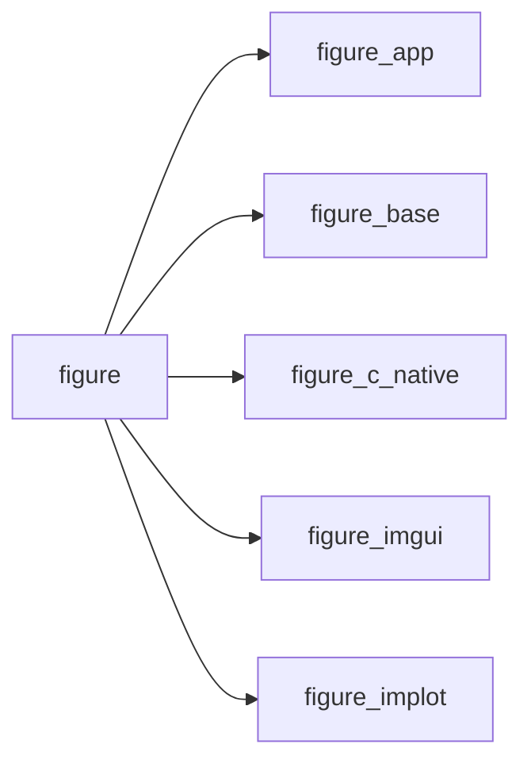

# figure

> FIGURE, Fortran Immediate-mode GUI for User interfaces, Rendering and Exploration.

 Umbrella module: `use figure` gives the application loop (figure_app), the Dear ImGui widgets (figure_imgui) and
 the ImPlot plots (figure_implot).

**Source**: `src/lib/figure.F90`

**Dependencies**

