# figure_app

> figure_app, the application: window, frame loop and lazy redraw.

 The whole life of a FIGURE program is one loop:

```fortran
 call app%init('My tool', 1280, 720)
 do while (app%next_frame())
    ! declare the UI: widgets return what happened this frame
 enddo
 call app%destroy()
```

 `next_frame` renders the previous frame, then waits for input and opens the next one (lazy redraw: once the UI
 settles it sleeps until input or `max_wait`, so an idle window costs a fraction of a percent of one core); it
 returns `.false.` when the user closes the window. There are no widget objects, handles or callbacks: the state is
 the application's own variables.

**Source**: `src/lib/figure_app.F90`

**Dependencies**

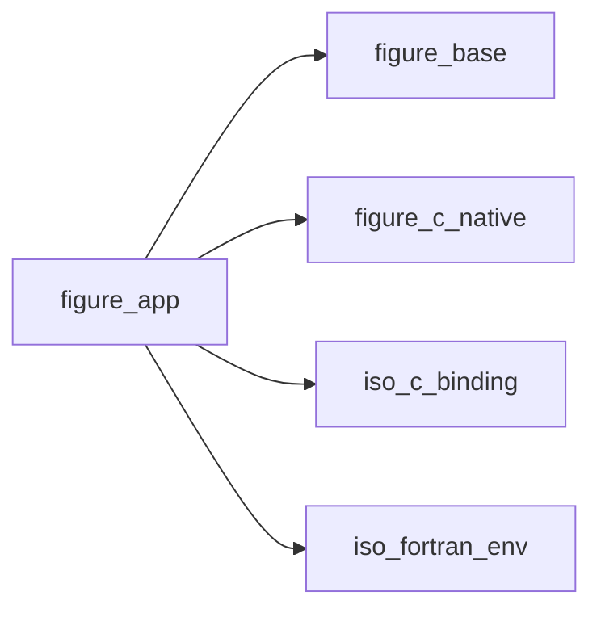

## Contents

- [app_object](#app-object)
- [init](#init)
- [init_headless](#init-headless)
- [init_remote](#init-remote)
- [set_lazy](#set-lazy)
- [set_style](#set-style)
- [set_font](#set-font)
- [load_style](#load-style)
- [save_style](#save-style)
- [set_docking](#set-docking)
- [request_frames](#request-frames)
- [set_confirm_quit](#set-confirm-quit)
- [quit](#quit)
- [set_title](#set-title)
- [open_file_dialog](#open-file-dialog)
- [save_file_dialog](#save-file-dialog)
- [open_folder_dialog](#open-folder-dialog)
- [file_dialog_result](#file-dialog-result)
- [save_image](#save-image)
- [image_result](#image-result)
- [save_layout](#save-layout)
- [load_layout](#load-layout)
- [destroy](#destroy)
- [show_file_dialog](#show-file-dialog)
- [next_frame](#next-frame)
- [quit_requested](#quit-requested)
- [title](#title)
- [content_scale](#content-scale)

## Derived Types

### app_object

A FIGURE application (one per program).

 The native layer owns the lifecycle state (initialized, frame open) and rejects out-of-order calls with
 `FIG_ERR_STATE`; only `in_frame` is mirrored here, because `next_frame` must know whether to close a frame.

#### Components

| Name | Type | Attributes | Description |
|------|------|------------|-------------|
| `in_frame` | logical |  | A frame is open. |

#### Type-Bound Procedures

| Name | Attributes | Description |
|------|------------|-------------|
| `init` | pass(self) | Open the window. |
| `init_headless` | pass(self) | Contexts only, no window (tests). |
| `init_remote` | pass(self) | The UI in a web browser (no window, display or GPU). |
| `next_frame` | pass(self) | Close the current frame, open the next; false on quit. |
| `set_lazy` | pass(self) | Lazy redraw on/off, longest sleep. |
| `set_style` | pass(self) | Colours of the interface, the plots and the background. |
| `set_docking` | pass(self) | Docking on (the default) or off. |
| `set_font` | pass(self) | The default font and its size. |
| `load_style` | pass(self) | A theme file. |
| `save_style` | pass(self) | The style in effect, as a theme file. |
| `request_frames` | pass(self) | Redraw without waiting for input. |
| `set_confirm_quit` | pass(self) | Report a quit request instead of quitting. |
| `quit_requested` | pass(self) | The user asked to quit (once per request). |
| `quit` | pass(self) | End the loop at the next frame. |
| `set_title` | pass(self) | The window's title, after init. |
| `title` | pass(self) | The window's title. |
| `open_file_dialog` | pass(self) | The system's dialog to choose a file to open. |
| `save_file_dialog` | pass(self) | The system's dialog to choose where to save. |
| `open_folder_dialog` | pass(self) | The system's dialog to choose a folder. |
| `file_dialog_result` | pass(self) | The answer to a dialog, once given. |
| `save_image` | pass(self) | A rectangle of the window as a PNG file, after this frame. |
| `image_result` | pass(self) | The outcome of save_image, once. |
| `save_layout` | pass(self) | The arrangement of the windows (docking included) to a file. |
| `load_layout` | pass(self) | An arrangement from a file, applied before the next frame. |
| `content_scale` | pass(self) | Display content scale. |
| `destroy` | pass(self) | Close everything. |

## Subroutines

### init

Open the window (`width` x `height` logical pixels) and create the ImGui/ImPlot contexts.

 Window positions and sizes are not saved by default: with `ini_file`, Dear ImGui keeps them in that file, read
 at the first frame and written while the program runs (its `imgui.ini`).

```fortran
subroutine init(self, title, width, height, vsync, stat, ini_file)
```

**Arguments**

| Name | Type | Intent | Attributes | Description |
|------|------|--------|------------|-------------|
| `self` | class([app_object](/api/src/lib/figure_app#app-object)) | inout |  | Application. |
| `title` | character(len=*) | in |  | Window title. |
| `width` | integer(kind=int32) | in |  | Width [logical pixels]. |
| `height` | integer(kind=int32) | in |  | Height [logical pixels]. |
| `vsync` | logical | in | optional | Synchronize with the display (default true). |
| `stat` | integer(kind=int32) | out | optional | Status. |
| `ini_file` | character(len=*) | in | optional | File keeping the window layout (default: none). |

**Call graph**

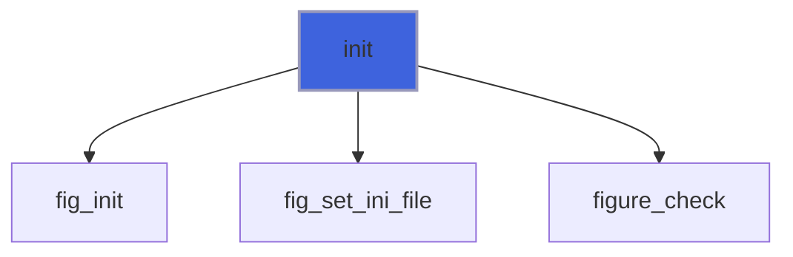

### init_headless

Create the contexts on a virtual `width` x `height` display, without window or GPU.

```fortran
subroutine init_headless(self, width, height, stat)
```

**Arguments**

| Name | Type | Intent | Attributes | Description |
|------|------|--------|------------|-------------|
| `self` | class([app_object](/api/src/lib/figure_app#app-object)) | inout |  | Application. |
| `width` | integer(kind=int32) | in |  | Width [pixels]. |
| `height` | integer(kind=int32) | in |  | Height [pixels]. |
| `stat` | integer(kind=int32) | out | optional | Status. |

**Call graph**

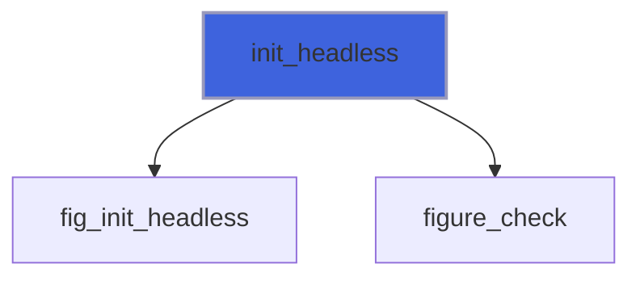

### init_remote

Create the contexts and serve the UI to a web browser on `http://host:port/` instead of opening a window: the
 program needs no display or GPU (a cluster node will do). One browser at a time, which can come and go while the
 program runs. The page and its connection need an access token in the address (`http://localhost:8080/?token=...`,
 printed at start, returned in `url`): 32 random hex digits, or `token` (`token=''` disables it: anyone who reaches
 the port then controls the program). Keep the default host (127.0.0.1) and reach a remote machine through an SSH
 tunnel (`ssh -L 8080:localhost:8080 node`).

 A browser has no vsync to pace the program, so frames are capped at `max_fps` per second (default 60), and a
 frame is sent only once the previous one has left: with a slow client the newest frame goes, the ones in between
 are skipped. A frame equal to the last one sent is not sent again. Vertices travel in 12 bytes instead of 20, and
 `compress` deflates frames and textures: `'auto'` (default) while the client is the bottleneck (frames are being
 skipped), `'always'`, or `'never'`; deflate costs about 7 ms of CPU per MB and shrinks frames 2.5 to 3.5 times.

```fortran
subroutine init_remote(self, port, host, width, height, port_used, quiet, max_fps, compress, token, url, stat)
```

**Arguments**

| Name | Type | Intent | Attributes | Description |
|------|------|--------|------------|-------------|
| `self` | class([app_object](/api/src/lib/figure_app#app-object)) | inout |  | Application. |
| `port` | integer(kind=int32) | in | optional | Port (default 8080; 0: any free port). |
| `host` | character(len=*) | in | optional | Address to listen on (default 127.0.0.1). |
| `width` | integer(kind=int32) | in | optional | Display width until the browser's [pixels] (default 1280). |
| `height` | integer(kind=int32) | in | optional | Display height until the browser's [pixels] (default 800). |
| `port_used` | integer(kind=int32) | out | optional | The port listened on (useful with port 0). |
| `quiet` | logical | in | optional | Do not print the address to open (default false). |
| `max_fps` | real(kind=real64) | in | optional | Most frames per second (default 60; 0: no cap). |
| `compress` | character(len=*) | in | optional | Deflate frames and textures: 'auto', 'always', 'never'. |
| `token` | character(len=*) | in | optional | Access token (default: random; '': none). |
| `url` | character(len=*) | out | optional | The address to open, with the token (blank-padded). |
| `stat` | integer(kind=int32) | out | optional | Status. |

**Call graph**

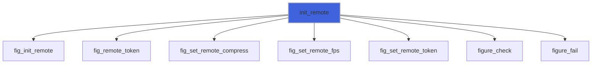

### set_lazy

Lazy redraw (default on): once the UI settles, sleep until input or `max_wait` seconds (default 0.5).

```fortran
subroutine set_lazy(self, enabled, max_wait)
```

**Arguments**

| Name | Type | Intent | Attributes | Description |
|------|------|--------|------------|-------------|
| `self` | class([app_object](/api/src/lib/figure_app#app-object)) | inout |  | Application. |
| `enabled` | logical | in |  | Lazy redraw on. |
| `max_wait` | real(kind=real64) | in | optional | Longest sleep [s]: the refresh period of live data. |

**Call graph**

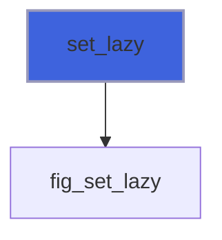

### set_style

Colours of the interface, the plots and the window background, by name, after `init*`:

 - `'seal'` (the default), `'seal-light'`: FIGURE's, from its mark: ink (or paper) and one vermilion, spent on
   what the user touches and on the first plotted line; square corners;
 - `'paper'`: for publication, black on white, thin borders, line colours that survive greyscale printing;
 - `'high-contrast'`: white on black with yellow accents, text at 7:1 or more (WCAG AAA);
 - `'dark'`, `'light'`, `'classic'`: Dear ImGui's own styles, with ImPlot's default line colours.

 `lines='okabe-ito'` replaces the style's line colours with Okabe and Ito's colour-blind-safe set. Each style is
 a theme file (`themes/<name>.toml`, embedded). The environment variable `FIGURE_STYLE` picks the style at
 initialisation; this call overrides it. The font and its size are kept; every other colour and variable comes from
 the style (base and theme file), so changes made by name are reset.

```fortran
subroutine set_style(self, name, lines, stat)
```

**Arguments**

| Name | Type | Intent | Attributes | Description |
|------|------|--------|------------|-------------|
| `self` | class([app_object](/api/src/lib/figure_app#app-object)) | inout |  | Application. |
| `name` | character(len=*) | in |  | Style name. |
| `lines` | character(len=*) | in | optional | Line palette: `'okabe-ito'` (default: the style's own). |
| `stat` | integer(kind=int32) | out | optional |  |

**Call graph**

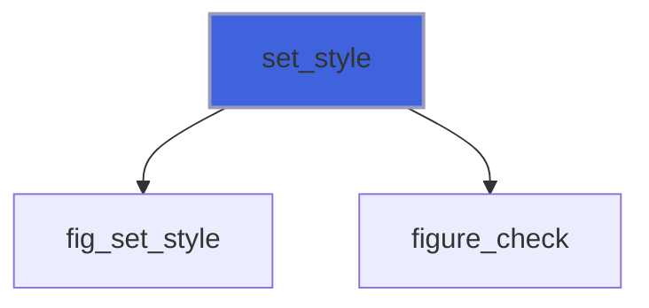

### set_font

The default font of the interface, after `init*`: `'plex-sans'` (IBM Plex Sans, bundled: the default, at 15
 logical pixels), `'proggy'` (Dear ImGui's own 13-pixel bitmap font), or the path of a TrueType/OpenType file;
 `size` in logical pixels (multiplied by the display's content scale), kept if absent.

```fortran
subroutine set_font(self, font, size, stat)
```

**Arguments**

| Name | Type | Intent | Attributes | Description |
|------|------|--------|------------|-------------|
| `self` | class([app_object](/api/src/lib/figure_app#app-object)) | inout |  | Application. |
| `font` | character(len=*) | in |  | Font. |
| `size` | real(kind=real64) | in | optional | Size [logical pixels], in (0, 200]. |
| `stat` | integer(kind=int32) | out | optional | `FIG_ERR_ARGUMENT` if it is not a font or the size is wrong. |

**Call graph**

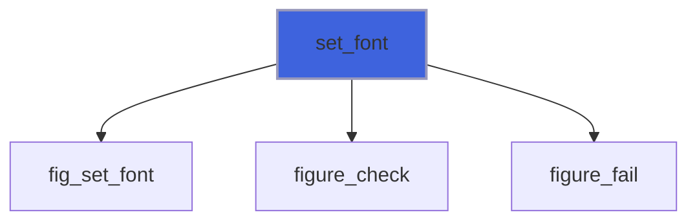

### load_style

Apply a theme file (the format of the files in `themes/`: docs, Styles, Theme files), after `init*`. Sizes in the
 file are logical pixels; what the file does not set comes from its `base`.

```fortran
subroutine load_style(self, file, stat)
```

**Arguments**

| Name | Type | Intent | Attributes | Description |
|------|------|--------|------------|-------------|
| `self` | class([app_object](/api/src/lib/figure_app#app-object)) | inout |  | Application. |
| `file` | character(len=*) | in |  | Theme file. |
| `stat` | integer(kind=int32) | out | optional | malformed (the message gives the line). |

**Call graph**

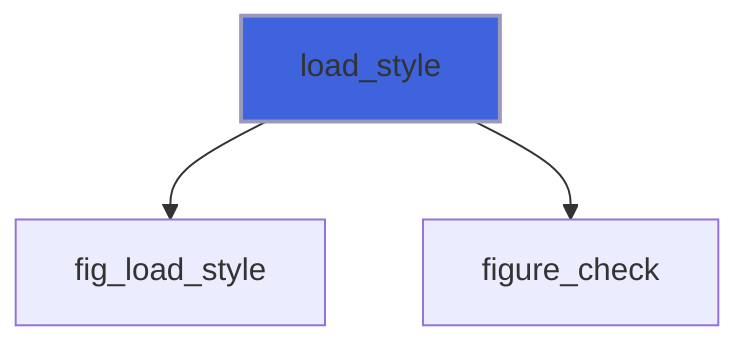

### save_style

Write the style in effect as a theme file: its base, background, line colours, and every colour and variable
 that differs from the base (sizes in logical pixels; colours as 8-bit hex, alphas exact). Changes made by name
 or in the style editor (`ig_show_style_editor`) are kept; `load_style` reads the file back.

```fortran
subroutine save_style(self, file, stat)
```

**Arguments**

| Name | Type | Intent | Attributes | Description |
|------|------|--------|------------|-------------|
| `self` | class([app_object](/api/src/lib/figure_app#app-object)) | inout |  | Application. |
| `file` | character(len=*) | in |  | Theme file to write. |
| `stat` | integer(kind=int32) | out | optional |  |

**Call graph**

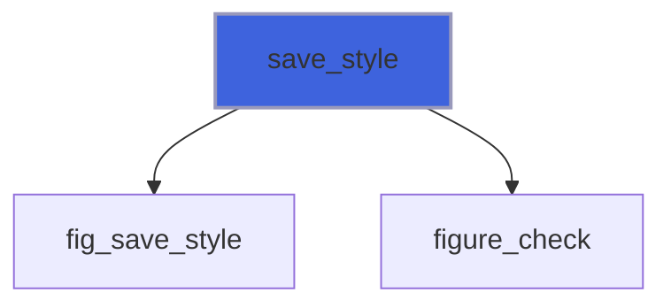

### set_docking

Docking on (the default since `init*`) or off: with docking on, a window dragged by its title bar docks into
 another window or into a dock space (`ig_dock_space`). After `init*`.

```fortran
subroutine set_docking(self, enabled, stat)
```

**Arguments**

| Name | Type | Intent | Attributes | Description |
|------|------|--------|------------|-------------|
| `self` | class([app_object](/api/src/lib/figure_app#app-object)) | inout |  | Application. |
| `enabled` | logical | in |  | Docking on. |
| `stat` | integer(kind=int32) | out | optional |  |

**Call graph**

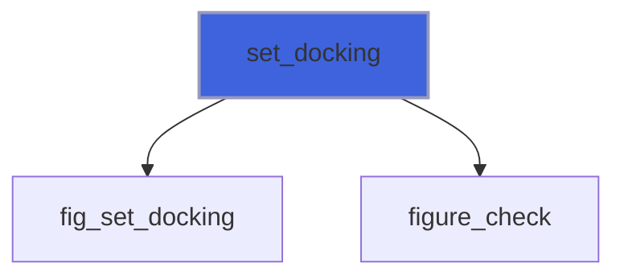

### request_frames

Draw at least `n` more frames without waiting for input (e.g. after new data arrived).

```fortran
subroutine request_frames(self, n)
```

**Arguments**

| Name | Type | Intent | Attributes | Description |
|------|------|--------|------------|-------------|
| `self` | class([app_object](/api/src/lib/figure_app#app-object)) | inout |  | Application. |
| `n` | integer(kind=int32) | in |  | Frames. |

**Call graph**

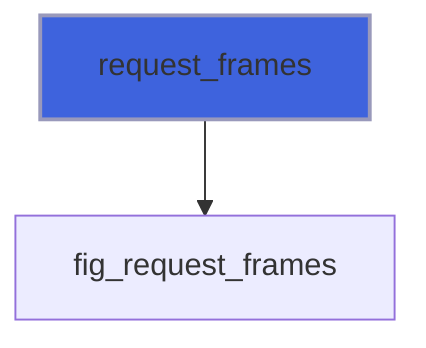

### set_confirm_quit

With `enabled`, the window's close button (and the system's quit) no longer ends `next_frame`: the request is
 reported by `quit_requested`, and the program quits with `quit` (after asking to save, for example).

```fortran
subroutine set_confirm_quit(self, enabled)
```

**Arguments**

| Name | Type | Intent | Attributes | Description |
|------|------|--------|------------|-------------|
| `self` | class([app_object](/api/src/lib/figure_app#app-object)) | inout |  | Application. |
| `enabled` | logical | in |  | Ask first. |

**Call graph**

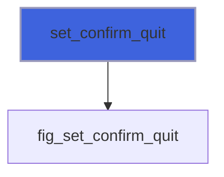

### quit

End the loop: the next `next_frame` returns `.false.` (in every mode).

```fortran
subroutine quit(self)
```

**Arguments**

| Name | Type | Intent | Attributes | Description |
|------|------|--------|------------|-------------|
| `self` | class([app_object](/api/src/lib/figure_app#app-object)) | inout |  | Application. |

**Call graph**

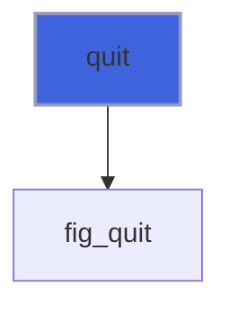

### set_title

The window's title, after `init`: the document being edited and a mark when it has changes, for example. Shown in
 window mode; in remote and headless modes it is kept (read back by `title`) and nothing shows it.

```fortran
subroutine set_title(self, text, stat)
```

**Arguments**

| Name | Type | Intent | Attributes | Description |
|------|------|--------|------------|-------------|
| `self` | class([app_object](/api/src/lib/figure_app#app-object)) | inout |  | Application. |
| `text` | character(len=*) | in |  | Title. |
| `stat` | integer(kind=int32) | out | optional | Status. |

**Call graph**

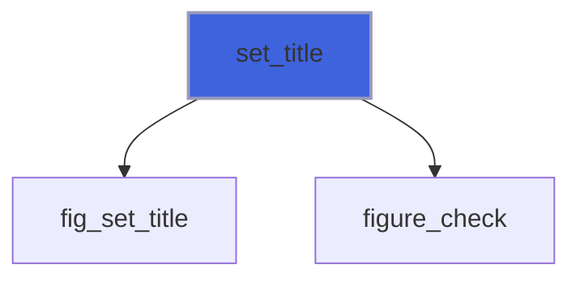

### open_file_dialog

Show the system's dialog to choose a file to open. It does not block: the interface keeps drawing, and the answer
 is read with `file_dialog_result(id, ...)` on the following frames. `filters`: entries `'name|pattern'`, the
 pattern being extensions separated by `;` (`'Input files|input;inp'`, `'All files|*'`). Window mode only:
 `FIG_ERR_STATE` in remote and headless modes (ask for the path in a text field there).

```fortran
subroutine open_file_dialog(self, id, filters, default_path, stat)
```

**Arguments**

| Name | Type | Intent | Attributes | Description |
|------|------|--------|------------|-------------|
| `self` | class([app_object](/api/src/lib/figure_app#app-object)) | inout |  | Application. |
| `id` | character(len=*) | in |  | Dialog id (any text, used to read the answer). |
| `filters` | character(len=*) | in | optional | File type filters. |
| `default_path` | character(len=*) | in | optional | Folder or file to start from (relative: to the |
| `stat` | integer(kind=int32) | out | optional | Status. |

**Call graph**

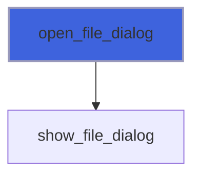

### save_file_dialog

Show the system's dialog to choose where to save (a new or an existing file); as `open_file_dialog`.

```fortran
subroutine save_file_dialog(self, id, filters, default_path, stat)
```

**Arguments**

| Name | Type | Intent | Attributes | Description |
|------|------|--------|------------|-------------|
| `self` | class([app_object](/api/src/lib/figure_app#app-object)) | inout |  | Application. |
| `id` | character(len=*) | in |  | Dialog id. |
| `filters` | character(len=*) | in | optional | File type filters. |
| `default_path` | character(len=*) | in | optional | Folder or file to start from (relative: to the |
| `stat` | integer(kind=int32) | out | optional | Status. |

**Call graph**

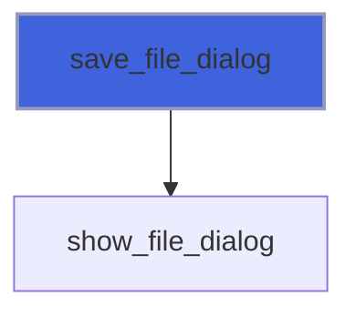

### open_folder_dialog

Show the system's dialog to choose a folder; as `open_file_dialog`.

```fortran
subroutine open_folder_dialog(self, id, default_path, stat)
```

**Arguments**

| Name | Type | Intent | Attributes | Description |
|------|------|--------|------------|-------------|
| `self` | class([app_object](/api/src/lib/figure_app#app-object)) | inout |  | Application. |
| `id` | character(len=*) | in |  | Dialog id. |
| `default_path` | character(len=*) | in | optional | Folder to start from (relative: to the working |
| `stat` | integer(kind=int32) | out | optional | Status. |

**Call graph**

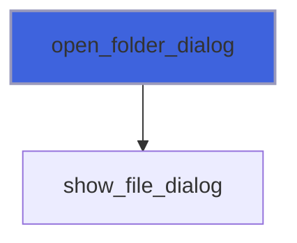

### file_dialog_result

The answer to the dialog `id`: `done` false while it is open; once answered, `done` true and either `path` (the
 file or folder chosen) or `cancelled` true. The answer is given once; then the id is free again, and until the
 next dialog `done` is false: poll it every frame. A dialog that failed (Linux without a portal or zenity) gives
 `done` true and `FIG_ERR_FAILED` with the reason.

```fortran
subroutine file_dialog_result(self, id, path, done, cancelled, stat)
```

**Arguments**

| Name | Type | Intent | Attributes | Description |
|------|------|--------|------------|-------------|
| `self` | class([app_object](/api/src/lib/figure_app#app-object)) | inout |  | Application. |
| `id` | character(len=*) | in |  | Dialog id. |
| `path` | character(len=:) | out | allocatable | Chosen path ('' while open or if cancelled). |
| `done` | logical | out |  | The dialog was answered. |
| `cancelled` | logical | out | optional | The user cancelled it. |
| `stat` | integer(kind=int32) | out | optional | Status. |

**Call graph**

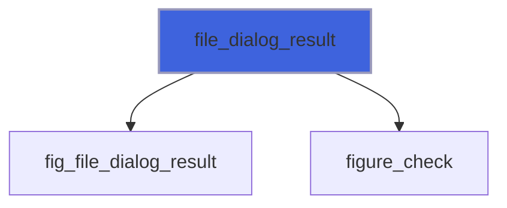

### save_image

Write the rectangle (xmin, ymin)-(xmax, ymax) of the window [logical pixels, as `ig_item_rect` and
 `test_window_rect` give them] as a PNG file, at the screen's resolution, when the current frame is rendered.
 Ask for it outside the frame in which a menu or popup covers the rectangle (they would be in the picture).
 The outcome comes once, from `image_result`. Window mode only: in remote and headless modes there are no
 pixels on the program's side, `FIG_ERR_STATE`; an empty rectangle or file name, `FIG_ERR_ARGUMENT`.

```fortran
subroutine save_image(self, path, xmin, ymin, xmax, ymax, stat)
```

**Arguments**

| Name | Type | Intent | Attributes | Description |
|------|------|--------|------------|-------------|
| `self` | class([app_object](/api/src/lib/figure_app#app-object)) | inout |  | Application. |
| `path` | character(len=*) | in |  | PNG file. |
| `xmin` | real(kind=real64) | in |  | Left. |
| `ymin` | real(kind=real64) | in |  | Top. |
| `xmax` | real(kind=real64) | in |  | Right. |
| `ymax` | real(kind=real64) | in |  | Bottom. |
| `stat` | integer(kind=int32) | out | optional | Status. |

**Call graph**

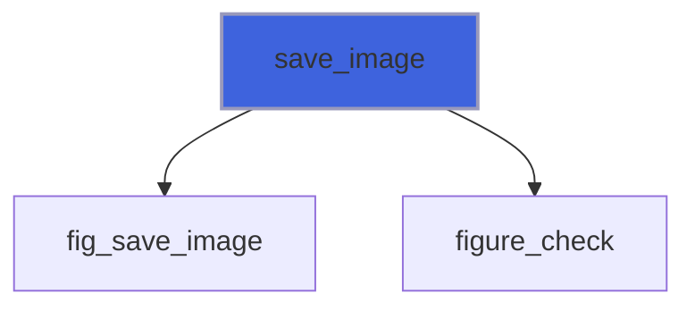

### image_result

The outcome of `save_image`, once, after the frame that wrote it: `done` true and the file `path`, or
 `FIG_ERR_FAILED` with the reason (the file cannot be written). `done` false before and after: poll it every frame.

```fortran
subroutine image_result(self, path, done, stat)
```

**Arguments**

| Name | Type | Intent | Attributes | Description |
|------|------|--------|------------|-------------|
| `self` | class([app_object](/api/src/lib/figure_app#app-object)) | inout |  | Application. |
| `path` | character(len=:) | out | allocatable | The file ('' until done). |
| `done` | logical | out |  | Written, or failed. |
| `stat` | integer(kind=int32) | out | optional | Status. |

**Call graph**

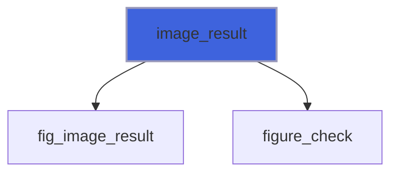

### save_layout

Write the layout to `path`: the windows' positions, sizes and docking (the dock nodes and which window is in
 which), the tables' columns: Dear ImGui's settings, as its ini text, for every window shown in this session and
 those read before. `comment` (lines separated by `new_line('a')`) is written first, each line led by '; ', which
 `load_layout` skips: the program's own state (the windows it opens on demand, say) for itself to read back.
 Any mode. `FIG_ERR_FAILED` if the file cannot be written.

```fortran
subroutine save_layout(self, path, comment, stat)
```

**Arguments**

| Name | Type | Intent | Attributes | Description |
|------|------|--------|------------|-------------|
| `self` | class([app_object](/api/src/lib/figure_app#app-object)) | inout |  | Application. |
| `path` | character(len=*) | in |  | File. |
| `comment` | character(len=*) | in | optional | Lines to keep with it. |
| `stat` | integer(kind=int32) | out | optional | Status. |

**Call graph**

```mermaid
flowchart TD
  save_layout["save_layout"] --> fig_save_layout["fig_save_layout"]
  save_layout["save_layout"] --> figure_check["figure_check"]
  style save_layout fill:#3e63dd,stroke:#99b,stroke-width:2px
```

### load_layout

Read a layout written by `save_layout` (or an ini file of Dear ImGui), applied before the next frame: the
 settings in effect are cleared, the file's are read, the dock nodes are rebuilt and the windows that exist take
 their saved position, size and dock; the others take theirs when they appear. A program that lays out its dock
 space with `ig_dock_layout_begin` should not lay it out again: the dock space has a layout again (the same id as
 when saved). `FIG_ERR_FAILED` if the file cannot be read, `FIG_ERR_ARGUMENT` if it holds no layout.

```fortran
subroutine load_layout(self, path, stat)
```

**Arguments**

| Name | Type | Intent | Attributes | Description |
|------|------|--------|------------|-------------|
| `self` | class([app_object](/api/src/lib/figure_app#app-object)) | inout |  | Application. |
| `path` | character(len=*) | in |  | File. |
| `stat` | integer(kind=int32) | out | optional | Status. |

**Call graph**

```mermaid
flowchart TD
  load_layout["load_layout"] --> fig_load_layout["fig_load_layout"]
  load_layout["load_layout"] --> figure_check["figure_check"]
  style load_layout fill:#3e63dd,stroke:#99b,stroke-width:2px
```

### destroy

Close the window and destroy the contexts (safe in any state).

```fortran
subroutine destroy(self)
```

**Arguments**

| Name | Type | Intent | Attributes | Description |
|------|------|--------|------------|-------------|
| `self` | class([app_object](/api/src/lib/figure_app#app-object)) | inout |  | Application. |

**Call graph**

```mermaid
flowchart TD
  init["init"] --> destroy["destroy"]
  destroy["destroy"] --> fig_shutdown["fig_shutdown"]
  style destroy fill:#3e63dd,stroke:#99b,stroke-width:2px
```

### show_file_dialog

Open a native file dialog of `kind` (0 open, 1 save, 2 folder).

```fortran
subroutine show_file_dialog(kind, id, filters, default_path, stat)
```

**Arguments**

| Name | Type | Intent | Attributes | Description |
|------|------|--------|------------|-------------|
| `kind` | integer(kind=c_int) | in |  | Kind. |
| `id` | character(len=*) | in |  | Dialog id. |
| `filters` | character(len=*) | in | optional | 'name\|pattern' entries. |
| `default_path` | character(len=*) | in | optional | Where to start. |
| `stat` | integer(kind=int32) | out | optional | Status. |

**Call graph**

```mermaid
flowchart TD
  open_file_dialog["open_file_dialog"] --> show_file_dialog["show_file_dialog"]
  open_folder_dialog["open_folder_dialog"] --> show_file_dialog["show_file_dialog"]
  save_file_dialog["save_file_dialog"] --> show_file_dialog["show_file_dialog"]
  show_file_dialog["show_file_dialog"] --> fig_file_dialog["fig_file_dialog"]
  show_file_dialog["show_file_dialog"] --> figure_check["figure_check"]
  style show_file_dialog fill:#3e63dd,stroke:#99b,stroke-width:2px
```

## Functions

### next_frame

Render the open frame (if any), then process input and open the next; `.false.` when the user quits.

**Returns**: `logical`

```fortran
function next_frame(self, stat) result(running)
```

**Arguments**

| Name | Type | Intent | Attributes | Description |
|------|------|--------|------------|-------------|
| `self` | class([app_object](/api/src/lib/figure_app#app-object)) | inout |  | Application. |
| `stat` | integer(kind=int32) | out | optional | Status. |

**Call graph**

```mermaid
flowchart TD
  next_frame["next_frame"] --> fig_begin_frame["fig_begin_frame"]
  next_frame["next_frame"] --> fig_end_frame["fig_end_frame"]
  next_frame["next_frame"] --> figure_check["figure_check"]
  style next_frame fill:#3e63dd,stroke:#99b,stroke-width:2px
```

### quit_requested

The user asked to quit (the window's close button) since the last call: true once per request. Only with
 `set_confirm_quit(.true.)`; otherwise the request ends `next_frame` at once.

**Returns**: `logical`

```fortran
function quit_requested(self) result(requested)
```

**Arguments**

| Name | Type | Intent | Attributes | Description |
|------|------|--------|------------|-------------|
| `self` | class([app_object](/api/src/lib/figure_app#app-object)) | inout |  | Application. |

**Call graph**

```mermaid
flowchart TD
  quit_requested["quit_requested"] --> fig_quit_requested["fig_quit_requested"]
  style quit_requested fill:#3e63dd,stroke:#99b,stroke-width:2px
```

### title

The window's title: the one given to `init` or the last `set_title` ('' before `init`, and in headless and remote
 modes until `set_title`).

**Returns**: `character(len=:)`

```fortran
function title(self) result(text)
```

**Arguments**

| Name | Type | Intent | Attributes | Description |
|------|------|--------|------------|-------------|
| `self` | class([app_object](/api/src/lib/figure_app#app-object)) | in |  | Application. |

**Call graph**

```mermaid
flowchart TD
  title["title"] --> fig_title["fig_title"]
  style title fill:#3e63dd,stroke:#99b,stroke-width:2px
```

### content_scale

Display content scale (1 standard, 2 on most high-DPI displays).

**Returns**: `real(kind=real64)`

```fortran
function content_scale(self) result(scale)
```

**Arguments**

| Name | Type | Intent | Attributes | Description |
|------|------|--------|------------|-------------|
| `self` | class([app_object](/api/src/lib/figure_app#app-object)) | in |  | Application. |

**Call graph**

```mermaid
flowchart TD
  content_scale["content_scale"] --> fig_content_scale["fig_content_scale"]
  style content_scale fill:#3e63dd,stroke:#99b,stroke-width:2px
```
