# figure_app

> figure_app, the application: window, frame loop and lazy redraw.

 The whole life of a FIGURE program is one loop:

```fortran
 call app%init('My tool', 1280, 720)
 do while (app%next_frame())
    ! declare the UI: widgets return what happened this frame
 enddo
 call app%destroy()
```

 `next_frame` renders the previous frame, then waits for input and opens the next one (lazy redraw: once the UI
 settles it sleeps until input or `max_wait`, so an idle window costs a fraction of a percent of one core); it
 returns `.false.` when the user closes the window. There are no widget objects, handles or callbacks: the state is
 the application's own variables.

**Source**: `src/lib/figure_app.F90`

**Dependencies**

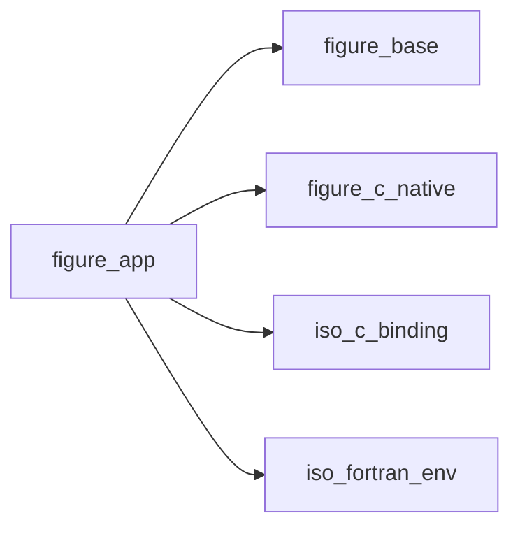

## Contents

- [app_object](#app-object)
- [init](#init)
- [init_headless](#init-headless)
- [init_remote](#init-remote)
- [set_lazy](#set-lazy)
- [set_style](#set-style)
- [set_font](#set-font)
- [load_style](#load-style)
- [save_style](#save-style)
- [set_docking](#set-docking)
- [request_frames](#request-frames)
- [destroy](#destroy)
- [next_frame](#next-frame)
- [content_scale](#content-scale)

## Derived Types

### app_object

A FIGURE application (one per program).

 The native layer owns the lifecycle state (initialized, frame open) and rejects out-of-order calls with
 `FIG_ERR_STATE`; only `in_frame` is mirrored here, because `next_frame` must know whether to close a frame.

#### Components

| Name | Type | Attributes | Description |
|------|------|------------|-------------|
| `in_frame` | logical |  | A frame is open. |

#### Type-Bound Procedures

| Name | Attributes | Description |
|------|------------|-------------|
| `init` | pass(self) | Open the window. |
| `init_headless` | pass(self) | Contexts only, no window (tests). |
| `init_remote` | pass(self) | The UI in a web browser (no window, display or GPU). |
| `next_frame` | pass(self) | Close the current frame, open the next; false on quit. |
| `set_lazy` | pass(self) | Lazy redraw on/off, longest sleep. |
| `set_style` | pass(self) | Colours of the interface, the plots and the background. |
| `set_docking` | pass(self) | Docking on (the default) or off. |
| `set_font` | pass(self) | The default font and its size. |
| `load_style` | pass(self) | A theme file. |
| `save_style` | pass(self) | The style in effect, as a theme file. |
| `request_frames` | pass(self) | Redraw without waiting for input. |
| `content_scale` | pass(self) | Display content scale. |
| `destroy` | pass(self) | Close everything. |

## Subroutines

### init

Open the window (`width` x `height` logical pixels) and create the ImGui/ImPlot contexts.

 Window positions and sizes are not saved by default: with `ini_file`, Dear ImGui keeps them in that file, read
 at the first frame and written while the program runs (its `imgui.ini`).

```fortran
subroutine init(self, title, width, height, vsync, stat, ini_file)
```

**Arguments**

| Name | Type | Intent | Attributes | Description |
|------|------|--------|------------|-------------|
| `self` | class([app_object](/api/src/lib/figure_app#app-object)) | inout |  | Application. |
| `title` | character(len=*) | in |  | Window title. |
| `width` | integer(kind=int32) | in |  | Width [logical pixels]. |
| `height` | integer(kind=int32) | in |  | Height [logical pixels]. |
| `vsync` | logical | in | optional | Synchronize with the display (default true). |
| `stat` | integer(kind=int32) | out | optional | Status. |
| `ini_file` | character(len=*) | in | optional | File keeping the window layout (default: none). |

**Call graph**

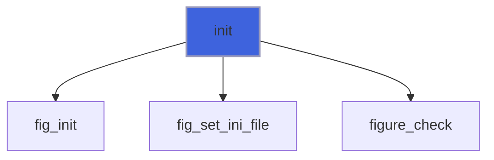

### init_headless

Create the contexts on a virtual `width` x `height` display, without window or GPU.

```fortran
subroutine init_headless(self, width, height, stat)
```

**Arguments**

| Name | Type | Intent | Attributes | Description |
|------|------|--------|------------|-------------|
| `self` | class([app_object](/api/src/lib/figure_app#app-object)) | inout |  | Application. |
| `width` | integer(kind=int32) | in |  | Width [pixels]. |
| `height` | integer(kind=int32) | in |  | Height [pixels]. |
| `stat` | integer(kind=int32) | out | optional | Status. |

**Call graph**

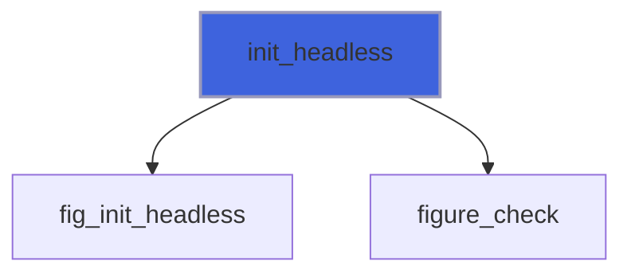

### init_remote

Create the contexts and serve the UI to a web browser on `http://host:port/` instead of opening a window: the
 program needs no display or GPU (a cluster node will do). One browser at a time, which can come and go while the
 program runs. The page and its connection need an access token in the address (`http://localhost:8080/?token=...`,
 printed at start, returned in `url`): 32 random hex digits, or `token` (`token=''` disables it: anyone who reaches
 the port then controls the program). Keep the default host (127.0.0.1) and reach a remote machine through an SSH
 tunnel (`ssh -L 8080:localhost:8080 node`).

 A browser has no vsync to pace the program, so frames are capped at `max_fps` per second (default 60), and a
 frame is sent only once the previous one has left: with a slow client the newest frame goes, the ones in between
 are skipped. A frame equal to the last one sent is not sent again. Vertices travel in 12 bytes instead of 20, and
 `compress` deflates frames and textures: `'auto'` (default) while the client is the bottleneck (frames are being
 skipped), `'always'`, or `'never'`; deflate costs about 7 ms of CPU per MB and saves 2.5 to 4 times.

```fortran
subroutine init_remote(self, port, host, width, height, port_used, quiet, max_fps, compress, token, url, stat)
```

**Arguments**

| Name | Type | Intent | Attributes | Description |
|------|------|--------|------------|-------------|
| `self` | class([app_object](/api/src/lib/figure_app#app-object)) | inout |  | Application. |
| `port` | integer(kind=int32) | in | optional | Port (default 8080; 0: any free port). |
| `host` | character(len=*) | in | optional | Address to listen on (default 127.0.0.1). |
| `width` | integer(kind=int32) | in | optional | Display width until the browser's [pixels] (default 1280). |
| `height` | integer(kind=int32) | in | optional | Display height until the browser's [pixels] (default 800). |
| `port_used` | integer(kind=int32) | out | optional | The port listened on (useful with port 0). |
| `quiet` | logical | in | optional | Do not print the address to open (default false). |
| `max_fps` | real(kind=real64) | in | optional | Most frames per second (default 60; 0: no cap). |
| `compress` | character(len=*) | in | optional | Deflate frames and textures: 'auto', 'always', 'never'. |
| `token` | character(len=*) | in | optional | Access token (default: random; '': none). |
| `url` | character(len=*) | out | optional | The address to open, with the token (blank-padded). |
| `stat` | integer(kind=int32) | out | optional | Status. |

**Call graph**

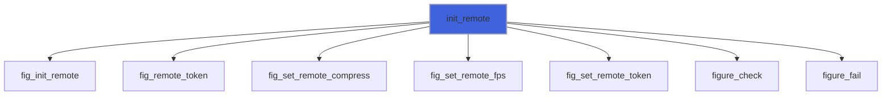

### set_lazy

Lazy redraw (default on): once the UI settles, sleep until input or `max_wait` seconds (default 0.5).

```fortran
subroutine set_lazy(self, enabled, max_wait)
```

**Arguments**

| Name | Type | Intent | Attributes | Description |
|------|------|--------|------------|-------------|
| `self` | class([app_object](/api/src/lib/figure_app#app-object)) | inout |  | Application. |
| `enabled` | logical | in |  | Lazy redraw on. |
| `max_wait` | real(kind=real64) | in | optional | Longest sleep [s]: the refresh period of live data. |

**Call graph**

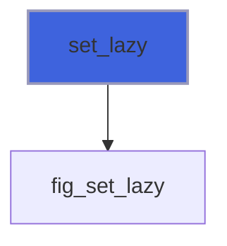

### set_style

Colours of the interface, the plots and the window background, by name, after `init*`:

 - `'seal'` (the default), `'seal-light'`: FIGURE's, from its mark: ink (or paper) and one vermilion, spent on
   what the user touches and on the first plotted line; square corners;
 - `'paper'`: for publication, black on white, thin borders, line colours that survive greyscale printing;
 - `'high-contrast'`: white on black with yellow accents, text at 7:1 or more (WCAG AAA);
 - `'dark'`, `'light'`, `'classic'`: Dear ImGui's own styles, with ImPlot's default line colours.

 `lines='okabe-ito'` replaces the style's line colours with Okabe and Ito's colour-blind-safe set. Each style is
 a theme file (`themes/<name>.toml`, embedded). The environment variable `FIGURE_STYLE` picks the style at
 initialisation; this call overrides it. Sizes and fonts are kept; colours and variables changed by name are reset.

```fortran
subroutine set_style(self, name, lines, stat)
```

**Arguments**

| Name | Type | Intent | Attributes | Description |
|------|------|--------|------------|-------------|
| `self` | class([app_object](/api/src/lib/figure_app#app-object)) | inout |  | Application. |
| `name` | character(len=*) | in |  | Style name. |
| `lines` | character(len=*) | in | optional | Line palette: `'okabe-ito'` (default: the style's own). |
| `stat` | integer(kind=int32) | out | optional |  |

**Call graph**

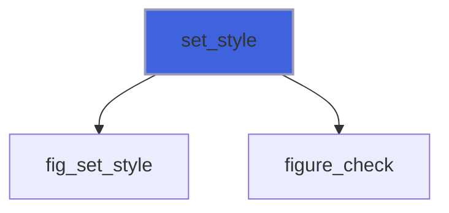

### set_font

The default font of the interface, after `init*`: `'plex-sans'` (IBM Plex Sans, bundled: the default, at 15
 logical pixels), `'proggy'` (Dear ImGui's own 13-pixel bitmap font), or the path of a TrueType/OpenType file;
 `size` in logical pixels (multiplied by the display's content scale), kept if absent.

```fortran
subroutine set_font(self, font, size, stat)
```

**Arguments**

| Name | Type | Intent | Attributes | Description |
|------|------|--------|------------|-------------|
| `self` | class([app_object](/api/src/lib/figure_app#app-object)) | inout |  | Application. |
| `font` | character(len=*) | in |  | Font. |
| `size` | real(kind=real64) | in | optional | Size [logical pixels], in (0, 200]. |
| `stat` | integer(kind=int32) | out | optional | `FIG_ERR_ARGUMENT` if it is not a font or the size is wrong. |

**Call graph**

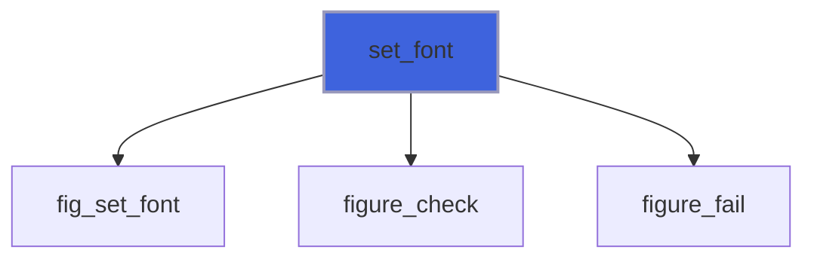

### load_style

Apply a theme file (the format of the files in `themes/`: docs, Styles, Theme files), after `init*`. Sizes in the
 file are logical pixels; what the file does not set comes from its `base`.

```fortran
subroutine load_style(self, file, stat)
```

**Arguments**

| Name | Type | Intent | Attributes | Description |
|------|------|--------|------------|-------------|
| `self` | class([app_object](/api/src/lib/figure_app#app-object)) | inout |  | Application. |
| `file` | character(len=*) | in |  | Theme file. |
| `stat` | integer(kind=int32) | out | optional | malformed (the message gives the line). |

**Call graph**

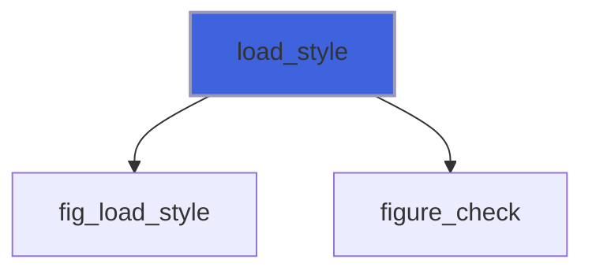

### save_style

Write the style in effect as a theme file: its base, background, line colours, and every colour and variable
 that differs from the base (sizes in logical pixels; colours as 8-bit hex, alphas exact). Changes made by name
 or in the style editor (`ig_show_style_editor`) are kept; `load_style` reads the file back.

```fortran
subroutine save_style(self, file, stat)
```

**Arguments**

| Name | Type | Intent | Attributes | Description |
|------|------|--------|------------|-------------|
| `self` | class([app_object](/api/src/lib/figure_app#app-object)) | inout |  | Application. |
| `file` | character(len=*) | in |  | Theme file to write. |
| `stat` | integer(kind=int32) | out | optional |  |

**Call graph**

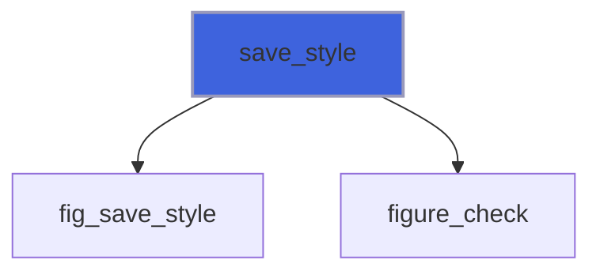

### set_docking

Docking on (the default since `init*`) or off: with docking on, a window dragged by its title bar docks into
 another window or into a dock space (`ig_dock_space`). After `init*`.

```fortran
subroutine set_docking(self, enabled, stat)
```

**Arguments**

| Name | Type | Intent | Attributes | Description |
|------|------|--------|------------|-------------|
| `self` | class([app_object](/api/src/lib/figure_app#app-object)) | inout |  | Application. |
| `enabled` | logical | in |  | Docking on. |
| `stat` | integer(kind=int32) | out | optional |  |

**Call graph**

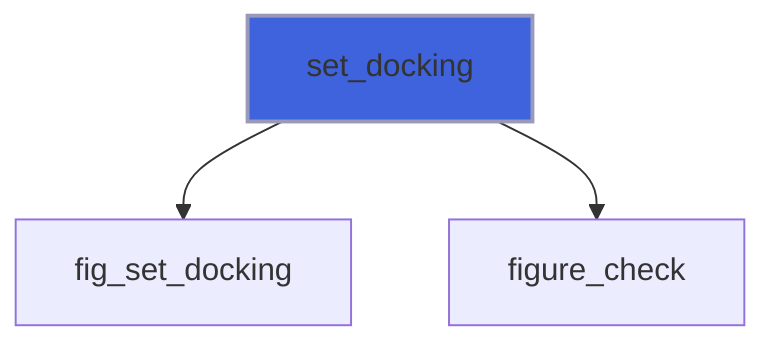

### request_frames

Draw at least `n` more frames without waiting for input (e.g. after new data arrived).

```fortran
subroutine request_frames(self, n)
```

**Arguments**

| Name | Type | Intent | Attributes | Description |
|------|------|--------|------------|-------------|
| `self` | class([app_object](/api/src/lib/figure_app#app-object)) | inout |  | Application. |
| `n` | integer(kind=int32) | in |  | Frames. |

**Call graph**

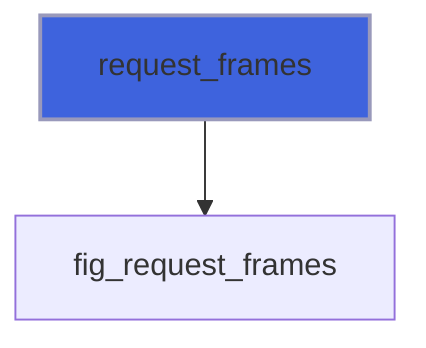

### destroy

Close the window and destroy the contexts (safe in any state).

```fortran
subroutine destroy(self)
```

**Arguments**

| Name | Type | Intent | Attributes | Description |
|------|------|--------|------------|-------------|
| `self` | class([app_object](/api/src/lib/figure_app#app-object)) | inout |  | Application. |

**Call graph**

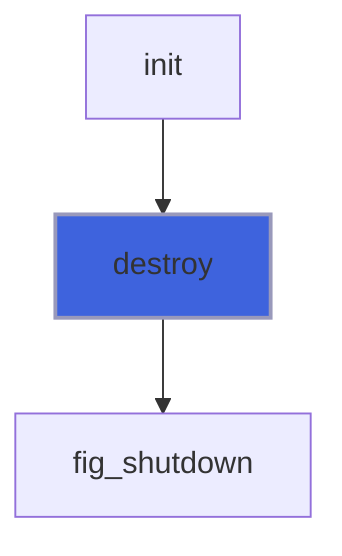

## Functions

### next_frame

Render the open frame (if any), then process input and open the next; `.false.` when the user quits.

**Returns**: `logical`

```fortran
function next_frame(self, stat) result(running)
```

**Arguments**

| Name | Type | Intent | Attributes | Description |
|------|------|--------|------------|-------------|
| `self` | class([app_object](/api/src/lib/figure_app#app-object)) | inout |  | Application. |
| `stat` | integer(kind=int32) | out | optional | Status. |

**Call graph**

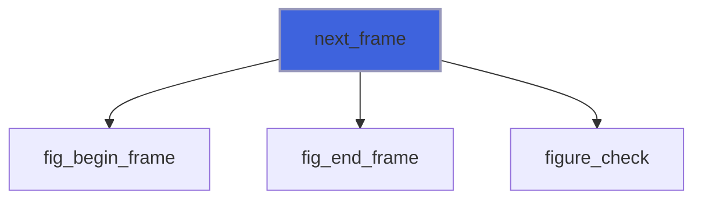

### content_scale

Display content scale (1 standard, 2 on most high-DPI displays).

**Returns**: `real(kind=real64)`

```fortran
function content_scale(self) result(scale)
```

**Arguments**

| Name | Type | Intent | Attributes | Description |
|------|------|--------|------------|-------------|
| `self` | class([app_object](/api/src/lib/figure_app#app-object)) | in |  | Application. |

**Call graph**

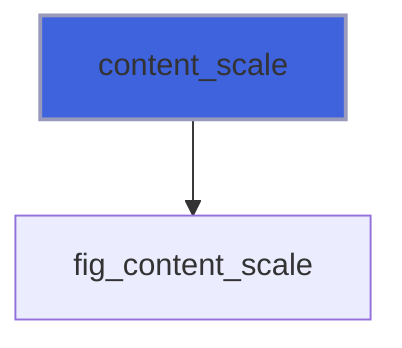
