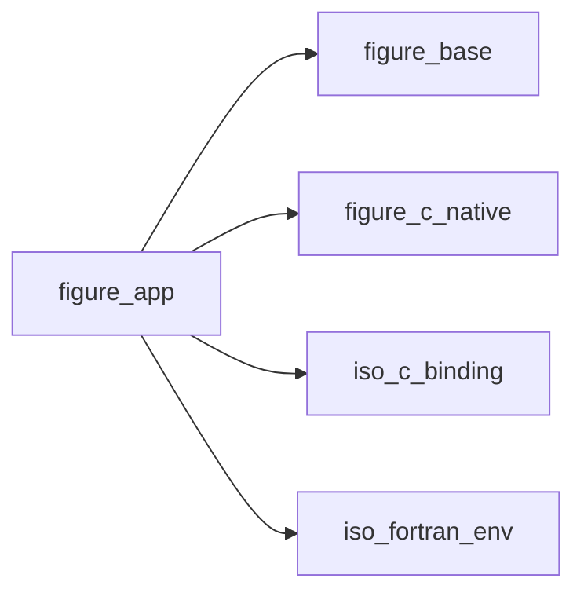
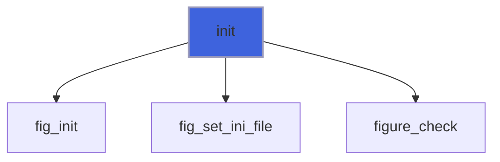
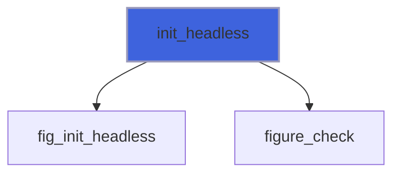
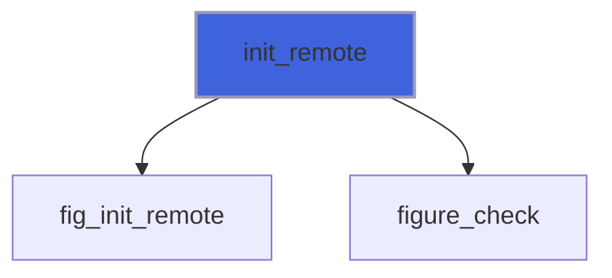
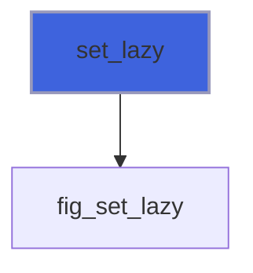
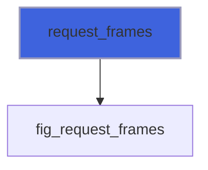
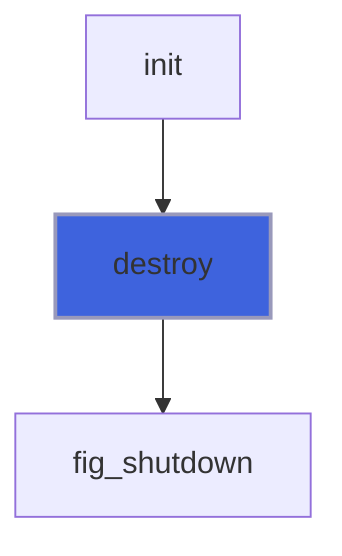
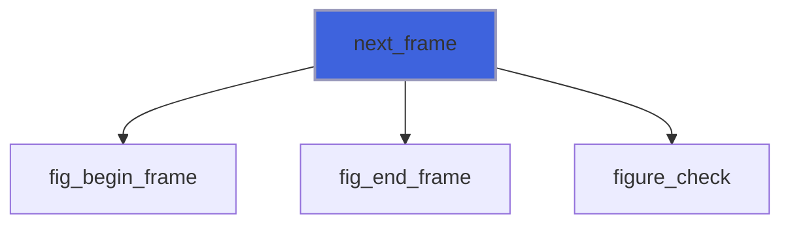
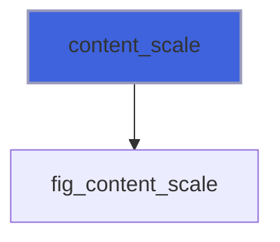

# figure_app

> figure_app, the application: window, frame loop and lazy redraw.

 The whole life of a FIGURE program is one loop:

```fortran
 call app%init('My tool', 1280, 720)
 do while (app%next_frame())
    ! declare the UI: widgets return what happened this frame
 enddo
 call app%destroy()
```

 `next_frame` renders the previous frame, then waits for input and opens the next one (lazy redraw: once the UI
 settles it sleeps until input or `max_wait`, so an idle window costs a fraction of a percent of one core); it
 returns `.false.` when the user closes the window. There are no widget objects, handles or callbacks: the state is
 the application's own variables.

**Source**: `src/lib/figure_app.F90`

**Dependencies**



## Contents

- [app_object](#app-object)
- [init](#init)
- [init_headless](#init-headless)
- [init_remote](#init-remote)
- [set_lazy](#set-lazy)
- [request_frames](#request-frames)
- [destroy](#destroy)
- [next_frame](#next-frame)
- [content_scale](#content-scale)

## Derived Types

### app_object

A FIGURE application (one per program).

 The native layer owns the lifecycle state (initialized, frame open) and rejects out-of-order calls with
 `FIG_ERR_STATE`; only `in_frame` is mirrored here, because `next_frame` must know whether to close a frame.

#### Components

| Name | Type | Attributes | Description |
|------|------|------------|-------------|
| `in_frame` | logical |  | A frame is open. |

#### Type-Bound Procedures

| Name | Attributes | Description |
|------|------------|-------------|
| `init` | pass(self) | Open the window. |
| `init_headless` | pass(self) | Contexts only, no window (tests). |
| `init_remote` | pass(self) | The UI in a web browser (no window, display or GPU). |
| `next_frame` | pass(self) | Close the current frame, open the next; false on quit. |
| `set_lazy` | pass(self) | Lazy redraw on/off, longest sleep. |
| `request_frames` | pass(self) | Redraw without waiting for input. |
| `content_scale` | pass(self) | Display content scale. |
| `destroy` | pass(self) | Close everything. |

## Subroutines

### init

Open the window (`width` x `height` logical pixels) and create the ImGui/ImPlot contexts.

 Window positions and sizes are not saved by default: with `ini_file`, Dear ImGui keeps them in that file, read
 at the first frame and written while the program runs (its `imgui.ini`).

```fortran
subroutine init(self, title, width, height, vsync, stat, ini_file)
```

**Arguments**

| Name | Type | Intent | Attributes | Description |
|------|------|--------|------------|-------------|
| `self` | class([app_object](/api/src/lib/figure_app#app-object)) | inout |  | Application. |
| `title` | character(len=*) | in |  | Window title. |
| `width` | integer(kind=int32) | in |  | Width [logical pixels]. |
| `height` | integer(kind=int32) | in |  | Height [logical pixels]. |
| `vsync` | logical | in | optional | Synchronize with the display (default true). |
| `stat` | integer(kind=int32) | out | optional | Status. |
| `ini_file` | character(len=*) | in | optional | File keeping the window layout (default: none). |

**Call graph**



### init_headless

Create the contexts on a virtual `width` x `height` display, without window or GPU.

```fortran
subroutine init_headless(self, width, height, stat)
```

**Arguments**

| Name | Type | Intent | Attributes | Description |
|------|------|--------|------------|-------------|
| `self` | class([app_object](/api/src/lib/figure_app#app-object)) | inout |  | Application. |
| `width` | integer(kind=int32) | in |  | Width [pixels]. |
| `height` | integer(kind=int32) | in |  | Height [pixels]. |
| `stat` | integer(kind=int32) | out | optional | Status. |

**Call graph**



### init_remote

Create the contexts and serve the UI to a web browser on `http://host:port/` instead of opening a window: the
 program needs no display or GPU (a cluster node will do). One browser at a time, which can come and go while the
 program runs. There is no authentication: whoever reaches the port controls the program, so keep the default
 host (127.0.0.1) and reach a remote machine through an SSH tunnel (`ssh -L 8080:localhost:8080 node`).

```fortran
subroutine init_remote(self, port, host, width, height, port_used, quiet, stat)
```

**Arguments**

| Name | Type | Intent | Attributes | Description |
|------|------|--------|------------|-------------|
| `self` | class([app_object](/api/src/lib/figure_app#app-object)) | inout |  | Application. |
| `port` | integer(kind=int32) | in | optional | Port (default 8080; 0: any free port). |
| `host` | character(len=*) | in | optional | Address to listen on (default 127.0.0.1). |
| `width` | integer(kind=int32) | in | optional | Display width until the browser's [pixels] (default 1280). |
| `height` | integer(kind=int32) | in | optional | Display height until the browser's [pixels] (default 800). |
| `port_used` | integer(kind=int32) | out | optional | The port listened on (useful with port 0). |
| `quiet` | logical | in | optional | Do not print the address to open (default false). |
| `stat` | integer(kind=int32) | out | optional | Status. |

**Call graph**



### set_lazy

Lazy redraw (default on): once the UI settles, sleep until input or `max_wait` seconds (default 0.5).

```fortran
subroutine set_lazy(self, enabled, max_wait)
```

**Arguments**

| Name | Type | Intent | Attributes | Description |
|------|------|--------|------------|-------------|
| `self` | class([app_object](/api/src/lib/figure_app#app-object)) | inout |  | Application. |
| `enabled` | logical | in |  | Lazy redraw on. |
| `max_wait` | real(kind=real64) | in | optional | Longest sleep [s]: the refresh period of live data. |

**Call graph**



### request_frames

Draw at least `n` more frames without waiting for input (e.g. after new data arrived).

```fortran
subroutine request_frames(self, n)
```

**Arguments**

| Name | Type | Intent | Attributes | Description |
|------|------|--------|------------|-------------|
| `self` | class([app_object](/api/src/lib/figure_app#app-object)) | inout |  | Application. |
| `n` | integer(kind=int32) | in |  | Frames. |

**Call graph**



### destroy

Close the window and destroy the contexts (safe in any state).

```fortran
subroutine destroy(self)
```

**Arguments**

| Name | Type | Intent | Attributes | Description |
|------|------|--------|------------|-------------|
| `self` | class([app_object](/api/src/lib/figure_app#app-object)) | inout |  | Application. |

**Call graph**



## Functions

### next_frame

Render the open frame (if any), then process input and open the next; `.false.` when the user quits.

**Returns**: `logical`

```fortran
function next_frame(self, stat) result(running)
```

**Arguments**

| Name | Type | Intent | Attributes | Description |
|------|------|--------|------------|-------------|
| `self` | class([app_object](/api/src/lib/figure_app#app-object)) | inout |  | Application. |
| `stat` | integer(kind=int32) | out | optional | Status. |

**Call graph**



### content_scale

Display content scale (1 standard, 2 on most high-DPI displays).

**Returns**: `real(kind=real64)`

```fortran
function content_scale(self) result(scale)
```

**Arguments**

| Name | Type | Intent | Attributes | Description |
|------|------|--------|------------|-------------|
| `self` | class([app_object](/api/src/lib/figure_app#app-object)) | in |  | Application. |

**Call graph**


