# figure_app

> figure_app, the application: window, frame loop and lazy redraw.

 The whole life of a FIGURE program is one loop:

```fortran
 call app%init('My tool', 1280, 720)
 do while (app%next_frame())
    ! declare the UI: widgets return what happened this frame
 enddo
 call app%destroy()
```

 `next_frame` renders the previous frame, then waits for input and opens the next one (lazy redraw: once the UI
 settles it sleeps until input or `max_wait`, so an idle window costs a fraction of a percent of one core); it
 returns `.false.` when the user closes the window. There are no widget objects, handles or callbacks: the state is
 the application's own variables.

**Source**: `src/lib/figure_app.F90`

**Dependencies**

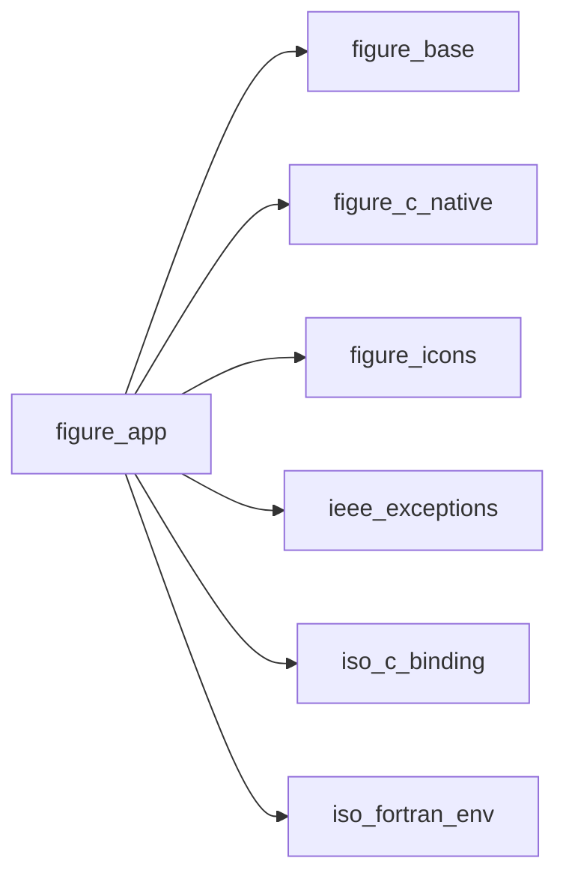

## Contents

- [app_object](#app-object)
- [init](#init)
- [init_headless](#init-headless)
- [set_icon_image](#set-icon-image)
- [set_icon_glyph](#set-icon-glyph)
- [init_remote](#init-remote)
- [set_checks](#set-checks)
- [set_lazy](#set-lazy)
- [set_style](#set-style)
- [palette_color](#palette-color)
- [notify](#notify)
- [notifications](#notifications)
- [set_font](#set-font)
- [add_fallback_font](#add-fallback-font)
- [load_style](#load-style)
- [save_style](#save-style)
- [set_docking](#set-docking)
- [request_frames](#request-frames)
- [wake](#wake)
- [set_confirm_quit](#set-confirm-quit)
- [quit](#quit)
- [set_title](#set-title)
- [open_file_dialog](#open-file-dialog)
- [save_file_dialog](#save-file-dialog)
- [open_folder_dialog](#open-folder-dialog)
- [open_file_browser](#open-file-browser)
- [save_file_browser](#save-file-browser)
- [file_dialog_result](#file-dialog-result)
- [save_image](#save-image)
- [image_result](#image-result)
- [save_layout](#save-layout)
- [load_layout](#load-layout)
- [add_window](#add-window)
- [set_window_visible](#set-window-visible)
- [view_menu](#view-menu)
- [add_layout](#add-layout)
- [switch_layout](#switch-layout)
- [reset_layout](#reset-layout)
- [open_prefs](#open-prefs)
- [save_pref_text](#save-pref-text)
- [save_pref_int32](#save-pref-int32)
- [save_pref_int64](#save-pref-int64)
- [save_pref_real32](#save-pref-real32)
- [save_pref_real64](#save-pref-real64)
- [save_pref_logical](#save-pref-logical)
- [set_size_limits](#set-size-limits)
- [destroy](#destroy)
- [show_dialog](#show-dialog)
- [show_file_dialog](#show-file-dialog)
- [show_file_browser](#show-file-browser)
- [frame_options](#frame-options)
- [next_frame](#next-frame)
- [quit_requested](#quit-requested)
- [dropped](#dropped)
- [title](#title)
- [window_visible](#window-visible)
- [layout](#layout)
- [prefs_file](#prefs-file)
- [real_text](#real-text)
- [pref_text](#pref-text)
- [load_pref_text](#load-pref-text)
- [load_pref_int32](#load-pref-int32)
- [load_pref_int64](#load-pref-int64)
- [load_pref_real32](#load-pref-real32)
- [load_pref_real64](#load-pref-real64)
- [load_pref_logical](#load-pref-logical)
- [message_box](#message-box)
- [content_scale](#content-scale)
- [opt](#opt)
- [flag](#flag)
- [opt_len](#opt-len)

## Derived Types

### app_object

A FIGURE application (one per program).

 The native layer owns the lifecycle state (initialized, frame open) and rejects out-of-order calls with
 `FIG_ERR_STATE`; only `in_frame` is mirrored here, because `next_frame` must know whether to close a frame.

**Components**

| Name | Type | Attributes | Description |
|------|------|------------|-------------|
| `in_frame` | logical |  | A frame is open. |

**Type-Bound Procedures**

| Name | Attributes | Description |
|------|------------|-------------|
| [`init`](/api/src/lib/figure_app#init) | pass(self) | Open the window. |
| [`init_headless`](/api/src/lib/figure_app#init-headless) | pass(self) | Contexts only, no window (tests). |
| [`init_remote`](/api/src/lib/figure_app#init-remote) | pass(self) | The UI in a web browser (no window, display or GPU). |
| [`next_frame`](/api/src/lib/figure_app#next-frame) | pass(self) | Close the current frame, open the next; false on quit. |
| [`set_checks`](/api/src/lib/figure_app#set-checks) | pass(self) | What a usage error does: 'abort', 'report' (default), 'recover'. |
| [`set_lazy`](/api/src/lib/figure_app#set-lazy) | pass(self) | Lazy redraw on/off, longest sleep. |
| [`set_style`](/api/src/lib/figure_app#set-style) | pass(self) | The style: a name, or a look and a palette. |
| [`palette_color`](/api/src/lib/figure_app#palette-color) | pass(self) | The colour of a palette role in effect. |
| [`set_docking`](/api/src/lib/figure_app#set-docking) | pass(self) | Docking on (the default) or off. |
| [`set_font`](/api/src/lib/figure_app#set-font) | pass(self) | The default font and its size. |
| [`add_fallback_font`](/api/src/lib/figure_app#add-fallback-font) | pass(self) | A font for the glyphs the text fonts lack. |
| [`load_style`](/api/src/lib/figure_app#load-style) | pass(self) | A theme file. |
| [`save_style`](/api/src/lib/figure_app#save-style) | pass(self) | The style in effect, as a theme file. |
| [`request_frames`](/api/src/lib/figure_app#request-frames) | pass(self) | Redraw without waiting for input. |
| [`wake`](/api/src/lib/figure_app#wake) | pass(self) | Start the next frame at once (from any thread). |
| [`set_confirm_quit`](/api/src/lib/figure_app#set-confirm-quit) | pass(self) | Report a quit request instead of quitting. |
| [`quit_requested`](/api/src/lib/figure_app#quit-requested) | pass(self) | The user asked to quit (once per request). |
| [`dropped`](/api/src/lib/figure_app#dropped) | pass(self) | The files and folders dropped on the window this frame. |
| [`quit`](/api/src/lib/figure_app#quit) | pass(self) | End the loop at the next frame. |
| [`set_title`](/api/src/lib/figure_app#set-title) | pass(self) | The window's title, after init. |
| [`title`](/api/src/lib/figure_app#title) | pass(self) | The window's title. |
| [`open_file_dialog`](/api/src/lib/figure_app#open-file-dialog) | pass(self) | The system's dialog to choose a file to open. |
| [`save_file_dialog`](/api/src/lib/figure_app#save-file-dialog) | pass(self) | The system's dialog to choose where to save. |
| [`open_folder_dialog`](/api/src/lib/figure_app#open-folder-dialog) | pass(self) | The system's dialog to choose a folder. |
| [`open_file_browser`](/api/src/lib/figure_app#open-file-browser) | pass(self) | FIGURE's browser to choose a file (or a folder) to open. |
| [`save_file_browser`](/api/src/lib/figure_app#save-file-browser) | pass(self) | FIGURE's browser to choose where to save. |
| [`file_dialog_result`](/api/src/lib/figure_app#file-dialog-result) | pass(self) | The answer to a dialog or a browser, once given. |
| [`save_image`](/api/src/lib/figure_app#save-image) | pass(self) | A rectangle of the window as a PNG file, after this frame. |
| [`image_result`](/api/src/lib/figure_app#image-result) | pass(self) | The outcome of save_image, once. |
| [`save_layout`](/api/src/lib/figure_app#save-layout) | pass(self) | The arrangement of the windows (docking included) to a file. |
| [`load_layout`](/api/src/lib/figure_app#load-layout) | pass(self) | An arrangement from a file, applied before the next frame. |
| [`notify`](/api/src/lib/figure_app#notify) | pass(self) | Tell the user something, in a notification. |
| [`notifications`](/api/src/lib/figure_app#notifications) | pass(self) | The notifications kept (the last 100). |
| [`add_window`](/api/src/lib/figure_app#add-window) | pass(self) | Register a window: the View menu, its close button, kept hidden. |
| [`window_visible`](/api/src/lib/figure_app#window-visible) | pass(self) | A registered window is shown. |
| [`set_window_visible`](/api/src/lib/figure_app#set-window-visible) | pass(self) | Show or hide a registered window. |
| [`view_menu`](/api/src/lib/figure_app#view-menu) | pass(self) | The View menu: the windows, the layouts, Reset layout. |
| [`add_layout`](/api/src/lib/figure_app#add-layout) | pass(self) | Declare a named layout. |
| [`switch_layout`](/api/src/lib/figure_app#switch-layout) | pass(self) | Make a layout current: laid out again, or as the user left it. |
| [`reset_layout`](/api/src/lib/figure_app#reset-layout) | pass(self) | Lay the current layout out again. |
| [`layout`](/api/src/lib/figure_app#layout) | pass(self) | The current layout's name: the one to build. |
| [`open_prefs`](/api/src/lib/figure_app#open-prefs) | pass(self) | Read the preferences from the program's file, kept there from now on. |
| [`prefs_file`](/api/src/lib/figure_app#prefs-file) | pass(self) | The preferences' file. |
| [`save_pref_logical`](/api/src/lib/figure_app#save-pref-logical) | pass(self) | Keep the preference `key`: a logical (as save_pref of a text, written `true` or `false`). |
| [`save_pref_real64`](/api/src/lib/figure_app#save-pref-real64) | pass(self) | Keep the preference `key`: a real (as save_pref of a text, written with 17 significant digits: read back exactly). |
| [`save_pref_real32`](/api/src/lib/figure_app#save-pref-real32) | pass(self) | Keep the preference `key`: a real (as save_pref of a text, written with 9 significant digits: read back exactly). |
| [`save_pref_int64`](/api/src/lib/figure_app#save-pref-int64) | pass(self) | Keep the preference `key`: a 64-bit integer (as save_pref of a text, written in decimal). |
| [`save_pref_int32`](/api/src/lib/figure_app#save-pref-int32) | pass(self) | Keep the preference `key`: an integer (as save_pref of a text, written in decimal). |
| [`save_pref_text`](/api/src/lib/figure_app#save-pref-text) | pass(self) | Keep the preference `key`: a text (every character kept, trailing blanks too). In memory until the next save of the file (`open_prefs`); without `open_prefs`, for this run. Statuses: `FIG_ERR_ARGUMENT` for a key that is empty, has a newline or a blank at an end, or starts with `[`, `#` or `;`; `FIG_ERR_STATE` before `init*` or from a task. |
| `save_pref` |  | Keep a preference. Generic: [`save_pref_text`](/api/src/lib/figure_app#save-pref-text), [`save_pref_int32`](/api/src/lib/figure_app#save-pref-int32), [`save_pref_int64`](/api/src/lib/figure_app#save-pref-int64) |
| `save_pref` |  | Keep a preference. Generic: [`save_pref_real32`](/api/src/lib/figure_app#save-pref-real32), [`save_pref_real64`](/api/src/lib/figure_app#save-pref-real64), [`save_pref_logical`](/api/src/lib/figure_app#save-pref-logical) |
| [`load_pref_logical`](/api/src/lib/figure_app#load-pref-logical) | pass(self) | The preference `key` into `value` as a logical (`true` or `false`): as `load_pref` of an integer. |
| [`load_pref_real64`](/api/src/lib/figure_app#load-pref-real64) | pass(self) | The preference `key` into `value` as a real: as `load_pref` of an integer. |
| [`load_pref_real32`](/api/src/lib/figure_app#load-pref-real32) | pass(self) | The preference `key` into `value` as a real: as `load_pref` of an integer. |
| [`load_pref_int64`](/api/src/lib/figure_app#load-pref-int64) | pass(self) | The preference `key` into `value` as a 64-bit integer: as `load_pref` of an integer. |
| [`load_pref_int32`](/api/src/lib/figure_app#load-pref-int32) | pass(self) | The preference `key` into `value` as an integer: true when it is kept and is one; otherwise false, and `value` takes `default` if present, else stays as it is (a text edited into something else counts as not kept). |
| [`load_pref_text`](/api/src/lib/figure_app#load-pref-text) | pass(self) | The preference `key` into `value`: true when it is kept (`value` takes it, blank-padded or cut to its length); false when it is not, and `value` takes `default` if present, else stays as it is. Statuses: as `save_pref`'s. |
| `load_pref` |  | A preference kept, or a default. Generic: [`load_pref_text`](/api/src/lib/figure_app#load-pref-text), [`load_pref_int32`](/api/src/lib/figure_app#load-pref-int32), [`load_pref_int64`](/api/src/lib/figure_app#load-pref-int64) |
| `load_pref` |  | A preference kept, or a default. Generic: [`load_pref_real32`](/api/src/lib/figure_app#load-pref-real32), [`load_pref_real64`](/api/src/lib/figure_app#load-pref-real64), [`load_pref_logical`](/api/src/lib/figure_app#load-pref-logical) |
| [`message_box`](/api/src/lib/figure_app#message-box) | pass(self) | A question in a box: 0 while open, then the button chosen. |
| [`set_size_limits`](/api/src/lib/figure_app#set-size-limits) | pass(self) | The window's least and greatest size. |
| [`content_scale`](/api/src/lib/figure_app#content-scale) | pass(self) | Display content scale. |
| [`destroy`](/api/src/lib/figure_app#destroy) | pass(self) | Close everything. |
| [`set_icon_image`](/api/src/lib/figure_app#set-icon-image) | pass(self) | The window's icon from an image. |
| [`set_icon_glyph`](/api/src/lib/figure_app#set-icon-glyph) | pass(self) | The window's icon from an ICON_*. |
| `set_icon` |  | The window's icon: an image or an ICON_*. Generic: [`set_icon_image`](/api/src/lib/figure_app#set-icon-image), [`set_icon_glyph`](/api/src/lib/figure_app#set-icon-glyph) |

## Subroutines

### init

Open the window (`width` x `height` logical pixels) and create the ImGui/ImPlot contexts.

 Window positions and sizes are not saved by default: with `ini_file`, Dear ImGui keeps them in that file, read
 at the first frame and written while the program runs (its `imgui.ini`); not while `FIGURE_CAPTURE` records.

 `decorations='figure'` opens the window without the system's frame and draws one: a title bar with the icon
 (`set_icon`), the program's main menu bar (`ig_begin_main_menu_bar`) inside it, the title centred, and the
 minimize, maximize (restore) and close buttons, in the colours of the palette's roles. The bar drags the window,
 its edges resize it, a double-click on it maximizes; close takes the quit path of the system's close button
 (`set_confirm_quit`). `buttons` puts them on the `'right'` (the default) or the `'left'` (the default on macOS).

**Attributes**: recursive

```fortran
subroutine init(self, title, width, height, vsync, stat, ini_file, decorations, buttons)
```

**Arguments**

| Name | Type | Intent | Attributes | Description |
|------|------|--------|------------|-------------|
| `self` | class([app_object](/api/src/lib/figure_app#app-object)) | inout |  | Application. |
| `title` | character(len=*) | in |  | Window title. |
| `width` | integer(kind=int32) | in |  | Width [logical pixels]. |
| `height` | integer(kind=int32) | in |  | Height [logical pixels]. |
| `vsync` | logical | in | optional | Synchronize with the display (default true). |
| `stat` | integer(kind=int32) | out | optional | `FIG_ERR_ARGUMENT` for a wrong size or option. |
| `ini_file` | character(len=*) | in | optional | File keeping the window layout (default: none). |
| `decorations` | character(len=*) | in | optional | The window's frame: `'native'` (default) or `'figure'`. |
| `buttons` | character(len=*) | in | optional | With `'figure'`: `'right'` or `'left'` (default: the platform's side, left on macOS). |

**Call graph**

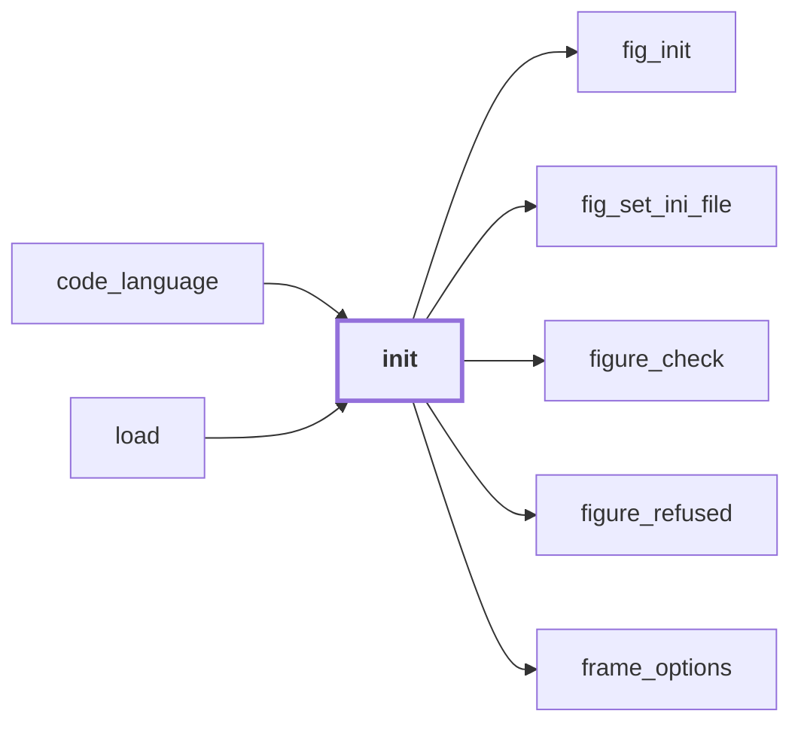

### init_headless

Create the contexts on a virtual `width` x `height` display, without window or GPU.

 `decorations='figure'` draws the title bar of `init`'s `decorations='figure'` as in a window, for tests: its
 buttons' actions are recorded as state (`test_frame_state`), close takes the quit path.

**Attributes**: recursive

```fortran
subroutine init_headless(self, width, height, stat, decorations, buttons)
```

**Arguments**

| Name | Type | Intent | Attributes | Description |
|------|------|--------|------------|-------------|
| `self` | class([app_object](/api/src/lib/figure_app#app-object)) | inout |  | Application. |
| `width` | integer(kind=int32) | in |  | Width [pixels]. |
| `height` | integer(kind=int32) | in |  | Height [pixels]. |
| `stat` | integer(kind=int32) | out | optional | Status: `FIG_ERR_ARGUMENT` for a wrong size or option. |
| `decorations` | character(len=*) | in | optional | `'native'` (default: no bar) or `'figure'`. |
| `buttons` | character(len=*) | in | optional | With `'figure'`: `'right'` or `'left'`. |

**Call graph**

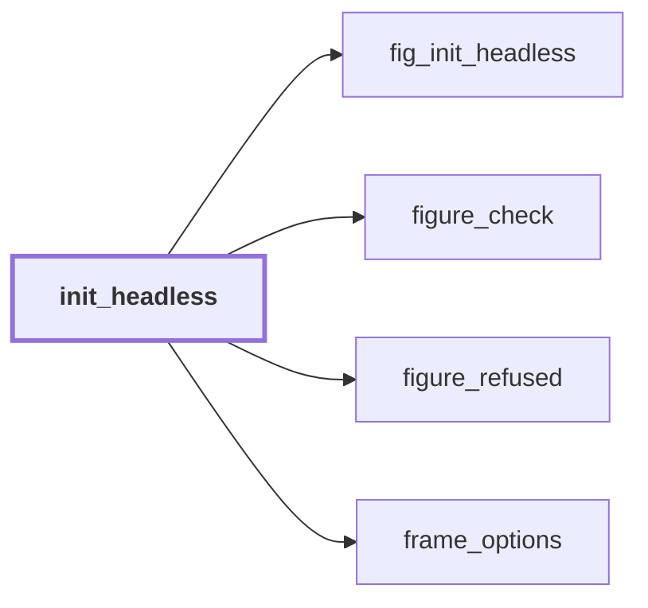

### set_icon_image

The window's icon (task bar, dock, the title bar of `decorations='figure'`) from an image, `image(4, width,
 height)`: `image(:, i, j)` = R, G, B, A of pixel (i, j), j = 1 the top row. Window mode only (and a window's
 program captured headless, `FIGURE_CAPTURE_HEADLESS`: the title bar's icon); 1 to 1024 pixels a side (64 x 64 or
 256 x 256 are usual).

**Attributes**: recursive

```fortran
subroutine set_icon_image(self, image, stat)
```

**Arguments**

| Name | Type | Intent | Attributes | Description |
|------|------|--------|------------|-------------|
| `self` | class([app_object](/api/src/lib/figure_app#app-object)) | inout |  | Application. |
| `image` | integer(kind=int8) | in | contiguous, target | Pixels. |
| `stat` | integer(kind=int32) | out | optional | modes, `FIG_ERR_ARGUMENT` for a wrong shape, `FIG_ERR_FAILED` where the system has no window icons (the title bar's is set). |

**Call graph**

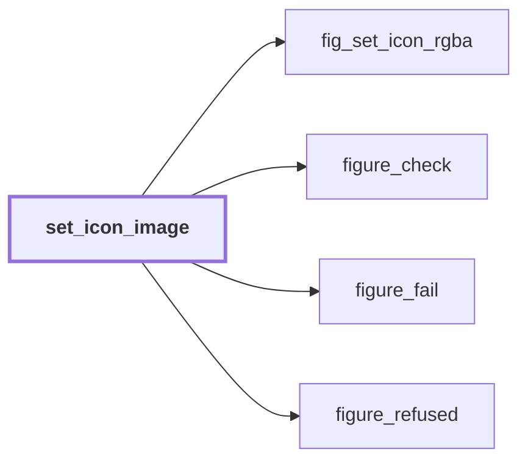

### set_icon_glyph

The window's icon from one of the bundled icons, `ICON_*`: rendered at 64 x 64 pixels in the palette's text on
 accent colour on a rounded square of its accent; the title bar of `decorations='figure'` shows the glyph in the
 accent colour. Window mode only (and a window's program captured headless, `FIGURE_CAPTURE_HEADLESS`: the title
 bar's icon).

**Attributes**: recursive

```fortran
subroutine set_icon_glyph(self, icon, stat)
```

**Arguments**

| Name | Type | Intent | Attributes | Description |
|------|------|--------|------------|-------------|
| `self` | class([app_object](/api/src/lib/figure_app#app-object)) | inout |  | Application. |
| `icon` | character(len=*) | in |  | One `ICON_*` constant. |
| `stat` | integer(kind=int32) | out | optional | `FIG_ERR_ARGUMENT` if `icon` is not one icon, `FIG_ERR_FAILED` where the system has no window icons (the title bar's is set). |

**Call graph**

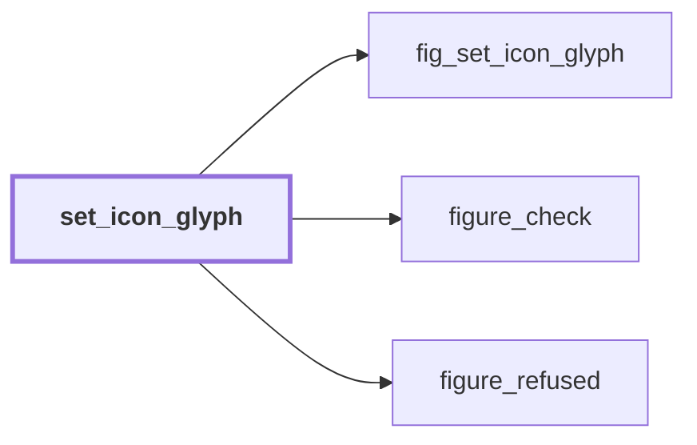

### init_remote

Create the contexts and serve the UI to a web browser on `http://host:port/` instead of opening a window: the
 program needs no display or GPU (a cluster node will do). One browser at a time, which can come and go while the
 program runs. The page and its connection need an access token in the address (`http://localhost:8080/?token=...`,
 printed at start, returned in `url`): 32 random hex digits, or `token` (`token=''` disables it: anyone who reaches
 the port then controls the program). Keep the default host (127.0.0.1) and reach a remote machine through an SSH
 tunnel (`ssh -L 8080:localhost:8080 node`).

 A browser has no vsync to pace the program, so frames are capped at `max_fps` per second (default 60), and a
 frame is sent only once the previous one has left: with a slow client the newest frame goes, the ones in between
 are skipped. A frame equal to the last one sent is not sent again. Vertices travel in 12 bytes instead of 20, and
 `compress` deflates frames and textures: `'auto'` (default) while the client is the bottleneck (frames are being
 skipped), `'always'`, or `'never'`; deflate costs about 7 ms of CPU per MB and shrinks frames 2.5 to 3.5 times.
 With `lossy` (default true) an image updated in consecutive frames (a 3-D view while the camera moves) travels as
 JPEG at quality 75 while it changes, 30 to 190 times smaller than raw, and exact once it has not changed for
 150 ms; `lossy=.false.` always sends exact pixels. Images with transparent pixels always go exact.

**Attributes**: recursive

```fortran
subroutine init_remote(self, port, host, width, height, port_used, quiet, max_fps, compress, lossy, token, url, stat)
```

**Arguments**

| Name | Type | Intent | Attributes | Description |
|------|------|--------|------------|-------------|
| `self` | class([app_object](/api/src/lib/figure_app#app-object)) | inout |  | Application. |
| `port` | integer(kind=int32) | in | optional | Port (default 8080; 0: any free port). |
| `host` | character(len=*) | in | optional | Address to listen on (default 127.0.0.1). |
| `width` | integer(kind=int32) | in | optional | Display width until the browser's [pixels] (default 1280). |
| `height` | integer(kind=int32) | in | optional | Display height until the browser's [pixels] (default 800). |
| `port_used` | integer(kind=int32) | out | optional | The port listened on (useful with port 0). |
| `quiet` | logical | in | optional | Do not print the address to open (default false). |
| `max_fps` | real(kind=real64) | in | optional | Most frames per second (default 60; 0: no cap). |
| `compress` | character(len=*) | in | optional | Deflate frames and textures: 'auto', 'always', 'never'. |
| `lossy` | logical | in | optional | Changing images as JPEG, exact when still (default true). |
| `token` | character(len=*) | in | optional | Access token (default: random; '': none). |
| `url` | character(len=*) | out | optional | The address to open, with the token (blank-padded). |
| `stat` | integer(kind=int32) | out | optional | Status. |

**Call graph**

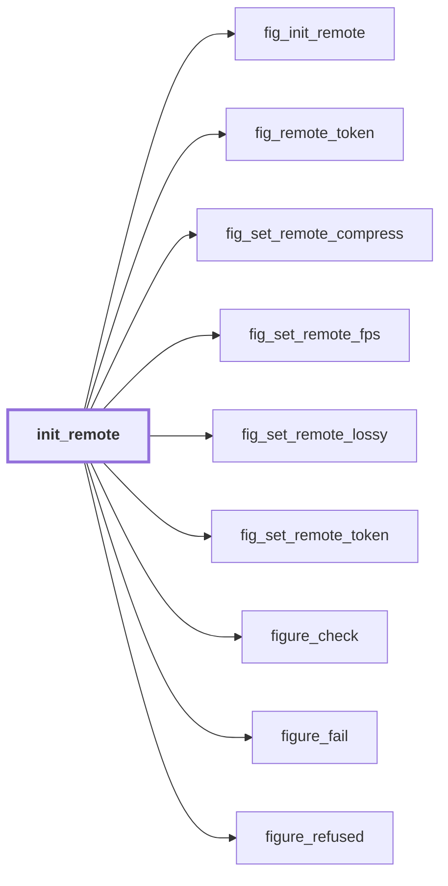

### set_checks

What a usage error does: a wrong end (one that does not close the innermost open scope, or follows a begin that
 returned false where the rule is "end only after a true begin"), a scope left open at the end of the frame, a
 drawing procedure called with no frame open. FIGURE keeps a record of the scopes open in the frame (every
 begin/end and push/pop pair it wraps) and checks each end against it before Dear ImGui sees it; the messages
 name the Fortran calls (`ig_end_table: the open scope is ig_tree_node('Blocks') (close it with ig_tree_pop
 before ig_end_table)`). `mode`:

 - `'abort'`: the program stops (`error stop`, the message on standard error) at the call that breaks the rule,
   or at `next_frame` for a scope left open; calls outside FIGURE (raw bindings) meet Dear ImGui's own assertions;
 - `'report'` (the default): the wrong call is refused (it does nothing), the frame goes on, the scopes left open
   are closed, and the next `next_frame` returns `FIG_ERR_STATE` with every message (without its `stat`: `error
   stop`, as any failure);
 - `'recover'`: as `'report'`, but an end whose scope is open further down first closes the scopes opened after
   it, and `next_frame` shows the messages in a notification (`figure_last_error` has them) and returns `FIG_OK`.

 A call with a `stat` of its own (`ig_pop_style_color(stat=s)`) gets its usage error there, in every mode.
 Callable before `init*`; `destroy` restores the default. Statuses: `FIG_ERR_ARGUMENT` for another mode,
 `FIG_ERR_STATE` from a task. The same in every mode (window, headless, remote).

**Attributes**: recursive

```fortran
subroutine set_checks(self, mode, stat)
```

**Arguments**

| Name | Type | Intent | Attributes | Description |
|------|------|--------|------------|-------------|
| `self` | class([app_object](/api/src/lib/figure_app#app-object)) | inout |  | Application. |
| `mode` | character(len=*) | in |  | 'abort', 'report' or 'recover'. |
| `stat` | integer(kind=int32) | out | optional | Status. |

**Call graph**

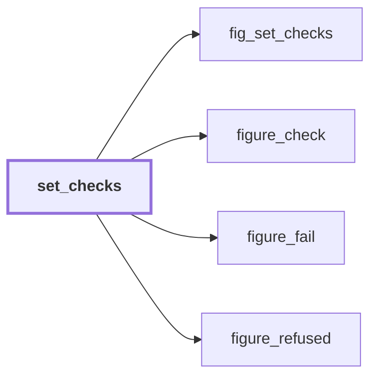

### set_lazy

Lazy redraw (default on): once the UI settles, sleep until input or `max_wait` seconds (default 0.5). Callable
 from any thread (a task included).

**Attributes**: recursive

```fortran
subroutine set_lazy(self, enabled, max_wait)
```

**Arguments**

| Name | Type | Intent | Attributes | Description |
|------|------|--------|------------|-------------|
| `self` | class([app_object](/api/src/lib/figure_app#app-object)) | inout |  | Application. |
| `enabled` | logical | in |  | Lazy redraw on. |
| `max_wait` | real(kind=real64) | in | optional | Longest sleep [s]: the refresh period of live data. |

**Call graph**

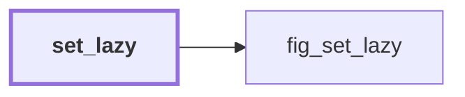

### set_style

The style of the interface, the plots and the window's background, after `init*`: by name, or by its two parts,
 a look (the geometry) and a palette (the colours). Changing one part keeps the other.

 Names (each a theme file, `themes/<name>.toml`, embedded):

 - `'seal'` (the default), `'seal-light'`: FIGURE's, from its mark: ink (or paper) and one vermilion, spent on
   what the user touches and on the first plotted line; square corners;
 - `'paper'`: for publication, black on white, thin borders, line colours that survive greyscale printing;
 - `'high-contrast'`: white on black with yellow accents, text at 7:1 or more (WCAG AAA);
 - `'dark'`, `'light'`, `'classic'`: Dear ImGui's own styles, with ImPlot's default line colours.

 Looks: `'seal'`, `'fusion'`, `'adwaita'`, `'fluent'`. Palettes: `'seal'`, `'seal-light'`, `'paper'`,
 `'high-contrast'`, `'nord'`, `'solarized-dark'`, `'solarized-light'`, `'gruvbox-dark'`, `'gruvbox-light'`,
 `'dracula'`, `'catppuccin-mocha'`, `'catppuccin-latte'`, `'tokyo-night'`, `'one-dark'`, and `'auto'`, which
 follows the system's light or dark setting (`auto_dark`, default `'seal'`; `auto_light`, default `'seal-light'`)
 and changes with it while the program runs; in headless and remote modes the setting is unknown and counts as
 dark. A palette's colours are derived from twelve roles and checked for contrast (docs, Styles, Palettes).

 The parts are applied in order, all or none: `name`, then `look`, then `palette`, then `lines` (`'okabe-ito'`
 replaces the line colours with Okabe and Ito's colour-blind-safe set). The environment variable `FIGURE_STYLE`
 picks the style at initialisation; this call overrides it. The font and its size are kept; colours and variables
 changed by name are reset by the part that sets them.

**Attributes**: recursive

```fortran
subroutine set_style(self, name, lines, stat, look, palette, auto_dark, auto_light)
```

**Arguments**

| Name | Type | Intent | Attributes | Description |
|------|------|--------|------------|-------------|
| `self` | class([app_object](/api/src/lib/figure_app#app-object)) | inout |  | Application. |
| `name` | character(len=*) | in | optional | Style name. |
| `lines` | character(len=*) | in | optional | Line palette: `'okabe-ito'` (default: the style's own). |
| `stat` | integer(kind=int32) | out | optional | palette, a palette below the contrast rule, or no argument. |
| `look` | character(len=*) | in | optional | Look: the geometry (rounding, padding, spacing, borders). |
| `palette` | character(len=*) | in | optional | Palette: the colours, or `'auto'`. |
| `auto_dark` | character(len=*) | in | optional | Palette of `'auto'` on a dark system (default `'seal'`). |
| `auto_light` | character(len=*) | in | optional | Palette of `'auto'` on a light system (default `'seal-light'`). |

**Call graph**

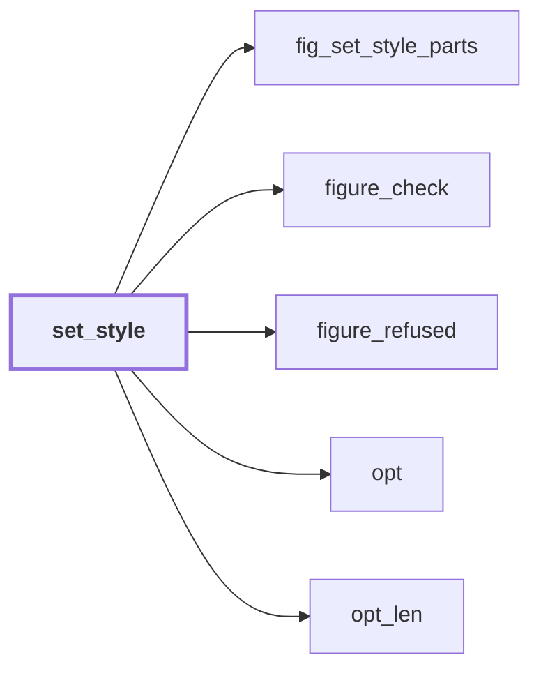

### palette_color

The colour of a palette role in effect, as `[r, g, b, a]` in [0, 1]: `'background'`, `'surface'`,
 `'raised_surface'`, `'border'`, `'text'`, `'dimmed_text'`, `'accent'`, `'text_on_accent'`, `'selection'`,
 `'success'`, `'warning'`, `'error'`. With a style that has no palette (`'dark'`, `'light'`, `'classic'`, a theme
 file without one), the roles are read from Dear ImGui's colours (`WindowBg`, `FrameBg`, `Button`, `Border`,
 `Text`, `TextDisabled`, `CheckMark`, `Header`), and success, warning and error are Okabe and Ito's bluish green,
 orange and vermilion. After `init*`; the same in every mode.

**Attributes**: recursive

```fortran
subroutine palette_color(self, role, rgba, stat)
```

**Arguments**

| Name | Type | Intent | Attributes | Description |
|------|------|--------|------------|-------------|
| `self` | class([app_object](/api/src/lib/figure_app#app-object)) | inout |  | Application. |
| `role` | character(len=*) | in |  | Role name. |
| `rgba` | real(kind=real64) | out |  | Colour, components in [0, 1]. |
| `stat` | integer(kind=int32) | out | optional | Status: `FIG_ERR_ARGUMENT` for an unknown role. |

**Call graph**

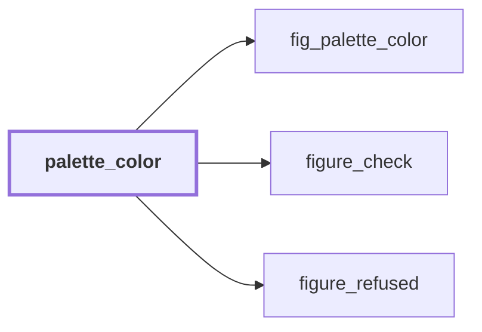

### notify

Tell the user something without a dialog: a notification drawn by FIGURE after the program's windows, in the
 bottom-right corner (above a bottom side bar), the newest at the bottom, older ones stacked above. `kind`:
 `'info'` (default), `'success'`, `'warning'` or `'error'`, drawn with its palette role (accent, success, warning,
 error) and its icon (`ICON_INFO`, `ICON_CIRCLE_CHECK`, `ICON_TRIANGLE_ALERT`, `ICON_CIRCLE_X`). It stays
 `seconds` (default 5; 0 or less: until clicked), fading out in its last half second, timed by the frame time
 (the fixed one in headless mode and in recordings); a click dismisses it. The last 100 are kept
 (`notifications`). Statuses: `FIG_ERR_STATE` before `init*` or from a task, `FIG_ERR_ARGUMENT` for an unknown
 kind. The same in every mode.

**Attributes**: recursive

```fortran
subroutine notify(self, text, kind, seconds, stat)
```

**Arguments**

| Name | Type | Intent | Attributes | Description |
|------|------|--------|------------|-------------|
| `self` | class([app_object](/api/src/lib/figure_app#app-object)) | inout |  | Application. |
| `text` | character(len=*) | in |  | What to tell (UTF-8; wrapped). |
| `kind` | character(len=*) | in | optional | 'info', 'success', 'warning' or 'error'. |
| `seconds` | real(kind=real64) | in | optional | Time shown [s] (default 5; <= 0: until clicked). |
| `stat` | integer(kind=int32) | out | optional | Status. |

**Call graph**

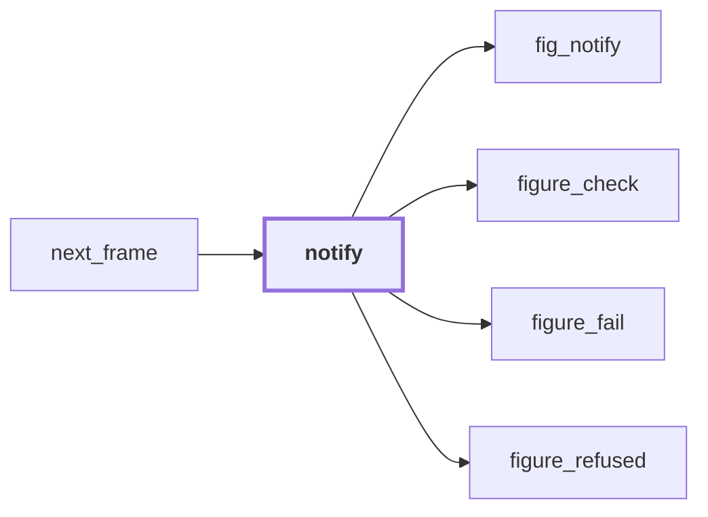

### notifications

The notifications kept, the last 100, oldest first: their texts (`list`, padded with blanks to the longest),
 their kinds (`'info'`, ...) and whether each is still shown (not yet timed out or dismissed). None before
 `init*`.

**Attributes**: recursive

```fortran
subroutine notifications(self, list, kinds, shown)
```

**Arguments**

| Name | Type | Intent | Attributes | Description |
|------|------|--------|------------|-------------|
| `self` | class([app_object](/api/src/lib/figure_app#app-object)) | in |  | Application. |
| `list` | character(len=:) | out | allocatable | Texts. |
| `kinds` | character(len=7) | out | allocatable, optional | Kinds. |
| `shown` | logical | out | allocatable, optional | Still shown. |

**Call graph**

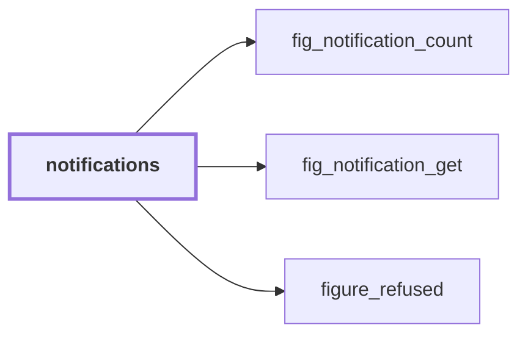

### set_font

The default font of the interface, after `init*`: `'plex-sans'` (IBM Plex Sans, bundled: the default, at 15
 logical pixels), `'plex-mono'` (IBM Plex Mono, bundled: monospace, every character as wide), `'proggy'` (Dear
 ImGui's own 13-pixel bitmap font), or the path of a TrueType/OpenType file; `size` in logical pixels (multiplied
 by the display's content scale), kept if absent.

**Attributes**: recursive

```fortran
subroutine set_font(self, font, size, stat)
```

**Arguments**

| Name | Type | Intent | Attributes | Description |
|------|------|--------|------------|-------------|
| `self` | class([app_object](/api/src/lib/figure_app#app-object)) | inout |  | Application. |
| `font` | character(len=*) | in |  | Font. |
| `size` | real(kind=real64) | in | optional | Size [logical pixels], in (0, 200]. |
| `stat` | integer(kind=int32) | out | optional | `FIG_ERR_ARGUMENT` if it is not a font or the size is wrong. |

**Call graph**

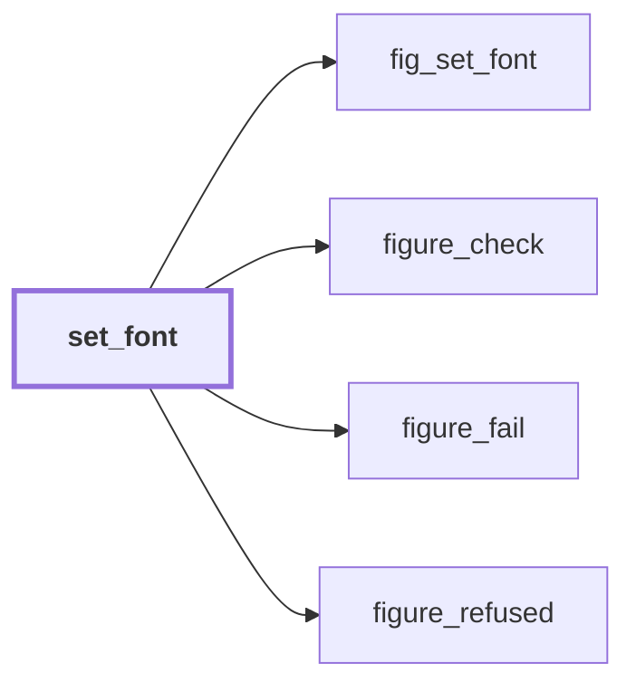

### add_fallback_font

A fallback font of the program's own, a TrueType/OpenType file: merged into every text font (the bundled ones,
 `'proggy'` and the files of `set_font`/`ig_push_font`, loaded already or later) after IBM Plex, the Lucide icons
 and the bundled fallback, Noto Sans Math, so it gives only the glyphs they all lack; several are asked in the
 order they are added. Its letters are scaled to the text font's em and stand on its baseline. After `init*`,
 between frames (not inside one); a file added already is not added again; it lasts until `destroy`. At most 13
 (Dear ImGui's 16 sources per font). The same in every mode (in remote mode the browser receives the glyphs).

**Attributes**: recursive

```fortran
subroutine add_fallback_font(self, file, stat)
```

**Arguments**

| Name | Type | Intent | Attributes | Description |
|------|------|--------|------------|-------------|
| `self` | class([app_object](/api/src/lib/figure_app#app-object)) | inout |  | Application. |
| `file` | character(len=*) | in |  | TrueType/OpenType file. |
| `stat` | integer(kind=int32) | out | optional | `FIG_ERR_ARGUMENT` if it is not a font or 13 are added already, `FIG_ERR_STATE` before `init*` or inside a frame. |

**Call graph**

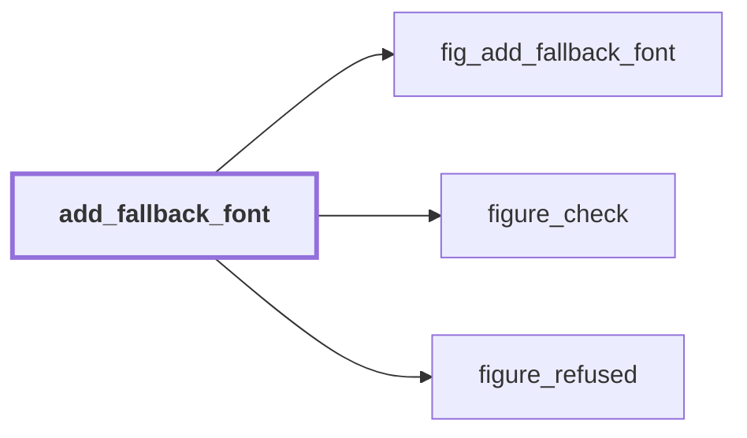

### load_style

Apply a theme file (the format of the files in `themes/`: docs, Styles, Theme files), after `init*`. Sizes in the
 file are logical pixels; what the file does not set comes from its `base`.

**Attributes**: recursive

```fortran
subroutine load_style(self, file, stat)
```

**Arguments**

| Name | Type | Intent | Attributes | Description |
|------|------|--------|------------|-------------|
| `self` | class([app_object](/api/src/lib/figure_app#app-object)) | inout |  | Application. |
| `file` | character(len=*) | in |  | Theme file. |
| `stat` | integer(kind=int32) | out | optional | malformed (the message gives the line). |

**Call graph**

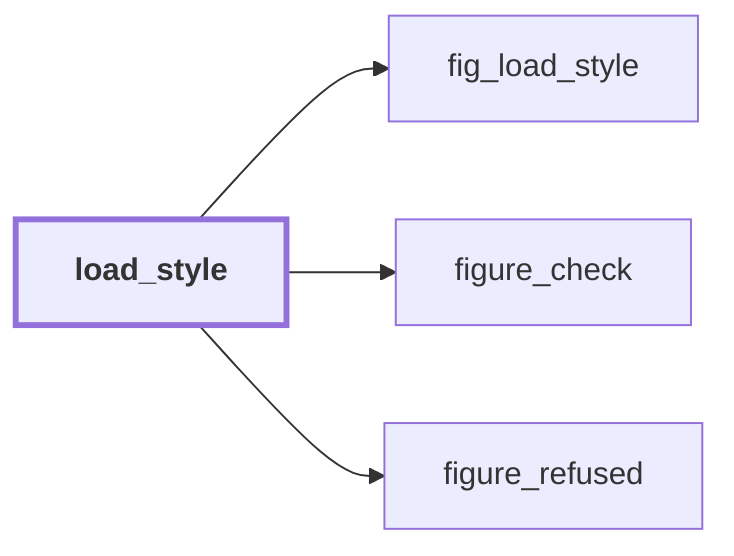

### save_style

Write the style in effect as a theme file: its base, background, line colours, and every colour and variable
 that differs from the base (sizes in logical pixels; colours as 8-bit hex, alphas exact). Changes made by name
 or in the style editor (`ig_show_style_editor`) are kept; `load_style` reads the file back.

**Attributes**: recursive

```fortran
subroutine save_style(self, file, stat)
```

**Arguments**

| Name | Type | Intent | Attributes | Description |
|------|------|--------|------------|-------------|
| `self` | class([app_object](/api/src/lib/figure_app#app-object)) | inout |  | Application. |
| `file` | character(len=*) | in |  | Theme file to write. |
| `stat` | integer(kind=int32) | out | optional |  |

**Call graph**

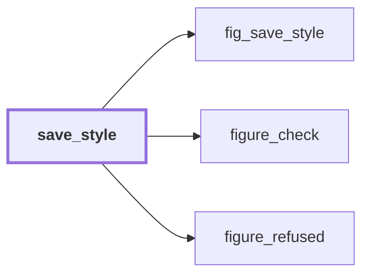

### set_docking

Docking on (the default since `init*`) or off: with docking on, a window dragged by its title bar docks into
 another window or into a dock space (`ig_dock_space`). After `init*`.

**Attributes**: recursive

```fortran
subroutine set_docking(self, enabled, stat)
```

**Arguments**

| Name | Type | Intent | Attributes | Description |
|------|------|--------|------------|-------------|
| `self` | class([app_object](/api/src/lib/figure_app#app-object)) | inout |  | Application. |
| `enabled` | logical | in |  | Docking on. |
| `stat` | integer(kind=int32) | out | optional |  |

**Call graph**

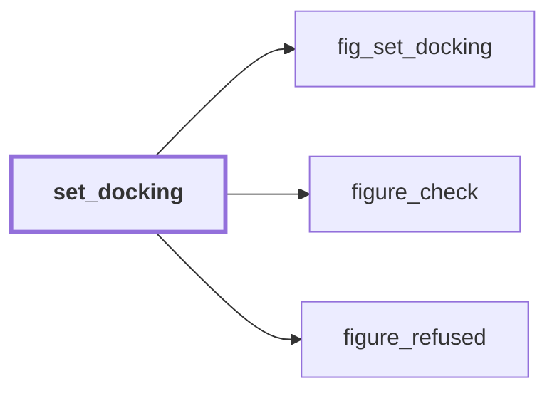

### request_frames

Draw at least `n` more frames without waiting for input (e.g. after new data arrived). It raises the count of
 frames still to draw, never lowers it: concurrent requests keep the largest. Callable from any thread (a task, an
 OpenMP thread): from another thread than the loop's it also wakes a lazy loop that is waiting, so the first of
 the frames starts at once.

**Attributes**: recursive

```fortran
subroutine request_frames(self, n)
```

**Arguments**

| Name | Type | Intent | Attributes | Description |
|------|------|--------|------------|-------------|
| `self` | class([app_object](/api/src/lib/figure_app#app-object)) | inout |  | Application. |
| `n` | integer(kind=int32) | in |  | Frames. |

**Call graph**

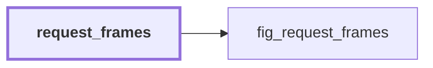

### wake

The next frame starts without waiting for input or `max_wait`, from any thread (a FIGURE task, an OpenMP thread,
 an MPI progress thread): a lazy loop that is waiting stops waiting, in every mode (window: an event; remote: the
 wait on the network ends; headless: the loop never waits). From the loop's own thread, the next `next_frame` does
 not wait. Never refused: a task may call it. Before `init*` it does nothing.

**Attributes**: recursive

```fortran
subroutine wake(self)
```

**Arguments**

| Name | Type | Intent | Attributes | Description |
|------|------|--------|------------|-------------|
| `self` | class([app_object](/api/src/lib/figure_app#app-object)) | in |  | Application. |

**Call graph**

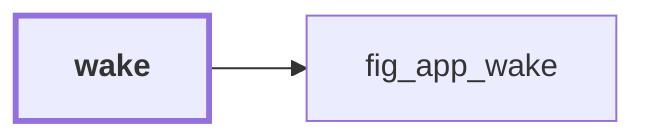

### set_confirm_quit

With `enabled`, the window's close button (and the system's quit) no longer ends `next_frame`: the request is
 reported by `quit_requested`, and the program quits with `quit` (after asking to save, for example). Callable
 from any thread (a task included).

**Attributes**: recursive

```fortran
subroutine set_confirm_quit(self, enabled)
```

**Arguments**

| Name | Type | Intent | Attributes | Description |
|------|------|--------|------------|-------------|
| `self` | class([app_object](/api/src/lib/figure_app#app-object)) | inout |  | Application. |
| `enabled` | logical | in |  | Ask first. |

**Call graph**

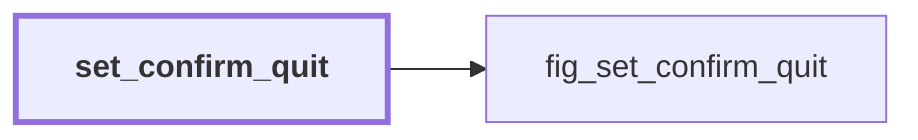

### quit

End the loop: the next `next_frame` returns `.false.` (in every mode). Callable from any thread (a task
 included): from another thread than the loop's it also wakes a lazy loop that is waiting, so the loop ends at
 once.

**Attributes**: recursive

```fortran
subroutine quit(self)
```

**Arguments**

| Name | Type | Intent | Attributes | Description |
|------|------|--------|------------|-------------|
| `self` | class([app_object](/api/src/lib/figure_app#app-object)) | inout |  | Application. |

**Call graph**

```mermaid
flowchart LR
  quit["quit"] --> fig_quit["fig_quit"]
  classDef focus stroke-width:3px,font-weight:bold
  class quit focus
  click fig_quit href "figure_c_native.html#fig-quit" "fig_quit"
```

### set_title

The window's title, after `init`: the document being edited and a mark when it has changes, for example. Shown in
 window mode; in remote and headless modes it is kept (read back by `title`) and nothing shows it.

**Attributes**: recursive

```fortran
subroutine set_title(self, text, stat)
```

**Arguments**

| Name | Type | Intent | Attributes | Description |
|------|------|--------|------------|-------------|
| `self` | class([app_object](/api/src/lib/figure_app#app-object)) | inout |  | Application. |
| `text` | character(len=*) | in |  | Title. |
| `stat` | integer(kind=int32) | out | optional | Status. |

**Call graph**

```mermaid
flowchart LR
  set_title["set_title"] --> fig_set_title["fig_set_title"]
  set_title["set_title"] --> figure_check["figure_check"]
  set_title["set_title"] --> figure_refused["figure_refused"]
  classDef focus stroke-width:3px,font-weight:bold
  class set_title focus
  click figure_refused href "figure_base.html#figure-refused" "figure_refused"
  click figure_check href "figure_base.html#figure-check" "figure_check"
  click fig_set_title href "figure_c_native.html#fig-set-title" "fig_set_title"
```

### open_file_dialog

Show the system's dialog to choose a file to open. It does not block: the interface keeps drawing, and the answer
 is read with `file_dialog_result(id, ...)` on the following frames. `filters`: entries `'name|pattern'`, the
 pattern being extensions separated by `;` (`'Input files|input;inp'`, `'All files|*'`). Window mode only:
 `FIG_ERR_STATE` in remote and headless modes (FIGURE's own browser, `open_file_browser`, works there).
 `prefer='figure'` opens FIGURE's browser instead (`open_file_browser`), in every mode, answered the same way;
 `'system'` (default) the system's dialog. Statuses: as the dialog or the browser opened; `FIG_ERR_ARGUMENT` for
 another `prefer`.

**Attributes**: recursive

```fortran
subroutine open_file_dialog(self, id, filters, default_path, stat, prefer)
```

**Arguments**

| Name | Type | Intent | Attributes | Description |
|------|------|--------|------------|-------------|
| `self` | class([app_object](/api/src/lib/figure_app#app-object)) | inout |  | Application. |
| `id` | character(len=*) | in |  | Dialog id (any text, used to read the answer). |
| `filters` | character(len=*) | in | optional | File type filters. |
| `default_path` | character(len=*) | in | optional | Folder or file to start from (relative: to the working directory; absent: that directory). |
| `stat` | integer(kind=int32) | out | optional | Status. |
| `prefer` | character(len=*) | in | optional | `'system'` (default) or `'figure'`: FIGURE's browser. |

**Call graph**

```mermaid
flowchart LR
  open_file_dialog["open_file_dialog"] --> show_dialog["show_dialog"]
  classDef focus stroke-width:3px,font-weight:bold
  class open_file_dialog focus
  click show_dialog href "#show-dialog" "show_dialog"
```

### save_file_dialog

Show the system's dialog to choose where to save (a new or an existing file); as `open_file_dialog`
 (`prefer='figure'`: FIGURE's browser, `save_file_browser`).

**Attributes**: recursive

```fortran
subroutine save_file_dialog(self, id, filters, default_path, stat, prefer)
```

**Arguments**

| Name | Type | Intent | Attributes | Description |
|------|------|--------|------------|-------------|
| `self` | class([app_object](/api/src/lib/figure_app#app-object)) | inout |  | Application. |
| `id` | character(len=*) | in |  | Dialog id. |
| `filters` | character(len=*) | in | optional | File type filters. |
| `default_path` | character(len=*) | in | optional | Folder or file to start from (relative: to the working directory; absent: that directory). |
| `stat` | integer(kind=int32) | out | optional | Status. |
| `prefer` | character(len=*) | in | optional | `'system'` (default) or `'figure'`: FIGURE's browser. |

**Call graph**

```mermaid
flowchart LR
  save_file_dialog["save_file_dialog"] --> show_dialog["show_dialog"]
  classDef focus stroke-width:3px,font-weight:bold
  class save_file_dialog focus
  click show_dialog href "#show-dialog" "show_dialog"
```

### open_folder_dialog

Show the system's dialog to choose a folder; as `open_file_dialog` (`prefer='figure'`: FIGURE's browser,
 `open_file_browser` with `folders=.true.`).

**Attributes**: recursive

```fortran
subroutine open_folder_dialog(self, id, default_path, stat, prefer)
```

**Arguments**

| Name | Type | Intent | Attributes | Description |
|------|------|--------|------------|-------------|
| `self` | class([app_object](/api/src/lib/figure_app#app-object)) | inout |  | Application. |
| `id` | character(len=*) | in |  | Dialog id. |
| `default_path` | character(len=*) | in | optional | Folder to start from (relative: to the working directory; absent: that directory). |
| `stat` | integer(kind=int32) | out | optional | Status. |
| `prefer` | character(len=*) | in | optional | `'system'` (default) or `'figure'`: FIGURE's browser. |

**Call graph**

```mermaid
flowchart LR
  open_folder_dialog["open_folder_dialog"] --> show_dialog["show_dialog"]
  classDef focus stroke-width:3px,font-weight:bold
  class open_folder_dialog focus
  click show_dialog href "#show-dialog" "show_dialog"
```

### open_file_browser

Show FIGURE's file browser to choose a file to open (or, with `folders`, a folder): a modal drawn by FIGURE in
 Dear ImGui, in the palette's colours, the same in window, remote and headless modes (in remote mode it lists the
 files of the machine the program runs on). It does not block: the answer is read with `file_dialog_result(id,
 ...)`, as a system dialog's, so a program switches between the two by changing this call. The browser lists the
 folder's entries (folders first, sizes, modification times; sorted by a click on a column's header), filtered by
 `filters` (as `open_file_dialog`'s, chosen in a list) with hidden files on request; a path field (Enter goes
 there, Tab completes), the parent folder, places (home, the working directory, the file systems' roots, the
 recent folders kept between runs in FIGURE's settings file) and a new folder. Escape or Cancel cancels. A folder
 that cannot be read is reported in the browser. Statuses: `FIG_ERR_STATE` before `init*`, from a task, or for an
 id with a dialog or a browser still open; `FIG_ERR_ARGUMENT` for a malformed filter.

**Attributes**: recursive

```fortran
subroutine open_file_browser(self, id, filters, default_path, folders, stat)
```

**Arguments**

| Name | Type | Intent | Attributes | Description |
|------|------|--------|------------|-------------|
| `self` | class([app_object](/api/src/lib/figure_app#app-object)) | inout |  | Application. |
| `id` | character(len=*) | in |  | Dialog id (any text, used to read the answer). |
| `filters` | character(len=*) | in | optional | File type filters, `'name\|pattern'` (the first in effect). |
| `default_path` | character(len=*) | in | optional | Folder to start in, or a file (its folder; the file selected); relative: to the working directory (absent: that directory). |
| `folders` | logical | in | optional | Choose a folder instead of a file (default false). |
| `stat` | integer(kind=int32) | out | optional | Status. |

**Call graph**

```mermaid
flowchart LR
  open_file_browser["open_file_browser"] --> figure_refused["figure_refused"]
  open_file_browser["open_file_browser"] --> show_file_browser["show_file_browser"]
  classDef focus stroke-width:3px,font-weight:bold
  class open_file_browser focus
  click figure_refused href "figure_base.html#figure-refused" "figure_refused"
  click show_file_browser href "#show-file-browser" "show_file_browser"
```

### save_file_browser

Show FIGURE's file browser to choose where to save: a name typed in the folder shown, or an existing file; a file
 that exists is replaced only after the user says so. As `open_file_browser`; `default_path` may name the file
 to propose (its folder need exist, the file need not).

**Attributes**: recursive

```fortran
subroutine save_file_browser(self, id, filters, default_path, stat)
```

**Arguments**

| Name | Type | Intent | Attributes | Description |
|------|------|--------|------------|-------------|
| `self` | class([app_object](/api/src/lib/figure_app#app-object)) | inout |  | Application. |
| `id` | character(len=*) | in |  | Dialog id. |
| `filters` | character(len=*) | in | optional | File type filters, `'name\|pattern'`. |
| `default_path` | character(len=*) | in | optional | Folder to start in, or the file to propose. |
| `stat` | integer(kind=int32) | out | optional | Status. |

**Call graph**

```mermaid
flowchart LR
  save_file_browser["save_file_browser"] --> figure_refused["figure_refused"]
  save_file_browser["save_file_browser"] --> show_file_browser["show_file_browser"]
  classDef focus stroke-width:3px,font-weight:bold
  class save_file_browser focus
  click figure_refused href "figure_base.html#figure-refused" "figure_refused"
  click show_file_browser href "#show-file-browser" "show_file_browser"
```

### file_dialog_result

The answer to the dialog or the browser `id`: `done` false while it is open; once answered, `done` true and
 either `path` (the file or folder chosen, absolute for the browser) or `cancelled` true. The answer is given once;
 then the id is free again, and until the next dialog `done` is false: poll it every frame. A dialog that failed
 (Linux without a portal or zenity) gives `done` true and `FIG_ERR_FAILED` with the reason.

**Attributes**: recursive

```fortran
subroutine file_dialog_result(self, id, path, done, cancelled, stat)
```

**Arguments**

| Name | Type | Intent | Attributes | Description |
|------|------|--------|------------|-------------|
| `self` | class([app_object](/api/src/lib/figure_app#app-object)) | inout |  | Application. |
| `id` | character(len=*) | in |  | Dialog id. |
| `path` | character(len=:) | out | allocatable | Chosen path ('' while open or if cancelled). |
| `done` | logical | out |  | The dialog was answered. |
| `cancelled` | logical | out | optional | The user cancelled it. |
| `stat` | integer(kind=int32) | out | optional | Status. |

**Call graph**

```mermaid
flowchart LR
  file_dialog_result["file_dialog_result"] --> fig_file_dialog_result["fig_file_dialog_result"]
  file_dialog_result["file_dialog_result"] --> figure_check["figure_check"]
  file_dialog_result["file_dialog_result"] --> figure_refused["figure_refused"]
  classDef focus stroke-width:3px,font-weight:bold
  class file_dialog_result focus
  click figure_refused href "figure_base.html#figure-refused" "figure_refused"
  click fig_file_dialog_result href "figure_c_native.html#fig-file-dialog-result" "fig_file_dialog_result"
  click figure_check href "figure_base.html#figure-check" "figure_check"
```

### save_image

Write the rectangle (xmin, ymin)-(xmax, ymax) of the window [logical pixels, as `ig_item_rect` and
 `test_window_rect` give them] as a PNG file, at the screen's resolution, when the current frame is rendered.
 Ask for it outside the frame in which a menu or popup covers the rectangle (they would be in the picture).
 The outcome comes once, from `image_result`. Every mode: a window's pixels are read back from the GPU, headless
 and remote modes draw the frame with FIGURE's CPU renderer (capture.md). An empty rectangle or file name,
 `FIG_ERR_ARGUMENT`; before `init*`, `FIG_ERR_STATE`.

**Attributes**: recursive

```fortran
subroutine save_image(self, path, xmin, ymin, xmax, ymax, stat)
```

**Arguments**

| Name | Type | Intent | Attributes | Description |
|------|------|--------|------------|-------------|
| `self` | class([app_object](/api/src/lib/figure_app#app-object)) | inout |  | Application. |
| `path` | character(len=*) | in |  | PNG file. |
| `xmin` | real(kind=real64) | in |  | Left. |
| `ymin` | real(kind=real64) | in |  | Top. |
| `xmax` | real(kind=real64) | in |  | Right. |
| `ymax` | real(kind=real64) | in |  | Bottom. |
| `stat` | integer(kind=int32) | out | optional | Status. |

**Call graph**

```mermaid
flowchart LR
  save_image["save_image"] --> fig_save_image["fig_save_image"]
  save_image["save_image"] --> figure_check["figure_check"]
  save_image["save_image"] --> figure_refused["figure_refused"]
  classDef focus stroke-width:3px,font-weight:bold
  class save_image focus
  click figure_refused href "figure_base.html#figure-refused" "figure_refused"
  click figure_check href "figure_base.html#figure-check" "figure_check"
  click fig_save_image href "figure_c_native.html#fig-save-image" "fig_save_image"
```

### image_result

The outcome of `save_image`, once, after the frame that wrote it: `done` true and the file `path`, or
 `FIG_ERR_FAILED` with the reason (the file cannot be written). `done` false before and after: poll it every frame.

**Attributes**: recursive

```fortran
subroutine image_result(self, path, done, stat)
```

**Arguments**

| Name | Type | Intent | Attributes | Description |
|------|------|--------|------------|-------------|
| `self` | class([app_object](/api/src/lib/figure_app#app-object)) | inout |  | Application. |
| `path` | character(len=:) | out | allocatable | The file ('' until done). |
| `done` | logical | out |  | Written, or failed. |
| `stat` | integer(kind=int32) | out | optional | Status. |

**Call graph**

```mermaid
flowchart LR
  image_result["image_result"] --> fig_image_result["fig_image_result"]
  image_result["image_result"] --> figure_check["figure_check"]
  image_result["image_result"] --> figure_refused["figure_refused"]
  classDef focus stroke-width:3px,font-weight:bold
  class image_result focus
  click figure_refused href "figure_base.html#figure-refused" "figure_refused"
  click fig_image_result href "figure_c_native.html#fig-image-result" "fig_image_result"
  click figure_check href "figure_base.html#figure-check" "figure_check"
```

### save_layout

Write the layout to `path`: the windows' positions, sizes and docking (the dock nodes and which window is in
 which), the tables' columns: Dear ImGui's settings, as its ini text, for every window shown in this session and
 those read before. `comment` (lines separated by `new_line('a')`) is written first, each line led by '; ', which
 `load_layout` skips: the program's own state (the windows it opens on demand, say) for itself to read back.
 Any mode. `FIG_ERR_FAILED` if the file cannot be written.

**Attributes**: recursive

```fortran
subroutine save_layout(self, path, comment, stat)
```

**Arguments**

| Name | Type | Intent | Attributes | Description |
|------|------|--------|------------|-------------|
| `self` | class([app_object](/api/src/lib/figure_app#app-object)) | inout |  | Application. |
| `path` | character(len=*) | in |  | File. |
| `comment` | character(len=*) | in | optional | Lines to keep with it. |
| `stat` | integer(kind=int32) | out | optional | Status. |

**Call graph**

```mermaid
flowchart LR
  save_layout["save_layout"] --> fig_save_layout["fig_save_layout"]
  save_layout["save_layout"] --> figure_check["figure_check"]
  save_layout["save_layout"] --> figure_refused["figure_refused"]
  classDef focus stroke-width:3px,font-weight:bold
  class save_layout focus
  click figure_refused href "figure_base.html#figure-refused" "figure_refused"
  click figure_check href "figure_base.html#figure-check" "figure_check"
  click fig_save_layout href "figure_c_native.html#fig-save-layout" "fig_save_layout"
```

### load_layout

Read a layout written by `save_layout` (or an ini file of Dear ImGui), applied before the next frame: the
 settings in effect are cleared, the file's are read, the dock nodes are rebuilt and the windows that exist take
 their saved position, size and dock; the others take theirs when they appear. A program that lays out its dock
 space with `ig_dock_layout_begin` should not lay it out again: the dock space has a layout again (the same id as
 when saved). `FIG_ERR_FAILED` if the file cannot be read, `FIG_ERR_ARGUMENT` if it holds no layout.

**Attributes**: recursive

```fortran
subroutine load_layout(self, path, stat)
```

**Arguments**

| Name | Type | Intent | Attributes | Description |
|------|------|--------|------------|-------------|
| `self` | class([app_object](/api/src/lib/figure_app#app-object)) | inout |  | Application. |
| `path` | character(len=*) | in |  | File. |
| `stat` | integer(kind=int32) | out | optional | Status. |

**Call graph**

```mermaid
flowchart LR
  load_layout["load_layout"] --> fig_load_layout["fig_load_layout"]
  load_layout["load_layout"] --> figure_check["figure_check"]
  load_layout["load_layout"] --> figure_refused["figure_refused"]
  classDef focus stroke-width:3px,font-weight:bold
  class load_layout focus
  click figure_refused href "figure_base.html#figure-refused" "figure_refused"
  click figure_check href "figure_base.html#figure-check" "figure_check"
  click fig_load_layout href "figure_c_native.html#fig-load-layout" "fig_load_layout"
```

### add_window

Register the window `name` (the name given to `ig_begin`) with FIGURE's window registry: `view_menu` lists it as a
 check item that shows and hides it, `ig_begin(name)` (without `open`) gives it a close button that hides it, and
 the preferences (`open_prefs`) keep whether it is shown from one run to the next. The program draws it only while
 `window_visible(name)` is true. After `init*`, before or after `open_prefs` (a window added after takes its kept
 visibility when added). Statuses: `FIG_ERR_ARGUMENT` for an empty name or one added already, `FIG_ERR_STATE`
 before `init*` or from a task. The same in every mode.

**Attributes**: recursive

```fortran
subroutine add_window(self, name, visible, closable, in_view_menu, remember, stat)
```

**Arguments**

| Name | Type | Intent | Attributes | Description |
|------|------|--------|------------|-------------|
| `self` | class([app_object](/api/src/lib/figure_app#app-object)) | inout |  | Application. |
| `name` | character(len=*) | in |  | Window name, as given to `ig_begin`. |
| `visible` | logical | in | optional | Shown at the first run (default true). |
| `closable` | logical | in | optional | A close button (default true). |
| `in_view_menu` | logical | in | optional | Listed in the View menu (default true). |
| `remember` | logical | in | optional | Shown or hidden as at the end of the last run (default true). |
| `stat` | integer(kind=int32) | out | optional | Status. |

**Call graph**

```mermaid
flowchart LR
  add_window["add_window"] --> fig_window_add["fig_window_add"]
  add_window["add_window"] --> figure_check["figure_check"]
  add_window["add_window"] --> figure_refused["figure_refused"]
  add_window["add_window"] --> flag["flag"]
  classDef focus stroke-width:3px,font-weight:bold
  class add_window focus
  click figure_refused href "figure_base.html#figure-refused" "figure_refused"
  click figure_check href "figure_base.html#figure-check" "figure_check"
  click fig_window_add href "figure_c_native.html#fig-window-add" "fig_window_add"
  click flag href "#flag" "flag"
```

### set_window_visible

Show or hide the registered window `name` from the program (a Log window shown when an error arrives). Statuses:
 `FIG_ERR_ARGUMENT` for a name not added, `FIG_ERR_STATE` from a task.

**Attributes**: recursive

```fortran
subroutine set_window_visible(self, name, visible, stat)
```

**Arguments**

| Name | Type | Intent | Attributes | Description |
|------|------|--------|------------|-------------|
| `self` | class([app_object](/api/src/lib/figure_app#app-object)) | inout |  | Application. |
| `name` | character(len=*) | in |  | Window name. |
| `visible` | logical | in |  | Shown. |
| `stat` | integer(kind=int32) | out | optional | Status. |

**Call graph**

```mermaid
flowchart LR
  set_window_visible["set_window_visible"] --> fig_window_set_visible["fig_window_set_visible"]
  set_window_visible["set_window_visible"] --> figure_check["figure_check"]
  set_window_visible["set_window_visible"] --> figure_refused["figure_refused"]
  classDef focus stroke-width:3px,font-weight:bold
  class set_window_visible focus
  click figure_refused href "figure_base.html#figure-refused" "figure_refused"
  click figure_check href "figure_base.html#figure-check" "figure_check"
  click fig_window_set_visible href "figure_c_native.html#fig-window-set-visible" "fig_window_set_visible"
```

### view_menu

The View menu, inside a menu bar (`ig_begin_main_menu_bar` or `ig_begin_menu_bar`): a check item per registered
 window listed in it (its name without the `##` part), in the order added; then, with layouts, one item per layout
 (the current one checked: a click switches to it); then "Reset layout" (`reset_layout`), shown with layouts or
 once a dock space was laid out with `ig_dock_layout_begin`. Each frame, where the menu goes. Statuses:
 `FIG_ERR_STATE` with no frame open or from a task. The same in every mode.

**Attributes**: recursive

```fortran
subroutine view_menu(self, label, stat)
```

**Arguments**

| Name | Type | Intent | Attributes | Description |
|------|------|--------|------------|-------------|
| `self` | class([app_object](/api/src/lib/figure_app#app-object)) | inout |  | Application. |
| `label` | character(len=*) | in | optional | The menu's label (default 'View'). |
| `stat` | integer(kind=int32) | out | optional | Status. |

**Call graph**

```mermaid
flowchart LR
  view_menu["view_menu"] --> fig_view_menu["fig_view_menu"]
  view_menu["view_menu"] --> figure_check["figure_check"]
  view_menu["view_menu"] --> figure_draw_refused["figure_draw_refused"]
  view_menu["view_menu"] --> opt["opt"]
  view_menu["view_menu"] --> opt_len["opt_len"]
  classDef focus stroke-width:3px,font-weight:bold
  class view_menu focus
  click figure_draw_refused href "figure_base.html#figure-draw-refused" "figure_draw_refused"
  click figure_check href "figure_base.html#figure-check" "figure_check"
  click fig_view_menu href "figure_c_native.html#fig-view-menu" "fig_view_menu"
  click opt href "#opt" "opt"
  click opt_len href "#opt-len" "opt_len"
```

### add_layout

Declare the layout `name`: an arrangement of the dock space the program builds when `ig_dock_layout_begin` returns
 true and `layout()` is `name` (FIGURE calls nothing of the program's: the builder is the program's code under
 that test). The first added is current, unless the preferences kept another. `windows`, the registered windows
 the layout shows (the other registered ones are hidden when it becomes current); absent, switching to it leaves
 them as they are. Statuses: `FIG_ERR_ARGUMENT` for an empty name or one added already, `FIG_ERR_STATE` before
 `init*` or from a task.

**Attributes**: recursive

```fortran
subroutine add_layout(self, name, windows, stat)
```

**Arguments**

| Name | Type | Intent | Attributes | Description |
|------|------|--------|------------|-------------|
| `self` | class([app_object](/api/src/lib/figure_app#app-object)) | inout |  | Application. |
| `name` | character(len=*) | in |  | Layout name (shown in the View menu). |
| `windows` | character(len=*) | in | optional | The registered windows it shows (blank-padded). |
| `stat` | integer(kind=int32) | out | optional | Status. |

**Call graph**

```mermaid
flowchart LR
  add_layout["add_layout"] --> fig_layout_add["fig_layout_add"]
  add_layout["add_layout"] --> figure_check["figure_check"]
  add_layout["add_layout"] --> figure_refused["figure_refused"]
  classDef focus stroke-width:3px,font-weight:bold
  class add_layout focus
  click figure_refused href "figure_base.html#figure-refused" "figure_refused"
  click figure_check href "figure_base.html#figure-check" "figure_check"
  click fig_layout_add href "figure_c_native.html#fig-layout-add" "fig_layout_add"
```

### switch_layout

Make the layout `name` current (the View menu does it on a click). The arrangement the user left the current one
 in is kept; then, if `name` was arranged by the user earlier in this run (or in the last, by the preferences),
 that arrangement comes back before the next frame; otherwise each dock space laid out with `ig_dock_layout_begin`
 is laid out again: `ig_dock_layout_begin` returns true on its next call and the program builds `layout()`. A
 layout with `windows` shows those and hides the other registered windows. Statuses: `FIG_ERR_ARGUMENT` for a
 layout not added, `FIG_ERR_STATE` from a task. Between frames or inside one; the same in every mode.

**Attributes**: recursive

```fortran
subroutine switch_layout(self, name, stat)
```

**Arguments**

| Name | Type | Intent | Attributes | Description |
|------|------|--------|------------|-------------|
| `self` | class([app_object](/api/src/lib/figure_app#app-object)) | inout |  | Application. |
| `name` | character(len=*) | in |  | Layout name. |
| `stat` | integer(kind=int32) | out | optional | Status. |

**Call graph**

```mermaid
flowchart LR
  switch_layout["switch_layout"] --> fig_layout_switch["fig_layout_switch"]
  switch_layout["switch_layout"] --> figure_check["figure_check"]
  switch_layout["switch_layout"] --> figure_refused["figure_refused"]
  classDef focus stroke-width:3px,font-weight:bold
  class switch_layout focus
  click figure_refused href "figure_base.html#figure-refused" "figure_refused"
  click figure_check href "figure_base.html#figure-check" "figure_check"
  click fig_layout_switch href "figure_c_native.html#fig-layout-switch" "fig_layout_switch"
```

### reset_layout

Lay the current layout out again (the View menu's "Reset layout"): the user's changes to it are forgotten, each
 dock space laid out with `ig_dock_layout_begin` is laid out again on the next frame, and a layout with `windows`
 shows those again. Without layouts, the dock spaces are laid out again all the same. Status: `FIG_ERR_STATE`
 from a task.

**Attributes**: recursive

```fortran
subroutine reset_layout(self, stat)
```

**Arguments**

| Name | Type | Intent | Attributes | Description |
|------|------|--------|------------|-------------|
| `self` | class([app_object](/api/src/lib/figure_app#app-object)) | inout |  | Application. |
| `stat` | integer(kind=int32) | out | optional | Status. |

**Call graph**

```mermaid
flowchart LR
  reset_layout["reset_layout"] --> fig_layout_reset["fig_layout_reset"]
  reset_layout["reset_layout"] --> figure_check["figure_check"]
  reset_layout["reset_layout"] --> figure_refused["figure_refused"]
  classDef focus stroke-width:3px,font-weight:bold
  class reset_layout focus
  click figure_refused href "figure_base.html#figure-refused" "figure_refused"
  click figure_check href "figure_base.html#figure-check" "figure_check"
  click fig_layout_reset href "figure_c_native.html#fig-layout-reset" "fig_layout_reset"
```

### open_prefs

Keep the program's preferences in a file from now on, and read those of the last run: the values of `save_pref`,
 the registered windows' visibility, the current layout and the arrangement of each layout, the style set by
 `set_style` and, in window mode, the window's position, size and maximized state. Read now: the style and the
 window's geometry are applied at once, the arrangement before the next frame; so call it after `init*` and after
 the program's own defaults (`set_style`), before the first frame. Written when something changed, every 30 s of
 frame time and at `destroy`, to `<file>.tmp` first and then renamed over the file: a crash leaves the file of
 the last save whole. The file: `file`, or `preferences.ini` in the platform's folder for the program `name`
 (SDL's `SDL_GetPrefPath`: `~/.local/share/<name>/` on Linux, `%APPDATA%\<name>\` on Windows,
 `~/Library/Application Support/<name>/` on macOS); in headless mode without `file` none (kept in memory: tests
 name a file), and during a capture (`FIGURE_CAPTURE`) nothing is read or written. A file that does not exist yet
 is not an error. Not kept: a theme file (`load_style`), the style editor's changes, the colours and variables
 set by name, the fonts. Statuses: `FIG_ERR_ARGUMENT` for a name that is not a folder's name (letters, digits,
 blanks, `.`, `_`, `-`), `FIG_ERR_STATE` before `init*`, a second time, or from a task.

**Attributes**: recursive

```fortran
subroutine open_prefs(self, name, file, stat)
```

**Arguments**

| Name | Type | Intent | Attributes | Description |
|------|------|--------|------------|-------------|
| `self` | class([app_object](/api/src/lib/figure_app#app-object)) | inout |  | Application. |
| `name` | character(len=*) | in |  | The program's name: its folder of preferences. |
| `file` | character(len=*) | in | optional | The file instead (relative: to the working directory). |
| `stat` | integer(kind=int32) | out | optional | Status. |

**Call graph**

```mermaid
flowchart LR
  open_prefs["open_prefs"] --> fig_prefs_open["fig_prefs_open"]
  open_prefs["open_prefs"] --> figure_check["figure_check"]
  open_prefs["open_prefs"] --> figure_refused["figure_refused"]
  open_prefs["open_prefs"] --> opt["opt"]
  open_prefs["open_prefs"] --> opt_len["opt_len"]
  classDef focus stroke-width:3px,font-weight:bold
  class open_prefs focus
  click figure_refused href "figure_base.html#figure-refused" "figure_refused"
  click figure_check href "figure_base.html#figure-check" "figure_check"
  click fig_prefs_open href "figure_c_native.html#fig-prefs-open" "fig_prefs_open"
  click opt href "#opt" "opt"
  click opt_len href "#opt-len" "opt_len"
```

### save_pref_text

Keep the preference `key`: a text (every character kept, trailing blanks too). In memory until the next save
 of the file (`open_prefs`); without `open_prefs`, for this run. Statuses: `FIG_ERR_ARGUMENT` for a key that is
 empty, has a newline or a blank at an end, or starts with `[`, `#` or `;`; `FIG_ERR_STATE` before `init*` or
 from a task.

**Attributes**: recursive

```fortran
subroutine save_pref_text(self, key, value, stat)
```

**Arguments**

| Name | Type | Intent | Attributes | Description |
|------|------|--------|------------|-------------|
| `self` | class([app_object](/api/src/lib/figure_app#app-object)) | inout |  | Application. |
| `key` | character(len=*) | in |  | Key. |
| `value` | character(len=*) | in |  | Value. |
| `stat` | integer(kind=int32) | out | optional | Status. |

**Call graph**

```mermaid
flowchart LR
  save_pref_int32["save_pref_int32"] --> save_pref_text["save_pref_text"]
  save_pref_int64["save_pref_int64"] --> save_pref_text["save_pref_text"]
  save_pref_logical["save_pref_logical"] --> save_pref_text["save_pref_text"]
  save_pref_real32["save_pref_real32"] --> save_pref_text["save_pref_text"]
  save_pref_real64["save_pref_real64"] --> save_pref_text["save_pref_text"]
  save_pref_text["save_pref_text"] --> fig_pref_set["fig_pref_set"]
  save_pref_text["save_pref_text"] --> figure_check["figure_check"]
  save_pref_text["save_pref_text"] --> figure_refused["figure_refused"]
  classDef focus stroke-width:3px,font-weight:bold
  class save_pref_text focus
  click save_pref_int32 href "#save-pref-int32" "save_pref_int32"
  click save_pref_int64 href "#save-pref-int64" "save_pref_int64"
  click save_pref_logical href "#save-pref-logical" "save_pref_logical"
  click save_pref_real32 href "#save-pref-real32" "save_pref_real32"
  click save_pref_real64 href "#save-pref-real64" "save_pref_real64"
  click figure_refused href "figure_base.html#figure-refused" "figure_refused"
  click figure_check href "figure_base.html#figure-check" "figure_check"
  click fig_pref_set href "figure_c_native.html#fig-pref-set" "fig_pref_set"
```

### save_pref_int32

Keep the preference `key`: an integer (as save_pref of a text, written in decimal).

**Attributes**: recursive

```fortran
subroutine save_pref_int32(self, key, value, stat)
```

**Arguments**

| Name | Type | Intent | Attributes | Description |
|------|------|--------|------------|-------------|
| `self` | class([app_object](/api/src/lib/figure_app#app-object)) | inout |  | Application. |
| `key` | character(len=*) | in |  | Key. |
| `value` | integer(kind=int32) | in |  | Value. |
| `stat` | integer(kind=int32) | out | optional | Status. |

**Call graph**

```mermaid
flowchart LR
  save_pref_int32["save_pref_int32"] --> save_pref_text["save_pref_text"]
  classDef focus stroke-width:3px,font-weight:bold
  class save_pref_int32 focus
  click save_pref_text href "#save-pref-text" "save_pref_text"
```

### save_pref_int64

Keep the preference `key`: a 64-bit integer (as save_pref of a text, written in decimal).

**Attributes**: recursive

```fortran
subroutine save_pref_int64(self, key, value, stat)
```

**Arguments**

| Name | Type | Intent | Attributes | Description |
|------|------|--------|------------|-------------|
| `self` | class([app_object](/api/src/lib/figure_app#app-object)) | inout |  | Application. |
| `key` | character(len=*) | in |  | Key. |
| `value` | integer(kind=int64) | in |  | Value. |
| `stat` | integer(kind=int32) | out | optional | Status. |

**Call graph**

```mermaid
flowchart LR
  save_pref_int64["save_pref_int64"] --> save_pref_text["save_pref_text"]
  classDef focus stroke-width:3px,font-weight:bold
  class save_pref_int64 focus
  click save_pref_text href "#save-pref-text" "save_pref_text"
```

### save_pref_real32

Keep the preference `key`: a real (as save_pref of a text, written with 9 significant digits: read back exactly).

**Attributes**: recursive

```fortran
subroutine save_pref_real32(self, key, value, stat)
```

**Arguments**

| Name | Type | Intent | Attributes | Description |
|------|------|--------|------------|-------------|
| `self` | class([app_object](/api/src/lib/figure_app#app-object)) | inout |  | Application. |
| `key` | character(len=*) | in |  | Key. |
| `value` | real(kind=real32) | in |  | Value. |
| `stat` | integer(kind=int32) | out | optional | Status. |

**Call graph**

```mermaid
flowchart LR
  save_pref_real32["save_pref_real32"] --> real_text["real_text"]
  save_pref_real32["save_pref_real32"] --> save_pref_text["save_pref_text"]
  classDef focus stroke-width:3px,font-weight:bold
  class save_pref_real32 focus
  click save_pref_text href "#save-pref-text" "save_pref_text"
  click real_text href "#real-text" "real_text"
```

### save_pref_real64

Keep the preference `key`: a real (as save_pref of a text, written with 17 significant digits: read back exactly).

**Attributes**: recursive

```fortran
subroutine save_pref_real64(self, key, value, stat)
```

**Arguments**

| Name | Type | Intent | Attributes | Description |
|------|------|--------|------------|-------------|
| `self` | class([app_object](/api/src/lib/figure_app#app-object)) | inout |  | Application. |
| `key` | character(len=*) | in |  | Key. |
| `value` | real(kind=real64) | in |  | Value. |
| `stat` | integer(kind=int32) | out | optional | Status. |

**Call graph**

```mermaid
flowchart LR
  save_pref_real64["save_pref_real64"] --> real_text["real_text"]
  save_pref_real64["save_pref_real64"] --> save_pref_text["save_pref_text"]
  classDef focus stroke-width:3px,font-weight:bold
  class save_pref_real64 focus
  click save_pref_text href "#save-pref-text" "save_pref_text"
  click real_text href "#real-text" "real_text"
```

### save_pref_logical

Keep the preference `key`: a logical (as save_pref of a text, written `true` or `false`).

**Attributes**: recursive

```fortran
subroutine save_pref_logical(self, key, value, stat)
```

**Arguments**

| Name | Type | Intent | Attributes | Description |
|------|------|--------|------------|-------------|
| `self` | class([app_object](/api/src/lib/figure_app#app-object)) | inout |  | Application. |
| `key` | character(len=*) | in |  | Key. |
| `value` | logical | in |  | Value. |
| `stat` | integer(kind=int32) | out | optional | Status. |

**Call graph**

```mermaid
flowchart LR
  save_pref_logical["save_pref_logical"] --> save_pref_text["save_pref_text"]
  classDef focus stroke-width:3px,font-weight:bold
  class save_pref_logical focus
  click save_pref_text href "#save-pref-text" "save_pref_text"
```

### set_size_limits

The least and the greatest size the user can give the window [logical pixels, as `init`'s]; 0, or an absent
 maximum: no limit. Window mode; in headless and remote modes it does nothing (the display is the test's or the
 browser's). Statuses: `FIG_ERR_ARGUMENT` for a negative size or a maximum below its minimum, `FIG_ERR_FAILED`
 if the system refuses, `FIG_ERR_STATE` before `init*` or from a task.

**Attributes**: recursive

```fortran
subroutine set_size_limits(self, min_width, min_height, max_width, max_height, stat)
```

**Arguments**

| Name | Type | Intent | Attributes | Description |
|------|------|--------|------------|-------------|
| `self` | class([app_object](/api/src/lib/figure_app#app-object)) | inout |  | Application. |
| `min_width` | integer(kind=int32) | in |  | Least width [logical pixels]. |
| `min_height` | integer(kind=int32) | in |  | Least height [logical pixels]. |
| `max_width` | integer(kind=int32) | in | optional | Greatest width [logical pixels] (default: none). |
| `max_height` | integer(kind=int32) | in | optional | Greatest height [logical pixels] (default: none). |
| `stat` | integer(kind=int32) | out | optional | Status. |

**Call graph**

```mermaid
flowchart LR
  set_size_limits["set_size_limits"] --> fig_set_size_limits["fig_set_size_limits"]
  set_size_limits["set_size_limits"] --> figure_check["figure_check"]
  set_size_limits["set_size_limits"] --> figure_refused["figure_refused"]
  classDef focus stroke-width:3px,font-weight:bold
  class set_size_limits focus
  click figure_refused href "figure_base.html#figure-refused" "figure_refused"
  click figure_check href "figure_base.html#figure-check" "figure_check"
  click fig_set_size_limits href "figure_c_native.html#fig-set-size-limits" "fig_set_size_limits"
```

### destroy

Close the window and destroy the contexts (safe in any state).

**Attributes**: recursive

```fortran
subroutine destroy(self)
```

**Arguments**

| Name | Type | Intent | Attributes | Description |
|------|------|--------|------------|-------------|
| `self` | class([app_object](/api/src/lib/figure_app#app-object)) | inout |  | Application. |

**Call graph**

```mermaid
flowchart LR
  editor_init["editor_init"] --> destroy["destroy"]
  init["init"] --> destroy["destroy"]
  init["init"] --> destroy["destroy"]
  view_init["view_init"] --> destroy["destroy"]
  destroy["destroy"] --> fig_shutdown["fig_shutdown"]
  destroy["destroy"] --> figure_refused["figure_refused"]
  classDef focus stroke-width:3px,font-weight:bold
  class destroy focus
  click editor_init href "figure_editor.html#editor-init" "editor_init"
  click init href "#init" "init"
  click view_init href "figure_markdown.html#view-init" "view_init"
  click figure_refused href "figure_base.html#figure-refused" "figure_refused"
  click fig_shutdown href "figure_c_native.html#fig-shutdown" "fig_shutdown"
```

### show_dialog

The system's dialog of `kind` (0 open, 1 save, 2 folder) or, with `prefer='figure'`, FIGURE's browser of that kind.

**Attributes**: recursive

```fortran
subroutine show_dialog(kind, who, id, filters, default_path, prefer, stat)
```

**Arguments**

| Name | Type | Intent | Attributes | Description |
|------|------|--------|------------|-------------|
| `kind` | integer(kind=c_int) | in |  | Kind. |
| `who` | character(len=*) | in |  | The entry point, for messages. |
| `id` | character(len=*) | in |  | Dialog id. |
| `filters` | character(len=*) | in | optional | 'name\|pattern' entries. |
| `default_path` | character(len=*) | in | optional | Where to start. |
| `prefer` | character(len=*) | in | optional | 'system' or 'figure'. |
| `stat` | integer(kind=int32) | out | optional | Status. |

**Call graph**

```mermaid
flowchart LR
  open_file_dialog["open_file_dialog"] --> show_dialog["show_dialog"]
  open_folder_dialog["open_folder_dialog"] --> show_dialog["show_dialog"]
  save_file_dialog["save_file_dialog"] --> show_dialog["show_dialog"]
  show_dialog["show_dialog"] --> figure_fail["figure_fail"]
  show_dialog["show_dialog"] --> figure_refused["figure_refused"]
  show_dialog["show_dialog"] --> show_file_browser["show_file_browser"]
  show_dialog["show_dialog"] --> show_file_dialog["show_file_dialog"]
  classDef focus stroke-width:3px,font-weight:bold
  class show_dialog focus
  click open_file_dialog href "#open-file-dialog" "open_file_dialog"
  click open_folder_dialog href "#open-folder-dialog" "open_folder_dialog"
  click save_file_dialog href "#save-file-dialog" "save_file_dialog"
  click show_file_dialog href "#show-file-dialog" "show_file_dialog"
  click figure_refused href "figure_base.html#figure-refused" "figure_refused"
  click show_file_browser href "#show-file-browser" "show_file_browser"
  click figure_fail href "figure_base.html#figure-fail" "figure_fail"
```

### show_file_dialog

Open a native file dialog of `kind` (0 open, 1 save, 2 folder).

```fortran
subroutine show_file_dialog(kind, id, filters, default_path, stat)
```

**Arguments**

| Name | Type | Intent | Attributes | Description |
|------|------|--------|------------|-------------|
| `kind` | integer(kind=c_int) | in |  | Kind. |
| `id` | character(len=*) | in |  | Dialog id. |
| `filters` | character(len=*) | in | optional | 'name\|pattern' entries. |
| `default_path` | character(len=*) | in | optional | Where to start. |
| `stat` | integer(kind=int32) | out | optional | Status. |

**Call graph**

```mermaid
flowchart LR
  show_dialog["show_dialog"] --> show_file_dialog["show_file_dialog"]
  show_file_dialog["show_file_dialog"] --> fig_file_dialog["fig_file_dialog"]
  show_file_dialog["show_file_dialog"] --> figure_check["figure_check"]
  classDef focus stroke-width:3px,font-weight:bold
  class show_file_dialog focus
  click show_dialog href "#show-dialog" "show_dialog"
  click figure_check href "figure_base.html#figure-check" "figure_check"
  click fig_file_dialog href "figure_c_native.html#fig-file-dialog" "fig_file_dialog"
```

### show_file_browser

Open FIGURE's file browser of `kind` (0 open, 1 save, 2 folder).

```fortran
subroutine show_file_browser(kind, id, filters, default_path, stat)
```

**Arguments**

| Name | Type | Intent | Attributes | Description |
|------|------|--------|------------|-------------|
| `kind` | integer(kind=c_int) | in |  | Kind. |
| `id` | character(len=*) | in |  | Dialog id. |
| `filters` | character(len=*) | in | optional | 'name\|pattern' entries. |
| `default_path` | character(len=*) | in | optional | Where to start. |
| `stat` | integer(kind=int32) | out | optional | Status. |

**Call graph**

```mermaid
flowchart LR
  open_file_browser["open_file_browser"] --> show_file_browser["show_file_browser"]
  save_file_browser["save_file_browser"] --> show_file_browser["show_file_browser"]
  show_dialog["show_dialog"] --> show_file_browser["show_file_browser"]
  show_file_browser["show_file_browser"] --> fig_file_browser["fig_file_browser"]
  show_file_browser["show_file_browser"] --> figure_check["figure_check"]
  classDef focus stroke-width:3px,font-weight:bold
  class show_file_browser focus
  click open_file_browser href "#open-file-browser" "open_file_browser"
  click save_file_browser href "#save-file-browser" "save_file_browser"
  click show_dialog href "#show-dialog" "show_dialog"
  click figure_check href "figure_base.html#figure-check" "figure_check"
  click fig_file_browser href "figure_c_native.html#fig-file-browser" "fig_file_browser"
```

## Functions

### frame_options

Give the frame options to the native layer, before init: `FIG_ERR_ARGUMENT` for an unknown value.

**Returns**: `integer(kind=c_int)`

```fortran
function frame_options(decorations, buttons) result(status)
```

**Arguments**

| Name | Type | Intent | Attributes | Description |
|------|------|--------|------------|-------------|
| `decorations` | character(len=*) | in | optional | `'native'` or `'figure'`. |
| `buttons` | character(len=*) | in | optional | `'right'` or `'left'`. |

**Call graph**

```mermaid
flowchart LR
  init["init"] --> frame_options["frame_options"]
  init_headless["init_headless"] --> frame_options["frame_options"]
  frame_options["frame_options"] --> fig_frame_options["fig_frame_options"]
  classDef focus stroke-width:3px,font-weight:bold
  class frame_options focus
  click init href "#init" "init"
  click init_headless href "#init-headless" "init_headless"
  click fig_frame_options href "figure_c_native.html#fig-frame-options" "fig_frame_options"
```

### next_frame

Render the open frame (if any), then process input and open the next; `.false.` when the user quits. The usage
 errors of the frame just ended (a wrong end, a scope left open, a drawing call with no frame open: `set_checks`)
 are reported here: `FIG_ERR_STATE` with every message, one per line, in `figure_last_error`; the scopes left
 open have been closed and the next frame is open, so the loop can go on. In mode 'recover' they are shown in a
 notification instead and the status is `FIG_OK`. See errors.md, "Pairing and frames".

**Attributes**: recursive

**Returns**: `logical`

```fortran
function next_frame(self, stat) result(running)
```

**Arguments**

| Name | Type | Intent | Attributes | Description |
|------|------|--------|------------|-------------|
| `self` | class([app_object](/api/src/lib/figure_app#app-object)) | inout |  | Application. |
| `stat` | integer(kind=int32) | out | optional | Status. |

**Call graph**

```mermaid
flowchart LR
  next_frame["next_frame"] --> fig_begin_frame["fig_begin_frame"]
  next_frame["next_frame"] --> fig_end_frame["fig_end_frame"]
  next_frame["next_frame"] --> fig_scope_report["fig_scope_report"]
  next_frame["next_frame"] --> figure_check["figure_check"]
  next_frame["next_frame"] --> figure_last_error["figure_last_error"]
  next_frame["next_frame"] --> figure_refused["figure_refused"]
  next_frame["next_frame"] --> notify["notify"]
  classDef focus stroke-width:3px,font-weight:bold
  class next_frame focus
  click figure_refused href "figure_base.html#figure-refused" "figure_refused"
  click fig_end_frame href "figure_c_native.html#fig-end-frame" "fig_end_frame"
  click figure_check href "figure_base.html#figure-check" "figure_check"
  click fig_begin_frame href "figure_c_native.html#fig-begin-frame" "fig_begin_frame"
  click fig_scope_report href "figure_c_native.html#fig-scope-report" "fig_scope_report"
  click notify href "#notify" "notify"
  click figure_last_error href "figure_base.html#figure-last-error" "figure_last_error"
```

### quit_requested

The user asked to quit (the window's close button) since the last call: true once per request. Only with
 `set_confirm_quit(.true.)`; otherwise the request ends `next_frame` at once. Callable from any thread (a task
 included): one caller gets each request.

**Attributes**: recursive

**Returns**: `logical`

```fortran
function quit_requested(self) result(requested)
```

**Arguments**

| Name | Type | Intent | Attributes | Description |
|------|------|--------|------------|-------------|
| `self` | class([app_object](/api/src/lib/figure_app#app-object)) | inout |  | Application. |

**Call graph**

```mermaid
flowchart LR
  quit_requested["quit_requested"] --> fig_quit_requested["fig_quit_requested"]
  classDef focus stroke-width:3px,font-weight:bold
  class quit_requested focus
  click fig_quit_requested href "figure_c_native.html#fig-quit-requested" "fig_quit_requested"
```

### dropped

The files and folders dropped on the window since the last frame (SDL's drop events), and where: true on the
 frame after the drop only, with `paths` the absolute paths (UTF-8, blank-padded to the longest; folders as
 folders, without a trailing separator) and (`x`, `y`) the point of the drop [pixels], the coordinates of
 `ig_item_rect` and of the mouse, so that the program can tell which window or region received it. Several files
 dropped at once come together, at one point. False, with `paths` empty, on every other frame; also before
 `init*` and from a task. Window mode: the system's drag and drop; headless mode: only the drops of `test_drop`;
 remote mode: none (a browser gives a page the dropped files' contents, not paths on the server: the page refuses
 them), but those of `test_drop`. Status: `FIG_ERR_STATE` before `init*` and from a task (a task does not draw:
 the task's status becomes `FIG_ERR_STATE` too); without `stat`, the result is `.false.` and nothing stops.

**Attributes**: recursive

**Returns**: `logical`

```fortran
function dropped(self, paths, x, y, stat) result(any_dropped)
```

**Arguments**

| Name | Type | Intent | Attributes | Description |
|------|------|--------|------------|-------------|
| `self` | class([app_object](/api/src/lib/figure_app#app-object)) | in |  | Application. |
| `paths` | character(len=:) | out | allocatable | Paths dropped. |
| `x` | real(kind=real64) | out | optional | Abscissa of the drop [pixels]. |
| `y` | real(kind=real64) | out | optional | Ordinate of the drop [pixels]. |
| `stat` | integer(kind=int32) | out | optional | Status. |

**Call graph**

```mermaid
flowchart LR
  dropped["dropped"] --> fig_dropped["fig_dropped"]
  dropped["dropped"] --> fig_dropped_path["fig_dropped_path"]
  dropped["dropped"] --> figure_refused["figure_refused"]
  classDef focus stroke-width:3px,font-weight:bold
  class dropped focus
  click figure_refused href "figure_base.html#figure-refused" "figure_refused"
  click fig_dropped href "figure_c_native.html#fig-dropped" "fig_dropped"
  click fig_dropped_path href "figure_c_native.html#fig-dropped-path" "fig_dropped_path"
```

### title

The window's title: the one given to `init` or the last `set_title` ('' before `init`, and in headless and remote
 modes until `set_title`).

**Attributes**: recursive

**Returns**: `character(len=:)`

```fortran
function title(self) result(text)
```

**Arguments**

| Name | Type | Intent | Attributes | Description |
|------|------|--------|------------|-------------|
| `self` | class([app_object](/api/src/lib/figure_app#app-object)) | in |  | Application. |

**Call graph**

```mermaid
flowchart LR
  title["title"] --> fig_title["fig_title"]
  title["title"] --> figure_refused["figure_refused"]
  classDef focus stroke-width:3px,font-weight:bold
  class title focus
  click figure_refused href "figure_base.html#figure-refused" "figure_refused"
  click fig_title href "figure_c_native.html#fig-title" "fig_title"
```

### window_visible

True while the registered window `name` is shown: draw it (`ig_begin`/`ig_end`) only then. Hidden by its close
 button, by the View menu, by a layout that does not show it, or by `set_window_visible`. Statuses:
 `FIG_ERR_ARGUMENT` for a name not added (`.false.`), `FIG_ERR_STATE` from a task.

**Attributes**: recursive

**Returns**: `logical`

```fortran
function window_visible(self, name, stat) result(visible)
```

**Arguments**

| Name | Type | Intent | Attributes | Description |
|------|------|--------|------------|-------------|
| `self` | class([app_object](/api/src/lib/figure_app#app-object)) | in |  | Application. |
| `name` | character(len=*) | in |  | Window name. |
| `stat` | integer(kind=int32) | out | optional | Status. |

**Call graph**

```mermaid
flowchart LR
  window_visible["window_visible"] --> fig_window_visible["fig_window_visible"]
  window_visible["window_visible"] --> figure_check["figure_check"]
  window_visible["window_visible"] --> figure_refused["figure_refused"]
  classDef focus stroke-width:3px,font-weight:bold
  class window_visible focus
  click figure_refused href "figure_base.html#figure-refused" "figure_refused"
  click figure_check href "figure_base.html#figure-check" "figure_check"
  click fig_window_visible href "figure_c_native.html#fig-window-visible" "fig_window_visible"
```

### layout

The current layout's name ('' before the first `add_layout`): the one to build when `ig_dock_layout_begin`
 returns true. '' from a task.

**Attributes**: recursive

**Returns**: `character(len=:)`

```fortran
function layout(self) result(name)
```

**Arguments**

| Name | Type | Intent | Attributes | Description |
|------|------|--------|------------|-------------|
| `self` | class([app_object](/api/src/lib/figure_app#app-object)) | in |  | Application. |

**Call graph**

```mermaid
flowchart LR
  layout["layout"] --> fig_layout_current["fig_layout_current"]
  layout["layout"] --> figure_refused["figure_refused"]
  classDef focus stroke-width:3px,font-weight:bold
  class layout focus
  click figure_refused href "figure_base.html#figure-refused" "figure_refused"
  click fig_layout_current href "figure_c_native.html#fig-layout-current" "fig_layout_current"
```

### prefs_file

The file `open_prefs` keeps the preferences in ('' before it, in memory only, or from a task).

**Attributes**: recursive

**Returns**: `character(len=:)`

```fortran
function prefs_file(self) result(path)
```

**Arguments**

| Name | Type | Intent | Attributes | Description |
|------|------|--------|------------|-------------|
| `self` | class([app_object](/api/src/lib/figure_app#app-object)) | in |  | Application. |

**Call graph**

```mermaid
flowchart LR
  prefs_file["prefs_file"] --> fig_prefs_file["fig_prefs_file"]
  prefs_file["prefs_file"] --> figure_refused["figure_refused"]
  classDef focus stroke-width:3px,font-weight:bold
  class prefs_file focus
  click figure_refused href "figure_base.html#figure-refused" "figure_refused"
  click fig_prefs_file href "figure_c_native.html#fig-prefs-file" "fig_prefs_file"
```

### real_text

The shortest text of `value` that reads back to it: scientific notation with 1 to `digits` + 1 significant
 digits, its exponent without padding (`7.0E-1`, `1.0000000000000001E-1`); `Infinity`, `NaN` as written. With
 `value_32`, read back as a 32-bit real.

**Attributes**: recursive

**Returns**: `character(len=:)`

```fortran
function real_text(value, digits, value_32) result(text)
```

**Arguments**

| Name | Type | Intent | Attributes | Description |
|------|------|--------|------------|-------------|
| `value` | real(kind=real64) | in |  | Value. |
| `digits` | integer(kind=int32) | in |  | Most digits after the point. |
| `value_32` | real(kind=real32) | in | optional | The 32-bit value, when it is one. |

**Call graph**

```mermaid
flowchart LR
  real_range["real_range"] --> real_text["real_text"]
  save_pref_real32["save_pref_real32"] --> real_text["real_text"]
  save_pref_real64["save_pref_real64"] --> real_text["real_text"]
  speed_ok["speed_ok"] --> real_text["real_text"]
  classDef focus stroke-width:3px,font-weight:bold
  class real_text focus
  click real_range href "figure_numbers.html#real-range" "real_range"
  click save_pref_real32 href "#save-pref-real32" "save_pref_real32"
  click save_pref_real64 href "#save-pref-real64" "save_pref_real64"
  click speed_ok href "figure_player.html#speed-ok" "speed_ok"
```

### pref_text

The text of the preference `key`, and whether it is kept.

**Attributes**: recursive

**Returns**: `character(len=:)`

```fortran
function pref_text(key, found, stat) result(text)
```

**Arguments**

| Name | Type | Intent | Attributes | Description |
|------|------|--------|------------|-------------|
| `key` | character(len=*) | in |  | Key. |
| `found` | logical | out |  | Kept. |
| `stat` | integer(kind=int32) | out | optional | Status. |

**Call graph**

```mermaid
flowchart LR
  load_pref_int32["load_pref_int32"] --> pref_text["pref_text"]
  load_pref_int64["load_pref_int64"] --> pref_text["pref_text"]
  load_pref_logical["load_pref_logical"] --> pref_text["pref_text"]
  load_pref_real32["load_pref_real32"] --> pref_text["pref_text"]
  load_pref_real64["load_pref_real64"] --> pref_text["pref_text"]
  load_pref_text["load_pref_text"] --> pref_text["pref_text"]
  pref_text["pref_text"] --> fig_pref_get["fig_pref_get"]
  pref_text["pref_text"] --> figure_check["figure_check"]
  classDef focus stroke-width:3px,font-weight:bold
  class pref_text focus
  click load_pref_int32 href "#load-pref-int32" "load_pref_int32"
  click load_pref_int64 href "#load-pref-int64" "load_pref_int64"
  click load_pref_logical href "#load-pref-logical" "load_pref_logical"
  click load_pref_real32 href "#load-pref-real32" "load_pref_real32"
  click load_pref_real64 href "#load-pref-real64" "load_pref_real64"
  click load_pref_text href "#load-pref-text" "load_pref_text"
  click fig_pref_get href "figure_c_native.html#fig-pref-get" "fig_pref_get"
  click figure_check href "figure_base.html#figure-check" "figure_check"
```

### load_pref_text

The preference `key` into `value`: true when it is kept (`value` takes it, blank-padded or cut to its length);
 false when it is not, and `value` takes `default` if present, else stays as it is. Statuses: as `save_pref`'s.

**Attributes**: recursive

**Returns**: `logical`

```fortran
function load_pref_text(self, key, value, default, stat) result(found)
```

**Arguments**

| Name | Type | Intent | Attributes | Description |
|------|------|--------|------------|-------------|
| `self` | class([app_object](/api/src/lib/figure_app#app-object)) | in |  | Application. |
| `key` | character(len=*) | in |  | Key. |
| `value` | character(len=*) | inout |  | Value. |
| `default` | character(len=*) | in | optional | Value when not kept. |
| `stat` | integer(kind=int32) | out | optional | Status. |

**Call graph**

```mermaid
flowchart LR
  load_pref_text["load_pref_text"] --> figure_refused["figure_refused"]
  load_pref_text["load_pref_text"] --> pref_text["pref_text"]
  classDef focus stroke-width:3px,font-weight:bold
  class load_pref_text focus
  click figure_refused href "figure_base.html#figure-refused" "figure_refused"
  click pref_text href "#pref-text" "pref_text"
```

### load_pref_int32

The preference `key` into `value` as an integer: true when it is kept and is one; otherwise false, and `value`
 takes `default` if present, else stays as it is (a text edited into something else counts as not kept).

**Attributes**: recursive

**Returns**: `logical`

```fortran
function load_pref_int32(self, key, value, default, stat) result(found)
```

**Arguments**

| Name | Type | Intent | Attributes | Description |
|------|------|--------|------------|-------------|
| `self` | class([app_object](/api/src/lib/figure_app#app-object)) | in |  | Application. |
| `key` | character(len=*) | in |  | Key. |
| `value` | integer(kind=int32) | inout |  | Value. |
| `default` | integer(kind=int32) | in | optional | Value when not kept. |
| `stat` | integer(kind=int32) | out | optional | Status. |

**Call graph**

```mermaid
flowchart LR
  load_pref_int32["load_pref_int32"] --> figure_refused["figure_refused"]
  load_pref_int32["load_pref_int32"] --> pref_text["pref_text"]
  classDef focus stroke-width:3px,font-weight:bold
  class load_pref_int32 focus
  click figure_refused href "figure_base.html#figure-refused" "figure_refused"
  click pref_text href "#pref-text" "pref_text"
```

### load_pref_int64

The preference `key` into `value` as a 64-bit integer: as `load_pref` of an integer.

**Attributes**: recursive

**Returns**: `logical`

```fortran
function load_pref_int64(self, key, value, default, stat) result(found)
```

**Arguments**

| Name | Type | Intent | Attributes | Description |
|------|------|--------|------------|-------------|
| `self` | class([app_object](/api/src/lib/figure_app#app-object)) | in |  | Application. |
| `key` | character(len=*) | in |  | Key. |
| `value` | integer(kind=int64) | inout |  | Value. |
| `default` | integer(kind=int64) | in | optional | Value when not kept. |
| `stat` | integer(kind=int32) | out | optional | Status. |

**Call graph**

```mermaid
flowchart LR
  load_pref_int64["load_pref_int64"] --> figure_refused["figure_refused"]
  load_pref_int64["load_pref_int64"] --> pref_text["pref_text"]
  classDef focus stroke-width:3px,font-weight:bold
  class load_pref_int64 focus
  click figure_refused href "figure_base.html#figure-refused" "figure_refused"
  click pref_text href "#pref-text" "pref_text"
```

### load_pref_real32

The preference `key` into `value` as a real: as `load_pref` of an integer.

**Attributes**: recursive

**Returns**: `logical`

```fortran
function load_pref_real32(self, key, value, default, stat) result(found)
```

**Arguments**

| Name | Type | Intent | Attributes | Description |
|------|------|--------|------------|-------------|
| `self` | class([app_object](/api/src/lib/figure_app#app-object)) | in |  | Application. |
| `key` | character(len=*) | in |  | Key. |
| `value` | real(kind=real32) | inout |  | Value. |
| `default` | real(kind=real32) | in | optional | Value when not kept. |
| `stat` | integer(kind=int32) | out | optional | Status. |

**Call graph**

```mermaid
flowchart LR
  load_pref_real32["load_pref_real32"] --> figure_refused["figure_refused"]
  load_pref_real32["load_pref_real32"] --> pref_text["pref_text"]
  classDef focus stroke-width:3px,font-weight:bold
  class load_pref_real32 focus
  click figure_refused href "figure_base.html#figure-refused" "figure_refused"
  click pref_text href "#pref-text" "pref_text"
```

### load_pref_real64

The preference `key` into `value` as a real: as `load_pref` of an integer.

**Attributes**: recursive

**Returns**: `logical`

```fortran
function load_pref_real64(self, key, value, default, stat) result(found)
```

**Arguments**

| Name | Type | Intent | Attributes | Description |
|------|------|--------|------------|-------------|
| `self` | class([app_object](/api/src/lib/figure_app#app-object)) | in |  | Application. |
| `key` | character(len=*) | in |  | Key. |
| `value` | real(kind=real64) | inout |  | Value. |
| `default` | real(kind=real64) | in | optional | Value when not kept. |
| `stat` | integer(kind=int32) | out | optional | Status. |

**Call graph**

```mermaid
flowchart LR
  load_pref_real64["load_pref_real64"] --> figure_refused["figure_refused"]
  load_pref_real64["load_pref_real64"] --> pref_text["pref_text"]
  classDef focus stroke-width:3px,font-weight:bold
  class load_pref_real64 focus
  click figure_refused href "figure_base.html#figure-refused" "figure_refused"
  click pref_text href "#pref-text" "pref_text"
```

### load_pref_logical

The preference `key` into `value` as a logical (`true` or `false`): as `load_pref` of an integer.

**Attributes**: recursive

**Returns**: `logical`

```fortran
function load_pref_logical(self, key, value, default, stat) result(found)
```

**Arguments**

| Name | Type | Intent | Attributes | Description |
|------|------|--------|------------|-------------|
| `self` | class([app_object](/api/src/lib/figure_app#app-object)) | in |  | Application. |
| `key` | character(len=*) | in |  | Key. |
| `value` | logical | inout |  | Value. |
| `default` | logical | in | optional | Value when not kept. |
| `stat` | integer(kind=int32) | out | optional | Status. |

**Call graph**

```mermaid
flowchart LR
  load_pref_logical["load_pref_logical"] --> figure_refused["figure_refused"]
  load_pref_logical["load_pref_logical"] --> pref_text["pref_text"]
  classDef focus stroke-width:3px,font-weight:bold
  class load_pref_logical focus
  click figure_refused href "figure_base.html#figure-refused" "figure_refused"
  click pref_text href "#pref-text" "pref_text"
```

### message_box

Ask the user in a box: a modal drawn by FIGURE after the program's windows, centred, with `title`, `text`
 (wrapped) and a row of `buttons` (default `'OK'`). Polled: call it every frame while waiting (a call opens the
 box `id` if it is not open; the texts of later calls replace its own): 0 while the box is open, then once the
 number of the button chosen (from 1), after which the box is gone and the id free. The box stays open until
 answered, called or not. Enter chooses the first button, Escape the last. Several boxes at once: each opened
 over the ones before, the newest on top, answered from the top down. A box waits, not drawn, while a popup of the
 program's (a menu, a modal, a file browser) is open: Dear ImGui keeps one popup per level. Statuses:
 `FIG_ERR_ARGUMENT` for an empty id or every button label empty, `FIG_ERR_STATE` before `init*` or from a task.
 The same in every mode.

**Attributes**: recursive

**Returns**: `integer(kind=int32)`

```fortran
function message_box(self, id, title, text, buttons, stat) result(answer)
```

**Arguments**

| Name | Type | Intent | Attributes | Description |
|------|------|--------|------------|-------------|
| `self` | class([app_object](/api/src/lib/figure_app#app-object)) | inout |  | Application. |
| `id` | character(len=*) | in |  | Id (any text: the box's own). |
| `title` | character(len=*) | in |  | Title. |
| `text` | character(len=*) | in |  | Text (UTF-8). |
| `buttons` | character(len=*) | in | optional | Button labels (blank-padded; default `'OK'`). |
| `stat` | integer(kind=int32) | out | optional | Status. |

**Call graph**

```mermaid
flowchart LR
  message_box["message_box"] --> fig_message_box["fig_message_box"]
  message_box["message_box"] --> figure_check["figure_check"]
  message_box["message_box"] --> figure_refused["figure_refused"]
  classDef focus stroke-width:3px,font-weight:bold
  class message_box focus
  click figure_refused href "figure_base.html#figure-refused" "figure_refused"
  click figure_check href "figure_base.html#figure-check" "figure_check"
  click fig_message_box href "figure_c_native.html#fig-message-box" "fig_message_box"
```

### content_scale

Display content scale (1 standard, 2 on most high-DPI displays). Callable from any thread (a task included).

**Attributes**: recursive

**Returns**: `real(kind=real64)`

```fortran
function content_scale(self) result(scale)
```

**Arguments**

| Name | Type | Intent | Attributes | Description |
|------|------|--------|------------|-------------|
| `self` | class([app_object](/api/src/lib/figure_app#app-object)) | in |  | Application. |

**Call graph**

```mermaid
flowchart LR
  content_scale["content_scale"] --> fig_content_scale["fig_content_scale"]
  classDef focus stroke-width:3px,font-weight:bold
  class content_scale focus
  click fig_content_scale href "figure_c_native.html#fig-content-scale" "fig_content_scale"
```

### opt

An optional string, or '' when absent (the native layer takes a length of 0 as not given).

**Attributes**: pure

**Returns**: `character(len=:)`

```fortran
function opt(s) result(v)
```

**Arguments**

| Name | Type | Intent | Attributes | Description |
|------|------|--------|------------|-------------|
| `s` | character(len=*) | in | optional | String. |

**Call graph**

```mermaid
flowchart LR
  ig_begin_multi_select["ig_begin_multi_select"] --> opt["opt"]
  ip3_setup_axis["ip3_setup_axis"] --> opt["opt"]
  ip3_setup_box["ip3_setup_box"] --> opt["opt"]
  ip3_setup_legend["ip3_setup_legend"] --> opt["opt"]
  open_prefs["open_prefs"] --> opt["opt"]
  set_style["set_style"] --> opt["opt"]
  view_menu["view_menu"] --> opt["opt"]
  classDef focus stroke-width:3px,font-weight:bold
  class opt focus
  click ig_begin_multi_select href "figure_group.html#ig-begin-multi-select" "ig_begin_multi_select"
  click ip3_setup_axis href "figure_implot3d.html#ip3-setup-axis" "ip3_setup_axis"
  click ip3_setup_box href "figure_implot3d.html#ip3-setup-box" "ip3_setup_box"
  click ip3_setup_legend href "figure_implot3d.html#ip3-setup-legend" "ip3_setup_legend"
  click open_prefs href "#open-prefs" "open_prefs"
  click set_style href "#set-style" "set_style"
  click view_menu href "#view-menu" "view_menu"
```

### flag

An optional logical as 0 or 1, `default` when absent.

**Attributes**: pure

**Returns**: `integer(kind=c_int)`

```fortran
function flag(value, default) result(f)
```

**Arguments**

| Name | Type | Intent | Attributes | Description |
|------|------|--------|------------|-------------|
| `value` | logical | in | optional | Value. |
| `default` | logical | in |  | Value when absent. |

**Call graph**

```mermaid
flowchart LR
  add_window["add_window"] --> flag["flag"]
  set_mesh["set_mesh"] --> flag["flag"]
  classDef focus stroke-width:3px,font-weight:bold
  class flag focus
  click add_window href "#add-window" "add_window"
  click set_mesh href "figure_view3d.html#set-mesh" "set_mesh"
```

### opt_len

The length of an optional name without its trailing blanks (a padded array's element), 0 when absent.

**Attributes**: pure

**Returns**: `integer(kind=c_int)`

```fortran
function opt_len(s) result(n)
```

**Arguments**

| Name | Type | Intent | Attributes | Description |
|------|------|--------|------------|-------------|
| `s` | character(len=*) | in | optional | String. |

**Call graph**

```mermaid
flowchart LR
  open_prefs["open_prefs"] --> opt_len["opt_len"]
  set_style["set_style"] --> opt_len["opt_len"]
  view_menu["view_menu"] --> opt_len["opt_len"]
  classDef focus stroke-width:3px,font-weight:bold
  class opt_len focus
  click open_prefs href "#open-prefs" "open_prefs"
  click set_style href "#set-style" "set_style"
  click view_menu href "#view-menu" "view_menu"
```
