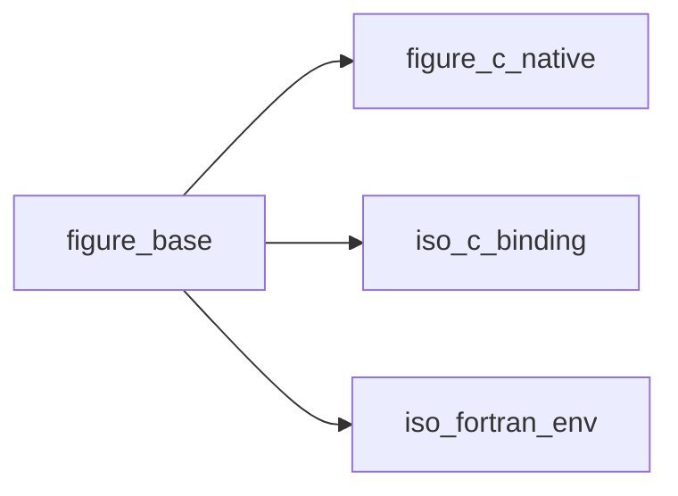
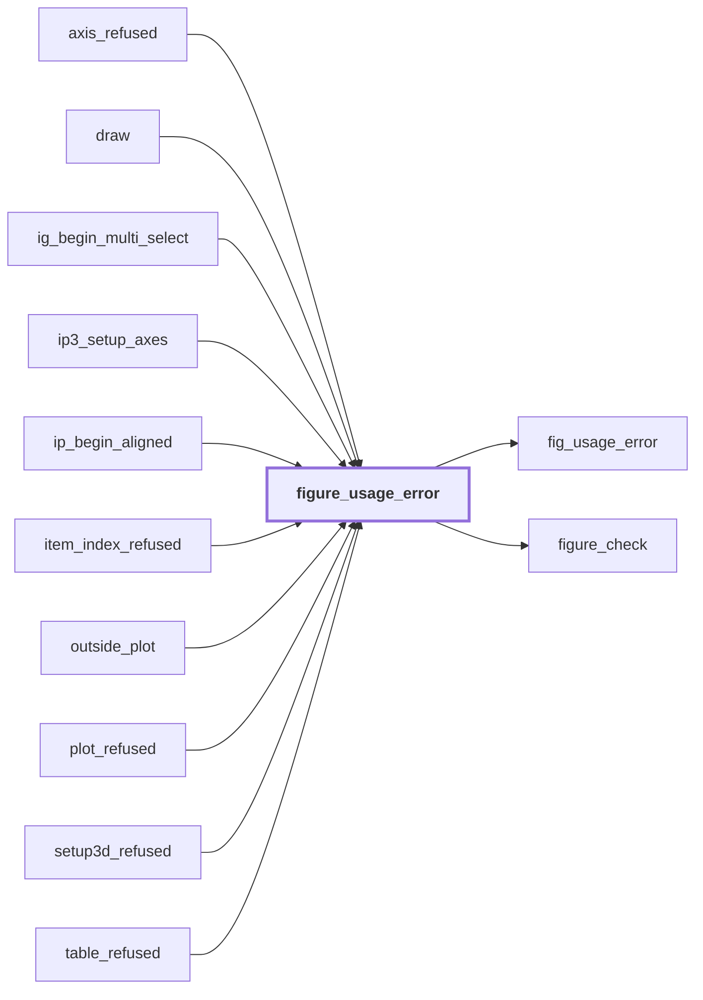
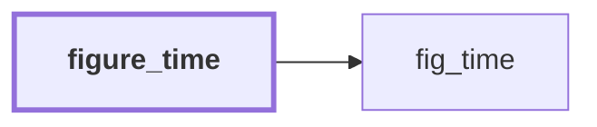
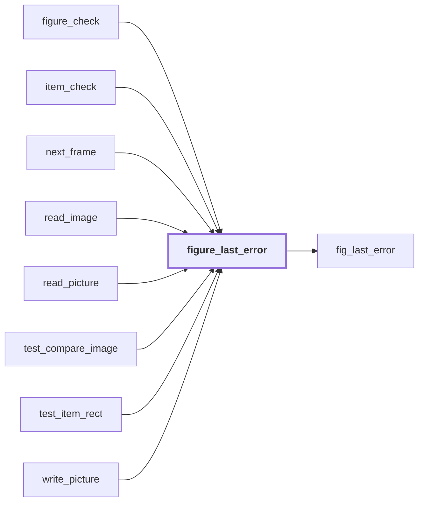
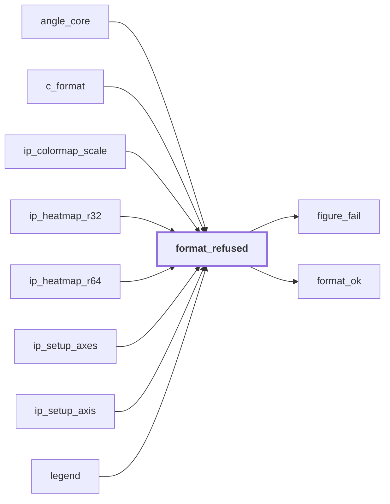

# figure_base

> figure_base, error handling and string conversion shared by the FIGURE modules.

 Procedures that can fail take an optional `stat`: if present it receives `FIG_OK` or a `FIG_ERR_*` code and
 `figure_last_error()` gives the message; if absent, a failure prints the message and stops (`error stop`).

 Usage checks: every drawing procedure asks `figure_draw_refused` first (a task, or no frame open), and every
 begin/end and push/pop pair registers in the scope record of the frame (`figure_scope_open` after the begin,
 `figure_scope_refused` before the end): see errors.md, "Pairing and frames".

**Source**: `src/lib/figure_base.F90`

**Dependencies**



## Contents

- [figure_check](#figure-check)
- [figure_fail](#figure-fail)
- [figure_usage_error](#figure-usage-error)
- [figure_scope_open](#figure-scope-open)
- [figure_time](#figure-time)
- [figure_last_error](#figure-last-error)
- [figure_refused](#figure-refused)
- [figure_draw_refused](#figure-draw-refused)
- [figure_scope_refused](#figure-scope-refused)
- [format_ok](#format-ok)
- [format_refused](#format-refused)
- [cstr](#cstr)

## Variables

| Name | Type | Attributes | Description |
|------|------|------------|-------------|
| `FORMAT_INTEGER` | integer(kind=int32) | parameter | A printf format of an integer value: d, i, u. |
| `FORMAT_REAL` | integer(kind=int32) | parameter | A printf format of a real value: f, F, e, E, g, G, a, A. |
| `SCOPE_WINDOW` | integer(kind=c_int) | parameter | ig_begin, ig_begin_side_bar / ig_end (always paired). |
| `SCOPE_CHILD` | integer(kind=c_int) | parameter | ig_begin_child / ig_end_child (always paired). |
| `SCOPE_TAB_BAR` | integer(kind=c_int) | parameter | ig_begin_tab_bar / ig_end_tab_bar (after true). |
| `SCOPE_TAB` | integer(kind=c_int) | parameter | ig_begin_tab / ig_end_tab (after true). |
| `SCOPE_TABLE` | integer(kind=c_int) | parameter | ig_begin_table / ig_end_table (after true). |
| `SCOPE_TREE` | integer(kind=c_int) | parameter | ig_tree_node / ig_tree_pop (after true). |
| `SCOPE_MAIN_MENU_BAR` | integer(kind=c_int) | parameter | ig_begin_main_menu_bar / ig_end_main_menu_bar (after true). |
| `SCOPE_MENU_BAR` | integer(kind=c_int) | parameter | ig_begin_menu_bar / ig_end_menu_bar (after true). |
| `SCOPE_MENU` | integer(kind=c_int) | parameter | ig_begin_menu / ig_end_menu (after true). |
| `SCOPE_POPUP` | integer(kind=c_int) | parameter | ig_begin_popup, ig_begin_popup_context, ig_begin_popup_modal / ig_end_popup (after true). |
| `SCOPE_PLOT` | integer(kind=c_int) | parameter | ip_begin_plot / ip_end_plot (after true). |
| `SCOPE_SUBPLOTS` | integer(kind=c_int) | parameter | ip_begin_subplots / ip_end_subplots (after true). |
| `SCOPE_DOCK_LAYOUT` | integer(kind=c_int) | parameter | ig_dock_layout_begin / ig_dock_layout_end (after true). |
| `SCOPE_ID` | integer(kind=c_int) | parameter | ig_push_id / ig_pop_id. |
| `SCOPE_DISABLED` | integer(kind=c_int) | parameter | ig_begin_disabled / ig_end_disabled. |
| `SCOPE_FONT` | integer(kind=c_int) | parameter | ig_push_font / ig_pop_font. |
| `SCOPE_STYLE_COLOR` | integer(kind=c_int) | parameter | ig_/ip_push_style_color / ig_/ip_pop_style_color. |
| `SCOPE_STYLE_VAR` | integer(kind=c_int) | parameter | ig_/ip_push_style_var / ig_/ip_pop_style_var. |
| `SCOPE_GROUP` | integer(kind=c_int) | parameter | ig_begin_group / ig_end_group (always paired). |
| `SCOPE_ALIGN` | integer(kind=c_int) | parameter | ig_align_begin / ig_align_end (always paired). |
| `SCOPE_ITEM_WIDTH` | integer(kind=c_int) | parameter | ig_push_item_width / ig_pop_item_width (always paired). |
| `SCOPE_TOOLTIP` | integer(kind=c_int) | parameter | ig_begin_tooltip, ig_begin_item_tooltip / ig_end_tooltip (after true). |
| `SCOPE_PLOT3D` | integer(kind=c_int) | parameter | ip3_begin_plot / ip3_end_plot (after true). |
| `SCOPE_ALIGNED` | integer(kind=c_int) | parameter | ip_begin_aligned / ip_end_aligned (after true). |
| `SCOPE_LEGEND_POPUP` | integer(kind=c_int) | parameter | ip_begin_legend_popup / ip_end_legend_popup (after true). |
| `SCOPE_MULTI_SELECT` | integer(kind=c_int) | parameter | ig_begin_multi_select / ig_end_multi_select (always paired). |

## Subroutines

### figure_check

Store `status` in `stat` if present, else stop on failure with the last error message.

**Attributes**: recursive

```fortran
subroutine figure_check(status, stat)
```

**Arguments**

| Name | Type | Intent | Attributes | Description |
|------|------|--------|------------|-------------|
| `status` | integer(kind=c_int) | in |  | Status from the native layer. |
| `stat` | integer(kind=int32) | out | optional | Status for the caller. |

**Call graph**

```mermaid
flowchart LR
  add_fallback_font["add_fallback_font"] --> figure_check["figure_check"]
  add_layout["add_layout"] --> figure_check["figure_check"]
  add_mesh["add_mesh"] --> figure_check["figure_check"]
  add_window["add_window"] --> figure_check["figure_check"]
  angle_core["angle_core"] --> figure_check["figure_check"]
  changed["changed"] --> figure_check["figure_check"]
  clear["clear"] --> figure_check["figure_check"]
  clip["clip"] --> figure_check["figure_check"]
  code_diff["code_diff"] --> figure_check["figure_check"]
  code_diff_lines["code_diff_lines"] --> figure_check["figure_check"]
  colormap3d_ok["colormap3d_ok"] --> figure_check["figure_check"]
  contour_draw["contour_draw"] --> figure_check["figure_check"]
  drag_core["drag_core"] --> figure_check["figure_check"]
  draw["draw"] --> figure_check["figure_check"]
  draw["draw"] --> figure_check["figure_check"]
  editor_clear_marks["editor_clear_marks"] --> figure_check["figure_check"]
  editor_draw["editor_draw"] --> figure_check["figure_check"]
  editor_find["editor_find"] --> figure_check["figure_check"]
  editor_focus["editor_focus"] --> figure_check["figure_check"]
  editor_goto["editor_goto"] --> figure_check["figure_check"]
  editor_init["editor_init"] --> figure_check["figure_check"]
  editor_insert["editor_insert"] --> figure_check["figure_check"]
  editor_mark["editor_mark"] --> figure_check["figure_check"]
  editor_read_only["editor_read_only"] --> figure_check["figure_check"]
  editor_redo["editor_redo"] --> figure_check["figure_check"]
  editor_replace["editor_replace"] --> figure_check["figure_check"]
  editor_select["editor_select"] --> figure_check["figure_check"]
  editor_set_completions["editor_set_completions"] --> figure_check["figure_check"]
  editor_set_language["editor_set_language"] --> figure_check["figure_check"]
  editor_set_options["editor_set_options"] --> figure_check["figure_check"]
  editor_set_text["editor_set_text"] --> figure_check["figure_check"]
  editor_undo["editor_undo"] --> figure_check["figure_check"]
  field_image["field_image"] --> figure_check["figure_check"]
  fig_read_image["fig_read_image"] --> figure_check["figure_check"]
  figure_draw_refused["figure_draw_refused"] --> figure_check["figure_check"]
  figure_fail["figure_fail"] --> figure_check["figure_check"]
  figure_file_time["figure_file_time"] --> figure_check["figure_check"]
  figure_make_folder["figure_make_folder"] --> figure_check["figure_check"]
  figure_remove["figure_remove"] --> figure_check["figure_check"]
  figure_scope_refused["figure_scope_refused"] --> figure_check["figure_check"]
  figure_set_file_time["figure_set_file_time"] --> figure_check["figure_check"]
  figure_usage_error["figure_usage_error"] --> figure_check["figure_check"]
  file_dialog_result["file_dialog_result"] --> figure_check["figure_check"]
  fit["fit"] --> figure_check["figure_check"]
  get_camera["get_camera"] --> figure_check["figure_check"]
  get_color["get_color"] --> figure_check["figure_check"]
  get_var["get_var"] --> figure_check["figure_check"]
  gizmo["gizmo"] --> figure_check["figure_check"]
  ig_align_begin["ig_align_begin"] --> figure_check["figure_check"]
  ig_canvas["ig_canvas"] --> figure_check["figure_check"]
  ig_color_edit["ig_color_edit"] --> figure_check["figure_check"]
  ig_dock_layout_begin["ig_dock_layout_begin"] --> figure_check["figure_check"]
  ig_dock_layout_end["ig_dock_layout_end"] --> figure_check["figure_check"]
  ig_dock_space["ig_dock_space"] --> figure_check["figure_check"]
  ig_dock_split["ig_dock_split"] --> figure_check["figure_check"]
  ig_dock_window["ig_dock_window"] --> figure_check["figure_check"]
  ig_drag_source["ig_drag_source"] --> figure_check["figure_check"]
  ig_drop_target["ig_drop_target"] --> figure_check["figure_check"]
  ig_gradient_edit["ig_gradient_edit"] --> figure_check["figure_check"]
  ig_invisible_button["ig_invisible_button"] --> figure_check["figure_check"]
  ig_last_item["ig_last_item"] --> figure_check["figure_check"]
  ig_list_box["ig_list_box"] --> figure_check["figure_check"]
  ig_markdown["ig_markdown"] --> figure_check["figure_check"]
  ig_player["ig_player"] --> figure_check["figure_check"]
  ig_pop_font["ig_pop_font"] --> figure_check["figure_check"]
  ig_push_font["ig_push_font"] --> figure_check["figure_check"]
  ig_push_style_color_hex["ig_push_style_color_hex"] --> figure_check["figure_check"]
  ig_push_style_color_rgba["ig_push_style_color_rgba"] --> figure_check["figure_check"]
  ig_push_style_var_i32["ig_push_style_var_i32"] --> figure_check["figure_check"]
  ig_push_style_var_logical["ig_push_style_var_logical"] --> figure_check["figure_check"]
  ig_push_style_var_r64["ig_push_style_var_r64"] --> figure_check["figure_check"]
  ig_push_style_var_vec2["ig_push_style_var_vec2"] --> figure_check["figure_check"]
  ig_radio["ig_radio"] --> figure_check["figure_check"]
  ig_set_clipboard["ig_set_clipboard"] --> figure_check["figure_check"]
  ig_set_next_item_shortcut["ig_set_next_item_shortcut"] --> figure_check["figure_check"]
  ig_shortcut["ig_shortcut"] --> figure_check["figure_check"]
  ig_show_style_editor["ig_show_style_editor"] --> figure_check["figure_check"]
  ig_splitter["ig_splitter"] --> figure_check["figure_check"]
  image["image"] --> figure_check["figure_check"]
  image_result["image_result"] --> figure_check["figure_check"]
  init["init"] --> figure_check["figure_check"]
  init["init"] --> figure_check["figure_check"]
  init["init"] --> figure_check["figure_check"]
  init_headless["init_headless"] --> figure_check["figure_check"]
  init_remote["init_remote"] --> figure_check["figure_check"]
  input_core["input_core"] --> figure_check["figure_check"]
  ip3_image["ip3_image"] --> figure_check["figure_check"]
  ip3_line_r32["ip3_line_r32"] --> figure_check["figure_check"]
  ip3_line_r64["ip3_line_r64"] --> figure_check["figure_check"]
  ip3_mesh_r32["ip3_mesh_r32"] --> figure_check["figure_check"]
  ip3_mesh_r64["ip3_mesh_r64"] --> figure_check["figure_check"]
  ip3_mouse_ray["ip3_mouse_ray"] --> figure_check["figure_check"]
  ip3_plot_to_pixels["ip3_plot_to_pixels"] --> figure_check["figure_check"]
  ip3_quads_r32["ip3_quads_r32"] --> figure_check["figure_check"]
  ip3_quads_r64["ip3_quads_r64"] --> figure_check["figure_check"]
  ip3_scatter_r32["ip3_scatter_r32"] --> figure_check["figure_check"]
  ip3_scatter_r64["ip3_scatter_r64"] --> figure_check["figure_check"]
  ip3_setup_axes["ip3_setup_axes"] --> figure_check["figure_check"]
  ip3_setup_axis["ip3_setup_axis"] --> figure_check["figure_check"]
  ip3_setup_box["ip3_setup_box"] --> figure_check["figure_check"]
  ip3_setup_legend["ip3_setup_legend"] --> figure_check["figure_check"]
  ip3_spec["ip3_spec"] --> figure_check["figure_check"]
  ip3_surface_grid_r32["ip3_surface_grid_r32"] --> figure_check["figure_check"]
  ip3_surface_grid_r64["ip3_surface_grid_r64"] --> figure_check["figure_check"]
  ip3_surface_r32["ip3_surface_r32"] --> figure_check["figure_check"]
  ip3_surface_r64["ip3_surface_r64"] --> figure_check["figure_check"]
  ip3_text["ip3_text"] --> figure_check["figure_check"]
  ip3_triangles_r32["ip3_triangles_r32"] --> figure_check["figure_check"]
  ip3_triangles_r64["ip3_triangles_r64"] --> figure_check["figure_check"]
  ip_annotation["ip_annotation"] --> figure_check["figure_check"]
  ip_bar_groups_r32["ip_bar_groups_r32"] --> figure_check["figure_check"]
  ip_bar_groups_r64["ip_bar_groups_r64"] --> figure_check["figure_check"]
  ip_bars_i32_r32["ip_bars_i32_r32"] --> figure_check["figure_check"]
  ip_bars_i32_r64["ip_bars_i32_r64"] --> figure_check["figure_check"]
  ip_bars_i64_r32["ip_bars_i64_r32"] --> figure_check["figure_check"]
  ip_bars_i64_r64["ip_bars_i64_r64"] --> figure_check["figure_check"]
  ip_bars_r32["ip_bars_r32"] --> figure_check["figure_check"]
  ip_bars_r64["ip_bars_r64"] --> figure_check["figure_check"]
  ip_begin_aligned["ip_begin_aligned"] --> figure_check["figure_check"]
  ip_begin_legend_popup["ip_begin_legend_popup"] --> figure_check["figure_check"]
  ip_cancel_selection["ip_cancel_selection"] --> figure_check["figure_check"]
  ip_colormap["ip_colormap"] --> figure_check["figure_check"]
  ip_colormap_scale["ip_colormap_scale"] --> figure_check["figure_check"]
  ip_colormap_stops["ip_colormap_stops"] --> figure_check["figure_check"]
  ip_digital_r32["ip_digital_r32"] --> figure_check["figure_check"]
  ip_digital_r64["ip_digital_r64"] --> figure_check["figure_check"]
  ip_drag_line_x["ip_drag_line_x"] --> figure_check["figure_check"]
  ip_drag_line_y["ip_drag_line_y"] --> figure_check["figure_check"]
  ip_drag_point["ip_drag_point"] --> figure_check["figure_check"]
  ip_drag_rect["ip_drag_rect"] --> figure_check["figure_check"]
  ip_drop_target["ip_drop_target"] --> figure_check["figure_check"]
  ip_error_bars_i32_r32["ip_error_bars_i32_r32"] --> figure_check["figure_check"]
  ip_error_bars_i32_r64["ip_error_bars_i32_r64"] --> figure_check["figure_check"]
  ip_error_bars_i64_r32["ip_error_bars_i64_r32"] --> figure_check["figure_check"]
  ip_error_bars_i64_r64["ip_error_bars_i64_r64"] --> figure_check["figure_check"]
  ip_error_bars_r32["ip_error_bars_r32"] --> figure_check["figure_check"]
  ip_error_bars_r64["ip_error_bars_r64"] --> figure_check["figure_check"]
  ip_heatmap_r32["ip_heatmap_r32"] --> figure_check["figure_check"]
  ip_heatmap_r64["ip_heatmap_r64"] --> figure_check["figure_check"]
  ip_hide_next_item["ip_hide_next_item"] --> figure_check["figure_check"]
  ip_histogram2d_r32["ip_histogram2d_r32"] --> figure_check["figure_check"]
  ip_histogram2d_r64["ip_histogram2d_r64"] --> figure_check["figure_check"]
  ip_histogram_r32["ip_histogram_r32"] --> figure_check["figure_check"]
  ip_histogram_r64["ip_histogram_r64"] --> figure_check["figure_check"]
  ip_image["ip_image"] --> figure_check["figure_check"]
  ip_inf_lines_i32["ip_inf_lines_i32"] --> figure_check["figure_check"]
  ip_inf_lines_i64["ip_inf_lines_i64"] --> figure_check["figure_check"]
  ip_inf_lines_r32["ip_inf_lines_r32"] --> figure_check["figure_check"]
  ip_inf_lines_r64["ip_inf_lines_r64"] --> figure_check["figure_check"]
  ip_legend_hovered["ip_legend_hovered"] --> figure_check["figure_check"]
  ip_line_i32_r32["ip_line_i32_r32"] --> figure_check["figure_check"]
  ip_line_i32_r64["ip_line_i32_r64"] --> figure_check["figure_check"]
  ip_line_i64_r32["ip_line_i64_r32"] --> figure_check["figure_check"]
  ip_line_i64_r64["ip_line_i64_r64"] --> figure_check["figure_check"]
  ip_line_r32["ip_line_r32"] --> figure_check["figure_check"]
  ip_line_r64["ip_line_r64"] --> figure_check["figure_check"]
  ip_line_row_r32["ip_line_row_r32"] --> figure_check["figure_check"]
  ip_line_row_r64["ip_line_row_r64"] --> figure_check["figure_check"]
  ip_line_values_r32["ip_line_values_r32"] --> figure_check["figure_check"]
  ip_line_values_r64["ip_line_values_r64"] --> figure_check["figure_check"]
  ip_link_axis["ip_link_axis"] --> figure_check["figure_check"]
  ip_load_colormap["ip_load_colormap"] --> figure_check["figure_check"]
  ip_pixels_to_plot["ip_pixels_to_plot"] --> figure_check["figure_check"]
  ip_plot_hovered["ip_plot_hovered"] --> figure_check["figure_check"]
  ip_plot_limits["ip_plot_limits"] --> figure_check["figure_check"]
  ip_plot_mouse["ip_plot_mouse"] --> figure_check["figure_check"]
  ip_plot_selection["ip_plot_selection"] --> figure_check["figure_check"]
  ip_plot_to_pixels["ip_plot_to_pixels"] --> figure_check["figure_check"]
  ip_push_style_color_hex["ip_push_style_color_hex"] --> figure_check["figure_check"]
  ip_push_style_color_rgba["ip_push_style_color_rgba"] --> figure_check["figure_check"]
  ip_push_style_var_logical["ip_push_style_var_logical"] --> figure_check["figure_check"]
  ip_push_style_var_r64["ip_push_style_var_r64"] --> figure_check["figure_check"]
  ip_push_style_var_vec2["ip_push_style_var_vec2"] --> figure_check["figure_check"]
  ip_scatter_i32_r32["ip_scatter_i32_r32"] --> figure_check["figure_check"]
  ip_scatter_i32_r64["ip_scatter_i32_r64"] --> figure_check["figure_check"]
  ip_scatter_i64_r32["ip_scatter_i64_r32"] --> figure_check["figure_check"]
  ip_scatter_i64_r64["ip_scatter_i64_r64"] --> figure_check["figure_check"]
  ip_scatter_r32["ip_scatter_r32"] --> figure_check["figure_check"]
  ip_scatter_r64["ip_scatter_r64"] --> figure_check["figure_check"]
  ip_set_axes["ip_set_axes"] --> figure_check["figure_check"]
  ip_setup_axes["ip_setup_axes"] --> figure_check["figure_check"]
  ip_setup_axes_limits["ip_setup_axes_limits"] --> figure_check["figure_check"]
  ip_setup_axis["ip_setup_axis"] --> figure_check["figure_check"]
  ip_setup_axis_constraints["ip_setup_axis_constraints"] --> figure_check["figure_check"]
  ip_setup_axis_limits["ip_setup_axis_limits"] --> figure_check["figure_check"]
  ip_setup_axis_ticks["ip_setup_axis_ticks"] --> figure_check["figure_check"]
  ip_setup_legend["ip_setup_legend"] --> figure_check["figure_check"]
  ip_shaded_i32_r32["ip_shaded_i32_r32"] --> figure_check["figure_check"]
  ip_shaded_i32_r64["ip_shaded_i32_r64"] --> figure_check["figure_check"]
  ip_shaded_i64_r32["ip_shaded_i64_r32"] --> figure_check["figure_check"]
  ip_shaded_i64_r64["ip_shaded_i64_r64"] --> figure_check["figure_check"]
  ip_shaded_r32["ip_shaded_r32"] --> figure_check["figure_check"]
  ip_shaded_r64["ip_shaded_r64"] --> figure_check["figure_check"]
  ip_shaded_ref_i32_r32["ip_shaded_ref_i32_r32"] --> figure_check["figure_check"]
  ip_shaded_ref_i32_r64["ip_shaded_ref_i32_r64"] --> figure_check["figure_check"]
  ip_shaded_ref_i64_r32["ip_shaded_ref_i64_r32"] --> figure_check["figure_check"]
  ip_shaded_ref_i64_r64["ip_shaded_ref_i64_r64"] --> figure_check["figure_check"]
  ip_shaded_ref_r32["ip_shaded_ref_r32"] --> figure_check["figure_check"]
  ip_shaded_ref_r64["ip_shaded_ref_r64"] --> figure_check["figure_check"]
  ip_spec["ip_spec"] --> figure_check["figure_check"]
  ip_stairs_i32_r32["ip_stairs_i32_r32"] --> figure_check["figure_check"]
  ip_stairs_i32_r64["ip_stairs_i32_r64"] --> figure_check["figure_check"]
  ip_stairs_i64_r32["ip_stairs_i64_r32"] --> figure_check["figure_check"]
  ip_stairs_i64_r64["ip_stairs_i64_r64"] --> figure_check["figure_check"]
  ip_stairs_r32["ip_stairs_r32"] --> figure_check["figure_check"]
  ip_stairs_r64["ip_stairs_r64"] --> figure_check["figure_check"]
  ip_stems_i32_r32["ip_stems_i32_r32"] --> figure_check["figure_check"]
  ip_stems_i32_r64["ip_stems_i32_r64"] --> figure_check["figure_check"]
  ip_stems_i64_r32["ip_stems_i64_r32"] --> figure_check["figure_check"]
  ip_stems_i64_r64["ip_stems_i64_r64"] --> figure_check["figure_check"]
  ip_stems_r32["ip_stems_r32"] --> figure_check["figure_check"]
  ip_stems_r64["ip_stems_r64"] --> figure_check["figure_check"]
  ip_tag["ip_tag"] --> figure_check["figure_check"]
  ip_text["ip_text"] --> figure_check["figure_check"]
  items_list["items_list"] --> figure_check["figure_check"]
  legend["legend"] --> figure_check["figure_check"]
  load["load"] --> figure_check["figure_check"]
  load_layout["load_layout"] --> figure_check["figure_check"]
  load_style["load_style"] --> figure_check["figure_check"]
  message_box["message_box"] --> figure_check["figure_check"]
  next_frame["next_frame"] --> figure_check["figure_check"]
  notify["notify"] --> figure_check["figure_check"]
  open_prefs["open_prefs"] --> figure_check["figure_check"]
  orbit["orbit"] --> figure_check["figure_check"]
  palette_color["palette_color"] --> figure_check["figure_check"]
  pan["pan"] --> figure_check["figure_check"]
  pop["pop"] --> figure_check["figure_check"]
  pref_text["pref_text"] --> figure_check["figure_check"]
  process_exit_code["process_exit_code"] --> figure_check["figure_check"]
  process_kill["process_kill"] --> figure_check["figure_check"]
  process_poll["process_poll"] --> figure_check["figure_check"]
  process_start["process_start"] --> figure_check["figure_check"]
  projection_matrix["projection_matrix"] --> figure_check["figure_check"]
  push_color["push_color"] --> figure_check["figure_check"]
  push_var["push_var"] --> figure_check["figure_check"]
  query["query"] --> figure_check["figure_check"]
  range_core["range_core"] --> figure_check["figure_check"]
  remove["remove"] --> figure_check["figure_check"]
  render_info["render_info"] --> figure_check["figure_check"]
  reset_layout["reset_layout"] --> figure_check["figure_check"]
  save_image["save_image"] --> figure_check["figure_check"]
  save_layout["save_layout"] --> figure_check["figure_check"]
  save_pref_text["save_pref_text"] --> figure_check["figure_check"]
  save_style["save_style"] --> figure_check["figure_check"]
  scalar_set["scalar_set"] --> figure_check["figure_check"]
  set_camera["set_camera"] --> figure_check["figure_check"]
  set_checks["set_checks"] --> figure_check["figure_check"]
  set_color["set_color"] --> figure_check["figure_check"]
  set_docking["set_docking"] --> figure_check["figure_check"]
  set_font["set_font"] --> figure_check["figure_check"]
  set_icon_glyph["set_icon_glyph"] --> figure_check["figure_check"]
  set_icon_image["set_icon_image"] --> figure_check["figure_check"]
  set_mesh["set_mesh"] --> figure_check["figure_check"]
  set_size_limits["set_size_limits"] --> figure_check["figure_check"]
  set_style["set_style"] --> figure_check["figure_check"]
  set_title["set_title"] --> figure_check["figure_check"]
  set_var["set_var"] --> figure_check["figure_check"]
  set_window_visible["set_window_visible"] --> figure_check["figure_check"]
  show_file_browser["show_file_browser"] --> figure_check["figure_check"]
  show_file_dialog["show_file_dialog"] --> figure_check["figure_check"]
  slider_core["slider_core"] --> figure_check["figure_check"]
  style_new["style_new"] --> figure_check["figure_check"]
  switch_layout["switch_layout"] --> figure_check["figure_check"]
  task_cancel["task_cancel"] --> figure_check["figure_check"]
  task_result["task_result"] --> figure_check["figure_check"]
  task_start["task_start"] --> figure_check["figure_check"]
  test_capture["test_capture"] --> figure_check["figure_check"]
  test_click["test_click"] --> figure_check["figure_check"]
  test_drag["test_drag"] --> figure_check["figure_check"]
  test_drawn_extent_name["test_drawn_extent_name"] --> figure_check["figure_check"]
  test_drawn_extent_rgba["test_drawn_extent_rgba"] --> figure_check["figure_check"]
  test_drop["test_drop"] --> figure_check["figure_check"]
  test_field_pixel["test_field_pixel"] --> figure_check["figure_check"]
  test_frame_hit["test_frame_hit"] --> figure_check["figure_check"]
  test_frame_rect["test_frame_rect"] --> figure_check["figure_check"]
  test_frame_state["test_frame_state"] --> figure_check["figure_check"]
  test_glyph["test_glyph"] --> figure_check["figure_check"]
  test_item_click["test_item_click"] --> figure_check["figure_check"]
  test_item_type_text["test_item_type_text"] --> figure_check["figure_check"]
  test_item_value["test_item_value"] --> figure_check["figure_check"]
  test_key["test_key"] --> figure_check["figure_check"]
  test_menu_click["test_menu_click"] --> figure_check["figure_check"]
  test_mouse_button["test_mouse_button"] --> figure_check["figure_check"]
  test_mouse_move["test_mouse_move"] --> figure_check["figure_check"]
  test_next_frame["test_next_frame"] --> figure_check["figure_check"]
  test_plot_tick["test_plot_tick"] --> figure_check["figure_check"]
  test_popup_rect["test_popup_rect"] --> figure_check["figure_check"]
  test_quit["test_quit"] --> figure_check["figure_check"]
  test_record_items["test_record_items"] --> figure_check["figure_check"]
  test_run["test_run"] --> figure_check["figure_check"]
  test_settings_file["test_settings_file"] --> figure_check["figure_check"]
  test_system_theme["test_system_theme"] --> figure_check["figure_check"]
  test_type["test_type"] --> figure_check["figure_check"]
  test_wheel["test_wheel"] --> figure_check["figure_check"]
  test_window_rect["test_window_rect"] --> figure_check["figure_check"]
  text_buffer_set["text_buffer_set"] --> figure_check["figure_check"]
  unclip["unclip"] --> figure_check["figure_check"]
  update["update"] --> figure_check["figure_check"]
  view["view"] --> figure_check["figure_check"]
  view_cube["view_cube"] --> figure_check["figure_check"]
  view_draw["view_draw"] --> figure_check["figure_check"]
  view_find["view_find"] --> figure_check["figure_check"]
  view_init["view_init"] --> figure_check["figure_check"]
  view_load["view_load"] --> figure_check["figure_check"]
  view_matrix["view_matrix"] --> figure_check["figure_check"]
  view_menu["view_menu"] --> figure_check["figure_check"]
  view_scroll_to["view_scroll_to"] --> figure_check["figure_check"]
  view_set_text["view_set_text"] --> figure_check["figure_check"]
  window_visible["window_visible"] --> figure_check["figure_check"]
  zoom["zoom"] --> figure_check["figure_check"]
  figure_check["figure_check"] --> figure_last_error["figure_last_error"]
  classDef focus stroke-width:3px,font-weight:bold
  class figure_check focus
  click add_fallback_font href "figure_app.html#add-fallback-font" "add_fallback_font"
  click add_layout href "figure_app.html#add-layout" "add_layout"
  click add_mesh href "figure_view3d.html#add-mesh" "add_mesh"
  click add_window href "figure_app.html#add-window" "add_window"
  click angle_core href "figure_numbers.html#angle-core" "angle_core"
  click changed href "figure_view3d.html#changed" "changed"
  click clear href "figure_view3d.html#clear" "clear"
  click clip href "figure_view3d.html#clip" "clip"
  click code_diff href "figure_editor.html#code-diff" "code_diff"
  click code_diff_lines href "figure_editor.html#code-diff-lines" "code_diff_lines"
  click colormap3d_ok href "figure_implot3d.html#colormap3d-ok" "colormap3d_ok"
  click contour_draw href "figure_implot.html#contour-draw" "contour_draw"
  click drag_core href "figure_numbers.html#drag-core" "drag_core"
  click draw href "figure_canvas.html#draw" "draw"
  click editor_clear_marks href "figure_editor.html#editor-clear-marks" "editor_clear_marks"
  click editor_draw href "figure_editor.html#editor-draw" "editor_draw"
  click editor_find href "figure_editor.html#editor-find" "editor_find"
  click editor_focus href "figure_editor.html#editor-focus" "editor_focus"
  click editor_goto href "figure_editor.html#editor-goto" "editor_goto"
  click editor_init href "figure_editor.html#editor-init" "editor_init"
  click editor_insert href "figure_editor.html#editor-insert" "editor_insert"
  click editor_mark href "figure_editor.html#editor-mark" "editor_mark"
  click editor_read_only href "figure_editor.html#editor-read-only" "editor_read_only"
  click editor_redo href "figure_editor.html#editor-redo" "editor_redo"
  click editor_replace href "figure_editor.html#editor-replace" "editor_replace"
  click editor_select href "figure_editor.html#editor-select" "editor_select"
  click editor_set_completions href "figure_editor.html#editor-set-completions" "editor_set_completions"
  click editor_set_language href "figure_editor.html#editor-set-language" "editor_set_language"
  click editor_set_options href "figure_editor.html#editor-set-options" "editor_set_options"
  click editor_set_text href "figure_editor.html#editor-set-text" "editor_set_text"
  click editor_undo href "figure_editor.html#editor-undo" "editor_undo"
  click field_image href "figure_implot.html#field-image" "field_image"
  click fig_read_image href "figure_texture.html#fig-read-image" "fig_read_image"
  click figure_draw_refused href "#figure-draw-refused" "figure_draw_refused"
  click figure_fail href "#figure-fail" "figure_fail"
  click figure_file_time href "figure_files.html#figure-file-time" "figure_file_time"
  click figure_make_folder href "figure_files.html#figure-make-folder" "figure_make_folder"
  click figure_remove href "figure_files.html#figure-remove" "figure_remove"
  click figure_scope_refused href "#figure-scope-refused" "figure_scope_refused"
  click figure_set_file_time href "figure_files.html#figure-set-file-time" "figure_set_file_time"
  click figure_usage_error href "#figure-usage-error" "figure_usage_error"
  click file_dialog_result href "figure_app.html#file-dialog-result" "file_dialog_result"
  click fit href "figure_view3d.html#fit" "fit"
  click get_camera href "figure_view3d.html#get-camera" "get_camera"
  click get_color href "figure_style.html#get-color" "get_color"
  click get_var href "figure_style.html#get-var" "get_var"
  click gizmo href "figure_view3d.html#gizmo" "gizmo"
  click ig_align_begin href "figure_group.html#ig-align-begin" "ig_align_begin"
  click ig_canvas href "figure_canvas.html#ig-canvas" "ig_canvas"
  click ig_color_edit href "figure_imgui.html#ig-color-edit" "ig_color_edit"
  click ig_dock_layout_begin href "figure_dock.html#ig-dock-layout-begin" "ig_dock_layout_begin"
  click ig_dock_layout_end href "figure_dock.html#ig-dock-layout-end" "ig_dock_layout_end"
  click ig_dock_space href "figure_dock.html#ig-dock-space" "ig_dock_space"
  click ig_dock_split href "figure_dock.html#ig-dock-split" "ig_dock_split"
  click ig_dock_window href "figure_dock.html#ig-dock-window" "ig_dock_window"
  click ig_drag_source href "figure_imgui.html#ig-drag-source" "ig_drag_source"
  click ig_drop_target href "figure_imgui.html#ig-drop-target" "ig_drop_target"
  click ig_gradient_edit href "figure_implot.html#ig-gradient-edit" "ig_gradient_edit"
  click ig_invisible_button href "figure_canvas.html#ig-invisible-button" "ig_invisible_button"
  click ig_last_item href "figure_imgui.html#ig-last-item" "ig_last_item"
  click ig_list_box href "figure_numbers.html#ig-list-box" "ig_list_box"
  click ig_markdown href "figure_markdown.html#ig-markdown" "ig_markdown"
  click ig_player href "figure_player.html#ig-player" "ig_player"
  click ig_pop_font href "figure_style.html#ig-pop-font" "ig_pop_font"
  click ig_push_font href "figure_style.html#ig-push-font" "ig_push_font"
  click ig_push_style_color_hex href "figure_style.html#ig-push-style-color-hex" "ig_push_style_color_hex"
  click ig_push_style_color_rgba href "figure_style.html#ig-push-style-color-rgba" "ig_push_style_color_rgba"
  click ig_push_style_var_i32 href "figure_style.html#ig-push-style-var-i32" "ig_push_style_var_i32"
  click ig_push_style_var_logical href "figure_style.html#ig-push-style-var-logical" "ig_push_style_var_logical"
  click ig_push_style_var_r64 href "figure_style.html#ig-push-style-var-r64" "ig_push_style_var_r64"
  click ig_push_style_var_vec2 href "figure_style.html#ig-push-style-var-vec2" "ig_push_style_var_vec2"
  click ig_radio href "figure_numbers.html#ig-radio" "ig_radio"
  click ig_set_clipboard href "figure_imgui.html#ig-set-clipboard" "ig_set_clipboard"
  click ig_set_next_item_shortcut href "figure_menu.html#ig-set-next-item-shortcut" "ig_set_next_item_shortcut"
  click ig_shortcut href "figure_menu.html#ig-shortcut" "ig_shortcut"
  click ig_show_style_editor href "figure_style.html#ig-show-style-editor" "ig_show_style_editor"
  click ig_splitter href "figure_imgui.html#ig-splitter" "ig_splitter"
  click image href "figure_view3d.html#image" "image"
  click image_result href "figure_app.html#image-result" "image_result"
  click init href "figure_app.html#init" "init"
  click init_headless href "figure_app.html#init-headless" "init_headless"
  click init_remote href "figure_app.html#init-remote" "init_remote"
  click input_core href "figure_numbers.html#input-core" "input_core"
  click ip3_image href "figure_implot3d.html#ip3-image" "ip3_image"
  click ip3_line_r32 href "figure_implot3d.html#ip3-line-r32" "ip3_line_r32"
  click ip3_line_r64 href "figure_implot3d.html#ip3-line-r64" "ip3_line_r64"
  click ip3_mesh_r32 href "figure_implot3d.html#ip3-mesh-r32" "ip3_mesh_r32"
  click ip3_mesh_r64 href "figure_implot3d.html#ip3-mesh-r64" "ip3_mesh_r64"
  click ip3_mouse_ray href "figure_implot3d.html#ip3-mouse-ray" "ip3_mouse_ray"
  click ip3_plot_to_pixels href "figure_implot3d.html#ip3-plot-to-pixels" "ip3_plot_to_pixels"
  click ip3_quads_r32 href "figure_implot3d.html#ip3-quads-r32" "ip3_quads_r32"
  click ip3_quads_r64 href "figure_implot3d.html#ip3-quads-r64" "ip3_quads_r64"
  click ip3_scatter_r32 href "figure_implot3d.html#ip3-scatter-r32" "ip3_scatter_r32"
  click ip3_scatter_r64 href "figure_implot3d.html#ip3-scatter-r64" "ip3_scatter_r64"
  click ip3_setup_axes href "figure_implot3d.html#ip3-setup-axes" "ip3_setup_axes"
  click ip3_setup_axis href "figure_implot3d.html#ip3-setup-axis" "ip3_setup_axis"
  click ip3_setup_box href "figure_implot3d.html#ip3-setup-box" "ip3_setup_box"
  click ip3_setup_legend href "figure_implot3d.html#ip3-setup-legend" "ip3_setup_legend"
  click ip3_spec href "figure_implot3d.html#ip3-spec" "ip3_spec"
  click ip3_surface_grid_r32 href "figure_implot3d.html#ip3-surface-grid-r32" "ip3_surface_grid_r32"
  click ip3_surface_grid_r64 href "figure_implot3d.html#ip3-surface-grid-r64" "ip3_surface_grid_r64"
  click ip3_surface_r32 href "figure_implot3d.html#ip3-surface-r32" "ip3_surface_r32"
  click ip3_surface_r64 href "figure_implot3d.html#ip3-surface-r64" "ip3_surface_r64"
  click ip3_text href "figure_implot3d.html#ip3-text" "ip3_text"
  click ip3_triangles_r32 href "figure_implot3d.html#ip3-triangles-r32" "ip3_triangles_r32"
  click ip3_triangles_r64 href "figure_implot3d.html#ip3-triangles-r64" "ip3_triangles_r64"
  click ip_annotation href "figure_implot.html#ip-annotation" "ip_annotation"
  click ip_bar_groups_r32 href "figure_implot.html#ip-bar-groups-r32" "ip_bar_groups_r32"
  click ip_bar_groups_r64 href "figure_implot.html#ip-bar-groups-r64" "ip_bar_groups_r64"
  click ip_bars_i32_r32 href "figure_implot.html#ip-bars-i32-r32" "ip_bars_i32_r32"
  click ip_bars_i32_r64 href "figure_implot.html#ip-bars-i32-r64" "ip_bars_i32_r64"
  click ip_bars_i64_r32 href "figure_implot.html#ip-bars-i64-r32" "ip_bars_i64_r32"
  click ip_bars_i64_r64 href "figure_implot.html#ip-bars-i64-r64" "ip_bars_i64_r64"
  click ip_bars_r32 href "figure_implot.html#ip-bars-r32" "ip_bars_r32"
  click ip_bars_r64 href "figure_implot.html#ip-bars-r64" "ip_bars_r64"
  click ip_begin_aligned href "figure_implot.html#ip-begin-aligned" "ip_begin_aligned"
  click ip_begin_legend_popup href "figure_implot.html#ip-begin-legend-popup" "ip_begin_legend_popup"
  click ip_cancel_selection href "figure_implot.html#ip-cancel-selection" "ip_cancel_selection"
  click ip_colormap href "figure_implot.html#ip-colormap" "ip_colormap"
  click ip_colormap_scale href "figure_implot.html#ip-colormap-scale" "ip_colormap_scale"
  click ip_colormap_stops href "figure_implot.html#ip-colormap-stops" "ip_colormap_stops"
  click ip_digital_r32 href "figure_implot.html#ip-digital-r32" "ip_digital_r32"
  click ip_digital_r64 href "figure_implot.html#ip-digital-r64" "ip_digital_r64"
  click ip_drag_line_x href "figure_implot.html#ip-drag-line-x" "ip_drag_line_x"
  click ip_drag_line_y href "figure_implot.html#ip-drag-line-y" "ip_drag_line_y"
  click ip_drag_point href "figure_implot.html#ip-drag-point" "ip_drag_point"
  click ip_drag_rect href "figure_implot.html#ip-drag-rect" "ip_drag_rect"
  click ip_drop_target href "figure_implot.html#ip-drop-target" "ip_drop_target"
  click ip_error_bars_i32_r32 href "figure_implot.html#ip-error-bars-i32-r32" "ip_error_bars_i32_r32"
  click ip_error_bars_i32_r64 href "figure_implot.html#ip-error-bars-i32-r64" "ip_error_bars_i32_r64"
  click ip_error_bars_i64_r32 href "figure_implot.html#ip-error-bars-i64-r32" "ip_error_bars_i64_r32"
  click ip_error_bars_i64_r64 href "figure_implot.html#ip-error-bars-i64-r64" "ip_error_bars_i64_r64"
  click ip_error_bars_r32 href "figure_implot.html#ip-error-bars-r32" "ip_error_bars_r32"
  click ip_error_bars_r64 href "figure_implot.html#ip-error-bars-r64" "ip_error_bars_r64"
  click ip_heatmap_r32 href "figure_implot.html#ip-heatmap-r32" "ip_heatmap_r32"
  click ip_heatmap_r64 href "figure_implot.html#ip-heatmap-r64" "ip_heatmap_r64"
  click ip_hide_next_item href "figure_implot.html#ip-hide-next-item" "ip_hide_next_item"
  click ip_histogram2d_r32 href "figure_implot.html#ip-histogram2d-r32" "ip_histogram2d_r32"
  click ip_histogram2d_r64 href "figure_implot.html#ip-histogram2d-r64" "ip_histogram2d_r64"
  click ip_histogram_r32 href "figure_implot.html#ip-histogram-r32" "ip_histogram_r32"
  click ip_histogram_r64 href "figure_implot.html#ip-histogram-r64" "ip_histogram_r64"
  click ip_image href "figure_implot.html#ip-image" "ip_image"
  click ip_inf_lines_i32 href "figure_implot.html#ip-inf-lines-i32" "ip_inf_lines_i32"
  click ip_inf_lines_i64 href "figure_implot.html#ip-inf-lines-i64" "ip_inf_lines_i64"
  click ip_inf_lines_r32 href "figure_implot.html#ip-inf-lines-r32" "ip_inf_lines_r32"
  click ip_inf_lines_r64 href "figure_implot.html#ip-inf-lines-r64" "ip_inf_lines_r64"
  click ip_legend_hovered href "figure_implot.html#ip-legend-hovered" "ip_legend_hovered"
  click ip_line_i32_r32 href "figure_implot.html#ip-line-i32-r32" "ip_line_i32_r32"
  click ip_line_i32_r64 href "figure_implot.html#ip-line-i32-r64" "ip_line_i32_r64"
  click ip_line_i64_r32 href "figure_implot.html#ip-line-i64-r32" "ip_line_i64_r32"
  click ip_line_i64_r64 href "figure_implot.html#ip-line-i64-r64" "ip_line_i64_r64"
  click ip_line_r32 href "figure_implot.html#ip-line-r32" "ip_line_r32"
  click ip_line_r64 href "figure_implot.html#ip-line-r64" "ip_line_r64"
  click ip_line_row_r32 href "figure_implot.html#ip-line-row-r32" "ip_line_row_r32"
  click ip_line_row_r64 href "figure_implot.html#ip-line-row-r64" "ip_line_row_r64"
  click ip_line_values_r32 href "figure_implot.html#ip-line-values-r32" "ip_line_values_r32"
  click ip_line_values_r64 href "figure_implot.html#ip-line-values-r64" "ip_line_values_r64"
  click ip_link_axis href "figure_implot.html#ip-link-axis" "ip_link_axis"
  click ip_load_colormap href "figure_implot.html#ip-load-colormap" "ip_load_colormap"
  click ip_pixels_to_plot href "figure_implot.html#ip-pixels-to-plot" "ip_pixels_to_plot"
  click ip_plot_hovered href "figure_implot.html#ip-plot-hovered" "ip_plot_hovered"
  click ip_plot_limits href "figure_implot.html#ip-plot-limits" "ip_plot_limits"
  click ip_plot_mouse href "figure_implot.html#ip-plot-mouse" "ip_plot_mouse"
  click ip_plot_selection href "figure_implot.html#ip-plot-selection" "ip_plot_selection"
  click ip_plot_to_pixels href "figure_implot.html#ip-plot-to-pixels" "ip_plot_to_pixels"
  click ip_push_style_color_hex href "figure_style.html#ip-push-style-color-hex" "ip_push_style_color_hex"
  click ip_push_style_color_rgba href "figure_style.html#ip-push-style-color-rgba" "ip_push_style_color_rgba"
  click ip_push_style_var_logical href "figure_style.html#ip-push-style-var-logical" "ip_push_style_var_logical"
  click ip_push_style_var_r64 href "figure_style.html#ip-push-style-var-r64" "ip_push_style_var_r64"
  click ip_push_style_var_vec2 href "figure_style.html#ip-push-style-var-vec2" "ip_push_style_var_vec2"
  click ip_scatter_i32_r32 href "figure_implot.html#ip-scatter-i32-r32" "ip_scatter_i32_r32"
  click ip_scatter_i32_r64 href "figure_implot.html#ip-scatter-i32-r64" "ip_scatter_i32_r64"
  click ip_scatter_i64_r32 href "figure_implot.html#ip-scatter-i64-r32" "ip_scatter_i64_r32"
  click ip_scatter_i64_r64 href "figure_implot.html#ip-scatter-i64-r64" "ip_scatter_i64_r64"
  click ip_scatter_r32 href "figure_implot.html#ip-scatter-r32" "ip_scatter_r32"
  click ip_scatter_r64 href "figure_implot.html#ip-scatter-r64" "ip_scatter_r64"
  click ip_set_axes href "figure_implot.html#ip-set-axes" "ip_set_axes"
  click ip_setup_axes href "figure_implot.html#ip-setup-axes" "ip_setup_axes"
  click ip_setup_axes_limits href "figure_implot.html#ip-setup-axes-limits" "ip_setup_axes_limits"
  click ip_setup_axis href "figure_implot.html#ip-setup-axis" "ip_setup_axis"
  click ip_setup_axis_constraints href "figure_implot.html#ip-setup-axis-constraints" "ip_setup_axis_constraints"
  click ip_setup_axis_limits href "figure_implot.html#ip-setup-axis-limits" "ip_setup_axis_limits"
  click ip_setup_axis_ticks href "figure_implot.html#ip-setup-axis-ticks" "ip_setup_axis_ticks"
  click ip_setup_legend href "figure_implot.html#ip-setup-legend" "ip_setup_legend"
  click ip_shaded_i32_r32 href "figure_implot.html#ip-shaded-i32-r32" "ip_shaded_i32_r32"
  click ip_shaded_i32_r64 href "figure_implot.html#ip-shaded-i32-r64" "ip_shaded_i32_r64"
  click ip_shaded_i64_r32 href "figure_implot.html#ip-shaded-i64-r32" "ip_shaded_i64_r32"
  click ip_shaded_i64_r64 href "figure_implot.html#ip-shaded-i64-r64" "ip_shaded_i64_r64"
  click ip_shaded_r32 href "figure_implot.html#ip-shaded-r32" "ip_shaded_r32"
  click ip_shaded_r64 href "figure_implot.html#ip-shaded-r64" "ip_shaded_r64"
  click ip_shaded_ref_i32_r32 href "figure_implot.html#ip-shaded-ref-i32-r32" "ip_shaded_ref_i32_r32"
  click ip_shaded_ref_i32_r64 href "figure_implot.html#ip-shaded-ref-i32-r64" "ip_shaded_ref_i32_r64"
  click ip_shaded_ref_i64_r32 href "figure_implot.html#ip-shaded-ref-i64-r32" "ip_shaded_ref_i64_r32"
  click ip_shaded_ref_i64_r64 href "figure_implot.html#ip-shaded-ref-i64-r64" "ip_shaded_ref_i64_r64"
  click ip_shaded_ref_r32 href "figure_implot.html#ip-shaded-ref-r32" "ip_shaded_ref_r32"
  click ip_shaded_ref_r64 href "figure_implot.html#ip-shaded-ref-r64" "ip_shaded_ref_r64"
  click ip_spec href "figure_implot.html#ip-spec" "ip_spec"
  click ip_stairs_i32_r32 href "figure_implot.html#ip-stairs-i32-r32" "ip_stairs_i32_r32"
  click ip_stairs_i32_r64 href "figure_implot.html#ip-stairs-i32-r64" "ip_stairs_i32_r64"
  click ip_stairs_i64_r32 href "figure_implot.html#ip-stairs-i64-r32" "ip_stairs_i64_r32"
  click ip_stairs_i64_r64 href "figure_implot.html#ip-stairs-i64-r64" "ip_stairs_i64_r64"
  click ip_stairs_r32 href "figure_implot.html#ip-stairs-r32" "ip_stairs_r32"
  click ip_stairs_r64 href "figure_implot.html#ip-stairs-r64" "ip_stairs_r64"
  click ip_stems_i32_r32 href "figure_implot.html#ip-stems-i32-r32" "ip_stems_i32_r32"
  click ip_stems_i32_r64 href "figure_implot.html#ip-stems-i32-r64" "ip_stems_i32_r64"
  click ip_stems_i64_r32 href "figure_implot.html#ip-stems-i64-r32" "ip_stems_i64_r32"
  click ip_stems_i64_r64 href "figure_implot.html#ip-stems-i64-r64" "ip_stems_i64_r64"
  click ip_stems_r32 href "figure_implot.html#ip-stems-r32" "ip_stems_r32"
  click ip_stems_r64 href "figure_implot.html#ip-stems-r64" "ip_stems_r64"
  click ip_tag href "figure_implot.html#ip-tag" "ip_tag"
  click ip_text href "figure_implot.html#ip-text" "ip_text"
  click items_list href "figure_testing.html#items-list" "items_list"
  click legend href "figure_implot.html#legend" "legend"
  click load href "figure_texture.html#load" "load"
  click load_layout href "figure_app.html#load-layout" "load_layout"
  click load_style href "figure_app.html#load-style" "load_style"
  click message_box href "figure_app.html#message-box" "message_box"
  click next_frame href "figure_app.html#next-frame" "next_frame"
  click notify href "figure_app.html#notify" "notify"
  click open_prefs href "figure_app.html#open-prefs" "open_prefs"
  click orbit href "figure_view3d.html#orbit" "orbit"
  click palette_color href "figure_app.html#palette-color" "palette_color"
  click pan href "figure_view3d.html#pan" "pan"
  click pop href "figure_style.html#pop" "pop"
  click pref_text href "figure_app.html#pref-text" "pref_text"
  click process_exit_code href "figure_process.html#process-exit-code" "process_exit_code"
  click process_kill href "figure_process.html#process-kill" "process_kill"
  click process_poll href "figure_process.html#process-poll" "process_poll"
  click process_start href "figure_process.html#process-start" "process_start"
  click projection_matrix href "figure_view3d.html#projection-matrix" "projection_matrix"
  click push_color href "figure_style.html#push-color" "push_color"
  click push_var href "figure_style.html#push-var" "push_var"
  click query href "figure_view3d.html#query" "query"
  click range_core href "figure_numbers.html#range-core" "range_core"
  click remove href "figure_view3d.html#remove" "remove"
  click render_info href "figure_view3d.html#render-info" "render_info"
  click reset_layout href "figure_app.html#reset-layout" "reset_layout"
  click save_image href "figure_app.html#save-image" "save_image"
  click save_layout href "figure_app.html#save-layout" "save_layout"
  click save_pref_text href "figure_app.html#save-pref-text" "save_pref_text"
  click save_style href "figure_app.html#save-style" "save_style"
  click scalar_set href "figure_view3d.html#scalar-set" "scalar_set"
  click set_camera href "figure_view3d.html#set-camera" "set_camera"
  click set_checks href "figure_app.html#set-checks" "set_checks"
  click set_color href "figure_style.html#set-color" "set_color"
  click set_docking href "figure_app.html#set-docking" "set_docking"
  click set_font href "figure_app.html#set-font" "set_font"
  click set_icon_glyph href "figure_app.html#set-icon-glyph" "set_icon_glyph"
  click set_icon_image href "figure_app.html#set-icon-image" "set_icon_image"
  click set_mesh href "figure_view3d.html#set-mesh" "set_mesh"
  click set_size_limits href "figure_app.html#set-size-limits" "set_size_limits"
  click set_style href "figure_app.html#set-style" "set_style"
  click set_title href "figure_app.html#set-title" "set_title"
  click set_var href "figure_style.html#set-var" "set_var"
  click set_window_visible href "figure_app.html#set-window-visible" "set_window_visible"
  click show_file_browser href "figure_app.html#show-file-browser" "show_file_browser"
  click show_file_dialog href "figure_app.html#show-file-dialog" "show_file_dialog"
  click slider_core href "figure_numbers.html#slider-core" "slider_core"
  click style_new href "figure_view3d.html#style-new" "style_new"
  click switch_layout href "figure_app.html#switch-layout" "switch_layout"
  click task_cancel href "figure_task.html#task-cancel" "task_cancel"
  click task_result href "figure_task.html#task-result" "task_result"
  click task_start href "figure_task.html#task-start" "task_start"
  click test_capture href "figure_testing.html#test-capture" "test_capture"
  click test_click href "figure_testing.html#test-click" "test_click"
  click test_drag href "figure_testing.html#test-drag" "test_drag"
  click test_drawn_extent_name href "figure_testing.html#test-drawn-extent-name" "test_drawn_extent_name"
  click test_drawn_extent_rgba href "figure_testing.html#test-drawn-extent-rgba" "test_drawn_extent_rgba"
  click test_drop href "figure_testing.html#test-drop" "test_drop"
  click test_field_pixel href "figure_testing.html#test-field-pixel" "test_field_pixel"
  click test_frame_hit href "figure_testing.html#test-frame-hit" "test_frame_hit"
  click test_frame_rect href "figure_testing.html#test-frame-rect" "test_frame_rect"
  click test_frame_state href "figure_testing.html#test-frame-state" "test_frame_state"
  click test_glyph href "figure_testing.html#test-glyph" "test_glyph"
  click test_item_click href "figure_testing.html#test-item-click" "test_item_click"
  click test_item_type_text href "figure_testing.html#test-item-type-text" "test_item_type_text"
  click test_item_value href "figure_testing.html#test-item-value" "test_item_value"
  click test_key href "figure_testing.html#test-key" "test_key"
  click test_menu_click href "figure_testing.html#test-menu-click" "test_menu_click"
  click test_mouse_button href "figure_testing.html#test-mouse-button" "test_mouse_button"
  click test_mouse_move href "figure_testing.html#test-mouse-move" "test_mouse_move"
  click test_next_frame href "figure_testing.html#test-next-frame" "test_next_frame"
  click test_plot_tick href "figure_testing.html#test-plot-tick" "test_plot_tick"
  click test_popup_rect href "figure_testing.html#test-popup-rect" "test_popup_rect"
  click test_quit href "figure_testing.html#test-quit" "test_quit"
  click test_record_items href "figure_testing.html#test-record-items" "test_record_items"
  click test_run href "figure_testing.html#test-run" "test_run"
  click test_settings_file href "figure_testing.html#test-settings-file" "test_settings_file"
  click test_system_theme href "figure_testing.html#test-system-theme" "test_system_theme"
  click test_type href "figure_testing.html#test-type" "test_type"
  click test_wheel href "figure_testing.html#test-wheel" "test_wheel"
  click test_window_rect href "figure_testing.html#test-window-rect" "test_window_rect"
  click text_buffer_set href "figure_imgui.html#text-buffer-set" "text_buffer_set"
  click unclip href "figure_view3d.html#unclip" "unclip"
  click update href "figure_texture.html#update" "update"
  click view href "figure_view3d.html#view" "view"
  click view_cube href "figure_view3d.html#view-cube" "view_cube"
  click view_draw href "figure_markdown.html#view-draw" "view_draw"
  click view_find href "figure_markdown.html#view-find" "view_find"
  click view_init href "figure_markdown.html#view-init" "view_init"
  click view_load href "figure_markdown.html#view-load" "view_load"
  click view_matrix href "figure_view3d.html#view-matrix" "view_matrix"
  click view_menu href "figure_app.html#view-menu" "view_menu"
  click view_scroll_to href "figure_markdown.html#view-scroll-to" "view_scroll_to"
  click view_set_text href "figure_markdown.html#view-set-text" "view_set_text"
  click window_visible href "figure_app.html#window-visible" "window_visible"
  click zoom href "figure_view3d.html#zoom" "zoom"
  click figure_last_error href "#figure-last-error" "figure_last_error"
```

### figure_fail

Report a failure detected on the Fortran side: set the last error message, then act as `figure_check`.

**Attributes**: recursive

```fortran
subroutine figure_fail(status, message, stat)
```

**Arguments**

| Name | Type | Intent | Attributes | Description |
|------|------|--------|------------|-------------|
| `status` | integer(kind=c_int) | in |  | Failure status (a `FIG_ERR_*` code). |
| `message` | character(len=*) | in |  | Message for `figure_last_error`. |
| `stat` | integer(kind=int32) | out | optional | Status for the caller. |

**Call graph**

```mermaid
flowchart LR
  alive["alive"] --> figure_fail["figure_fail"]
  alive["alive"] --> figure_fail["figure_fail"]
  alive["alive"] --> figure_fail["figure_fail"]
  axis_refused["axis_refused"] --> figure_fail["figure_fail"]
  bins_ok["bins_ok"] --> figure_fail["figure_fail"]
  c_format["c_format"] --> figure_fail["figure_fail"]
  code_language["code_language"] --> figure_fail["figure_fail"]
  colormap_ok["colormap_ok"] --> figure_fail["figure_fail"]
  connectivity_ok["connectivity_ok"] --> figure_fail["figure_fail"]
  contour_draw["contour_draw"] --> figure_fail["figure_fail"]
  contour_ok["contour_ok"] --> figure_fail["figure_fail"]
  coordinates_ok["coordinates_ok"] --> figure_fail["figure_fail"]
  drag_core["drag_core"] --> figure_fail["figure_fail"]
  drag_ok["drag_ok"] --> figure_fail["figure_fail"]
  draw["draw"] --> figure_fail["figure_fail"]
  editor_set_options["editor_set_options"] --> figure_fail["figure_fail"]
  ends_ok["ends_ok"] --> figure_fail["figure_fail"]
  field_image["field_image"] --> figure_fail["figure_fail"]
  field_ok["field_ok"] --> figure_fail["figure_fail"]
  field_scale_ok["field_scale_ok"] --> figure_fail["figure_fail"]
  format_refused["format_refused"] --> figure_fail["figure_fail"]
  gizmo["gizmo"] --> figure_fail["figure_fail"]
  grid_ok["grid_ok"] --> figure_fail["figure_fail"]
  ig_align_begin["ig_align_begin"] --> figure_fail["figure_fail"]
  ig_align_next["ig_align_next"] --> figure_fail["figure_fail"]
  ig_begin_popup_context["ig_begin_popup_context"] --> figure_fail["figure_fail"]
  ig_begin_table["ig_begin_table"] --> figure_fail["figure_fail"]
  ig_canvas["ig_canvas"] --> figure_fail["figure_fail"]
  ig_color_edit["ig_color_edit"] --> figure_fail["figure_fail"]
  ig_dock_split["ig_dock_split"] --> figure_fail["figure_fail"]
  ig_draw_circle["ig_draw_circle"] --> figure_fail["figure_fail"]
  ig_draw_image["ig_draw_image"] --> figure_fail["figure_fail"]
  ig_focus_here["ig_focus_here"] --> figure_fail["figure_fail"]
  ig_item_hovered["ig_item_hovered"] --> figure_fail["figure_fail"]
  ig_player["ig_player"] --> figure_fail["figure_fail"]
  ig_push_font["ig_push_font"] --> figure_fail["figure_fail"]
  ig_splitter["ig_splitter"] --> figure_fail["figure_fail"]
  ig_table_row_color["ig_table_row_color"] --> figure_fail["figure_fail"]
  ig_table_setup_column["ig_table_setup_column"] --> figure_fail["figure_fail"]
  init_remote["init_remote"] --> figure_fail["figure_fail"]
  int_range["int_range"] --> figure_fail["figure_fail"]
  ip3_image["ip3_image"] --> figure_fail["figure_fail"]
  ip3_quads_r32["ip3_quads_r32"] --> figure_fail["figure_fail"]
  ip3_quads_r64["ip3_quads_r64"] --> figure_fail["figure_fail"]
  ip3_setup_axes["ip3_setup_axes"] --> figure_fail["figure_fail"]
  ip3_setup_axis["ip3_setup_axis"] --> figure_fail["figure_fail"]
  ip3_setup_box["ip3_setup_box"] --> figure_fail["figure_fail"]
  ip3_setup_legend["ip3_setup_legend"] --> figure_fail["figure_fail"]
  ip3_spec["ip3_spec"] --> figure_fail["figure_fail"]
  ip3_text["ip3_text"] --> figure_fail["figure_fail"]
  ip3_triangles_r32["ip3_triangles_r32"] --> figure_fail["figure_fail"]
  ip3_triangles_r64["ip3_triangles_r64"] --> figure_fail["figure_fail"]
  ip_annotation["ip_annotation"] --> figure_fail["figure_fail"]
  ip_bar_groups_r32["ip_bar_groups_r32"] --> figure_fail["figure_fail"]
  ip_bar_groups_r64["ip_bar_groups_r64"] --> figure_fail["figure_fail"]
  ip_begin_legend_popup["ip_begin_legend_popup"] --> figure_fail["figure_fail"]
  ip_colormap["ip_colormap"] --> figure_fail["figure_fail"]
  ip_drag_rect["ip_drag_rect"] --> figure_fail["figure_fail"]
  ip_drop_target["ip_drop_target"] --> figure_fail["figure_fail"]
  ip_image["ip_image"] --> figure_fail["figure_fail"]
  ip_link_axis["ip_link_axis"] --> figure_fail["figure_fail"]
  ip_pixels_to_plot["ip_pixels_to_plot"] --> figure_fail["figure_fail"]
  ip_plot_to_pixels["ip_plot_to_pixels"] --> figure_fail["figure_fail"]
  ip_setup_axes["ip_setup_axes"] --> figure_fail["figure_fail"]
  ip_setup_axis["ip_setup_axis"] --> figure_fail["figure_fail"]
  ip_setup_axis_constraints["ip_setup_axis_constraints"] --> figure_fail["figure_fail"]
  ip_setup_axis_ticks["ip_setup_axis_ticks"] --> figure_fail["figure_fail"]
  ip_setup_legend["ip_setup_legend"] --> figure_fail["figure_fail"]
  ip_spec["ip_spec"] --> figure_fail["figure_fail"]
  ip_tag["ip_tag"] --> figure_fail["figure_fail"]
  ip_text["ip_text"] --> figure_fail["figure_fail"]
  item_check["item_check"] --> figure_fail["figure_fail"]
  item_index_refused["item_index_refused"] --> figure_fail["figure_fail"]
  item_refused["item_refused"] --> figure_fail["figure_fail"]
  language_init["language_init"] --> figure_fail["figure_fail"]
  legend["legend"] --> figure_fail["figure_fail"]
  log_set_cap["log_set_cap"] --> figure_fail["figure_fail"]
  no_components["no_components"] --> figure_fail["figure_fail"]
  notify["notify"] --> figure_fail["figure_fail"]
  pair_ok["pair_ok"] --> figure_fail["figure_fail"]
  points_ok["points_ok"] --> figure_fail["figure_fail"]
  process_exit_code["process_exit_code"] --> figure_fail["figure_fail"]
  process_kill["process_kill"] --> figure_fail["figure_fail"]
  process_poll["process_poll"] --> figure_fail["figure_fail"]
  process_start["process_start"] --> figure_fail["figure_fail"]
  push_color["push_color"] --> figure_fail["figure_fail"]
  push_color_hex["push_color_hex"] --> figure_fail["figure_fail"]
  range_ok["range_ok"] --> figure_fail["figure_fail"]
  read_image["read_image"] --> figure_fail["figure_fail"]
  real_range["real_range"] --> figure_fail["figure_fail"]
  remove["remove"] --> figure_fail["figure_fail"]
  row_ok["row_ok"] --> figure_fail["figure_fail"]
  scale_flags["scale_flags"] --> figure_fail["figure_fail"]
  scale_given_ok["scale_given_ok"] --> figure_fail["figure_fail"]
  scroll_arguments["scroll_arguments"] --> figure_fail["figure_fail"]
  series_ok["series_ok"] --> figure_fail["figure_fail"]
  set_checks["set_checks"] --> figure_fail["figure_fail"]
  set_color["set_color"] --> figure_fail["figure_fail"]
  set_color_hex["set_color_hex"] --> figure_fail["figure_fail"]
  set_font["set_font"] --> figure_fail["figure_fail"]
  set_icon_image["set_icon_image"] --> figure_fail["figure_fail"]
  set_mesh["set_mesh"] --> figure_fail["figure_fail"]
  show_dialog["show_dialog"] --> figure_fail["figure_fail"]
  speed_ok["speed_ok"] --> figure_fail["figure_fail"]
  style_new["style_new"] --> figure_fail["figure_fail"]
  surface["surface"] --> figure_fail["figure_fail"]
  surface_ok["surface_ok"] --> figure_fail["figure_fail"]
  table_refused["table_refused"] --> figure_fail["figure_fail"]
  task_cancel["task_cancel"] --> figure_fail["figure_fail"]
  task_result["task_result"] --> figure_fail["figure_fail"]
  task_start["task_start"] --> figure_fail["figure_fail"]
  test_click["test_click"] --> figure_fail["figure_fail"]
  test_compare_image["test_compare_image"] --> figure_fail["figure_fail"]
  test_drop["test_drop"] --> figure_fail["figure_fail"]
  test_item_checked["test_item_checked"] --> figure_fail["figure_fail"]
  test_item_click["test_item_click"] --> figure_fail["figure_fail"]
  test_item_rect["test_item_rect"] --> figure_fail["figure_fail"]
  test_mouse_button["test_mouse_button"] --> figure_fail["figure_fail"]
  test_system_theme["test_system_theme"] --> figure_fail["figure_fail"]
  triangles_ok["triangles_ok"] --> figure_fail["figure_fail"]
  update["update"] --> figure_fail["figure_fail"]
  view["view"] --> figure_fail["figure_fail"]
  view_cube["view_cube"] --> figure_fail["figure_fail"]
  figure_fail["figure_fail"] --> fig_set_last_error["fig_set_last_error"]
  figure_fail["figure_fail"] --> figure_check["figure_check"]
  classDef focus stroke-width:3px,font-weight:bold
  class figure_fail focus
  click alive href "figure_editor.html#alive" "alive"
  click axis_refused href "figure_implot.html#axis-refused" "axis_refused"
  click bins_ok href "figure_implot.html#bins-ok" "bins_ok"
  click c_format href "figure_numbers.html#c-format" "c_format"
  click code_language href "figure_editor.html#code-language" "code_language"
  click colormap_ok href "figure_implot.html#colormap-ok" "colormap_ok"
  click connectivity_ok href "figure_view3d.html#connectivity-ok" "connectivity_ok"
  click contour_draw href "figure_implot.html#contour-draw" "contour_draw"
  click contour_ok href "figure_implot.html#contour-ok" "contour_ok"
  click coordinates_ok href "figure_canvas.html#coordinates-ok" "coordinates_ok"
  click drag_core href "figure_numbers.html#drag-core" "drag_core"
  click drag_ok href "figure_implot.html#drag-ok" "drag_ok"
  click draw href "figure_canvas.html#draw" "draw"
  click editor_set_options href "figure_editor.html#editor-set-options" "editor_set_options"
  click ends_ok href "figure_implot.html#ends-ok" "ends_ok"
  click field_image href "figure_implot.html#field-image" "field_image"
  click field_ok href "figure_implot.html#field-ok" "field_ok"
  click field_scale_ok href "figure_implot.html#field-scale-ok" "field_scale_ok"
  click format_refused href "#format-refused" "format_refused"
  click gizmo href "figure_view3d.html#gizmo" "gizmo"
  click grid_ok href "figure_implot3d.html#grid-ok" "grid_ok"
  click ig_align_begin href "figure_group.html#ig-align-begin" "ig_align_begin"
  click ig_align_next href "figure_group.html#ig-align-next" "ig_align_next"
  click ig_begin_popup_context href "figure_menu.html#ig-begin-popup-context" "ig_begin_popup_context"
  click ig_begin_table href "figure_group.html#ig-begin-table" "ig_begin_table"
  click ig_canvas href "figure_canvas.html#ig-canvas" "ig_canvas"
  click ig_color_edit href "figure_imgui.html#ig-color-edit" "ig_color_edit"
  click ig_dock_split href "figure_dock.html#ig-dock-split" "ig_dock_split"
  click ig_draw_circle href "figure_canvas.html#ig-draw-circle" "ig_draw_circle"
  click ig_draw_image href "figure_canvas.html#ig-draw-image" "ig_draw_image"
  click ig_focus_here href "figure_imgui.html#ig-focus-here" "ig_focus_here"
  click ig_item_hovered href "figure_imgui.html#ig-item-hovered" "ig_item_hovered"
  click ig_player href "figure_player.html#ig-player" "ig_player"
  click ig_push_font href "figure_style.html#ig-push-font" "ig_push_font"
  click ig_splitter href "figure_imgui.html#ig-splitter" "ig_splitter"
  click ig_table_row_color href "figure_group.html#ig-table-row-color" "ig_table_row_color"
  click ig_table_setup_column href "figure_group.html#ig-table-setup-column" "ig_table_setup_column"
  click init_remote href "figure_app.html#init-remote" "init_remote"
  click int_range href "figure_numbers.html#int-range" "int_range"
  click ip3_image href "figure_implot3d.html#ip3-image" "ip3_image"
  click ip3_quads_r32 href "figure_implot3d.html#ip3-quads-r32" "ip3_quads_r32"
  click ip3_quads_r64 href "figure_implot3d.html#ip3-quads-r64" "ip3_quads_r64"
  click ip3_setup_axes href "figure_implot3d.html#ip3-setup-axes" "ip3_setup_axes"
  click ip3_setup_axis href "figure_implot3d.html#ip3-setup-axis" "ip3_setup_axis"
  click ip3_setup_box href "figure_implot3d.html#ip3-setup-box" "ip3_setup_box"
  click ip3_setup_legend href "figure_implot3d.html#ip3-setup-legend" "ip3_setup_legend"
  click ip3_spec href "figure_implot3d.html#ip3-spec" "ip3_spec"
  click ip3_text href "figure_implot3d.html#ip3-text" "ip3_text"
  click ip3_triangles_r32 href "figure_implot3d.html#ip3-triangles-r32" "ip3_triangles_r32"
  click ip3_triangles_r64 href "figure_implot3d.html#ip3-triangles-r64" "ip3_triangles_r64"
  click ip_annotation href "figure_implot.html#ip-annotation" "ip_annotation"
  click ip_bar_groups_r32 href "figure_implot.html#ip-bar-groups-r32" "ip_bar_groups_r32"
  click ip_bar_groups_r64 href "figure_implot.html#ip-bar-groups-r64" "ip_bar_groups_r64"
  click ip_begin_legend_popup href "figure_implot.html#ip-begin-legend-popup" "ip_begin_legend_popup"
  click ip_colormap href "figure_implot.html#ip-colormap" "ip_colormap"
  click ip_drag_rect href "figure_implot.html#ip-drag-rect" "ip_drag_rect"
  click ip_drop_target href "figure_implot.html#ip-drop-target" "ip_drop_target"
  click ip_image href "figure_implot.html#ip-image" "ip_image"
  click ip_link_axis href "figure_implot.html#ip-link-axis" "ip_link_axis"
  click ip_pixels_to_plot href "figure_implot.html#ip-pixels-to-plot" "ip_pixels_to_plot"
  click ip_plot_to_pixels href "figure_implot.html#ip-plot-to-pixels" "ip_plot_to_pixels"
  click ip_setup_axes href "figure_implot.html#ip-setup-axes" "ip_setup_axes"
  click ip_setup_axis href "figure_implot.html#ip-setup-axis" "ip_setup_axis"
  click ip_setup_axis_constraints href "figure_implot.html#ip-setup-axis-constraints" "ip_setup_axis_constraints"
  click ip_setup_axis_ticks href "figure_implot.html#ip-setup-axis-ticks" "ip_setup_axis_ticks"
  click ip_setup_legend href "figure_implot.html#ip-setup-legend" "ip_setup_legend"
  click ip_spec href "figure_implot.html#ip-spec" "ip_spec"
  click ip_tag href "figure_implot.html#ip-tag" "ip_tag"
  click ip_text href "figure_implot.html#ip-text" "ip_text"
  click item_check href "figure_testing.html#item-check" "item_check"
  click item_index_refused href "figure_imgui.html#item-index-refused" "item_index_refused"
  click item_refused href "figure_implot3d.html#item-refused" "item_refused"
  click language_init href "figure_editor.html#language-init" "language_init"
  click legend href "figure_implot.html#legend" "legend"
  click log_set_cap href "figure_process.html#log-set-cap" "log_set_cap"
  click no_components href "figure_numbers.html#no-components" "no_components"
  click notify href "figure_app.html#notify" "notify"
  click pair_ok href "figure_implot.html#pair-ok" "pair_ok"
  click points_ok href "figure_view3d.html#points-ok" "points_ok"
  click process_exit_code href "figure_process.html#process-exit-code" "process_exit_code"
  click process_kill href "figure_process.html#process-kill" "process_kill"
  click process_poll href "figure_process.html#process-poll" "process_poll"
  click process_start href "figure_process.html#process-start" "process_start"
  click push_color href "figure_style.html#push-color" "push_color"
  click push_color_hex href "figure_style.html#push-color-hex" "push_color_hex"
  click range_ok href "figure_implot.html#range-ok" "range_ok"
  click read_image href "figure_texture.html#read-image" "read_image"
  click real_range href "figure_numbers.html#real-range" "real_range"
  click remove href "figure_view3d.html#remove" "remove"
  click row_ok href "figure_implot.html#row-ok" "row_ok"
  click scale_flags href "figure_numbers.html#scale-flags" "scale_flags"
  click scale_given_ok href "figure_implot.html#scale-given-ok" "scale_given_ok"
  click scroll_arguments href "figure_imgui.html#scroll-arguments" "scroll_arguments"
  click series_ok href "figure_implot.html#series-ok" "series_ok"
  click set_checks href "figure_app.html#set-checks" "set_checks"
  click set_color href "figure_style.html#set-color" "set_color"
  click set_color_hex href "figure_style.html#set-color-hex" "set_color_hex"
  click set_font href "figure_app.html#set-font" "set_font"
  click set_icon_image href "figure_app.html#set-icon-image" "set_icon_image"
  click set_mesh href "figure_view3d.html#set-mesh" "set_mesh"
  click show_dialog href "figure_app.html#show-dialog" "show_dialog"
  click speed_ok href "figure_numbers.html#speed-ok" "speed_ok"
  click style_new href "figure_view3d.html#style-new" "style_new"
  click surface href "figure_view3d.html#surface" "surface"
  click surface_ok href "figure_implot3d.html#surface-ok" "surface_ok"
  click table_refused href "figure_group.html#table-refused" "table_refused"
  click task_cancel href "figure_task.html#task-cancel" "task_cancel"
  click task_result href "figure_task.html#task-result" "task_result"
  click task_start href "figure_task.html#task-start" "task_start"
  click test_click href "figure_testing.html#test-click" "test_click"
  click test_compare_image href "figure_testing.html#test-compare-image" "test_compare_image"
  click test_drop href "figure_testing.html#test-drop" "test_drop"
  click test_item_checked href "figure_testing.html#test-item-checked" "test_item_checked"
  click test_item_click href "figure_testing.html#test-item-click" "test_item_click"
  click test_item_rect href "figure_testing.html#test-item-rect" "test_item_rect"
  click test_mouse_button href "figure_testing.html#test-mouse-button" "test_mouse_button"
  click test_system_theme href "figure_testing.html#test-system-theme" "test_system_theme"
  click triangles_ok href "figure_implot3d.html#triangles-ok" "triangles_ok"
  click update href "figure_texture.html#update" "update"
  click view href "figure_view3d.html#view" "view"
  click view_cube href "figure_view3d.html#view-cube" "view_cube"
  click fig_set_last_error href "figure_c_native.html#fig-set-last-error" "fig_set_last_error"
  click figure_check href "#figure-check" "figure_check"
```

### figure_usage_error

A usage error found by a wrapper (`FIG_ERR_STATE`: a call out of its place, as `ig_table_sort` outside a table):
 returned in `stat` when present; without it, mode 'abort' stops the program here and the other modes keep it for
 the next `app%next_frame`, as the errors of `figure_draw_refused`.

**Attributes**: recursive

```fortran
subroutine figure_usage_error(message, stat)
```

**Arguments**

| Name | Type | Intent | Attributes | Description |
|------|------|--------|------------|-------------|
| `message` | character(len=*) | in |  | The whole message (`: `). |
| `stat` | integer(kind=int32) | out | optional | Status: `FIG_ERR_STATE`. |

**Call graph**



### figure_scope_open

After a begin or a push: its scope in the record of the frame (a begin of the "end only after true" kind that
 returned false is remembered for the message of a wrong end, not opened).

**Attributes**: recursive

```fortran
subroutine figure_scope_open(kind, who, label, returned, aux)
```

**Arguments**

| Name | Type | Intent | Attributes | Description |
|------|------|--------|------------|-------------|
| `kind` | integer(kind=c_int) | in |  | SCOPE_*. |
| `who` | character(len=*) | in |  | The procedure (`ig_begin`). |
| `label` | character(len=*) | in |  | Its label or id (`''` when none). |
| `returned` | logical | in | optional | What the begin returned (default true). |
| `aux` | integer(kind=int32) | in | optional | The dock id of a dock layout. |

**Call graph**



```mermaid
flowchart LR
  ig_align_begin["ig_align_begin"] --> figure_scope_open["figure_scope_open"]
  ig_begin["ig_begin"] --> figure_scope_open["figure_scope_open"]
  ig_begin_child["ig_begin_child"] --> figure_scope_open["figure_scope_open"]
  ig_begin_disabled["ig_begin_disabled"] --> figure_scope_open["figure_scope_open"]
  ig_begin_group["ig_begin_group"] --> figure_scope_open["figure_scope_open"]
  ig_begin_item_tooltip["ig_begin_item_tooltip"] --> figure_scope_open["figure_scope_open"]
  ig_begin_main_menu_bar["ig_begin_main_menu_bar"] --> figure_scope_open["figure_scope_open"]
  ig_begin_menu["ig_begin_menu"] --> figure_scope_open["figure_scope_open"]
  ig_begin_menu_bar["ig_begin_menu_bar"] --> figure_scope_open["figure_scope_open"]
  ig_begin_multi_select["ig_begin_multi_select"] --> figure_scope_open["figure_scope_open"]
  ig_begin_popup["ig_begin_popup"] --> figure_scope_open["figure_scope_open"]
  ig_begin_popup_context["ig_begin_popup_context"] --> figure_scope_open["figure_scope_open"]
  ig_begin_popup_modal["ig_begin_popup_modal"] --> figure_scope_open["figure_scope_open"]
  ig_begin_side_bar["ig_begin_side_bar"] --> figure_scope_open["figure_scope_open"]
  ig_begin_tab["ig_begin_tab"] --> figure_scope_open["figure_scope_open"]
  ig_begin_tab_bar["ig_begin_tab_bar"] --> figure_scope_open["figure_scope_open"]
  ig_begin_table["ig_begin_table"] --> figure_scope_open["figure_scope_open"]
  ig_begin_tooltip["ig_begin_tooltip"] --> figure_scope_open["figure_scope_open"]
  ig_dock_layout_begin["ig_dock_layout_begin"] --> figure_scope_open["figure_scope_open"]
  ig_push_font["ig_push_font"] --> figure_scope_open["figure_scope_open"]
  ig_push_id_i32["ig_push_id_i32"] --> figure_scope_open["figure_scope_open"]
  ig_push_id_str["ig_push_id_str"] --> figure_scope_open["figure_scope_open"]
  ig_push_item_width["ig_push_item_width"] --> figure_scope_open["figure_scope_open"]
  ig_push_style_color_hex["ig_push_style_color_hex"] --> figure_scope_open["figure_scope_open"]
  ig_push_style_color_rgba["ig_push_style_color_rgba"] --> figure_scope_open["figure_scope_open"]
  ig_push_style_var_i32["ig_push_style_var_i32"] --> figure_scope_open["figure_scope_open"]
  ig_push_style_var_logical["ig_push_style_var_logical"] --> figure_scope_open["figure_scope_open"]
  ig_push_style_var_r64["ig_push_style_var_r64"] --> figure_scope_open["figure_scope_open"]
  ig_push_style_var_vec2["ig_push_style_var_vec2"] --> figure_scope_open["figure_scope_open"]
  ig_tree_node["ig_tree_node"] --> figure_scope_open["figure_scope_open"]
  ip3_begin_plot["ip3_begin_plot"] --> figure_scope_open["figure_scope_open"]
  ip_begin_aligned["ip_begin_aligned"] --> figure_scope_open["figure_scope_open"]
  ip_begin_legend_popup["ip_begin_legend_popup"] --> figure_scope_open["figure_scope_open"]
  ip_begin_plot["ip_begin_plot"] --> figure_scope_open["figure_scope_open"]
  ip_begin_subplots["ip_begin_subplots"] --> figure_scope_open["figure_scope_open"]
  ip_push_style_color_hex["ip_push_style_color_hex"] --> figure_scope_open["figure_scope_open"]
  ip_push_style_color_rgba["ip_push_style_color_rgba"] --> figure_scope_open["figure_scope_open"]
  ip_push_style_var_logical["ip_push_style_var_logical"] --> figure_scope_open["figure_scope_open"]
  ip_push_style_var_r64["ip_push_style_var_r64"] --> figure_scope_open["figure_scope_open"]
  ip_push_style_var_vec2["ip_push_style_var_vec2"] --> figure_scope_open["figure_scope_open"]
  figure_scope_open["figure_scope_open"] --> fig_scope_open["fig_scope_open"]
  classDef focus stroke-width:3px,font-weight:bold
  class figure_scope_open focus
  click ig_align_begin href "figure_group.html#ig-align-begin" "ig_align_begin"
  click ig_begin href "figure_imgui.html#ig-begin" "ig_begin"
  click ig_begin_child href "figure_group.html#ig-begin-child" "ig_begin_child"
  click ig_begin_disabled href "figure_group.html#ig-begin-disabled" "ig_begin_disabled"
  click ig_begin_group href "figure_group.html#ig-begin-group" "ig_begin_group"
  click ig_begin_item_tooltip href "figure_imgui.html#ig-begin-item-tooltip" "ig_begin_item_tooltip"
  click ig_begin_main_menu_bar href "figure_menu.html#ig-begin-main-menu-bar" "ig_begin_main_menu_bar"
  click ig_begin_menu href "figure_menu.html#ig-begin-menu" "ig_begin_menu"
  click ig_begin_menu_bar href "figure_menu.html#ig-begin-menu-bar" "ig_begin_menu_bar"
  click ig_begin_multi_select href "figure_group.html#ig-begin-multi-select" "ig_begin_multi_select"
  click ig_begin_popup href "figure_menu.html#ig-begin-popup" "ig_begin_popup"
  click ig_begin_popup_context href "figure_menu.html#ig-begin-popup-context" "ig_begin_popup_context"
  click ig_begin_popup_modal href "figure_menu.html#ig-begin-popup-modal" "ig_begin_popup_modal"
  click ig_begin_side_bar href "figure_imgui.html#ig-begin-side-bar" "ig_begin_side_bar"
  click ig_begin_tab href "figure_group.html#ig-begin-tab" "ig_begin_tab"
  click ig_begin_tab_bar href "figure_group.html#ig-begin-tab-bar" "ig_begin_tab_bar"
  click ig_begin_table href "figure_group.html#ig-begin-table" "ig_begin_table"
  click ig_begin_tooltip href "figure_imgui.html#ig-begin-tooltip" "ig_begin_tooltip"
  click ig_dock_layout_begin href "figure_dock.html#ig-dock-layout-begin" "ig_dock_layout_begin"
  click ig_push_font href "figure_style.html#ig-push-font" "ig_push_font"
  click ig_push_id_i32 href "figure_group.html#ig-push-id-i32" "ig_push_id_i32"
  click ig_push_id_str href "figure_group.html#ig-push-id-str" "ig_push_id_str"
  click ig_push_item_width href "figure_imgui.html#ig-push-item-width" "ig_push_item_width"
  click ig_push_style_color_hex href "figure_style.html#ig-push-style-color-hex" "ig_push_style_color_hex"
  click ig_push_style_color_rgba href "figure_style.html#ig-push-style-color-rgba" "ig_push_style_color_rgba"
  click ig_push_style_var_i32 href "figure_style.html#ig-push-style-var-i32" "ig_push_style_var_i32"
  click ig_push_style_var_logical href "figure_style.html#ig-push-style-var-logical" "ig_push_style_var_logical"
  click ig_push_style_var_r64 href "figure_style.html#ig-push-style-var-r64" "ig_push_style_var_r64"
  click ig_push_style_var_vec2 href "figure_style.html#ig-push-style-var-vec2" "ig_push_style_var_vec2"
  click ig_tree_node href "figure_group.html#ig-tree-node" "ig_tree_node"
  click ip3_begin_plot href "figure_implot3d.html#ip3-begin-plot" "ip3_begin_plot"
  click ip_begin_aligned href "figure_implot.html#ip-begin-aligned" "ip_begin_aligned"
  click ip_begin_legend_popup href "figure_implot.html#ip-begin-legend-popup" "ip_begin_legend_popup"
  click ip_begin_plot href "figure_implot.html#ip-begin-plot" "ip_begin_plot"
  click ip_begin_subplots href "figure_implot.html#ip-begin-subplots" "ip_begin_subplots"
  click ip_push_style_color_hex href "figure_style.html#ip-push-style-color-hex" "ip_push_style_color_hex"
  click ip_push_style_color_rgba href "figure_style.html#ip-push-style-color-rgba" "ip_push_style_color_rgba"
  click ip_push_style_var_logical href "figure_style.html#ip-push-style-var-logical" "ip_push_style_var_logical"
  click ip_push_style_var_r64 href "figure_style.html#ip-push-style-var-r64" "ip_push_style_var_r64"
  click ip_push_style_var_vec2 href "figure_style.html#ip-push-style-var-vec2" "ip_push_style_var_vec2"
  click fig_scope_open href "figure_c_native.html#fig-scope-open" "fig_scope_open"
```

## Functions

### figure_time

Seconds since the first call of `figure_time` in the program, on a monotonic clock (`clock_gettime` of
 `CLOCK_MONOTONIC` on Linux, `mach_absolute_time` on macOS, `QueryPerformanceCounter` on Windows): never
 decreasing, not stepped when the system sets its time, as `system_clock` is under nvfortran.
 Resolution: the counter's tick, 1 ns on Linux, 1 ns or 42 ns on macOS (Intel, Apple silicon), usually 100 ns on
 Windows; the first call returns (about) 0. Callable at any time (before `init*`, after `destroy`) and from any
 thread, a task included; the same in every mode.

**Attributes**: recursive

**Returns**: `real(kind=real64)`

```fortran
function figure_time() result(seconds)
```

**Call graph**



### figure_last_error

Message of the last failed call.

**Attributes**: recursive

**Returns**: `character(len=:)`

```fortran
function figure_last_error() result(msg)
```

**Call graph**



### figure_refused

True when called from a task's worker thread: the drawing entry point `name` must return at once. The task's
 status becomes `FIG_ERR_STATE` with a message naming `name` (given by `t%result`), the task is asked to stop, and
 `stat`, if present, is `FIG_ERR_STATE`. False on the main thread (nothing changes).

**Attributes**: recursive

**Returns**: `logical`

```fortran
function figure_refused(name, stat) result(refused)
```

**Arguments**

| Name | Type | Intent | Attributes | Description |
|------|------|--------|------------|-------------|
| `name` | character(len=*) | in |  | The entry point. |
| `stat` | integer(kind=int32) | out | optional | Status, on a refusal. |

**Call graph**



```mermaid
flowchart LR
  add_fallback_font["add_fallback_font"] --> figure_refused["figure_refused"]
  add_layout["add_layout"] --> figure_refused["figure_refused"]
  add_window["add_window"] --> figure_refused["figure_refused"]
  alive["alive"] --> figure_refused["figure_refused"]
  alive["alive"] --> figure_refused["figure_refused"]
  changed["changed"] --> figure_refused["figure_refused"]
  clear["clear"] --> figure_refused["figure_refused"]
  clip["clip"] --> figure_refused["figure_refused"]
  destroy["destroy"] --> figure_refused["figure_refused"]
  drag_ok["drag_ok"] --> figure_refused["figure_refused"]
  dropped["dropped"] --> figure_refused["figure_refused"]
  editor_init["editor_init"] --> figure_refused["figure_refused"]
  file_dialog_result["file_dialog_result"] --> figure_refused["figure_refused"]
  fit["fit"] --> figure_refused["figure_refused"]
  get_camera["get_camera"] --> figure_refused["figure_refused"]
  ig_get_clipboard["ig_get_clipboard"] --> figure_refused["figure_refused"]
  ig_get_style_color["ig_get_style_color"] --> figure_refused["figure_refused"]
  ig_get_style_var["ig_get_style_var"] --> figure_refused["figure_refused"]
  ig_set_clipboard["ig_set_clipboard"] --> figure_refused["figure_refused"]
  ig_set_style_color_hex["ig_set_style_color_hex"] --> figure_refused["figure_refused"]
  ig_set_style_color_rgba["ig_set_style_color_rgba"] --> figure_refused["figure_refused"]
  ig_set_style_var_i32["ig_set_style_var_i32"] --> figure_refused["figure_refused"]
  ig_set_style_var_logical["ig_set_style_var_logical"] --> figure_refused["figure_refused"]
  ig_set_style_var_r64["ig_set_style_var_r64"] --> figure_refused["figure_refused"]
  ig_set_style_var_vec2["ig_set_style_var_vec2"] --> figure_refused["figure_refused"]
  ig_text_size["ig_text_size"] --> figure_refused["figure_refused"]
  image["image"] --> figure_refused["figure_refused"]
  image_result["image_result"] --> figure_refused["figure_refused"]
  init["init"] --> figure_refused["figure_refused"]
  init["init"] --> figure_refused["figure_refused"]
  init["init"] --> figure_refused["figure_refused"]
  init_headless["init_headless"] --> figure_refused["figure_refused"]
  init_remote["init_remote"] --> figure_refused["figure_refused"]
  ip_colormap["ip_colormap"] --> figure_refused["figure_refused"]
  ip_colormap_names["ip_colormap_names"] --> figure_refused["figure_refused"]
  ip_colormap_stops["ip_colormap_stops"] --> figure_refused["figure_refused"]
  ip_get_style_color["ip_get_style_color"] --> figure_refused["figure_refused"]
  ip_get_style_var["ip_get_style_var"] --> figure_refused["figure_refused"]
  ip_load_colormap["ip_load_colormap"] --> figure_refused["figure_refused"]
  ip_set_style_color_hex["ip_set_style_color_hex"] --> figure_refused["figure_refused"]
  ip_set_style_color_rgba["ip_set_style_color_rgba"] --> figure_refused["figure_refused"]
  ip_set_style_var_logical["ip_set_style_var_logical"] --> figure_refused["figure_refused"]
  ip_set_style_var_r64["ip_set_style_var_r64"] --> figure_refused["figure_refused"]
  ip_set_style_var_vec2["ip_set_style_var_vec2"] --> figure_refused["figure_refused"]
  layout["layout"] --> figure_refused["figure_refused"]
  lines["lines"] --> figure_refused["figure_refused"]
  load["load"] --> figure_refused["figure_refused"]
  load_layout["load_layout"] --> figure_refused["figure_refused"]
  load_pref_int32["load_pref_int32"] --> figure_refused["figure_refused"]
  load_pref_int64["load_pref_int64"] --> figure_refused["figure_refused"]
  load_pref_logical["load_pref_logical"] --> figure_refused["figure_refused"]
  load_pref_real32["load_pref_real32"] --> figure_refused["figure_refused"]
  load_pref_real64["load_pref_real64"] --> figure_refused["figure_refused"]
  load_pref_text["load_pref_text"] --> figure_refused["figure_refused"]
  load_style["load_style"] --> figure_refused["figure_refused"]
  message_box["message_box"] --> figure_refused["figure_refused"]
  next_frame["next_frame"] --> figure_refused["figure_refused"]
  notifications["notifications"] --> figure_refused["figure_refused"]
  notify["notify"] --> figure_refused["figure_refused"]
  open_file_browser["open_file_browser"] --> figure_refused["figure_refused"]
  open_prefs["open_prefs"] --> figure_refused["figure_refused"]
  orbit["orbit"] --> figure_refused["figure_refused"]
  palette_color["palette_color"] --> figure_refused["figure_refused"]
  pan["pan"] --> figure_refused["figure_refused"]
  prefs_file["prefs_file"] --> figure_refused["figure_refused"]
  projection_matrix["projection_matrix"] --> figure_refused["figure_refused"]
  quads["quads"] --> figure_refused["figure_refused"]
  query["query"] --> figure_refused["figure_refused"]
  remove["remove"] --> figure_refused["figure_refused"]
  render_info["render_info"] --> figure_refused["figure_refused"]
  reset_layout["reset_layout"] --> figure_refused["figure_refused"]
  save_file_browser["save_file_browser"] --> figure_refused["figure_refused"]
  save_image["save_image"] --> figure_refused["figure_refused"]
  save_layout["save_layout"] --> figure_refused["figure_refused"]
  save_pref_text["save_pref_text"] --> figure_refused["figure_refused"]
  save_style["save_style"] --> figure_refused["figure_refused"]
  set_camera["set_camera"] --> figure_refused["figure_refused"]
  set_checks["set_checks"] --> figure_refused["figure_refused"]
  set_docking["set_docking"] --> figure_refused["figure_refused"]
  set_font["set_font"] --> figure_refused["figure_refused"]
  set_icon_glyph["set_icon_glyph"] --> figure_refused["figure_refused"]
  set_icon_image["set_icon_image"] --> figure_refused["figure_refused"]
  set_mesh["set_mesh"] --> figure_refused["figure_refused"]
  set_size_limits["set_size_limits"] --> figure_refused["figure_refused"]
  set_style["set_style"] --> figure_refused["figure_refused"]
  set_title["set_title"] --> figure_refused["figure_refused"]
  set_window_visible["set_window_visible"] --> figure_refused["figure_refused"]
  show_dialog["show_dialog"] --> figure_refused["figure_refused"]
  surface["surface"] --> figure_refused["figure_refused"]
  switch_layout["switch_layout"] --> figure_refused["figure_refused"]
  title["title"] --> figure_refused["figure_refused"]
  triangles["triangles"] --> figure_refused["figure_refused"]
  unclip["unclip"] --> figure_refused["figure_refused"]
  update["update"] --> figure_refused["figure_refused"]
  view["view"] --> figure_refused["figure_refused"]
  view_init["view_init"] --> figure_refused["figure_refused"]
  view_matrix["view_matrix"] --> figure_refused["figure_refused"]
  window_visible["window_visible"] --> figure_refused["figure_refused"]
  zoom["zoom"] --> figure_refused["figure_refused"]
  figure_refused["figure_refused"] --> fig_task_refuse["fig_task_refuse"]
  classDef focus stroke-width:3px,font-weight:bold
  class figure_refused focus
  click add_fallback_font href "figure_app.html#add-fallback-font" "add_fallback_font"
  click add_layout href "figure_app.html#add-layout" "add_layout"
  click add_window href "figure_app.html#add-window" "add_window"
  click alive href "figure_editor.html#alive" "alive"
  click changed href "figure_view3d.html#changed" "changed"
  click clear href "figure_view3d.html#clear" "clear"
  click clip href "figure_view3d.html#clip" "clip"
  click destroy href "figure_app.html#destroy" "destroy"
  click drag_ok href "figure_implot.html#drag-ok" "drag_ok"
  click dropped href "figure_app.html#dropped" "dropped"
  click editor_init href "figure_editor.html#editor-init" "editor_init"
  click file_dialog_result href "figure_app.html#file-dialog-result" "file_dialog_result"
  click fit href "figure_view3d.html#fit" "fit"
  click get_camera href "figure_view3d.html#get-camera" "get_camera"
  click ig_get_clipboard href "figure_imgui.html#ig-get-clipboard" "ig_get_clipboard"
  click ig_get_style_color href "figure_style.html#ig-get-style-color" "ig_get_style_color"
  click ig_get_style_var href "figure_style.html#ig-get-style-var" "ig_get_style_var"
  click ig_set_clipboard href "figure_imgui.html#ig-set-clipboard" "ig_set_clipboard"
  click ig_set_style_color_hex href "figure_style.html#ig-set-style-color-hex" "ig_set_style_color_hex"
  click ig_set_style_color_rgba href "figure_style.html#ig-set-style-color-rgba" "ig_set_style_color_rgba"
  click ig_set_style_var_i32 href "figure_style.html#ig-set-style-var-i32" "ig_set_style_var_i32"
  click ig_set_style_var_logical href "figure_style.html#ig-set-style-var-logical" "ig_set_style_var_logical"
  click ig_set_style_var_r64 href "figure_style.html#ig-set-style-var-r64" "ig_set_style_var_r64"
  click ig_set_style_var_vec2 href "figure_style.html#ig-set-style-var-vec2" "ig_set_style_var_vec2"
  click ig_text_size href "figure_imgui.html#ig-text-size" "ig_text_size"
  click image href "figure_view3d.html#image" "image"
  click image_result href "figure_app.html#image-result" "image_result"
  click init href "figure_app.html#init" "init"
  click init_headless href "figure_app.html#init-headless" "init_headless"
  click init_remote href "figure_app.html#init-remote" "init_remote"
  click ip_colormap href "figure_implot.html#ip-colormap" "ip_colormap"
  click ip_colormap_names href "figure_implot.html#ip-colormap-names" "ip_colormap_names"
  click ip_colormap_stops href "figure_implot.html#ip-colormap-stops" "ip_colormap_stops"
  click ip_get_style_color href "figure_style.html#ip-get-style-color" "ip_get_style_color"
  click ip_get_style_var href "figure_style.html#ip-get-style-var" "ip_get_style_var"
  click ip_load_colormap href "figure_implot.html#ip-load-colormap" "ip_load_colormap"
  click ip_set_style_color_hex href "figure_style.html#ip-set-style-color-hex" "ip_set_style_color_hex"
  click ip_set_style_color_rgba href "figure_style.html#ip-set-style-color-rgba" "ip_set_style_color_rgba"
  click ip_set_style_var_logical href "figure_style.html#ip-set-style-var-logical" "ip_set_style_var_logical"
  click ip_set_style_var_r64 href "figure_style.html#ip-set-style-var-r64" "ip_set_style_var_r64"
  click ip_set_style_var_vec2 href "figure_style.html#ip-set-style-var-vec2" "ip_set_style_var_vec2"
  click layout href "figure_app.html#layout" "layout"
  click lines href "figure_view3d.html#lines" "lines"
  click load href "figure_texture.html#load" "load"
  click load_layout href "figure_app.html#load-layout" "load_layout"
  click load_pref_int32 href "figure_app.html#load-pref-int32" "load_pref_int32"
  click load_pref_int64 href "figure_app.html#load-pref-int64" "load_pref_int64"
  click load_pref_logical href "figure_app.html#load-pref-logical" "load_pref_logical"
  click load_pref_real32 href "figure_app.html#load-pref-real32" "load_pref_real32"
  click load_pref_real64 href "figure_app.html#load-pref-real64" "load_pref_real64"
  click load_pref_text href "figure_app.html#load-pref-text" "load_pref_text"
  click load_style href "figure_app.html#load-style" "load_style"
  click message_box href "figure_app.html#message-box" "message_box"
  click next_frame href "figure_app.html#next-frame" "next_frame"
  click notifications href "figure_app.html#notifications" "notifications"
  click notify href "figure_app.html#notify" "notify"
  click open_file_browser href "figure_app.html#open-file-browser" "open_file_browser"
  click open_prefs href "figure_app.html#open-prefs" "open_prefs"
  click orbit href "figure_view3d.html#orbit" "orbit"
  click palette_color href "figure_app.html#palette-color" "palette_color"
  click pan href "figure_view3d.html#pan" "pan"
  click prefs_file href "figure_app.html#prefs-file" "prefs_file"
  click projection_matrix href "figure_view3d.html#projection-matrix" "projection_matrix"
  click quads href "figure_view3d.html#quads" "quads"
  click query href "figure_view3d.html#query" "query"
  click remove href "figure_view3d.html#remove" "remove"
  click render_info href "figure_view3d.html#render-info" "render_info"
  click reset_layout href "figure_app.html#reset-layout" "reset_layout"
  click save_file_browser href "figure_app.html#save-file-browser" "save_file_browser"
  click save_image href "figure_app.html#save-image" "save_image"
  click save_layout href "figure_app.html#save-layout" "save_layout"
  click save_pref_text href "figure_app.html#save-pref-text" "save_pref_text"
  click save_style href "figure_app.html#save-style" "save_style"
  click set_camera href "figure_view3d.html#set-camera" "set_camera"
  click set_checks href "figure_app.html#set-checks" "set_checks"
  click set_docking href "figure_app.html#set-docking" "set_docking"
  click set_font href "figure_app.html#set-font" "set_font"
  click set_icon_glyph href "figure_app.html#set-icon-glyph" "set_icon_glyph"
  click set_icon_image href "figure_app.html#set-icon-image" "set_icon_image"
  click set_mesh href "figure_view3d.html#set-mesh" "set_mesh"
  click set_size_limits href "figure_app.html#set-size-limits" "set_size_limits"
  click set_style href "figure_app.html#set-style" "set_style"
  click set_title href "figure_app.html#set-title" "set_title"
  click set_window_visible href "figure_app.html#set-window-visible" "set_window_visible"
  click show_dialog href "figure_app.html#show-dialog" "show_dialog"
  click surface href "figure_view3d.html#surface" "surface"
  click switch_layout href "figure_app.html#switch-layout" "switch_layout"
  click title href "figure_app.html#title" "title"
  click triangles href "figure_view3d.html#triangles" "triangles"
  click unclip href "figure_view3d.html#unclip" "unclip"
  click update href "figure_texture.html#update" "update"
  click view href "figure_view3d.html#view" "view"
  click view_init href "figure_markdown.html#view-init" "view_init"
  click view_matrix href "figure_view3d.html#view-matrix" "view_matrix"
  click window_visible href "figure_app.html#window-visible" "window_visible"
  click zoom href "figure_view3d.html#zoom" "zoom"
  click fig_task_refuse href "figure_c_native.html#fig-task-refuse" "fig_task_refuse"
```

### figure_draw_refused

True when the drawing entry point `name` must return at once: called from a task (as `figure_refused`), or with
 no frame open (a usage error: `FIG_ERR_STATE`, `<name>: no frame open`). A usage error is returned in `stat`
 when present; without it, mode 'abort' stops the program here and the other modes keep it for the next
 `app%next_frame` (`app%set_checks`). False, `stat` untouched, inside a frame on the main thread.

**Attributes**: recursive

**Returns**: `logical`

```fortran
function figure_draw_refused(name, stat) result(refused)
```

**Arguments**

| Name | Type | Intent | Attributes | Description |
|------|------|--------|------------|-------------|
| `name` | character(len=*) | in |  | The entry point. |
| `stat` | integer(kind=int32) | out | optional | Status, on a refusal. |

**Call graph**

```mermaid
flowchart LR
  clipper_begin["clipper_begin"] --> figure_draw_refused["figure_draw_refused"]
  clipper_step["clipper_step"] --> figure_draw_refused["figure_draw_refused"]
  code_diff["code_diff"] --> figure_draw_refused["figure_draw_refused"]
  draw["draw"] --> figure_draw_refused["figure_draw_refused"]
  draw["draw"] --> figure_draw_refused["figure_draw_refused"]
  editor_draw["editor_draw"] --> figure_draw_refused["figure_draw_refused"]
  field_image["field_image"] --> figure_draw_refused["figure_draw_refused"]
  gizmo["gizmo"] --> figure_draw_refused["figure_draw_refused"]
  ig_align_begin["ig_align_begin"] --> figure_draw_refused["figure_draw_refused"]
  ig_align_next["ig_align_next"] --> figure_draw_refused["figure_draw_refused"]
  ig_align_text_to_frame_padding["ig_align_text_to_frame_padding"] --> figure_draw_refused["figure_draw_refused"]
  ig_any_item_active["ig_any_item_active"] --> figure_draw_refused["figure_draw_refused"]
  ig_any_item_hovered["ig_any_item_hovered"] --> figure_draw_refused["figure_draw_refused"]
  ig_available["ig_available"] --> figure_draw_refused["figure_draw_refused"]
  ig_begin["ig_begin"] --> figure_draw_refused["figure_draw_refused"]
  ig_begin_child["ig_begin_child"] --> figure_draw_refused["figure_draw_refused"]
  ig_begin_disabled["ig_begin_disabled"] --> figure_draw_refused["figure_draw_refused"]
  ig_begin_group["ig_begin_group"] --> figure_draw_refused["figure_draw_refused"]
  ig_begin_item_tooltip["ig_begin_item_tooltip"] --> figure_draw_refused["figure_draw_refused"]
  ig_begin_main_menu_bar["ig_begin_main_menu_bar"] --> figure_draw_refused["figure_draw_refused"]
  ig_begin_menu["ig_begin_menu"] --> figure_draw_refused["figure_draw_refused"]
  ig_begin_menu_bar["ig_begin_menu_bar"] --> figure_draw_refused["figure_draw_refused"]
  ig_begin_multi_select["ig_begin_multi_select"] --> figure_draw_refused["figure_draw_refused"]
  ig_begin_popup["ig_begin_popup"] --> figure_draw_refused["figure_draw_refused"]
  ig_begin_popup_context["ig_begin_popup_context"] --> figure_draw_refused["figure_draw_refused"]
  ig_begin_popup_modal["ig_begin_popup_modal"] --> figure_draw_refused["figure_draw_refused"]
  ig_begin_side_bar["ig_begin_side_bar"] --> figure_draw_refused["figure_draw_refused"]
  ig_begin_tab["ig_begin_tab"] --> figure_draw_refused["figure_draw_refused"]
  ig_begin_tab_bar["ig_begin_tab_bar"] --> figure_draw_refused["figure_draw_refused"]
  ig_begin_table["ig_begin_table"] --> figure_draw_refused["figure_draw_refused"]
  ig_begin_tooltip["ig_begin_tooltip"] --> figure_draw_refused["figure_draw_refused"]
  ig_button["ig_button"] --> figure_draw_refused["figure_draw_refused"]
  ig_canvas["ig_canvas"] --> figure_draw_refused["figure_draw_refused"]
  ig_checkbox["ig_checkbox"] --> figure_draw_refused["figure_draw_refused"]
  ig_close_current_popup["ig_close_current_popup"] --> figure_draw_refused["figure_draw_refused"]
  ig_collapsing_header["ig_collapsing_header"] --> figure_draw_refused["figure_draw_refused"]
  ig_color_edit["ig_color_edit"] --> figure_draw_refused["figure_draw_refused"]
  ig_combo["ig_combo"] --> figure_draw_refused["figure_draw_refused"]
  ig_cursor_screen_pos["ig_cursor_screen_pos"] --> figure_draw_refused["figure_draw_refused"]
  ig_default_focus["ig_default_focus"] --> figure_draw_refused["figure_draw_refused"]
  ig_dock_layout_begin["ig_dock_layout_begin"] --> figure_draw_refused["figure_draw_refused"]
  ig_dock_space["ig_dock_space"] --> figure_draw_refused["figure_draw_refused"]
  ig_dock_split["ig_dock_split"] --> figure_draw_refused["figure_draw_refused"]
  ig_dock_window["ig_dock_window"] --> figure_draw_refused["figure_draw_refused"]
  ig_drag_i32["ig_drag_i32"] --> figure_draw_refused["figure_draw_refused"]
  ig_drag_i32_v["ig_drag_i32_v"] --> figure_draw_refused["figure_draw_refused"]
  ig_drag_i64["ig_drag_i64"] --> figure_draw_refused["figure_draw_refused"]
  ig_drag_i64_v["ig_drag_i64_v"] --> figure_draw_refused["figure_draw_refused"]
  ig_drag_r32["ig_drag_r32"] --> figure_draw_refused["figure_draw_refused"]
  ig_drag_r32_v["ig_drag_r32_v"] --> figure_draw_refused["figure_draw_refused"]
  ig_drag_r64["ig_drag_r64"] --> figure_draw_refused["figure_draw_refused"]
  ig_drag_r64_v["ig_drag_r64_v"] --> figure_draw_refused["figure_draw_refused"]
  ig_drag_range_i32["ig_drag_range_i32"] --> figure_draw_refused["figure_draw_refused"]
  ig_drag_range_i64["ig_drag_range_i64"] --> figure_draw_refused["figure_draw_refused"]
  ig_drag_range_r32["ig_drag_range_r32"] --> figure_draw_refused["figure_draw_refused"]
  ig_drag_range_r64["ig_drag_range_r64"] --> figure_draw_refused["figure_draw_refused"]
  ig_drag_source["ig_drag_source"] --> figure_draw_refused["figure_draw_refused"]
  ig_dragging["ig_dragging"] --> figure_draw_refused["figure_draw_refused"]
  ig_draw_circle["ig_draw_circle"] --> figure_draw_refused["figure_draw_refused"]
  ig_draw_image["ig_draw_image"] --> figure_draw_refused["figure_draw_refused"]
  ig_drop_target["ig_drop_target"] --> figure_draw_refused["figure_draw_refused"]
  ig_dummy["ig_dummy"] --> figure_draw_refused["figure_draw_refused"]
  ig_em_i32["ig_em_i32"] --> figure_draw_refused["figure_draw_refused"]
  ig_em_r64["ig_em_r64"] --> figure_draw_refused["figure_draw_refused"]
  ig_focus_here["ig_focus_here"] --> figure_draw_refused["figure_draw_refused"]
  ig_focus_window["ig_focus_window"] --> figure_draw_refused["figure_draw_refused"]
  ig_font_size["ig_font_size"] --> figure_draw_refused["figure_draw_refused"]
  ig_frame_height["ig_frame_height"] --> figure_draw_refused["figure_draw_refused"]
  ig_get_scroll["ig_get_scroll"] --> figure_draw_refused["figure_draw_refused"]
  ig_gradient_edit["ig_gradient_edit"] --> figure_draw_refused["figure_draw_refused"]
  ig_image["ig_image"] --> figure_draw_refused["figure_draw_refused"]
  ig_indent["ig_indent"] --> figure_draw_refused["figure_draw_refused"]
  ig_input_i32["ig_input_i32"] --> figure_draw_refused["figure_draw_refused"]
  ig_input_i32_v["ig_input_i32_v"] --> figure_draw_refused["figure_draw_refused"]
  ig_input_i64["ig_input_i64"] --> figure_draw_refused["figure_draw_refused"]
  ig_input_i64_v["ig_input_i64_v"] --> figure_draw_refused["figure_draw_refused"]
  ig_input_r32["ig_input_r32"] --> figure_draw_refused["figure_draw_refused"]
  ig_input_r32_v["ig_input_r32_v"] --> figure_draw_refused["figure_draw_refused"]
  ig_input_r64["ig_input_r64"] --> figure_draw_refused["figure_draw_refused"]
  ig_input_r64_v["ig_input_r64_v"] --> figure_draw_refused["figure_draw_refused"]
  ig_input_text["ig_input_text"] --> figure_draw_refused["figure_draw_refused"]
  ig_input_text_multiline["ig_input_text_multiline"] --> figure_draw_refused["figure_draw_refused"]
  ig_invisible_button["ig_invisible_button"] --> figure_draw_refused["figure_draw_refused"]
  ig_item_hovered["ig_item_hovered"] --> figure_draw_refused["figure_draw_refused"]
  ig_item_rect["ig_item_rect"] --> figure_draw_refused["figure_draw_refused"]
  ig_last_item["ig_last_item"] --> figure_draw_refused["figure_draw_refused"]
  ig_line_height["ig_line_height"] --> figure_draw_refused["figure_draw_refused"]
  ig_list_box["ig_list_box"] --> figure_draw_refused["figure_draw_refused"]
  ig_markdown["ig_markdown"] --> figure_draw_refused["figure_draw_refused"]
  ig_menu_item["ig_menu_item"] --> figure_draw_refused["figure_draw_refused"]
  ig_new_line["ig_new_line"] --> figure_draw_refused["figure_draw_refused"]
  ig_open_popup["ig_open_popup"] --> figure_draw_refused["figure_draw_refused"]
  ig_player["ig_player"] --> figure_draw_refused["figure_draw_refused"]
  ig_progress_bar["ig_progress_bar"] --> figure_draw_refused["figure_draw_refused"]
  ig_push_font["ig_push_font"] --> figure_draw_refused["figure_draw_refused"]
  ig_push_id_i32["ig_push_id_i32"] --> figure_draw_refused["figure_draw_refused"]
  ig_push_id_str["ig_push_id_str"] --> figure_draw_refused["figure_draw_refused"]
  ig_push_item_width["ig_push_item_width"] --> figure_draw_refused["figure_draw_refused"]
  ig_push_style_color_hex["ig_push_style_color_hex"] --> figure_draw_refused["figure_draw_refused"]
  ig_push_style_color_rgba["ig_push_style_color_rgba"] --> figure_draw_refused["figure_draw_refused"]
  ig_push_style_var_i32["ig_push_style_var_i32"] --> figure_draw_refused["figure_draw_refused"]
  ig_push_style_var_logical["ig_push_style_var_logical"] --> figure_draw_refused["figure_draw_refused"]
  ig_push_style_var_r64["ig_push_style_var_r64"] --> figure_draw_refused["figure_draw_refused"]
  ig_push_style_var_vec2["ig_push_style_var_vec2"] --> figure_draw_refused["figure_draw_refused"]
  ig_radio["ig_radio"] --> figure_draw_refused["figure_draw_refused"]
  ig_same_line["ig_same_line"] --> figure_draw_refused["figure_draw_refused"]
  ig_scroll_here["ig_scroll_here"] --> figure_draw_refused["figure_draw_refused"]
  ig_scroll_to_pos["ig_scroll_to_pos"] --> figure_draw_refused["figure_draw_refused"]
  ig_selectable["ig_selectable"] --> figure_draw_refused["figure_draw_refused"]
  ig_separator["ig_separator"] --> figure_draw_refused["figure_draw_refused"]
  ig_separator_text["ig_separator_text"] --> figure_draw_refused["figure_draw_refused"]
  ig_set_next_item_open["ig_set_next_item_open"] --> figure_draw_refused["figure_draw_refused"]
  ig_set_next_item_shortcut["ig_set_next_item_shortcut"] --> figure_draw_refused["figure_draw_refused"]
  ig_set_next_item_width["ig_set_next_item_width"] --> figure_draw_refused["figure_draw_refused"]
  ig_set_next_window["ig_set_next_window"] --> figure_draw_refused["figure_draw_refused"]
  ig_set_next_window_dock["ig_set_next_window_dock"] --> figure_draw_refused["figure_draw_refused"]
  ig_set_scroll["ig_set_scroll"] --> figure_draw_refused["figure_draw_refused"]
  ig_shortcut["ig_shortcut"] --> figure_draw_refused["figure_draw_refused"]
  ig_show_demo_window["ig_show_demo_window"] --> figure_draw_refused["figure_draw_refused"]
  ig_show_style_editor["ig_show_style_editor"] --> figure_draw_refused["figure_draw_refused"]
  ig_slider_angle_r32["ig_slider_angle_r32"] --> figure_draw_refused["figure_draw_refused"]
  ig_slider_angle_r64["ig_slider_angle_r64"] --> figure_draw_refused["figure_draw_refused"]
  ig_slider_i32["ig_slider_i32"] --> figure_draw_refused["figure_draw_refused"]
  ig_slider_i32_v["ig_slider_i32_v"] --> figure_draw_refused["figure_draw_refused"]
  ig_slider_i64["ig_slider_i64"] --> figure_draw_refused["figure_draw_refused"]
  ig_slider_i64_v["ig_slider_i64_v"] --> figure_draw_refused["figure_draw_refused"]
  ig_slider_r32["ig_slider_r32"] --> figure_draw_refused["figure_draw_refused"]
  ig_slider_r32_v["ig_slider_r32_v"] --> figure_draw_refused["figure_draw_refused"]
  ig_slider_r64["ig_slider_r64"] --> figure_draw_refused["figure_draw_refused"]
  ig_slider_r64_v["ig_slider_r64_v"] --> figure_draw_refused["figure_draw_refused"]
  ig_spacing["ig_spacing"] --> figure_draw_refused["figure_draw_refused"]
  ig_splitter["ig_splitter"] --> figure_draw_refused["figure_draw_refused"]
  ig_table_column_enabled["ig_table_column_enabled"] --> figure_draw_refused["figure_draw_refused"]
  ig_table_headers_row["ig_table_headers_row"] --> figure_draw_refused["figure_draw_refused"]
  ig_table_hovered_column["ig_table_hovered_column"] --> figure_draw_refused["figure_draw_refused"]
  ig_table_next_column["ig_table_next_column"] --> figure_draw_refused["figure_draw_refused"]
  ig_table_next_row["ig_table_next_row"] --> figure_draw_refused["figure_draw_refused"]
  ig_table_row_color["ig_table_row_color"] --> figure_draw_refused["figure_draw_refused"]
  ig_table_set_column["ig_table_set_column"] --> figure_draw_refused["figure_draw_refused"]
  ig_table_setup_column["ig_table_setup_column"] --> figure_draw_refused["figure_draw_refused"]
  ig_table_sort["ig_table_sort"] --> figure_draw_refused["figure_draw_refused"]
  ig_text["ig_text"] --> figure_draw_refused["figure_draw_refused"]
  ig_text_colored["ig_text_colored"] --> figure_draw_refused["figure_draw_refused"]
  ig_text_disabled["ig_text_disabled"] --> figure_draw_refused["figure_draw_refused"]
  ig_text_link["ig_text_link"] --> figure_draw_refused["figure_draw_refused"]
  ig_text_link_url["ig_text_link_url"] --> figure_draw_refused["figure_draw_refused"]
  ig_text_wrapped["ig_text_wrapped"] --> figure_draw_refused["figure_draw_refused"]
  ig_tool_button["ig_tool_button"] --> figure_draw_refused["figure_draw_refused"]
  ig_tooltip["ig_tooltip"] --> figure_draw_refused["figure_draw_refused"]
  ig_tree_node["ig_tree_node"] --> figure_draw_refused["figure_draw_refused"]
  ig_unindent["ig_unindent"] --> figure_draw_refused["figure_draw_refused"]
  ig_window_dock["ig_window_dock"] --> figure_draw_refused["figure_draw_refused"]
  ip3_begin_plot["ip3_begin_plot"] --> figure_draw_refused["figure_draw_refused"]
  ip3_image["ip3_image"] --> figure_draw_refused["figure_draw_refused"]
  ip3_mouse_ray["ip3_mouse_ray"] --> figure_draw_refused["figure_draw_refused"]
  ip3_plot_to_pixels["ip3_plot_to_pixels"] --> figure_draw_refused["figure_draw_refused"]
  ip3_setup_axes["ip3_setup_axes"] --> figure_draw_refused["figure_draw_refused"]
  ip3_setup_axis["ip3_setup_axis"] --> figure_draw_refused["figure_draw_refused"]
  ip3_setup_box["ip3_setup_box"] --> figure_draw_refused["figure_draw_refused"]
  ip3_setup_legend["ip3_setup_legend"] --> figure_draw_refused["figure_draw_refused"]
  ip3_text["ip3_text"] --> figure_draw_refused["figure_draw_refused"]
  ip_annotation["ip_annotation"] --> figure_draw_refused["figure_draw_refused"]
  ip_bar_groups_r32["ip_bar_groups_r32"] --> figure_draw_refused["figure_draw_refused"]
  ip_bar_groups_r64["ip_bar_groups_r64"] --> figure_draw_refused["figure_draw_refused"]
  ip_bars_i32_r32["ip_bars_i32_r32"] --> figure_draw_refused["figure_draw_refused"]
  ip_bars_i32_r64["ip_bars_i32_r64"] --> figure_draw_refused["figure_draw_refused"]
  ip_bars_i64_r32["ip_bars_i64_r32"] --> figure_draw_refused["figure_draw_refused"]
  ip_bars_i64_r64["ip_bars_i64_r64"] --> figure_draw_refused["figure_draw_refused"]
  ip_bars_r32["ip_bars_r32"] --> figure_draw_refused["figure_draw_refused"]
  ip_bars_r64["ip_bars_r64"] --> figure_draw_refused["figure_draw_refused"]
  ip_begin_aligned["ip_begin_aligned"] --> figure_draw_refused["figure_draw_refused"]
  ip_begin_legend_popup["ip_begin_legend_popup"] --> figure_draw_refused["figure_draw_refused"]
  ip_begin_plot["ip_begin_plot"] --> figure_draw_refused["figure_draw_refused"]
  ip_begin_subplots["ip_begin_subplots"] --> figure_draw_refused["figure_draw_refused"]
  ip_cancel_selection["ip_cancel_selection"] --> figure_draw_refused["figure_draw_refused"]
  ip_colormap_scale["ip_colormap_scale"] --> figure_draw_refused["figure_draw_refused"]
  ip_contour_r32["ip_contour_r32"] --> figure_draw_refused["figure_draw_refused"]
  ip_contour_r64["ip_contour_r64"] --> figure_draw_refused["figure_draw_refused"]
  ip_digital_r32["ip_digital_r32"] --> figure_draw_refused["figure_draw_refused"]
  ip_digital_r64["ip_digital_r64"] --> figure_draw_refused["figure_draw_refused"]
  ip_drag_line_x["ip_drag_line_x"] --> figure_draw_refused["figure_draw_refused"]
  ip_drag_line_y["ip_drag_line_y"] --> figure_draw_refused["figure_draw_refused"]
  ip_drag_point["ip_drag_point"] --> figure_draw_refused["figure_draw_refused"]
  ip_drag_rect["ip_drag_rect"] --> figure_draw_refused["figure_draw_refused"]
  ip_drop_target["ip_drop_target"] --> figure_draw_refused["figure_draw_refused"]
  ip_error_bars_i32_r32["ip_error_bars_i32_r32"] --> figure_draw_refused["figure_draw_refused"]
  ip_error_bars_i32_r64["ip_error_bars_i32_r64"] --> figure_draw_refused["figure_draw_refused"]
  ip_error_bars_i64_r32["ip_error_bars_i64_r32"] --> figure_draw_refused["figure_draw_refused"]
  ip_error_bars_i64_r64["ip_error_bars_i64_r64"] --> figure_draw_refused["figure_draw_refused"]
  ip_error_bars_r32["ip_error_bars_r32"] --> figure_draw_refused["figure_draw_refused"]
  ip_error_bars_r64["ip_error_bars_r64"] --> figure_draw_refused["figure_draw_refused"]
  ip_heatmap_r32["ip_heatmap_r32"] --> figure_draw_refused["figure_draw_refused"]
  ip_heatmap_r64["ip_heatmap_r64"] --> figure_draw_refused["figure_draw_refused"]
  ip_hide_next_item["ip_hide_next_item"] --> figure_draw_refused["figure_draw_refused"]
  ip_histogram2d_r32["ip_histogram2d_r32"] --> figure_draw_refused["figure_draw_refused"]
  ip_histogram2d_r64["ip_histogram2d_r64"] --> figure_draw_refused["figure_draw_refused"]
  ip_histogram_r32["ip_histogram_r32"] --> figure_draw_refused["figure_draw_refused"]
  ip_histogram_r64["ip_histogram_r64"] --> figure_draw_refused["figure_draw_refused"]
  ip_image["ip_image"] --> figure_draw_refused["figure_draw_refused"]
  ip_inf_lines_i32["ip_inf_lines_i32"] --> figure_draw_refused["figure_draw_refused"]
  ip_inf_lines_i64["ip_inf_lines_i64"] --> figure_draw_refused["figure_draw_refused"]
  ip_inf_lines_r32["ip_inf_lines_r32"] --> figure_draw_refused["figure_draw_refused"]
  ip_inf_lines_r64["ip_inf_lines_r64"] --> figure_draw_refused["figure_draw_refused"]
  ip_legend_hovered["ip_legend_hovered"] --> figure_draw_refused["figure_draw_refused"]
  ip_line_i32_r32["ip_line_i32_r32"] --> figure_draw_refused["figure_draw_refused"]
  ip_line_i32_r64["ip_line_i32_r64"] --> figure_draw_refused["figure_draw_refused"]
  ip_line_i64_r32["ip_line_i64_r32"] --> figure_draw_refused["figure_draw_refused"]
  ip_line_i64_r64["ip_line_i64_r64"] --> figure_draw_refused["figure_draw_refused"]
  ip_line_r32["ip_line_r32"] --> figure_draw_refused["figure_draw_refused"]
  ip_line_r64["ip_line_r64"] --> figure_draw_refused["figure_draw_refused"]
  ip_line_row_r32["ip_line_row_r32"] --> figure_draw_refused["figure_draw_refused"]
  ip_line_row_r64["ip_line_row_r64"] --> figure_draw_refused["figure_draw_refused"]
  ip_line_values_r32["ip_line_values_r32"] --> figure_draw_refused["figure_draw_refused"]
  ip_line_values_r64["ip_line_values_r64"] --> figure_draw_refused["figure_draw_refused"]
  ip_link_axis["ip_link_axis"] --> figure_draw_refused["figure_draw_refused"]
  ip_pixels_to_plot["ip_pixels_to_plot"] --> figure_draw_refused["figure_draw_refused"]
  ip_plot_hovered["ip_plot_hovered"] --> figure_draw_refused["figure_draw_refused"]
  ip_plot_limits["ip_plot_limits"] --> figure_draw_refused["figure_draw_refused"]
  ip_plot_mouse["ip_plot_mouse"] --> figure_draw_refused["figure_draw_refused"]
  ip_plot_selection["ip_plot_selection"] --> figure_draw_refused["figure_draw_refused"]
  ip_plot_size["ip_plot_size"] --> figure_draw_refused["figure_draw_refused"]
  ip_plot_to_pixels["ip_plot_to_pixels"] --> figure_draw_refused["figure_draw_refused"]
  ip_push_style_color_hex["ip_push_style_color_hex"] --> figure_draw_refused["figure_draw_refused"]
  ip_push_style_color_rgba["ip_push_style_color_rgba"] --> figure_draw_refused["figure_draw_refused"]
  ip_push_style_var_logical["ip_push_style_var_logical"] --> figure_draw_refused["figure_draw_refused"]
  ip_push_style_var_r64["ip_push_style_var_r64"] --> figure_draw_refused["figure_draw_refused"]
  ip_push_style_var_vec2["ip_push_style_var_vec2"] --> figure_draw_refused["figure_draw_refused"]
  ip_scatter_i32_r32["ip_scatter_i32_r32"] --> figure_draw_refused["figure_draw_refused"]
  ip_scatter_i32_r64["ip_scatter_i32_r64"] --> figure_draw_refused["figure_draw_refused"]
  ip_scatter_i64_r32["ip_scatter_i64_r32"] --> figure_draw_refused["figure_draw_refused"]
  ip_scatter_i64_r64["ip_scatter_i64_r64"] --> figure_draw_refused["figure_draw_refused"]
  ip_scatter_r32["ip_scatter_r32"] --> figure_draw_refused["figure_draw_refused"]
  ip_scatter_r64["ip_scatter_r64"] --> figure_draw_refused["figure_draw_refused"]
  ip_set_axes["ip_set_axes"] --> figure_draw_refused["figure_draw_refused"]
  ip_setup_axes["ip_setup_axes"] --> figure_draw_refused["figure_draw_refused"]
  ip_setup_axes_limits["ip_setup_axes_limits"] --> figure_draw_refused["figure_draw_refused"]
  ip_setup_axis["ip_setup_axis"] --> figure_draw_refused["figure_draw_refused"]
  ip_setup_axis_constraints["ip_setup_axis_constraints"] --> figure_draw_refused["figure_draw_refused"]
  ip_setup_axis_limits["ip_setup_axis_limits"] --> figure_draw_refused["figure_draw_refused"]
  ip_setup_axis_ticks["ip_setup_axis_ticks"] --> figure_draw_refused["figure_draw_refused"]
  ip_setup_legend["ip_setup_legend"] --> figure_draw_refused["figure_draw_refused"]
  ip_shaded_i32_r32["ip_shaded_i32_r32"] --> figure_draw_refused["figure_draw_refused"]
  ip_shaded_i32_r64["ip_shaded_i32_r64"] --> figure_draw_refused["figure_draw_refused"]
  ip_shaded_i64_r32["ip_shaded_i64_r32"] --> figure_draw_refused["figure_draw_refused"]
  ip_shaded_i64_r64["ip_shaded_i64_r64"] --> figure_draw_refused["figure_draw_refused"]
  ip_shaded_r32["ip_shaded_r32"] --> figure_draw_refused["figure_draw_refused"]
  ip_shaded_r64["ip_shaded_r64"] --> figure_draw_refused["figure_draw_refused"]
  ip_shaded_ref_i32_r32["ip_shaded_ref_i32_r32"] --> figure_draw_refused["figure_draw_refused"]
  ip_shaded_ref_i32_r64["ip_shaded_ref_i32_r64"] --> figure_draw_refused["figure_draw_refused"]
  ip_shaded_ref_i64_r32["ip_shaded_ref_i64_r32"] --> figure_draw_refused["figure_draw_refused"]
  ip_shaded_ref_i64_r64["ip_shaded_ref_i64_r64"] --> figure_draw_refused["figure_draw_refused"]
  ip_shaded_ref_r32["ip_shaded_ref_r32"] --> figure_draw_refused["figure_draw_refused"]
  ip_shaded_ref_r64["ip_shaded_ref_r64"] --> figure_draw_refused["figure_draw_refused"]
  ip_stairs_i32_r32["ip_stairs_i32_r32"] --> figure_draw_refused["figure_draw_refused"]
  ip_stairs_i32_r64["ip_stairs_i32_r64"] --> figure_draw_refused["figure_draw_refused"]
  ip_stairs_i64_r32["ip_stairs_i64_r32"] --> figure_draw_refused["figure_draw_refused"]
  ip_stairs_i64_r64["ip_stairs_i64_r64"] --> figure_draw_refused["figure_draw_refused"]
  ip_stairs_r32["ip_stairs_r32"] --> figure_draw_refused["figure_draw_refused"]
  ip_stairs_r64["ip_stairs_r64"] --> figure_draw_refused["figure_draw_refused"]
  ip_stems_i32_r32["ip_stems_i32_r32"] --> figure_draw_refused["figure_draw_refused"]
  ip_stems_i32_r64["ip_stems_i32_r64"] --> figure_draw_refused["figure_draw_refused"]
  ip_stems_i64_r32["ip_stems_i64_r32"] --> figure_draw_refused["figure_draw_refused"]
  ip_stems_i64_r64["ip_stems_i64_r64"] --> figure_draw_refused["figure_draw_refused"]
  ip_stems_r32["ip_stems_r32"] --> figure_draw_refused["figure_draw_refused"]
  ip_stems_r64["ip_stems_r64"] --> figure_draw_refused["figure_draw_refused"]
  ip_tag["ip_tag"] --> figure_draw_refused["figure_draw_refused"]
  ip_text["ip_text"] --> figure_draw_refused["figure_draw_refused"]
  item_refused["item_refused"] --> figure_draw_refused["figure_draw_refused"]
  legend["legend"] --> figure_draw_refused["figure_draw_refused"]
  log_draw["log_draw"] --> figure_draw_refused["figure_draw_refused"]
  surface_ok["surface_ok"] --> figure_draw_refused["figure_draw_refused"]
  view_cube["view_cube"] --> figure_draw_refused["figure_draw_refused"]
  view_draw["view_draw"] --> figure_draw_refused["figure_draw_refused"]
  view_menu["view_menu"] --> figure_draw_refused["figure_draw_refused"]
  figure_draw_refused["figure_draw_refused"] --> fig_draw_refuse["fig_draw_refuse"]
  figure_draw_refused["figure_draw_refused"] --> figure_check["figure_check"]
  classDef focus stroke-width:3px,font-weight:bold
  class figure_draw_refused focus
  click clipper_begin href "figure_group.html#clipper-begin" "clipper_begin"
  click clipper_step href "figure_group.html#clipper-step" "clipper_step"
  click code_diff href "figure_editor.html#code-diff" "code_diff"
  click draw href "figure_canvas.html#draw" "draw"
  click editor_draw href "figure_editor.html#editor-draw" "editor_draw"
  click field_image href "figure_implot.html#field-image" "field_image"
  click gizmo href "figure_view3d.html#gizmo" "gizmo"
  click ig_align_begin href "figure_group.html#ig-align-begin" "ig_align_begin"
  click ig_align_next href "figure_group.html#ig-align-next" "ig_align_next"
  click ig_align_text_to_frame_padding href "figure_imgui.html#ig-align-text-to-frame-padding" "ig_align_text_to_frame_padding"
  click ig_any_item_active href "figure_imgui.html#ig-any-item-active" "ig_any_item_active"
  click ig_any_item_hovered href "figure_imgui.html#ig-any-item-hovered" "ig_any_item_hovered"
  click ig_available href "figure_imgui.html#ig-available" "ig_available"
  click ig_begin href "figure_imgui.html#ig-begin" "ig_begin"
  click ig_begin_child href "figure_group.html#ig-begin-child" "ig_begin_child"
  click ig_begin_disabled href "figure_group.html#ig-begin-disabled" "ig_begin_disabled"
  click ig_begin_group href "figure_group.html#ig-begin-group" "ig_begin_group"
  click ig_begin_item_tooltip href "figure_imgui.html#ig-begin-item-tooltip" "ig_begin_item_tooltip"
  click ig_begin_main_menu_bar href "figure_menu.html#ig-begin-main-menu-bar" "ig_begin_main_menu_bar"
  click ig_begin_menu href "figure_menu.html#ig-begin-menu" "ig_begin_menu"
  click ig_begin_menu_bar href "figure_menu.html#ig-begin-menu-bar" "ig_begin_menu_bar"
  click ig_begin_multi_select href "figure_group.html#ig-begin-multi-select" "ig_begin_multi_select"
  click ig_begin_popup href "figure_menu.html#ig-begin-popup" "ig_begin_popup"
  click ig_begin_popup_context href "figure_menu.html#ig-begin-popup-context" "ig_begin_popup_context"
  click ig_begin_popup_modal href "figure_menu.html#ig-begin-popup-modal" "ig_begin_popup_modal"
  click ig_begin_side_bar href "figure_imgui.html#ig-begin-side-bar" "ig_begin_side_bar"
  click ig_begin_tab href "figure_group.html#ig-begin-tab" "ig_begin_tab"
  click ig_begin_tab_bar href "figure_group.html#ig-begin-tab-bar" "ig_begin_tab_bar"
  click ig_begin_table href "figure_group.html#ig-begin-table" "ig_begin_table"
  click ig_begin_tooltip href "figure_imgui.html#ig-begin-tooltip" "ig_begin_tooltip"
  click ig_button href "figure_imgui.html#ig-button" "ig_button"
  click ig_canvas href "figure_canvas.html#ig-canvas" "ig_canvas"
  click ig_checkbox href "figure_imgui.html#ig-checkbox" "ig_checkbox"
  click ig_close_current_popup href "figure_menu.html#ig-close-current-popup" "ig_close_current_popup"
  click ig_collapsing_header href "figure_group.html#ig-collapsing-header" "ig_collapsing_header"
  click ig_color_edit href "figure_imgui.html#ig-color-edit" "ig_color_edit"
  click ig_combo href "figure_imgui.html#ig-combo" "ig_combo"
  click ig_cursor_screen_pos href "figure_canvas.html#ig-cursor-screen-pos" "ig_cursor_screen_pos"
  click ig_default_focus href "figure_imgui.html#ig-default-focus" "ig_default_focus"
  click ig_dock_layout_begin href "figure_dock.html#ig-dock-layout-begin" "ig_dock_layout_begin"
  click ig_dock_space href "figure_dock.html#ig-dock-space" "ig_dock_space"
  click ig_dock_split href "figure_dock.html#ig-dock-split" "ig_dock_split"
  click ig_dock_window href "figure_dock.html#ig-dock-window" "ig_dock_window"
  click ig_drag_i32 href "figure_numbers.html#ig-drag-i32" "ig_drag_i32"
  click ig_drag_i32_v href "figure_numbers.html#ig-drag-i32-v" "ig_drag_i32_v"
  click ig_drag_i64 href "figure_numbers.html#ig-drag-i64" "ig_drag_i64"
  click ig_drag_i64_v href "figure_numbers.html#ig-drag-i64-v" "ig_drag_i64_v"
  click ig_drag_r32 href "figure_numbers.html#ig-drag-r32" "ig_drag_r32"
  click ig_drag_r32_v href "figure_numbers.html#ig-drag-r32-v" "ig_drag_r32_v"
  click ig_drag_r64 href "figure_numbers.html#ig-drag-r64" "ig_drag_r64"
  click ig_drag_r64_v href "figure_numbers.html#ig-drag-r64-v" "ig_drag_r64_v"
  click ig_drag_range_i32 href "figure_numbers.html#ig-drag-range-i32" "ig_drag_range_i32"
  click ig_drag_range_i64 href "figure_numbers.html#ig-drag-range-i64" "ig_drag_range_i64"
  click ig_drag_range_r32 href "figure_numbers.html#ig-drag-range-r32" "ig_drag_range_r32"
  click ig_drag_range_r64 href "figure_numbers.html#ig-drag-range-r64" "ig_drag_range_r64"
  click ig_drag_source href "figure_imgui.html#ig-drag-source" "ig_drag_source"
  click ig_dragging href "figure_imgui.html#ig-dragging" "ig_dragging"
  click ig_draw_circle href "figure_canvas.html#ig-draw-circle" "ig_draw_circle"
  click ig_draw_image href "figure_canvas.html#ig-draw-image" "ig_draw_image"
  click ig_drop_target href "figure_imgui.html#ig-drop-target" "ig_drop_target"
  click ig_dummy href "figure_imgui.html#ig-dummy" "ig_dummy"
  click ig_em_i32 href "figure_imgui.html#ig-em-i32" "ig_em_i32"
  click ig_em_r64 href "figure_imgui.html#ig-em-r64" "ig_em_r64"
  click ig_focus_here href "figure_imgui.html#ig-focus-here" "ig_focus_here"
  click ig_focus_window href "figure_imgui.html#ig-focus-window" "ig_focus_window"
  click ig_font_size href "figure_imgui.html#ig-font-size" "ig_font_size"
  click ig_frame_height href "figure_imgui.html#ig-frame-height" "ig_frame_height"
  click ig_get_scroll href "figure_imgui.html#ig-get-scroll" "ig_get_scroll"
  click ig_gradient_edit href "figure_implot.html#ig-gradient-edit" "ig_gradient_edit"
  click ig_image href "figure_imgui.html#ig-image" "ig_image"
  click ig_indent href "figure_imgui.html#ig-indent" "ig_indent"
  click ig_input_i32 href "figure_numbers.html#ig-input-i32" "ig_input_i32"
  click ig_input_i32_v href "figure_numbers.html#ig-input-i32-v" "ig_input_i32_v"
  click ig_input_i64 href "figure_numbers.html#ig-input-i64" "ig_input_i64"
  click ig_input_i64_v href "figure_numbers.html#ig-input-i64-v" "ig_input_i64_v"
  click ig_input_r32 href "figure_numbers.html#ig-input-r32" "ig_input_r32"
  click ig_input_r32_v href "figure_numbers.html#ig-input-r32-v" "ig_input_r32_v"
  click ig_input_r64 href "figure_numbers.html#ig-input-r64" "ig_input_r64"
  click ig_input_r64_v href "figure_numbers.html#ig-input-r64-v" "ig_input_r64_v"
  click ig_input_text href "figure_imgui.html#ig-input-text" "ig_input_text"
  click ig_input_text_multiline href "figure_imgui.html#ig-input-text-multiline" "ig_input_text_multiline"
  click ig_invisible_button href "figure_canvas.html#ig-invisible-button" "ig_invisible_button"
  click ig_item_hovered href "figure_imgui.html#ig-item-hovered" "ig_item_hovered"
  click ig_item_rect href "figure_imgui.html#ig-item-rect" "ig_item_rect"
  click ig_last_item href "figure_imgui.html#ig-last-item" "ig_last_item"
  click ig_line_height href "figure_imgui.html#ig-line-height" "ig_line_height"
  click ig_list_box href "figure_numbers.html#ig-list-box" "ig_list_box"
  click ig_markdown href "figure_markdown.html#ig-markdown" "ig_markdown"
  click ig_menu_item href "figure_menu.html#ig-menu-item" "ig_menu_item"
  click ig_new_line href "figure_imgui.html#ig-new-line" "ig_new_line"
  click ig_open_popup href "figure_menu.html#ig-open-popup" "ig_open_popup"
  click ig_player href "figure_player.html#ig-player" "ig_player"
  click ig_progress_bar href "figure_imgui.html#ig-progress-bar" "ig_progress_bar"
  click ig_push_font href "figure_style.html#ig-push-font" "ig_push_font"
  click ig_push_id_i32 href "figure_group.html#ig-push-id-i32" "ig_push_id_i32"
  click ig_push_id_str href "figure_group.html#ig-push-id-str" "ig_push_id_str"
  click ig_push_item_width href "figure_imgui.html#ig-push-item-width" "ig_push_item_width"
  click ig_push_style_color_hex href "figure_style.html#ig-push-style-color-hex" "ig_push_style_color_hex"
  click ig_push_style_color_rgba href "figure_style.html#ig-push-style-color-rgba" "ig_push_style_color_rgba"
  click ig_push_style_var_i32 href "figure_style.html#ig-push-style-var-i32" "ig_push_style_var_i32"
  click ig_push_style_var_logical href "figure_style.html#ig-push-style-var-logical" "ig_push_style_var_logical"
  click ig_push_style_var_r64 href "figure_style.html#ig-push-style-var-r64" "ig_push_style_var_r64"
  click ig_push_style_var_vec2 href "figure_style.html#ig-push-style-var-vec2" "ig_push_style_var_vec2"
  click ig_radio href "figure_numbers.html#ig-radio" "ig_radio"
  click ig_same_line href "figure_imgui.html#ig-same-line" "ig_same_line"
  click ig_scroll_here href "figure_imgui.html#ig-scroll-here" "ig_scroll_here"
  click ig_scroll_to_pos href "figure_imgui.html#ig-scroll-to-pos" "ig_scroll_to_pos"
  click ig_selectable href "figure_imgui.html#ig-selectable" "ig_selectable"
  click ig_separator href "figure_imgui.html#ig-separator" "ig_separator"
  click ig_separator_text href "figure_imgui.html#ig-separator-text" "ig_separator_text"
  click ig_set_next_item_open href "figure_group.html#ig-set-next-item-open" "ig_set_next_item_open"
  click ig_set_next_item_shortcut href "figure_menu.html#ig-set-next-item-shortcut" "ig_set_next_item_shortcut"
  click ig_set_next_item_width href "figure_imgui.html#ig-set-next-item-width" "ig_set_next_item_width"
  click ig_set_next_window href "figure_imgui.html#ig-set-next-window" "ig_set_next_window"
  click ig_set_next_window_dock href "figure_dock.html#ig-set-next-window-dock" "ig_set_next_window_dock"
  click ig_set_scroll href "figure_imgui.html#ig-set-scroll" "ig_set_scroll"
  click ig_shortcut href "figure_menu.html#ig-shortcut" "ig_shortcut"
  click ig_show_demo_window href "figure_imgui.html#ig-show-demo-window" "ig_show_demo_window"
  click ig_show_style_editor href "figure_style.html#ig-show-style-editor" "ig_show_style_editor"
  click ig_slider_angle_r32 href "figure_numbers.html#ig-slider-angle-r32" "ig_slider_angle_r32"
  click ig_slider_angle_r64 href "figure_numbers.html#ig-slider-angle-r64" "ig_slider_angle_r64"
  click ig_slider_i32 href "figure_numbers.html#ig-slider-i32" "ig_slider_i32"
  click ig_slider_i32_v href "figure_numbers.html#ig-slider-i32-v" "ig_slider_i32_v"
  click ig_slider_i64 href "figure_numbers.html#ig-slider-i64" "ig_slider_i64"
  click ig_slider_i64_v href "figure_numbers.html#ig-slider-i64-v" "ig_slider_i64_v"
  click ig_slider_r32 href "figure_numbers.html#ig-slider-r32" "ig_slider_r32"
  click ig_slider_r32_v href "figure_numbers.html#ig-slider-r32-v" "ig_slider_r32_v"
  click ig_slider_r64 href "figure_numbers.html#ig-slider-r64" "ig_slider_r64"
  click ig_slider_r64_v href "figure_numbers.html#ig-slider-r64-v" "ig_slider_r64_v"
  click ig_spacing href "figure_imgui.html#ig-spacing" "ig_spacing"
  click ig_splitter href "figure_imgui.html#ig-splitter" "ig_splitter"
  click ig_table_column_enabled href "figure_group.html#ig-table-column-enabled" "ig_table_column_enabled"
  click ig_table_headers_row href "figure_group.html#ig-table-headers-row" "ig_table_headers_row"
  click ig_table_hovered_column href "figure_group.html#ig-table-hovered-column" "ig_table_hovered_column"
  click ig_table_next_column href "figure_group.html#ig-table-next-column" "ig_table_next_column"
  click ig_table_next_row href "figure_group.html#ig-table-next-row" "ig_table_next_row"
  click ig_table_row_color href "figure_group.html#ig-table-row-color" "ig_table_row_color"
  click ig_table_set_column href "figure_group.html#ig-table-set-column" "ig_table_set_column"
  click ig_table_setup_column href "figure_group.html#ig-table-setup-column" "ig_table_setup_column"
  click ig_table_sort href "figure_group.html#ig-table-sort" "ig_table_sort"
  click ig_text href "figure_imgui.html#ig-text" "ig_text"
  click ig_text_colored href "figure_imgui.html#ig-text-colored" "ig_text_colored"
  click ig_text_disabled href "figure_imgui.html#ig-text-disabled" "ig_text_disabled"
  click ig_text_link href "figure_imgui.html#ig-text-link" "ig_text_link"
  click ig_text_link_url href "figure_imgui.html#ig-text-link-url" "ig_text_link_url"
  click ig_text_wrapped href "figure_imgui.html#ig-text-wrapped" "ig_text_wrapped"
  click ig_tool_button href "figure_imgui.html#ig-tool-button" "ig_tool_button"
  click ig_tooltip href "figure_imgui.html#ig-tooltip" "ig_tooltip"
  click ig_tree_node href "figure_group.html#ig-tree-node" "ig_tree_node"
  click ig_unindent href "figure_imgui.html#ig-unindent" "ig_unindent"
  click ig_window_dock href "figure_dock.html#ig-window-dock" "ig_window_dock"
  click ip3_begin_plot href "figure_implot3d.html#ip3-begin-plot" "ip3_begin_plot"
  click ip3_image href "figure_implot3d.html#ip3-image" "ip3_image"
  click ip3_mouse_ray href "figure_implot3d.html#ip3-mouse-ray" "ip3_mouse_ray"
  click ip3_plot_to_pixels href "figure_implot3d.html#ip3-plot-to-pixels" "ip3_plot_to_pixels"
  click ip3_setup_axes href "figure_implot3d.html#ip3-setup-axes" "ip3_setup_axes"
  click ip3_setup_axis href "figure_implot3d.html#ip3-setup-axis" "ip3_setup_axis"
  click ip3_setup_box href "figure_implot3d.html#ip3-setup-box" "ip3_setup_box"
  click ip3_setup_legend href "figure_implot3d.html#ip3-setup-legend" "ip3_setup_legend"
  click ip3_text href "figure_implot3d.html#ip3-text" "ip3_text"
  click ip_annotation href "figure_implot.html#ip-annotation" "ip_annotation"
  click ip_bar_groups_r32 href "figure_implot.html#ip-bar-groups-r32" "ip_bar_groups_r32"
  click ip_bar_groups_r64 href "figure_implot.html#ip-bar-groups-r64" "ip_bar_groups_r64"
  click ip_bars_i32_r32 href "figure_implot.html#ip-bars-i32-r32" "ip_bars_i32_r32"
  click ip_bars_i32_r64 href "figure_implot.html#ip-bars-i32-r64" "ip_bars_i32_r64"
  click ip_bars_i64_r32 href "figure_implot.html#ip-bars-i64-r32" "ip_bars_i64_r32"
  click ip_bars_i64_r64 href "figure_implot.html#ip-bars-i64-r64" "ip_bars_i64_r64"
  click ip_bars_r32 href "figure_implot.html#ip-bars-r32" "ip_bars_r32"
  click ip_bars_r64 href "figure_implot.html#ip-bars-r64" "ip_bars_r64"
  click ip_begin_aligned href "figure_implot.html#ip-begin-aligned" "ip_begin_aligned"
  click ip_begin_legend_popup href "figure_implot.html#ip-begin-legend-popup" "ip_begin_legend_popup"
  click ip_begin_plot href "figure_implot.html#ip-begin-plot" "ip_begin_plot"
  click ip_begin_subplots href "figure_implot.html#ip-begin-subplots" "ip_begin_subplots"
  click ip_cancel_selection href "figure_implot.html#ip-cancel-selection" "ip_cancel_selection"
  click ip_colormap_scale href "figure_implot.html#ip-colormap-scale" "ip_colormap_scale"
  click ip_contour_r32 href "figure_implot.html#ip-contour-r32" "ip_contour_r32"
  click ip_contour_r64 href "figure_implot.html#ip-contour-r64" "ip_contour_r64"
  click ip_digital_r32 href "figure_implot.html#ip-digital-r32" "ip_digital_r32"
  click ip_digital_r64 href "figure_implot.html#ip-digital-r64" "ip_digital_r64"
  click ip_drag_line_x href "figure_implot.html#ip-drag-line-x" "ip_drag_line_x"
  click ip_drag_line_y href "figure_implot.html#ip-drag-line-y" "ip_drag_line_y"
  click ip_drag_point href "figure_implot.html#ip-drag-point" "ip_drag_point"
  click ip_drag_rect href "figure_implot.html#ip-drag-rect" "ip_drag_rect"
  click ip_drop_target href "figure_implot.html#ip-drop-target" "ip_drop_target"
  click ip_error_bars_i32_r32 href "figure_implot.html#ip-error-bars-i32-r32" "ip_error_bars_i32_r32"
  click ip_error_bars_i32_r64 href "figure_implot.html#ip-error-bars-i32-r64" "ip_error_bars_i32_r64"
  click ip_error_bars_i64_r32 href "figure_implot.html#ip-error-bars-i64-r32" "ip_error_bars_i64_r32"
  click ip_error_bars_i64_r64 href "figure_implot.html#ip-error-bars-i64-r64" "ip_error_bars_i64_r64"
  click ip_error_bars_r32 href "figure_implot.html#ip-error-bars-r32" "ip_error_bars_r32"
  click ip_error_bars_r64 href "figure_implot.html#ip-error-bars-r64" "ip_error_bars_r64"
  click ip_heatmap_r32 href "figure_implot.html#ip-heatmap-r32" "ip_heatmap_r32"
  click ip_heatmap_r64 href "figure_implot.html#ip-heatmap-r64" "ip_heatmap_r64"
  click ip_hide_next_item href "figure_implot.html#ip-hide-next-item" "ip_hide_next_item"
  click ip_histogram2d_r32 href "figure_implot.html#ip-histogram2d-r32" "ip_histogram2d_r32"
  click ip_histogram2d_r64 href "figure_implot.html#ip-histogram2d-r64" "ip_histogram2d_r64"
  click ip_histogram_r32 href "figure_implot.html#ip-histogram-r32" "ip_histogram_r32"
  click ip_histogram_r64 href "figure_implot.html#ip-histogram-r64" "ip_histogram_r64"
  click ip_image href "figure_implot.html#ip-image" "ip_image"
  click ip_inf_lines_i32 href "figure_implot.html#ip-inf-lines-i32" "ip_inf_lines_i32"
  click ip_inf_lines_i64 href "figure_implot.html#ip-inf-lines-i64" "ip_inf_lines_i64"
  click ip_inf_lines_r32 href "figure_implot.html#ip-inf-lines-r32" "ip_inf_lines_r32"
  click ip_inf_lines_r64 href "figure_implot.html#ip-inf-lines-r64" "ip_inf_lines_r64"
  click ip_legend_hovered href "figure_implot.html#ip-legend-hovered" "ip_legend_hovered"
  click ip_line_i32_r32 href "figure_implot.html#ip-line-i32-r32" "ip_line_i32_r32"
  click ip_line_i32_r64 href "figure_implot.html#ip-line-i32-r64" "ip_line_i32_r64"
  click ip_line_i64_r32 href "figure_implot.html#ip-line-i64-r32" "ip_line_i64_r32"
  click ip_line_i64_r64 href "figure_implot.html#ip-line-i64-r64" "ip_line_i64_r64"
  click ip_line_r32 href "figure_implot.html#ip-line-r32" "ip_line_r32"
  click ip_line_r64 href "figure_implot.html#ip-line-r64" "ip_line_r64"
  click ip_line_row_r32 href "figure_implot.html#ip-line-row-r32" "ip_line_row_r32"
  click ip_line_row_r64 href "figure_implot.html#ip-line-row-r64" "ip_line_row_r64"
  click ip_line_values_r32 href "figure_implot.html#ip-line-values-r32" "ip_line_values_r32"
  click ip_line_values_r64 href "figure_implot.html#ip-line-values-r64" "ip_line_values_r64"
  click ip_link_axis href "figure_implot.html#ip-link-axis" "ip_link_axis"
  click ip_pixels_to_plot href "figure_implot.html#ip-pixels-to-plot" "ip_pixels_to_plot"
  click ip_plot_hovered href "figure_implot.html#ip-plot-hovered" "ip_plot_hovered"
  click ip_plot_limits href "figure_implot.html#ip-plot-limits" "ip_plot_limits"
  click ip_plot_mouse href "figure_implot.html#ip-plot-mouse" "ip_plot_mouse"
  click ip_plot_selection href "figure_implot.html#ip-plot-selection" "ip_plot_selection"
  click ip_plot_size href "figure_implot.html#ip-plot-size" "ip_plot_size"
  click ip_plot_to_pixels href "figure_implot.html#ip-plot-to-pixels" "ip_plot_to_pixels"
  click ip_push_style_color_hex href "figure_style.html#ip-push-style-color-hex" "ip_push_style_color_hex"
  click ip_push_style_color_rgba href "figure_style.html#ip-push-style-color-rgba" "ip_push_style_color_rgba"
  click ip_push_style_var_logical href "figure_style.html#ip-push-style-var-logical" "ip_push_style_var_logical"
  click ip_push_style_var_r64 href "figure_style.html#ip-push-style-var-r64" "ip_push_style_var_r64"
  click ip_push_style_var_vec2 href "figure_style.html#ip-push-style-var-vec2" "ip_push_style_var_vec2"
  click ip_scatter_i32_r32 href "figure_implot.html#ip-scatter-i32-r32" "ip_scatter_i32_r32"
  click ip_scatter_i32_r64 href "figure_implot.html#ip-scatter-i32-r64" "ip_scatter_i32_r64"
  click ip_scatter_i64_r32 href "figure_implot.html#ip-scatter-i64-r32" "ip_scatter_i64_r32"
  click ip_scatter_i64_r64 href "figure_implot.html#ip-scatter-i64-r64" "ip_scatter_i64_r64"
  click ip_scatter_r32 href "figure_implot.html#ip-scatter-r32" "ip_scatter_r32"
  click ip_scatter_r64 href "figure_implot.html#ip-scatter-r64" "ip_scatter_r64"
  click ip_set_axes href "figure_implot.html#ip-set-axes" "ip_set_axes"
  click ip_setup_axes href "figure_implot.html#ip-setup-axes" "ip_setup_axes"
  click ip_setup_axes_limits href "figure_implot.html#ip-setup-axes-limits" "ip_setup_axes_limits"
  click ip_setup_axis href "figure_implot.html#ip-setup-axis" "ip_setup_axis"
  click ip_setup_axis_constraints href "figure_implot.html#ip-setup-axis-constraints" "ip_setup_axis_constraints"
  click ip_setup_axis_limits href "figure_implot.html#ip-setup-axis-limits" "ip_setup_axis_limits"
  click ip_setup_axis_ticks href "figure_implot.html#ip-setup-axis-ticks" "ip_setup_axis_ticks"
  click ip_setup_legend href "figure_implot.html#ip-setup-legend" "ip_setup_legend"
  click ip_shaded_i32_r32 href "figure_implot.html#ip-shaded-i32-r32" "ip_shaded_i32_r32"
  click ip_shaded_i32_r64 href "figure_implot.html#ip-shaded-i32-r64" "ip_shaded_i32_r64"
  click ip_shaded_i64_r32 href "figure_implot.html#ip-shaded-i64-r32" "ip_shaded_i64_r32"
  click ip_shaded_i64_r64 href "figure_implot.html#ip-shaded-i64-r64" "ip_shaded_i64_r64"
  click ip_shaded_r32 href "figure_implot.html#ip-shaded-r32" "ip_shaded_r32"
  click ip_shaded_r64 href "figure_implot.html#ip-shaded-r64" "ip_shaded_r64"
  click ip_shaded_ref_i32_r32 href "figure_implot.html#ip-shaded-ref-i32-r32" "ip_shaded_ref_i32_r32"
  click ip_shaded_ref_i32_r64 href "figure_implot.html#ip-shaded-ref-i32-r64" "ip_shaded_ref_i32_r64"
  click ip_shaded_ref_i64_r32 href "figure_implot.html#ip-shaded-ref-i64-r32" "ip_shaded_ref_i64_r32"
  click ip_shaded_ref_i64_r64 href "figure_implot.html#ip-shaded-ref-i64-r64" "ip_shaded_ref_i64_r64"
  click ip_shaded_ref_r32 href "figure_implot.html#ip-shaded-ref-r32" "ip_shaded_ref_r32"
  click ip_shaded_ref_r64 href "figure_implot.html#ip-shaded-ref-r64" "ip_shaded_ref_r64"
  click ip_stairs_i32_r32 href "figure_implot.html#ip-stairs-i32-r32" "ip_stairs_i32_r32"
  click ip_stairs_i32_r64 href "figure_implot.html#ip-stairs-i32-r64" "ip_stairs_i32_r64"
  click ip_stairs_i64_r32 href "figure_implot.html#ip-stairs-i64-r32" "ip_stairs_i64_r32"
  click ip_stairs_i64_r64 href "figure_implot.html#ip-stairs-i64-r64" "ip_stairs_i64_r64"
  click ip_stairs_r32 href "figure_implot.html#ip-stairs-r32" "ip_stairs_r32"
  click ip_stairs_r64 href "figure_implot.html#ip-stairs-r64" "ip_stairs_r64"
  click ip_stems_i32_r32 href "figure_implot.html#ip-stems-i32-r32" "ip_stems_i32_r32"
  click ip_stems_i32_r64 href "figure_implot.html#ip-stems-i32-r64" "ip_stems_i32_r64"
  click ip_stems_i64_r32 href "figure_implot.html#ip-stems-i64-r32" "ip_stems_i64_r32"
  click ip_stems_i64_r64 href "figure_implot.html#ip-stems-i64-r64" "ip_stems_i64_r64"
  click ip_stems_r32 href "figure_implot.html#ip-stems-r32" "ip_stems_r32"
  click ip_stems_r64 href "figure_implot.html#ip-stems-r64" "ip_stems_r64"
  click ip_tag href "figure_implot.html#ip-tag" "ip_tag"
  click ip_text href "figure_implot.html#ip-text" "ip_text"
  click item_refused href "figure_implot3d.html#item-refused" "item_refused"
  click legend href "figure_implot.html#legend" "legend"
  click log_draw href "figure_process.html#log-draw" "log_draw"
  click surface_ok href "figure_implot3d.html#surface-ok" "surface_ok"
  click view_cube href "figure_view3d.html#view-cube" "view_cube"
  click view_draw href "figure_markdown.html#view-draw" "view_draw"
  click view_menu href "figure_app.html#view-menu" "view_menu"
  click fig_draw_refuse href "figure_c_native.html#fig-draw-refuse" "fig_draw_refuse"
  click figure_check href "#figure-check" "figure_check"
```

### figure_scope_refused

Before an end or a pop: true when it must return at once, because it is called from a task or with no frame open
 (as `figure_draw_refused`) or because it does not close the innermost open scope of the record (`FIG_ERR_STATE`,
 the message naming both calls); in mode 'recover' an end whose scope is open further down closes the scopes
 opened after it and goes on. A usage error is returned in `stat` when present; without it, mode 'abort' stops
 here and the other modes keep it for the next `app%next_frame`.

**Attributes**: recursive

**Returns**: `logical`

```fortran
function figure_scope_refused(kind, who, n, stat) result(refused)
```

**Arguments**

| Name | Type | Intent | Attributes | Description |
|------|------|--------|------------|-------------|
| `kind` | integer(kind=c_int) | in |  | SCOPE_*. |
| `who` | character(len=*) | in |  | The procedure (`ig_end`). |
| `n` | integer(kind=int32) | in | optional | Pops (style changes; default 1). |
| `stat` | integer(kind=int32) | out | optional | Status, on a refusal. |

**Call graph**



```mermaid
flowchart LR
  ig_align_end["ig_align_end"] --> figure_scope_refused["figure_scope_refused"]
  ig_dock_layout_end["ig_dock_layout_end"] --> figure_scope_refused["figure_scope_refused"]
  ig_end["ig_end"] --> figure_scope_refused["figure_scope_refused"]
  ig_end_child["ig_end_child"] --> figure_scope_refused["figure_scope_refused"]
  ig_end_disabled["ig_end_disabled"] --> figure_scope_refused["figure_scope_refused"]
  ig_end_group["ig_end_group"] --> figure_scope_refused["figure_scope_refused"]
  ig_end_main_menu_bar["ig_end_main_menu_bar"] --> figure_scope_refused["figure_scope_refused"]
  ig_end_menu["ig_end_menu"] --> figure_scope_refused["figure_scope_refused"]
  ig_end_menu_bar["ig_end_menu_bar"] --> figure_scope_refused["figure_scope_refused"]
  ig_end_multi_select["ig_end_multi_select"] --> figure_scope_refused["figure_scope_refused"]
  ig_end_popup["ig_end_popup"] --> figure_scope_refused["figure_scope_refused"]
  ig_end_tab["ig_end_tab"] --> figure_scope_refused["figure_scope_refused"]
  ig_end_tab_bar["ig_end_tab_bar"] --> figure_scope_refused["figure_scope_refused"]
  ig_end_table["ig_end_table"] --> figure_scope_refused["figure_scope_refused"]
  ig_end_tooltip["ig_end_tooltip"] --> figure_scope_refused["figure_scope_refused"]
  ig_pop_font["ig_pop_font"] --> figure_scope_refused["figure_scope_refused"]
  ig_pop_id["ig_pop_id"] --> figure_scope_refused["figure_scope_refused"]
  ig_pop_item_width["ig_pop_item_width"] --> figure_scope_refused["figure_scope_refused"]
  ig_pop_style_color["ig_pop_style_color"] --> figure_scope_refused["figure_scope_refused"]
  ig_pop_style_var["ig_pop_style_var"] --> figure_scope_refused["figure_scope_refused"]
  ig_tree_pop["ig_tree_pop"] --> figure_scope_refused["figure_scope_refused"]
  ip3_end_plot["ip3_end_plot"] --> figure_scope_refused["figure_scope_refused"]
  ip_end_aligned["ip_end_aligned"] --> figure_scope_refused["figure_scope_refused"]
  ip_end_legend_popup["ip_end_legend_popup"] --> figure_scope_refused["figure_scope_refused"]
  ip_end_plot["ip_end_plot"] --> figure_scope_refused["figure_scope_refused"]
  ip_end_subplots["ip_end_subplots"] --> figure_scope_refused["figure_scope_refused"]
  ip_pop_style_color["ip_pop_style_color"] --> figure_scope_refused["figure_scope_refused"]
  ip_pop_style_var["ip_pop_style_var"] --> figure_scope_refused["figure_scope_refused"]
  figure_scope_refused["figure_scope_refused"] --> fig_scope_close["fig_scope_close"]
  figure_scope_refused["figure_scope_refused"] --> figure_check["figure_check"]
  classDef focus stroke-width:3px,font-weight:bold
  class figure_scope_refused focus
  click ig_align_end href "figure_group.html#ig-align-end" "ig_align_end"
  click ig_dock_layout_end href "figure_dock.html#ig-dock-layout-end" "ig_dock_layout_end"
  click ig_end href "figure_imgui.html#ig-end" "ig_end"
  click ig_end_child href "figure_group.html#ig-end-child" "ig_end_child"
  click ig_end_disabled href "figure_group.html#ig-end-disabled" "ig_end_disabled"
  click ig_end_group href "figure_group.html#ig-end-group" "ig_end_group"
  click ig_end_main_menu_bar href "figure_menu.html#ig-end-main-menu-bar" "ig_end_main_menu_bar"
  click ig_end_menu href "figure_menu.html#ig-end-menu" "ig_end_menu"
  click ig_end_menu_bar href "figure_menu.html#ig-end-menu-bar" "ig_end_menu_bar"
  click ig_end_multi_select href "figure_group.html#ig-end-multi-select" "ig_end_multi_select"
  click ig_end_popup href "figure_menu.html#ig-end-popup" "ig_end_popup"
  click ig_end_tab href "figure_group.html#ig-end-tab" "ig_end_tab"
  click ig_end_tab_bar href "figure_group.html#ig-end-tab-bar" "ig_end_tab_bar"
  click ig_end_table href "figure_group.html#ig-end-table" "ig_end_table"
  click ig_end_tooltip href "figure_imgui.html#ig-end-tooltip" "ig_end_tooltip"
  click ig_pop_font href "figure_style.html#ig-pop-font" "ig_pop_font"
  click ig_pop_id href "figure_group.html#ig-pop-id" "ig_pop_id"
  click ig_pop_item_width href "figure_imgui.html#ig-pop-item-width" "ig_pop_item_width"
  click ig_pop_style_color href "figure_style.html#ig-pop-style-color" "ig_pop_style_color"
  click ig_pop_style_var href "figure_style.html#ig-pop-style-var" "ig_pop_style_var"
  click ig_tree_pop href "figure_group.html#ig-tree-pop" "ig_tree_pop"
  click ip3_end_plot href "figure_implot3d.html#ip3-end-plot" "ip3_end_plot"
  click ip_end_aligned href "figure_implot.html#ip-end-aligned" "ip_end_aligned"
  click ip_end_legend_popup href "figure_implot.html#ip-end-legend-popup" "ip_end_legend_popup"
  click ip_end_plot href "figure_implot.html#ip-end-plot" "ip_end_plot"
  click ip_end_subplots href "figure_implot.html#ip-end-subplots" "ip_end_subplots"
  click ip_pop_style_color href "figure_style.html#ip-pop-style-color" "ip_pop_style_color"
  click ip_pop_style_var href "figure_style.html#ip-pop-style-var" "ip_pop_style_var"
  click fig_scope_close href "figure_c_native.html#fig-scope-close" "fig_scope_close"
  click figure_check href "#figure-check" "figure_check"
```

### format_ok

True when `fmt` is a printf format for one value of `family` (`FORMAT_INTEGER` or `FORMAT_REAL`): exactly one
 conversion of the family (`d`, `i`, `u`; `f`, `F`, `e`, `E`, `g`, `G`, `a`, `A`), with optional flags (`-+ #0`),
 width and precision (digits), and any number of `%%` and other characters. Refused: no conversion or more than
 one, a conversion of the other family or of none (`%s`, `%c`, `%p`, `%x`, `%n`, ...), `*` for a width or a
 precision, length modifiers (`%ld`, `%Lf`), a `%` at the end. With `text=.true.`, a format with no conversion
 (text, `%%` included, or empty) is accepted too: C prints it as it is and ignores the value. Formats given to C's
 formatter unchecked are undefined behaviour when they do not match the value: a wrong label at best, a crash at
 worst.

**Attributes**: pure

**Returns**: `logical`

```fortran
function format_ok(fmt, family, text) result(ok)
```

**Arguments**

| Name | Type | Intent | Attributes | Description |
|------|------|--------|------------|-------------|
| `fmt` | character(len=*) | in |  | The format. |
| `family` | integer(kind=int32) | in |  | FORMAT_INTEGER or FORMAT_REAL. |
| `text` | logical | in | optional | Accept a format without conversion (default false). |

**Call graph**


### format_refused

True when `fmt` is not a printf format of `family` (`format_ok`): the failure is reported as `figure_fail` does,
 `FIG_ERR_ARGUMENT` with a message naming the procedure, the argument and the family expected (`stat` absent:
 `error stop` with it). False, `stat` untouched, for a good format.

**Returns**: `logical`

```fortran
function format_refused(name, argument, fmt, family, stat, text) result(refused)
```

**Arguments**

| Name | Type | Intent | Attributes | Description |
|------|------|--------|------------|-------------|
| `name` | character(len=*) | in |  | The procedure. |
| `argument` | character(len=*) | in |  | The argument holding the format. |
| `fmt` | character(len=*) | in |  | The format. |
| `family` | integer(kind=int32) | in |  | FORMAT_INTEGER or FORMAT_REAL. |
| `stat` | integer(kind=int32) | out | optional | Status, on a refusal. |
| `text` | logical | in | optional | Accept a format without conversion (`format_ok`). |

**Call graph**



### cstr

`s` NUL-terminated, for cimgui/cimplot (trailing blanks kept: labels are taken verbatim).

**Attributes**: pure

**Returns**: `character(kind=c_char, len=:)`

```fortran
function cstr(s) result(c)
```

**Arguments**

| Name | Type | Intent | Attributes | Description |
|------|------|--------|------------|-------------|
| `s` | character(len=*) | in |  | Fortran string. |

**Call graph**

```mermaid
flowchart LR
  angle_core["angle_core"] --> cstr["cstr"]
  contour_draw["contour_draw"] --> cstr["cstr"]
  drag_core["drag_core"] --> cstr["cstr"]
  ig_begin["ig_begin"] --> cstr["cstr"]
  ig_begin_child["ig_begin_child"] --> cstr["cstr"]
  ig_begin_menu["ig_begin_menu"] --> cstr["cstr"]
  ig_begin_popup["ig_begin_popup"] --> cstr["cstr"]
  ig_begin_popup_modal["ig_begin_popup_modal"] --> cstr["cstr"]
  ig_begin_tab["ig_begin_tab"] --> cstr["cstr"]
  ig_begin_tab_bar["ig_begin_tab_bar"] --> cstr["cstr"]
  ig_begin_table["ig_begin_table"] --> cstr["cstr"]
  ig_button["ig_button"] --> cstr["cstr"]
  ig_checkbox["ig_checkbox"] --> cstr["cstr"]
  ig_collapsing_header["ig_collapsing_header"] --> cstr["cstr"]
  ig_color_edit["ig_color_edit"] --> cstr["cstr"]
  ig_combo["ig_combo"] --> cstr["cstr"]
  ig_focus_window["ig_focus_window"] --> cstr["cstr"]
  ig_list_box["ig_list_box"] --> cstr["cstr"]
  ig_menu_item["ig_menu_item"] --> cstr["cstr"]
  ig_open_popup["ig_open_popup"] --> cstr["cstr"]
  ig_player["ig_player"] --> cstr["cstr"]
  ig_progress_bar["ig_progress_bar"] --> cstr["cstr"]
  ig_push_id_str["ig_push_id_str"] --> cstr["cstr"]
  ig_radio["ig_radio"] --> cstr["cstr"]
  ig_selectable["ig_selectable"] --> cstr["cstr"]
  ig_separator_text["ig_separator_text"] --> cstr["cstr"]
  ig_table_setup_column["ig_table_setup_column"] --> cstr["cstr"]
  ig_text["ig_text"] --> cstr["cstr"]
  ig_text_colored["ig_text_colored"] --> cstr["cstr"]
  ig_text_disabled["ig_text_disabled"] --> cstr["cstr"]
  ig_text_link["ig_text_link"] --> cstr["cstr"]
  ig_text_link_url["ig_text_link_url"] --> cstr["cstr"]
  ig_text_size["ig_text_size"] --> cstr["cstr"]
  ig_text_wrapped["ig_text_wrapped"] --> cstr["cstr"]
  ig_tooltip["ig_tooltip"] --> cstr["cstr"]
  ig_tree_node["ig_tree_node"] --> cstr["cstr"]
  input_core["input_core"] --> cstr["cstr"]
  ip3_begin_plot["ip3_begin_plot"] --> cstr["cstr"]
  ip3_image["ip3_image"] --> cstr["cstr"]
  ip3_line_r32["ip3_line_r32"] --> cstr["cstr"]
  ip3_line_r64["ip3_line_r64"] --> cstr["cstr"]
  ip3_mesh_r32["ip3_mesh_r32"] --> cstr["cstr"]
  ip3_mesh_r64["ip3_mesh_r64"] --> cstr["cstr"]
  ip3_quads_r32["ip3_quads_r32"] --> cstr["cstr"]
  ip3_quads_r64["ip3_quads_r64"] --> cstr["cstr"]
  ip3_scatter_r32["ip3_scatter_r32"] --> cstr["cstr"]
  ip3_scatter_r64["ip3_scatter_r64"] --> cstr["cstr"]
  ip3_setup_axes["ip3_setup_axes"] --> cstr["cstr"]
  ip3_setup_axis["ip3_setup_axis"] --> cstr["cstr"]
  ip3_surface_grid_r32["ip3_surface_grid_r32"] --> cstr["cstr"]
  ip3_surface_grid_r64["ip3_surface_grid_r64"] --> cstr["cstr"]
  ip3_surface_r32["ip3_surface_r32"] --> cstr["cstr"]
  ip3_surface_r64["ip3_surface_r64"] --> cstr["cstr"]
  ip3_text["ip3_text"] --> cstr["cstr"]
  ip3_triangles_r32["ip3_triangles_r32"] --> cstr["cstr"]
  ip3_triangles_r64["ip3_triangles_r64"] --> cstr["cstr"]
  ip_bars_i32_r32["ip_bars_i32_r32"] --> cstr["cstr"]
  ip_bars_i32_r64["ip_bars_i32_r64"] --> cstr["cstr"]
  ip_bars_i64_r32["ip_bars_i64_r32"] --> cstr["cstr"]
  ip_bars_i64_r64["ip_bars_i64_r64"] --> cstr["cstr"]
  ip_bars_r32["ip_bars_r32"] --> cstr["cstr"]
  ip_bars_r64["ip_bars_r64"] --> cstr["cstr"]
  ip_begin_aligned["ip_begin_aligned"] --> cstr["cstr"]
  ip_begin_legend_popup["ip_begin_legend_popup"] --> cstr["cstr"]
  ip_begin_plot["ip_begin_plot"] --> cstr["cstr"]
  ip_begin_subplots["ip_begin_subplots"] --> cstr["cstr"]
  ip_colormap_scale["ip_colormap_scale"] --> cstr["cstr"]
  ip_digital_r32["ip_digital_r32"] --> cstr["cstr"]
  ip_digital_r64["ip_digital_r64"] --> cstr["cstr"]
  ip_error_bars_i32_r32["ip_error_bars_i32_r32"] --> cstr["cstr"]
  ip_error_bars_i32_r64["ip_error_bars_i32_r64"] --> cstr["cstr"]
  ip_error_bars_i64_r32["ip_error_bars_i64_r32"] --> cstr["cstr"]
  ip_error_bars_i64_r64["ip_error_bars_i64_r64"] --> cstr["cstr"]
  ip_error_bars_r32["ip_error_bars_r32"] --> cstr["cstr"]
  ip_error_bars_r64["ip_error_bars_r64"] --> cstr["cstr"]
  ip_heatmap_r32["ip_heatmap_r32"] --> cstr["cstr"]
  ip_heatmap_r64["ip_heatmap_r64"] --> cstr["cstr"]
  ip_histogram2d_r32["ip_histogram2d_r32"] --> cstr["cstr"]
  ip_histogram2d_r64["ip_histogram2d_r64"] --> cstr["cstr"]
  ip_histogram_r32["ip_histogram_r32"] --> cstr["cstr"]
  ip_histogram_r64["ip_histogram_r64"] --> cstr["cstr"]
  ip_image["ip_image"] --> cstr["cstr"]
  ip_inf_lines_i32["ip_inf_lines_i32"] --> cstr["cstr"]
  ip_inf_lines_i64["ip_inf_lines_i64"] --> cstr["cstr"]
  ip_inf_lines_r32["ip_inf_lines_r32"] --> cstr["cstr"]
  ip_inf_lines_r64["ip_inf_lines_r64"] --> cstr["cstr"]
  ip_legend_hovered["ip_legend_hovered"] --> cstr["cstr"]
  ip_line_i32_r32["ip_line_i32_r32"] --> cstr["cstr"]
  ip_line_i32_r64["ip_line_i32_r64"] --> cstr["cstr"]
  ip_line_i64_r32["ip_line_i64_r32"] --> cstr["cstr"]
  ip_line_i64_r64["ip_line_i64_r64"] --> cstr["cstr"]
  ip_line_r32["ip_line_r32"] --> cstr["cstr"]
  ip_line_r64["ip_line_r64"] --> cstr["cstr"]
  ip_line_row_r32["ip_line_row_r32"] --> cstr["cstr"]
  ip_line_row_r64["ip_line_row_r64"] --> cstr["cstr"]
  ip_line_values_r32["ip_line_values_r32"] --> cstr["cstr"]
  ip_line_values_r64["ip_line_values_r64"] --> cstr["cstr"]
  ip_scatter_i32_r32["ip_scatter_i32_r32"] --> cstr["cstr"]
  ip_scatter_i32_r64["ip_scatter_i32_r64"] --> cstr["cstr"]
  ip_scatter_i64_r32["ip_scatter_i64_r32"] --> cstr["cstr"]
  ip_scatter_i64_r64["ip_scatter_i64_r64"] --> cstr["cstr"]
  ip_scatter_r32["ip_scatter_r32"] --> cstr["cstr"]
  ip_scatter_r64["ip_scatter_r64"] --> cstr["cstr"]
  ip_setup_axes["ip_setup_axes"] --> cstr["cstr"]
  ip_setup_axis["ip_setup_axis"] --> cstr["cstr"]
  ip_shaded_i32_r32["ip_shaded_i32_r32"] --> cstr["cstr"]
  ip_shaded_i32_r64["ip_shaded_i32_r64"] --> cstr["cstr"]
  ip_shaded_i64_r32["ip_shaded_i64_r32"] --> cstr["cstr"]
  ip_shaded_i64_r64["ip_shaded_i64_r64"] --> cstr["cstr"]
  ip_shaded_r32["ip_shaded_r32"] --> cstr["cstr"]
  ip_shaded_r64["ip_shaded_r64"] --> cstr["cstr"]
  ip_shaded_ref_i32_r32["ip_shaded_ref_i32_r32"] --> cstr["cstr"]
  ip_shaded_ref_i32_r64["ip_shaded_ref_i32_r64"] --> cstr["cstr"]
  ip_shaded_ref_i64_r32["ip_shaded_ref_i64_r32"] --> cstr["cstr"]
  ip_shaded_ref_i64_r64["ip_shaded_ref_i64_r64"] --> cstr["cstr"]
  ip_shaded_ref_r32["ip_shaded_ref_r32"] --> cstr["cstr"]
  ip_shaded_ref_r64["ip_shaded_ref_r64"] --> cstr["cstr"]
  ip_stairs_i32_r32["ip_stairs_i32_r32"] --> cstr["cstr"]
  ip_stairs_i32_r64["ip_stairs_i32_r64"] --> cstr["cstr"]
  ip_stairs_i64_r32["ip_stairs_i64_r32"] --> cstr["cstr"]
  ip_stairs_i64_r64["ip_stairs_i64_r64"] --> cstr["cstr"]
  ip_stairs_r32["ip_stairs_r32"] --> cstr["cstr"]
  ip_stairs_r64["ip_stairs_r64"] --> cstr["cstr"]
  ip_stems_i32_r32["ip_stems_i32_r32"] --> cstr["cstr"]
  ip_stems_i32_r64["ip_stems_i32_r64"] --> cstr["cstr"]
  ip_stems_i64_r32["ip_stems_i64_r32"] --> cstr["cstr"]
  ip_stems_i64_r64["ip_stems_i64_r64"] --> cstr["cstr"]
  ip_stems_r32["ip_stems_r32"] --> cstr["cstr"]
  ip_stems_r64["ip_stems_r64"] --> cstr["cstr"]
  ip_text["ip_text"] --> cstr["cstr"]
  log_draw["log_draw"] --> cstr["cstr"]
  range_core["range_core"] --> cstr["cstr"]
  slider_core["slider_core"] --> cstr["cstr"]
  classDef focus stroke-width:3px,font-weight:bold
  class cstr focus
  click angle_core href "figure_numbers.html#angle-core" "angle_core"
  click contour_draw href "figure_implot.html#contour-draw" "contour_draw"
  click drag_core href "figure_numbers.html#drag-core" "drag_core"
  click ig_begin href "figure_imgui.html#ig-begin" "ig_begin"
  click ig_begin_child href "figure_group.html#ig-begin-child" "ig_begin_child"
  click ig_begin_menu href "figure_menu.html#ig-begin-menu" "ig_begin_menu"
  click ig_begin_popup href "figure_menu.html#ig-begin-popup" "ig_begin_popup"
  click ig_begin_popup_modal href "figure_menu.html#ig-begin-popup-modal" "ig_begin_popup_modal"
  click ig_begin_tab href "figure_group.html#ig-begin-tab" "ig_begin_tab"
  click ig_begin_tab_bar href "figure_group.html#ig-begin-tab-bar" "ig_begin_tab_bar"
  click ig_begin_table href "figure_group.html#ig-begin-table" "ig_begin_table"
  click ig_button href "figure_imgui.html#ig-button" "ig_button"
  click ig_checkbox href "figure_imgui.html#ig-checkbox" "ig_checkbox"
  click ig_collapsing_header href "figure_group.html#ig-collapsing-header" "ig_collapsing_header"
  click ig_color_edit href "figure_imgui.html#ig-color-edit" "ig_color_edit"
  click ig_combo href "figure_imgui.html#ig-combo" "ig_combo"
  click ig_focus_window href "figure_imgui.html#ig-focus-window" "ig_focus_window"
  click ig_list_box href "figure_numbers.html#ig-list-box" "ig_list_box"
  click ig_menu_item href "figure_menu.html#ig-menu-item" "ig_menu_item"
  click ig_open_popup href "figure_menu.html#ig-open-popup" "ig_open_popup"
  click ig_player href "figure_player.html#ig-player" "ig_player"
  click ig_progress_bar href "figure_imgui.html#ig-progress-bar" "ig_progress_bar"
  click ig_push_id_str href "figure_group.html#ig-push-id-str" "ig_push_id_str"
  click ig_radio href "figure_numbers.html#ig-radio" "ig_radio"
  click ig_selectable href "figure_imgui.html#ig-selectable" "ig_selectable"
  click ig_separator_text href "figure_imgui.html#ig-separator-text" "ig_separator_text"
  click ig_table_setup_column href "figure_group.html#ig-table-setup-column" "ig_table_setup_column"
  click ig_text href "figure_imgui.html#ig-text" "ig_text"
  click ig_text_colored href "figure_imgui.html#ig-text-colored" "ig_text_colored"
  click ig_text_disabled href "figure_imgui.html#ig-text-disabled" "ig_text_disabled"
  click ig_text_link href "figure_imgui.html#ig-text-link" "ig_text_link"
  click ig_text_link_url href "figure_imgui.html#ig-text-link-url" "ig_text_link_url"
  click ig_text_size href "figure_imgui.html#ig-text-size" "ig_text_size"
  click ig_text_wrapped href "figure_imgui.html#ig-text-wrapped" "ig_text_wrapped"
  click ig_tooltip href "figure_imgui.html#ig-tooltip" "ig_tooltip"
  click ig_tree_node href "figure_group.html#ig-tree-node" "ig_tree_node"
  click input_core href "figure_numbers.html#input-core" "input_core"
  click ip3_begin_plot href "figure_implot3d.html#ip3-begin-plot" "ip3_begin_plot"
  click ip3_image href "figure_implot3d.html#ip3-image" "ip3_image"
  click ip3_line_r32 href "figure_implot3d.html#ip3-line-r32" "ip3_line_r32"
  click ip3_line_r64 href "figure_implot3d.html#ip3-line-r64" "ip3_line_r64"
  click ip3_mesh_r32 href "figure_implot3d.html#ip3-mesh-r32" "ip3_mesh_r32"
  click ip3_mesh_r64 href "figure_implot3d.html#ip3-mesh-r64" "ip3_mesh_r64"
  click ip3_quads_r32 href "figure_implot3d.html#ip3-quads-r32" "ip3_quads_r32"
  click ip3_quads_r64 href "figure_implot3d.html#ip3-quads-r64" "ip3_quads_r64"
  click ip3_scatter_r32 href "figure_implot3d.html#ip3-scatter-r32" "ip3_scatter_r32"
  click ip3_scatter_r64 href "figure_implot3d.html#ip3-scatter-r64" "ip3_scatter_r64"
  click ip3_setup_axes href "figure_implot3d.html#ip3-setup-axes" "ip3_setup_axes"
  click ip3_setup_axis href "figure_implot3d.html#ip3-setup-axis" "ip3_setup_axis"
  click ip3_surface_grid_r32 href "figure_implot3d.html#ip3-surface-grid-r32" "ip3_surface_grid_r32"
  click ip3_surface_grid_r64 href "figure_implot3d.html#ip3-surface-grid-r64" "ip3_surface_grid_r64"
  click ip3_surface_r32 href "figure_implot3d.html#ip3-surface-r32" "ip3_surface_r32"
  click ip3_surface_r64 href "figure_implot3d.html#ip3-surface-r64" "ip3_surface_r64"
  click ip3_text href "figure_implot3d.html#ip3-text" "ip3_text"
  click ip3_triangles_r32 href "figure_implot3d.html#ip3-triangles-r32" "ip3_triangles_r32"
  click ip3_triangles_r64 href "figure_implot3d.html#ip3-triangles-r64" "ip3_triangles_r64"
  click ip_bars_i32_r32 href "figure_implot.html#ip-bars-i32-r32" "ip_bars_i32_r32"
  click ip_bars_i32_r64 href "figure_implot.html#ip-bars-i32-r64" "ip_bars_i32_r64"
  click ip_bars_i64_r32 href "figure_implot.html#ip-bars-i64-r32" "ip_bars_i64_r32"
  click ip_bars_i64_r64 href "figure_implot.html#ip-bars-i64-r64" "ip_bars_i64_r64"
  click ip_bars_r32 href "figure_implot.html#ip-bars-r32" "ip_bars_r32"
  click ip_bars_r64 href "figure_implot.html#ip-bars-r64" "ip_bars_r64"
  click ip_begin_aligned href "figure_implot.html#ip-begin-aligned" "ip_begin_aligned"
  click ip_begin_legend_popup href "figure_implot.html#ip-begin-legend-popup" "ip_begin_legend_popup"
  click ip_begin_plot href "figure_implot.html#ip-begin-plot" "ip_begin_plot"
  click ip_begin_subplots href "figure_implot.html#ip-begin-subplots" "ip_begin_subplots"
  click ip_colormap_scale href "figure_implot.html#ip-colormap-scale" "ip_colormap_scale"
  click ip_digital_r32 href "figure_implot.html#ip-digital-r32" "ip_digital_r32"
  click ip_digital_r64 href "figure_implot.html#ip-digital-r64" "ip_digital_r64"
  click ip_error_bars_i32_r32 href "figure_implot.html#ip-error-bars-i32-r32" "ip_error_bars_i32_r32"
  click ip_error_bars_i32_r64 href "figure_implot.html#ip-error-bars-i32-r64" "ip_error_bars_i32_r64"
  click ip_error_bars_i64_r32 href "figure_implot.html#ip-error-bars-i64-r32" "ip_error_bars_i64_r32"
  click ip_error_bars_i64_r64 href "figure_implot.html#ip-error-bars-i64-r64" "ip_error_bars_i64_r64"
  click ip_error_bars_r32 href "figure_implot.html#ip-error-bars-r32" "ip_error_bars_r32"
  click ip_error_bars_r64 href "figure_implot.html#ip-error-bars-r64" "ip_error_bars_r64"
  click ip_heatmap_r32 href "figure_implot.html#ip-heatmap-r32" "ip_heatmap_r32"
  click ip_heatmap_r64 href "figure_implot.html#ip-heatmap-r64" "ip_heatmap_r64"
  click ip_histogram2d_r32 href "figure_implot.html#ip-histogram2d-r32" "ip_histogram2d_r32"
  click ip_histogram2d_r64 href "figure_implot.html#ip-histogram2d-r64" "ip_histogram2d_r64"
  click ip_histogram_r32 href "figure_implot.html#ip-histogram-r32" "ip_histogram_r32"
  click ip_histogram_r64 href "figure_implot.html#ip-histogram-r64" "ip_histogram_r64"
  click ip_image href "figure_implot.html#ip-image" "ip_image"
  click ip_inf_lines_i32 href "figure_implot.html#ip-inf-lines-i32" "ip_inf_lines_i32"
  click ip_inf_lines_i64 href "figure_implot.html#ip-inf-lines-i64" "ip_inf_lines_i64"
  click ip_inf_lines_r32 href "figure_implot.html#ip-inf-lines-r32" "ip_inf_lines_r32"
  click ip_inf_lines_r64 href "figure_implot.html#ip-inf-lines-r64" "ip_inf_lines_r64"
  click ip_legend_hovered href "figure_implot.html#ip-legend-hovered" "ip_legend_hovered"
  click ip_line_i32_r32 href "figure_implot.html#ip-line-i32-r32" "ip_line_i32_r32"
  click ip_line_i32_r64 href "figure_implot.html#ip-line-i32-r64" "ip_line_i32_r64"
  click ip_line_i64_r32 href "figure_implot.html#ip-line-i64-r32" "ip_line_i64_r32"
  click ip_line_i64_r64 href "figure_implot.html#ip-line-i64-r64" "ip_line_i64_r64"
  click ip_line_r32 href "figure_implot.html#ip-line-r32" "ip_line_r32"
  click ip_line_r64 href "figure_implot.html#ip-line-r64" "ip_line_r64"
  click ip_line_row_r32 href "figure_implot.html#ip-line-row-r32" "ip_line_row_r32"
  click ip_line_row_r64 href "figure_implot.html#ip-line-row-r64" "ip_line_row_r64"
  click ip_line_values_r32 href "figure_implot.html#ip-line-values-r32" "ip_line_values_r32"
  click ip_line_values_r64 href "figure_implot.html#ip-line-values-r64" "ip_line_values_r64"
  click ip_scatter_i32_r32 href "figure_implot.html#ip-scatter-i32-r32" "ip_scatter_i32_r32"
  click ip_scatter_i32_r64 href "figure_implot.html#ip-scatter-i32-r64" "ip_scatter_i32_r64"
  click ip_scatter_i64_r32 href "figure_implot.html#ip-scatter-i64-r32" "ip_scatter_i64_r32"
  click ip_scatter_i64_r64 href "figure_implot.html#ip-scatter-i64-r64" "ip_scatter_i64_r64"
  click ip_scatter_r32 href "figure_implot.html#ip-scatter-r32" "ip_scatter_r32"
  click ip_scatter_r64 href "figure_implot.html#ip-scatter-r64" "ip_scatter_r64"
  click ip_setup_axes href "figure_implot.html#ip-setup-axes" "ip_setup_axes"
  click ip_setup_axis href "figure_implot.html#ip-setup-axis" "ip_setup_axis"
  click ip_shaded_i32_r32 href "figure_implot.html#ip-shaded-i32-r32" "ip_shaded_i32_r32"
  click ip_shaded_i32_r64 href "figure_implot.html#ip-shaded-i32-r64" "ip_shaded_i32_r64"
  click ip_shaded_i64_r32 href "figure_implot.html#ip-shaded-i64-r32" "ip_shaded_i64_r32"
  click ip_shaded_i64_r64 href "figure_implot.html#ip-shaded-i64-r64" "ip_shaded_i64_r64"
  click ip_shaded_r32 href "figure_implot.html#ip-shaded-r32" "ip_shaded_r32"
  click ip_shaded_r64 href "figure_implot.html#ip-shaded-r64" "ip_shaded_r64"
  click ip_shaded_ref_i32_r32 href "figure_implot.html#ip-shaded-ref-i32-r32" "ip_shaded_ref_i32_r32"
  click ip_shaded_ref_i32_r64 href "figure_implot.html#ip-shaded-ref-i32-r64" "ip_shaded_ref_i32_r64"
  click ip_shaded_ref_i64_r32 href "figure_implot.html#ip-shaded-ref-i64-r32" "ip_shaded_ref_i64_r32"
  click ip_shaded_ref_i64_r64 href "figure_implot.html#ip-shaded-ref-i64-r64" "ip_shaded_ref_i64_r64"
  click ip_shaded_ref_r32 href "figure_implot.html#ip-shaded-ref-r32" "ip_shaded_ref_r32"
  click ip_shaded_ref_r64 href "figure_implot.html#ip-shaded-ref-r64" "ip_shaded_ref_r64"
  click ip_stairs_i32_r32 href "figure_implot.html#ip-stairs-i32-r32" "ip_stairs_i32_r32"
  click ip_stairs_i32_r64 href "figure_implot.html#ip-stairs-i32-r64" "ip_stairs_i32_r64"
  click ip_stairs_i64_r32 href "figure_implot.html#ip-stairs-i64-r32" "ip_stairs_i64_r32"
  click ip_stairs_i64_r64 href "figure_implot.html#ip-stairs-i64-r64" "ip_stairs_i64_r64"
  click ip_stairs_r32 href "figure_implot.html#ip-stairs-r32" "ip_stairs_r32"
  click ip_stairs_r64 href "figure_implot.html#ip-stairs-r64" "ip_stairs_r64"
  click ip_stems_i32_r32 href "figure_implot.html#ip-stems-i32-r32" "ip_stems_i32_r32"
  click ip_stems_i32_r64 href "figure_implot.html#ip-stems-i32-r64" "ip_stems_i32_r64"
  click ip_stems_i64_r32 href "figure_implot.html#ip-stems-i64-r32" "ip_stems_i64_r32"
  click ip_stems_i64_r64 href "figure_implot.html#ip-stems-i64-r64" "ip_stems_i64_r64"
  click ip_stems_r32 href "figure_implot.html#ip-stems-r32" "ip_stems_r32"
  click ip_stems_r64 href "figure_implot.html#ip-stems-r64" "ip_stems_r64"
  click ip_text href "figure_implot.html#ip-text" "ip_text"
  click log_draw href "figure_process.html#log-draw" "log_draw"
  click range_core href "figure_numbers.html#range-core" "range_core"
  click slider_core href "figure_numbers.html#slider-core" "slider_core"
```
