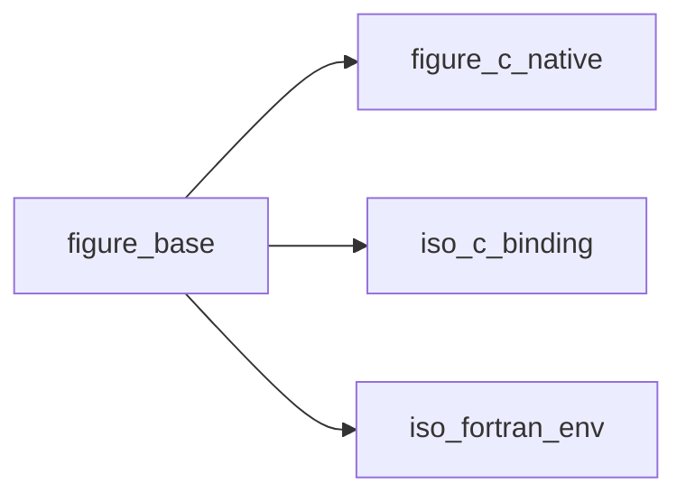
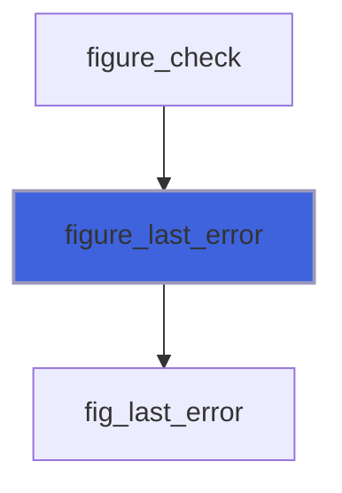

```mermaid
flowchart TD
  contour_draw["contour_draw"] --> cstr["cstr"]
  ig_begin["ig_begin"] --> cstr["cstr"]
  ig_begin_child["ig_begin_child"] --> cstr["cstr"]
  ig_begin_menu["ig_begin_menu"] --> cstr["cstr"]
  ig_begin_popup["ig_begin_popup"] --> cstr["cstr"]
  ig_begin_popup_modal["ig_begin_popup_modal"] --> cstr["cstr"]
  ig_begin_tab["ig_begin_tab"] --> cstr["cstr"]
  ig_begin_tab_bar["ig_begin_tab_bar"] --> cstr["cstr"]
  ig_begin_table["ig_begin_table"] --> cstr["cstr"]
  ig_button["ig_button"] --> cstr["cstr"]
  ig_checkbox["ig_checkbox"] --> cstr["cstr"]
  ig_collapsing_header["ig_collapsing_header"] --> cstr["cstr"]
  ig_color_edit["ig_color_edit"] --> cstr["cstr"]
  ig_combo["ig_combo"] --> cstr["cstr"]
  ig_focus_window["ig_focus_window"] --> cstr["cstr"]
  ig_input_i32["ig_input_i32"] --> cstr["cstr"]
  ig_input_r64["ig_input_r64"] --> cstr["cstr"]
  ig_menu_item["ig_menu_item"] --> cstr["cstr"]
  ig_open_popup["ig_open_popup"] --> cstr["cstr"]
  ig_progress_bar["ig_progress_bar"] --> cstr["cstr"]
  ig_push_id_str["ig_push_id_str"] --> cstr["cstr"]
  ig_selectable["ig_selectable"] --> cstr["cstr"]
  ig_slider_i32["ig_slider_i32"] --> cstr["cstr"]
  ig_slider_r32["ig_slider_r32"] --> cstr["cstr"]
  ig_slider_r64["ig_slider_r64"] --> cstr["cstr"]
  ig_table_setup_column["ig_table_setup_column"] --> cstr["cstr"]
  ig_text["ig_text"] --> cstr["cstr"]
  ig_text_colored["ig_text_colored"] --> cstr["cstr"]
  ig_text_disabled["ig_text_disabled"] --> cstr["cstr"]
  ig_text_size["ig_text_size"] --> cstr["cstr"]
  ig_text_wrapped["ig_text_wrapped"] --> cstr["cstr"]
  ig_tooltip["ig_tooltip"] --> cstr["cstr"]
  ig_tree_node["ig_tree_node"] --> cstr["cstr"]
  ip_bars_r32["ip_bars_r32"] --> cstr["cstr"]
  ip_bars_r64["ip_bars_r64"] --> cstr["cstr"]
  ip_begin_plot["ip_begin_plot"] --> cstr["cstr"]
  ip_begin_subplots["ip_begin_subplots"] --> cstr["cstr"]
  ip_colormap_scale["ip_colormap_scale"] --> cstr["cstr"]
  ip_error_bars_r32["ip_error_bars_r32"] --> cstr["cstr"]
  ip_error_bars_r64["ip_error_bars_r64"] --> cstr["cstr"]
  ip_heatmap_r32["ip_heatmap_r32"] --> cstr["cstr"]
  ip_heatmap_r64["ip_heatmap_r64"] --> cstr["cstr"]
  ip_image["ip_image"] --> cstr["cstr"]
  ip_line_r32["ip_line_r32"] --> cstr["cstr"]
  ip_line_r64["ip_line_r64"] --> cstr["cstr"]
  ip_line_row_r32["ip_line_row_r32"] --> cstr["cstr"]
  ip_line_row_r64["ip_line_row_r64"] --> cstr["cstr"]
  ip_line_values_r32["ip_line_values_r32"] --> cstr["cstr"]
  ip_line_values_r64["ip_line_values_r64"] --> cstr["cstr"]
  ip_scatter_r32["ip_scatter_r32"] --> cstr["cstr"]
  ip_scatter_r64["ip_scatter_r64"] --> cstr["cstr"]
  ip_setup_axes["ip_setup_axes"] --> cstr["cstr"]
  ip_shaded_r32["ip_shaded_r32"] --> cstr["cstr"]
  ip_shaded_r64["ip_shaded_r64"] --> cstr["cstr"]
  ip_shaded_ref_r32["ip_shaded_ref_r32"] --> cstr["cstr"]
  ip_shaded_ref_r64["ip_shaded_ref_r64"] --> cstr["cstr"]
  log_draw["log_draw"] --> cstr["cstr"]
  style cstr fill:#3e63dd,stroke:#99b,stroke-width:2px
```

# figure_base

> figure_base, error handling and string conversion shared by the FIGURE modules.

 Procedures that can fail take an optional `stat`: if present it receives `FIG_OK` or a `FIG_ERR_*` code and
 `figure_last_error()` gives the message; if absent, a failure prints the message and stops (`error stop`).

**Source**: `src/lib/figure_base.F90`

**Dependencies**



## Contents

- [figure_check](#figure-check)
- [figure_fail](#figure-fail)
- [figure_last_error](#figure-last-error)
- [figure_refused](#figure-refused)
- [cstr](#cstr)

## Subroutines

### figure_check

Store `status` in `stat` if present, else stop on failure with the last error message.

```fortran
subroutine figure_check(status, stat)
```

**Arguments**

| Name | Type | Intent | Attributes | Description |
|------|------|--------|------------|-------------|
| `status` | integer(kind=c_int) | in |  | Status from the native layer. |
| `stat` | integer(kind=int32) | out | optional | Status for the caller. |

**Call graph**


### figure_fail

Report a failure detected on the Fortran side: set the last error message, then act as `figure_check`.

```fortran
subroutine figure_fail(status, message, stat)
```

**Arguments**

| Name | Type | Intent | Attributes | Description |
|------|------|--------|------------|-------------|
| `status` | integer(kind=c_int) | in |  | Failure status (a `FIG_ERR_*` code). |
| `message` | character(len=*) | in |  | Message for `figure_last_error`. |
| `stat` | integer(kind=int32) | out | optional | Status for the caller. |

**Call graph**



```mermaid
flowchart TD
  alive["alive"] --> figure_fail["figure_fail"]
  colormap_ok["colormap_ok"] --> figure_fail["figure_fail"]
  connectivity_ok["connectivity_ok"] --> figure_fail["figure_fail"]
  contour_draw["contour_draw"] --> figure_fail["figure_fail"]
  contour_ok["contour_ok"] --> figure_fail["figure_fail"]
  drag_ok["drag_ok"] --> figure_fail["figure_fail"]
  field_ok["field_ok"] --> figure_fail["figure_fail"]
  ig_color_edit["ig_color_edit"] --> figure_fail["figure_fail"]
  ig_dock_split["ig_dock_split"] --> figure_fail["figure_fail"]
  ig_push_font["ig_push_font"] --> figure_fail["figure_fail"]
  init_remote["init_remote"] --> figure_fail["figure_fail"]
  ip_annotation["ip_annotation"] --> figure_fail["figure_fail"]
  ip_colormap["ip_colormap"] --> figure_fail["figure_fail"]
  ip_colormap_legend["ip_colormap_legend"] --> figure_fail["figure_fail"]
  ip_image["ip_image"] --> figure_fail["figure_fail"]
  ip_spec["ip_spec"] --> figure_fail["figure_fail"]
  log_set_cap["log_set_cap"] --> figure_fail["figure_fail"]
  notify["notify"] --> figure_fail["figure_fail"]
  points_ok["points_ok"] --> figure_fail["figure_fail"]
  process_exit_code["process_exit_code"] --> figure_fail["figure_fail"]
  process_kill["process_kill"] --> figure_fail["figure_fail"]
  process_poll["process_poll"] --> figure_fail["figure_fail"]
  process_start["process_start"] --> figure_fail["figure_fail"]
  push_color["push_color"] --> figure_fail["figure_fail"]
  push_color_hex["push_color_hex"] --> figure_fail["figure_fail"]
  remove["remove"] --> figure_fail["figure_fail"]
  row_ok["row_ok"] --> figure_fail["figure_fail"]
  series_ok["series_ok"] --> figure_fail["figure_fail"]
  set_color["set_color"] --> figure_fail["figure_fail"]
  set_color_hex["set_color_hex"] --> figure_fail["figure_fail"]
  set_font["set_font"] --> figure_fail["figure_fail"]
  set_icon_image["set_icon_image"] --> figure_fail["figure_fail"]
  set_mesh["set_mesh"] --> figure_fail["figure_fail"]
  show_dialog["show_dialog"] --> figure_fail["figure_fail"]
  style_new["style_new"] --> figure_fail["figure_fail"]
  surface["surface"] --> figure_fail["figure_fail"]
  task_cancel["task_cancel"] --> figure_fail["figure_fail"]
  task_result["task_result"] --> figure_fail["figure_fail"]
  task_start["task_start"] --> figure_fail["figure_fail"]
  test_click["test_click"] --> figure_fail["figure_fail"]
  test_drop["test_drop"] --> figure_fail["figure_fail"]
  test_mouse_button["test_mouse_button"] --> figure_fail["figure_fail"]
  test_system_theme["test_system_theme"] --> figure_fail["figure_fail"]
  update["update"] --> figure_fail["figure_fail"]
  view["view"] --> figure_fail["figure_fail"]
  figure_fail["figure_fail"] --> fig_set_last_error["fig_set_last_error"]
  figure_fail["figure_fail"] --> figure_check["figure_check"]
  style figure_fail fill:#3e63dd,stroke:#99b,stroke-width:2px
```

## Functions

### figure_last_error

Message of the last failed call.

**Returns**: `character(len=:)`

```fortran
function figure_last_error() result(msg)
```

**Call graph**



### figure_refused

True when called from a task's worker thread: the drawing entry point `name` must return at once. The task's
 status becomes `FIG_ERR_STATE` with a message naming `name` (given by `t%result`), the task is asked to stop, and
 `stat`, if present, is `FIG_ERR_STATE`. False on the main thread (nothing changes).

**Attributes**: recursive

**Returns**: `logical`

```fortran
function figure_refused(name, stat) result(refused)
```

**Arguments**

| Name | Type | Intent | Attributes | Description |
|------|------|--------|------------|-------------|
| `name` | character(len=*) | in |  | The entry point. |
| `stat` | integer(kind=int32) | out | optional | Status, on a refusal. |

**Call graph**


### cstr

`s` NUL-terminated, for cimgui/cimplot (trailing blanks kept: labels are taken verbatim).

**Attributes**: pure

**Returns**: `character(kind=c_char, len=:)`

```fortran
function cstr(s) result(c)
```

**Arguments**

| Name | Type | Intent | Attributes | Description |
|------|------|--------|------------|-------------|
| `s` | character(len=*) | in |  | Fortran string. |

**Call graph**


