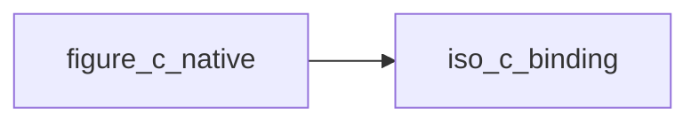

# figure_c_native

> figure_c_native, the raw C interfaces of FIGURE's native glue (native/figure_native.h).

 Private to the library: applications use figure_app, figure_imgui and figure_implot. The glue owns the platform
 (window, OpenGL context) and calls the cimgui/cimplot functions Fortran cannot call directly (structs larger than
 `ImVec2` passed by value); the direct ones are generated in figure_cimgui and figure_cimplot. Strings passed to
 the glue are (pointer, length), not NUL-terminated.

**Source**: `src/lib/figure_c_native.F90`

**Dependencies**

## Contents

- [fig_init](#fig-init)
- [fig_init_headless](#fig-init-headless)
- [fig_init_remote](#fig-init-remote)
- [fig_begin_frame](#fig-begin-frame)
- [fig_end_frame](#fig-end-frame)
- [fig_set_ini_file](#fig-set-ini-file)
- [fig_set_style](#fig-set-style)
- [fig_remote_token](#fig-remote-token)
- [fig_file_dialog](#fig-file-dialog)
- [fig_file_dialog_result](#fig-file-dialog-result)
- [fig_save_image](#fig-save-image)
- [fig_image_result](#fig-image-result)
- [fig_save_layout](#fig-save-layout)
- [fig_begin_side_bar](#fig-begin-side-bar)
- [fig_tool_button](#fig-tool-button)
- [fig_clipper_new](#fig-clipper-new)
- [fig_clipper_step](#fig-clipper-step)
- [fig_load_layout](#fig-load-layout)
- [fig_quit_requested](#fig-quit-requested)
- [fig_set_title](#fig-set-title)
- [fig_title](#fig-title)
- [fig_input_quit](#fig-input-quit)
- [fig_content_scale](#fig-content-scale)
- [fig_last_error](#fig-last-error)
- [fig_texture_create](#fig-texture-create)
- [fig_texture_update](#fig-texture-update)
- [fig_load_style](#fig-load-style)
- [fig_save_style](#fig-save-style)
- [fig_push_style_color](#fig-push-style-color)
- [fig_push_style_var](#fig-push-style-var)
- [fig_pop_style](#fig-pop-style)
- [fig_set_font](#fig-set-font)
- [fig_push_font](#fig-push-font)
- [fig_pop_font](#fig-pop-font)
- [fig_show_style_editor](#fig-show-style-editor)
- [fig_style_color](#fig-style-color)
- [fig_style_var](#fig-style-var)
- [fig_set_docking](#fig-set-docking)
- [fig_dock_id](#fig-dock-id)
- [fig_dock_space](#fig-dock-space)
- [fig_dock_layout_begin](#fig-dock-layout-begin)
- [fig_dock_split](#fig-dock-split)
- [fig_dock_window](#fig-dock-window)
- [fig_dock_layout_end](#fig-dock-layout-end)
- [fig_window_dock](#fig-window-dock)
- [fig_input_next_frame](#fig-input-next-frame)
- [fig_input_mouse_pos](#fig-input-mouse-pos)
- [fig_input_mouse_button](#fig-input-mouse-button)
- [fig_input_wheel](#fig-input-wheel)
- [fig_input_key](#fig-input-key)
- [fig_input_text](#fig-input-text)
- [fig_plot_tick_label](#fig-plot-tick-label)
- [fig_key_chord](#fig-key-chord)
- [fig_widget_input_text](#fig-widget-input-text)
- [fig_window_rect](#fig-window-rect)
- [fig_shutdown](#fig-shutdown)
- [fig_set_lazy](#fig-set-lazy)
- [fig_set_remote_fps](#fig-set-remote-fps)
- [fig_set_remote_compress](#fig-set-remote-compress)
- [fig_set_remote_token](#fig-set-remote-token)
- [fig_clipper_begin](#fig-clipper-begin)
- [fig_clipper_delete](#fig-clipper-delete)
- [fig_set_confirm_quit](#fig-set-confirm-quit)
- [fig_quit](#fig-quit)
- [fig_request_frames](#fig-request-frames)
- [fig_set_last_error](#fig-set-last-error)
- [fig_texture_destroy](#fig-texture-destroy)
- [fig_texture_sampling](#fig-texture-sampling)
- [fig_input_mouse](#fig-input-mouse)

## Variables

| Name | Type | Attributes | Description |
|------|------|------------|-------------|
| `FIG_OK` | integer(kind=c_int) | parameter | Success. |
| `FIG_ERR_STATE` | integer(kind=c_int) | parameter | Call not allowed in the current state. |
| `FIG_ERR_ARGUMENT` | integer(kind=c_int) | parameter | Invalid argument. |
| `FIG_ERR_FAILED` | integer(kind=c_int) | parameter | The platform (SDL, OpenGL) reported a failure. |
| `FIG_ERR_EXCEPTION` | integer(kind=c_int) | parameter | A C++ exception was caught at the boundary. |

## Interfaces

### fig_init

### fig_init_headless

### fig_init_remote

### fig_begin_frame

### fig_end_frame

### fig_set_ini_file

### fig_set_style

### fig_remote_token

### fig_file_dialog

### fig_file_dialog_result

### fig_save_image

### fig_image_result

### fig_save_layout

### fig_begin_side_bar

### fig_tool_button

### fig_clipper_new

### fig_clipper_step

### fig_load_layout

### fig_quit_requested

### fig_set_title

### fig_title

### fig_input_quit

### fig_content_scale

### fig_last_error

### fig_texture_create

### fig_texture_update

### fig_load_style

### fig_save_style

### fig_push_style_color

### fig_push_style_var

### fig_pop_style

### fig_set_font

### fig_push_font

### fig_pop_font

### fig_show_style_editor

### fig_style_color

### fig_style_var

### fig_set_docking

### fig_dock_id

### fig_dock_space

### fig_dock_layout_begin

### fig_dock_split

### fig_dock_window

### fig_dock_layout_end

### fig_window_dock

### fig_input_next_frame

### fig_input_mouse_pos

### fig_input_mouse_button

### fig_input_wheel

### fig_input_key

### fig_input_text

### fig_plot_tick_label

### fig_key_chord

### fig_widget_input_text

### fig_window_rect

### fig_shutdown

### fig_set_lazy

### fig_set_remote_fps

### fig_set_remote_compress

### fig_set_remote_token

### fig_clipper_begin

### fig_clipper_delete

### fig_set_confirm_quit

### fig_quit

### fig_request_frames

### fig_set_last_error

### fig_texture_destroy

### fig_texture_sampling

### fig_input_mouse
