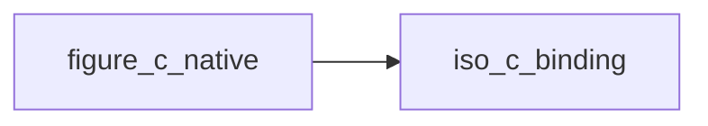

# figure_c_native

> figure_c_native, the raw C interfaces of FIGURE's native glue (native/figure_native.h).

 Private to the library: applications use figure_app, figure_imgui and figure_implot. The glue owns the platform
 (window, OpenGL context) and calls the cimgui/cimplot functions Fortran cannot call directly (structs larger than
 `ImVec2` passed by value); the direct ones are generated in figure_cimgui and figure_cimplot. Strings passed to
 the glue are (pointer, length), not NUL-terminated.

**Source**: `src/lib/figure_c_native.F90`

**Dependencies**

## Contents

- [fig_item_status](#fig-item-status)
- [fig_canvas_event](#fig-canvas-event)
- [fig_init](#fig-init)
- [fig_init_headless](#fig-init-headless)
- [fig_init_remote](#fig-init-remote)
- [fig_begin_frame](#fig-begin-frame)
- [fig_end_frame](#fig-end-frame)
- [fig_set_ini_file](#fig-set-ini-file)
- [fig_set_style](#fig-set-style)
- [fig_set_style_parts](#fig-set-style-parts)
- [fig_palette_color](#fig-palette-color)
- [fig_input_system_theme](#fig-input-system-theme)
- [fig_frame_options](#fig-frame-options)
- [fig_set_icon_rgba](#fig-set-icon-rgba)
- [fig_set_icon_glyph](#fig-set-icon-glyph)
- [fig_process_start](#fig-process-start)
- [fig_process_pending](#fig-process-pending)
- [fig_process_take](#fig-process-take)
- [fig_process_info](#fig-process-info)
- [fig_process_kill](#fig-process-kill)
- [fig_notify](#fig-notify)
- [fig_notification_count](#fig-notification-count)
- [fig_notification_get](#fig-notification-get)
- [fig_notification_rect](#fig-notification-rect)
- [fig_notification_alpha](#fig-notification-alpha)
- [fig_drawn_extent](#fig-drawn-extent)
- [fig_drawn_extent_rgba](#fig-drawn-extent-rgba)
- [fig_popup_rect](#fig-popup-rect)
- [fig_task_start](#fig-task-start)
- [fig_task_state](#fig-task-state)
- [fig_task_report](#fig-task-report)
- [fig_task_fail](#fig-task-fail)
- [fig_task_cancel](#fig-task-cancel)
- [fig_task_cancelled](#fig-task-cancelled)
- [fig_task_finish](#fig-task-finish)
- [fig_task_on_worker](#fig-task-on-worker)
- [fig_task_refuse](#fig-task-refuse)
- [fig_set_checks](#fig-set-checks)
- [fig_checks](#fig-checks)
- [fig_draw_refuse](#fig-draw-refuse)
- [fig_usage_error](#fig-usage-error)
- [fig_add_fallback_font](#fig-add-fallback-font)
- [fig_test_glyph](#fig-test-glyph)
- [fig_time](#fig-time)
- [fig_make_folder](#fig-make-folder)
- [fig_remove](#fig-remove)
- [fig_set_file_time](#fig-set-file-time)
- [fig_file_time](#fig-file-time)
- [fig_file_exists](#fig-file-exists)
- [fig_dnd_source](#fig-dnd-source)
- [fig_dnd_target](#fig-dnd-target)
- [fig_dnd_plot_target](#fig-dnd-plot-target)
- [fig_dnd_dragging](#fig-dnd-dragging)
- [fig_plot_link](#fig-plot-link)
- [fig_aligned_open](#fig-aligned-open)
- [fig_multi_select_begin](#fig-multi-select-begin)
- [fig_multi_select_item](#fig-multi-select-item)
- [fig_plot3d_mouse_ray](#fig-plot3d-mouse-ray)
- [fig_scope_close](#fig-scope-close)
- [fig_scope_report](#fig-scope-report)
- [fig_frame_hit](#fig-frame-hit)
- [fig_frame_rect](#fig-frame-rect)
- [fig_frame_state](#fig-frame-state)
- [fig_remote_token](#fig-remote-token)
- [fig_file_dialog](#fig-file-dialog)
- [fig_file_dialog_result](#fig-file-dialog-result)
- [fig_file_browser](#fig-file-browser)
- [fig_file_browser_settings](#fig-file-browser-settings)
- [fig_file_browser_get](#fig-file-browser-get)
- [fig_file_browser_rect](#fig-file-browser-rect)
- [fig_save_image](#fig-save-image)
- [fig_image_result](#fig-image-result)
- [fig_test_capture](#fig-test-capture)
- [fig_render_threads](#fig-render-threads)
- [fig_save_layout](#fig-save-layout)
- [fig_begin_side_bar](#fig-begin-side-bar)
- [fig_tool_button](#fig-tool-button)
- [fig_clipper_new](#fig-clipper-new)
- [fig_clipper_step](#fig-clipper-step)
- [fig_table_sort](#fig-table-sort)
- [fig_table_row_color](#fig-table-row-color)
- [fig_table_column_enabled](#fig-table-column-enabled)
- [fig_table_hovered_column](#fig-table-hovered-column)
- [fig_load_layout](#fig-load-layout)
- [fig_quit_requested](#fig-quit-requested)
- [fig_set_title](#fig-set-title)
- [fig_title](#fig-title)
- [fig_input_quit](#fig-input-quit)
- [fig_content_scale](#fig-content-scale)
- [fig_last_error](#fig-last-error)
- [fig_texture_create](#fig-texture-create)
- [fig_texture_update](#fig-texture-update)
- [fig_image_read](#fig-image-read)
- [fig_image_write](#fig-image-write)
- [fig_load_style](#fig-load-style)
- [fig_save_style](#fig-save-style)
- [fig_push_style_color](#fig-push-style-color)
- [fig_push_style_var](#fig-push-style-var)
- [fig_pop_style](#fig-pop-style)
- [fig_set_font](#fig-set-font)
- [fig_push_font](#fig-push-font)
- [fig_pop_font](#fig-pop-font)
- [fig_show_style_editor](#fig-show-style-editor)
- [fig_style_color](#fig-style-color)
- [fig_style_var](#fig-style-var)
- [fig_set_docking](#fig-set-docking)
- [fig_dock_id](#fig-dock-id)
- [fig_dock_space](#fig-dock-space)
- [fig_dock_layout_begin](#fig-dock-layout-begin)
- [fig_dock_split](#fig-dock-split)
- [fig_dock_window](#fig-dock-window)
- [fig_dock_layout_end](#fig-dock-layout-end)
- [fig_window_dock](#fig-window-dock)
- [fig_input_next_frame](#fig-input-next-frame)
- [fig_input_mouse_pos](#fig-input-mouse-pos)
- [fig_input_mouse_button](#fig-input-mouse-button)
- [fig_input_wheel](#fig-input-wheel)
- [fig_input_key](#fig-input-key)
- [fig_input_text](#fig-input-text)
- [fig_plot_tick_label](#fig-plot-tick-label)
- [fig_plot_annotation](#fig-plot-annotation)
- [fig_plot_tag](#fig-plot-tag)
- [fig_shortcut](#fig-shortcut)
- [fig_set_next_item_shortcut](#fig-set-next-item-shortcut)
- [fig_last_item](#fig-last-item)
- [fig_drag_range](#fig-drag-range)
- [fig_list_box](#fig-list-box)
- [fig_plot_state](#fig-plot-state)
- [fig_plot3d_colormap](#fig-plot3d-colormap)
- [fig_plot3d_axis_format](#fig-plot3d-axis-format)
- [fig_plot3d_state](#fig-plot3d-state)
- [fig_align_begin](#fig-align-begin)
- [fig_widget_input_text](#fig-widget-input-text)
- [fig_text_set](#fig-text-set)
- [fig_text_get](#fig-text-get)
- [fig_text_length](#fig-text-length)
- [fig_widget_input_text_multiline](#fig-widget-input-text-multiline)
- [fig_input_drop](#fig-input-drop)
- [fig_dropped](#fig-dropped)
- [fig_dropped_path](#fig-dropped-path)
- [fig_set_clipboard](#fig-set-clipboard)
- [fig_get_clipboard](#fig-get-clipboard)
- [fig_opened_url](#fig-opened-url)
- [fig_items_record](#fig-items-record)
- [fig_item_find](#fig-item-find)
- [fig_item_value](#fig-item-value)
- [fig_items_list](#fig-items-list)
- [fig_item_click](#fig-item-click)
- [fig_item_type](#fig-item-type)
- [fig_menu_click](#fig-menu-click)
- [fig_test_run](#fig-test-run)
- [fig_window_rect](#fig-window-rect)
- [fig_colormap](#fig-colormap)
- [fig_colormap_legend](#fig-colormap-legend)
- [fig_field_image](#fig-field-image)
- [fig_field_uploads](#fig-field-uploads)
- [fig_field_count](#fig-field-count)
- [fig_field_time](#fig-field-time)
- [fig_field_pixel](#fig-field-pixel)
- [fig_load_colormap](#fig-load-colormap)
- [fig_colormap_count](#fig-colormap-count)
- [fig_colormap_name](#fig-colormap-name)
- [fig_gradient_edit](#fig-gradient-edit)
- [fig_colormap_stops](#fig-colormap-stops)
- [fig_canvas](#fig-canvas)
- [fig_draw](#fig-draw)
- [fig_invisible_button](#fig-invisible-button)
- [fig_drawn_extent_layer](#fig-drawn-extent-layer)
- [fig_window_add](#fig-window-add)
- [fig_window_visible](#fig-window-visible)
- [fig_window_set_visible](#fig-window-set-visible)
- [fig_window_open_flag](#fig-window-open-flag)
- [fig_view_menu](#fig-view-menu)
- [fig_layout_add](#fig-layout-add)
- [fig_layout_switch](#fig-layout-switch)
- [fig_layout_reset](#fig-layout-reset)
- [fig_layout_current](#fig-layout-current)
- [fig_prefs_open](#fig-prefs-open)
- [fig_prefs_file](#fig-prefs-file)
- [fig_pref_set](#fig-pref-set)
- [fig_pref_get](#fig-pref-get)
- [fig_message_box](#fig-message-box)
- [fig_splitter](#fig-splitter)
- [fig_set_size_limits](#fig-set-size-limits)
- [fig_shutdown](#fig-shutdown)
- [fig_process_release](#fig-process-release)
- [fig_task_release](#fig-task-release)
- [fig_dnd_payload](#fig-dnd-payload)
- [fig_multi_select_end](#fig-multi-select-end)
- [fig_clipper_include](#fig-clipper-include)
- [fig_scope_open](#fig-scope-open)
- [fig_set_lazy](#fig-set-lazy)
- [fig_set_remote_fps](#fig-set-remote-fps)
- [fig_set_remote_compress](#fig-set-remote-compress)
- [fig_set_remote_lossy](#fig-set-remote-lossy)
- [fig_set_remote_token](#fig-set-remote-token)
- [fig_clipper_begin](#fig-clipper-begin)
- [fig_clipper_delete](#fig-clipper-delete)
- [fig_set_confirm_quit](#fig-set-confirm-quit)
- [fig_quit](#fig-quit)
- [fig_app_wake](#fig-app-wake)
- [fig_request_frames](#fig-request-frames)
- [fig_set_last_error](#fig-set-last-error)
- [fig_texture_destroy](#fig-texture-destroy)
- [fig_image_free](#fig-image-free)
- [fig_texture_sampling](#fig-texture-sampling)
- [fig_mark_last_item_edited](#fig-mark-last-item-edited)
- [fig_plot_end](#fig-plot-end)
- [fig_plot3d_end](#fig-plot3d-end)
- [fig_plot_axis_constraints](#fig-plot-axis-constraints)
- [fig_align_end](#fig-align-end)
- [fig_align_next](#fig-align-next)
- [fig_text_release](#fig-text-release)
- [fig_items_name](#fig-items-name)
- [fig_items_tooltip](#fig-items-tooltip)
- [fig_input_mouse](#fig-input-mouse)
- [fig_cursor_screen_pos](#fig-cursor-screen-pos)

## Variables

| Name | Type | Attributes | Description |
|------|------|------------|-------------|
| `FIG_OK` | integer(kind=c_int) | parameter | Success. |
| `FIG_ERR_STATE` | integer(kind=c_int) | parameter | Call not allowed in the current state. |
| `FIG_ERR_ARGUMENT` | integer(kind=c_int) | parameter | Invalid argument. |
| `FIG_ERR_FAILED` | integer(kind=c_int) | parameter | The platform (SDL, OpenGL) reported a failure. |
| `FIG_ERR_EXCEPTION` | integer(kind=c_int) | parameter | A C++ exception was caught at the boundary. |

## Derived Types

### fig_item_status

The status of the item drawn last, as native/figure_native.h's `fig_item_status`: 1 or 0 each.

**Attributes**: bind(C)

**Components**

| Name | Type | Attributes | Description |
|------|------|------------|-------------|
| `hovered` | integer(kind=c_int) |  | IsItemHovered. |
| `active` | integer(kind=c_int) |  | IsItemActive. |
| `focused` | integer(kind=c_int) |  | IsItemFocused. |
| `visible` | integer(kind=c_int) |  | IsItemVisible. |
| `activated` | integer(kind=c_int) |  | IsItemActivated. |
| `edited` | integer(kind=c_int) |  | IsItemEdited. |
| `deactivated` | integer(kind=c_int) |  | IsItemDeactivated. |
| `deactivated_after_edit` | integer(kind=c_int) |  | IsItemDeactivatedAfterEdit. |
| `toggled_open` | integer(kind=c_int) |  | IsItemToggledOpen. |
| `clicked` | integer(kind=c_int) |  | IsItemClicked, per button (left, right, middle). |
| `double_clicked` | integer(kind=c_int) |  | Double-clicked over the item, per button. |
| `rect` | real(kind=c_double) |  | x, y, width, height [pixels]. |

### fig_canvas_event

The event of a canvas in a frame, as native/figure_native.h's `fig_canvas_event`: flags 1 or 0, per button (left,
 right, middle).

**Attributes**: bind(C)

**Components**

| Name | Type | Attributes | Description |
|------|------|------------|-------------|
| `hovered` | integer(kind=c_int) |  | The pointer is over it. |
| `active` | integer(kind=c_int) |  | A button pressed over it is held. |
| `clicked` | integer(kind=c_int) |  | Pressed over it on this frame. |
| `double_clicked` | integer(kind=c_int) |  | Double-clicked over it on this frame. |
| `down` | integer(kind=c_int) |  | Held, pressed over it. |
| `released` | integer(kind=c_int) |  | Released on this frame, pressed over it. |
| `ctrl` | integer(kind=c_int) |  | Ctrl held. |
| `shift` | integer(kind=c_int) |  | Shift held. |
| `alt` | integer(kind=c_int) |  | Alt held. |
| `super` | integer(kind=c_int) |  | Super (cmd, windows key) held. |
| `mouse` | real(kind=c_double) |  | The pointer from the canvas's top-left [pixels]. |
| `drag` | real(kind=c_double) |  | The pointer from where the held button was pressed [pixels]. |
| `delta` | real(kind=c_double) |  | The pointer's motion this frame, while held [pixels]. |
| `wheel` | real(kind=c_double) |  | Vertical wheel steps this frame, while hovered. |
| `wheel_h` | real(kind=c_double) |  | Horizontal wheel steps this frame, while hovered. |
| `origin` | real(kind=c_double) |  | The canvas's top-left on the screen [pixels]. |
| `size` | real(kind=c_double) |  | Its width and height [pixels]. |

## Interfaces

### fig_init

### fig_init_headless

### fig_init_remote

### fig_begin_frame

### fig_end_frame

### fig_set_ini_file

### fig_set_style

### fig_set_style_parts

### fig_palette_color

### fig_input_system_theme

### fig_frame_options

### fig_set_icon_rgba

### fig_set_icon_glyph

### fig_process_start

### fig_process_pending

### fig_process_take

### fig_process_info

### fig_process_kill

### fig_notify

### fig_notification_count

### fig_notification_get

### fig_notification_rect

### fig_notification_alpha

### fig_drawn_extent

### fig_drawn_extent_rgba

### fig_popup_rect

### fig_task_start

### fig_task_state

### fig_task_report

### fig_task_fail

### fig_task_cancel

### fig_task_cancelled

### fig_task_finish

### fig_task_on_worker

### fig_task_refuse

### fig_set_checks

### fig_checks

### fig_draw_refuse

### fig_usage_error

### fig_add_fallback_font

### fig_test_glyph

### fig_time

### fig_make_folder

### fig_remove

### fig_set_file_time

### fig_file_time

### fig_file_exists

### fig_dnd_source

### fig_dnd_target

### fig_dnd_plot_target

### fig_dnd_dragging

### fig_plot_link

### fig_aligned_open

### fig_multi_select_begin

### fig_multi_select_item

### fig_plot3d_mouse_ray

### fig_scope_close

### fig_scope_report

### fig_frame_hit

### fig_frame_rect

### fig_frame_state

### fig_remote_token

### fig_file_dialog

### fig_file_dialog_result

### fig_file_browser

### fig_file_browser_settings

### fig_file_browser_get

### fig_file_browser_rect

### fig_save_image

### fig_image_result

### fig_test_capture

### fig_render_threads

### fig_save_layout

### fig_begin_side_bar

### fig_tool_button

### fig_clipper_new

### fig_clipper_step

### fig_table_sort

### fig_table_row_color

### fig_table_column_enabled

### fig_table_hovered_column

### fig_load_layout

### fig_quit_requested

### fig_set_title

### fig_title

### fig_input_quit

### fig_content_scale

### fig_last_error

### fig_texture_create

### fig_texture_update

### fig_image_read

### fig_image_write

### fig_load_style

### fig_save_style

### fig_push_style_color

### fig_push_style_var

### fig_pop_style

### fig_set_font

### fig_push_font

### fig_pop_font

### fig_show_style_editor

### fig_style_color

### fig_style_var

### fig_set_docking

### fig_dock_id

### fig_dock_space

### fig_dock_layout_begin

### fig_dock_split

### fig_dock_window

### fig_dock_layout_end

### fig_window_dock

### fig_input_next_frame

### fig_input_mouse_pos

### fig_input_mouse_button

### fig_input_wheel

### fig_input_key

### fig_input_text

### fig_plot_tick_label

### fig_plot_annotation

### fig_plot_tag

### fig_shortcut

### fig_set_next_item_shortcut

### fig_last_item

### fig_drag_range

### fig_list_box

### fig_plot_state

### fig_plot3d_colormap

### fig_plot3d_axis_format

### fig_plot3d_state

### fig_align_begin

### fig_widget_input_text

### fig_text_set

### fig_text_get

### fig_text_length

### fig_widget_input_text_multiline

### fig_input_drop

### fig_dropped

### fig_dropped_path

### fig_set_clipboard

### fig_get_clipboard

### fig_opened_url

### fig_items_record

### fig_item_find

### fig_item_value

### fig_items_list

### fig_item_click

### fig_item_type

### fig_menu_click

### fig_test_run

### fig_window_rect

### fig_colormap

### fig_colormap_legend

### fig_field_image

### fig_field_uploads

### fig_field_count

### fig_field_time

### fig_field_pixel

### fig_load_colormap

### fig_colormap_count

### fig_colormap_name

### fig_gradient_edit

### fig_colormap_stops

### fig_canvas

### fig_draw

### fig_invisible_button

### fig_drawn_extent_layer

### fig_window_add

### fig_window_visible

### fig_window_set_visible

### fig_window_open_flag

### fig_view_menu

### fig_layout_add

### fig_layout_switch

### fig_layout_reset

### fig_layout_current

### fig_prefs_open

### fig_prefs_file

### fig_pref_set

### fig_pref_get

### fig_message_box

### fig_splitter

### fig_set_size_limits

### fig_shutdown

### fig_process_release

### fig_task_release

### fig_dnd_payload

### fig_multi_select_end

### fig_clipper_include

### fig_scope_open

### fig_set_lazy

### fig_set_remote_fps

### fig_set_remote_compress

### fig_set_remote_lossy

### fig_set_remote_token

### fig_clipper_begin

### fig_clipper_delete

### fig_set_confirm_quit

### fig_quit

### fig_app_wake

### fig_request_frames

### fig_set_last_error

### fig_texture_destroy

### fig_image_free

### fig_texture_sampling

### fig_mark_last_item_edited

### fig_plot_end

### fig_plot3d_end

### fig_plot_axis_constraints

### fig_align_end

### fig_align_next

### fig_text_release

### fig_items_name

### fig_items_tooltip

### fig_input_mouse

### fig_cursor_screen_pos
