# figure_canvas

> figure_canvas, an area that takes the mouse and drawing primitives: the way to build a widget FIGURE does not have.

 `ig_canvas` places an item of a given size that takes the three mouse buttons and the wheel, and fills a
 `canvas_event_object` with what happened over it on the frame; the `ig_draw_*` primitives draw lines, rectangles,
 circles, polylines, polygons, text and images on one of four layers:
 - `'window'` (default): the current window's draw list, in screen pixels, clipped to the window, drawn over what the
   window drew before and under what it draws after;
 - `'foreground'` / `'background'`: over / under every window of the display, in screen pixels, not clipped;
 - `'plot'`: the current ImPlot plot, in plot units (the plot's axes), clipped to the plot area.

 Coordinates: screen pixels from the display's top-left, x right and y down (as `ig_cursor_screen_pos`,
 `ig_last_item`'s rectangle and the canvas's `origin`); the canvas's own pixels (the event's `mouse`) are measured
 from its top-left, so a point (cx, cy) of the canvas is drawn at `ev%origin + [cx, cy]`. Lengths (thickness,
 radius) are pixels on every layer. Colours are `[r, g, b(, a)]` in [0, 1]. Nothing is kept between frames: draw
 every frame, as every widget is declared every frame. Main thread only (a task's call is refused); the same in
 window, headless and remote mode (draw lists are what all three render).

**Source**: `src/lib/figure_canvas.F90`

**Dependencies**

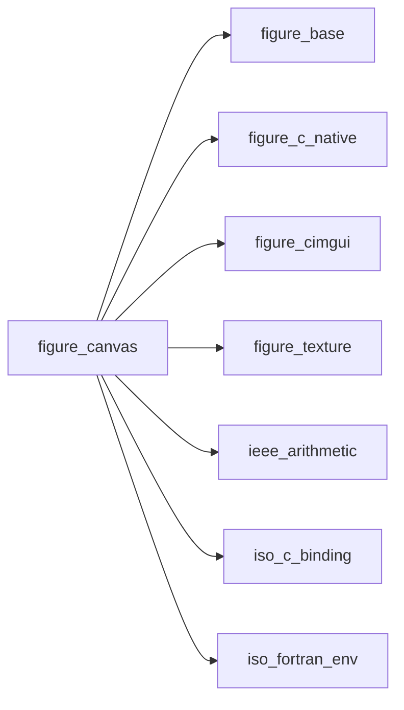

## Contents

- [canvas_event_object](#canvas-event-object)
- [ig_canvas](#ig-canvas)
- [ig_cursor_screen_pos](#ig-cursor-screen-pos)
- [ig_draw_line](#ig-draw-line)
- [ig_draw_rect](#ig-draw-rect)
- [ig_draw_circle](#ig-draw-circle)
- [ig_draw_polyline](#ig-draw-polyline)
- [ig_draw_polygon](#ig-draw-polygon)
- [ig_draw_text](#ig-draw-text)
- [ig_draw_image](#ig-draw-image)
- [draw](#draw)
- [ig_invisible_button](#ig-invisible-button)
- [coordinates_ok](#coordinates-ok)
- [length_ok](#length-ok)

## Variables

| Name | Type | Attributes | Description |
|------|------|------------|-------------|
| `LAYER_WINDOW` | integer(kind=c_int) | parameter | The current window's draw list. |
| `LAYER_FOREGROUND` | integer(kind=c_int) | parameter | Over every window. |
| `LAYER_BACKGROUND` | integer(kind=c_int) | parameter | Under every window. |
| `LAYER_PLOT` | integer(kind=c_int) | parameter | The current plot, in plot units. |
| `DRAW_LINE` | integer(kind=c_int) | parameter | A segment. |
| `DRAW_RECT` | integer(kind=c_int) | parameter | A rectangle. |
| `DRAW_CIRCLE` | integer(kind=c_int) | parameter | A circle. |
| `DRAW_POLYLINE` | integer(kind=c_int) | parameter | A polyline. |
| `DRAW_POLYGON` | integer(kind=c_int) | parameter | A polygon. |
| `DRAW_TEXT` | integer(kind=c_int) | parameter | Text. |
| `DRAW_IMAGE` | integer(kind=c_int) | parameter | A texture. |
| `COORD_MAX` | real(kind=real64) | parameter | The largest coordinate or length. |

## Derived Types

### canvas_event_object

What happened over a canvas on a frame, as `ig_canvas` found it: a plain value. Per button the arrays are
 (left, right, middle). The event states (`clicked`, `double_clicked`, `released`) are true on one frame;
 `drag` and `delta` are zero unless a button pressed over the canvas is held (and `drag` also on its release);
 the wheel is zero unless the pointer is over the canvas. Positions: `mouse` in the canvas's pixels (from its
 top-left, x right, y down; outside the canvas too, then below 0 or beyond its size); `origin` on the screen.

**Components**

| Name | Type | Attributes | Description |
|------|------|------------|-------------|
| `hovered` | logical |  | The pointer is over the canvas (and no other item is held). |
| `active` | logical |  | A button pressed over the canvas is held (a drag). |
| `clicked` | logical |  | A button was pressed over the canvas on this frame. |
| `double_clicked` | logical |  | A button was double-clicked over the canvas on this frame. |
| `down` | logical |  | A button pressed over the canvas is held. |
| `released` | logical |  | A button pressed over the canvas was released on this frame. |
| `mouse` | real(kind=real64) |  | The pointer, from the canvas's top-left [pixels]. |
| `drag` | real(kind=real64) |  | The pointer from where the held button was pressed [pixels]. |
| `delta` | real(kind=real64) |  | The pointer's motion on this frame, while a button is held [pixels]. |
| `wheel` | real(kind=real64) |  | Vertical wheel steps on this frame (positive: away from the user). |
| `wheel_h` | real(kind=real64) |  | Horizontal wheel steps on this frame. |
| `ctrl` | logical |  | Ctrl held. |
| `shift` | logical |  | Shift held. |
| `alt` | logical |  | Alt held. |
| `super` | logical |  | Super (cmd on macOS, the Windows key) held. |
| `origin` | real(kind=real64) |  | The canvas's top-left on the screen [pixels]. |
| `size` | real(kind=real64) |  | Its width and height [pixels]. |

## Subroutines

### ig_canvas

An area of `width` x `height` pixels that takes the mouse (Dear ImGui's `InvisibleButton` with the three buttons):
 `ev` receives what happened over it on this frame (`canvas_event_object`). While the pointer is over it the
 canvas owns the wheel (`SetItemKeyOwner`): a scrolling window or child holding it does not scroll. With
 `texture`, the texture is drawn over the whole canvas first, so that primitives drawn after it are on top. A
 size <= 0 is the space left plus it (0: all of it, -10: all but 10 pixels), at least 1 pixel. The canvas is one
 item: `ig_last_item`, `ig_same_line` and the context menus apply to it. Draw on it with the `ig_draw_*`
 primitives at `ev%origin + [cx, cy]`. A NaN or infinite size, or a texture not initialized: nothing placed,
 `ev` empty, `FIG_ERR_ARGUMENT` in `stat` (or `error stop` without it). No frame open or a task: `FIG_ERR_STATE`.
 The same in window, headless and remote mode.

**Attributes**: recursive

```fortran
subroutine ig_canvas(id, width, height, ev, texture, stat)
```

**Arguments**

| Name | Type | Intent | Attributes | Description |
|------|------|--------|------------|-------------|
| `id` | character(len=*) | in |  | Its id (unique in the window, not shown). |
| `width` | real(kind=real64) | in |  | Width [pixels] (<= 0: the space left plus it). |
| `height` | real(kind=real64) | in |  | Height [pixels] (<= 0: the space left plus it). |
| `ev` | type([canvas_event_object](/api/src/lib/figure_canvas#canvas-event-object)) | out |  | What happened over it on this frame. |
| `texture` | type([texture_object](/api/src/lib/figure_texture#texture-object)) | in | optional | A texture drawn over the whole canvas. |
| `stat` | integer(kind=int32) | out | optional | Status. |

**Call graph**

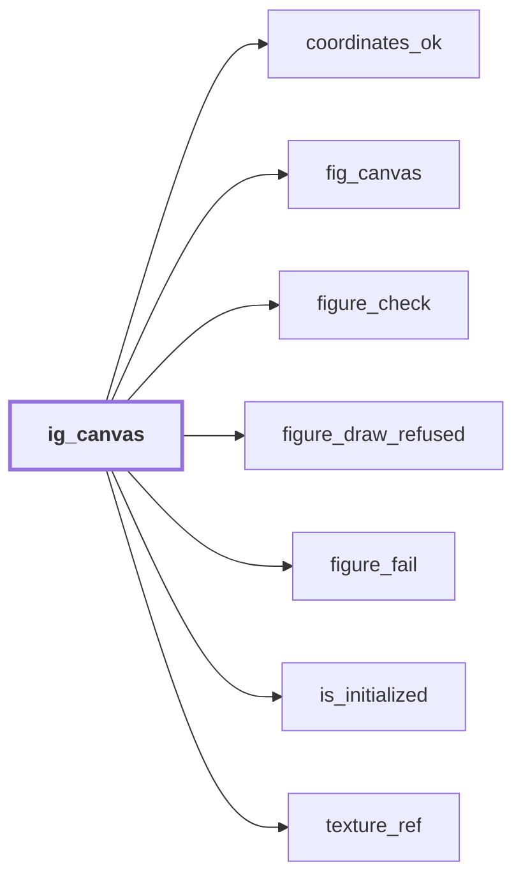

### ig_cursor_screen_pos

Where the next item goes, on the screen [pixels] (Dear ImGui's `GetCursorScreenPos`): the top-left of the next
 widget or canvas, the origin to draw from with the `ig_draw_*` primitives before placing an item there. No frame
 open or a task: zeros (a usage error, reported by `app%next_frame`).

**Attributes**: recursive

```fortran
subroutine ig_cursor_screen_pos(x, y)
```

**Arguments**

| Name | Type | Intent | Attributes | Description |
|------|------|--------|------------|-------------|
| `x` | real(kind=real64) | out |  | Abscissa [pixels from the display's left]. |
| `y` | real(kind=real64) | out |  | Ordinate [pixels from the display's top]. |

**Call graph**

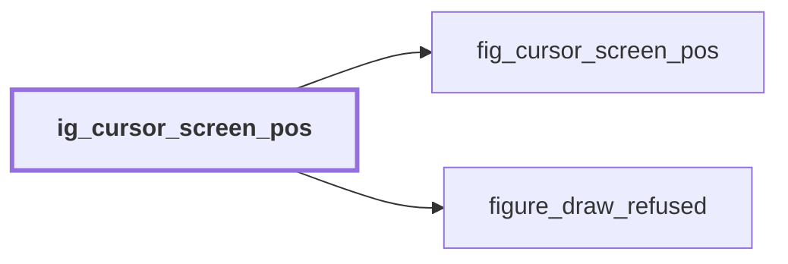

### ig_draw_line

A segment from (`x1`, `y1`) to (`x2`, `y2`) (`ImDrawList::AddLine`): screen pixels, or plot units on the
 `'plot'` layer. Refusals: see `ig_draw_polyline`.

**Attributes**: recursive

```fortran
subroutine ig_draw_line(x1, y1, x2, y2, color, thickness, layer, stat)
```

**Arguments**

| Name | Type | Intent | Attributes | Description |
|------|------|--------|------------|-------------|
| `x1` | real(kind=real64) | in |  | Start, abscissa [pixels or plot units]. |
| `y1` | real(kind=real64) | in |  | Start, ordinate [pixels or plot units]. |
| `x2` | real(kind=real64) | in |  | End, abscissa [pixels or plot units]. |
| `y2` | real(kind=real64) | in |  | End, ordinate [pixels or plot units]. |
| `color` | real(kind=real64) | in |  | Colour, `[r, g, b(, a)]` in [0, 1]. |
| `thickness` | real(kind=real64) | in | optional | Line thickness [pixels] (default 1). |
| `layer` | character(len=*) | in | optional | `'window'` (default), `'foreground'`, `'background'`, `'plot'`. |
| `stat` | integer(kind=int32) | out | optional | Status. |

**Call graph**


### ig_draw_rect

A rectangle with opposite corners (`x1`, `y1`) and (`x2`, `y2`), in any order (`ImDrawList::AddRect`,
 `AddRectFilled`): its outline, or filled. Screen pixels, or plot units on the `'plot'` layer. Refusals: see
 `ig_draw_polyline`.

**Attributes**: recursive

```fortran
subroutine ig_draw_rect(x1, y1, x2, y2, color, thickness, filled, layer, stat)
```

**Arguments**

| Name | Type | Intent | Attributes | Description |
|------|------|--------|------------|-------------|
| `x1` | real(kind=real64) | in |  | A corner, abscissa [pixels or plot units]. |
| `y1` | real(kind=real64) | in |  | A corner, ordinate [pixels or plot units]. |
| `x2` | real(kind=real64) | in |  | The opposite corner, abscissa [pixels or plot units]. |
| `y2` | real(kind=real64) | in |  | The opposite corner, ordinate [pixels or plot units]. |
| `color` | real(kind=real64) | in |  | Colour, `[r, g, b(, a)]` in [0, 1]. |
| `thickness` | real(kind=real64) | in | optional | Outline thickness [pixels] (default 1). |
| `filled` | logical | in | optional | Filled (default: the outline). |
| `layer` | character(len=*) | in | optional | `'window'` (default), `'foreground'`, `'background'`, `'plot'`. |
| `stat` | integer(kind=int32) | out | optional | Status. |

**Call graph**

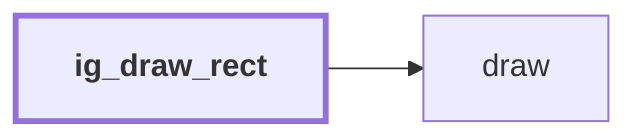

### ig_draw_circle

A circle centred at (`x`, `y`) (`ImDrawList::AddCircle`, `AddCircleFilled`): its outline, or filled. The centre
 in screen pixels, or plot units on the `'plot'` layer; the radius always in pixels (a marker, not a shape in plot
 units: a circle in plot units is a polygon of its points). Refusals: see `ig_draw_polyline`, and a radius below
 0 or not finite.

**Attributes**: recursive

```fortran
subroutine ig_draw_circle(x, y, radius, color, thickness, filled, layer, stat)
```

**Arguments**

| Name | Type | Intent | Attributes | Description |
|------|------|--------|------------|-------------|
| `x` | real(kind=real64) | in |  | Centre, abscissa [pixels or plot units]. |
| `y` | real(kind=real64) | in |  | Centre, ordinate [pixels or plot units]. |
| `radius` | real(kind=real64) | in |  | Radius [pixels]. |
| `color` | real(kind=real64) | in |  | Colour, `[r, g, b(, a)]` in [0, 1]. |
| `thickness` | real(kind=real64) | in | optional | Outline thickness [pixels] (default 1). |
| `filled` | logical | in | optional | Filled (default: the outline). |
| `layer` | character(len=*) | in | optional | `'window'` (default), `'foreground'`, `'background'`, `'plot'`. |
| `stat` | integer(kind=int32) | out | optional | Status. |

**Call graph**

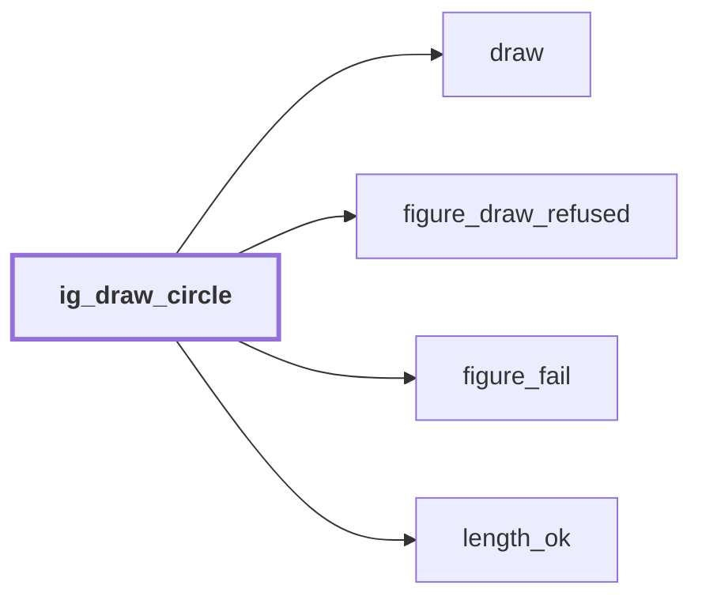

### ig_draw_polyline

A polyline through the points (`x(i)`, `y(i)`) (`ImDrawList::AddPolyline`); `closed` joins the last point to the
 first. Screen pixels, or plot units on the `'plot'` layer. `x` and `y` are passed to the native layer without a
 copy when contiguous (a strided section is packed by the compiler). Refused with `FIG_ERR_ARGUMENT` in `stat` (or
 `error stop` without it), nothing drawn, for every primitive: `x` and `y` of different sizes or fewer points than
 the primitive needs (2 here), a coordinate NaN, infinite or beyond single precision, a colour not of 3 or 4
 components in [0, 1], a thickness not above 0, an unknown layer. A `'plot'` layer outside a plot (between a true
 `ip_begin_plot` and `ip_end_plot`), no frame open or a task: `FIG_ERR_STATE`, a usage error. The same in
 window, headless and remote mode.

**Attributes**: recursive

```fortran
subroutine ig_draw_polyline(x, y, color, thickness, closed, layer, stat)
```

**Arguments**

| Name | Type | Intent | Attributes | Description |
|------|------|--------|------------|-------------|
| `x` | real(kind=real64) | in |  | Abscissae [pixels or plot units]. |
| `y` | real(kind=real64) | in |  | Ordinates [pixels or plot units]. |
| `color` | real(kind=real64) | in |  | Colour, `[r, g, b(, a)]` in [0, 1]. |
| `thickness` | real(kind=real64) | in | optional | Line thickness [pixels] (default 1). |
| `closed` | logical | in | optional | Join the last point to the first (default false). |
| `layer` | character(len=*) | in | optional | `'window'` (default), `'foreground'`, `'background'`, `'plot'`. |
| `stat` | integer(kind=int32) | out | optional | Status. |

**Call graph**

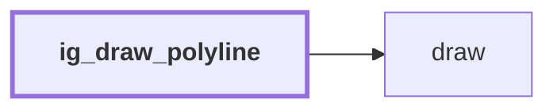

### ig_draw_polygon

A closed polygon through the points (`x(i)`, `y(i)`) (`ImDrawList::AddPolyline` closed, or
 `AddConcavePolyFilled`): its outline, or filled (convex or not; not self-intersecting). Screen pixels, or plot
 units on the `'plot'` layer. At least 3 points. Refusals: see `ig_draw_polyline`.

**Attributes**: recursive

```fortran
subroutine ig_draw_polygon(x, y, color, thickness, filled, layer, stat)
```

**Arguments**

| Name | Type | Intent | Attributes | Description |
|------|------|--------|------------|-------------|
| `x` | real(kind=real64) | in |  | Abscissae [pixels or plot units]. |
| `y` | real(kind=real64) | in |  | Ordinates [pixels or plot units]. |
| `color` | real(kind=real64) | in |  | Colour, `[r, g, b(, a)]` in [0, 1]. |
| `thickness` | real(kind=real64) | in | optional | Outline thickness [pixels] (default 1). |
| `filled` | logical | in | optional | Filled (default: the outline). |
| `layer` | character(len=*) | in | optional | `'window'` (default), `'foreground'`, `'background'`, `'plot'`. |
| `stat` | integer(kind=int32) | out | optional | Status. |

**Call graph**

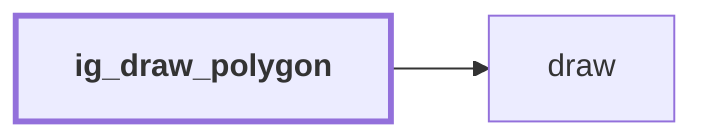

### ig_draw_text

`text` with its top-left at (`x`, `y`) (`ImDrawList::AddText`), in the current font: screen pixels, or plot
 units on the `'plot'` layer. One line per LF. Refusals: see `ig_draw_polyline`.

**Attributes**: recursive

```fortran
subroutine ig_draw_text(x, y, text, color, layer, stat)
```

**Arguments**

| Name | Type | Intent | Attributes | Description |
|------|------|--------|------------|-------------|
| `x` | real(kind=real64) | in |  | Top-left, abscissa [pixels or plot units]. |
| `y` | real(kind=real64) | in |  | Top-left, ordinate [pixels or plot units]. |
| `text` | character(len=*) | in |  | Text (UTF-8). |
| `color` | real(kind=real64) | in |  | Colour, `[r, g, b(, a)]` in [0, 1]. |
| `layer` | character(len=*) | in | optional | `'window'` (default), `'foreground'`, `'background'`, `'plot'`. |
| `stat` | integer(kind=int32) | out | optional | Status. |

**Call graph**

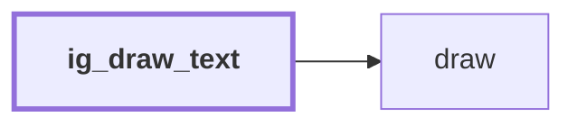

### ig_draw_image

A texture stretched over the rectangle with opposite corners (`x1`, `y1`) and (`x2`, `y2`), in any order
 (`ImDrawList::AddImage`), its pixel row 1 at the top; `color` multiplies its pixels (default white: as they
 are). Screen pixels, or plot units on the `'plot'` layer. Refusals: see `ig_draw_polyline`, and a texture not
 initialized.

**Attributes**: recursive

```fortran
subroutine ig_draw_image(texture, x1, y1, x2, y2, color, layer, stat)
```

**Arguments**

| Name | Type | Intent | Attributes | Description |
|------|------|--------|------------|-------------|
| `texture` | type([texture_object](/api/src/lib/figure_texture#texture-object)) | in |  | The texture. |
| `x1` | real(kind=real64) | in |  | A corner, abscissa [pixels or plot units]. |
| `y1` | real(kind=real64) | in |  | A corner, ordinate [pixels or plot units]. |
| `x2` | real(kind=real64) | in |  | The opposite corner, abscissa [pixels or plot units]. |
| `y2` | real(kind=real64) | in |  | The opposite corner, ordinate [pixels or plot units]. |
| `color` | real(kind=real64) | in | optional | Tint, `[r, g, b(, a)]` in [0, 1] (default white). |
| `layer` | character(len=*) | in | optional | `'window'` (default), `'foreground'`, `'background'`, `'plot'`. |
| `stat` | integer(kind=int32) | out | optional | Status. |

**Call graph**

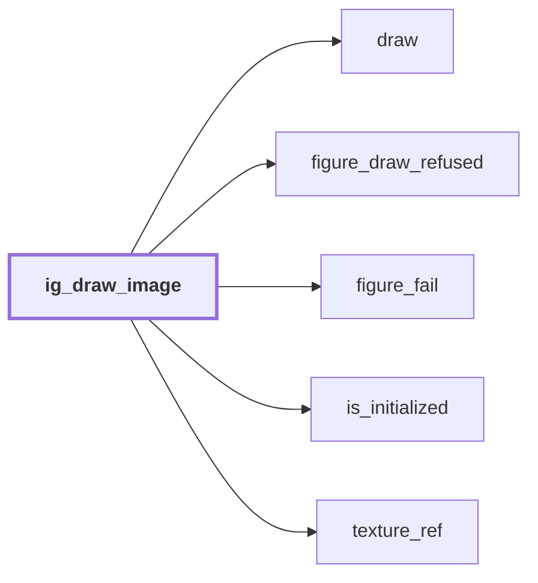

### draw

Check the arguments of a primitive and draw it: `FIG_ERR_ARGUMENT` for a wrong one, `FIG_ERR_STATE` (a usage
 error) for the plot layer outside a plot, no frame or a task.

**Attributes**: recursive

```fortran
subroutine draw(who, kind, x, y, color, thickness, radius, filled, text, layer, texture, stat)
```

**Arguments**

| Name | Type | Intent | Attributes | Description |
|------|------|--------|------------|-------------|
| `who` | character(len=*) | in |  | The procedure. |
| `kind` | integer(kind=c_int) | in |  | DRAW_*. |
| `x` | real(kind=real64) | in |  | Abscissae. |
| `y` | real(kind=real64) | in |  | Ordinates. |
| `color` | real(kind=real64) | in |  | Colour, `[r, g, b(, a)]` in [0, 1]. |
| `thickness` | real(kind=real64) | in | optional | Line thickness [pixels]. |
| `radius` | real(kind=real64) | in | optional | A circle's radius [pixels]. |
| `filled` | logical | in | optional | Filled (a polyline: closed). |
| `text` | character(len=*) | in | optional | Text. |
| `layer` | character(len=*) | in | optional | Layer name. |
| `texture` | integer(kind=c_long_long) | in | optional | ImTextureID. |
| `stat` | integer(kind=int32) | out | optional | Status. |

**Call graph**

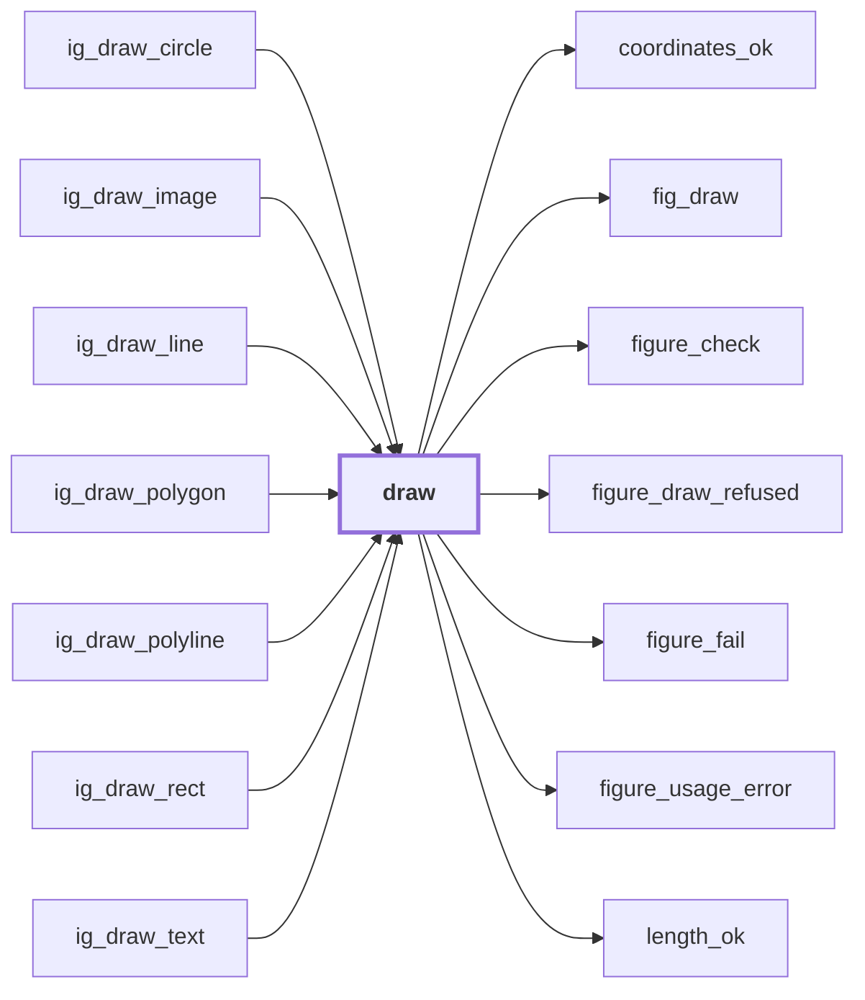

## Functions

### ig_invisible_button

A button that draws nothing (Dear ImGui's `InvisibleButton`): true on the frame it is clicked with the left
 button (pressed and released over it). It is an item like any other (`ig_last_item` gives its hovered and active
 states and its rectangle): a hot zone over something drawn with the `ig_draw_*` primitives. A size <= 0 is the
 space left plus it, at least 1 pixel. A NaN or infinite size: false, `FIG_ERR_ARGUMENT` in `stat` (or
 `error stop` without it); no frame open or a task: `FIG_ERR_STATE`. The same in window, headless and remote mode.

**Attributes**: recursive

**Returns**: `logical`

```fortran
function ig_invisible_button(id, width, height, stat) result(clicked)
```

**Arguments**

| Name | Type | Intent | Attributes | Description |
|------|------|--------|------------|-------------|
| `id` | character(len=*) | in |  | Its id (unique in the window, not shown). |
| `width` | real(kind=real64) | in |  | Width [pixels] (<= 0: the space left plus it). |
| `height` | real(kind=real64) | in |  | Height [pixels] (<= 0: the space left plus it). |
| `stat` | integer(kind=int32) | out | optional | Status. |

**Call graph**

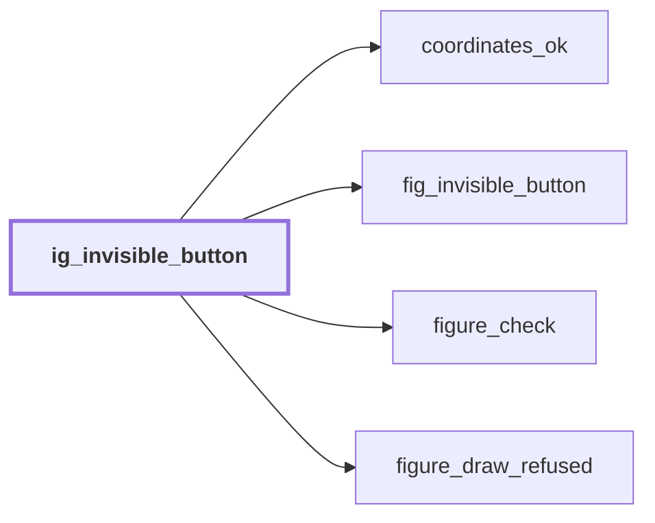

### coordinates_ok

True when every value of `v` is finite and within single precision; else `FIG_ERR_ARGUMENT`, the message
 naming `what`.

**Attributes**: recursive

**Returns**: `logical`

```fortran
function coordinates_ok(who, v, what, stat) result(ok)
```

**Arguments**

| Name | Type | Intent | Attributes | Description |
|------|------|--------|------------|-------------|
| `who` | character(len=*) | in |  | The procedure. |
| `v` | real(kind=real64) | in |  | Values. |
| `what` | character(len=*) | in |  | Their name. |
| `stat` | integer(kind=int32) | out | optional | Status, when refused. |

**Call graph**

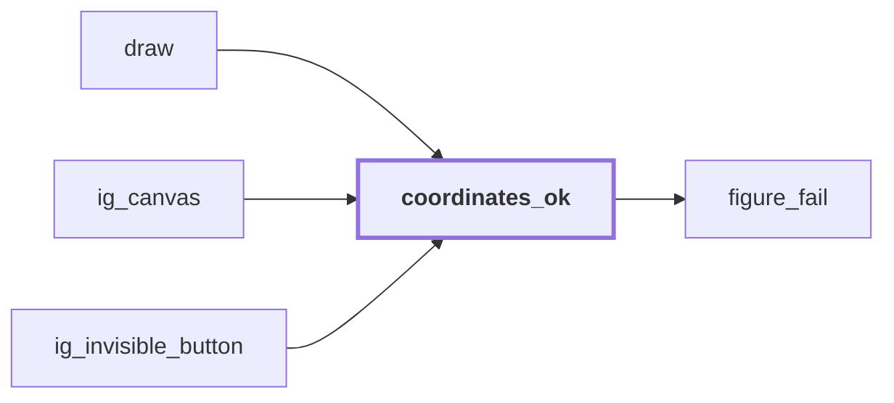

### length_ok

True when `v` is a finite length within single precision, above 0 (or, with `zero`, at least 0).

**Attributes**: pure

**Returns**: `logical`

```fortran
function length_ok(v, zero) result(ok)
```

**Arguments**

| Name | Type | Intent | Attributes | Description |
|------|------|--------|------------|-------------|
| `v` | real(kind=real64) | in |  | Length [pixels]. |
| `zero` | logical | in |  | 0 accepted. |

**Call graph**

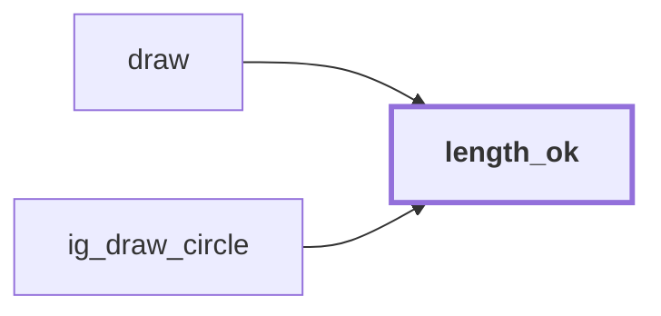
