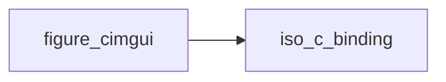

# figure_cimgui

> figure_cimgui, raw Dear ImGui interfaces (generated by scripts/gen_bindings.py: do not edit).

 Of the 427 public free functions of cimgui, 368 are bound directly (`bind(C)`) and 8 through the generated C++
 glue (native/figure_glue_generated.cpp: `figure_<name>`, structs passed by reference instead of by value, struct
 results through `res`); the rest are skipped: see docs/guide/raw-bindings.md. Private to the library:
 applications use the figure_* wrapper modules. Each dummy documents its C type and default.

**Source**: `src/lib/figure_cimgui.F90`

**Dependencies**

## Contents

- [im_vec2](#im-vec2)
- [im_vec4](#im-vec4)
- [im_texture_ref](#im-texture-ref)
- [igAcceptDragDropPayload](#igacceptdragdroppayload)
- [igArrowButton](#igarrowbutton)
- [igBegin](#igbegin)
- [igBeginChild_ID](#igbeginchild-id)
- [igBeginChild_Str](#igbeginchild-str)
- [igBeginCombo](#igbegincombo)
- [igBeginDragDropSource](#igbegindragdropsource)
- [igBeginDragDropTarget](#igbegindragdroptarget)
- [igBeginItemTooltip](#igbeginitemtooltip)
- [igBeginListBox](#igbeginlistbox)
- [igBeginMainMenuBar](#igbeginmainmenubar)
- [igBeginMenu](#igbeginmenu)
- [igBeginMenuBar](#igbeginmenubar)
- [igBeginMultiSelect](#igbeginmultiselect)
- [igBeginPopup](#igbeginpopup)
- [igBeginPopupContextItem](#igbeginpopupcontextitem)
- [igBeginPopupContextVoid](#igbeginpopupcontextvoid)
- [igBeginPopupContextWindow](#igbeginpopupcontextwindow)
- [igBeginPopupModal](#igbeginpopupmodal)
- [igBeginTabBar](#igbegintabbar)
- [igBeginTabItem](#igbegintabitem)
- [igBeginTable](#igbegintable)
- [igBeginTooltip](#igbegintooltip)
- [igButton](#igbutton)
- [igCalcItemWidth](#igcalcitemwidth)
- [igCalcTextSize](#igcalctextsize)
- [igCheckbox](#igcheckbox)
- [igCheckboxFlags_IntPtr](#igcheckboxflags-intptr)
- [igCheckboxFlags_UintPtr](#igcheckboxflags-uintptr)
- [igCollapsingHeader_BoolPtr](#igcollapsingheader-boolptr)
- [igCollapsingHeader_TreeNodeFlags](#igcollapsingheader-treenodeflags)
- [igColorButton](#igcolorbutton)
- [igColorConvertFloat4ToU32](#igcolorconvertfloat4tou32)
- [igColorEdit3](#igcoloredit3)
- [igColorEdit4](#igcoloredit4)
- [igColorPicker3](#igcolorpicker3)
- [igColorPicker4](#igcolorpicker4)
- [igCombo_Str](#igcombo-str)
- [igCombo_Str_arr](#igcombo-str-arr)
- [igCreateContext](#igcreatecontext)
- [igDebugCheckVersionAndDataLayout](#igdebugcheckversionanddatalayout)
- [igDockSpace](#igdockspace)
- [igDockSpaceOverViewport](#igdockspaceoverviewport)
- [igDragFloat](#igdragfloat)
- [igDragFloat2](#igdragfloat2)
- [igDragFloat3](#igdragfloat3)
- [igDragFloat4](#igdragfloat4)
- [igDragFloatRange2](#igdragfloatrange2)
- [igDragInt](#igdragint)
- [igDragInt2](#igdragint2)
- [igDragInt3](#igdragint3)
- [igDragInt4](#igdragint4)
- [igDragIntRange2](#igdragintrange2)
- [igDragScalar](#igdragscalar)
- [igDragScalarN](#igdragscalarn)
- [igEndMultiSelect](#igendmultiselect)
- [igFindViewportByID](#igfindviewportbyid)
- [igFindViewportByPlatformHandle](#igfindviewportbyplatformhandle)
- [igGetBackgroundDrawList](#iggetbackgrounddrawlist)
- [igGetClipboardText](#iggetclipboardtext)
- [igGetColorU32_Col](#iggetcoloru32-col)
- [igGetColorU32_U32](#iggetcoloru32-u32)
- [igGetColorU32_Vec4](#iggetcoloru32-vec4)
- [igGetColumnIndex](#iggetcolumnindex)
- [igGetColumnOffset](#iggetcolumnoffset)
- [igGetColumnsCount](#iggetcolumnscount)
- [igGetColumnWidth](#iggetcolumnwidth)
- [igGetContentRegionAvail](#iggetcontentregionavail)
- [igGetCurrentContext](#iggetcurrentcontext)
- [igGetCursorPos](#iggetcursorpos)
- [igGetCursorPosX](#iggetcursorposx)
- [igGetCursorPosY](#iggetcursorposy)
- [igGetCursorScreenPos](#iggetcursorscreenpos)
- [igGetCursorStartPos](#iggetcursorstartpos)
- [igGetDragDropPayload](#iggetdragdroppayload)
- [igGetDrawData](#iggetdrawdata)
- [igGetDrawListSharedData](#iggetdrawlistshareddata)
- [igGetFont](#iggetfont)
- [igGetFontBaked](#iggetfontbaked)
- [igGetFontSize](#iggetfontsize)
- [igGetFontTexUvWhitePixel](#iggetfonttexuvwhitepixel)
- [igGetForegroundDrawList_ViewportPtr](#iggetforegrounddrawlist-viewportptr)
- [igGetFrameCount](#iggetframecount)
- [igGetFrameHeight](#iggetframeheight)
- [igGetFrameHeightWithSpacing](#iggetframeheightwithspacing)
- [igGetID_Int](#iggetid-int)
- [igGetID_Ptr](#iggetid-ptr)
- [igGetID_Str](#iggetid-str)
- [igGetID_StrStr](#iggetid-strstr)
- [igGetIO_Nil](#iggetio-nil)
- [igGetItemClickedCountWithSingleClickDelay](#iggetitemclickedcountwithsingleclickdelay)
- [igGetItemFlags](#iggetitemflags)
- [igGetItemID](#iggetitemid)
- [igGetItemRectMax](#iggetitemrectmax)
- [igGetItemRectMin](#iggetitemrectmin)
- [igGetItemRectSize](#iggetitemrectsize)
- [igGetKeyName](#iggetkeyname)
- [igGetKeyPressedAmount](#iggetkeypressedamount)
- [igGetMainViewport](#iggetmainviewport)
- [igGetMouseClickedCount](#iggetmouseclickedcount)
- [igGetMouseCursor](#iggetmousecursor)
- [igGetMouseDragDelta](#iggetmousedragdelta)
- [igGetMousePos](#iggetmousepos)
- [igGetMousePosOnOpeningCurrentPopup](#iggetmouseposonopeningcurrentpopup)
- [igGetPlatformIO_Nil](#iggetplatformio-nil)
- [igGetScrollMaxX](#iggetscrollmaxx)
- [igGetScrollMaxY](#iggetscrollmaxy)
- [igGetScrollX](#iggetscrollx)
- [igGetScrollY](#iggetscrolly)
- [igGetStateStorage](#iggetstatestorage)
- [igGetStyle](#iggetstyle)
- [igGetStyleColorName](#iggetstylecolorname)
- [igGetStyleColorVec4](#iggetstylecolorvec4)
- [igGetTextLineHeight](#iggettextlineheight)
- [igGetTextLineHeightWithSpacing](#iggettextlineheightwithspacing)
- [igGetTime](#iggettime)
- [igGetTreeNodeToLabelSpacing](#iggettreenodetolabelspacing)
- [igGetVersion](#iggetversion)
- [igGetWindowDockID](#iggetwindowdockid)
- [igGetWindowDpiScale](#iggetwindowdpiscale)
- [igGetWindowDrawList](#iggetwindowdrawlist)
- [igGetWindowHeight](#iggetwindowheight)
- [igGetWindowPos](#iggetwindowpos)
- [igGetWindowSize](#iggetwindowsize)
- [igGetWindowViewport](#iggetwindowviewport)
- [igGetWindowWidth](#iggetwindowwidth)
- [igImageButton](#igimagebutton)
- [igInputDouble](#iginputdouble)
- [igInputFloat](#iginputfloat)
- [igInputFloat2](#iginputfloat2)
- [igInputFloat3](#iginputfloat3)
- [igInputFloat4](#iginputfloat4)
- [igInputInt](#iginputint)
- [igInputInt2](#iginputint2)
- [igInputInt3](#iginputint3)
- [igInputInt4](#iginputint4)
- [igInputScalar](#iginputscalar)
- [igInputScalarN](#iginputscalarn)
- [igInvisibleButton](#iginvisiblebutton)
- [igIsAnyItemActive](#igisanyitemactive)
- [igIsAnyItemFocused](#igisanyitemfocused)
- [igIsAnyItemHovered](#igisanyitemhovered)
- [igIsAnyMouseDown](#igisanymousedown)
- [igIsItemActivated](#igisitemactivated)
- [igIsItemActive](#igisitemactive)
- [igIsItemClicked](#igisitemclicked)
- [igIsItemDeactivated](#igisitemdeactivated)
- [igIsItemDeactivatedAfterEdit](#igisitemdeactivatedafteredit)
- [igIsItemEdited](#igisitemedited)
- [igIsItemFocused](#igisitemfocused)
- [igIsItemHovered](#igisitemhovered)
- [igIsItemToggledOpen](#igisitemtoggledopen)
- [igIsItemToggledSelection](#igisitemtoggledselection)
- [igIsItemVisible](#igisitemvisible)
- [igIsKeyChordPressed_Nil](#igiskeychordpressed-nil)
- [igIsKeyDown_Nil](#igiskeydown-nil)
- [igIsKeyPressed_Bool](#igiskeypressed-bool)
- [igIsKeyReleased_Nil](#igiskeyreleased-nil)
- [igIsMouseClicked_Bool](#igismouseclicked-bool)
- [igIsMouseDoubleClicked_Nil](#igismousedoubleclicked-nil)
- [igIsMouseDown_Nil](#igismousedown-nil)
- [igIsMouseDragging](#igismousedragging)
- [igIsMouseHoveringRect](#igismousehoveringrect)
- [igIsMousePosValid](#igismouseposvalid)
- [igIsMouseReleased_Nil](#igismousereleased-nil)
- [igIsMouseReleasedWithDelay](#igismousereleasedwithdelay)
- [igIsPopupOpen_Str](#igispopupopen-str)
- [igIsRectVisible_Nil](#igisrectvisible-nil)
- [igIsRectVisible_Vec2](#igisrectvisible-vec2)
- [igIsWindowAppearing](#igiswindowappearing)
- [igIsWindowCollapsed](#igiswindowcollapsed)
- [igIsWindowDocked](#igiswindowdocked)
- [igIsWindowFocused](#igiswindowfocused)
- [igIsWindowHovered](#igiswindowhovered)
- [igListBox_Str_arr](#iglistbox-str-arr)
- [igMemAlloc](#igmemalloc)
- [igMenuItem_Bool](#igmenuitem-bool)
- [igMenuItem_BoolPtr](#igmenuitem-boolptr)
- [igOpenPopup_ID](#igopenpopup-id)
- [igOpenPopup_Str](#igopenpopup-str)
- [igOpenPopupOnItemClick](#igopenpopuponitemclick)
- [igRadioButton_Bool](#igradiobutton-bool)
- [igRadioButton_IntPtr](#igradiobutton-intptr)
- [igSaveIniSettingsToMemory](#igsaveinisettingstomemory)
- [igSelectable_Bool](#igselectable-bool)
- [igSelectable_BoolPtr](#igselectable-boolptr)
- [igSetDragDropPayload](#igsetdragdroppayload)
- [igSetItemKeyOwner_Nil](#igsetitemkeyowner-nil)
- [igShortcut_Nil](#igshortcut-nil)
- [igShowStyleSelector](#igshowstyleselector)
- [igSliderAngle](#igsliderangle)
- [igSliderFloat](#igsliderfloat)
- [igSliderFloat2](#igsliderfloat2)
- [igSliderFloat3](#igsliderfloat3)
- [igSliderFloat4](#igsliderfloat4)
- [igSliderInt](#igsliderint)
- [igSliderInt2](#igsliderint2)
- [igSliderInt3](#igsliderint3)
- [igSliderInt4](#igsliderint4)
- [igSliderScalar](#igsliderscalar)
- [igSliderScalarN](#igsliderscalarn)
- [igSmallButton](#igsmallbutton)
- [igTabItemButton](#igtabitembutton)
- [igTableGetColumnCount](#igtablegetcolumncount)
- [igTableGetColumnFlags](#igtablegetcolumnflags)
- [igTableGetColumnIndex](#igtablegetcolumnindex)
- [igTableGetColumnName_Int](#igtablegetcolumnname-int)
- [igTableGetHoveredColumn](#igtablegethoveredcolumn)
- [igTableGetRowIndex](#igtablegetrowindex)
- [igTableGetSortSpecs](#igtablegetsortspecs)
- [igTableNextColumn](#igtablenextcolumn)
- [igTableSetColumnIndex](#igtablesetcolumnindex)
- [igTextLink](#igtextlink)
- [igTextLinkOpenURL](#igtextlinkopenurl)
- [igTreeNode_Str](#igtreenode-str)
- [igTreeNodeEx_Str](#igtreenodeex-str)
- [igTreeNodeGetOpen](#igtreenodegetopen)
- [igVSliderFloat](#igvsliderfloat)
- [igVSliderInt](#igvsliderint)
- [igVSliderScalar](#igvsliderscalar)
- [figure_sizeof_ImVec4_c](#figure-sizeof-imvec4-c)
- [figure_sizeof_ImTextureRef_c](#figure-sizeof-imtextureref-c)
- [igAlignTextToFramePadding](#igaligntexttoframepadding)
- [igBeginDisabled](#igbegindisabled)
- [igBeginGroup](#igbegingroup)
- [igBullet](#igbullet)
- [igCloseCurrentPopup](#igclosecurrentpopup)
- [igColorConvertHSVtoRGB](#igcolorconverthsvtorgb)
- [igColorConvertRGBtoHSV](#igcolorconvertrgbtohsv)
- [igColorConvertU32ToFloat4](#igcolorconvertu32tofloat4)
- [igColumns](#igcolumns)
- [igDebugFlashStyleColor](#igdebugflashstylecolor)
- [igDebugStartItemPicker](#igdebugstartitempicker)
- [igDebugTextEncoding](#igdebugtextencoding)
- [igDestroyContext](#igdestroycontext)
- [igDestroyPlatformWindows](#igdestroyplatformwindows)
- [igDummy](#igdummy)
- [igEnd](#igend)
- [igEndChild](#igendchild)
- [igEndCombo](#igendcombo)
- [igEndDisabled](#igenddisabled)
- [igEndDragDropSource](#igenddragdropsource)
- [igEndDragDropTarget](#igenddragdroptarget)
- [igEndFrame](#igendframe)
- [igEndGroup](#igendgroup)
- [igEndListBox](#igendlistbox)
- [igEndMainMenuBar](#igendmainmenubar)
- [igEndMenu](#igendmenu)
- [igEndMenuBar](#igendmenubar)
- [igEndPopup](#igendpopup)
- [igEndTabBar](#igendtabbar)
- [igEndTabItem](#igendtabitem)
- [igEndTable](#igendtable)
- [igEndTooltip](#igendtooltip)
- [igGetAllocatorFunctions](#iggetallocatorfunctions)
- [igImage](#igimage)
- [igImageWithBg](#igimagewithbg)
- [igIndent](#igindent)
- [igLoadIniSettingsFromDisk](#igloadinisettingsfromdisk)
- [igLoadIniSettingsFromMemory](#igloadinisettingsfrommemory)
- [igLogButtons](#iglogbuttons)
- [igLogFinish](#iglogfinish)
- [igLogToClipboard](#iglogtoclipboard)
- [igLogToFile](#iglogtofile)
- [igLogToTTY](#iglogtotty)
- [igMemFree](#igmemfree)
- [igNewFrame](#ignewframe)
- [igNewLine](#ignewline)
- [igNextColumn](#ignextcolumn)
- [igPlotHistogram_FloatPtr](#igplothistogram-floatptr)
- [igPlotLines_FloatPtr](#igplotlines-floatptr)
- [igPopClipRect](#igpopcliprect)
- [igPopFont](#igpopfont)
- [igPopID](#igpopid)
- [igPopItemFlag](#igpopitemflag)
- [igPopItemWidth](#igpopitemwidth)
- [igPopStyleColor](#igpopstylecolor)
- [igPopStyleVar](#igpopstylevar)
- [igPopTextWrapPos](#igpoptextwrappos)
- [igProgressBar](#igprogressbar)
- [igPushClipRect](#igpushcliprect)
- [igPushFont](#igpushfont)
- [igPushID_Int](#igpushid-int)
- [igPushID_Ptr](#igpushid-ptr)
- [igPushID_Str](#igpushid-str)
- [igPushID_StrStr](#igpushid-strstr)
- [igPushItemFlag](#igpushitemflag)
- [igPushItemWidth](#igpushitemwidth)
- [igPushStyleColor_U32](#igpushstylecolor-u32)
- [igPushStyleColor_Vec4](#igpushstylecolor-vec4)
- [igPushStyleVar_Float](#igpushstylevar-float)
- [igPushStyleVar_Vec2](#igpushstylevar-vec2)
- [igPushStyleVarX](#igpushstylevarx)
- [igPushStyleVarY](#igpushstylevary)
- [igPushTextWrapPos](#igpushtextwrappos)
- [igRender](#igrender)
- [igRenderPlatformWindowsDefault](#igrenderplatformwindowsdefault)
- [igResetMouseDragDelta](#igresetmousedragdelta)
- [igSameLine](#igsameline)
- [igSaveIniSettingsToDisk](#igsaveinisettingstodisk)
- [igSeparator](#igseparator)
- [igSeparatorText](#igseparatortext)
- [igSetClipboardText](#igsetclipboardtext)
- [igSetColumnOffset](#igsetcolumnoffset)
- [igSetColumnWidth](#igsetcolumnwidth)
- [igSetCurrentContext](#igsetcurrentcontext)
- [igSetCursorPos](#igsetcursorpos)
- [igSetCursorPosX](#igsetcursorposx)
- [igSetCursorPosY](#igsetcursorposy)
- [igSetCursorScreenPos](#igsetcursorscreenpos)
- [igSetItemDefaultFocus](#igsetitemdefaultfocus)
- [igSetKeyboardFocusHere](#igsetkeyboardfocushere)
- [igSetMouseCursor](#igsetmousecursor)
- [igSetNavCursorVisible](#igsetnavcursorvisible)
- [igSetNextFrameWantCaptureKeyboard](#igsetnextframewantcapturekeyboard)
- [igSetNextFrameWantCaptureMouse](#igsetnextframewantcapturemouse)
- [igSetNextItemAllowOverlap](#igsetnextitemallowoverlap)
- [igSetNextItemOpen](#igsetnextitemopen)
- [igSetNextItemSelectionUserData](#igsetnextitemselectionuserdata)
- [igSetNextItemShortcut](#igsetnextitemshortcut)
- [igSetNextItemStorageID](#igsetnextitemstorageid)
- [igSetNextItemWidth](#igsetnextitemwidth)
- [igSetNextWindowBgAlpha](#igsetnextwindowbgalpha)
- [igSetNextWindowClass](#igsetnextwindowclass)
- [igSetNextWindowCollapsed](#igsetnextwindowcollapsed)
- [igSetNextWindowContentSize](#igsetnextwindowcontentsize)
- [igSetNextWindowDockID](#igsetnextwindowdockid)
- [igSetNextWindowFocus](#igsetnextwindowfocus)
- [igSetNextWindowPos](#igsetnextwindowpos)
- [igSetNextWindowScroll](#igsetnextwindowscroll)
- [igSetNextWindowSize](#igsetnextwindowsize)
- [igSetNextWindowViewport](#igsetnextwindowviewport)
- [igSetScrollFromPosX_Float](#igsetscrollfromposx-float)
- [igSetScrollFromPosY_Float](#igsetscrollfromposy-float)
- [igSetScrollHereX](#igsetscrollherex)
- [igSetScrollHereY](#igsetscrollherey)
- [igSetScrollX_Float](#igsetscrollx-float)
- [igSetScrollY_Float](#igsetscrolly-float)
- [igSetStateStorage](#igsetstatestorage)
- [igSetTabItemClosed](#igsettabitemclosed)
- [igSetWindowCollapsed_Bool](#igsetwindowcollapsed-bool)
- [igSetWindowCollapsed_Str](#igsetwindowcollapsed-str)
- [igSetWindowFocus_Nil](#igsetwindowfocus-nil)
- [igSetWindowFocus_Str](#igsetwindowfocus-str)
- [igSetWindowPos_Str](#igsetwindowpos-str)
- [igSetWindowPos_Vec2](#igsetwindowpos-vec2)
- [igSetWindowSize_Str](#igsetwindowsize-str)
- [igSetWindowSize_Vec2](#igsetwindowsize-vec2)
- [igShowAboutWindow](#igshowaboutwindow)
- [igShowDebugLogWindow](#igshowdebuglogwindow)
- [igShowDemoWindow](#igshowdemowindow)
- [igShowFontSelector](#igshowfontselector)
- [igShowIDStackToolWindow](#igshowidstacktoolwindow)
- [igShowMetricsWindow](#igshowmetricswindow)
- [igShowStyleEditor](#igshowstyleeditor)
- [igShowUserGuide](#igshowuserguide)
- [igSpacing](#igspacing)
- [igStyleColorsClassic](#igstylecolorsclassic)
- [igStyleColorsDark](#igstylecolorsdark)
- [igStyleColorsLight](#igstylecolorslight)
- [igTableAngledHeadersRow](#igtableangledheadersrow)
- [igTableHeader](#igtableheader)
- [igTableHeadersRow](#igtableheadersrow)
- [igTableNextRow](#igtablenextrow)
- [igTableSetBgColor](#igtablesetbgcolor)
- [igTableSetColumnEnabled](#igtablesetcolumnenabled)
- [igTableSetupColumn](#igtablesetupcolumn)
- [igTableSetupScrollFreeze](#igtablesetupscrollfreeze)
- [igTextUnformatted](#igtextunformatted)
- [igTreePop](#igtreepop)
- [igTreePush_Ptr](#igtreepush-ptr)
- [igTreePush_Str](#igtreepush-str)
- [igUnindent](#igunindent)
- [igUpdatePlatformWindows](#igupdateplatformwindows)
- [igValue_Bool](#igvalue-bool)
- [igValue_Float](#igvalue-float)
- [igValue_Int](#igvalue-int)
- [igValue_Uint](#igvalue-uint)

## Derived Types

### im_vec2

ImVec2_c: a 2D vector of floats, passed by value.

**Attributes**: bind(C)

#### Components

| Name | Type | Attributes | Description |
|------|------|------------|-------------|
| `x` | real(kind=c_float) |  | Abscissa. |
| `y` | real(kind=c_float) |  | Ordinate. |

### im_vec4

`ImVec4_c`, the C layout of `ImVec4`, zero-initialized (not the C++ defaults).

**Attributes**: bind(C)

#### Components

| Name | Type | Attributes | Description |
|------|------|------------|-------------|
| `x` | real(kind=c_float) |  | C `float`. |
| `y` | real(kind=c_float) |  | C `float`. |
| `z` | real(kind=c_float) |  | C `float`. |
| `w` | real(kind=c_float) |  | C `float`. |

### im_texture_ref

`ImTextureRef_c`, the C layout of `ImTextureRef`, zero-initialized (not the C++ defaults).

**Attributes**: bind(C)

#### Components

| Name | Type | Attributes | Description |
|------|------|------------|-------------|
| `TexData` | type(c_ptr) |  | C `ImTextureData*`. |
| `TexID` | integer(kind=c_long_long) |  | C `ImTextureID`. |

## Interfaces

### igAcceptDragDropPayload

### igArrowButton

### igBegin

### igBeginChild_ID

### igBeginChild_Str

### igBeginCombo

### igBeginDragDropSource

### igBeginDragDropTarget

### igBeginItemTooltip

### igBeginListBox

### igBeginMainMenuBar

### igBeginMenu

### igBeginMenuBar

### igBeginMultiSelect

### igBeginPopup

### igBeginPopupContextItem

### igBeginPopupContextVoid

### igBeginPopupContextWindow

### igBeginPopupModal

### igBeginTabBar

### igBeginTabItem

### igBeginTable

### igBeginTooltip

### igButton

### igCalcItemWidth

### igCalcTextSize

### igCheckbox

### igCheckboxFlags_IntPtr

### igCheckboxFlags_UintPtr

### igCollapsingHeader_BoolPtr

### igCollapsingHeader_TreeNodeFlags

### igColorButton

### igColorConvertFloat4ToU32

### igColorEdit3

### igColorEdit4

### igColorPicker3

### igColorPicker4

### igCombo_Str

### igCombo_Str_arr

### igCreateContext

### igDebugCheckVersionAndDataLayout

### igDockSpace

### igDockSpaceOverViewport

### igDragFloat

### igDragFloat2

### igDragFloat3

### igDragFloat4

### igDragFloatRange2

### igDragInt

### igDragInt2

### igDragInt3

### igDragInt4

### igDragIntRange2

### igDragScalar

### igDragScalarN

### igEndMultiSelect

### igFindViewportByID

### igFindViewportByPlatformHandle

### igGetBackgroundDrawList

### igGetClipboardText

### igGetColorU32_Col

### igGetColorU32_U32

### igGetColorU32_Vec4

### igGetColumnIndex

### igGetColumnOffset

### igGetColumnsCount

### igGetColumnWidth

### igGetContentRegionAvail

### igGetCurrentContext

### igGetCursorPos

### igGetCursorPosX

### igGetCursorPosY

### igGetCursorScreenPos

### igGetCursorStartPos

### igGetDragDropPayload

### igGetDrawData

### igGetDrawListSharedData

### igGetFont

### igGetFontBaked

### igGetFontSize

### igGetFontTexUvWhitePixel

### igGetForegroundDrawList_ViewportPtr

### igGetFrameCount

### igGetFrameHeight

### igGetFrameHeightWithSpacing

### igGetID_Int

### igGetID_Ptr

### igGetID_Str

### igGetID_StrStr

### igGetIO_Nil

### igGetItemClickedCountWithSingleClickDelay

### igGetItemFlags

### igGetItemID

### igGetItemRectMax

### igGetItemRectMin

### igGetItemRectSize

### igGetKeyName

### igGetKeyPressedAmount

### igGetMainViewport

### igGetMouseClickedCount

### igGetMouseCursor

### igGetMouseDragDelta

### igGetMousePos

### igGetMousePosOnOpeningCurrentPopup

### igGetPlatformIO_Nil

### igGetScrollMaxX

### igGetScrollMaxY

### igGetScrollX

### igGetScrollY

### igGetStateStorage

### igGetStyle

### igGetStyleColorName

### igGetStyleColorVec4

### igGetTextLineHeight

### igGetTextLineHeightWithSpacing

### igGetTime

### igGetTreeNodeToLabelSpacing

### igGetVersion

### igGetWindowDockID

### igGetWindowDpiScale

### igGetWindowDrawList

### igGetWindowHeight

### igGetWindowPos

### igGetWindowSize

### igGetWindowViewport

### igGetWindowWidth

### igImageButton

### igInputDouble

### igInputFloat

### igInputFloat2

### igInputFloat3

### igInputFloat4

### igInputInt

### igInputInt2

### igInputInt3

### igInputInt4

### igInputScalar

### igInputScalarN

### igInvisibleButton

### igIsAnyItemActive

### igIsAnyItemFocused

### igIsAnyItemHovered

### igIsAnyMouseDown

### igIsItemActivated

### igIsItemActive

### igIsItemClicked

### igIsItemDeactivated

### igIsItemDeactivatedAfterEdit

### igIsItemEdited

### igIsItemFocused

### igIsItemHovered

### igIsItemToggledOpen

### igIsItemToggledSelection

### igIsItemVisible

### igIsKeyChordPressed_Nil

### igIsKeyDown_Nil

### igIsKeyPressed_Bool

### igIsKeyReleased_Nil

### igIsMouseClicked_Bool

### igIsMouseDoubleClicked_Nil

### igIsMouseDown_Nil

### igIsMouseDragging

### igIsMouseHoveringRect

### igIsMousePosValid

### igIsMouseReleased_Nil

### igIsMouseReleasedWithDelay

### igIsPopupOpen_Str

### igIsRectVisible_Nil

### igIsRectVisible_Vec2

### igIsWindowAppearing

### igIsWindowCollapsed

### igIsWindowDocked

### igIsWindowFocused

### igIsWindowHovered

### igListBox_Str_arr

### igMemAlloc

### igMenuItem_Bool

### igMenuItem_BoolPtr

### igOpenPopup_ID

### igOpenPopup_Str

### igOpenPopupOnItemClick

### igRadioButton_Bool

### igRadioButton_IntPtr

### igSaveIniSettingsToMemory

### igSelectable_Bool

### igSelectable_BoolPtr

### igSetDragDropPayload

### igSetItemKeyOwner_Nil

### igShortcut_Nil

### igShowStyleSelector

### igSliderAngle

### igSliderFloat

### igSliderFloat2

### igSliderFloat3

### igSliderFloat4

### igSliderInt

### igSliderInt2

### igSliderInt3

### igSliderInt4

### igSliderScalar

### igSliderScalarN

### igSmallButton

### igTabItemButton

### igTableGetColumnCount

### igTableGetColumnFlags

### igTableGetColumnIndex

### igTableGetColumnName_Int

### igTableGetHoveredColumn

### igTableGetRowIndex

### igTableGetSortSpecs

### igTableNextColumn

### igTableSetColumnIndex

### igTextLink

### igTextLinkOpenURL

### igTreeNode_Str

### igTreeNodeEx_Str

### igTreeNodeGetOpen

### igVSliderFloat

### igVSliderInt

### igVSliderScalar

### figure_sizeof_ImVec4_c

### figure_sizeof_ImTextureRef_c

### igAlignTextToFramePadding

### igBeginDisabled

### igBeginGroup

### igBullet

### igCloseCurrentPopup

### igColorConvertHSVtoRGB

### igColorConvertRGBtoHSV

### igColorConvertU32ToFloat4

### igColumns

### igDebugFlashStyleColor

### igDebugStartItemPicker

### igDebugTextEncoding

### igDestroyContext

### igDestroyPlatformWindows

### igDummy

### igEnd

### igEndChild

### igEndCombo

### igEndDisabled

### igEndDragDropSource

### igEndDragDropTarget

### igEndFrame

### igEndGroup

### igEndListBox

### igEndMainMenuBar

### igEndMenu

### igEndMenuBar

### igEndPopup

### igEndTabBar

### igEndTabItem

### igEndTable

### igEndTooltip

### igGetAllocatorFunctions

### igImage

### igImageWithBg

### igIndent

### igLoadIniSettingsFromDisk

### igLoadIniSettingsFromMemory

### igLogButtons

### igLogFinish

### igLogToClipboard

### igLogToFile

### igLogToTTY

### igMemFree

### igNewFrame

### igNewLine

### igNextColumn

### igPlotHistogram_FloatPtr

### igPlotLines_FloatPtr

### igPopClipRect

### igPopFont

### igPopID

### igPopItemFlag

### igPopItemWidth

### igPopStyleColor

### igPopStyleVar

### igPopTextWrapPos

### igProgressBar

### igPushClipRect

### igPushFont

### igPushID_Int

### igPushID_Ptr

### igPushID_Str

### igPushID_StrStr

### igPushItemFlag

### igPushItemWidth

### igPushStyleColor_U32

### igPushStyleColor_Vec4

### igPushStyleVar_Float

### igPushStyleVar_Vec2

### igPushStyleVarX

### igPushStyleVarY

### igPushTextWrapPos

### igRender

### igRenderPlatformWindowsDefault

### igResetMouseDragDelta

### igSameLine

### igSaveIniSettingsToDisk

### igSeparator

### igSeparatorText

### igSetClipboardText

### igSetColumnOffset

### igSetColumnWidth

### igSetCurrentContext

### igSetCursorPos

### igSetCursorPosX

### igSetCursorPosY

### igSetCursorScreenPos

### igSetItemDefaultFocus

### igSetKeyboardFocusHere

### igSetMouseCursor

### igSetNavCursorVisible

### igSetNextFrameWantCaptureKeyboard

### igSetNextFrameWantCaptureMouse

### igSetNextItemAllowOverlap

### igSetNextItemOpen

### igSetNextItemSelectionUserData

### igSetNextItemShortcut

### igSetNextItemStorageID

### igSetNextItemWidth

### igSetNextWindowBgAlpha

### igSetNextWindowClass

### igSetNextWindowCollapsed

### igSetNextWindowContentSize

### igSetNextWindowDockID

### igSetNextWindowFocus

### igSetNextWindowPos

### igSetNextWindowScroll

### igSetNextWindowSize

### igSetNextWindowViewport

### igSetScrollFromPosX_Float

### igSetScrollFromPosY_Float

### igSetScrollHereX

### igSetScrollHereY

### igSetScrollX_Float

### igSetScrollY_Float

### igSetStateStorage

### igSetTabItemClosed

### igSetWindowCollapsed_Bool

### igSetWindowCollapsed_Str

### igSetWindowFocus_Nil

### igSetWindowFocus_Str

### igSetWindowPos_Str

### igSetWindowPos_Vec2

### igSetWindowSize_Str

### igSetWindowSize_Vec2

### igShowAboutWindow

### igShowDebugLogWindow

### igShowDemoWindow

### igShowFontSelector

### igShowIDStackToolWindow

### igShowMetricsWindow

### igShowStyleEditor

### igShowUserGuide

### igSpacing

### igStyleColorsClassic

### igStyleColorsDark

### igStyleColorsLight

### igTableAngledHeadersRow

### igTableHeader

### igTableHeadersRow

### igTableNextRow

### igTableSetBgColor

### igTableSetColumnEnabled

### igTableSetupColumn

### igTableSetupScrollFreeze

### igTextUnformatted

### igTreePop

### igTreePush_Ptr

### igTreePush_Str

### igUnindent

### igUpdatePlatformWindows

### igValue_Bool

### igValue_Float

### igValue_Int

### igValue_Uint
