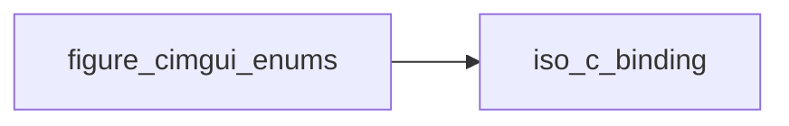

# figure_cimgui_enums

> figure_cimgui_enums, Dear ImGui enumerators (generated by scripts/gen_bindings.py: do not edit).

 The 769 enumerators of the 43 public Dear ImGui enums, values from the cimgui metadata. Names are the C names;
 combine flags with `ior`.

**Source**: `src/lib/figure_cimgui_enums.F90`

**Dependencies**

## Variables

| Name | Type | Attributes | Description |
|------|------|------------|-------------|
| `ImDrawFlags_None` | integer(kind=c_int) | parameter |  |
| `ImDrawFlags_RoundTopLeft` | integer(kind=c_int) | parameter |  |
| `ImDrawFlags_RoundTopRight` | integer(kind=c_int) | parameter |  |
| `ImDrawFlags_RoundBottomLeft` | integer(kind=c_int) | parameter |  |
| `ImDrawFlags_RoundBottomRight` | integer(kind=c_int) | parameter |  |
| `ImDrawFlags_RoundNone` | integer(kind=c_int) | parameter |  |
| `ImDrawFlags_RoundAll` | integer(kind=c_int) | parameter |  |
| `ImDrawFlags_RoundTop` | integer(kind=c_int) | parameter |  |
| `ImDrawFlags_RoundBottom` | integer(kind=c_int) | parameter |  |
| `ImDrawFlags_RoundLeft` | integer(kind=c_int) | parameter |  |
| `ImDrawFlags_RoundRight` | integer(kind=c_int) | parameter |  |
| `ImDrawFlags_Closed` | integer(kind=c_int) | parameter |  |
| `ImDrawFlags_JoinMiter` | integer(kind=c_int) | parameter |  |
| `ImDrawFlags_CapSquare` | integer(kind=c_int) | parameter |  |
| `ImDrawFlags_AAFill` | integer(kind=c_int) | parameter |  |
| `ImDrawFlags_AALines` | integer(kind=c_int) | parameter |  |
| `ImDrawFlags_AALineEnds` | integer(kind=c_int) | parameter |  |
| `ImDrawFlags_StrokeInside` | integer(kind=c_int) | parameter |  |
| `ImDrawFlags_StrokeCenter` | integer(kind=c_int) | parameter |  |
| `ImDrawFlags_StrokeCenterBiased` | integer(kind=c_int) | parameter |  |
| `ImDrawFlags_StrokeOutside` | integer(kind=c_int) | parameter |  |
| `ImDrawFlags_StrokeLegacy` | integer(kind=c_int) | parameter |  |
| `ImDrawFlags_TextNoPixelSnap` | integer(kind=c_int) | parameter |  |
| `ImDrawFlags_UseTexForRoundCorners` | integer(kind=c_int) | parameter |  |
| `ImDrawFlags_UseVtxOffset` | integer(kind=c_int) | parameter |  |
| `ImDrawFlags_AllowTexForRoundCorners_` | integer(kind=c_int) | parameter |  |
| `ImDrawFlags_RoundMask_` | integer(kind=c_int) | parameter |  |
| `ImDrawFlags_AllowInPushScope_` | integer(kind=c_int) | parameter |  |
| `ImDrawFlags_AllowInFrameScope_` | integer(kind=c_int) | parameter |  |
| `ImDrawFlags_StrokeMask_` | integer(kind=c_int) | parameter |  |
| `ImDrawFlags_InvalidMask_` | integer(kind=c_int) | parameter |  |
| `ImFontAtlasFlags_None` | integer(kind=c_int) | parameter |  |
| `ImFontAtlasFlags_NoPowerOfTwoHeight` | integer(kind=c_int) | parameter |  |
| `ImFontAtlasFlags_NoMouseCursors` | integer(kind=c_int) | parameter |  |
| `ImFontAtlasFlags_NoBakedLines` | integer(kind=c_int) | parameter |  |
| `ImFontAtlasFlags_NoBakedRoundCorners` | integer(kind=c_int) | parameter |  |
| `ImFontFlags_None` | integer(kind=c_int) | parameter |  |
| `ImFontFlags_NoLoadError` | integer(kind=c_int) | parameter |  |
| `ImFontFlags_NoLoadGlyphs` | integer(kind=c_int) | parameter |  |
| `ImFontFlags_LockBakedSizes` | integer(kind=c_int) | parameter |  |
| `ImFontFlags_ImplicitRefSize` | integer(kind=c_int) | parameter |  |
| `ImGuiBackendFlags_None` | integer(kind=c_int) | parameter |  |
| `ImGuiBackendFlags_HasGamepad` | integer(kind=c_int) | parameter |  |
| `ImGuiBackendFlags_HasMouseCursors` | integer(kind=c_int) | parameter |  |
| `ImGuiBackendFlags_HasSetMousePos` | integer(kind=c_int) | parameter |  |
| `ImGuiBackendFlags_RendererHasVtxOffset` | integer(kind=c_int) | parameter |  |
| `ImGuiBackendFlags_RendererHasTextures` | integer(kind=c_int) | parameter |  |
| `ImGuiBackendFlags_RendererHasViewports` | integer(kind=c_int) | parameter |  |
| `ImGuiBackendFlags_PlatformHasViewports` | integer(kind=c_int) | parameter |  |
| `ImGuiBackendFlags_HasMouseHoveredViewport` | integer(kind=c_int) | parameter |  |
| `ImGuiBackendFlags_HasParentViewport` | integer(kind=c_int) | parameter |  |
| `ImGuiButtonFlags_None` | integer(kind=c_int) | parameter |  |
| `ImGuiButtonFlags_MouseButtonLeft` | integer(kind=c_int) | parameter |  |
| `ImGuiButtonFlags_MouseButtonRight` | integer(kind=c_int) | parameter |  |
| `ImGuiButtonFlags_MouseButtonMiddle` | integer(kind=c_int) | parameter |  |
| `ImGuiButtonFlags_MouseButtonMask_` | integer(kind=c_int) | parameter |  |
| `ImGuiButtonFlags_EnableNav` | integer(kind=c_int) | parameter |  |
| `ImGuiButtonFlags_AllowOverlap` | integer(kind=c_int) | parameter |  |
| `ImGuiChildFlags_None` | integer(kind=c_int) | parameter |  |
| `ImGuiChildFlags_Borders` | integer(kind=c_int) | parameter |  |
| `ImGuiChildFlags_AlwaysUseWindowPadding` | integer(kind=c_int) | parameter |  |
| `ImGuiChildFlags_ResizeX` | integer(kind=c_int) | parameter |  |
| `ImGuiChildFlags_ResizeY` | integer(kind=c_int) | parameter |  |
| `ImGuiChildFlags_AutoResizeX` | integer(kind=c_int) | parameter |  |
| `ImGuiChildFlags_AutoResizeY` | integer(kind=c_int) | parameter |  |
| `ImGuiChildFlags_AlwaysAutoResize` | integer(kind=c_int) | parameter |  |
| `ImGuiChildFlags_FrameStyle` | integer(kind=c_int) | parameter |  |
| `ImGuiChildFlags_NavFlattened` | integer(kind=c_int) | parameter |  |
| `ImGuiCol_Text` | integer(kind=c_int) | parameter |  |
| `ImGuiCol_TextDisabled` | integer(kind=c_int) | parameter |  |
| `ImGuiCol_WindowBg` | integer(kind=c_int) | parameter |  |
| `ImGuiCol_ChildBg` | integer(kind=c_int) | parameter |  |
| `ImGuiCol_PopupBg` | integer(kind=c_int) | parameter |  |
| `ImGuiCol_Border` | integer(kind=c_int) | parameter |  |
| `ImGuiCol_BorderShadow` | integer(kind=c_int) | parameter |  |
| `ImGuiCol_FrameBg` | integer(kind=c_int) | parameter |  |
| `ImGuiCol_FrameBgHovered` | integer(kind=c_int) | parameter |  |
| `ImGuiCol_FrameBgActive` | integer(kind=c_int) | parameter |  |
| `ImGuiCol_TitleBg` | integer(kind=c_int) | parameter |  |
| `ImGuiCol_TitleBgActive` | integer(kind=c_int) | parameter |  |
| `ImGuiCol_TitleBgCollapsed` | integer(kind=c_int) | parameter |  |
| `ImGuiCol_MenuBarBg` | integer(kind=c_int) | parameter |  |
| `ImGuiCol_ScrollbarBg` | integer(kind=c_int) | parameter |  |
| `ImGuiCol_ScrollbarGrab` | integer(kind=c_int) | parameter |  |
| `ImGuiCol_ScrollbarGrabHovered` | integer(kind=c_int) | parameter |  |
| `ImGuiCol_ScrollbarGrabActive` | integer(kind=c_int) | parameter |  |
| `ImGuiCol_CheckMark` | integer(kind=c_int) | parameter |  |
| `ImGuiCol_CheckboxSelectedBg` | integer(kind=c_int) | parameter |  |
| `ImGuiCol_SliderGrab` | integer(kind=c_int) | parameter |  |
| `ImGuiCol_SliderGrabActive` | integer(kind=c_int) | parameter |  |
| `ImGuiCol_Button` | integer(kind=c_int) | parameter |  |
| `ImGuiCol_ButtonHovered` | integer(kind=c_int) | parameter |  |
| `ImGuiCol_ButtonActive` | integer(kind=c_int) | parameter |  |
| `ImGuiCol_Header` | integer(kind=c_int) | parameter |  |
| `ImGuiCol_HeaderHovered` | integer(kind=c_int) | parameter |  |
| `ImGuiCol_HeaderActive` | integer(kind=c_int) | parameter |  |
| `ImGuiCol_Separator` | integer(kind=c_int) | parameter |  |
| `ImGuiCol_SeparatorHovered` | integer(kind=c_int) | parameter |  |
| `ImGuiCol_SeparatorActive` | integer(kind=c_int) | parameter |  |
| `ImGuiCol_ResizeGrip` | integer(kind=c_int) | parameter |  |
| `ImGuiCol_ResizeGripHovered` | integer(kind=c_int) | parameter |  |
| `ImGuiCol_ResizeGripActive` | integer(kind=c_int) | parameter |  |
| `ImGuiCol_InputTextCursor` | integer(kind=c_int) | parameter |  |
| `ImGuiCol_TabHovered` | integer(kind=c_int) | parameter |  |
| `ImGuiCol_Tab` | integer(kind=c_int) | parameter |  |
| `ImGuiCol_TabSelected` | integer(kind=c_int) | parameter |  |
| `ImGuiCol_TabSelectedOverline` | integer(kind=c_int) | parameter |  |
| `ImGuiCol_TabDimmed` | integer(kind=c_int) | parameter |  |
| `ImGuiCol_TabDimmedSelected` | integer(kind=c_int) | parameter |  |
| `ImGuiCol_TabDimmedSelectedOverline` | integer(kind=c_int) | parameter |  |
| `ImGuiCol_DockingPreview` | integer(kind=c_int) | parameter |  |
| `ImGuiCol_DockingEmptyBg` | integer(kind=c_int) | parameter |  |
| `ImGuiCol_PlotLines` | integer(kind=c_int) | parameter |  |
| `ImGuiCol_PlotLinesHovered` | integer(kind=c_int) | parameter |  |
| `ImGuiCol_PlotHistogram` | integer(kind=c_int) | parameter |  |
| `ImGuiCol_PlotHistogramHovered` | integer(kind=c_int) | parameter |  |
| `ImGuiCol_TableHeaderBg` | integer(kind=c_int) | parameter |  |
| `ImGuiCol_TableBorderStrong` | integer(kind=c_int) | parameter |  |
| `ImGuiCol_TableBorderLight` | integer(kind=c_int) | parameter |  |
| `ImGuiCol_TableRowBg` | integer(kind=c_int) | parameter |  |
| `ImGuiCol_TableRowBgAlt` | integer(kind=c_int) | parameter |  |
| `ImGuiCol_TextLink` | integer(kind=c_int) | parameter |  |
| `ImGuiCol_TextSelectedBg` | integer(kind=c_int) | parameter |  |
| `ImGuiCol_TreeLines` | integer(kind=c_int) | parameter |  |
| `ImGuiCol_DragDropTarget` | integer(kind=c_int) | parameter |  |
| `ImGuiCol_DragDropTargetBg` | integer(kind=c_int) | parameter |  |
| `ImGuiCol_UnsavedMarker` | integer(kind=c_int) | parameter |  |
| `ImGuiCol_NavCursor` | integer(kind=c_int) | parameter |  |
| `ImGuiCol_NavWindowingHighlight` | integer(kind=c_int) | parameter |  |
| `ImGuiCol_NavWindowingDimBg` | integer(kind=c_int) | parameter |  |
| `ImGuiCol_ModalWindowDimBg` | integer(kind=c_int) | parameter |  |
| `ImGuiCol_COUNT` | integer(kind=c_int) | parameter |  |
| `ImGuiColorEditFlags_None` | integer(kind=c_int) | parameter |  |
| `ImGuiColorEditFlags_NoAlpha` | integer(kind=c_int) | parameter |  |
| `ImGuiColorEditFlags_NoPicker` | integer(kind=c_int) | parameter |  |
| `ImGuiColorEditFlags_NoOptions` | integer(kind=c_int) | parameter |  |
| `ImGuiColorEditFlags_NoSmallPreview` | integer(kind=c_int) | parameter |  |
| `ImGuiColorEditFlags_NoInputs` | integer(kind=c_int) | parameter |  |
| `ImGuiColorEditFlags_NoTooltip` | integer(kind=c_int) | parameter |  |
| `ImGuiColorEditFlags_NoLabel` | integer(kind=c_int) | parameter |  |
| `ImGuiColorEditFlags_NoSidePreview` | integer(kind=c_int) | parameter |  |
| `ImGuiColorEditFlags_NoDragDrop` | integer(kind=c_int) | parameter |  |
| `ImGuiColorEditFlags_NoBorder` | integer(kind=c_int) | parameter |  |
| `ImGuiColorEditFlags_NoColorMarkers` | integer(kind=c_int) | parameter |  |
| `ImGuiColorEditFlags_AlphaOpaque` | integer(kind=c_int) | parameter |  |
| `ImGuiColorEditFlags_AlphaNoBg` | integer(kind=c_int) | parameter |  |
| `ImGuiColorEditFlags_AlphaPreviewHalf` | integer(kind=c_int) | parameter |  |
| `ImGuiColorEditFlags_AlphaBar` | integer(kind=c_int) | parameter |  |
| `ImGuiColorEditFlags_HDR` | integer(kind=c_int) | parameter |  |
| `ImGuiColorEditFlags_DisplayRGB` | integer(kind=c_int) | parameter |  |
| `ImGuiColorEditFlags_DisplayHSV` | integer(kind=c_int) | parameter |  |
| `ImGuiColorEditFlags_DisplayHex` | integer(kind=c_int) | parameter |  |
| `ImGuiColorEditFlags_Uint8` | integer(kind=c_int) | parameter |  |
| `ImGuiColorEditFlags_Float` | integer(kind=c_int) | parameter |  |
| `ImGuiColorEditFlags_PickerHueBar` | integer(kind=c_int) | parameter |  |
| `ImGuiColorEditFlags_PickerHueWheel` | integer(kind=c_int) | parameter |  |
| `ImGuiColorEditFlags_PickerNoRotate` | integer(kind=c_int) | parameter |  |
| `ImGuiColorEditFlags_InputRGB` | integer(kind=c_int) | parameter |  |
| `ImGuiColorEditFlags_InputHSV` | integer(kind=c_int) | parameter |  |
| `ImGuiColorEditFlags_DefaultOptions_` | integer(kind=c_int) | parameter |  |
| `ImGuiColorEditFlags_AlphaMask_` | integer(kind=c_int) | parameter |  |
| `ImGuiColorEditFlags_DisplayMask_` | integer(kind=c_int) | parameter |  |
| `ImGuiColorEditFlags_DataTypeMask_` | integer(kind=c_int) | parameter |  |
| `ImGuiColorEditFlags_PickerMask_` | integer(kind=c_int) | parameter |  |
| `ImGuiColorEditFlags_InputMask_` | integer(kind=c_int) | parameter |  |
| `ImGuiComboFlags_None` | integer(kind=c_int) | parameter |  |
| `ImGuiComboFlags_PopupAlignLeft` | integer(kind=c_int) | parameter |  |
| `ImGuiComboFlags_HeightSmall` | integer(kind=c_int) | parameter |  |
| `ImGuiComboFlags_HeightRegular` | integer(kind=c_int) | parameter |  |
| `ImGuiComboFlags_HeightLarge` | integer(kind=c_int) | parameter |  |
| `ImGuiComboFlags_HeightLargest` | integer(kind=c_int) | parameter |  |
| `ImGuiComboFlags_NoArrowButton` | integer(kind=c_int) | parameter |  |
| `ImGuiComboFlags_NoPreview` | integer(kind=c_int) | parameter |  |
| `ImGuiComboFlags_WidthFitPreview` | integer(kind=c_int) | parameter |  |
| `ImGuiComboFlags_HeightMask_` | integer(kind=c_int) | parameter |  |
| `ImGuiCond_None` | integer(kind=c_int) | parameter |  |
| `ImGuiCond_Always` | integer(kind=c_int) | parameter |  |
| `ImGuiCond_Once` | integer(kind=c_int) | parameter |  |
| `ImGuiCond_FirstUseEver` | integer(kind=c_int) | parameter |  |
| `ImGuiCond_Appearing` | integer(kind=c_int) | parameter |  |
| `ImGuiConfigFlags_None` | integer(kind=c_int) | parameter |  |
| `ImGuiConfigFlags_NavEnableKeyboard` | integer(kind=c_int) | parameter |  |
| `ImGuiConfigFlags_NavEnableGamepad` | integer(kind=c_int) | parameter |  |
| `ImGuiConfigFlags_NoMouse` | integer(kind=c_int) | parameter |  |
| `ImGuiConfigFlags_NoMouseCursorChange` | integer(kind=c_int) | parameter |  |
| `ImGuiConfigFlags_NoKeyboard` | integer(kind=c_int) | parameter |  |
| `ImGuiConfigFlags_DockingEnable` | integer(kind=c_int) | parameter |  |
| `ImGuiConfigFlags_ViewportsEnable` | integer(kind=c_int) | parameter |  |
| `ImGuiConfigFlags_IsSRGB` | integer(kind=c_int) | parameter |  |
| `ImGuiConfigFlags_IsTouchScreen` | integer(kind=c_int) | parameter |  |
| `ImGuiDataType_S8` | integer(kind=c_int) | parameter |  |
| `ImGuiDataType_U8` | integer(kind=c_int) | parameter |  |
| `ImGuiDataType_S16` | integer(kind=c_int) | parameter |  |
| `ImGuiDataType_U16` | integer(kind=c_int) | parameter |  |
| `ImGuiDataType_S32` | integer(kind=c_int) | parameter |  |
| `ImGuiDataType_U32` | integer(kind=c_int) | parameter |  |
| `ImGuiDataType_S64` | integer(kind=c_int) | parameter |  |
| `ImGuiDataType_U64` | integer(kind=c_int) | parameter |  |
| `ImGuiDataType_Float` | integer(kind=c_int) | parameter |  |
| `ImGuiDataType_Double` | integer(kind=c_int) | parameter |  |
| `ImGuiDataType_Bool` | integer(kind=c_int) | parameter |  |
| `ImGuiDataType_String` | integer(kind=c_int) | parameter |  |
| `ImGuiDataType_COUNT` | integer(kind=c_int) | parameter |  |
| `ImGuiDir_None` | integer(kind=c_int) | parameter |  |
| `ImGuiDir_Left` | integer(kind=c_int) | parameter |  |
| `ImGuiDir_Right` | integer(kind=c_int) | parameter |  |
| `ImGuiDir_Up` | integer(kind=c_int) | parameter |  |
| `ImGuiDir_Down` | integer(kind=c_int) | parameter |  |
| `ImGuiDir_COUNT` | integer(kind=c_int) | parameter |  |
| `ImGuiDockNodeFlags_None` | integer(kind=c_int) | parameter |  |
| `ImGuiDockNodeFlags_KeepAliveOnly` | integer(kind=c_int) | parameter |  |
| `ImGuiDockNodeFlags_NoDockingOverCentralNode` | integer(kind=c_int) | parameter |  |
| `ImGuiDockNodeFlags_PassthruCentralNode` | integer(kind=c_int) | parameter |  |
| `ImGuiDockNodeFlags_NoDockingSplit` | integer(kind=c_int) | parameter |  |
| `ImGuiDockNodeFlags_NoResize` | integer(kind=c_int) | parameter |  |
| `ImGuiDockNodeFlags_AutoHideTabBar` | integer(kind=c_int) | parameter |  |
| `ImGuiDockNodeFlags_NoUndocking` | integer(kind=c_int) | parameter |  |
| `ImGuiDragDropFlags_None` | integer(kind=c_int) | parameter |  |
| `ImGuiDragDropFlags_SourceNoPreviewTooltip` | integer(kind=c_int) | parameter |  |
| `ImGuiDragDropFlags_SourceNoDisableHover` | integer(kind=c_int) | parameter |  |
| `ImGuiDragDropFlags_SourceNoHoldToOpenOthers` | integer(kind=c_int) | parameter |  |
| `ImGuiDragDropFlags_SourceAllowNullID` | integer(kind=c_int) | parameter |  |
| `ImGuiDragDropFlags_SourceExtern` | integer(kind=c_int) | parameter |  |
| `ImGuiDragDropFlags_PayloadAutoExpire` | integer(kind=c_int) | parameter |  |
| `ImGuiDragDropFlags_PayloadNoCrossContext` | integer(kind=c_int) | parameter |  |
| `ImGuiDragDropFlags_PayloadNoCrossProcess` | integer(kind=c_int) | parameter |  |
| `ImGuiDragDropFlags_AcceptBeforeDelivery` | integer(kind=c_int) | parameter |  |
| `ImGuiDragDropFlags_AcceptNoDrawDefaultRect` | integer(kind=c_int) | parameter |  |
| `ImGuiDragDropFlags_AcceptNoPreviewTooltip` | integer(kind=c_int) | parameter |  |
| `ImGuiDragDropFlags_AcceptDrawAsHovered` | integer(kind=c_int) | parameter |  |
| `ImGuiDragDropFlags_AcceptPeekOnly` | integer(kind=c_int) | parameter |  |
| `ImGuiFocusedFlags_None` | integer(kind=c_int) | parameter |  |
| `ImGuiFocusedFlags_ChildWindows` | integer(kind=c_int) | parameter |  |
| `ImGuiFocusedFlags_RootWindow` | integer(kind=c_int) | parameter |  |
| `ImGuiFocusedFlags_AnyWindow` | integer(kind=c_int) | parameter |  |
| `ImGuiFocusedFlags_NoPopupHierarchy` | integer(kind=c_int) | parameter |  |
| `ImGuiFocusedFlags_DockHierarchy` | integer(kind=c_int) | parameter |  |
| `ImGuiFocusedFlags_RootAndChildWindows` | integer(kind=c_int) | parameter |  |
| `ImGuiHoveredFlags_None` | integer(kind=c_int) | parameter |  |
| `ImGuiHoveredFlags_ChildWindows` | integer(kind=c_int) | parameter |  |
| `ImGuiHoveredFlags_RootWindow` | integer(kind=c_int) | parameter |  |
| `ImGuiHoveredFlags_AnyWindow` | integer(kind=c_int) | parameter |  |
| `ImGuiHoveredFlags_NoPopupHierarchy` | integer(kind=c_int) | parameter |  |
| `ImGuiHoveredFlags_DockHierarchy` | integer(kind=c_int) | parameter |  |
| `ImGuiHoveredFlags_AllowWhenBlockedByPopup` | integer(kind=c_int) | parameter |  |
| `ImGuiHoveredFlags_AllowWhenBlockedByActiveItem` | integer(kind=c_int) | parameter |  |
| `ImGuiHoveredFlags_AllowWhenOverlappedByItem` | integer(kind=c_int) | parameter |  |
| `ImGuiHoveredFlags_AllowWhenOverlappedByWindow` | integer(kind=c_int) | parameter |  |
| `ImGuiHoveredFlags_AllowWhenDisabled` | integer(kind=c_int) | parameter |  |
| `ImGuiHoveredFlags_NoNavOverride` | integer(kind=c_int) | parameter |  |
| `ImGuiHoveredFlags_AllowWhenOverlapped` | integer(kind=c_int) | parameter |  |
| `ImGuiHoveredFlags_RectOnly` | integer(kind=c_int) | parameter |  |
| `ImGuiHoveredFlags_RootAndChildWindows` | integer(kind=c_int) | parameter |  |
| `ImGuiHoveredFlags_ForTooltip` | integer(kind=c_int) | parameter |  |
| `ImGuiHoveredFlags_Stationary` | integer(kind=c_int) | parameter |  |
| `ImGuiHoveredFlags_DelayNone` | integer(kind=c_int) | parameter |  |
| `ImGuiHoveredFlags_DelayShort` | integer(kind=c_int) | parameter |  |
| `ImGuiHoveredFlags_DelayNormal` | integer(kind=c_int) | parameter |  |
| `ImGuiHoveredFlags_NoSharedDelay` | integer(kind=c_int) | parameter |  |
| `ImGuiInputFlags_None` | integer(kind=c_int) | parameter |  |
| `ImGuiInputFlags_Repeat` | integer(kind=c_int) | parameter |  |
| `ImGuiInputFlags_RouteActive` | integer(kind=c_int) | parameter |  |
| `ImGuiInputFlags_RouteFocused` | integer(kind=c_int) | parameter |  |
| `ImGuiInputFlags_RouteGlobal` | integer(kind=c_int) | parameter |  |
| `ImGuiInputFlags_RouteAlways` | integer(kind=c_int) | parameter |  |
| `ImGuiInputFlags_RouteOverFocused` | integer(kind=c_int) | parameter |  |
| `ImGuiInputFlags_RouteOverActive` | integer(kind=c_int) | parameter |  |
| `ImGuiInputFlags_RouteUnlessBgFocused` | integer(kind=c_int) | parameter |  |
| `ImGuiInputFlags_RouteFromRootWindow` | integer(kind=c_int) | parameter |  |
| `ImGuiInputFlags_Tooltip` | integer(kind=c_int) | parameter |  |
| `ImGuiInputTextFlags_None` | integer(kind=c_int) | parameter |  |
| `ImGuiInputTextFlags_CharsDecimal` | integer(kind=c_int) | parameter |  |
| `ImGuiInputTextFlags_CharsHexadecimal` | integer(kind=c_int) | parameter |  |
| `ImGuiInputTextFlags_CharsScientific` | integer(kind=c_int) | parameter |  |
| `ImGuiInputTextFlags_CharsUppercase` | integer(kind=c_int) | parameter |  |
| `ImGuiInputTextFlags_CharsNoBlank` | integer(kind=c_int) | parameter |  |
| `ImGuiInputTextFlags_AllowTabInput` | integer(kind=c_int) | parameter |  |
| `ImGuiInputTextFlags_EnterReturnsTrue` | integer(kind=c_int) | parameter |  |
| `ImGuiInputTextFlags_EscapeClearsAll` | integer(kind=c_int) | parameter |  |
| `ImGuiInputTextFlags_CtrlEnterForNewLine` | integer(kind=c_int) | parameter |  |
| `ImGuiInputTextFlags_ReadOnly` | integer(kind=c_int) | parameter |  |
| `ImGuiInputTextFlags_Password` | integer(kind=c_int) | parameter |  |
| `ImGuiInputTextFlags_AlwaysOverwrite` | integer(kind=c_int) | parameter |  |
| `ImGuiInputTextFlags_AutoSelectAll` | integer(kind=c_int) | parameter |  |
| `ImGuiInputTextFlags_ParseEmptyRefVal` | integer(kind=c_int) | parameter |  |
| `ImGuiInputTextFlags_DisplayEmptyRefVal` | integer(kind=c_int) | parameter |  |
| `ImGuiInputTextFlags_NoHorizontalScroll` | integer(kind=c_int) | parameter |  |
| `ImGuiInputTextFlags_NoUndoRedo` | integer(kind=c_int) | parameter |  |
| `ImGuiInputTextFlags_ElideLeft` | integer(kind=c_int) | parameter |  |
| `ImGuiInputTextFlags_CallbackCompletion` | integer(kind=c_int) | parameter |  |
| `ImGuiInputTextFlags_CallbackHistory` | integer(kind=c_int) | parameter |  |
| `ImGuiInputTextFlags_CallbackAlways` | integer(kind=c_int) | parameter |  |
| `ImGuiInputTextFlags_CallbackCharFilter` | integer(kind=c_int) | parameter |  |
| `ImGuiInputTextFlags_CallbackResize` | integer(kind=c_int) | parameter |  |
| `ImGuiInputTextFlags_CallbackEdit` | integer(kind=c_int) | parameter |  |
| `ImGuiInputTextFlags_WordWrap` | integer(kind=c_int) | parameter |  |
| `ImGuiItemFlags_None` | integer(kind=c_int) | parameter |  |
| `ImGuiItemFlags_NoTabStop` | integer(kind=c_int) | parameter |  |
| `ImGuiItemFlags_NoNav` | integer(kind=c_int) | parameter |  |
| `ImGuiItemFlags_NoNavDefaultFocus` | integer(kind=c_int) | parameter |  |
| `ImGuiItemFlags_ButtonRepeat` | integer(kind=c_int) | parameter |  |
| `ImGuiItemFlags_AutoClosePopups` | integer(kind=c_int) | parameter |  |
| `ImGuiItemFlags_AllowDuplicateId` | integer(kind=c_int) | parameter |  |
| `ImGuiItemFlags_Disabled` | integer(kind=c_int) | parameter |  |
| `ImGuiItemFlags_LiveEditOnInputText` | integer(kind=c_int) | parameter |  |
| `ImGuiItemFlags_LiveEditOnInputScalar` | integer(kind=c_int) | parameter |  |
| `ImGuiItemFlags_LiveEditOnInput` | integer(kind=c_int) | parameter |  |
| `ImGuiItemFlags_MixedValue` | integer(kind=c_int) | parameter |  |
| `ImGuiKey_None` | integer(kind=c_int) | parameter |  |
| `ImGuiKey_NamedKey_BEGIN` | integer(kind=c_int) | parameter |  |
| `ImGuiKey_Tab` | integer(kind=c_int) | parameter |  |
| `ImGuiKey_LeftArrow` | integer(kind=c_int) | parameter |  |
| `ImGuiKey_RightArrow` | integer(kind=c_int) | parameter |  |
| `ImGuiKey_UpArrow` | integer(kind=c_int) | parameter |  |
| `ImGuiKey_DownArrow` | integer(kind=c_int) | parameter |  |
| `ImGuiKey_PageUp` | integer(kind=c_int) | parameter |  |
| `ImGuiKey_PageDown` | integer(kind=c_int) | parameter |  |
| `ImGuiKey_Home` | integer(kind=c_int) | parameter |  |
| `ImGuiKey_End` | integer(kind=c_int) | parameter |  |
| `ImGuiKey_Insert` | integer(kind=c_int) | parameter |  |
| `ImGuiKey_Delete` | integer(kind=c_int) | parameter |  |
| `ImGuiKey_Backspace` | integer(kind=c_int) | parameter |  |
| `ImGuiKey_Space` | integer(kind=c_int) | parameter |  |
| `ImGuiKey_Enter` | integer(kind=c_int) | parameter |  |
| `ImGuiKey_Escape` | integer(kind=c_int) | parameter |  |
| `ImGuiKey_LeftCtrl` | integer(kind=c_int) | parameter |  |
| `ImGuiKey_LeftShift` | integer(kind=c_int) | parameter |  |
| `ImGuiKey_LeftAlt` | integer(kind=c_int) | parameter |  |
| `ImGuiKey_LeftSuper` | integer(kind=c_int) | parameter |  |
| `ImGuiKey_RightCtrl` | integer(kind=c_int) | parameter |  |
| `ImGuiKey_RightShift` | integer(kind=c_int) | parameter |  |
| `ImGuiKey_RightAlt` | integer(kind=c_int) | parameter |  |
| `ImGuiKey_RightSuper` | integer(kind=c_int) | parameter |  |
| `ImGuiKey_Menu` | integer(kind=c_int) | parameter |  |
| `ImGuiKey_0` | integer(kind=c_int) | parameter |  |
| `ImGuiKey_1` | integer(kind=c_int) | parameter |  |
| `ImGuiKey_2` | integer(kind=c_int) | parameter |  |
| `ImGuiKey_3` | integer(kind=c_int) | parameter |  |
| `ImGuiKey_4` | integer(kind=c_int) | parameter |  |
| `ImGuiKey_5` | integer(kind=c_int) | parameter |  |
| `ImGuiKey_6` | integer(kind=c_int) | parameter |  |
| `ImGuiKey_7` | integer(kind=c_int) | parameter |  |
| `ImGuiKey_8` | integer(kind=c_int) | parameter |  |
| `ImGuiKey_9` | integer(kind=c_int) | parameter |  |
| `ImGuiKey_A` | integer(kind=c_int) | parameter |  |
| `ImGuiKey_B` | integer(kind=c_int) | parameter |  |
| `ImGuiKey_C` | integer(kind=c_int) | parameter |  |
| `ImGuiKey_D` | integer(kind=c_int) | parameter |  |
| `ImGuiKey_E` | integer(kind=c_int) | parameter |  |
| `ImGuiKey_F` | integer(kind=c_int) | parameter |  |
| `ImGuiKey_G` | integer(kind=c_int) | parameter |  |
| `ImGuiKey_H` | integer(kind=c_int) | parameter |  |
| `ImGuiKey_I` | integer(kind=c_int) | parameter |  |
| `ImGuiKey_J` | integer(kind=c_int) | parameter |  |
| `ImGuiKey_K` | integer(kind=c_int) | parameter |  |
| `ImGuiKey_L` | integer(kind=c_int) | parameter |  |
| `ImGuiKey_M` | integer(kind=c_int) | parameter |  |
| `ImGuiKey_N` | integer(kind=c_int) | parameter |  |
| `ImGuiKey_O` | integer(kind=c_int) | parameter |  |
| `ImGuiKey_P` | integer(kind=c_int) | parameter |  |
| `ImGuiKey_Q` | integer(kind=c_int) | parameter |  |
| `ImGuiKey_R` | integer(kind=c_int) | parameter |  |
| `ImGuiKey_S` | integer(kind=c_int) | parameter |  |
| `ImGuiKey_T` | integer(kind=c_int) | parameter |  |
| `ImGuiKey_U` | integer(kind=c_int) | parameter |  |
| `ImGuiKey_V` | integer(kind=c_int) | parameter |  |
| `ImGuiKey_W` | integer(kind=c_int) | parameter |  |
| `ImGuiKey_X` | integer(kind=c_int) | parameter |  |
| `ImGuiKey_Y` | integer(kind=c_int) | parameter |  |
| `ImGuiKey_Z` | integer(kind=c_int) | parameter |  |
| `ImGuiKey_F1` | integer(kind=c_int) | parameter |  |
| `ImGuiKey_F2` | integer(kind=c_int) | parameter |  |
| `ImGuiKey_F3` | integer(kind=c_int) | parameter |  |
| `ImGuiKey_F4` | integer(kind=c_int) | parameter |  |
| `ImGuiKey_F5` | integer(kind=c_int) | parameter |  |
| `ImGuiKey_F6` | integer(kind=c_int) | parameter |  |
| `ImGuiKey_F7` | integer(kind=c_int) | parameter |  |
| `ImGuiKey_F8` | integer(kind=c_int) | parameter |  |
| `ImGuiKey_F9` | integer(kind=c_int) | parameter |  |
| `ImGuiKey_F10` | integer(kind=c_int) | parameter |  |
| `ImGuiKey_F11` | integer(kind=c_int) | parameter |  |
| `ImGuiKey_F12` | integer(kind=c_int) | parameter |  |
| `ImGuiKey_F13` | integer(kind=c_int) | parameter |  |
| `ImGuiKey_F14` | integer(kind=c_int) | parameter |  |
| `ImGuiKey_F15` | integer(kind=c_int) | parameter |  |
| `ImGuiKey_F16` | integer(kind=c_int) | parameter |  |
| `ImGuiKey_F17` | integer(kind=c_int) | parameter |  |
| `ImGuiKey_F18` | integer(kind=c_int) | parameter |  |
| `ImGuiKey_F19` | integer(kind=c_int) | parameter |  |
| `ImGuiKey_F20` | integer(kind=c_int) | parameter |  |
| `ImGuiKey_F21` | integer(kind=c_int) | parameter |  |
| `ImGuiKey_F22` | integer(kind=c_int) | parameter |  |
| `ImGuiKey_F23` | integer(kind=c_int) | parameter |  |
| `ImGuiKey_F24` | integer(kind=c_int) | parameter |  |
| `ImGuiKey_Apostrophe` | integer(kind=c_int) | parameter |  |
| `ImGuiKey_Comma` | integer(kind=c_int) | parameter |  |
| `ImGuiKey_Minus` | integer(kind=c_int) | parameter |  |
| `ImGuiKey_Period` | integer(kind=c_int) | parameter |  |
| `ImGuiKey_Slash` | integer(kind=c_int) | parameter |  |
| `ImGuiKey_Semicolon` | integer(kind=c_int) | parameter |  |
| `ImGuiKey_Equal` | integer(kind=c_int) | parameter |  |
| `ImGuiKey_LeftBracket` | integer(kind=c_int) | parameter |  |
| `ImGuiKey_Backslash` | integer(kind=c_int) | parameter |  |
| `ImGuiKey_RightBracket` | integer(kind=c_int) | parameter |  |
| `ImGuiKey_GraveAccent` | integer(kind=c_int) | parameter |  |
| `ImGuiKey_CapsLock` | integer(kind=c_int) | parameter |  |
| `ImGuiKey_ScrollLock` | integer(kind=c_int) | parameter |  |
| `ImGuiKey_NumLock` | integer(kind=c_int) | parameter |  |
| `ImGuiKey_PrintScreen` | integer(kind=c_int) | parameter |  |
| `ImGuiKey_Pause` | integer(kind=c_int) | parameter |  |
| `ImGuiKey_Keypad0` | integer(kind=c_int) | parameter |  |
| `ImGuiKey_Keypad1` | integer(kind=c_int) | parameter |  |
| `ImGuiKey_Keypad2` | integer(kind=c_int) | parameter |  |
| `ImGuiKey_Keypad3` | integer(kind=c_int) | parameter |  |
| `ImGuiKey_Keypad4` | integer(kind=c_int) | parameter |  |
| `ImGuiKey_Keypad5` | integer(kind=c_int) | parameter |  |
| `ImGuiKey_Keypad6` | integer(kind=c_int) | parameter |  |
| `ImGuiKey_Keypad7` | integer(kind=c_int) | parameter |  |
| `ImGuiKey_Keypad8` | integer(kind=c_int) | parameter |  |
| `ImGuiKey_Keypad9` | integer(kind=c_int) | parameter |  |
| `ImGuiKey_KeypadDecimal` | integer(kind=c_int) | parameter |  |
| `ImGuiKey_KeypadDivide` | integer(kind=c_int) | parameter |  |
| `ImGuiKey_KeypadMultiply` | integer(kind=c_int) | parameter |  |
| `ImGuiKey_KeypadSubtract` | integer(kind=c_int) | parameter |  |
| `ImGuiKey_KeypadAdd` | integer(kind=c_int) | parameter |  |
| `ImGuiKey_KeypadEnter` | integer(kind=c_int) | parameter |  |
| `ImGuiKey_KeypadEqual` | integer(kind=c_int) | parameter |  |
| `ImGuiKey_AppBack` | integer(kind=c_int) | parameter |  |
| `ImGuiKey_AppForward` | integer(kind=c_int) | parameter |  |
| `ImGuiKey_Oem102` | integer(kind=c_int) | parameter |  |
| `ImGuiKey_GamepadStart` | integer(kind=c_int) | parameter |  |
| `ImGuiKey_GamepadBack` | integer(kind=c_int) | parameter |  |
| `ImGuiKey_GamepadFaceLeft` | integer(kind=c_int) | parameter |  |
| `ImGuiKey_GamepadFaceRight` | integer(kind=c_int) | parameter |  |
| `ImGuiKey_GamepadFaceUp` | integer(kind=c_int) | parameter |  |
| `ImGuiKey_GamepadFaceDown` | integer(kind=c_int) | parameter |  |
| `ImGuiKey_GamepadDpadLeft` | integer(kind=c_int) | parameter |  |
| `ImGuiKey_GamepadDpadRight` | integer(kind=c_int) | parameter |  |
| `ImGuiKey_GamepadDpadUp` | integer(kind=c_int) | parameter |  |
| `ImGuiKey_GamepadDpadDown` | integer(kind=c_int) | parameter |  |
| `ImGuiKey_GamepadL1` | integer(kind=c_int) | parameter |  |
| `ImGuiKey_GamepadR1` | integer(kind=c_int) | parameter |  |
| `ImGuiKey_GamepadL2` | integer(kind=c_int) | parameter |  |
| `ImGuiKey_GamepadR2` | integer(kind=c_int) | parameter |  |
| `ImGuiKey_GamepadL3` | integer(kind=c_int) | parameter |  |
| `ImGuiKey_GamepadR3` | integer(kind=c_int) | parameter |  |
| `ImGuiKey_GamepadLStickLeft` | integer(kind=c_int) | parameter |  |
| `ImGuiKey_GamepadLStickRight` | integer(kind=c_int) | parameter |  |
| `ImGuiKey_GamepadLStickUp` | integer(kind=c_int) | parameter |  |
| `ImGuiKey_GamepadLStickDown` | integer(kind=c_int) | parameter |  |
| `ImGuiKey_GamepadRStickLeft` | integer(kind=c_int) | parameter |  |
| `ImGuiKey_GamepadRStickRight` | integer(kind=c_int) | parameter |  |
| `ImGuiKey_GamepadRStickUp` | integer(kind=c_int) | parameter |  |
| `ImGuiKey_GamepadRStickDown` | integer(kind=c_int) | parameter |  |
| `ImGuiKey_MouseLeft` | integer(kind=c_int) | parameter |  |
| `ImGuiKey_MouseRight` | integer(kind=c_int) | parameter |  |
| `ImGuiKey_MouseMiddle` | integer(kind=c_int) | parameter |  |
| `ImGuiKey_MouseX1` | integer(kind=c_int) | parameter |  |
| `ImGuiKey_MouseX2` | integer(kind=c_int) | parameter |  |
| `ImGuiKey_MouseWheelX` | integer(kind=c_int) | parameter |  |
| `ImGuiKey_MouseWheelY` | integer(kind=c_int) | parameter |  |
| `ImGuiKey_ReservedForModCtrl` | integer(kind=c_int) | parameter |  |
| `ImGuiKey_ReservedForModShift` | integer(kind=c_int) | parameter |  |
| `ImGuiKey_ReservedForModAlt` | integer(kind=c_int) | parameter |  |
| `ImGuiKey_ReservedForModSuper` | integer(kind=c_int) | parameter |  |
| `ImGuiKey_NamedKey_END` | integer(kind=c_int) | parameter |  |
| `ImGuiKey_NamedKey_COUNT` | integer(kind=c_int) | parameter |  |
| `ImGuiMod_None` | integer(kind=c_int) | parameter |  |
| `ImGuiMod_Ctrl` | integer(kind=c_int) | parameter |  |
| `ImGuiMod_Shift` | integer(kind=c_int) | parameter |  |
| `ImGuiMod_Alt` | integer(kind=c_int) | parameter |  |
| `ImGuiMod_Super` | integer(kind=c_int) | parameter |  |
| `ImGuiMod_Mask_` | integer(kind=c_int) | parameter |  |
| `ImGuiListClipperFlags_None` | integer(kind=c_int) | parameter |  |
| `ImGuiListClipperFlags_NoSetTableRowCounters` | integer(kind=c_int) | parameter |  |
| `ImGuiMouseButton_Left` | integer(kind=c_int) | parameter |  |
| `ImGuiMouseButton_Right` | integer(kind=c_int) | parameter |  |
| `ImGuiMouseButton_Middle` | integer(kind=c_int) | parameter |  |
| `ImGuiMouseButton_COUNT` | integer(kind=c_int) | parameter |  |
| `ImGuiMouseCursor_None` | integer(kind=c_int) | parameter |  |
| `ImGuiMouseCursor_Arrow` | integer(kind=c_int) | parameter |  |
| `ImGuiMouseCursor_TextInput` | integer(kind=c_int) | parameter |  |
| `ImGuiMouseCursor_ResizeAll` | integer(kind=c_int) | parameter |  |
| `ImGuiMouseCursor_ResizeNS` | integer(kind=c_int) | parameter |  |
| `ImGuiMouseCursor_ResizeEW` | integer(kind=c_int) | parameter |  |
| `ImGuiMouseCursor_ResizeNESW` | integer(kind=c_int) | parameter |  |
| `ImGuiMouseCursor_ResizeNWSE` | integer(kind=c_int) | parameter |  |
| `ImGuiMouseCursor_Hand` | integer(kind=c_int) | parameter |  |
| `ImGuiMouseCursor_Wait` | integer(kind=c_int) | parameter |  |
| `ImGuiMouseCursor_Progress` | integer(kind=c_int) | parameter |  |
| `ImGuiMouseCursor_NotAllowed` | integer(kind=c_int) | parameter |  |
| `ImGuiMouseCursor_COUNT` | integer(kind=c_int) | parameter |  |
| `ImGuiMouseSource_Mouse` | integer(kind=c_int) | parameter |  |
| `ImGuiMouseSource_TouchScreen` | integer(kind=c_int) | parameter |  |
| `ImGuiMouseSource_Pen` | integer(kind=c_int) | parameter |  |
| `ImGuiMouseSource_COUNT` | integer(kind=c_int) | parameter |  |
| `ImGuiMultiSelectFlags_None` | integer(kind=c_int) | parameter |  |
| `ImGuiMultiSelectFlags_SingleSelect` | integer(kind=c_int) | parameter |  |
| `ImGuiMultiSelectFlags_NoSelectAll` | integer(kind=c_int) | parameter |  |
| `ImGuiMultiSelectFlags_NoRangeSelect` | integer(kind=c_int) | parameter |  |
| `ImGuiMultiSelectFlags_NoAutoSelect` | integer(kind=c_int) | parameter |  |
| `ImGuiMultiSelectFlags_NoAutoClear` | integer(kind=c_int) | parameter |  |
| `ImGuiMultiSelectFlags_NoAutoClearOnReselect` | integer(kind=c_int) | parameter |  |
| `ImGuiMultiSelectFlags_BoxSelect1d` | integer(kind=c_int) | parameter |  |
| `ImGuiMultiSelectFlags_BoxSelect2d` | integer(kind=c_int) | parameter |  |
| `ImGuiMultiSelectFlags_BoxSelectNoScroll` | integer(kind=c_int) | parameter |  |
| `ImGuiMultiSelectFlags_ClearOnEscape` | integer(kind=c_int) | parameter |  |
| `ImGuiMultiSelectFlags_ClearOnClickVoid` | integer(kind=c_int) | parameter |  |
| `ImGuiMultiSelectFlags_ScopeWindow` | integer(kind=c_int) | parameter |  |
| `ImGuiMultiSelectFlags_ScopeRect` | integer(kind=c_int) | parameter |  |
| `ImGuiMultiSelectFlags_SelectOnAuto` | integer(kind=c_int) | parameter |  |
| `ImGuiMultiSelectFlags_SelectOnClickAlways` | integer(kind=c_int) | parameter |  |
| `ImGuiMultiSelectFlags_SelectOnClickRelease` | integer(kind=c_int) | parameter |  |
| `ImGuiMultiSelectFlags_NavWrapX` | integer(kind=c_int) | parameter |  |
| `ImGuiMultiSelectFlags_NoSelectOnRightClick` | integer(kind=c_int) | parameter |  |
| `ImGuiMultiSelectFlags_SelectOnMask_` | integer(kind=c_int) | parameter |  |
| `ImGuiMultiSelectFlags_CheckboxMode_` | integer(kind=c_int) | parameter |  |
| `ImGuiPopupFlags_None` | integer(kind=c_int) | parameter |  |
| `ImGuiPopupFlags_MouseButtonLeft` | integer(kind=c_int) | parameter |  |
| `ImGuiPopupFlags_MouseButtonRight` | integer(kind=c_int) | parameter |  |
| `ImGuiPopupFlags_MouseButtonMiddle` | integer(kind=c_int) | parameter |  |
| `ImGuiPopupFlags_NoReopen` | integer(kind=c_int) | parameter |  |
| `ImGuiPopupFlags_NoOpenOverExistingPopup` | integer(kind=c_int) | parameter |  |
| `ImGuiPopupFlags_NoOpenOverItems` | integer(kind=c_int) | parameter |  |
| `ImGuiPopupFlags_AnyPopupId` | integer(kind=c_int) | parameter |  |
| `ImGuiPopupFlags_AnyPopupLevel` | integer(kind=c_int) | parameter |  |
| `ImGuiPopupFlags_AnyPopup` | integer(kind=c_int) | parameter |  |
| `ImGuiPopupFlags_MouseButtonShift_` | integer(kind=c_int) | parameter |  |
| `ImGuiPopupFlags_MouseButtonMask_` | integer(kind=c_int) | parameter |  |
| `ImGuiPopupFlags_InvalidMask_` | integer(kind=c_int) | parameter |  |
| `ImGuiSelectableFlags_None` | integer(kind=c_int) | parameter |  |
| `ImGuiSelectableFlags_NoAutoClosePopups` | integer(kind=c_int) | parameter |  |
| `ImGuiSelectableFlags_SpanAllColumns` | integer(kind=c_int) | parameter |  |
| `ImGuiSelectableFlags_AllowDoubleClick` | integer(kind=c_int) | parameter |  |
| `ImGuiSelectableFlags_Disabled` | integer(kind=c_int) | parameter |  |
| `ImGuiSelectableFlags_AllowOverlap` | integer(kind=c_int) | parameter |  |
| `ImGuiSelectableFlags_Highlight` | integer(kind=c_int) | parameter |  |
| `ImGuiSelectableFlags_SelectOnNav` | integer(kind=c_int) | parameter |  |
| `ImGuiSelectionRequestType_None` | integer(kind=c_int) | parameter |  |
| `ImGuiSelectionRequestType_SetAll` | integer(kind=c_int) | parameter |  |
| `ImGuiSelectionRequestType_SetRange` | integer(kind=c_int) | parameter |  |
| `ImGuiSliderFlags_None` | integer(kind=c_int) | parameter |  |
| `ImGuiSliderFlags_Logarithmic` | integer(kind=c_int) | parameter |  |
| `ImGuiSliderFlags_NoRoundToFormat` | integer(kind=c_int) | parameter |  |
| `ImGuiSliderFlags_NoInput` | integer(kind=c_int) | parameter |  |
| `ImGuiSliderFlags_WrapAround` | integer(kind=c_int) | parameter |  |
| `ImGuiSliderFlags_ClampOnInput` | integer(kind=c_int) | parameter |  |
| `ImGuiSliderFlags_ClampZeroRange` | integer(kind=c_int) | parameter |  |
| `ImGuiSliderFlags_NoSpeedTweaks` | integer(kind=c_int) | parameter |  |
| `ImGuiSliderFlags_ColorMarkers` | integer(kind=c_int) | parameter |  |
| `ImGuiSliderFlags_AlwaysClamp` | integer(kind=c_int) | parameter |  |
| `ImGuiSliderFlags_InvalidMask_` | integer(kind=c_int) | parameter |  |
| `ImGuiSortDirection_None` | integer(kind=c_int) | parameter |  |
| `ImGuiSortDirection_Ascending` | integer(kind=c_int) | parameter |  |
| `ImGuiSortDirection_Descending` | integer(kind=c_int) | parameter |  |
| `ImGuiStyleVar_Alpha` | integer(kind=c_int) | parameter |  |
| `ImGuiStyleVar_DisabledAlpha` | integer(kind=c_int) | parameter |  |
| `ImGuiStyleVar_WindowPadding` | integer(kind=c_int) | parameter |  |
| `ImGuiStyleVar_WindowRounding` | integer(kind=c_int) | parameter |  |
| `ImGuiStyleVar_WindowBorderSize` | integer(kind=c_int) | parameter |  |
| `ImGuiStyleVar_WindowMinSize` | integer(kind=c_int) | parameter |  |
| `ImGuiStyleVar_WindowTitleAlign` | integer(kind=c_int) | parameter |  |
| `ImGuiStyleVar_ChildRounding` | integer(kind=c_int) | parameter |  |
| `ImGuiStyleVar_ChildBorderSize` | integer(kind=c_int) | parameter |  |
| `ImGuiStyleVar_PopupRounding` | integer(kind=c_int) | parameter |  |
| `ImGuiStyleVar_PopupBorderSize` | integer(kind=c_int) | parameter |  |
| `ImGuiStyleVar_FramePadding` | integer(kind=c_int) | parameter |  |
| `ImGuiStyleVar_FrameRounding` | integer(kind=c_int) | parameter |  |
| `ImGuiStyleVar_FrameBorderSize` | integer(kind=c_int) | parameter |  |
| `ImGuiStyleVar_ItemSpacing` | integer(kind=c_int) | parameter |  |
| `ImGuiStyleVar_ItemInnerSpacing` | integer(kind=c_int) | parameter |  |
| `ImGuiStyleVar_IndentSpacing` | integer(kind=c_int) | parameter |  |
| `ImGuiStyleVar_CellPadding` | integer(kind=c_int) | parameter |  |
| `ImGuiStyleVar_ScrollbarSize` | integer(kind=c_int) | parameter |  |
| `ImGuiStyleVar_ScrollbarRounding` | integer(kind=c_int) | parameter |  |
| `ImGuiStyleVar_ScrollbarPadding` | integer(kind=c_int) | parameter |  |
| `ImGuiStyleVar_GrabMinSize` | integer(kind=c_int) | parameter |  |
| `ImGuiStyleVar_GrabRounding` | integer(kind=c_int) | parameter |  |
| `ImGuiStyleVar_ImageRounding` | integer(kind=c_int) | parameter |  |
| `ImGuiStyleVar_ImageBorderSize` | integer(kind=c_int) | parameter |  |
| `ImGuiStyleVar_TabRounding` | integer(kind=c_int) | parameter |  |
| `ImGuiStyleVar_TabBorderSize` | integer(kind=c_int) | parameter |  |
| `ImGuiStyleVar_TabMinWidthBase` | integer(kind=c_int) | parameter |  |
| `ImGuiStyleVar_TabMinWidthShrink` | integer(kind=c_int) | parameter |  |
| `ImGuiStyleVar_TabBarBorderSize` | integer(kind=c_int) | parameter |  |
| `ImGuiStyleVar_TabBarOverlineSize` | integer(kind=c_int) | parameter |  |
| `ImGuiStyleVar_TableAngledHeadersAngle` | integer(kind=c_int) | parameter |  |
| `ImGuiStyleVar_TableAngledHeadersTextAlign` | integer(kind=c_int) | parameter |  |
| `ImGuiStyleVar_TreeLinesSize` | integer(kind=c_int) | parameter |  |
| `ImGuiStyleVar_TreeLinesRounding` | integer(kind=c_int) | parameter |  |
| `ImGuiStyleVar_MenuItemRounding` | integer(kind=c_int) | parameter |  |
| `ImGuiStyleVar_SelectableRounding` | integer(kind=c_int) | parameter |  |
| `ImGuiStyleVar_DragDropTargetRounding` | integer(kind=c_int) | parameter |  |
| `ImGuiStyleVar_ButtonTextAlign` | integer(kind=c_int) | parameter |  |
| `ImGuiStyleVar_SelectableTextAlign` | integer(kind=c_int) | parameter |  |
| `ImGuiStyleVar_SeparatorSize` | integer(kind=c_int) | parameter |  |
| `ImGuiStyleVar_SeparatorTextBorderSize` | integer(kind=c_int) | parameter |  |
| `ImGuiStyleVar_SeparatorTextAlign` | integer(kind=c_int) | parameter |  |
| `ImGuiStyleVar_SeparatorTextPadding` | integer(kind=c_int) | parameter |  |
| `ImGuiStyleVar_DockingSeparatorSize` | integer(kind=c_int) | parameter |  |
| `ImGuiStyleVar_COUNT` | integer(kind=c_int) | parameter |  |
| `ImGuiTabBarFlags_None` | integer(kind=c_int) | parameter |  |
| `ImGuiTabBarFlags_Reorderable` | integer(kind=c_int) | parameter |  |
| `ImGuiTabBarFlags_AutoSelectNewTabs` | integer(kind=c_int) | parameter |  |
| `ImGuiTabBarFlags_TabListPopupButton` | integer(kind=c_int) | parameter |  |
| `ImGuiTabBarFlags_NoCloseWithMiddleMouseButton` | integer(kind=c_int) | parameter |  |
| `ImGuiTabBarFlags_NoTabListScrollingButtons` | integer(kind=c_int) | parameter |  |
| `ImGuiTabBarFlags_NoTooltip` | integer(kind=c_int) | parameter |  |
| `ImGuiTabBarFlags_DrawSelectedOverline` | integer(kind=c_int) | parameter |  |
| `ImGuiTabBarFlags_FittingPolicyMixed` | integer(kind=c_int) | parameter |  |
| `ImGuiTabBarFlags_FittingPolicyShrink` | integer(kind=c_int) | parameter |  |
| `ImGuiTabBarFlags_FittingPolicyScroll` | integer(kind=c_int) | parameter |  |
| `ImGuiTabBarFlags_FittingPolicyMask_` | integer(kind=c_int) | parameter |  |
| `ImGuiTabBarFlags_FittingPolicyDefault_` | integer(kind=c_int) | parameter |  |
| `ImGuiTabItemFlags_None` | integer(kind=c_int) | parameter |  |
| `ImGuiTabItemFlags_UnsavedDocument` | integer(kind=c_int) | parameter |  |
| `ImGuiTabItemFlags_SetSelected` | integer(kind=c_int) | parameter |  |
| `ImGuiTabItemFlags_NoCloseWithMiddleMouseButton` | integer(kind=c_int) | parameter |  |
| `ImGuiTabItemFlags_NoPushId` | integer(kind=c_int) | parameter |  |
| `ImGuiTabItemFlags_NoTooltip` | integer(kind=c_int) | parameter |  |
| `ImGuiTabItemFlags_NoReorder` | integer(kind=c_int) | parameter |  |
| `ImGuiTabItemFlags_Leading` | integer(kind=c_int) | parameter |  |
| `ImGuiTabItemFlags_Trailing` | integer(kind=c_int) | parameter |  |
| `ImGuiTabItemFlags_NoAssumedClosure` | integer(kind=c_int) | parameter |  |
| `ImGuiTableBgTarget_None` | integer(kind=c_int) | parameter |  |
| `ImGuiTableBgTarget_RowBg0` | integer(kind=c_int) | parameter |  |
| `ImGuiTableBgTarget_RowBg1` | integer(kind=c_int) | parameter |  |
| `ImGuiTableBgTarget_CellBg` | integer(kind=c_int) | parameter |  |
| `ImGuiTableColumnFlags_None` | integer(kind=c_int) | parameter |  |
| `ImGuiTableColumnFlags_Disabled` | integer(kind=c_int) | parameter |  |
| `ImGuiTableColumnFlags_DefaultHide` | integer(kind=c_int) | parameter |  |
| `ImGuiTableColumnFlags_DefaultSort` | integer(kind=c_int) | parameter |  |
| `ImGuiTableColumnFlags_WidthStretch` | integer(kind=c_int) | parameter |  |
| `ImGuiTableColumnFlags_WidthFixed` | integer(kind=c_int) | parameter |  |
| `ImGuiTableColumnFlags_NoResize` | integer(kind=c_int) | parameter |  |
| `ImGuiTableColumnFlags_NoReorder` | integer(kind=c_int) | parameter |  |
| `ImGuiTableColumnFlags_NoHide` | integer(kind=c_int) | parameter |  |
| `ImGuiTableColumnFlags_NoClip` | integer(kind=c_int) | parameter |  |
| `ImGuiTableColumnFlags_NoSort` | integer(kind=c_int) | parameter |  |
| `ImGuiTableColumnFlags_NoSortAscending` | integer(kind=c_int) | parameter |  |
| `ImGuiTableColumnFlags_NoSortDescending` | integer(kind=c_int) | parameter |  |
| `ImGuiTableColumnFlags_NoHeaderLabel` | integer(kind=c_int) | parameter |  |
| `ImGuiTableColumnFlags_NoHeaderWidth` | integer(kind=c_int) | parameter |  |
| `ImGuiTableColumnFlags_PreferSortAscending` | integer(kind=c_int) | parameter |  |
| `ImGuiTableColumnFlags_PreferSortDescending` | integer(kind=c_int) | parameter |  |
| `ImGuiTableColumnFlags_IndentEnable` | integer(kind=c_int) | parameter |  |
| `ImGuiTableColumnFlags_IndentDisable` | integer(kind=c_int) | parameter |  |
| `ImGuiTableColumnFlags_AngledHeader` | integer(kind=c_int) | parameter |  |
| `ImGuiTableColumnFlags_IsEnabled` | integer(kind=c_int) | parameter |  |
| `ImGuiTableColumnFlags_IsVisible` | integer(kind=c_int) | parameter |  |
| `ImGuiTableColumnFlags_IsSorted` | integer(kind=c_int) | parameter |  |
| `ImGuiTableColumnFlags_IsHovered` | integer(kind=c_int) | parameter |  |
| `ImGuiTableColumnFlags_WidthMask_` | integer(kind=c_int) | parameter |  |
| `ImGuiTableColumnFlags_IndentMask_` | integer(kind=c_int) | parameter |  |
| `ImGuiTableColumnFlags_StatusMask_` | integer(kind=c_int) | parameter |  |
| `ImGuiTableColumnFlags_NoDirectResize_` | integer(kind=c_int) | parameter |  |
| `ImGuiTableFlags_None` | integer(kind=c_int) | parameter |  |
| `ImGuiTableFlags_Resizable` | integer(kind=c_int) | parameter |  |
| `ImGuiTableFlags_Reorderable` | integer(kind=c_int) | parameter |  |
| `ImGuiTableFlags_Hideable` | integer(kind=c_int) | parameter |  |
| `ImGuiTableFlags_Sortable` | integer(kind=c_int) | parameter |  |
| `ImGuiTableFlags_NoSavedSettings` | integer(kind=c_int) | parameter |  |
| `ImGuiTableFlags_ContextMenuInBody` | integer(kind=c_int) | parameter |  |
| `ImGuiTableFlags_RowBg` | integer(kind=c_int) | parameter |  |
| `ImGuiTableFlags_BordersInnerH` | integer(kind=c_int) | parameter |  |
| `ImGuiTableFlags_BordersOuterH` | integer(kind=c_int) | parameter |  |
| `ImGuiTableFlags_BordersInnerV` | integer(kind=c_int) | parameter |  |
| `ImGuiTableFlags_BordersOuterV` | integer(kind=c_int) | parameter |  |
| `ImGuiTableFlags_BordersH` | integer(kind=c_int) | parameter |  |
| `ImGuiTableFlags_BordersV` | integer(kind=c_int) | parameter |  |
| `ImGuiTableFlags_BordersInner` | integer(kind=c_int) | parameter |  |
| `ImGuiTableFlags_BordersOuter` | integer(kind=c_int) | parameter |  |
| `ImGuiTableFlags_Borders` | integer(kind=c_int) | parameter |  |
| `ImGuiTableFlags_NoBordersInBody` | integer(kind=c_int) | parameter |  |
| `ImGuiTableFlags_NoBordersInBodyUntilResize` | integer(kind=c_int) | parameter |  |
| `ImGuiTableFlags_SizingFixedFit` | integer(kind=c_int) | parameter |  |
| `ImGuiTableFlags_SizingFixedSame` | integer(kind=c_int) | parameter |  |
| `ImGuiTableFlags_SizingStretchProp` | integer(kind=c_int) | parameter |  |
| `ImGuiTableFlags_SizingStretchSame` | integer(kind=c_int) | parameter |  |
| `ImGuiTableFlags_NoHostExtendX` | integer(kind=c_int) | parameter |  |
| `ImGuiTableFlags_NoHostExtendY` | integer(kind=c_int) | parameter |  |
| `ImGuiTableFlags_NoKeepColumnsVisible` | integer(kind=c_int) | parameter |  |
| `ImGuiTableFlags_PreciseWidths` | integer(kind=c_int) | parameter |  |
| `ImGuiTableFlags_NoClip` | integer(kind=c_int) | parameter |  |
| `ImGuiTableFlags_PadOuterX` | integer(kind=c_int) | parameter |  |
| `ImGuiTableFlags_NoPadOuterX` | integer(kind=c_int) | parameter |  |
| `ImGuiTableFlags_NoPadInnerX` | integer(kind=c_int) | parameter |  |
| `ImGuiTableFlags_ScrollX` | integer(kind=c_int) | parameter |  |
| `ImGuiTableFlags_ScrollY` | integer(kind=c_int) | parameter |  |
| `ImGuiTableFlags_SortMulti` | integer(kind=c_int) | parameter |  |
| `ImGuiTableFlags_SortTristate` | integer(kind=c_int) | parameter |  |
| `ImGuiTableFlags_HighlightHoveredColumn` | integer(kind=c_int) | parameter |  |
| `ImGuiTableFlags_SizingMask_` | integer(kind=c_int) | parameter |  |
| `ImGuiTableRowFlags_None` | integer(kind=c_int) | parameter |  |
| `ImGuiTableRowFlags_Headers` | integer(kind=c_int) | parameter |  |
| `ImGuiTreeNodeFlags_None` | integer(kind=c_int) | parameter |  |
| `ImGuiTreeNodeFlags_Selected` | integer(kind=c_int) | parameter |  |
| `ImGuiTreeNodeFlags_Framed` | integer(kind=c_int) | parameter |  |
| `ImGuiTreeNodeFlags_AllowOverlap` | integer(kind=c_int) | parameter |  |
| `ImGuiTreeNodeFlags_NoTreePushOnOpen` | integer(kind=c_int) | parameter |  |
| `ImGuiTreeNodeFlags_NoAutoOpenOnLog` | integer(kind=c_int) | parameter |  |
| `ImGuiTreeNodeFlags_DefaultOpen` | integer(kind=c_int) | parameter |  |
| `ImGuiTreeNodeFlags_OpenOnDoubleClick` | integer(kind=c_int) | parameter |  |
| `ImGuiTreeNodeFlags_OpenOnArrow` | integer(kind=c_int) | parameter |  |
| `ImGuiTreeNodeFlags_Leaf` | integer(kind=c_int) | parameter |  |
| `ImGuiTreeNodeFlags_Bullet` | integer(kind=c_int) | parameter |  |
| `ImGuiTreeNodeFlags_FramePadding` | integer(kind=c_int) | parameter |  |
| `ImGuiTreeNodeFlags_SpanAvailWidth` | integer(kind=c_int) | parameter |  |
| `ImGuiTreeNodeFlags_SpanFullWidth` | integer(kind=c_int) | parameter |  |
| `ImGuiTreeNodeFlags_SpanLabelWidth` | integer(kind=c_int) | parameter |  |
| `ImGuiTreeNodeFlags_SpanAllColumns` | integer(kind=c_int) | parameter |  |
| `ImGuiTreeNodeFlags_LabelSpanAllColumns` | integer(kind=c_int) | parameter |  |
| `ImGuiTreeNodeFlags_NavLeftJumpsToParent` | integer(kind=c_int) | parameter |  |
| `ImGuiTreeNodeFlags_CollapsingHeader` | integer(kind=c_int) | parameter |  |
| `ImGuiTreeNodeFlags_DrawLinesNone` | integer(kind=c_int) | parameter |  |
| `ImGuiTreeNodeFlags_DrawLinesFull` | integer(kind=c_int) | parameter |  |
| `ImGuiTreeNodeFlags_DrawLinesToNodes` | integer(kind=c_int) | parameter |  |
| `ImGuiViewportFlags_None` | integer(kind=c_int) | parameter |  |
| `ImGuiViewportFlags_IsPlatformWindow` | integer(kind=c_int) | parameter |  |
| `ImGuiViewportFlags_IsPlatformMonitor` | integer(kind=c_int) | parameter |  |
| `ImGuiViewportFlags_OwnedByApp` | integer(kind=c_int) | parameter |  |
| `ImGuiViewportFlags_NoDecoration` | integer(kind=c_int) | parameter |  |
| `ImGuiViewportFlags_NoTaskBarIcon` | integer(kind=c_int) | parameter |  |
| `ImGuiViewportFlags_NoFocusOnAppearing` | integer(kind=c_int) | parameter |  |
| `ImGuiViewportFlags_NoFocusOnClick` | integer(kind=c_int) | parameter |  |
| `ImGuiViewportFlags_NoInputs` | integer(kind=c_int) | parameter |  |
| `ImGuiViewportFlags_NoRendererClear` | integer(kind=c_int) | parameter |  |
| `ImGuiViewportFlags_NoAutoMerge` | integer(kind=c_int) | parameter |  |
| `ImGuiViewportFlags_TopMost` | integer(kind=c_int) | parameter |  |
| `ImGuiViewportFlags_CanHostOtherWindows` | integer(kind=c_int) | parameter |  |
| `ImGuiViewportFlags_IsMinimized` | integer(kind=c_int) | parameter |  |
| `ImGuiViewportFlags_IsFocused` | integer(kind=c_int) | parameter |  |
| `ImGuiWindowFlags_None` | integer(kind=c_int) | parameter |  |
| `ImGuiWindowFlags_NoTitleBar` | integer(kind=c_int) | parameter |  |
| `ImGuiWindowFlags_NoResize` | integer(kind=c_int) | parameter |  |
| `ImGuiWindowFlags_NoMove` | integer(kind=c_int) | parameter |  |
| `ImGuiWindowFlags_NoScrollbar` | integer(kind=c_int) | parameter |  |
| `ImGuiWindowFlags_NoScrollWithMouse` | integer(kind=c_int) | parameter |  |
| `ImGuiWindowFlags_NoCollapse` | integer(kind=c_int) | parameter |  |
| `ImGuiWindowFlags_AlwaysAutoResize` | integer(kind=c_int) | parameter |  |
| `ImGuiWindowFlags_NoBackground` | integer(kind=c_int) | parameter |  |
| `ImGuiWindowFlags_NoSavedSettings` | integer(kind=c_int) | parameter |  |
| `ImGuiWindowFlags_NoMouseInputs` | integer(kind=c_int) | parameter |  |
| `ImGuiWindowFlags_MenuBar` | integer(kind=c_int) | parameter |  |
| `ImGuiWindowFlags_HorizontalScrollbar` | integer(kind=c_int) | parameter |  |
| `ImGuiWindowFlags_NoFocusOnAppearing` | integer(kind=c_int) | parameter |  |
| `ImGuiWindowFlags_NoBringToFrontOnFocus` | integer(kind=c_int) | parameter |  |
| `ImGuiWindowFlags_AlwaysVerticalScrollbar` | integer(kind=c_int) | parameter |  |
| `ImGuiWindowFlags_AlwaysHorizontalScrollbar` | integer(kind=c_int) | parameter |  |
| `ImGuiWindowFlags_NoNavInputs` | integer(kind=c_int) | parameter |  |
| `ImGuiWindowFlags_NoNavFocus` | integer(kind=c_int) | parameter |  |
| `ImGuiWindowFlags_UnsavedDocument` | integer(kind=c_int) | parameter |  |
| `ImGuiWindowFlags_NoDocking` | integer(kind=c_int) | parameter |  |
| `ImGuiWindowFlags_NoNav` | integer(kind=c_int) | parameter |  |
| `ImGuiWindowFlags_NoDecoration` | integer(kind=c_int) | parameter |  |
| `ImGuiWindowFlags_NoInputs` | integer(kind=c_int) | parameter |  |
| `ImGuiWindowFlags_DockNodeHost` | integer(kind=c_int) | parameter |  |
| `ImGuiWindowFlags_ChildWindow` | integer(kind=c_int) | parameter |  |
| `ImGuiWindowFlags_Tooltip` | integer(kind=c_int) | parameter |  |
| `ImGuiWindowFlags_Popup` | integer(kind=c_int) | parameter |  |
| `ImGuiWindowFlags_Modal` | integer(kind=c_int) | parameter |  |
| `ImGuiWindowFlags_ChildMenu` | integer(kind=c_int) | parameter |  |
| `ImTextureFormat_RGBA32` | integer(kind=c_int) | parameter |  |
| `ImTextureFormat_Alpha8` | integer(kind=c_int) | parameter |  |
| `ImTextureStatus_OK` | integer(kind=c_int) | parameter |  |
| `ImTextureStatus_Destroyed` | integer(kind=c_int) | parameter |  |
| `ImTextureStatus_WantCreate` | integer(kind=c_int) | parameter |  |
| `ImTextureStatus_WantUpdates` | integer(kind=c_int) | parameter |  |
| `ImTextureStatus_WantDestroy` | integer(kind=c_int) | parameter |  |
