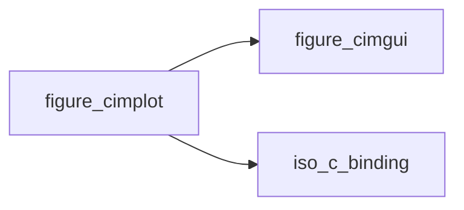

# figure_cimplot

> figure_cimplot, raw ImPlot interfaces (generated by scripts/gen_bindings.py: do not edit).

 The 96 public free functions of cimplot that Fortran calls directly (`bind(C)`), out of 401; the others need the
 C++ glue or are skipped: see docs/guide/raw-bindings.md. Private to the library: applications use the figure_*
 wrapper modules. Each dummy documents its C type and default.

**Source**: `src/lib/figure_cimplot.F90`

**Dependencies**

## Contents

- [ImPlot_AddColormap_U32Ptr](#implot-addcolormap-u32ptr)
- [ImPlot_AddColormap_Vec4Ptr](#implot-addcolormap-vec4ptr)
- [ImPlot_BeginAlignedPlots](#implot-beginalignedplots)
- [ImPlot_BeginDragDropSourceAxis](#implot-begindragdropsourceaxis)
- [ImPlot_BeginDragDropSourceItem](#implot-begindragdropsourceitem)
- [ImPlot_BeginDragDropSourcePlot](#implot-begindragdropsourceplot)
- [ImPlot_BeginDragDropTargetAxis](#implot-begindragdroptargetaxis)
- [ImPlot_BeginDragDropTargetLegend](#implot-begindragdroptargetlegend)
- [ImPlot_BeginDragDropTargetPlot](#implot-begindragdroptargetplot)
- [ImPlot_BeginLegendPopup](#implot-beginlegendpopup)
- [ImPlot_BeginPlot](#implot-beginplot)
- [ImPlot_BeginSubplots](#implot-beginsubplots)
- [ImPlot_ColormapButton](#implot-colormapbutton)
- [ImPlot_ColormapSlider](#implot-colormapslider)
- [ImPlot_CreateContext](#implot-createcontext)
- [ImPlot_GetColormapCount](#implot-getcolormapcount)
- [ImPlot_GetColormapIndex](#implot-getcolormapindex)
- [ImPlot_GetColormapName](#implot-getcolormapname)
- [ImPlot_GetColormapSize](#implot-getcolormapsize)
- [ImPlot_GetCurrentContext](#implot-getcurrentcontext)
- [ImPlot_GetInputMap](#implot-getinputmap)
- [ImPlot_GetMarkerName](#implot-getmarkername)
- [ImPlot_GetPlotDrawList](#implot-getplotdrawlist)
- [ImPlot_GetPlotPos](#implot-getplotpos)
- [ImPlot_GetPlotSize](#implot-getplotsize)
- [ImPlot_GetStyle](#implot-getstyle)
- [ImPlot_GetStyleColorName](#implot-getstylecolorname)
- [ImPlot_IsAxisHovered](#implot-isaxishovered)
- [ImPlot_IsItemHidden](#implot-isitemhidden)
- [ImPlot_IsLastItemHidden](#implot-islastitemhidden)
- [ImPlot_IsLegendEntryHovered](#implot-islegendentryhovered)
- [ImPlot_IsPlotHovered](#implot-isplothovered)
- [ImPlot_IsPlotSelected](#implot-isplotselected)
- [ImPlot_IsSubplotsHovered](#implot-issubplotshovered)
- [ImPlot_NextMarker](#implot-nextmarker)
- [ImPlot_PlotToPixels_double](#implot-plottopixels-double)
- [ImPlot_ShowColormapSelector](#implot-showcolormapselector)
- [ImPlot_ShowInputMapSelector](#implot-showinputmapselector)
- [ImPlot_ShowStyleSelector](#implot-showstyleselector)
- [ImPlot_BustColorCache](#implot-bustcolorcache)
- [ImPlot_CancelPlotSelection](#implot-cancelplotselection)
- [ImPlot_ColormapIcon](#implot-colormapicon)
- [ImPlot_ColormapScale](#implot-colormapscale)
- [ImPlot_DestroyContext](#implot-destroycontext)
- [ImPlot_EndAlignedPlots](#implot-endalignedplots)
- [ImPlot_EndDragDropSource](#implot-enddragdropsource)
- [ImPlot_EndDragDropTarget](#implot-enddragdroptarget)
- [ImPlot_EndLegendPopup](#implot-endlegendpopup)
- [ImPlot_EndPlot](#implot-endplot)
- [ImPlot_EndSubplots](#implot-endsubplots)
- [ImPlot_HideNextItem](#implot-hidenextitem)
- [ImPlot_ItemIcon_U32](#implot-itemicon-u32)
- [ImPlot_MapInputDefault](#implot-mapinputdefault)
- [ImPlot_MapInputReverse](#implot-mapinputreverse)
- [ImPlot_PopColormap](#implot-popcolormap)
- [ImPlot_PopPlotClipRect](#implot-popplotcliprect)
- [ImPlot_PopStyleColor](#implot-popstylecolor)
- [ImPlot_PopStyleVar](#implot-popstylevar)
- [ImPlot_PushColormap_PlotColormap](#implot-pushcolormap-plotcolormap)
- [ImPlot_PushColormap_Str](#implot-pushcolormap-str)
- [ImPlot_PushPlotClipRect](#implot-pushplotcliprect)
- [ImPlot_PushStyleColor_U32](#implot-pushstylecolor-u32)
- [ImPlot_PushStyleVar_Float](#implot-pushstylevar-float)
- [ImPlot_PushStyleVar_Int](#implot-pushstylevar-int)
- [ImPlot_PushStyleVar_Vec2](#implot-pushstylevar-vec2)
- [ImPlot_SetAxes](#implot-setaxes)
- [ImPlot_SetAxis](#implot-setaxis)
- [ImPlot_SetCurrentContext](#implot-setcurrentcontext)
- [ImPlot_SetImGuiContext](#implot-setimguicontext)
- [ImPlot_SetNextAxesLimits](#implot-setnextaxeslimits)
- [ImPlot_SetNextAxesToFit](#implot-setnextaxestofit)
- [ImPlot_SetNextAxisLimits](#implot-setnextaxislimits)
- [ImPlot_SetNextAxisLinks](#implot-setnextaxislinks)
- [ImPlot_SetNextAxisToFit](#implot-setnextaxistofit)
- [ImPlot_SetupAxes](#implot-setupaxes)
- [ImPlot_SetupAxesLimits](#implot-setupaxeslimits)
- [ImPlot_SetupAxis](#implot-setupaxis)
- [ImPlot_SetupAxisFormat_Str](#implot-setupaxisformat-str)
- [ImPlot_SetupAxisLimits](#implot-setupaxislimits)
- [ImPlot_SetupAxisLimitsConstraints](#implot-setupaxislimitsconstraints)
- [ImPlot_SetupAxisLinks](#implot-setupaxislinks)
- [ImPlot_SetupAxisScale_PlotScale](#implot-setupaxisscale-plotscale)
- [ImPlot_SetupAxisTicks_double](#implot-setupaxisticks-double)
- [ImPlot_SetupAxisTicks_doublePtr](#implot-setupaxisticks-doubleptr)
- [ImPlot_SetupAxisZoomConstraints](#implot-setupaxiszoomconstraints)
- [ImPlot_SetupFinish](#implot-setupfinish)
- [ImPlot_SetupLegend](#implot-setuplegend)
- [ImPlot_SetupMouseText](#implot-setupmousetext)
- [ImPlot_ShowDemoWindow](#implot-showdemowindow)
- [ImPlot_ShowMetricsWindow](#implot-showmetricswindow)
- [ImPlot_ShowStyleEditor](#implot-showstyleeditor)
- [ImPlot_ShowUserGuide](#implot-showuserguide)
- [ImPlot_StyleColorsAuto](#implot-stylecolorsauto)
- [ImPlot_StyleColorsClassic](#implot-stylecolorsclassic)
- [ImPlot_StyleColorsDark](#implot-stylecolorsdark)
- [ImPlot_StyleColorsLight](#implot-stylecolorslight)

## Interfaces

### ImPlot_AddColormap_U32Ptr

### ImPlot_AddColormap_Vec4Ptr

### ImPlot_BeginAlignedPlots

### ImPlot_BeginDragDropSourceAxis

### ImPlot_BeginDragDropSourceItem

### ImPlot_BeginDragDropSourcePlot

### ImPlot_BeginDragDropTargetAxis

### ImPlot_BeginDragDropTargetLegend

### ImPlot_BeginDragDropTargetPlot

### ImPlot_BeginLegendPopup

### ImPlot_BeginPlot

### ImPlot_BeginSubplots

### ImPlot_ColormapButton

### ImPlot_ColormapSlider

### ImPlot_CreateContext

### ImPlot_GetColormapCount

### ImPlot_GetColormapIndex

### ImPlot_GetColormapName

### ImPlot_GetColormapSize

### ImPlot_GetCurrentContext

### ImPlot_GetInputMap

### ImPlot_GetMarkerName

### ImPlot_GetPlotDrawList

### ImPlot_GetPlotPos

### ImPlot_GetPlotSize

### ImPlot_GetStyle

### ImPlot_GetStyleColorName

### ImPlot_IsAxisHovered

### ImPlot_IsItemHidden

### ImPlot_IsLastItemHidden

### ImPlot_IsLegendEntryHovered

### ImPlot_IsPlotHovered

### ImPlot_IsPlotSelected

### ImPlot_IsSubplotsHovered

### ImPlot_NextMarker

### ImPlot_PlotToPixels_double

### ImPlot_ShowColormapSelector

### ImPlot_ShowInputMapSelector

### ImPlot_ShowStyleSelector

### ImPlot_BustColorCache

### ImPlot_CancelPlotSelection

### ImPlot_ColormapIcon

### ImPlot_ColormapScale

### ImPlot_DestroyContext

### ImPlot_EndAlignedPlots

### ImPlot_EndDragDropSource

### ImPlot_EndDragDropTarget

### ImPlot_EndLegendPopup

### ImPlot_EndPlot

### ImPlot_EndSubplots

### ImPlot_HideNextItem

### ImPlot_ItemIcon_U32

### ImPlot_MapInputDefault

### ImPlot_MapInputReverse

### ImPlot_PopColormap

### ImPlot_PopPlotClipRect

### ImPlot_PopStyleColor

### ImPlot_PopStyleVar

### ImPlot_PushColormap_PlotColormap

### ImPlot_PushColormap_Str

### ImPlot_PushPlotClipRect

### ImPlot_PushStyleColor_U32

### ImPlot_PushStyleVar_Float

### ImPlot_PushStyleVar_Int

### ImPlot_PushStyleVar_Vec2

### ImPlot_SetAxes

### ImPlot_SetAxis

### ImPlot_SetCurrentContext

### ImPlot_SetImGuiContext

### ImPlot_SetNextAxesLimits

### ImPlot_SetNextAxesToFit

### ImPlot_SetNextAxisLimits

### ImPlot_SetNextAxisLinks

### ImPlot_SetNextAxisToFit

### ImPlot_SetupAxes

### ImPlot_SetupAxesLimits

### ImPlot_SetupAxis

### ImPlot_SetupAxisFormat_Str

### ImPlot_SetupAxisLimits

### ImPlot_SetupAxisLimitsConstraints

### ImPlot_SetupAxisLinks

### ImPlot_SetupAxisScale_PlotScale

### ImPlot_SetupAxisTicks_double

### ImPlot_SetupAxisTicks_doublePtr

### ImPlot_SetupAxisZoomConstraints

### ImPlot_SetupFinish

### ImPlot_SetupLegend

### ImPlot_SetupMouseText

### ImPlot_ShowDemoWindow

### ImPlot_ShowMetricsWindow

### ImPlot_ShowStyleEditor

### ImPlot_ShowUserGuide

### ImPlot_StyleColorsAuto

### ImPlot_StyleColorsClassic

### ImPlot_StyleColorsDark

### ImPlot_StyleColorsLight
