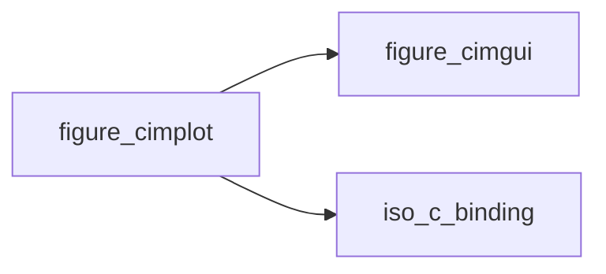

# figure_cimplot

> figure_cimplot, raw ImPlot interfaces (generated by scripts/gen_bindings.py: do not edit).

 Of the 401 public free functions of cimplot, 96 are bound directly (`bind(C)`) and 272 through the generated C++
 glue (native/figure_glue_generated.cpp: `figure_<name>`, structs passed by reference instead of by value, struct
 results through `res`); the rest are skipped: see docs/guide/raw-bindings.md. Private to the library:
 applications use the figure_* wrapper modules. Each dummy documents its C type and default.

**Source**: `src/lib/figure_cimplot.F90`

**Dependencies**

## Contents

- [im_plot_point](#im-plot-point)
- [im_plot_range](#im-plot-range)
- [im_plot_rect](#im-plot-rect)
- [im_plot_spec](#im-plot-spec)
- [ImPlot_AddColormap_U32Ptr](#implot-addcolormap-u32ptr)
- [ImPlot_AddColormap_Vec4Ptr](#implot-addcolormap-vec4ptr)
- [ImPlot_BeginAlignedPlots](#implot-beginalignedplots)
- [ImPlot_BeginDragDropSourceAxis](#implot-begindragdropsourceaxis)
- [ImPlot_BeginDragDropSourceItem](#implot-begindragdropsourceitem)
- [ImPlot_BeginDragDropSourcePlot](#implot-begindragdropsourceplot)
- [ImPlot_BeginDragDropTargetAxis](#implot-begindragdroptargetaxis)
- [ImPlot_BeginDragDropTargetLegend](#implot-begindragdroptargetlegend)
- [ImPlot_BeginDragDropTargetPlot](#implot-begindragdroptargetplot)
- [ImPlot_BeginLegendPopup](#implot-beginlegendpopup)
- [ImPlot_BeginPlot](#implot-beginplot)
- [ImPlot_BeginSubplots](#implot-beginsubplots)
- [ImPlot_ColormapButton](#implot-colormapbutton)
- [ImPlot_ColormapSlider](#implot-colormapslider)
- [ImPlot_CreateContext](#implot-createcontext)
- [ImPlot_DragLineX](#implot-draglinex)
- [ImPlot_DragLineY](#implot-dragliney)
- [ImPlot_DragPoint](#implot-dragpoint)
- [ImPlot_DragRect](#implot-dragrect)
- [ImPlot_GetColormapCount](#implot-getcolormapcount)
- [ImPlot_GetColormapIndex](#implot-getcolormapindex)
- [ImPlot_GetColormapName](#implot-getcolormapname)
- [ImPlot_GetColormapSize](#implot-getcolormapsize)
- [ImPlot_GetCurrentContext](#implot-getcurrentcontext)
- [ImPlot_GetInputMap](#implot-getinputmap)
- [ImPlot_GetMarkerName](#implot-getmarkername)
- [ImPlot_GetPlotDrawList](#implot-getplotdrawlist)
- [ImPlot_GetPlotPos](#implot-getplotpos)
- [ImPlot_GetPlotSize](#implot-getplotsize)
- [ImPlot_GetStyle](#implot-getstyle)
- [ImPlot_GetStyleColorName](#implot-getstylecolorname)
- [ImPlot_IsAxisHovered](#implot-isaxishovered)
- [ImPlot_IsItemHidden](#implot-isitemhidden)
- [ImPlot_IsLastItemHidden](#implot-islastitemhidden)
- [ImPlot_IsLegendEntryHovered](#implot-islegendentryhovered)
- [ImPlot_IsPlotHovered](#implot-isplothovered)
- [ImPlot_IsPlotSelected](#implot-isplotselected)
- [ImPlot_IsSubplotsHovered](#implot-issubplotshovered)
- [ImPlot_NextMarker](#implot-nextmarker)
- [ImPlot_PlotHistogram2D_doublePtr](#implot-plothistogram2d-doubleptr)
- [ImPlot_PlotHistogram2D_FloatPtr](#implot-plothistogram2d-floatptr)
- [ImPlot_PlotHistogram2D_S16Ptr](#implot-plothistogram2d-s16ptr)
- [ImPlot_PlotHistogram2D_S32Ptr](#implot-plothistogram2d-s32ptr)
- [ImPlot_PlotHistogram2D_S64Ptr](#implot-plothistogram2d-s64ptr)
- [ImPlot_PlotHistogram2D_S8Ptr](#implot-plothistogram2d-s8ptr)
- [ImPlot_PlotHistogram2D_U16Ptr](#implot-plothistogram2d-u16ptr)
- [ImPlot_PlotHistogram2D_U32Ptr](#implot-plothistogram2d-u32ptr)
- [ImPlot_PlotHistogram2D_U64Ptr](#implot-plothistogram2d-u64ptr)
- [ImPlot_PlotHistogram2D_U8Ptr](#implot-plothistogram2d-u8ptr)
- [ImPlot_PlotHistogram_doublePtr](#implot-plothistogram-doubleptr)
- [ImPlot_PlotHistogram_FloatPtr](#implot-plothistogram-floatptr)
- [ImPlot_PlotHistogram_S16Ptr](#implot-plothistogram-s16ptr)
- [ImPlot_PlotHistogram_S32Ptr](#implot-plothistogram-s32ptr)
- [ImPlot_PlotHistogram_S64Ptr](#implot-plothistogram-s64ptr)
- [ImPlot_PlotHistogram_S8Ptr](#implot-plothistogram-s8ptr)
- [ImPlot_PlotHistogram_U16Ptr](#implot-plothistogram-u16ptr)
- [ImPlot_PlotHistogram_U32Ptr](#implot-plothistogram-u32ptr)
- [ImPlot_PlotHistogram_U64Ptr](#implot-plothistogram-u64ptr)
- [ImPlot_PlotHistogram_U8Ptr](#implot-plothistogram-u8ptr)
- [ImPlot_PlotToPixels_double](#implot-plottopixels-double)
- [ImPlot_PlotToPixels_PlotPoint](#implot-plottopixels-plotpoint)
- [ImPlot_ShowColormapSelector](#implot-showcolormapselector)
- [ImPlot_ShowInputMapSelector](#implot-showinputmapselector)
- [ImPlot_ShowStyleSelector](#implot-showstyleselector)
- [figure_sizeof_ImPlotPoint_c](#figure-sizeof-implotpoint-c)
- [figure_sizeof_ImPlotRange_c](#figure-sizeof-implotrange-c)
- [figure_sizeof_ImPlotRect_c](#figure-sizeof-implotrect-c)
- [figure_sizeof_ImPlotSpec_c](#figure-sizeof-implotspec-c)
- [ImPlot_Annotation_Bool](#implot-annotation-bool)
- [ImPlot_BustColorCache](#implot-bustcolorcache)
- [ImPlot_CancelPlotSelection](#implot-cancelplotselection)
- [ImPlot_ColormapIcon](#implot-colormapicon)
- [ImPlot_ColormapScale](#implot-colormapscale)
- [ImPlot_DestroyContext](#implot-destroycontext)
- [ImPlot_EndAlignedPlots](#implot-endalignedplots)
- [ImPlot_EndDragDropSource](#implot-enddragdropsource)
- [ImPlot_EndDragDropTarget](#implot-enddragdroptarget)
- [ImPlot_EndLegendPopup](#implot-endlegendpopup)
- [ImPlot_EndPlot](#implot-endplot)
- [ImPlot_EndSubplots](#implot-endsubplots)
- [ImPlot_GetColormapColor](#implot-getcolormapcolor)
- [ImPlot_GetLastItemColor](#implot-getlastitemcolor)
- [ImPlot_GetPlotLimits](#implot-getplotlimits)
- [ImPlot_GetPlotMousePos](#implot-getplotmousepos)
- [ImPlot_GetPlotSelection](#implot-getplotselection)
- [ImPlot_HideNextItem](#implot-hidenextitem)
- [ImPlot_ItemIcon_U32](#implot-itemicon-u32)
- [ImPlot_ItemIcon_Vec4](#implot-itemicon-vec4)
- [ImPlot_MapInputDefault](#implot-mapinputdefault)
- [ImPlot_MapInputReverse](#implot-mapinputreverse)
- [ImPlot_NextColormapColor](#implot-nextcolormapcolor)
- [ImPlot_PixelsToPlot_Float](#implot-pixelstoplot-float)
- [ImPlot_PixelsToPlot_Vec2](#implot-pixelstoplot-vec2)
- [ImPlot_PlotBarGroups_doublePtr](#implot-plotbargroups-doubleptr)
- [ImPlot_PlotBarGroups_FloatPtr](#implot-plotbargroups-floatptr)
- [ImPlot_PlotBarGroups_S16Ptr](#implot-plotbargroups-s16ptr)
- [ImPlot_PlotBarGroups_S32Ptr](#implot-plotbargroups-s32ptr)
- [ImPlot_PlotBarGroups_S64Ptr](#implot-plotbargroups-s64ptr)
- [ImPlot_PlotBarGroups_S8Ptr](#implot-plotbargroups-s8ptr)
- [ImPlot_PlotBarGroups_U16Ptr](#implot-plotbargroups-u16ptr)
- [ImPlot_PlotBarGroups_U32Ptr](#implot-plotbargroups-u32ptr)
- [ImPlot_PlotBarGroups_U64Ptr](#implot-plotbargroups-u64ptr)
- [ImPlot_PlotBarGroups_U8Ptr](#implot-plotbargroups-u8ptr)
- [ImPlot_PlotBars_doublePtrdoublePtr](#implot-plotbars-doubleptrdoubleptr)
- [ImPlot_PlotBars_doublePtrInt](#implot-plotbars-doubleptrint)
- [ImPlot_PlotBars_FloatPtrFloatPtr](#implot-plotbars-floatptrfloatptr)
- [ImPlot_PlotBars_FloatPtrInt](#implot-plotbars-floatptrint)
- [ImPlot_PlotBars_S16PtrInt](#implot-plotbars-s16ptrint)
- [ImPlot_PlotBars_S16PtrS16Ptr](#implot-plotbars-s16ptrs16ptr)
- [ImPlot_PlotBars_S32PtrInt](#implot-plotbars-s32ptrint)
- [ImPlot_PlotBars_S32PtrS32Ptr](#implot-plotbars-s32ptrs32ptr)
- [ImPlot_PlotBars_S64PtrInt](#implot-plotbars-s64ptrint)
- [ImPlot_PlotBars_S64PtrS64Ptr](#implot-plotbars-s64ptrs64ptr)
- [ImPlot_PlotBars_S8PtrInt](#implot-plotbars-s8ptrint)
- [ImPlot_PlotBars_S8PtrS8Ptr](#implot-plotbars-s8ptrs8ptr)
- [ImPlot_PlotBars_U16PtrInt](#implot-plotbars-u16ptrint)
- [ImPlot_PlotBars_U16PtrU16Ptr](#implot-plotbars-u16ptru16ptr)
- [ImPlot_PlotBars_U32PtrInt](#implot-plotbars-u32ptrint)
- [ImPlot_PlotBars_U32PtrU32Ptr](#implot-plotbars-u32ptru32ptr)
- [ImPlot_PlotBars_U64PtrInt](#implot-plotbars-u64ptrint)
- [ImPlot_PlotBars_U64PtrU64Ptr](#implot-plotbars-u64ptru64ptr)
- [ImPlot_PlotBars_U8PtrInt](#implot-plotbars-u8ptrint)
- [ImPlot_PlotBars_U8PtrU8Ptr](#implot-plotbars-u8ptru8ptr)
- [ImPlot_PlotBubbles_doublePtrdoublePtrdoublePtr](#implot-plotbubbles-doubleptrdoubleptrdoubleptr)
- [ImPlot_PlotBubbles_doublePtrdoublePtrInt](#implot-plotbubbles-doubleptrdoubleptrint)
- [ImPlot_PlotBubbles_FloatPtrFloatPtrFloatPtr](#implot-plotbubbles-floatptrfloatptrfloatptr)
- [ImPlot_PlotBubbles_FloatPtrFloatPtrInt](#implot-plotbubbles-floatptrfloatptrint)
- [ImPlot_PlotBubbles_S16PtrS16PtrInt](#implot-plotbubbles-s16ptrs16ptrint)
- [ImPlot_PlotBubbles_S16PtrS16PtrS16Ptr](#implot-plotbubbles-s16ptrs16ptrs16ptr)
- [ImPlot_PlotBubbles_S32PtrS32PtrInt](#implot-plotbubbles-s32ptrs32ptrint)
- [ImPlot_PlotBubbles_S32PtrS32PtrS32Ptr](#implot-plotbubbles-s32ptrs32ptrs32ptr)
- [ImPlot_PlotBubbles_S64PtrS64PtrInt](#implot-plotbubbles-s64ptrs64ptrint)
- [ImPlot_PlotBubbles_S64PtrS64PtrS64Ptr](#implot-plotbubbles-s64ptrs64ptrs64ptr)
- [ImPlot_PlotBubbles_S8PtrS8PtrInt](#implot-plotbubbles-s8ptrs8ptrint)
- [ImPlot_PlotBubbles_S8PtrS8PtrS8Ptr](#implot-plotbubbles-s8ptrs8ptrs8ptr)
- [ImPlot_PlotBubbles_U16PtrU16PtrInt](#implot-plotbubbles-u16ptru16ptrint)
- [ImPlot_PlotBubbles_U16PtrU16PtrU16Ptr](#implot-plotbubbles-u16ptru16ptru16ptr)
- [ImPlot_PlotBubbles_U32PtrU32PtrInt](#implot-plotbubbles-u32ptru32ptrint)
- [ImPlot_PlotBubbles_U32PtrU32PtrU32Ptr](#implot-plotbubbles-u32ptru32ptru32ptr)
- [ImPlot_PlotBubbles_U64PtrU64PtrInt](#implot-plotbubbles-u64ptru64ptrint)
- [ImPlot_PlotBubbles_U64PtrU64PtrU64Ptr](#implot-plotbubbles-u64ptru64ptru64ptr)
- [ImPlot_PlotBubbles_U8PtrU8PtrInt](#implot-plotbubbles-u8ptru8ptrint)
- [ImPlot_PlotBubbles_U8PtrU8PtrU8Ptr](#implot-plotbubbles-u8ptru8ptru8ptr)
- [ImPlot_PlotDigital_doublePtr](#implot-plotdigital-doubleptr)
- [ImPlot_PlotDigital_FloatPtr](#implot-plotdigital-floatptr)
- [ImPlot_PlotDigital_S16Ptr](#implot-plotdigital-s16ptr)
- [ImPlot_PlotDigital_S32Ptr](#implot-plotdigital-s32ptr)
- [ImPlot_PlotDigital_S64Ptr](#implot-plotdigital-s64ptr)
- [ImPlot_PlotDigital_S8Ptr](#implot-plotdigital-s8ptr)
- [ImPlot_PlotDigital_U16Ptr](#implot-plotdigital-u16ptr)
- [ImPlot_PlotDigital_U32Ptr](#implot-plotdigital-u32ptr)
- [ImPlot_PlotDigital_U64Ptr](#implot-plotdigital-u64ptr)
- [ImPlot_PlotDigital_U8Ptr](#implot-plotdigital-u8ptr)
- [ImPlot_PlotDummy](#implot-plotdummy)
- [ImPlot_PlotErrorBars_doublePtrdoublePtrdoublePtrdoublePtr](#implot-ploterrorbars-doubleptrdoubleptrdoubleptrdoubleptr)
- [ImPlot_PlotErrorBars_doublePtrdoublePtrdoublePtrInt](#implot-ploterrorbars-doubleptrdoubleptrdoubleptrint)
- [ImPlot_PlotErrorBars_FloatPtrFloatPtrFloatPtrFloatPtr](#implot-ploterrorbars-floatptrfloatptrfloatptrfloatptr)
- [ImPlot_PlotErrorBars_FloatPtrFloatPtrFloatPtrInt](#implot-ploterrorbars-floatptrfloatptrfloatptrint)
- [ImPlot_PlotErrorBars_S16PtrS16PtrS16PtrInt](#implot-ploterrorbars-s16ptrs16ptrs16ptrint)
- [ImPlot_PlotErrorBars_S16PtrS16PtrS16PtrS16Ptr](#implot-ploterrorbars-s16ptrs16ptrs16ptrs16ptr)
- [ImPlot_PlotErrorBars_S32PtrS32PtrS32PtrInt](#implot-ploterrorbars-s32ptrs32ptrs32ptrint)
- [ImPlot_PlotErrorBars_S32PtrS32PtrS32PtrS32Ptr](#implot-ploterrorbars-s32ptrs32ptrs32ptrs32ptr)
- [ImPlot_PlotErrorBars_S64PtrS64PtrS64PtrInt](#implot-ploterrorbars-s64ptrs64ptrs64ptrint)
- [ImPlot_PlotErrorBars_S64PtrS64PtrS64PtrS64Ptr](#implot-ploterrorbars-s64ptrs64ptrs64ptrs64ptr)
- [ImPlot_PlotErrorBars_S8PtrS8PtrS8PtrInt](#implot-ploterrorbars-s8ptrs8ptrs8ptrint)
- [ImPlot_PlotErrorBars_S8PtrS8PtrS8PtrS8Ptr](#implot-ploterrorbars-s8ptrs8ptrs8ptrs8ptr)
- [ImPlot_PlotErrorBars_U16PtrU16PtrU16PtrInt](#implot-ploterrorbars-u16ptru16ptru16ptrint)
- [ImPlot_PlotErrorBars_U16PtrU16PtrU16PtrU16Ptr](#implot-ploterrorbars-u16ptru16ptru16ptru16ptr)
- [ImPlot_PlotErrorBars_U32PtrU32PtrU32PtrInt](#implot-ploterrorbars-u32ptru32ptru32ptrint)
- [ImPlot_PlotErrorBars_U32PtrU32PtrU32PtrU32Ptr](#implot-ploterrorbars-u32ptru32ptru32ptru32ptr)
- [ImPlot_PlotErrorBars_U64PtrU64PtrU64PtrInt](#implot-ploterrorbars-u64ptru64ptru64ptrint)
- [ImPlot_PlotErrorBars_U64PtrU64PtrU64PtrU64Ptr](#implot-ploterrorbars-u64ptru64ptru64ptru64ptr)
- [ImPlot_PlotErrorBars_U8PtrU8PtrU8PtrInt](#implot-ploterrorbars-u8ptru8ptru8ptrint)
- [ImPlot_PlotErrorBars_U8PtrU8PtrU8PtrU8Ptr](#implot-ploterrorbars-u8ptru8ptru8ptru8ptr)
- [ImPlot_PlotHeatmap_doublePtr](#implot-plotheatmap-doubleptr)
- [ImPlot_PlotHeatmap_FloatPtr](#implot-plotheatmap-floatptr)
- [ImPlot_PlotHeatmap_S16Ptr](#implot-plotheatmap-s16ptr)
- [ImPlot_PlotHeatmap_S32Ptr](#implot-plotheatmap-s32ptr)
- [ImPlot_PlotHeatmap_S64Ptr](#implot-plotheatmap-s64ptr)
- [ImPlot_PlotHeatmap_S8Ptr](#implot-plotheatmap-s8ptr)
- [ImPlot_PlotHeatmap_U16Ptr](#implot-plotheatmap-u16ptr)
- [ImPlot_PlotHeatmap_U32Ptr](#implot-plotheatmap-u32ptr)
- [ImPlot_PlotHeatmap_U64Ptr](#implot-plotheatmap-u64ptr)
- [ImPlot_PlotHeatmap_U8Ptr](#implot-plotheatmap-u8ptr)
- [ImPlot_PlotImage](#implot-plotimage)
- [ImPlot_PlotInfLines_doublePtr](#implot-plotinflines-doubleptr)
- [ImPlot_PlotInfLines_FloatPtr](#implot-plotinflines-floatptr)
- [ImPlot_PlotInfLines_S16Ptr](#implot-plotinflines-s16ptr)
- [ImPlot_PlotInfLines_S32Ptr](#implot-plotinflines-s32ptr)
- [ImPlot_PlotInfLines_S64Ptr](#implot-plotinflines-s64ptr)
- [ImPlot_PlotInfLines_S8Ptr](#implot-plotinflines-s8ptr)
- [ImPlot_PlotInfLines_U16Ptr](#implot-plotinflines-u16ptr)
- [ImPlot_PlotInfLines_U32Ptr](#implot-plotinflines-u32ptr)
- [ImPlot_PlotInfLines_U64Ptr](#implot-plotinflines-u64ptr)
- [ImPlot_PlotInfLines_U8Ptr](#implot-plotinflines-u8ptr)
- [ImPlot_PlotLine_doublePtrdoublePtr](#implot-plotline-doubleptrdoubleptr)
- [ImPlot_PlotLine_doublePtrInt](#implot-plotline-doubleptrint)
- [ImPlot_PlotLine_FloatPtrFloatPtr](#implot-plotline-floatptrfloatptr)
- [ImPlot_PlotLine_FloatPtrInt](#implot-plotline-floatptrint)
- [ImPlot_PlotLine_S16PtrInt](#implot-plotline-s16ptrint)
- [ImPlot_PlotLine_S16PtrS16Ptr](#implot-plotline-s16ptrs16ptr)
- [ImPlot_PlotLine_S32PtrInt](#implot-plotline-s32ptrint)
- [ImPlot_PlotLine_S32PtrS32Ptr](#implot-plotline-s32ptrs32ptr)
- [ImPlot_PlotLine_S64PtrInt](#implot-plotline-s64ptrint)
- [ImPlot_PlotLine_S64PtrS64Ptr](#implot-plotline-s64ptrs64ptr)
- [ImPlot_PlotLine_S8PtrInt](#implot-plotline-s8ptrint)
- [ImPlot_PlotLine_S8PtrS8Ptr](#implot-plotline-s8ptrs8ptr)
- [ImPlot_PlotLine_U16PtrInt](#implot-plotline-u16ptrint)
- [ImPlot_PlotLine_U16PtrU16Ptr](#implot-plotline-u16ptru16ptr)
- [ImPlot_PlotLine_U32PtrInt](#implot-plotline-u32ptrint)
- [ImPlot_PlotLine_U32PtrU32Ptr](#implot-plotline-u32ptru32ptr)
- [ImPlot_PlotLine_U64PtrInt](#implot-plotline-u64ptrint)
- [ImPlot_PlotLine_U64PtrU64Ptr](#implot-plotline-u64ptru64ptr)
- [ImPlot_PlotLine_U8PtrInt](#implot-plotline-u8ptrint)
- [ImPlot_PlotLine_U8PtrU8Ptr](#implot-plotline-u8ptru8ptr)
- [ImPlot_PlotPieChart_doublePtrStr](#implot-plotpiechart-doubleptrstr)
- [ImPlot_PlotPieChart_FloatPtrStr](#implot-plotpiechart-floatptrstr)
- [ImPlot_PlotPieChart_S16PtrStr](#implot-plotpiechart-s16ptrstr)
- [ImPlot_PlotPieChart_S32PtrStr](#implot-plotpiechart-s32ptrstr)
- [ImPlot_PlotPieChart_S64PtrStr](#implot-plotpiechart-s64ptrstr)
- [ImPlot_PlotPieChart_S8PtrStr](#implot-plotpiechart-s8ptrstr)
- [ImPlot_PlotPieChart_U16PtrStr](#implot-plotpiechart-u16ptrstr)
- [ImPlot_PlotPieChart_U32PtrStr](#implot-plotpiechart-u32ptrstr)
- [ImPlot_PlotPieChart_U64PtrStr](#implot-plotpiechart-u64ptrstr)
- [ImPlot_PlotPieChart_U8PtrStr](#implot-plotpiechart-u8ptrstr)
- [ImPlot_PlotPolygon_doublePtr](#implot-plotpolygon-doubleptr)
- [ImPlot_PlotPolygon_FloatPtr](#implot-plotpolygon-floatptr)
- [ImPlot_PlotPolygon_S16Ptr](#implot-plotpolygon-s16ptr)
- [ImPlot_PlotPolygon_S32Ptr](#implot-plotpolygon-s32ptr)
- [ImPlot_PlotPolygon_S64Ptr](#implot-plotpolygon-s64ptr)
- [ImPlot_PlotPolygon_S8Ptr](#implot-plotpolygon-s8ptr)
- [ImPlot_PlotPolygon_U16Ptr](#implot-plotpolygon-u16ptr)
- [ImPlot_PlotPolygon_U32Ptr](#implot-plotpolygon-u32ptr)
- [ImPlot_PlotPolygon_U64Ptr](#implot-plotpolygon-u64ptr)
- [ImPlot_PlotPolygon_U8Ptr](#implot-plotpolygon-u8ptr)
- [ImPlot_PlotScatter_doublePtrdoublePtr](#implot-plotscatter-doubleptrdoubleptr)
- [ImPlot_PlotScatter_doublePtrInt](#implot-plotscatter-doubleptrint)
- [ImPlot_PlotScatter_FloatPtrFloatPtr](#implot-plotscatter-floatptrfloatptr)
- [ImPlot_PlotScatter_FloatPtrInt](#implot-plotscatter-floatptrint)
- [ImPlot_PlotScatter_S16PtrInt](#implot-plotscatter-s16ptrint)
- [ImPlot_PlotScatter_S16PtrS16Ptr](#implot-plotscatter-s16ptrs16ptr)
- [ImPlot_PlotScatter_S32PtrInt](#implot-plotscatter-s32ptrint)
- [ImPlot_PlotScatter_S32PtrS32Ptr](#implot-plotscatter-s32ptrs32ptr)
- [ImPlot_PlotScatter_S64PtrInt](#implot-plotscatter-s64ptrint)
- [ImPlot_PlotScatter_S64PtrS64Ptr](#implot-plotscatter-s64ptrs64ptr)
- [ImPlot_PlotScatter_S8PtrInt](#implot-plotscatter-s8ptrint)
- [ImPlot_PlotScatter_S8PtrS8Ptr](#implot-plotscatter-s8ptrs8ptr)
- [ImPlot_PlotScatter_U16PtrInt](#implot-plotscatter-u16ptrint)
- [ImPlot_PlotScatter_U16PtrU16Ptr](#implot-plotscatter-u16ptru16ptr)
- [ImPlot_PlotScatter_U32PtrInt](#implot-plotscatter-u32ptrint)
- [ImPlot_PlotScatter_U32PtrU32Ptr](#implot-plotscatter-u32ptru32ptr)
- [ImPlot_PlotScatter_U64PtrInt](#implot-plotscatter-u64ptrint)
- [ImPlot_PlotScatter_U64PtrU64Ptr](#implot-plotscatter-u64ptru64ptr)
- [ImPlot_PlotScatter_U8PtrInt](#implot-plotscatter-u8ptrint)
- [ImPlot_PlotScatter_U8PtrU8Ptr](#implot-plotscatter-u8ptru8ptr)
- [ImPlot_PlotShaded_doublePtrdoublePtrdoublePtr](#implot-plotshaded-doubleptrdoubleptrdoubleptr)
- [ImPlot_PlotShaded_doublePtrdoublePtrInt](#implot-plotshaded-doubleptrdoubleptrint)
- [ImPlot_PlotShaded_doublePtrInt](#implot-plotshaded-doubleptrint)
- [ImPlot_PlotShaded_FloatPtrFloatPtrFloatPtr](#implot-plotshaded-floatptrfloatptrfloatptr)
- [ImPlot_PlotShaded_FloatPtrFloatPtrInt](#implot-plotshaded-floatptrfloatptrint)
- [ImPlot_PlotShaded_FloatPtrInt](#implot-plotshaded-floatptrint)
- [ImPlot_PlotShaded_S16PtrInt](#implot-plotshaded-s16ptrint)
- [ImPlot_PlotShaded_S16PtrS16PtrInt](#implot-plotshaded-s16ptrs16ptrint)
- [ImPlot_PlotShaded_S16PtrS16PtrS16Ptr](#implot-plotshaded-s16ptrs16ptrs16ptr)
- [ImPlot_PlotShaded_S32PtrInt](#implot-plotshaded-s32ptrint)
- [ImPlot_PlotShaded_S32PtrS32PtrInt](#implot-plotshaded-s32ptrs32ptrint)
- [ImPlot_PlotShaded_S32PtrS32PtrS32Ptr](#implot-plotshaded-s32ptrs32ptrs32ptr)
- [ImPlot_PlotShaded_S64PtrInt](#implot-plotshaded-s64ptrint)
- [ImPlot_PlotShaded_S64PtrS64PtrInt](#implot-plotshaded-s64ptrs64ptrint)
- [ImPlot_PlotShaded_S64PtrS64PtrS64Ptr](#implot-plotshaded-s64ptrs64ptrs64ptr)
- [ImPlot_PlotShaded_S8PtrInt](#implot-plotshaded-s8ptrint)
- [ImPlot_PlotShaded_S8PtrS8PtrInt](#implot-plotshaded-s8ptrs8ptrint)
- [ImPlot_PlotShaded_S8PtrS8PtrS8Ptr](#implot-plotshaded-s8ptrs8ptrs8ptr)
- [ImPlot_PlotShaded_U16PtrInt](#implot-plotshaded-u16ptrint)
- [ImPlot_PlotShaded_U16PtrU16PtrInt](#implot-plotshaded-u16ptru16ptrint)
- [ImPlot_PlotShaded_U16PtrU16PtrU16Ptr](#implot-plotshaded-u16ptru16ptru16ptr)
- [ImPlot_PlotShaded_U32PtrInt](#implot-plotshaded-u32ptrint)
- [ImPlot_PlotShaded_U32PtrU32PtrInt](#implot-plotshaded-u32ptru32ptrint)
- [ImPlot_PlotShaded_U32PtrU32PtrU32Ptr](#implot-plotshaded-u32ptru32ptru32ptr)
- [ImPlot_PlotShaded_U64PtrInt](#implot-plotshaded-u64ptrint)
- [ImPlot_PlotShaded_U64PtrU64PtrInt](#implot-plotshaded-u64ptru64ptrint)
- [ImPlot_PlotShaded_U64PtrU64PtrU64Ptr](#implot-plotshaded-u64ptru64ptru64ptr)
- [ImPlot_PlotShaded_U8PtrInt](#implot-plotshaded-u8ptrint)
- [ImPlot_PlotShaded_U8PtrU8PtrInt](#implot-plotshaded-u8ptru8ptrint)
- [ImPlot_PlotShaded_U8PtrU8PtrU8Ptr](#implot-plotshaded-u8ptru8ptru8ptr)
- [ImPlot_PlotStairs_doublePtrdoublePtr](#implot-plotstairs-doubleptrdoubleptr)
- [ImPlot_PlotStairs_doublePtrInt](#implot-plotstairs-doubleptrint)
- [ImPlot_PlotStairs_FloatPtrFloatPtr](#implot-plotstairs-floatptrfloatptr)
- [ImPlot_PlotStairs_FloatPtrInt](#implot-plotstairs-floatptrint)
- [ImPlot_PlotStairs_S16PtrInt](#implot-plotstairs-s16ptrint)
- [ImPlot_PlotStairs_S16PtrS16Ptr](#implot-plotstairs-s16ptrs16ptr)
- [ImPlot_PlotStairs_S32PtrInt](#implot-plotstairs-s32ptrint)
- [ImPlot_PlotStairs_S32PtrS32Ptr](#implot-plotstairs-s32ptrs32ptr)
- [ImPlot_PlotStairs_S64PtrInt](#implot-plotstairs-s64ptrint)
- [ImPlot_PlotStairs_S64PtrS64Ptr](#implot-plotstairs-s64ptrs64ptr)
- [ImPlot_PlotStairs_S8PtrInt](#implot-plotstairs-s8ptrint)
- [ImPlot_PlotStairs_S8PtrS8Ptr](#implot-plotstairs-s8ptrs8ptr)
- [ImPlot_PlotStairs_U16PtrInt](#implot-plotstairs-u16ptrint)
- [ImPlot_PlotStairs_U16PtrU16Ptr](#implot-plotstairs-u16ptru16ptr)
- [ImPlot_PlotStairs_U32PtrInt](#implot-plotstairs-u32ptrint)
- [ImPlot_PlotStairs_U32PtrU32Ptr](#implot-plotstairs-u32ptru32ptr)
- [ImPlot_PlotStairs_U64PtrInt](#implot-plotstairs-u64ptrint)
- [ImPlot_PlotStairs_U64PtrU64Ptr](#implot-plotstairs-u64ptru64ptr)
- [ImPlot_PlotStairs_U8PtrInt](#implot-plotstairs-u8ptrint)
- [ImPlot_PlotStairs_U8PtrU8Ptr](#implot-plotstairs-u8ptru8ptr)
- [ImPlot_PlotStems_doublePtrdoublePtr](#implot-plotstems-doubleptrdoubleptr)
- [ImPlot_PlotStems_doublePtrInt](#implot-plotstems-doubleptrint)
- [ImPlot_PlotStems_FloatPtrFloatPtr](#implot-plotstems-floatptrfloatptr)
- [ImPlot_PlotStems_FloatPtrInt](#implot-plotstems-floatptrint)
- [ImPlot_PlotStems_S16PtrInt](#implot-plotstems-s16ptrint)
- [ImPlot_PlotStems_S16PtrS16Ptr](#implot-plotstems-s16ptrs16ptr)
- [ImPlot_PlotStems_S32PtrInt](#implot-plotstems-s32ptrint)
- [ImPlot_PlotStems_S32PtrS32Ptr](#implot-plotstems-s32ptrs32ptr)
- [ImPlot_PlotStems_S64PtrInt](#implot-plotstems-s64ptrint)
- [ImPlot_PlotStems_S64PtrS64Ptr](#implot-plotstems-s64ptrs64ptr)
- [ImPlot_PlotStems_S8PtrInt](#implot-plotstems-s8ptrint)
- [ImPlot_PlotStems_S8PtrS8Ptr](#implot-plotstems-s8ptrs8ptr)
- [ImPlot_PlotStems_U16PtrInt](#implot-plotstems-u16ptrint)
- [ImPlot_PlotStems_U16PtrU16Ptr](#implot-plotstems-u16ptru16ptr)
- [ImPlot_PlotStems_U32PtrInt](#implot-plotstems-u32ptrint)
- [ImPlot_PlotStems_U32PtrU32Ptr](#implot-plotstems-u32ptru32ptr)
- [ImPlot_PlotStems_U64PtrInt](#implot-plotstems-u64ptrint)
- [ImPlot_PlotStems_U64PtrU64Ptr](#implot-plotstems-u64ptru64ptr)
- [ImPlot_PlotStems_U8PtrInt](#implot-plotstems-u8ptrint)
- [ImPlot_PlotStems_U8PtrU8Ptr](#implot-plotstems-u8ptru8ptr)
- [ImPlot_PlotText](#implot-plottext)
- [ImPlot_PopColormap](#implot-popcolormap)
- [ImPlot_PopPlotClipRect](#implot-popplotcliprect)
- [ImPlot_PopStyleColor](#implot-popstylecolor)
- [ImPlot_PopStyleVar](#implot-popstylevar)
- [ImPlot_PushColormap_PlotColormap](#implot-pushcolormap-plotcolormap)
- [ImPlot_PushColormap_Str](#implot-pushcolormap-str)
- [ImPlot_PushPlotClipRect](#implot-pushplotcliprect)
- [ImPlot_PushStyleColor_U32](#implot-pushstylecolor-u32)
- [ImPlot_PushStyleColor_Vec4](#implot-pushstylecolor-vec4)
- [ImPlot_PushStyleVar_Float](#implot-pushstylevar-float)
- [ImPlot_PushStyleVar_Int](#implot-pushstylevar-int)
- [ImPlot_PushStyleVar_Vec2](#implot-pushstylevar-vec2)
- [ImPlot_SampleColormap](#implot-samplecolormap)
- [ImPlot_SetAxes](#implot-setaxes)
- [ImPlot_SetAxis](#implot-setaxis)
- [ImPlot_SetCurrentContext](#implot-setcurrentcontext)
- [ImPlot_SetImGuiContext](#implot-setimguicontext)
- [ImPlot_SetNextAxesLimits](#implot-setnextaxeslimits)
- [ImPlot_SetNextAxesToFit](#implot-setnextaxestofit)
- [ImPlot_SetNextAxisLimits](#implot-setnextaxislimits)
- [ImPlot_SetNextAxisLinks](#implot-setnextaxislinks)
- [ImPlot_SetNextAxisToFit](#implot-setnextaxistofit)
- [ImPlot_SetupAxes](#implot-setupaxes)
- [ImPlot_SetupAxesLimits](#implot-setupaxeslimits)
- [ImPlot_SetupAxis](#implot-setupaxis)
- [ImPlot_SetupAxisFormat_Str](#implot-setupaxisformat-str)
- [ImPlot_SetupAxisLimits](#implot-setupaxislimits)
- [ImPlot_SetupAxisLimitsConstraints](#implot-setupaxislimitsconstraints)
- [ImPlot_SetupAxisLinks](#implot-setupaxislinks)
- [ImPlot_SetupAxisScale_PlotScale](#implot-setupaxisscale-plotscale)
- [ImPlot_SetupAxisTicks_double](#implot-setupaxisticks-double)
- [ImPlot_SetupAxisTicks_doublePtr](#implot-setupaxisticks-doubleptr)
- [ImPlot_SetupAxisZoomConstraints](#implot-setupaxiszoomconstraints)
- [ImPlot_SetupFinish](#implot-setupfinish)
- [ImPlot_SetupLegend](#implot-setuplegend)
- [ImPlot_SetupMouseText](#implot-setupmousetext)
- [ImPlot_ShowDemoWindow](#implot-showdemowindow)
- [ImPlot_ShowMetricsWindow](#implot-showmetricswindow)
- [ImPlot_ShowStyleEditor](#implot-showstyleeditor)
- [ImPlot_ShowUserGuide](#implot-showuserguide)
- [ImPlot_StyleColorsAuto](#implot-stylecolorsauto)
- [ImPlot_StyleColorsClassic](#implot-stylecolorsclassic)
- [ImPlot_StyleColorsDark](#implot-stylecolorsdark)
- [ImPlot_StyleColorsLight](#implot-stylecolorslight)
- [ImPlot_TagX_Bool](#implot-tagx-bool)
- [ImPlot_TagY_Bool](#implot-tagy-bool)
- [figure_ImPlotSpec_default](#figure-implotspec-default)

## Derived Types

### im_plot_point

`ImPlotPoint_c`, the C layout of `ImPlotPoint`, zero-initialized (not the C++ defaults).

**Attributes**: bind(C)

#### Components

| Name | Type | Attributes | Description |
|------|------|------------|-------------|
| `x` | real(kind=c_double) |  | C `double`. |
| `y` | real(kind=c_double) |  | C `double`. |

### im_plot_range

`ImPlotRange_c`, the C layout of `ImPlotRange`, zero-initialized (not the C++ defaults).

**Attributes**: bind(C)

#### Components

| Name | Type | Attributes | Description |
|------|------|------------|-------------|
| `Min` | real(kind=c_double) |  | C `double`. |
| `Max` | real(kind=c_double) |  | C `double`. |

### im_plot_rect

`ImPlotRect_c`, the C layout of `ImPlotRect`, zero-initialized (not the C++ defaults).

**Attributes**: bind(C)

#### Components

| Name | Type | Attributes | Description |
|------|------|------------|-------------|
| `X` | type([im_plot_range](/api/src/lib/figure_cimplot#im-plot-range)) |  | C `ImPlotRange`. |
| `Y` | type([im_plot_range](/api/src/lib/figure_cimplot#im-plot-range)) |  | C `ImPlotRange`. |

### im_plot_spec

`ImPlotSpec_c`, the C layout of `ImPlotSpec`, zero-initialized (not the C++ defaults).

**Attributes**: bind(C)

#### Components

| Name | Type | Attributes | Description |
|------|------|------------|-------------|
| `LineColor` | type([im_vec4](/api/src/lib/figure_cimgui#im-vec4)) |  | C `ImVec4`. |
| `LineColors` | type(c_ptr) |  | C `ImU32*`. |
| `LineWeight` | real(kind=c_float) |  | C `float`. |
| `FillColor` | type([im_vec4](/api/src/lib/figure_cimgui#im-vec4)) |  | C `ImVec4`. |
| `FillColors` | type(c_ptr) |  | C `ImU32*`. |
| `FillAlpha` | real(kind=c_float) |  | C `float`. |
| `Marker` | integer(kind=c_int) |  | C `ImPlotMarker`. |
| `MarkerSize` | real(kind=c_float) |  | C `float`. |
| `MarkerSizes` | type(c_ptr) |  | C `float*`. |
| `MarkerLineColor` | type([im_vec4](/api/src/lib/figure_cimgui#im-vec4)) |  | C `ImVec4`. |
| `MarkerLineColors` | type(c_ptr) |  | C `ImU32*`. |
| `MarkerFillColor` | type([im_vec4](/api/src/lib/figure_cimgui#im-vec4)) |  | C `ImVec4`. |
| `MarkerFillColors` | type(c_ptr) |  | C `ImU32*`. |
| `Size` | real(kind=c_float) |  | C `float`. |
| `Offset` | integer(kind=c_int) |  | C `int`. |
| `Stride` | integer(kind=c_int) |  | C `int`. |
| `Flags` | integer(kind=c_int) |  | C `ImPlotItemFlags`. |

## Interfaces

### ImPlot_AddColormap_U32Ptr

### ImPlot_AddColormap_Vec4Ptr

### ImPlot_BeginAlignedPlots

### ImPlot_BeginDragDropSourceAxis

### ImPlot_BeginDragDropSourceItem

### ImPlot_BeginDragDropSourcePlot

### ImPlot_BeginDragDropTargetAxis

### ImPlot_BeginDragDropTargetLegend

### ImPlot_BeginDragDropTargetPlot

### ImPlot_BeginLegendPopup

### ImPlot_BeginPlot

### ImPlot_BeginSubplots

### ImPlot_ColormapButton

### ImPlot_ColormapSlider

### ImPlot_CreateContext

### ImPlot_DragLineX

### ImPlot_DragLineY

### ImPlot_DragPoint

### ImPlot_DragRect

### ImPlot_GetColormapCount

### ImPlot_GetColormapIndex

### ImPlot_GetColormapName

### ImPlot_GetColormapSize

### ImPlot_GetCurrentContext

### ImPlot_GetInputMap

### ImPlot_GetMarkerName

### ImPlot_GetPlotDrawList

### ImPlot_GetPlotPos

### ImPlot_GetPlotSize

### ImPlot_GetStyle

### ImPlot_GetStyleColorName

### ImPlot_IsAxisHovered

### ImPlot_IsItemHidden

### ImPlot_IsLastItemHidden

### ImPlot_IsLegendEntryHovered

### ImPlot_IsPlotHovered

### ImPlot_IsPlotSelected

### ImPlot_IsSubplotsHovered

### ImPlot_NextMarker

### ImPlot_PlotHistogram2D_doublePtr

### ImPlot_PlotHistogram2D_FloatPtr

### ImPlot_PlotHistogram2D_S16Ptr

### ImPlot_PlotHistogram2D_S32Ptr

### ImPlot_PlotHistogram2D_S64Ptr

### ImPlot_PlotHistogram2D_S8Ptr

### ImPlot_PlotHistogram2D_U16Ptr

### ImPlot_PlotHistogram2D_U32Ptr

### ImPlot_PlotHistogram2D_U64Ptr

### ImPlot_PlotHistogram2D_U8Ptr

### ImPlot_PlotHistogram_doublePtr

### ImPlot_PlotHistogram_FloatPtr

### ImPlot_PlotHistogram_S16Ptr

### ImPlot_PlotHistogram_S32Ptr

### ImPlot_PlotHistogram_S64Ptr

### ImPlot_PlotHistogram_S8Ptr

### ImPlot_PlotHistogram_U16Ptr

### ImPlot_PlotHistogram_U32Ptr

### ImPlot_PlotHistogram_U64Ptr

### ImPlot_PlotHistogram_U8Ptr

### ImPlot_PlotToPixels_double

### ImPlot_PlotToPixels_PlotPoint

### ImPlot_ShowColormapSelector

### ImPlot_ShowInputMapSelector

### ImPlot_ShowStyleSelector

### figure_sizeof_ImPlotPoint_c

### figure_sizeof_ImPlotRange_c

### figure_sizeof_ImPlotRect_c

### figure_sizeof_ImPlotSpec_c

### ImPlot_Annotation_Bool

### ImPlot_BustColorCache

### ImPlot_CancelPlotSelection

### ImPlot_ColormapIcon

### ImPlot_ColormapScale

### ImPlot_DestroyContext

### ImPlot_EndAlignedPlots

### ImPlot_EndDragDropSource

### ImPlot_EndDragDropTarget

### ImPlot_EndLegendPopup

### ImPlot_EndPlot

### ImPlot_EndSubplots

### ImPlot_GetColormapColor

### ImPlot_GetLastItemColor

### ImPlot_GetPlotLimits

### ImPlot_GetPlotMousePos

### ImPlot_GetPlotSelection

### ImPlot_HideNextItem

### ImPlot_ItemIcon_U32

### ImPlot_ItemIcon_Vec4

### ImPlot_MapInputDefault

### ImPlot_MapInputReverse

### ImPlot_NextColormapColor

### ImPlot_PixelsToPlot_Float

### ImPlot_PixelsToPlot_Vec2

### ImPlot_PlotBarGroups_doublePtr

### ImPlot_PlotBarGroups_FloatPtr

### ImPlot_PlotBarGroups_S16Ptr

### ImPlot_PlotBarGroups_S32Ptr

### ImPlot_PlotBarGroups_S64Ptr

### ImPlot_PlotBarGroups_S8Ptr

### ImPlot_PlotBarGroups_U16Ptr

### ImPlot_PlotBarGroups_U32Ptr

### ImPlot_PlotBarGroups_U64Ptr

### ImPlot_PlotBarGroups_U8Ptr

### ImPlot_PlotBars_doublePtrdoublePtr

### ImPlot_PlotBars_doublePtrInt

### ImPlot_PlotBars_FloatPtrFloatPtr

### ImPlot_PlotBars_FloatPtrInt

### ImPlot_PlotBars_S16PtrInt

### ImPlot_PlotBars_S16PtrS16Ptr

### ImPlot_PlotBars_S32PtrInt

### ImPlot_PlotBars_S32PtrS32Ptr

### ImPlot_PlotBars_S64PtrInt

### ImPlot_PlotBars_S64PtrS64Ptr

### ImPlot_PlotBars_S8PtrInt

### ImPlot_PlotBars_S8PtrS8Ptr

### ImPlot_PlotBars_U16PtrInt

### ImPlot_PlotBars_U16PtrU16Ptr

### ImPlot_PlotBars_U32PtrInt

### ImPlot_PlotBars_U32PtrU32Ptr

### ImPlot_PlotBars_U64PtrInt

### ImPlot_PlotBars_U64PtrU64Ptr

### ImPlot_PlotBars_U8PtrInt

### ImPlot_PlotBars_U8PtrU8Ptr

### ImPlot_PlotBubbles_doublePtrdoublePtrdoublePtr

### ImPlot_PlotBubbles_doublePtrdoublePtrInt

### ImPlot_PlotBubbles_FloatPtrFloatPtrFloatPtr

### ImPlot_PlotBubbles_FloatPtrFloatPtrInt

### ImPlot_PlotBubbles_S16PtrS16PtrInt

### ImPlot_PlotBubbles_S16PtrS16PtrS16Ptr

### ImPlot_PlotBubbles_S32PtrS32PtrInt

### ImPlot_PlotBubbles_S32PtrS32PtrS32Ptr

### ImPlot_PlotBubbles_S64PtrS64PtrInt

### ImPlot_PlotBubbles_S64PtrS64PtrS64Ptr

### ImPlot_PlotBubbles_S8PtrS8PtrInt

### ImPlot_PlotBubbles_S8PtrS8PtrS8Ptr

### ImPlot_PlotBubbles_U16PtrU16PtrInt

### ImPlot_PlotBubbles_U16PtrU16PtrU16Ptr

### ImPlot_PlotBubbles_U32PtrU32PtrInt

### ImPlot_PlotBubbles_U32PtrU32PtrU32Ptr

### ImPlot_PlotBubbles_U64PtrU64PtrInt

### ImPlot_PlotBubbles_U64PtrU64PtrU64Ptr

### ImPlot_PlotBubbles_U8PtrU8PtrInt

### ImPlot_PlotBubbles_U8PtrU8PtrU8Ptr

### ImPlot_PlotDigital_doublePtr

### ImPlot_PlotDigital_FloatPtr

### ImPlot_PlotDigital_S16Ptr

### ImPlot_PlotDigital_S32Ptr

### ImPlot_PlotDigital_S64Ptr

### ImPlot_PlotDigital_S8Ptr

### ImPlot_PlotDigital_U16Ptr

### ImPlot_PlotDigital_U32Ptr

### ImPlot_PlotDigital_U64Ptr

### ImPlot_PlotDigital_U8Ptr

### ImPlot_PlotDummy

### ImPlot_PlotErrorBars_doublePtrdoublePtrdoublePtrdoublePtr

### ImPlot_PlotErrorBars_doublePtrdoublePtrdoublePtrInt

### ImPlot_PlotErrorBars_FloatPtrFloatPtrFloatPtrFloatPtr

### ImPlot_PlotErrorBars_FloatPtrFloatPtrFloatPtrInt

### ImPlot_PlotErrorBars_S16PtrS16PtrS16PtrInt

### ImPlot_PlotErrorBars_S16PtrS16PtrS16PtrS16Ptr

### ImPlot_PlotErrorBars_S32PtrS32PtrS32PtrInt

### ImPlot_PlotErrorBars_S32PtrS32PtrS32PtrS32Ptr

### ImPlot_PlotErrorBars_S64PtrS64PtrS64PtrInt

### ImPlot_PlotErrorBars_S64PtrS64PtrS64PtrS64Ptr

### ImPlot_PlotErrorBars_S8PtrS8PtrS8PtrInt

### ImPlot_PlotErrorBars_S8PtrS8PtrS8PtrS8Ptr

### ImPlot_PlotErrorBars_U16PtrU16PtrU16PtrInt

### ImPlot_PlotErrorBars_U16PtrU16PtrU16PtrU16Ptr

### ImPlot_PlotErrorBars_U32PtrU32PtrU32PtrInt

### ImPlot_PlotErrorBars_U32PtrU32PtrU32PtrU32Ptr

### ImPlot_PlotErrorBars_U64PtrU64PtrU64PtrInt

### ImPlot_PlotErrorBars_U64PtrU64PtrU64PtrU64Ptr

### ImPlot_PlotErrorBars_U8PtrU8PtrU8PtrInt

### ImPlot_PlotErrorBars_U8PtrU8PtrU8PtrU8Ptr

### ImPlot_PlotHeatmap_doublePtr

### ImPlot_PlotHeatmap_FloatPtr

### ImPlot_PlotHeatmap_S16Ptr

### ImPlot_PlotHeatmap_S32Ptr

### ImPlot_PlotHeatmap_S64Ptr

### ImPlot_PlotHeatmap_S8Ptr

### ImPlot_PlotHeatmap_U16Ptr

### ImPlot_PlotHeatmap_U32Ptr

### ImPlot_PlotHeatmap_U64Ptr

### ImPlot_PlotHeatmap_U8Ptr

### ImPlot_PlotImage

### ImPlot_PlotInfLines_doublePtr

### ImPlot_PlotInfLines_FloatPtr

### ImPlot_PlotInfLines_S16Ptr

### ImPlot_PlotInfLines_S32Ptr

### ImPlot_PlotInfLines_S64Ptr

### ImPlot_PlotInfLines_S8Ptr

### ImPlot_PlotInfLines_U16Ptr

### ImPlot_PlotInfLines_U32Ptr

### ImPlot_PlotInfLines_U64Ptr

### ImPlot_PlotInfLines_U8Ptr

### ImPlot_PlotLine_doublePtrdoublePtr

### ImPlot_PlotLine_doublePtrInt

### ImPlot_PlotLine_FloatPtrFloatPtr

### ImPlot_PlotLine_FloatPtrInt

### ImPlot_PlotLine_S16PtrInt

### ImPlot_PlotLine_S16PtrS16Ptr

### ImPlot_PlotLine_S32PtrInt

### ImPlot_PlotLine_S32PtrS32Ptr

### ImPlot_PlotLine_S64PtrInt

### ImPlot_PlotLine_S64PtrS64Ptr

### ImPlot_PlotLine_S8PtrInt

### ImPlot_PlotLine_S8PtrS8Ptr

### ImPlot_PlotLine_U16PtrInt

### ImPlot_PlotLine_U16PtrU16Ptr

### ImPlot_PlotLine_U32PtrInt

### ImPlot_PlotLine_U32PtrU32Ptr

### ImPlot_PlotLine_U64PtrInt

### ImPlot_PlotLine_U64PtrU64Ptr

### ImPlot_PlotLine_U8PtrInt

### ImPlot_PlotLine_U8PtrU8Ptr

### ImPlot_PlotPieChart_doublePtrStr

### ImPlot_PlotPieChart_FloatPtrStr

### ImPlot_PlotPieChart_S16PtrStr

### ImPlot_PlotPieChart_S32PtrStr

### ImPlot_PlotPieChart_S64PtrStr

### ImPlot_PlotPieChart_S8PtrStr

### ImPlot_PlotPieChart_U16PtrStr

### ImPlot_PlotPieChart_U32PtrStr

### ImPlot_PlotPieChart_U64PtrStr

### ImPlot_PlotPieChart_U8PtrStr

### ImPlot_PlotPolygon_doublePtr

### ImPlot_PlotPolygon_FloatPtr

### ImPlot_PlotPolygon_S16Ptr

### ImPlot_PlotPolygon_S32Ptr

### ImPlot_PlotPolygon_S64Ptr

### ImPlot_PlotPolygon_S8Ptr

### ImPlot_PlotPolygon_U16Ptr

### ImPlot_PlotPolygon_U32Ptr

### ImPlot_PlotPolygon_U64Ptr

### ImPlot_PlotPolygon_U8Ptr

### ImPlot_PlotScatter_doublePtrdoublePtr

### ImPlot_PlotScatter_doublePtrInt

### ImPlot_PlotScatter_FloatPtrFloatPtr

### ImPlot_PlotScatter_FloatPtrInt

### ImPlot_PlotScatter_S16PtrInt

### ImPlot_PlotScatter_S16PtrS16Ptr

### ImPlot_PlotScatter_S32PtrInt

### ImPlot_PlotScatter_S32PtrS32Ptr

### ImPlot_PlotScatter_S64PtrInt

### ImPlot_PlotScatter_S64PtrS64Ptr

### ImPlot_PlotScatter_S8PtrInt

### ImPlot_PlotScatter_S8PtrS8Ptr

### ImPlot_PlotScatter_U16PtrInt

### ImPlot_PlotScatter_U16PtrU16Ptr

### ImPlot_PlotScatter_U32PtrInt

### ImPlot_PlotScatter_U32PtrU32Ptr

### ImPlot_PlotScatter_U64PtrInt

### ImPlot_PlotScatter_U64PtrU64Ptr

### ImPlot_PlotScatter_U8PtrInt

### ImPlot_PlotScatter_U8PtrU8Ptr

### ImPlot_PlotShaded_doublePtrdoublePtrdoublePtr

### ImPlot_PlotShaded_doublePtrdoublePtrInt

### ImPlot_PlotShaded_doublePtrInt

### ImPlot_PlotShaded_FloatPtrFloatPtrFloatPtr

### ImPlot_PlotShaded_FloatPtrFloatPtrInt

### ImPlot_PlotShaded_FloatPtrInt

### ImPlot_PlotShaded_S16PtrInt

### ImPlot_PlotShaded_S16PtrS16PtrInt

### ImPlot_PlotShaded_S16PtrS16PtrS16Ptr

### ImPlot_PlotShaded_S32PtrInt

### ImPlot_PlotShaded_S32PtrS32PtrInt

### ImPlot_PlotShaded_S32PtrS32PtrS32Ptr

### ImPlot_PlotShaded_S64PtrInt

### ImPlot_PlotShaded_S64PtrS64PtrInt

### ImPlot_PlotShaded_S64PtrS64PtrS64Ptr

### ImPlot_PlotShaded_S8PtrInt

### ImPlot_PlotShaded_S8PtrS8PtrInt

### ImPlot_PlotShaded_S8PtrS8PtrS8Ptr

### ImPlot_PlotShaded_U16PtrInt

### ImPlot_PlotShaded_U16PtrU16PtrInt

### ImPlot_PlotShaded_U16PtrU16PtrU16Ptr

### ImPlot_PlotShaded_U32PtrInt

### ImPlot_PlotShaded_U32PtrU32PtrInt

### ImPlot_PlotShaded_U32PtrU32PtrU32Ptr

### ImPlot_PlotShaded_U64PtrInt

### ImPlot_PlotShaded_U64PtrU64PtrInt

### ImPlot_PlotShaded_U64PtrU64PtrU64Ptr

### ImPlot_PlotShaded_U8PtrInt

### ImPlot_PlotShaded_U8PtrU8PtrInt

### ImPlot_PlotShaded_U8PtrU8PtrU8Ptr

### ImPlot_PlotStairs_doublePtrdoublePtr

### ImPlot_PlotStairs_doublePtrInt

### ImPlot_PlotStairs_FloatPtrFloatPtr

### ImPlot_PlotStairs_FloatPtrInt

### ImPlot_PlotStairs_S16PtrInt

### ImPlot_PlotStairs_S16PtrS16Ptr

### ImPlot_PlotStairs_S32PtrInt

### ImPlot_PlotStairs_S32PtrS32Ptr

### ImPlot_PlotStairs_S64PtrInt

### ImPlot_PlotStairs_S64PtrS64Ptr

### ImPlot_PlotStairs_S8PtrInt

### ImPlot_PlotStairs_S8PtrS8Ptr

### ImPlot_PlotStairs_U16PtrInt

### ImPlot_PlotStairs_U16PtrU16Ptr

### ImPlot_PlotStairs_U32PtrInt

### ImPlot_PlotStairs_U32PtrU32Ptr

### ImPlot_PlotStairs_U64PtrInt

### ImPlot_PlotStairs_U64PtrU64Ptr

### ImPlot_PlotStairs_U8PtrInt

### ImPlot_PlotStairs_U8PtrU8Ptr

### ImPlot_PlotStems_doublePtrdoublePtr

### ImPlot_PlotStems_doublePtrInt

### ImPlot_PlotStems_FloatPtrFloatPtr

### ImPlot_PlotStems_FloatPtrInt

### ImPlot_PlotStems_S16PtrInt

### ImPlot_PlotStems_S16PtrS16Ptr

### ImPlot_PlotStems_S32PtrInt

### ImPlot_PlotStems_S32PtrS32Ptr

### ImPlot_PlotStems_S64PtrInt

### ImPlot_PlotStems_S64PtrS64Ptr

### ImPlot_PlotStems_S8PtrInt

### ImPlot_PlotStems_S8PtrS8Ptr

### ImPlot_PlotStems_U16PtrInt

### ImPlot_PlotStems_U16PtrU16Ptr

### ImPlot_PlotStems_U32PtrInt

### ImPlot_PlotStems_U32PtrU32Ptr

### ImPlot_PlotStems_U64PtrInt

### ImPlot_PlotStems_U64PtrU64Ptr

### ImPlot_PlotStems_U8PtrInt

### ImPlot_PlotStems_U8PtrU8Ptr

### ImPlot_PlotText

### ImPlot_PopColormap

### ImPlot_PopPlotClipRect

### ImPlot_PopStyleColor

### ImPlot_PopStyleVar

### ImPlot_PushColormap_PlotColormap

### ImPlot_PushColormap_Str

### ImPlot_PushPlotClipRect

### ImPlot_PushStyleColor_U32

### ImPlot_PushStyleColor_Vec4

### ImPlot_PushStyleVar_Float

### ImPlot_PushStyleVar_Int

### ImPlot_PushStyleVar_Vec2

### ImPlot_SampleColormap

### ImPlot_SetAxes

### ImPlot_SetAxis

### ImPlot_SetCurrentContext

### ImPlot_SetImGuiContext

### ImPlot_SetNextAxesLimits

### ImPlot_SetNextAxesToFit

### ImPlot_SetNextAxisLimits

### ImPlot_SetNextAxisLinks

### ImPlot_SetNextAxisToFit

### ImPlot_SetupAxes

### ImPlot_SetupAxesLimits

### ImPlot_SetupAxis

### ImPlot_SetupAxisFormat_Str

### ImPlot_SetupAxisLimits

### ImPlot_SetupAxisLimitsConstraints

### ImPlot_SetupAxisLinks

### ImPlot_SetupAxisScale_PlotScale

### ImPlot_SetupAxisTicks_double

### ImPlot_SetupAxisTicks_doublePtr

### ImPlot_SetupAxisZoomConstraints

### ImPlot_SetupFinish

### ImPlot_SetupLegend

### ImPlot_SetupMouseText

### ImPlot_ShowDemoWindow

### ImPlot_ShowMetricsWindow

### ImPlot_ShowStyleEditor

### ImPlot_ShowUserGuide

### ImPlot_StyleColorsAuto

### ImPlot_StyleColorsClassic

### ImPlot_StyleColorsDark

### ImPlot_StyleColorsLight

### ImPlot_TagX_Bool

### ImPlot_TagY_Bool

### figure_ImPlotSpec_default
