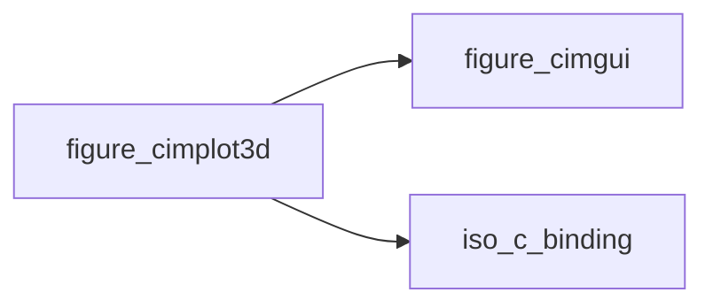

# figure_cimplot3d

> figure_cimplot3d, raw ImPlot3D interfaces (generated by scripts/gen_bindings.py: do not edit).

 Of the 131 public free functions of cimplot3d, 53 are bound directly (`bind(C)`) and 73 through the generated C++
 glue (native/figure_glue_generated.cpp: `figure_<name>`, structs passed by reference instead of by value, struct
 results through `res`); the rest are skipped: see docs/guide/raw-bindings.md. Private to the library:
 applications use the figure_* wrapper modules. Each dummy documents its C type and default.

**Source**: `src/lib/figure_cimplot3d.F90`

**Dependencies**

## Contents

- [im_plot3d_point](#im-plot3d-point)
- [im_plot3d_quat](#im-plot3d-quat)
- [im_plot3d_spec](#im-plot3d-spec)
- [ImPlot3D_AddColormap_U32Ptr](#implot3d-addcolormap-u32ptr)
- [ImPlot3D_AddColormap_Vec4Ptr](#implot3d-addcolormap-vec4ptr)
- [ImPlot3D_BeginPlot](#implot3d-beginplot)
- [ImPlot3D_CreateContext](#implot3d-createcontext)
- [ImPlot3D_GetColormapCount](#implot3d-getcolormapcount)
- [ImPlot3D_GetColormapIndex](#implot3d-getcolormapindex)
- [ImPlot3D_GetColormapName](#implot3d-getcolormapname)
- [ImPlot3D_GetColormapSize](#implot3d-getcolormapsize)
- [ImPlot3D_GetCurrentContext](#implot3d-getcurrentcontext)
- [ImPlot3D_GetPlotDrawList](#implot3d-getplotdrawlist)
- [ImPlot3D_GetPlotRectPos](#implot3d-getplotrectpos)
- [ImPlot3D_GetPlotRectSize](#implot3d-getplotrectsize)
- [ImPlot3D_GetStyle](#implot3d-getstyle)
- [ImPlot3D_GetStyleColorU32](#implot3d-getstylecoloru32)
- [ImPlot3D_NextMarker](#implot3d-nextmarker)
- [ImPlot3D_PlotToPixels_double](#implot3d-plottopixels-double)
- [ImPlot3D_PlotToPixels_Plot3DPoint](#implot3d-plottopixels-plot3dpoint)
- [ImPlot3D_ShowColormapSelector](#implot3d-showcolormapselector)
- [ImPlot3D_ShowStyleSelector](#implot3d-showstyleselector)
- [figure_sizeof_ImPlot3DPoint_c](#figure-sizeof-implot3dpoint-c)
- [figure_sizeof_ImPlot3DQuat_c](#figure-sizeof-implot3dquat-c)
- [figure_sizeof_ImPlot3DSpec_c](#figure-sizeof-implot3dspec-c)
- [ImPlot3D_DestroyContext](#implot3d-destroycontext)
- [ImPlot3D_EndPlot](#implot3d-endplot)
- [ImPlot3D_GetColormapColor](#implot3d-getcolormapcolor)
- [ImPlot3D_GetStyleColorVec4](#implot3d-getstylecolorvec4)
- [ImPlot3D_NextColormapColor](#implot3d-nextcolormapcolor)
- [ImPlot3D_PixelsToPlotPlane_double](#implot3d-pixelstoplotplane-double)
- [ImPlot3D_PixelsToPlotPlane_Vec2](#implot3d-pixelstoplotplane-vec2)
- [ImPlot3D_PlotDummy](#implot3d-plotdummy)
- [ImPlot3D_PlotImage_Plot3DPoint](#implot3d-plotimage-plot3dpoint)
- [ImPlot3D_PlotImage_Vec2](#implot3d-plotimage-vec2)
- [ImPlot3D_PlotLine_doublePtr](#implot3d-plotline-doubleptr)
- [ImPlot3D_PlotLine_FloatPtr](#implot3d-plotline-floatptr)
- [ImPlot3D_PlotLine_S16Ptr](#implot3d-plotline-s16ptr)
- [ImPlot3D_PlotLine_S32Ptr](#implot3d-plotline-s32ptr)
- [ImPlot3D_PlotLine_S64Ptr](#implot3d-plotline-s64ptr)
- [ImPlot3D_PlotLine_S8Ptr](#implot3d-plotline-s8ptr)
- [ImPlot3D_PlotLine_U16Ptr](#implot3d-plotline-u16ptr)
- [ImPlot3D_PlotLine_U32Ptr](#implot3d-plotline-u32ptr)
- [ImPlot3D_PlotLine_U64Ptr](#implot3d-plotline-u64ptr)
- [ImPlot3D_PlotLine_U8Ptr](#implot3d-plotline-u8ptr)
- [ImPlot3D_PlotMesh_doublePtr](#implot3d-plotmesh-doubleptr)
- [ImPlot3D_PlotMesh_FloatPtr](#implot3d-plotmesh-floatptr)
- [ImPlot3D_PlotMesh_S16Ptr](#implot3d-plotmesh-s16ptr)
- [ImPlot3D_PlotMesh_S32Ptr](#implot3d-plotmesh-s32ptr)
- [ImPlot3D_PlotMesh_S64Ptr](#implot3d-plotmesh-s64ptr)
- [ImPlot3D_PlotMesh_S8Ptr](#implot3d-plotmesh-s8ptr)
- [ImPlot3D_PlotMesh_U16Ptr](#implot3d-plotmesh-u16ptr)
- [ImPlot3D_PlotMesh_U32Ptr](#implot3d-plotmesh-u32ptr)
- [ImPlot3D_PlotMesh_U64Ptr](#implot3d-plotmesh-u64ptr)
- [ImPlot3D_PlotMesh_U8Ptr](#implot3d-plotmesh-u8ptr)
- [ImPlot3D_PlotQuad_doublePtr](#implot3d-plotquad-doubleptr)
- [ImPlot3D_PlotQuad_FloatPtr](#implot3d-plotquad-floatptr)
- [ImPlot3D_PlotQuad_S16Ptr](#implot3d-plotquad-s16ptr)
- [ImPlot3D_PlotQuad_S32Ptr](#implot3d-plotquad-s32ptr)
- [ImPlot3D_PlotQuad_S64Ptr](#implot3d-plotquad-s64ptr)
- [ImPlot3D_PlotQuad_S8Ptr](#implot3d-plotquad-s8ptr)
- [ImPlot3D_PlotQuad_U16Ptr](#implot3d-plotquad-u16ptr)
- [ImPlot3D_PlotQuad_U32Ptr](#implot3d-plotquad-u32ptr)
- [ImPlot3D_PlotQuad_U64Ptr](#implot3d-plotquad-u64ptr)
- [ImPlot3D_PlotQuad_U8Ptr](#implot3d-plotquad-u8ptr)
- [ImPlot3D_PlotScatter_doublePtr](#implot3d-plotscatter-doubleptr)
- [ImPlot3D_PlotScatter_FloatPtr](#implot3d-plotscatter-floatptr)
- [ImPlot3D_PlotScatter_S16Ptr](#implot3d-plotscatter-s16ptr)
- [ImPlot3D_PlotScatter_S32Ptr](#implot3d-plotscatter-s32ptr)
- [ImPlot3D_PlotScatter_S64Ptr](#implot3d-plotscatter-s64ptr)
- [ImPlot3D_PlotScatter_S8Ptr](#implot3d-plotscatter-s8ptr)
- [ImPlot3D_PlotScatter_U16Ptr](#implot3d-plotscatter-u16ptr)
- [ImPlot3D_PlotScatter_U32Ptr](#implot3d-plotscatter-u32ptr)
- [ImPlot3D_PlotScatter_U64Ptr](#implot3d-plotscatter-u64ptr)
- [ImPlot3D_PlotScatter_U8Ptr](#implot3d-plotscatter-u8ptr)
- [ImPlot3D_PlotSurface_doublePtr](#implot3d-plotsurface-doubleptr)
- [ImPlot3D_PlotSurface_FloatPtr](#implot3d-plotsurface-floatptr)
- [ImPlot3D_PlotSurface_S16Ptr](#implot3d-plotsurface-s16ptr)
- [ImPlot3D_PlotSurface_S32Ptr](#implot3d-plotsurface-s32ptr)
- [ImPlot3D_PlotSurface_S64Ptr](#implot3d-plotsurface-s64ptr)
- [ImPlot3D_PlotSurface_S8Ptr](#implot3d-plotsurface-s8ptr)
- [ImPlot3D_PlotSurface_U16Ptr](#implot3d-plotsurface-u16ptr)
- [ImPlot3D_PlotSurface_U32Ptr](#implot3d-plotsurface-u32ptr)
- [ImPlot3D_PlotSurface_U64Ptr](#implot3d-plotsurface-u64ptr)
- [ImPlot3D_PlotSurface_U8Ptr](#implot3d-plotsurface-u8ptr)
- [ImPlot3D_PlotText](#implot3d-plottext)
- [ImPlot3D_PlotTriangle_doublePtr](#implot3d-plottriangle-doubleptr)
- [ImPlot3D_PlotTriangle_FloatPtr](#implot3d-plottriangle-floatptr)
- [ImPlot3D_PlotTriangle_S16Ptr](#implot3d-plottriangle-s16ptr)
- [ImPlot3D_PlotTriangle_S32Ptr](#implot3d-plottriangle-s32ptr)
- [ImPlot3D_PlotTriangle_S64Ptr](#implot3d-plottriangle-s64ptr)
- [ImPlot3D_PlotTriangle_S8Ptr](#implot3d-plottriangle-s8ptr)
- [ImPlot3D_PlotTriangle_U16Ptr](#implot3d-plottriangle-u16ptr)
- [ImPlot3D_PlotTriangle_U32Ptr](#implot3d-plottriangle-u32ptr)
- [ImPlot3D_PlotTriangle_U64Ptr](#implot3d-plottriangle-u64ptr)
- [ImPlot3D_PlotTriangle_U8Ptr](#implot3d-plottriangle-u8ptr)
- [ImPlot3D_PopColormap](#implot3d-popcolormap)
- [ImPlot3D_PopStyleColor](#implot3d-popstylecolor)
- [ImPlot3D_PopStyleVar](#implot3d-popstylevar)
- [ImPlot3D_PushColormap_Plot3DColormap](#implot3d-pushcolormap-plot3dcolormap)
- [ImPlot3D_PushColormap_Str](#implot3d-pushcolormap-str)
- [ImPlot3D_PushStyleColor_U32](#implot3d-pushstylecolor-u32)
- [ImPlot3D_PushStyleColor_Vec4](#implot3d-pushstylecolor-vec4)
- [ImPlot3D_PushStyleVar_Float](#implot3d-pushstylevar-float)
- [ImPlot3D_PushStyleVar_Int](#implot3d-pushstylevar-int)
- [ImPlot3D_PushStyleVar_Vec2](#implot3d-pushstylevar-vec2)
- [ImPlot3D_SampleColormap](#implot3d-samplecolormap)
- [ImPlot3D_SetCurrentContext](#implot3d-setcurrentcontext)
- [ImPlot3D_SetupAxes](#implot3d-setupaxes)
- [ImPlot3D_SetupAxesLimits](#implot3d-setupaxeslimits)
- [ImPlot3D_SetupAxis](#implot3d-setupaxis)
- [ImPlot3D_SetupAxisLimits](#implot3d-setupaxislimits)
- [ImPlot3D_SetupAxisLimitsConstraints](#implot3d-setupaxislimitsconstraints)
- [ImPlot3D_SetupAxisScale_Plot3DScale](#implot3d-setupaxisscale-plot3dscale)
- [ImPlot3D_SetupAxisTicks_double](#implot3d-setupaxisticks-double)
- [ImPlot3D_SetupAxisTicks_doublePtr](#implot3d-setupaxisticks-doubleptr)
- [ImPlot3D_SetupAxisZoomConstraints](#implot3d-setupaxiszoomconstraints)
- [ImPlot3D_SetupBoxInitialRotation_double](#implot3d-setupboxinitialrotation-double)
- [ImPlot3D_SetupBoxInitialRotation_Plot3DQuat](#implot3d-setupboxinitialrotation-plot3dquat)
- [ImPlot3D_SetupBoxRotation_double](#implot3d-setupboxrotation-double)
- [ImPlot3D_SetupBoxRotation_Plot3DQuat](#implot3d-setupboxrotation-plot3dquat)
- [ImPlot3D_SetupBoxScale](#implot3d-setupboxscale)
- [ImPlot3D_SetupLegend](#implot3d-setuplegend)
- [ImPlot3D_ShowAboutWindow](#implot3d-showaboutwindow)
- [ImPlot3D_ShowAllDemos](#implot3d-showalldemos)
- [ImPlot3D_ShowDemoWindow](#implot3d-showdemowindow)
- [ImPlot3D_ShowMetricsWindow](#implot3d-showmetricswindow)
- [ImPlot3D_ShowStyleEditor](#implot3d-showstyleeditor)
- [ImPlot3D_StyleColorsAuto](#implot3d-stylecolorsauto)
- [ImPlot3D_StyleColorsClassic](#implot3d-stylecolorsclassic)
- [ImPlot3D_StyleColorsDark](#implot3d-stylecolorsdark)
- [ImPlot3D_StyleColorsLight](#implot3d-stylecolorslight)
- [figure_ImPlot3DSpec_default](#figure-implot3dspec-default)

## Derived Types

### im_plot3d_point

`ImPlot3DPoint_c`, the C layout of `ImPlot3DPoint`, zero-initialized (not the C++ defaults).

**Attributes**: bind(C)

**Components**

| Name | Type | Attributes | Description |
|------|------|------------|-------------|
| `x` | real(kind=c_double) |  | C `double`. |
| `y` | real(kind=c_double) |  | C `double`. |
| `z` | real(kind=c_double) |  | C `double`. |

### im_plot3d_quat

`ImPlot3DQuat_c`, the C layout of `ImPlot3DQuat`, zero-initialized (not the C++ defaults).

**Attributes**: bind(C)

**Components**

| Name | Type | Attributes | Description |
|------|------|------------|-------------|
| `x` | real(kind=c_double) |  | C `double`. |
| `y` | real(kind=c_double) |  | C `double`. |
| `z` | real(kind=c_double) |  | C `double`. |
| `w` | real(kind=c_double) |  | C `double`. |

### im_plot3d_spec

`ImPlot3DSpec_c`, the C layout of `ImPlot3DSpec`, zero-initialized (not the C++ defaults).

**Attributes**: bind(C)

**Components**

| Name | Type | Attributes | Description |
|------|------|------------|-------------|
| `LineColor` | type([im_vec4](/api/src/lib/figure_cimgui#im-vec4)) |  | C `ImVec4`. |
| `LineColors` | type(c_ptr) |  | C `ImU32*`. |
| `LineWeight` | real(kind=c_float) |  | C `float`. |
| `FillColor` | type([im_vec4](/api/src/lib/figure_cimgui#im-vec4)) |  | C `ImVec4`. |
| `FillColors` | type(c_ptr) |  | C `ImU32*`. |
| `FillAlpha` | real(kind=c_float) |  | C `float`. |
| `Marker` | integer(kind=c_int) |  | C `ImPlot3DMarker`. |
| `MarkerSize` | real(kind=c_float) |  | C `float`. |
| `MarkerSizes` | type(c_ptr) |  | C `float*`. |
| `MarkerLineColor` | type([im_vec4](/api/src/lib/figure_cimgui#im-vec4)) |  | C `ImVec4`. |
| `MarkerLineColors` | type(c_ptr) |  | C `ImU32*`. |
| `MarkerFillColor` | type([im_vec4](/api/src/lib/figure_cimgui#im-vec4)) |  | C `ImVec4`. |
| `MarkerFillColors` | type(c_ptr) |  | C `ImU32*`. |
| `Offset` | integer(kind=c_int) |  | C `int`. |
| `Stride` | integer(kind=c_int) |  | C `int`. |
| `Flags` | integer(kind=c_int) |  | C `ImPlot3DItemFlags`. |

## Interfaces

### ImPlot3D_AddColormap_U32Ptr

### ImPlot3D_AddColormap_Vec4Ptr

### ImPlot3D_BeginPlot

### ImPlot3D_CreateContext

### ImPlot3D_GetColormapCount

### ImPlot3D_GetColormapIndex

### ImPlot3D_GetColormapName

### ImPlot3D_GetColormapSize

### ImPlot3D_GetCurrentContext

### ImPlot3D_GetPlotDrawList

### ImPlot3D_GetPlotRectPos

### ImPlot3D_GetPlotRectSize

### ImPlot3D_GetStyle

### ImPlot3D_GetStyleColorU32

### ImPlot3D_NextMarker

### ImPlot3D_PlotToPixels_double

### ImPlot3D_PlotToPixels_Plot3DPoint

### ImPlot3D_ShowColormapSelector

### ImPlot3D_ShowStyleSelector

### figure_sizeof_ImPlot3DPoint_c

### figure_sizeof_ImPlot3DQuat_c

### figure_sizeof_ImPlot3DSpec_c

### ImPlot3D_DestroyContext

### ImPlot3D_EndPlot

### ImPlot3D_GetColormapColor

### ImPlot3D_GetStyleColorVec4

### ImPlot3D_NextColormapColor

### ImPlot3D_PixelsToPlotPlane_double

### ImPlot3D_PixelsToPlotPlane_Vec2

### ImPlot3D_PlotDummy

### ImPlot3D_PlotImage_Plot3DPoint

### ImPlot3D_PlotImage_Vec2

### ImPlot3D_PlotLine_doublePtr

### ImPlot3D_PlotLine_FloatPtr

### ImPlot3D_PlotLine_S16Ptr

### ImPlot3D_PlotLine_S32Ptr

### ImPlot3D_PlotLine_S64Ptr

### ImPlot3D_PlotLine_S8Ptr

### ImPlot3D_PlotLine_U16Ptr

### ImPlot3D_PlotLine_U32Ptr

### ImPlot3D_PlotLine_U64Ptr

### ImPlot3D_PlotLine_U8Ptr

### ImPlot3D_PlotMesh_doublePtr

### ImPlot3D_PlotMesh_FloatPtr

### ImPlot3D_PlotMesh_S16Ptr

### ImPlot3D_PlotMesh_S32Ptr

### ImPlot3D_PlotMesh_S64Ptr

### ImPlot3D_PlotMesh_S8Ptr

### ImPlot3D_PlotMesh_U16Ptr

### ImPlot3D_PlotMesh_U32Ptr

### ImPlot3D_PlotMesh_U64Ptr

### ImPlot3D_PlotMesh_U8Ptr

### ImPlot3D_PlotQuad_doublePtr

### ImPlot3D_PlotQuad_FloatPtr

### ImPlot3D_PlotQuad_S16Ptr

### ImPlot3D_PlotQuad_S32Ptr

### ImPlot3D_PlotQuad_S64Ptr

### ImPlot3D_PlotQuad_S8Ptr

### ImPlot3D_PlotQuad_U16Ptr

### ImPlot3D_PlotQuad_U32Ptr

### ImPlot3D_PlotQuad_U64Ptr

### ImPlot3D_PlotQuad_U8Ptr

### ImPlot3D_PlotScatter_doublePtr

### ImPlot3D_PlotScatter_FloatPtr

### ImPlot3D_PlotScatter_S16Ptr

### ImPlot3D_PlotScatter_S32Ptr

### ImPlot3D_PlotScatter_S64Ptr

### ImPlot3D_PlotScatter_S8Ptr

### ImPlot3D_PlotScatter_U16Ptr

### ImPlot3D_PlotScatter_U32Ptr

### ImPlot3D_PlotScatter_U64Ptr

### ImPlot3D_PlotScatter_U8Ptr

### ImPlot3D_PlotSurface_doublePtr

### ImPlot3D_PlotSurface_FloatPtr

### ImPlot3D_PlotSurface_S16Ptr

### ImPlot3D_PlotSurface_S32Ptr

### ImPlot3D_PlotSurface_S64Ptr

### ImPlot3D_PlotSurface_S8Ptr

### ImPlot3D_PlotSurface_U16Ptr

### ImPlot3D_PlotSurface_U32Ptr

### ImPlot3D_PlotSurface_U64Ptr

### ImPlot3D_PlotSurface_U8Ptr

### ImPlot3D_PlotText

### ImPlot3D_PlotTriangle_doublePtr

### ImPlot3D_PlotTriangle_FloatPtr

### ImPlot3D_PlotTriangle_S16Ptr

### ImPlot3D_PlotTriangle_S32Ptr

### ImPlot3D_PlotTriangle_S64Ptr

### ImPlot3D_PlotTriangle_S8Ptr

### ImPlot3D_PlotTriangle_U16Ptr

### ImPlot3D_PlotTriangle_U32Ptr

### ImPlot3D_PlotTriangle_U64Ptr

### ImPlot3D_PlotTriangle_U8Ptr

### ImPlot3D_PopColormap

### ImPlot3D_PopStyleColor

### ImPlot3D_PopStyleVar

### ImPlot3D_PushColormap_Plot3DColormap

### ImPlot3D_PushColormap_Str

### ImPlot3D_PushStyleColor_U32

### ImPlot3D_PushStyleColor_Vec4

### ImPlot3D_PushStyleVar_Float

### ImPlot3D_PushStyleVar_Int

### ImPlot3D_PushStyleVar_Vec2

### ImPlot3D_SampleColormap

### ImPlot3D_SetCurrentContext

### ImPlot3D_SetupAxes

### ImPlot3D_SetupAxesLimits

### ImPlot3D_SetupAxis

### ImPlot3D_SetupAxisLimits

### ImPlot3D_SetupAxisLimitsConstraints

### ImPlot3D_SetupAxisScale_Plot3DScale

### ImPlot3D_SetupAxisTicks_double

### ImPlot3D_SetupAxisTicks_doublePtr

### ImPlot3D_SetupAxisZoomConstraints

### ImPlot3D_SetupBoxInitialRotation_double

### ImPlot3D_SetupBoxInitialRotation_Plot3DQuat

### ImPlot3D_SetupBoxRotation_double

### ImPlot3D_SetupBoxRotation_Plot3DQuat

### ImPlot3D_SetupBoxScale

### ImPlot3D_SetupLegend

### ImPlot3D_ShowAboutWindow

### ImPlot3D_ShowAllDemos

### ImPlot3D_ShowDemoWindow

### ImPlot3D_ShowMetricsWindow

### ImPlot3D_ShowStyleEditor

### ImPlot3D_StyleColorsAuto

### ImPlot3D_StyleColorsClassic

### ImPlot3D_StyleColorsDark

### ImPlot3D_StyleColorsLight

### figure_ImPlot3DSpec_default
