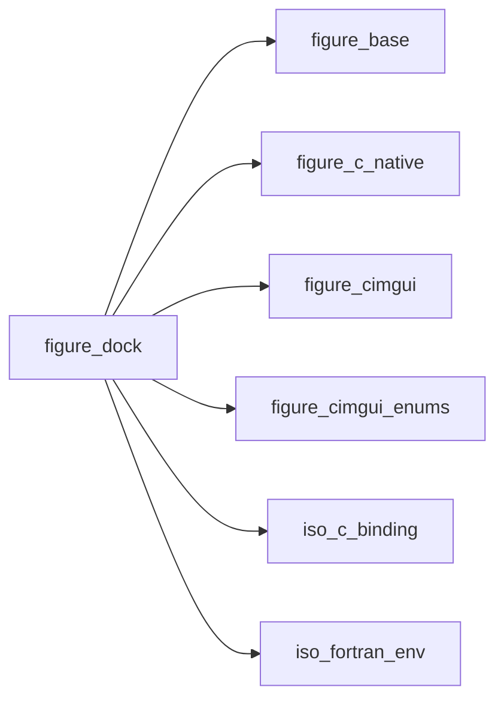
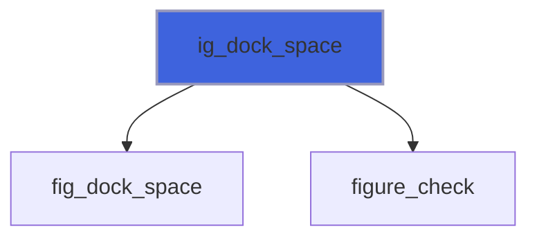
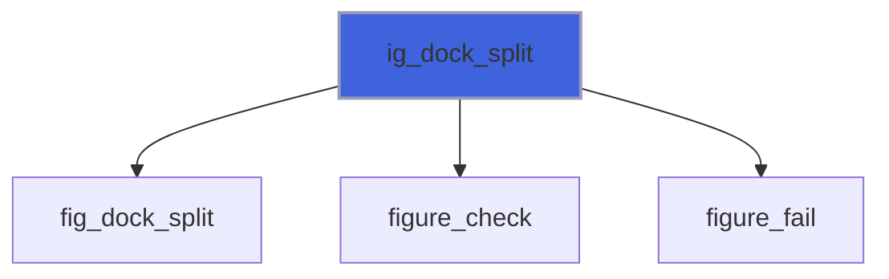
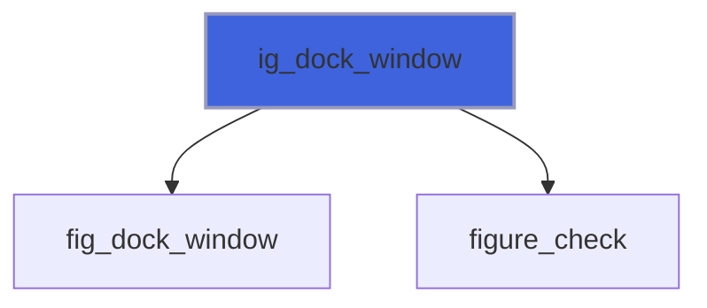
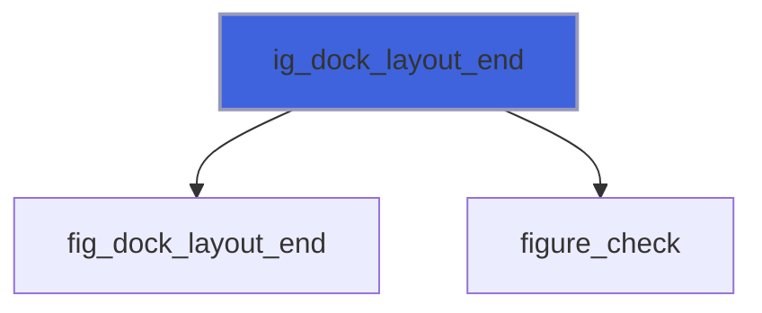
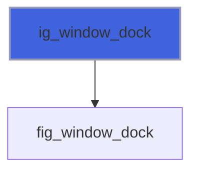
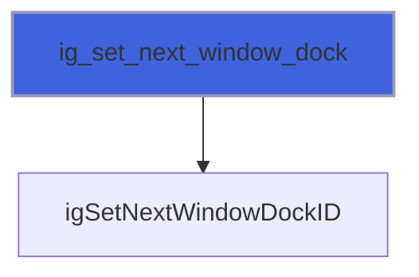
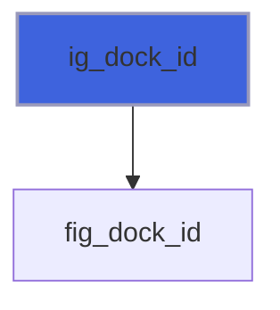
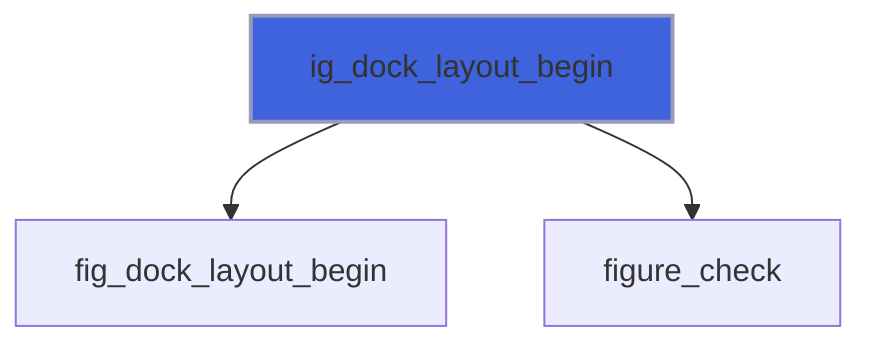

# figure_dock

> figure_dock, docking: windows docked into one another or into a dock space, and layouts set by the program.

 Docking is on by default (`app%set_docking` turns it off): the user drags a window by its title bar onto another
 window, or onto a dock space, and drops it as a tab or a split. A dock space over the whole display is declared
 every frame with `ig_dock_space`, before the windows that dock into it. A program lays out a dock space once, the
 first time it appears:

```fortran
 root = ig_dock_id('main')
 if (ig_dock_layout_begin(root)) then
    call ig_dock_split(root, 'left', 0.3_real64, left, right)
    call ig_dock_window('Controls', left)
    call ig_dock_window('Plots', right)
    call ig_dock_layout_end(root)
 endif
 call ig_dock_space(root)
```

 A window that appears after the layout was built (a file found later) is docked into a node with
 `ig_set_next_window_dock(node)` before its `ig_begin`: the first time it appears, then where the user moves it.

 Dock ids are Dear ImGui's ImGuiID (unsigned 32-bit), carried in `integer(int32)`: compare and pass them, do not do
 arithmetic on them.

**Source**: `src/lib/figure_dock.F90`

**Dependencies**



## Contents

- [ig_dock_space](#ig-dock-space)
- [ig_dock_split](#ig-dock-split)
- [ig_dock_window](#ig-dock-window)
- [ig_dock_layout_end](#ig-dock-layout-end)
- [ig_window_dock](#ig-window-dock)
- [ig_set_next_window_dock](#ig-set-next-window-dock)
- [ig_dock_id](#ig-dock-id)
- [ig_dock_layout_begin](#ig-dock-layout-begin)

## Subroutines

### ig_dock_space

A dock space covering the display, every frame, before the windows docked into it. Where nothing is docked it
 is transparent: floating windows and the window background show through.

```fortran
subroutine ig_dock_space(id, flags, stat)
```

**Arguments**

| Name | Type | Intent | Attributes | Description |
|------|------|--------|------------|-------------|
| `id` | integer(kind=int32) | in |  | Dock id (`ig_dock_id`). |
| `flags` | integer(kind=int32) | in | optional | `ImGuiDockNodeFlags_*` (default none). |
| `stat` | integer(kind=int32) | out | optional | Status: `FIG_ERR_STATE` outside a frame or with docking off. |

**Call graph**



### ig_dock_split

Split the node `id` in two: `id_at_dir` takes `fraction` of it on the side `direction` (`'left'`, `'right'`,
 `'up'`, `'down'`), `id_other` the rest. Split the new nodes again for more areas.

```fortran
subroutine ig_dock_split(id, direction, fraction, id_at_dir, id_other, stat)
```

**Arguments**

| Name | Type | Intent | Attributes | Description |
|------|------|--------|------------|-------------|
| `id` | integer(kind=int32) | in |  | Node to split. |
| `direction` | character(len=*) | in |  | `'left'`, `'right'`, `'up'` or `'down'`. |
| `fraction` | real(kind=real64) | in |  | Part of the node at `direction`, in (0, 1). |
| `id_at_dir` | integer(kind=int32) | out |  | The new node at `direction`. |
| `id_other` | integer(kind=int32) | out |  | The new node on the other side. |
| `stat` | integer(kind=int32) | out | optional | Status: `FIG_ERR_ARGUMENT` for a bad direction or fraction. |

**Call graph**



### ig_dock_window

Dock the window `name` (as passed to `ig_begin`) into the node `id` of a layout being built.

```fortran
subroutine ig_dock_window(name, id, stat)
```

**Arguments**

| Name | Type | Intent | Attributes | Description |
|------|------|--------|------------|-------------|
| `name` | character(len=*) | in |  | Window name. |
| `id` | integer(kind=int32) | in |  | Dock node. |
| `stat` | integer(kind=int32) | out | optional | Status. |

**Call graph**



### ig_dock_layout_end

Finish the layout started by `ig_dock_layout_begin`.

```fortran
subroutine ig_dock_layout_end(id, stat)
```

**Arguments**

| Name | Type | Intent | Attributes | Description |
|------|------|--------|------------|-------------|
| `id` | integer(kind=int32) | in |  | Dock id. |
| `stat` | integer(kind=int32) | out | optional | Status. |

**Call graph**



### ig_window_dock

Inside a window (between `ig_begin` and `ig_end`): the dock node it is in (0 if none) and whether it is docked.

```fortran
subroutine ig_window_dock(id, docked)
```

**Arguments**

| Name | Type | Intent | Attributes | Description |
|------|------|--------|------------|-------------|
| `id` | integer(kind=int32) | out |  | Dock node. |
| `docked` | logical | out |  | The window is docked. |

**Call graph**



### ig_set_next_window_dock

Dock the next window (the next `ig_begin`) into the node `id`: the first time it appears (a window created after
 the layout was built), or every frame with `always`.

```fortran
subroutine ig_set_next_window_dock(id, always)
```

**Arguments**

| Name | Type | Intent | Attributes | Description |
|------|------|--------|------------|-------------|
| `id` | integer(kind=int32) | in |  | Dock node (from the layout, or `ig_window_dock` of a docked window). |
| `always` | logical | in | optional | Every frame (default: first use only, then the user decides). |

**Call graph**



## Functions

### ig_dock_id

The dock id of a name: the same name gives the same id in every frame and every run.

**Returns**: `integer(kind=int32)`

```fortran
function ig_dock_id(name) result(id)
```

**Arguments**

| Name | Type | Intent | Attributes | Description |
|------|------|--------|------------|-------------|
| `name` | character(len=*) | in |  | Name. |

**Call graph**



### ig_dock_layout_begin

True when the dock space `id` has no layout yet (its first frame, without an ini file keeping one): then lay it
 out with `ig_dock_split` and `ig_dock_window`, and close with `ig_dock_layout_end`. Call it before `ig_dock_space`.

**Returns**: `logical`

```fortran
function ig_dock_layout_begin(id, stat) result(needed)
```

**Arguments**

| Name | Type | Intent | Attributes | Description |
|------|------|--------|------------|-------------|
| `id` | integer(kind=int32) | in |  | Dock id. |
| `stat` | integer(kind=int32) | out | optional | Status. |

**Call graph**


