# figure_editor

> figure_editor, a code editor (code_editor_object) with highlighting, marks, completion and find, and a text diff.

 The editor is ImGuiColorTextEdit (the goossens fork, MIT, vendored in third_party/ImGuiColorTextEdit) with FIGURE's
 own glue (native/figure_editor.cpp): it draws through Dear ImGui only, so window, headless and remote modes show the
 same pixels. Text is UTF-8; lines and columns are numbered from 1, columns in characters. Everything is polled:
 `ed%draw` returns true on the frame the user changed the text, `ed%completing` while the completion popup is open.

```fortran
 type(code_editor_object) :: ed
 call ed%init(code_language('input'))          ! key = value files; code_language('fortran') for Fortran
 call ed%set_text(text)
 call ed%set_completions(['reynolds number', 'save frequency '])
 ... every frame, inside a window:
 if (ed%draw('editor')) call validate(ed%text())   ! the user changed it: check it again
 call ed%clear_marks()
 call ed%mark(3, 'error', 'reynolds number must be positive')
```

 A language (`language_object`) is data: keywords, types, comments, strings, numbers, case, and a key = value mode;
 `code_language` gives the shipped ones (Fortran, input files, plain text) and the fork's own (C, C++, Python, JSON,
 Markdown, ...). `code_diff` draws the difference of two texts, `code_diff_lines` reports the lines that differ.

**Source**: `src/lib/figure_editor.F90`

**Dependencies**

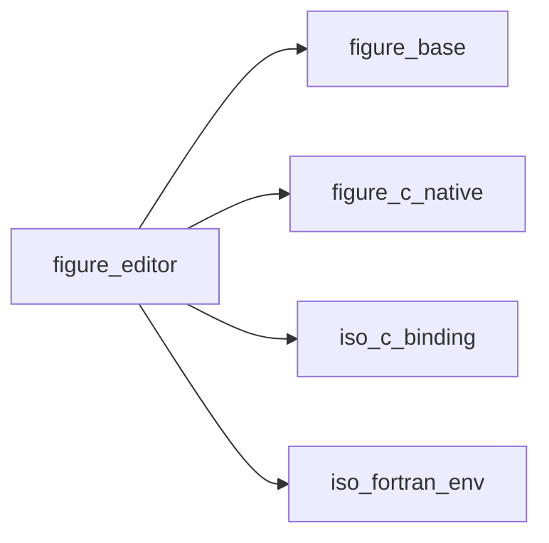

## Contents

- [language_object](#language-object)
- [code_editor_object](#code-editor-object)
- [fig_editor_create](#fig-editor-create)
- [fig_editor_language](#fig-editor-language)
- [fig_editor_set_text](#fig-editor-set-text)
- [fig_editor_string](#fig-editor-string)
- [fig_editor_draw](#fig-editor-draw)
- [fig_editor_mark](#fig-editor-mark)
- [fig_editor_clear_marks](#fig-editor-clear-marks)
- [fig_editor_mark_of](#fig-editor-mark-of)
- [fig_editor_goto](#fig-editor-goto)
- [fig_editor_find](#fig-editor-find)
- [fig_editor_replace](#fig-editor-replace)
- [fig_editor_cursor](#fig-editor-cursor)
- [fig_editor_selection](#fig-editor-selection)
- [fig_editor_select](#fig-editor-select)
- [fig_editor_insert](#fig-editor-insert)
- [fig_editor_completions](#fig-editor-completions)
- [fig_editor_completing](#fig-editor-completing)
- [fig_editor_option](#fig-editor-option)
- [fig_editor_undo](#fig-editor-undo)
- [fig_editor_info](#fig-editor-info)
- [fig_editor_focus](#fig-editor-focus)
- [fig_editor_line_rect](#fig-editor-line-rect)
- [fig_code_diff](#fig-code-diff)
- [fig_code_diff_lines](#fig-code-diff-lines)
- [fig_editor_destroy](#fig-editor-destroy)
- [language_init](#language-init)
- [editor_init](#editor-init)
- [editor_destroy](#editor-destroy)
- [editor_set_language](#editor-set-language)
- [editor_set_text](#editor-set-text)
- [editor_mark](#editor-mark)
- [editor_clear_marks](#editor-clear-marks)
- [editor_goto](#editor-goto)
- [editor_focus](#editor-focus)
- [editor_cursor](#editor-cursor)
- [editor_select](#editor-select)
- [editor_insert](#editor-insert)
- [editor_set_completions](#editor-set-completions)
- [editor_read_only](#editor-read-only)
- [editor_set_options](#editor-set-options)
- [code_diff](#code-diff)
- [code_diff_lines](#code-diff-lines)
- [joined](#joined)
- [split_lines](#split-lines)
- [language_name](#language-name)
- [code_language](#code-language)
- [editor_is_initialized](#editor-is-initialized)
- [editor_text](#editor-text)
- [editor_line_count](#editor-line-count)
- [editor_draw](#editor-draw)
- [editor_mark_of](#editor-mark-of)
- [editor_find](#editor-find)
- [editor_replace](#editor-replace)
- [editor_selection](#editor-selection)
- [editor_word_at_cursor](#editor-word-at-cursor)
- [editor_completing](#editor-completing)
- [editor_is_read_only](#editor-is-read-only)
- [editor_undo](#editor-undo)
- [editor_redo](#editor-redo)
- [editor_line_rect](#editor-line-rect)
- [alive](#alive)
- [editor_string](#editor-string)
- [pack_language](#pack-language)
- [lower](#lower)
- [fortran_keywords](#fortran-keywords)
- [fortran_types](#fortran-types)

## Variables

| Name | Type | Attributes | Description |
|------|------|------------|-------------|
| `LF` | character(len=*) | parameter | Line feed. |
| `US` | character(len=*) | parameter | Field separator of a packed language. The fork's own languages, by the names `code_language` takes. |
| `FORK_LANGUAGES` | character(len=*) | parameter |  |

## Derived Types

### language_object

A language the editor highlights: `lang%init(name, ...)`, or one of `code_language`'s. Default: plain text.

**Components**

| Name | Type | Attributes | Description |
|------|------|------------|-------------|
| `name_` | character(len=:) | allocatable | Its name ('': plain text). |
| `fork` | logical |  | One of the fork's own languages. |
| `keywords` | character(len=:) | allocatable | Keywords, LF-separated. |
| `types` | character(len=:) | allocatable | Types and attributes, LF-separated. |
| `comment` | character(len=:) | allocatable | Start of a line comment. |
| `comment_alt` | character(len=:) | allocatable | Another start of a line comment. |
| `block_start` | character(len=:) | allocatable | Start of a block comment. |
| `block_end` | character(len=:) | allocatable | End of a block comment. |
| `preprocessor` | character(len=:) | allocatable | The character starting a preprocessor line. |
| `single_quotes` | logical |  | '...' strings. |
| `double_quotes` | logical |  | "..." strings. |
| `numbers` | logical |  | Numbers coloured. |
| `case_sensitive` | logical |  | Keywords and types by case. |
| `key_value` | logical |  | key = value lines. |

**Type-Bound Procedures**

| Name | Attributes | Description |
|------|------------|-------------|
| [`init`](/api/src/lib/figure_editor#language-init) | pass(self) | Define the language. |
| [`name`](/api/src/lib/figure_editor#language-name) | pass(self) | Its name. |

### code_editor_object

A code editor: `ed%init([language])`, `ed%set_text`, then `ed%draw` every frame. Not to be copied (the copy would
 share the editor). No finaliser, as `texture_object`: an assignment or a function result would finalise a copy
 and destroy the editor the original still uses; `destroy` releases it (at the program's end the system does).

**Components**

| Name | Type | Attributes | Description |
|------|------|------------|-------------|
| `handle` | integer(kind=c_int) |  | Native handle (0: none). |

**Type-Bound Procedures**

| Name | Attributes | Description |
|------|------------|-------------|
| [`init`](/api/src/lib/figure_editor#editor-init) | pass(self) | Create the editor. |
| [`destroy`](/api/src/lib/figure_editor#editor-destroy) | pass(self) | Release it. |
| [`is_initialized`](/api/src/lib/figure_editor#editor-is-initialized) | pass(self) | Whether it exists. |
| [`set_language`](/api/src/lib/figure_editor#editor-set-language) | pass(self) | Highlight another language. |
| [`set_text`](/api/src/lib/figure_editor#editor-set-text) | pass(self) | Replace the text. |
| [`text`](/api/src/lib/figure_editor#editor-text) | pass(self) | The text. |
| [`line_count`](/api/src/lib/figure_editor#editor-line-count) | pass(self) | The number of lines. |
| [`draw`](/api/src/lib/figure_editor#editor-draw) | pass(self) | Draw the editor as a widget. |
| [`mark`](/api/src/lib/figure_editor#editor-mark) | pass(self) | Mark a line with a message. |
| [`clear_marks`](/api/src/lib/figure_editor#editor-clear-marks) | pass(self) | Remove every mark. |
| [`mark_of`](/api/src/lib/figure_editor#editor-mark-of) | pass(self) | The mark on a line. |
| [`goto`](/api/src/lib/figure_editor#editor-goto) | pass(self) | Move the cursor to a line. |
| [`focus`](/api/src/lib/figure_editor#editor-focus) | pass(self) | Give the editor the keyboard. |
| [`find`](/api/src/lib/figure_editor#editor-find) | pass(self) | Select the next occurrence of a text. |
| [`replace`](/api/src/lib/figure_editor#editor-replace) | pass(self) | Replace every occurrence of a text. |
| [`cursor`](/api/src/lib/figure_editor#editor-cursor) | pass(self) | The cursor's line and column. |
| [`selection`](/api/src/lib/figure_editor#editor-selection) | pass(self) | The selection. |
| [`select`](/api/src/lib/figure_editor#editor-select) | pass(self) | Select a range. |
| [`insert`](/api/src/lib/figure_editor#editor-insert) | pass(self) | Insert a text at the cursor. |
| [`word_at_cursor`](/api/src/lib/figure_editor#editor-word-at-cursor) | pass(self) | The word at the cursor. |
| [`set_completions`](/api/src/lib/figure_editor#editor-set-completions) | pass(self) | The words completion offers. |
| [`completing`](/api/src/lib/figure_editor#editor-completing) | pass(self) | The completion popup is open. |
| [`read_only`](/api/src/lib/figure_editor#editor-read-only) | pass(self) | Make it read-only, or editable. |
| [`is_read_only`](/api/src/lib/figure_editor#editor-is-read-only) | pass(self) | Whether it is read-only. |
| [`set_options`](/api/src/lib/figure_editor#editor-set-options) | pass(self) | Line numbers, tab size, whitespace, the current line. |
| [`undo`](/api/src/lib/figure_editor#editor-undo) | pass(self) | Undo the last change. |
| [`redo`](/api/src/lib/figure_editor#editor-redo) | pass(self) | Redo the last undone change. |
| [`line_rect`](/api/src/lib/figure_editor#editor-line-rect) | pass(self) | A line's rectangle on the screen. |

## Interfaces

### fig_editor_create

### fig_editor_language

### fig_editor_set_text

### fig_editor_string

### fig_editor_draw

### fig_editor_mark

### fig_editor_clear_marks

### fig_editor_mark_of

### fig_editor_goto

### fig_editor_find

### fig_editor_replace

### fig_editor_cursor

### fig_editor_selection

### fig_editor_select

### fig_editor_insert

### fig_editor_completions

### fig_editor_completing

### fig_editor_option

### fig_editor_undo

### fig_editor_info

### fig_editor_focus

### fig_editor_line_rect

### fig_code_diff

### fig_code_diff_lines

### fig_editor_destroy

## Subroutines

### language_init

Define a language: `name` (shown nowhere, it tells languages apart), the words it colours, its comments and
 strings. Keywords and types are each trimmed of trailing blanks; matched whole, by case only if `case_sensitive`.
 With `key_value`, a line `[section]` takes the types' colour and the words before a line's `=` the keywords'.
 Status: `FIG_ERR_ARGUMENT` for an empty name, a keyword or type with a blank or a separator inside, a preprocessor
 of more than one character. Any thread (it is data).

**Attributes**: recursive

```fortran
subroutine language_init(self, name, keywords, types, comment, comment_alt, block_comment, preprocessor, single_quotes, double_quotes, numbers, case_sensitive, key_value, stat)
```

**Arguments**

| Name | Type | Intent | Attributes | Description |
|------|------|--------|------------|-------------|
| `self` | class([language_object](/api/src/lib/figure_editor#language-object)) | inout |  | Language. |
| `name` | character(len=*) | in |  | Its name. |
| `keywords` | character(len=*) | in | optional | Keywords (the keywords' colour). |
| `types` | character(len=*) | in | optional | Types, attributes (the types' colour). |
| `comment` | character(len=*) | in | optional | Start of a line comment (default none). |
| `comment_alt` | character(len=*) | in | optional | Another start of a line comment. |
| `block_comment` | character(len=*) | in | optional | Start and end of a block comment. |
| `preprocessor` | character(len=*) | in | optional | The character of a preprocessor line (`'#'`). |
| `single_quotes` | logical | in | optional | '...' strings (default true). |
| `double_quotes` | logical | in | optional | "..." strings (default true). |
| `numbers` | logical | in | optional | Numbers coloured (default true). |
| `case_sensitive` | logical | in | optional | By case (default true). |
| `key_value` | logical | in | optional | key = value lines (default false). |
| `stat` | integer(kind=int32) | out | optional | Status. |

**Call graph**

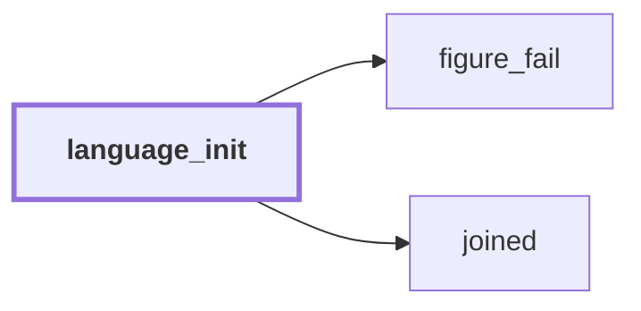

### editor_init

Create the editor (an existing one is destroyed first), empty, highlighting `language` (default: plain text). It
 shows line numbers, highlights the current line, matches brackets, and has the fork's find and replace window
 (ctrl+f; cmd+f on macOS), undo and redo (ctrl+z, ctrl+y), cut, copy and paste with the clipboard. After
 `app%init*`. Statuses: `FIG_ERR_STATE` from a task. The same in every mode.

**Attributes**: recursive

```fortran
subroutine editor_init(self, language, stat)
```

**Arguments**

| Name | Type | Intent | Attributes | Description |
|------|------|--------|------------|-------------|
| `self` | class([code_editor_object](/api/src/lib/figure_editor#code-editor-object)) | inout |  | Editor. |
| `language` | type([language_object](/api/src/lib/figure_editor#language-object)) | in | optional | Language (default: plain text). |
| `stat` | integer(kind=int32) | out | optional | Status. |

**Call graph**

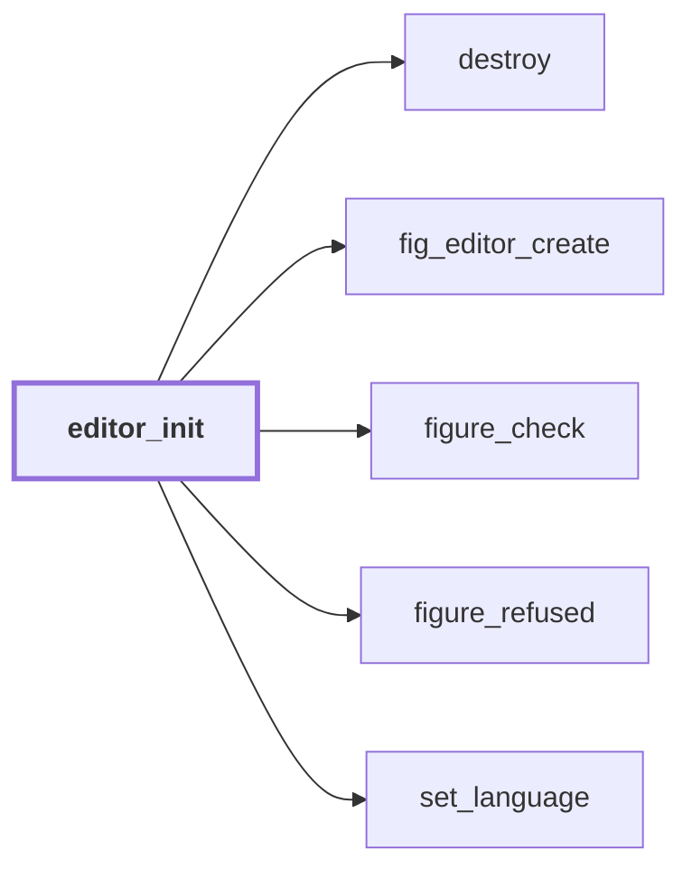

### editor_destroy

Release the editor (safe in any state).

**Attributes**: recursive

```fortran
subroutine editor_destroy(self)
```

**Arguments**

| Name | Type | Intent | Attributes | Description |
|------|------|--------|------------|-------------|
| `self` | class([code_editor_object](/api/src/lib/figure_editor#code-editor-object)) | inout |  | Editor. |

**Call graph**

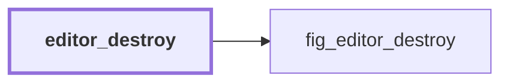

### editor_set_language

Highlight `language` from now on (the text, its marks and its undo history kept). Statuses: `FIG_ERR_STATE`
 before `init` and from a task.

**Attributes**: recursive

```fortran
subroutine editor_set_language(self, language, stat)
```

**Arguments**

| Name | Type | Intent | Attributes | Description |
|------|------|--------|------------|-------------|
| `self` | class([code_editor_object](/api/src/lib/figure_editor#code-editor-object)) | inout |  | Editor. |
| `language` | type([language_object](/api/src/lib/figure_editor#language-object)) | in |  | Language. |
| `stat` | integer(kind=int32) | out | optional | Status. |

**Call graph**

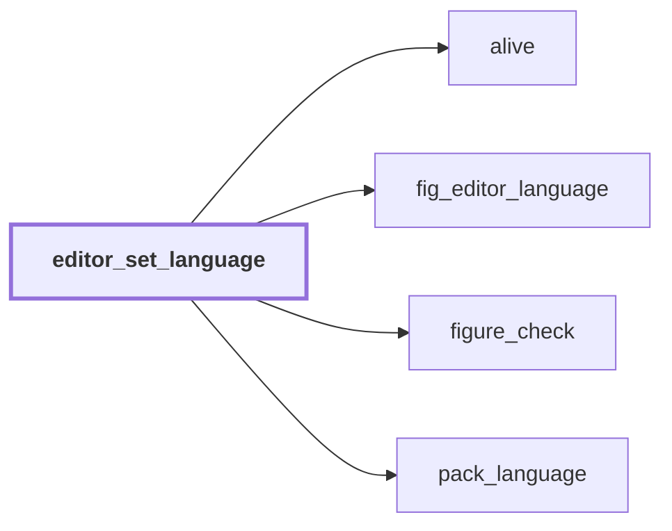

### editor_set_text

Replace the text with `text` (UTF-8, lines ended by LF or CR LF): the marks and the undo history go, the cursor
 goes to the start. Statuses: `FIG_ERR_STATE` before `init` and from a task.

**Attributes**: recursive

```fortran
subroutine editor_set_text(self, text, stat)
```

**Arguments**

| Name | Type | Intent | Attributes | Description |
|------|------|--------|------------|-------------|
| `self` | class([code_editor_object](/api/src/lib/figure_editor#code-editor-object)) | inout |  | Editor. |
| `text` | character(len=*) | in |  | Text. |
| `stat` | integer(kind=int32) | out | optional | Status. |

**Call graph**

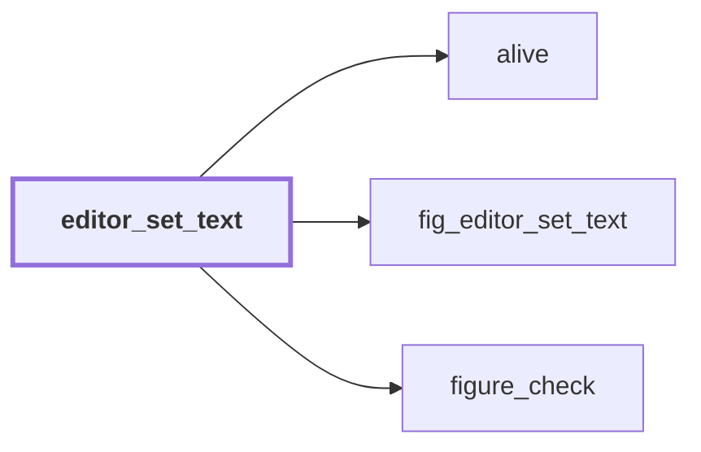

### editor_mark

Mark `line` with a message: `severity` `'error'`, `'warning'` or `'info'` tints the line and its number
 (vermilion, orange, blue) and puts its icon (a crossed circle, a triangle, an "i") beside the number; the
 message, after its severity's word, is the line's tooltip. A second mark on a line joins the messages and keeps
 the gravest severity. A mark moves with its line as lines are inserted or deleted above it, and goes with it.
 Statuses: `FIG_ERR_ARGUMENT` for another severity or a line outside [1, line_count()]; `FIG_ERR_STATE` before
 `init` and from a task.

**Attributes**: recursive

```fortran
subroutine editor_mark(self, line, severity, message, stat)
```

**Arguments**

| Name | Type | Intent | Attributes | Description |
|------|------|--------|------------|-------------|
| `self` | class([code_editor_object](/api/src/lib/figure_editor#code-editor-object)) | inout |  | Editor. |
| `line` | integer(kind=int32) | in |  | Line, from 1. |
| `severity` | character(len=*) | in |  | `'error'`, `'warning'` or `'info'`. |
| `message` | character(len=*) | in |  | Message (UTF-8). |
| `stat` | integer(kind=int32) | out | optional | Status. |

**Call graph**


### editor_clear_marks

Remove every mark. Statuses: `FIG_ERR_STATE` before `init` and from a task.

**Attributes**: recursive

```fortran
subroutine editor_clear_marks(self, stat)
```

**Arguments**

| Name | Type | Intent | Attributes | Description |
|------|------|--------|------------|-------------|
| `self` | class([code_editor_object](/api/src/lib/figure_editor#code-editor-object)) | inout |  | Editor. |
| `stat` | integer(kind=int32) | out | optional | Status. |

**Call graph**

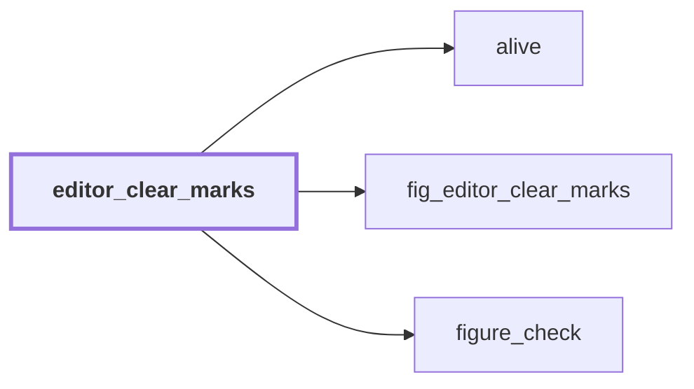

### editor_goto

Move the cursor to `line` (and `column`, default 1), clamped to the text, and scroll it into view at the next
 draw; with `focus`, give the editor the keyboard too. Statuses: `FIG_ERR_ARGUMENT` for a line or column below 1;
 `FIG_ERR_STATE` before `init` and from a task.

**Attributes**: recursive

```fortran
subroutine editor_goto(self, line, column, focus, stat)
```

**Arguments**

| Name | Type | Intent | Attributes | Description |
|------|------|--------|------------|-------------|
| `self` | class([code_editor_object](/api/src/lib/figure_editor#code-editor-object)) | inout |  | Editor. |
| `line` | integer(kind=int32) | in |  | Line, from 1. |
| `column` | integer(kind=int32) | in | optional | Column, from 1 [characters]. |
| `focus` | logical | in | optional | Give it the keyboard (default false). |
| `stat` | integer(kind=int32) | out | optional | Status. |

**Call graph**

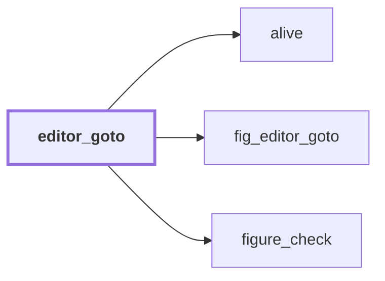

### editor_focus

Give the editor the keyboard at the next draw (as a click in it does). Statuses: `FIG_ERR_STATE` before `init`
 and from a task.

**Attributes**: recursive

```fortran
subroutine editor_focus(self, stat)
```

**Arguments**

| Name | Type | Intent | Attributes | Description |
|------|------|--------|------------|-------------|
| `self` | class([code_editor_object](/api/src/lib/figure_editor#code-editor-object)) | inout |  | Editor. |
| `stat` | integer(kind=int32) | out | optional | Status. |

**Call graph**

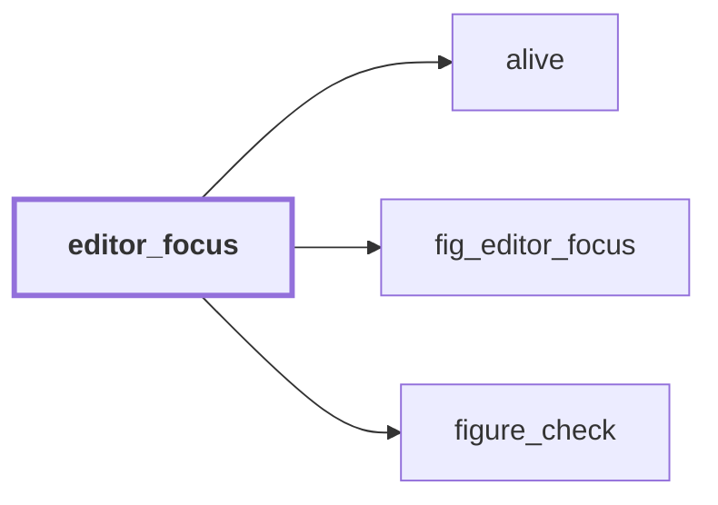

### editor_cursor

The cursor's line and column, from 1 (column in characters); 1, 1 before `init` and from a task.

**Attributes**: recursive

```fortran
subroutine editor_cursor(self, line, column)
```

**Arguments**

| Name | Type | Intent | Attributes | Description |
|------|------|--------|------------|-------------|
| `self` | class([code_editor_object](/api/src/lib/figure_editor#code-editor-object)) | in |  | Editor. |
| `line` | integer(kind=int32) | out |  | Line. |
| `column` | integer(kind=int32) | out |  | Column [characters]. |

**Call graph**

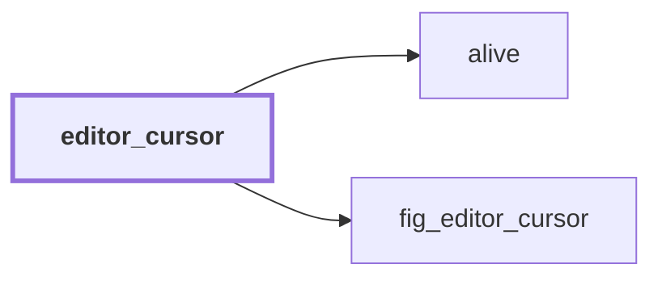

### editor_select

Select from (`first_line`, `first_column`) to just before (`last_line`, `last_column`) (from 1, clamped to the
 text). Statuses: `FIG_ERR_ARGUMENT` for a position below 1; `FIG_ERR_STATE` before `init` and from a task.

**Attributes**: recursive

```fortran
subroutine editor_select(self, first_line, first_column, last_line, last_column, stat)
```

**Arguments**

| Name | Type | Intent | Attributes | Description |
|------|------|--------|------------|-------------|
| `self` | class([code_editor_object](/api/src/lib/figure_editor#code-editor-object)) | inout |  | Editor. |
| `first_line` | integer(kind=int32) | in |  | First line. |
| `first_column` | integer(kind=int32) | in |  | First column [characters]. |
| `last_line` | integer(kind=int32) | in |  | Last line. |
| `last_column` | integer(kind=int32) | in |  | Column after the last [characters]. |
| `stat` | integer(kind=int32) | out | optional | Status. |

**Call graph**

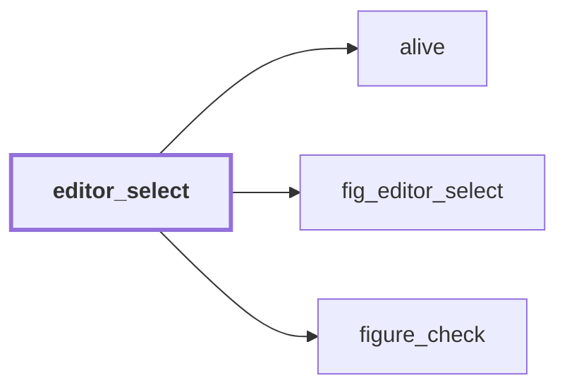

### editor_insert

Insert `text` at the cursor, in place of the selection if any, as one change (one undo); the cursor goes after it.
 Statuses: `FIG_ERR_STATE` for a read-only editor, before `init` and from a task.

**Attributes**: recursive

```fortran
subroutine editor_insert(self, text, stat)
```

**Arguments**

| Name | Type | Intent | Attributes | Description |
|------|------|--------|------------|-------------|
| `self` | class([code_editor_object](/api/src/lib/figure_editor#code-editor-object)) | inout |  | Editor. |
| `text` | character(len=*) | in |  | Text (UTF-8). |
| `stat` | integer(kind=int32) | out | optional | Status. |

**Call graph**

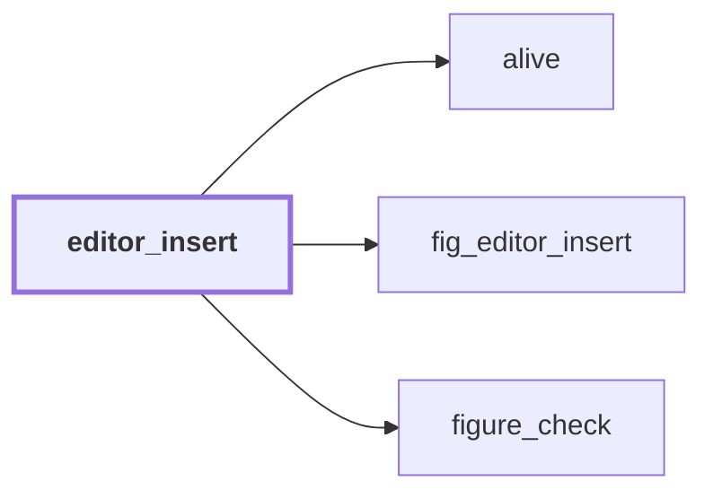

### editor_set_completions

The words completion offers (each trimmed of trailing blanks; none: completion off). While the user types a
 word, a popup under the cursor lists the words that start with it, then those that contain it, in this order
 and in any case; up and down choose, tab or enter inserts, escape closes it. In a key = value language a word
 may hold blanks and dashes (`'reynolds number'`): the term is then the line's text up to the cursor, its
 indentation kept. Not in comments and strings. Statuses: `FIG_ERR_STATE` before `init` and from a task.

**Attributes**: recursive

```fortran
subroutine editor_set_completions(self, words, stat)
```

**Arguments**

| Name | Type | Intent | Attributes | Description |
|------|------|--------|------------|-------------|
| `self` | class([code_editor_object](/api/src/lib/figure_editor#code-editor-object)) | inout |  | Editor. |
| `words` | character(len=*) | in |  | Words. |
| `stat` | integer(kind=int32) | out | optional | Status. |

**Call graph**

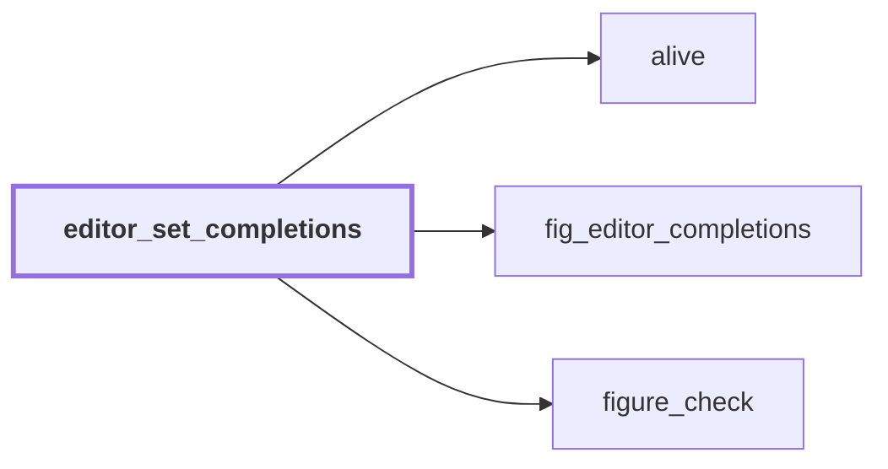

### editor_read_only

Make the editor read-only (`on` true: the user moves, selects and copies, nothing changes the text but
 `set_text`) or editable again. Statuses: `FIG_ERR_STATE` before `init` and from a task.

**Attributes**: recursive

```fortran
subroutine editor_read_only(self, on, stat)
```

**Arguments**

| Name | Type | Intent | Attributes | Description |
|------|------|--------|------------|-------------|
| `self` | class([code_editor_object](/api/src/lib/figure_editor#code-editor-object)) | inout |  | Editor. |
| `on` | logical | in |  | Read-only. |
| `stat` | integer(kind=int32) | out | optional | Status. |

**Call graph**

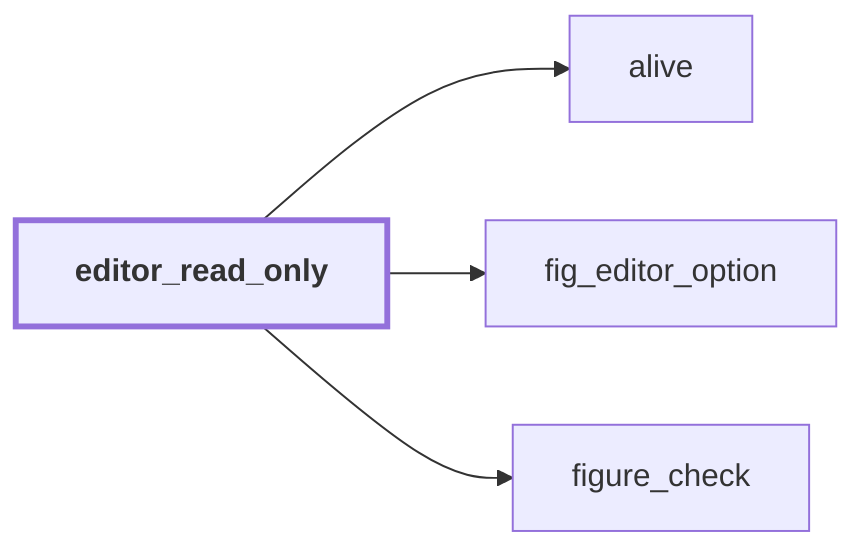

### editor_set_options

The editor's options: `line_numbers` shown (default true), `tab_size` [characters] in [1, 16] (default 4),
 `whitespace` shown as dots and arrows (default false), the current `line_highlight` (default true). Statuses:
 `FIG_ERR_ARGUMENT` for a tab size outside [1, 16]; `FIG_ERR_STATE` before `init` and from a task.

**Attributes**: recursive

```fortran
subroutine editor_set_options(self, line_numbers, tab_size, whitespace, line_highlight, stat)
```

**Arguments**

| Name | Type | Intent | Attributes | Description |
|------|------|--------|------------|-------------|
| `self` | class([code_editor_object](/api/src/lib/figure_editor#code-editor-object)) | inout |  | Editor. |
| `line_numbers` | logical | in | optional | Line numbers shown. |
| `tab_size` | integer(kind=int32) | in | optional | Tab size [characters]. |
| `whitespace` | logical | in | optional | Blanks and tabs shown. |
| `line_highlight` | logical | in | optional | The current line highlighted. |
| `stat` | integer(kind=int32) | out | optional | Status. |

**Call graph**

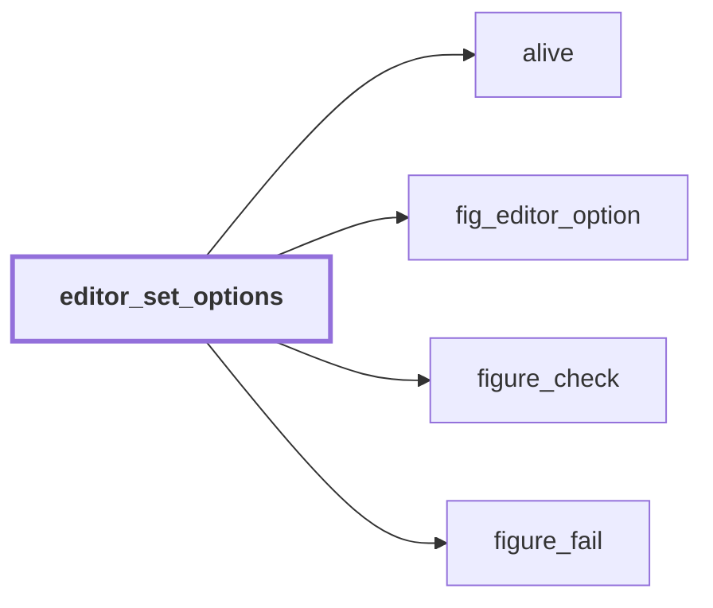

### code_diff

Draw the difference of two texts (UTF-8, lines ended by LF or CR LF) as a widget at the cursor, `width` x `height`
 pixels (0: the available region; negative: up to that distance from its edge), read-only, in IBM Plex Mono:
 one column with each removed line of `left` (tinted red, marked `-`) before the added line of `right` (green,
 `+`), or `side_by_side`. Lines compared whole, by the diff's algorithm (dtl, the shortest edit script). Drawn by
 id, as a widget: the comparison is made again only when a text or the language changes; a diff not drawn for 600
 frames is forgotten. Statuses: `FIG_ERR_ARGUMENT` for an empty id, `FIG_ERR_STATE` with no frame open and from a
 task. The same in every mode.

**Attributes**: recursive

```fortran
subroutine code_diff(id, left, right, side_by_side, language, width, height, stat)
```

**Arguments**

| Name | Type | Intent | Attributes | Description |
|------|------|--------|------------|-------------|
| `id` | character(len=*) | in |  | Widget id (unique in the window). |
| `left` | character(len=*) | in |  | The old text. |
| `right` | character(len=*) | in |  | The new text. |
| `side_by_side` | logical | in | optional | Two columns (default false: one). |
| `language` | type([language_object](/api/src/lib/figure_editor#language-object)) | in | optional | Highlighting (default plain text). |
| `width` | real(kind=real64) | in | optional | Width [pixels] (default 0: the available width). |
| `height` | real(kind=real64) | in | optional | Height [pixels] (default 0: the available height). |
| `stat` | integer(kind=int32) | out | optional | Status. |

**Call graph**

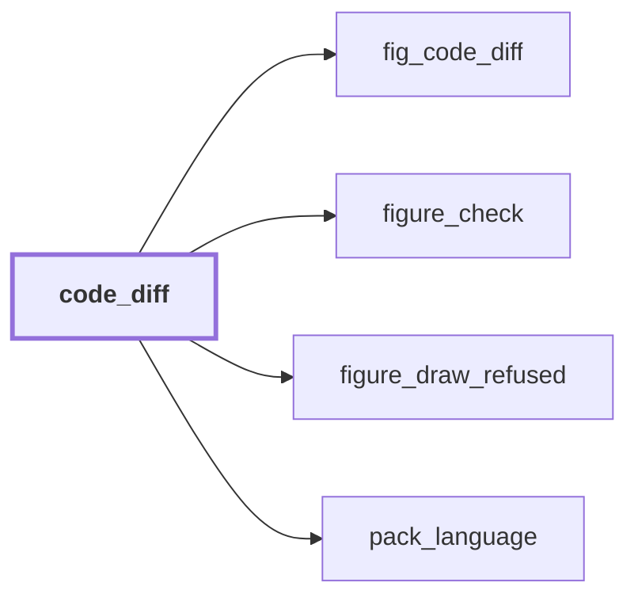

### code_diff_lines

The lines that differ between two texts, as `code_diff` shows them: `added`, the lines of `right` not in `left`,
 and `removed`, the lines of `left` not in `right` (from 1, ascending; a changed line is one of each). No frame
 needed, any mode; a task may call it. Status: always `FIG_OK` (`FIG_ERR_EXCEPTION` if the native layer fails).

**Attributes**: recursive

```fortran
subroutine code_diff_lines(left, right, added, removed, stat)
```

**Arguments**

| Name | Type | Intent | Attributes | Description |
|------|------|--------|------------|-------------|
| `left` | character(len=*) | in |  | The old text. |
| `right` | character(len=*) | in |  | The new text. |
| `added` | integer(kind=int32) | out | allocatable | Lines of `right` added. |
| `removed` | integer(kind=int32) | out | allocatable | Lines of `left` removed. |
| `stat` | integer(kind=int32) | out | optional | Status. |

**Call graph**

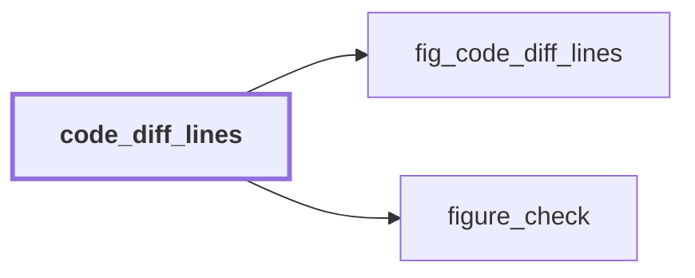

### joined

`words`, each trimmed, joined by LF into `all`; false for an empty word or one with a blank, LF or US inside.

**Attributes**: pure

```fortran
subroutine joined(words, all, ok)
```

**Arguments**

| Name | Type | Intent | Attributes | Description |
|------|------|--------|------------|-------------|
| `words` | character(len=*) | in |  | Words. |
| `all` | character(len=:) | out | allocatable | Joined. |
| `ok` | logical | out |  | All valid. |

**Call graph**

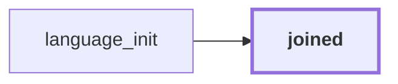

### split_lines

`text`'s LF-separated parts, blank-padded to the longest.

**Attributes**: pure

```fortran
subroutine split_lines(text, lines)
```

**Arguments**

| Name | Type | Intent | Attributes | Description |
|------|------|--------|------------|-------------|
| `text` | character(len=*) | in |  | Text. |
| `lines` | character(len=:) | out | allocatable | Parts. |

**Call graph**

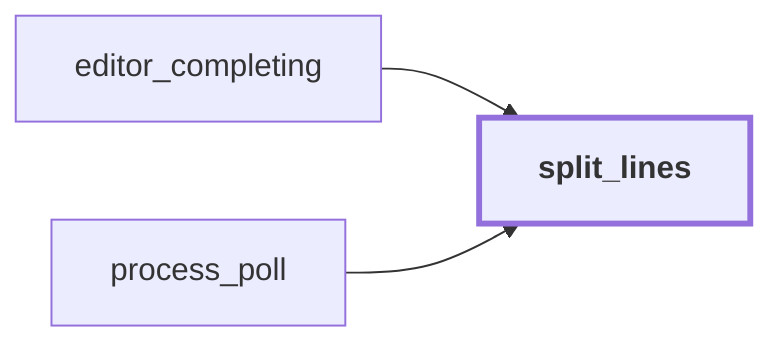

## Functions

### language_name

The language's name (`''` for plain text).

**Attributes**: pure

**Returns**: `character(len=:)`

```fortran
function language_name(self) result(name)
```

**Arguments**

| Name | Type | Intent | Attributes | Description |
|------|------|--------|------------|-------------|
| `self` | class([language_object](/api/src/lib/figure_editor#language-object)) | in |  | Language. |

### code_language

A shipped language by name, in any case: `'fortran'` (free form, any case, `!` comments, both quotes, kinds and
 exponents in numbers, `#` preprocessor lines), `'input'` (key = value files: `[section]` lines, keys, `!` and `#`
 comments, the words `true`, `false`, `yes`, `no`, `on`, `off`), `'text'` or `''` (plain), and the fork's own:
 `'angelscript'`, `'c'`, `'c++'`, `'c#'`, `'glsl'`, `'hlsl'`, `'json'`, `'julia'`, `'lua'`, `'markdown'`,
 `'python'`, `'sql'`, `'wgsl'`. Status: `FIG_ERR_ARGUMENT` for another name (plain text returned). Any thread.

**Attributes**: recursive

**Returns**: type([language_object](/api/src/lib/figure_editor#language-object))

```fortran
function code_language(name, stat) result(lang)
```

**Arguments**

| Name | Type | Intent | Attributes | Description |
|------|------|--------|------------|-------------|
| `name` | character(len=*) | in |  | Language name. |
| `stat` | integer(kind=int32) | out | optional | Status. |

**Call graph**

```mermaid
flowchart LR
  code_language["code_language"] --> figure_fail["figure_fail"]
  code_language["code_language"] --> fortran_keywords["fortran_keywords"]
  code_language["code_language"] --> fortran_types["fortran_types"]
  code_language["code_language"] --> init["init"]
  code_language["code_language"] --> lower["lower"]
  classDef focus stroke-width:3px,font-weight:bold
  class code_language focus
  click lower href "#lower" "lower"
  click init href "figure_app.html#init" "init"
  click fortran_keywords href "#fortran-keywords" "fortran_keywords"
  click fortran_types href "#fortran-types" "fortran_types"
  click figure_fail href "figure_base.html#figure-fail" "figure_fail"
```

### editor_is_initialized

Whether the editor exists.

**Attributes**: pure

**Returns**: `logical`

```fortran
function editor_is_initialized(self) result(yes)
```

**Arguments**

| Name | Type | Intent | Attributes | Description |
|------|------|--------|------------|-------------|
| `self` | class([code_editor_object](/api/src/lib/figure_editor#code-editor-object)) | in |  | Editor. |

### editor_text

The text, its lines joined by LF (no LF after the last). `''` before `init` and from a task.

**Attributes**: recursive

**Returns**: `character(len=:)`

```fortran
function editor_text(self) result(t)
```

**Arguments**

| Name | Type | Intent | Attributes | Description |
|------|------|--------|------------|-------------|
| `self` | class([code_editor_object](/api/src/lib/figure_editor#code-editor-object)) | in |  | Editor. |

**Call graph**

```mermaid
flowchart LR
  editor_text["editor_text"] --> editor_string["editor_string"]
  classDef focus stroke-width:3px,font-weight:bold
  class editor_text focus
  click editor_string href "#editor-string" "editor_string"
```

### editor_line_count

The number of lines (1 for an empty text; 0 before `init` and from a task).

**Attributes**: recursive

**Returns**: `integer(kind=int32)`

```fortran
function editor_line_count(self) result(n)
```

**Arguments**

| Name | Type | Intent | Attributes | Description |
|------|------|--------|------------|-------------|
| `self` | class([code_editor_object](/api/src/lib/figure_editor#code-editor-object)) | in |  | Editor. |

**Call graph**

```mermaid
flowchart LR
  editor_line_count["editor_line_count"] --> alive["alive"]
  editor_line_count["editor_line_count"] --> fig_editor_info["fig_editor_info"]
  classDef focus stroke-width:3px,font-weight:bold
  class editor_line_count focus
  click alive href "#alive" "alive"
  click fig_editor_info href "#fig-editor-info" "fig_editor_info"
```

### editor_draw

Draw the editor as a widget at the cursor, inside a window, `width` x `height` pixels (0: the available region;
 negative: up to that distance from its edge), in IBM Plex Mono at the current font size with the fallback font's
 symbols (they keep their own width: they may overlap the next character), and the style's colours. True on the
 frame the user changed the text (typing, a paste, undo, a completion: not `set_text`, `insert` or `replace`).
 The mouse and the keyboard as in a code editor (a click places the cursor, a drag selects, ctrl+click adds a
 cursor); the wheel scrolls. Statuses: `FIG_ERR_ARGUMENT` for an empty id; `FIG_ERR_STATE` before `init`, with no
 frame open, from a task. The same in every mode.

**Attributes**: recursive

**Returns**: `logical`

```fortran
function editor_draw(self, id, width, height, stat) result(changed)
```

**Arguments**

| Name | Type | Intent | Attributes | Description |
|------|------|--------|------------|-------------|
| `self` | class([code_editor_object](/api/src/lib/figure_editor#code-editor-object)) | inout |  | Editor. |
| `id` | character(len=*) | in |  | Widget id (unique in the window). |
| `width` | real(kind=real64) | in | optional | Width [pixels] (default 0: the available width). |
| `height` | real(kind=real64) | in | optional | Height [pixels] (default 0: the available height). |
| `stat` | integer(kind=int32) | out | optional | Status. |

**Call graph**

```mermaid
flowchart LR
  editor_draw["editor_draw"] --> alive["alive"]
  editor_draw["editor_draw"] --> fig_editor_draw["fig_editor_draw"]
  editor_draw["editor_draw"] --> figure_check["figure_check"]
  editor_draw["editor_draw"] --> figure_draw_refused["figure_draw_refused"]
  classDef focus stroke-width:3px,font-weight:bold
  class editor_draw focus
  click figure_draw_refused href "figure_base.html#figure-draw-refused" "figure_draw_refused"
  click alive href "#alive" "alive"
  click figure_check href "figure_base.html#figure-check" "figure_check"
  click fig_editor_draw href "#fig-editor-draw" "fig_editor_draw"
```

### editor_mark_of

The severity of the mark on `line` (`'error'`, `'warning'`, `'info'`; `''` for none, a line out of range, before
 `init` and from a task), and its message as its tooltip shows it (each message after its severity's word, LF
 between two).

**Attributes**: recursive

**Returns**: `character(len=:)`

```fortran
function editor_mark_of(self, line, message) result(severity)
```

**Arguments**

| Name | Type | Intent | Attributes | Description |
|------|------|--------|------------|-------------|
| `self` | class([code_editor_object](/api/src/lib/figure_editor#code-editor-object)) | in |  | Editor. |
| `line` | integer(kind=int32) | in |  | Line, from 1. |
| `message` | character(len=:) | out | allocatable, optional | Its message. |

**Call graph**

```mermaid
flowchart LR
  editor_mark_of["editor_mark_of"] --> alive["alive"]
  editor_mark_of["editor_mark_of"] --> fig_editor_mark_of["fig_editor_mark_of"]
  classDef focus stroke-width:3px,font-weight:bold
  class editor_mark_of focus
  click alive href "#alive" "alive"
  click fig_editor_mark_of href "#fig-editor-mark-of" "fig_editor_mark_of"
```

### editor_find

Select the next occurrence of `text` after the cursor, from the start again past the end, and scroll it into view
 at the next draw. True when found (the selection is then `text`). Statuses: `FIG_ERR_ARGUMENT` for an empty
 text; `FIG_ERR_STATE` before `init` and from a task.

**Attributes**: recursive

**Returns**: `logical`

```fortran
function editor_find(self, text, case_sensitive, whole_word, stat) result(found)
```

**Arguments**

| Name | Type | Intent | Attributes | Description |
|------|------|--------|------------|-------------|
| `self` | class([code_editor_object](/api/src/lib/figure_editor#code-editor-object)) | inout |  | Editor. |
| `text` | character(len=*) | in |  | Text to find. |
| `case_sensitive` | logical | in | optional | By case (default true). |
| `whole_word` | logical | in | optional | Whole words only (default false). |
| `stat` | integer(kind=int32) | out | optional | Status. |

**Call graph**

```mermaid
flowchart LR
  editor_find["editor_find"] --> alive["alive"]
  editor_find["editor_find"] --> fig_editor_find["fig_editor_find"]
  editor_find["editor_find"] --> figure_check["figure_check"]
  classDef focus stroke-width:3px,font-weight:bold
  class editor_find focus
  click alive href "#alive" "alive"
  click figure_check href "figure_base.html#figure-check" "figure_check"
  click fig_editor_find href "#fig-editor-find" "fig_editor_find"
```

### editor_replace

Replace every occurrence of `text` by `by`, as one change (one undo), and return how many were replaced. Statuses:
 `FIG_ERR_ARGUMENT` for an empty text; `FIG_ERR_STATE` for a read-only editor, before `init` and from a task.

**Attributes**: recursive

**Returns**: `integer(kind=int32)`

```fortran
function editor_replace(self, text, by, case_sensitive, whole_word, stat) result(count)
```

**Arguments**

| Name | Type | Intent | Attributes | Description |
|------|------|--------|------------|-------------|
| `self` | class([code_editor_object](/api/src/lib/figure_editor#code-editor-object)) | inout |  | Editor. |
| `text` | character(len=*) | in |  | Text to replace. |
| `by` | character(len=*) | in |  | Its replacement. |
| `case_sensitive` | logical | in | optional | By case (default true). |
| `whole_word` | logical | in | optional | Whole words only (default false). |
| `stat` | integer(kind=int32) | out | optional | Status. |

**Call graph**

```mermaid
flowchart LR
  editor_replace["editor_replace"] --> alive["alive"]
  editor_replace["editor_replace"] --> fig_editor_replace["fig_editor_replace"]
  editor_replace["editor_replace"] --> figure_check["figure_check"]
  classDef focus stroke-width:3px,font-weight:bold
  class editor_replace focus
  click alive href "#alive" "alive"
  click figure_check href "figure_base.html#figure-check" "figure_check"
  click fig_editor_replace href "#fig-editor-replace" "fig_editor_replace"
```

### editor_selection

The selection: true when some text is selected, from (`first_line`, `first_column`) to just before
 (`last_line`, `last_column`), from 1, columns in characters, and its `text`; false otherwise (the four positions
 are then the cursor's). False before `init` and from a task.

**Attributes**: recursive

**Returns**: `logical`

```fortran
function editor_selection(self, first_line, first_column, last_line, last_column, text) result(has)
```

**Arguments**

| Name | Type | Intent | Attributes | Description |
|------|------|--------|------------|-------------|
| `self` | class([code_editor_object](/api/src/lib/figure_editor#code-editor-object)) | in |  | Editor. |
| `first_line` | integer(kind=int32) | out |  | First line. |
| `first_column` | integer(kind=int32) | out |  | First column [characters]. |
| `last_line` | integer(kind=int32) | out |  | Last line. |
| `last_column` | integer(kind=int32) | out |  | Column after the last [characters]. |
| `text` | character(len=:) | out | allocatable, optional | The selected text. |

**Call graph**

```mermaid
flowchart LR
  editor_selection["editor_selection"] --> alive["alive"]
  editor_selection["editor_selection"] --> editor_string["editor_string"]
  editor_selection["editor_selection"] --> fig_editor_selection["fig_editor_selection"]
  classDef focus stroke-width:3px,font-weight:bold
  class editor_selection focus
  click alive href "#alive" "alive"
  click fig_editor_selection href "#fig-editor-selection" "fig_editor_selection"
  click editor_string href "#editor-string" "editor_string"
```

### editor_word_at_cursor

The word (letters, digits, `_`) the cursor is in or just after; `''` when none, before `init` and from a task.

**Attributes**: recursive

**Returns**: `character(len=:)`

```fortran
function editor_word_at_cursor(self) result(word)
```

**Arguments**

| Name | Type | Intent | Attributes | Description |
|------|------|--------|------------|-------------|
| `self` | class([code_editor_object](/api/src/lib/figure_editor#code-editor-object)) | in |  | Editor. |

**Call graph**

```mermaid
flowchart LR
  editor_word_at_cursor["editor_word_at_cursor"] --> editor_string["editor_string"]
  classDef focus stroke-width:3px,font-weight:bold
  class editor_word_at_cursor focus
  click editor_string href "#editor-string" "editor_string"
```

### editor_completing

True while the completion popup is open (from the frame after the typing that opened it), with the `words` it
 offers in its order (blank-padded to the longest). False before `init` and from a task.

**Attributes**: recursive

**Returns**: `logical`

```fortran
function editor_completing(self, words) result(open)
```

**Arguments**

| Name | Type | Intent | Attributes | Description |
|------|------|--------|------------|-------------|
| `self` | class([code_editor_object](/api/src/lib/figure_editor#code-editor-object)) | in |  | Editor. |
| `words` | character(len=:) | out | allocatable, optional | Words offered. |

**Call graph**

```mermaid
flowchart LR
  editor_completing["editor_completing"] --> alive["alive"]
  editor_completing["editor_completing"] --> editor_string["editor_string"]
  editor_completing["editor_completing"] --> fig_editor_completing["fig_editor_completing"]
  editor_completing["editor_completing"] --> split_lines["split_lines"]
  classDef focus stroke-width:3px,font-weight:bold
  class editor_completing focus
  click alive href "#alive" "alive"
  click fig_editor_completing href "#fig-editor-completing" "fig_editor_completing"
  click split_lines href "#split-lines" "split_lines"
  click editor_string href "#editor-string" "editor_string"
```

### editor_is_read_only

Whether the editor is read-only (false before `init` and from a task).

**Attributes**: recursive

**Returns**: `logical`

```fortran
function editor_is_read_only(self) result(on)
```

**Arguments**

| Name | Type | Intent | Attributes | Description |
|------|------|--------|------------|-------------|
| `self` | class([code_editor_object](/api/src/lib/figure_editor#code-editor-object)) | in |  | Editor. |

**Call graph**

```mermaid
flowchart LR
  editor_is_read_only["editor_is_read_only"] --> alive["alive"]
  editor_is_read_only["editor_is_read_only"] --> fig_editor_option["fig_editor_option"]
  classDef focus stroke-width:3px,font-weight:bold
  class editor_is_read_only focus
  click alive href "#alive" "alive"
  click fig_editor_option href "#fig-editor-option" "fig_editor_option"
```

### editor_undo

Undo the last change (as ctrl+z): true if there was one. Nothing in a read-only editor. Statuses: `FIG_ERR_STATE`
 before `init` and from a task.

**Attributes**: recursive

**Returns**: `logical`

```fortran
function editor_undo(self, stat) result(done)
```

**Arguments**

| Name | Type | Intent | Attributes | Description |
|------|------|--------|------------|-------------|
| `self` | class([code_editor_object](/api/src/lib/figure_editor#code-editor-object)) | inout |  | Editor. |
| `stat` | integer(kind=int32) | out | optional | Status. |

**Call graph**

```mermaid
flowchart LR
  editor_undo["editor_undo"] --> alive["alive"]
  editor_undo["editor_undo"] --> fig_editor_undo["fig_editor_undo"]
  editor_undo["editor_undo"] --> figure_check["figure_check"]
  classDef focus stroke-width:3px,font-weight:bold
  class editor_undo focus
  click alive href "#alive" "alive"
  click figure_check href "figure_base.html#figure-check" "figure_check"
  click fig_editor_undo href "#fig-editor-undo" "fig_editor_undo"
```

### editor_redo

Redo the last undone change (as ctrl+y): true if there was one. Statuses: `FIG_ERR_STATE` before `init` and from
 a task.

**Attributes**: recursive

**Returns**: `logical`

```fortran
function editor_redo(self, stat) result(done)
```

**Arguments**

| Name | Type | Intent | Attributes | Description |
|------|------|--------|------------|-------------|
| `self` | class([code_editor_object](/api/src/lib/figure_editor#code-editor-object)) | inout |  | Editor. |
| `stat` | integer(kind=int32) | out | optional | Status. |

**Call graph**

```mermaid
flowchart LR
  editor_redo["editor_redo"] --> alive["alive"]
  editor_redo["editor_redo"] --> fig_editor_undo["fig_editor_undo"]
  editor_redo["editor_redo"] --> figure_check["figure_check"]
  classDef focus stroke-width:3px,font-weight:bold
  class editor_redo focus
  click alive href "#alive" "alive"
  click figure_check href "figure_base.html#figure-check" "figure_check"
  click fig_editor_undo href "#fig-editor-undo" "fig_editor_undo"
```

### editor_line_rect

The rectangle [pixels] of `line`'s text area on the last draw, from the left of the text to the right of the
 editor (for a popup beside a line, or a test): true when the line was in view. False before the first draw,
 before `init` and from a task.

**Attributes**: recursive

**Returns**: `logical`

```fortran
function editor_line_rect(self, line, x0, y0, x1, y1) result(visible)
```

**Arguments**

| Name | Type | Intent | Attributes | Description |
|------|------|--------|------------|-------------|
| `self` | class([code_editor_object](/api/src/lib/figure_editor#code-editor-object)) | in |  | Editor. |
| `line` | integer(kind=int32) | in |  | Line, from 1. |
| `x0` | real(kind=real64) | out |  | Left [pixels]. |
| `y0` | real(kind=real64) | out |  | Top [pixels]. |
| `x1` | real(kind=real64) | out |  | Right [pixels]. |
| `y1` | real(kind=real64) | out |  | Bottom [pixels]. |

**Call graph**

```mermaid
flowchart LR
  editor_line_rect["editor_line_rect"] --> alive["alive"]
  editor_line_rect["editor_line_rect"] --> fig_editor_line_rect["fig_editor_line_rect"]
  classDef focus stroke-width:3px,font-weight:bold
  class editor_line_rect focus
  click alive href "#alive" "alive"
  click fig_editor_line_rect href "#fig-editor-line-rect" "fig_editor_line_rect"
```

### alive

True when the editor exists and the caller is on the main thread; else the refusal (`FIG_ERR_STATE`), silent for a
 query (`quiet`: its default value is the answer).

**Attributes**: recursive

**Returns**: `logical`

```fortran
function alive(self, name, stat, quiet) result(ok)
```

**Arguments**

| Name | Type | Intent | Attributes | Description |
|------|------|--------|------------|-------------|
| `self` | class([code_editor_object](/api/src/lib/figure_editor#code-editor-object)) | in |  | Editor. |
| `name` | character(len=*) | in |  | The method. |
| `stat` | integer(kind=int32) | out | optional | Status. |
| `quiet` | logical | in | optional | A query: no failure before `init`. |

**Call graph**

```mermaid
flowchart LR
  add_mesh["add_mesh"] --> alive["alive"]
  changed["changed"] --> alive["alive"]
  clear["clear"] --> alive["alive"]
  clip["clip"] --> alive["alive"]
  draw["draw"] --> alive["alive"]
  editor_clear_marks["editor_clear_marks"] --> alive["alive"]
  editor_completing["editor_completing"] --> alive["alive"]
  editor_cursor["editor_cursor"] --> alive["alive"]
  editor_draw["editor_draw"] --> alive["alive"]
  editor_find["editor_find"] --> alive["alive"]
  editor_focus["editor_focus"] --> alive["alive"]
  editor_goto["editor_goto"] --> alive["alive"]
  editor_insert["editor_insert"] --> alive["alive"]
  editor_is_read_only["editor_is_read_only"] --> alive["alive"]
  editor_line_count["editor_line_count"] --> alive["alive"]
  editor_line_rect["editor_line_rect"] --> alive["alive"]
  editor_mark["editor_mark"] --> alive["alive"]
  editor_mark_of["editor_mark_of"] --> alive["alive"]
  editor_read_only["editor_read_only"] --> alive["alive"]
  editor_redo["editor_redo"] --> alive["alive"]
  editor_replace["editor_replace"] --> alive["alive"]
  editor_select["editor_select"] --> alive["alive"]
  editor_selection["editor_selection"] --> alive["alive"]
  editor_set_completions["editor_set_completions"] --> alive["alive"]
  editor_set_language["editor_set_language"] --> alive["alive"]
  editor_set_options["editor_set_options"] --> alive["alive"]
  editor_set_text["editor_set_text"] --> alive["alive"]
  editor_string["editor_string"] --> alive["alive"]
  editor_undo["editor_undo"] --> alive["alive"]
  fit["fit"] --> alive["alive"]
  get_camera["get_camera"] --> alive["alive"]
  gizmo["gizmo"] --> alive["alive"]
  image["image"] --> alive["alive"]
  orbit["orbit"] --> alive["alive"]
  pan["pan"] --> alive["alive"]
  projection_matrix["projection_matrix"] --> alive["alive"]
  query["query"] --> alive["alive"]
  remove["remove"] --> alive["alive"]
  render_info["render_info"] --> alive["alive"]
  set_camera["set_camera"] --> alive["alive"]
  set_mesh["set_mesh"] --> alive["alive"]
  unclip["unclip"] --> alive["alive"]
  view["view"] --> alive["alive"]
  view_cube["view_cube"] --> alive["alive"]
  view_current_match["view_current_match"] --> alive["alive"]
  view_draw["view_draw"] --> alive["alive"]
  view_find["view_find"] --> alive["alive"]
  view_load["view_load"] --> alive["alive"]
  view_matches["view_matches"] --> alive["alive"]
  view_matrix["view_matrix"] --> alive["alive"]
  view_scroll_to["view_scroll_to"] --> alive["alive"]
  view_set_text["view_set_text"] --> alive["alive"]
  view_text["view_text"] --> alive["alive"]
  zoom["zoom"] --> alive["alive"]
  alive["alive"] --> figure_fail["figure_fail"]
  alive["alive"] --> figure_refused["figure_refused"]
  classDef focus stroke-width:3px,font-weight:bold
  class alive focus
  click add_mesh href "figure_view3d.html#add-mesh" "add_mesh"
  click changed href "figure_view3d.html#changed" "changed"
  click clear href "figure_view3d.html#clear" "clear"
  click clip href "figure_view3d.html#clip" "clip"
  click draw href "figure_canvas.html#draw" "draw"
  click editor_clear_marks href "#editor-clear-marks" "editor_clear_marks"
  click editor_completing href "#editor-completing" "editor_completing"
  click editor_cursor href "#editor-cursor" "editor_cursor"
  click editor_draw href "#editor-draw" "editor_draw"
  click editor_find href "#editor-find" "editor_find"
  click editor_focus href "#editor-focus" "editor_focus"
  click editor_goto href "#editor-goto" "editor_goto"
  click editor_insert href "#editor-insert" "editor_insert"
  click editor_is_read_only href "#editor-is-read-only" "editor_is_read_only"
  click editor_line_count href "#editor-line-count" "editor_line_count"
  click editor_line_rect href "#editor-line-rect" "editor_line_rect"
  click editor_mark href "#editor-mark" "editor_mark"
  click editor_mark_of href "#editor-mark-of" "editor_mark_of"
  click editor_read_only href "#editor-read-only" "editor_read_only"
  click editor_redo href "#editor-redo" "editor_redo"
  click editor_replace href "#editor-replace" "editor_replace"
  click editor_select href "#editor-select" "editor_select"
  click editor_selection href "#editor-selection" "editor_selection"
  click editor_set_completions href "#editor-set-completions" "editor_set_completions"
  click editor_set_language href "#editor-set-language" "editor_set_language"
  click editor_set_options href "#editor-set-options" "editor_set_options"
  click editor_set_text href "#editor-set-text" "editor_set_text"
  click editor_string href "#editor-string" "editor_string"
  click editor_undo href "#editor-undo" "editor_undo"
  click fit href "figure_view3d.html#fit" "fit"
  click get_camera href "figure_view3d.html#get-camera" "get_camera"
  click gizmo href "figure_view3d.html#gizmo" "gizmo"
  click image href "figure_view3d.html#image" "image"
  click orbit href "figure_view3d.html#orbit" "orbit"
  click pan href "figure_view3d.html#pan" "pan"
  click projection_matrix href "figure_view3d.html#projection-matrix" "projection_matrix"
  click query href "figure_view3d.html#query" "query"
  click remove href "figure_view3d.html#remove" "remove"
  click render_info href "figure_view3d.html#render-info" "render_info"
  click set_camera href "figure_view3d.html#set-camera" "set_camera"
  click set_mesh href "figure_view3d.html#set-mesh" "set_mesh"
  click unclip href "figure_view3d.html#unclip" "unclip"
  click view href "figure_view3d.html#view" "view"
  click view_cube href "figure_view3d.html#view-cube" "view_cube"
  click view_current_match href "figure_markdown.html#view-current-match" "view_current_match"
  click view_draw href "figure_markdown.html#view-draw" "view_draw"
  click view_find href "figure_markdown.html#view-find" "view_find"
  click view_load href "figure_markdown.html#view-load" "view_load"
  click view_matches href "figure_markdown.html#view-matches" "view_matches"
  click view_matrix href "figure_view3d.html#view-matrix" "view_matrix"
  click view_scroll_to href "figure_markdown.html#view-scroll-to" "view_scroll_to"
  click view_set_text href "figure_markdown.html#view-set-text" "view_set_text"
  click view_text href "figure_markdown.html#view-text" "view_text"
  click zoom href "figure_view3d.html#zoom" "zoom"
  click figure_refused href "figure_base.html#figure-refused" "figure_refused"
  click figure_fail href "figure_base.html#figure-fail" "figure_fail"
```

### editor_string

One of the editor's texts (fig_editor_string): '' before `init` and from a task.

**Attributes**: recursive

**Returns**: `character(len=:)`

```fortran
function editor_string(self, what) result(t)
```

**Arguments**

| Name | Type | Intent | Attributes | Description |
|------|------|--------|------------|-------------|
| `self` | class([code_editor_object](/api/src/lib/figure_editor#code-editor-object)) | in |  | Editor. |
| `what` | integer(kind=c_int) | in |  | 0 text, 1 word, 2 selection, 3 offered. |

**Call graph**

```mermaid
flowchart LR
  editor_completing["editor_completing"] --> editor_string["editor_string"]
  editor_selection["editor_selection"] --> editor_string["editor_string"]
  editor_text["editor_text"] --> editor_string["editor_string"]
  editor_word_at_cursor["editor_word_at_cursor"] --> editor_string["editor_string"]
  editor_string["editor_string"] --> alive["alive"]
  editor_string["editor_string"] --> fig_editor_string["fig_editor_string"]
  classDef focus stroke-width:3px,font-weight:bold
  class editor_string focus
  click editor_completing href "#editor-completing" "editor_completing"
  click editor_selection href "#editor-selection" "editor_selection"
  click editor_text href "#editor-text" "editor_text"
  click editor_word_at_cursor href "#editor-word-at-cursor" "editor_word_at_cursor"
  click alive href "#alive" "alive"
  click fig_editor_string href "#fig-editor-string" "fig_editor_string"
```

### pack_language

The language's definition for the native layer (fields separated by US; '' for plain text).

**Attributes**: pure

**Returns**: `character(len=:)`

```fortran
function pack_language(lang) result(packed)
```

**Arguments**

| Name | Type | Intent | Attributes | Description |
|------|------|--------|------------|-------------|
| `lang` | type([language_object](/api/src/lib/figure_editor#language-object)) | in |  | Language. |

**Call graph**

```mermaid
flowchart LR
  code_diff["code_diff"] --> pack_language["pack_language"]
  editor_set_language["editor_set_language"] --> pack_language["pack_language"]
  classDef focus stroke-width:3px,font-weight:bold
  class pack_language focus
  click code_diff href "#code-diff" "code_diff"
  click editor_set_language href "#editor-set-language" "editor_set_language"
```

### lower

`s` in lower case (ASCII letters).

**Attributes**: pure

**Returns**: `character(len=len)`

```fortran
function lower(s) result(l)
```

**Arguments**

| Name | Type | Intent | Attributes | Description |
|------|------|--------|------------|-------------|
| `s` | character(len=*) | in |  | String. |

**Call graph**

```mermaid
flowchart LR
  code_language["code_language"] --> lower["lower"]
  classDef focus stroke-width:3px,font-weight:bold
  class lower focus
  click code_language href "#code-language" "code_language"
```

### fortran_keywords

Fortran 2023's statements, constructs and operators (the keywords' colour).

**Attributes**: pure

**Returns**: `character(len=16)`

```fortran
function fortran_keywords() result(k)
```

**Call graph**

```mermaid
flowchart LR
  code_language["code_language"] --> fortran_keywords["fortran_keywords"]
  classDef focus stroke-width:3px,font-weight:bold
  class fortran_keywords focus
  click code_language href "#code-language" "code_language"
```

### fortran_types

Fortran's intrinsic types and attributes (the types' colour).

**Attributes**: pure

**Returns**: `character(len=16)`

```fortran
function fortran_types() result(t)
```

**Call graph**

```mermaid
flowchart LR
  code_language["code_language"] --> fortran_types["fortran_types"]
  classDef focus stroke-width:3px,font-weight:bold
  class fortran_types focus
  click code_language href "#code-language" "code_language"
```
