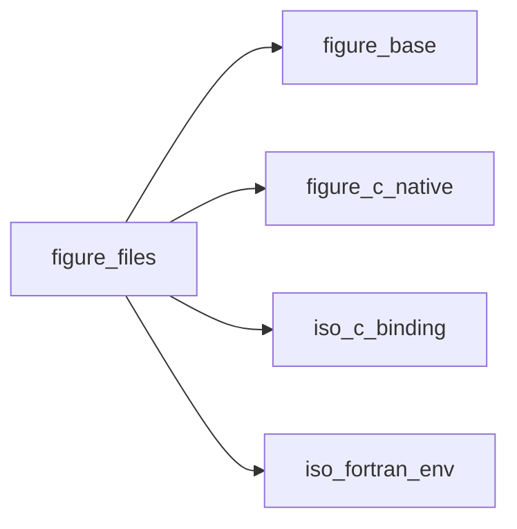
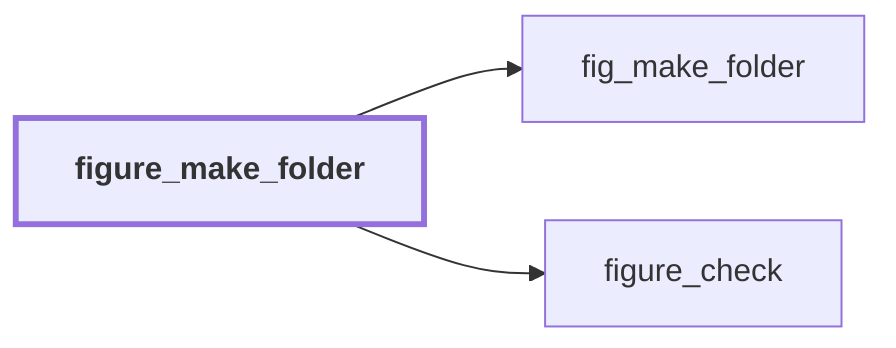
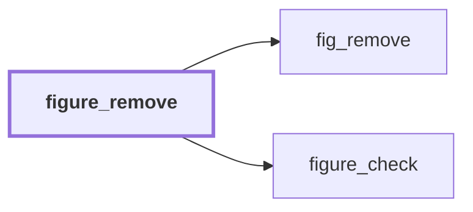
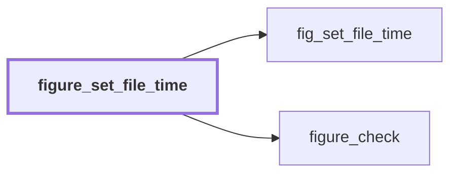
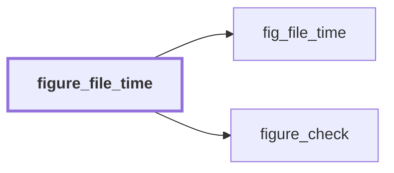

# figure_files

> figure_files, files and folders: make, remove, time, test, the same on every platform.

 Standard Fortran opens, reads and writes files, and `inquire` tests a file, but it has no way to make a folder,
 remove one, or set a file's time; `execute_command_line` with `mkdir -p` or `touch` works where a POSIX shell
 runs it, not on Windows, where it runs `cmd.exe`. These procedures do it in the native layer (C++'s
 `std::filesystem`, the system's file times), the same on Linux, macOS and Windows. Paths are UTF-8, with `/`
 separators (also `\` on Windows); a relative path is taken from the working folder. Any thread, any time (no
 `init*` needed).

**Source**: `src/lib/figure_files.F90`

**Dependencies**



## Contents

- [figure_make_folder](#figure-make-folder)
- [figure_remove](#figure-remove)
- [figure_set_file_time](#figure-set-file-time)
- [figure_file_time](#figure-file-time)
- [figure_file_exists](#figure-file-exists)

## Subroutines

### figure_make_folder

Make the folder `path`, and its missing parents unless `parents=.false.`; a folder already there is no error,
 a file there is (`FIG_ERR_FAILED`).

**Attributes**: recursive

```fortran
subroutine figure_make_folder(path, parents, stat)
```

**Arguments**

| Name | Type | Intent | Attributes | Description |
|------|------|--------|------------|-------------|
| `path` | character(len=*) | in |  | Folder. |
| `parents` | logical | in | optional | Make the missing parents (default `.true.`, as `mkdir -p`). |
| `stat` | integer(kind=int32) | out | optional | `FIG_ERR_ARGUMENT` for an empty path. |

**Call graph**



### figure_remove

Remove the file or empty folder `path`, or with `recursive=.true.` a folder and everything in it; a path that
 does not exist is no error (as `rm -f`), so a program clears without testing first.

**Attributes**: recursive

```fortran
subroutine figure_remove(path, recursive, stat)
```

**Arguments**

| Name | Type | Intent | Attributes | Description |
|------|------|--------|------------|-------------|
| `path` | character(len=*) | in |  | File or folder. |
| `recursive` | logical | in | optional | Remove a folder's content too (default `.false.`). |
| `stat` | integer(kind=int32) | out | optional | folder not empty), `FIG_ERR_ARGUMENT` for an empty path. |

**Call graph**



### figure_set_file_time

Set the modification time of the file or folder `path` to `time`, a local time `'YYYY-MM-DD hh:mm'` or
 `'YYYY-MM-DD hh:mm:ss'` (as `touch -t`): a listing shows the same time on every machine set to that time zone.

**Attributes**: recursive

```fortran
subroutine figure_set_file_time(path, time, stat)
```

**Arguments**

| Name | Type | Intent | Attributes | Description |
|------|------|--------|------------|-------------|
| `path` | character(len=*) | in |  | File or folder. |
| `time` | character(len=*) | in |  | Local time, `'YYYY-MM-DD hh:mm[:ss]'`. |
| `stat` | integer(kind=int32) | out | optional | a date, `FIG_ERR_FAILED` for a path that cannot be set. |

**Call graph**



## Functions

### figure_file_time

The modification time of the file or folder `path`, local, `'YYYY-MM-DD hh:mm:ss'`; blank on a failure.

**Attributes**: recursive

**Returns**: `character(len=19)`

```fortran
function figure_file_time(path, stat) result(time)
```

**Arguments**

| Name | Type | Intent | Attributes | Description |
|------|------|--------|------------|-------------|
| `path` | character(len=*) | in |  | File or folder. |
| `stat` | integer(kind=int32) | out | optional | Status: `FIG_ERR_FAILED` for a path that does not exist. |

**Call graph**



### figure_file_exists

Whether `path` exists, a file or a folder (what `inquire(file=)` says of a folder is the compiler's choice).

**Attributes**: recursive

**Returns**: `logical`

```fortran
function figure_file_exists(path) result(exists)
```

**Arguments**

| Name | Type | Intent | Attributes | Description |
|------|------|--------|------------|-------------|
| `path` | character(len=*) | in |  | File or folder. |

**Call graph**


