# figure_group

> figure_group, widgets that group other widgets: child regions, headers, tabs, tables, trees, id scopes, disabled blocks.

 Every drawing procedure of this module refuses a call from a task (`FIG_ERR_STATE`): see processes.md.

 Pairing rules (Dear ImGui's): `ig_end_tab_bar` only when `ig_begin_tab_bar` returned true, `ig_end_tab` only when
 `ig_begin_tab` returned true, `ig_end_table` only when `ig_begin_table` returned true, `ig_tree_pop` only when
 `ig_tree_node` returned true (unlike `ig_begin`/`ig_end`,
 always paired); `ig_pop_id` after every `ig_push_id`, `ig_end_disabled` after every `ig_begin_disabled`,
 `ig_end_child` after every `ig_begin_child`. A collapsing header needs no end call.

 A table: `ig_begin_table`, then optionally one `ig_table_setup_column` per column and `ig_table_headers_row`, then
 per row `ig_table_next_row` and per cell `ig_table_next_column` (or `ig_table_set_column`) before its widgets.
 Widgets repeated on every row need an id scope per row (`ig_push_id(row)`) or distinct labels.

**Source**: `src/lib/figure_group.F90`

**Dependencies**

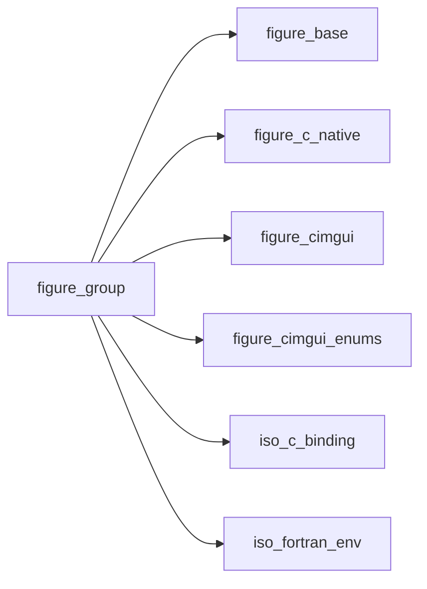

## Contents

- [list_clipper_object](#list-clipper-object)
- [ig_push_id](#ig-push-id)
- [clipper_begin](#clipper-begin)
- [clipper_final](#clipper-final)
- [ig_end_child](#ig-end-child)
- [ig_tree_pop](#ig-tree-pop)
- [ig_set_next_item_open](#ig-set-next-item-open)
- [ig_end_tab_bar](#ig-end-tab-bar)
- [ig_end_tab](#ig-end-tab)
- [ig_end_table](#ig-end-table)
- [ig_table_setup_column](#ig-table-setup-column)
- [ig_table_headers_row](#ig-table-headers-row)
- [ig_table_next_row](#ig-table-next-row)
- [ig_table_next_column](#ig-table-next-column)
- [ig_table_set_column](#ig-table-set-column)
- [ig_push_id_str](#ig-push-id-str)
- [ig_push_id_i32](#ig-push-id-i32)
- [ig_pop_id](#ig-pop-id)
- [ig_begin_disabled](#ig-begin-disabled)
- [ig_end_disabled](#ig-end-disabled)
- [clipper_step](#clipper-step)
- [ig_begin_child](#ig-begin-child)
- [ig_collapsing_header](#ig-collapsing-header)
- [ig_tree_node](#ig-tree-node)
- [ig_begin_tab_bar](#ig-begin-tab-bar)
- [ig_begin_tab](#ig-begin-tab)
- [ig_begin_table](#ig-begin-table)

## Derived Types

### list_clipper_object

Only the rows of a long list that are in view are drawn: `call clip%begin(n)`, then
 `do while (clip%step())`, drawing rows `clip%first` to `clip%last` (rows of equal height; in a window, a child
 region or a table). The loop ends by itself; a clipper left before its end is closed when it is begun again or
 goes out of scope.

#### Components

| Name | Type | Attributes | Description |
|------|------|------------|-------------|
| `first` | integer(kind=int32) |  | First row to draw (1-based). |
| `last` | integer(kind=int32) |  | Last row to draw. |
| `p` | type(c_ptr) |  | Dear ImGui's clipper. |

#### Type-Bound Procedures

| Name | Attributes | Description |
|------|------------|-------------|
| `begin` | pass(self) | Start: the number of rows. |
| `step` | pass(self) | The next rows to draw: false at the end. |

## Interfaces

### ig_push_id

Open an id scope, by a string or an integer.

**Module procedures**: [`ig_push_id_str`](/api/src/lib/figure_group#ig-push-id-str), [`ig_push_id_i32`](/api/src/lib/figure_group#ig-push-id-i32)

## Subroutines

### clipper_begin

Start clipping `count` rows; `item_height` [pixels] (default: measured on the first row drawn).

**Attributes**: recursive

```fortran
subroutine clipper_begin(self, count, item_height)
```

**Arguments**

| Name | Type | Intent | Attributes | Description |
|------|------|--------|------------|-------------|
| `self` | class([list_clipper_object](/api/src/lib/figure_group#list-clipper-object)) | inout |  | Clipper. |
| `count` | integer(kind=int32) | in |  | Rows. |
| `item_height` | real(kind=real64) | in | optional | Row height. |

**Call graph**

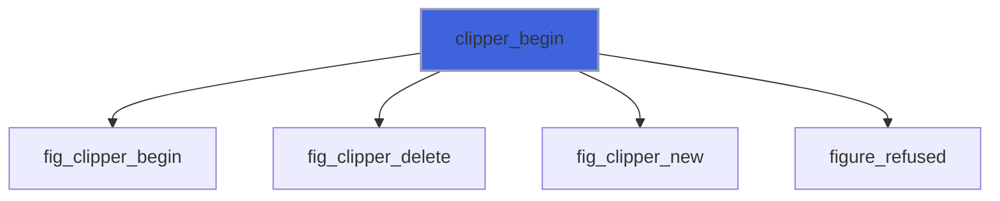

### clipper_final

A clipper going out of scope: freed.

```fortran
subroutine clipper_final(self)
```

**Arguments**

| Name | Type | Intent | Attributes | Description |
|------|------|--------|------------|-------------|
| `self` | type([list_clipper_object](/api/src/lib/figure_group#list-clipper-object)) | inout |  | Clipper. |

**Call graph**

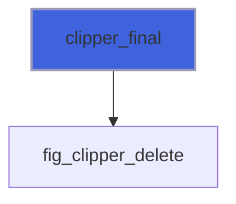

### ig_end_child

End the region opened by `ig_begin_child` (whatever it returned).

**Attributes**: recursive

```fortran
subroutine ig_end_child()
```

**Call graph**

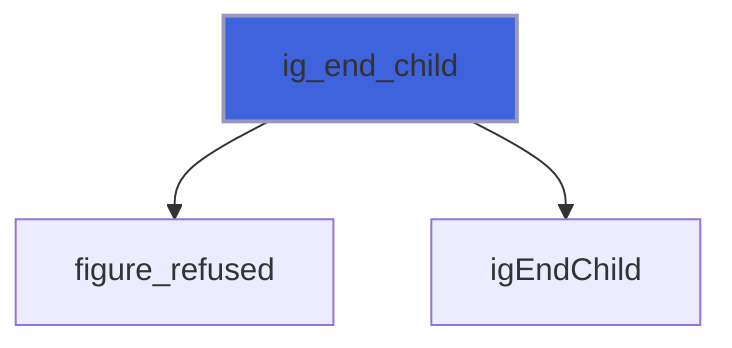

### ig_tree_pop

Close the children of a node (only after `ig_tree_node` returned true).

**Attributes**: recursive

```fortran
subroutine ig_tree_pop()
```

**Call graph**

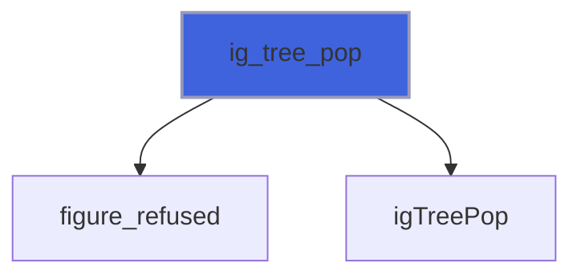

### ig_set_next_item_open

Open or close the next tree node (or collapsing header) from the program: the first time it is shown, or, with
 `always`, on this frame whatever its state (an "expand all" button calls it with `always` once per node).

**Attributes**: recursive

```fortran
subroutine ig_set_next_item_open(open, always)
```

**Arguments**

| Name | Type | Intent | Attributes | Description |
|------|------|--------|------------|-------------|
| `open` | logical | in |  | Open (true) or closed. |
| `always` | logical | in | optional | Enforce on this frame (default: only when the node has no state yet). |

**Call graph**

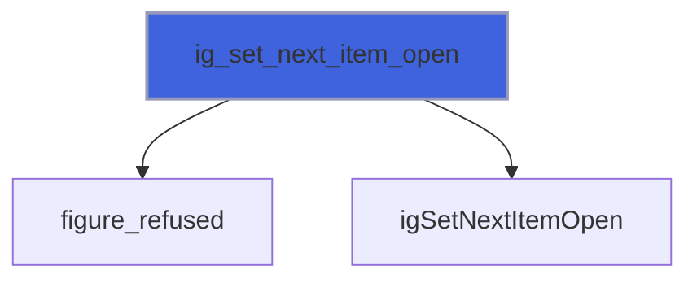

### ig_end_tab_bar

End a bar of tabs (only after `ig_begin_tab_bar` returned true).

**Attributes**: recursive

```fortran
subroutine ig_end_tab_bar()
```

**Call graph**

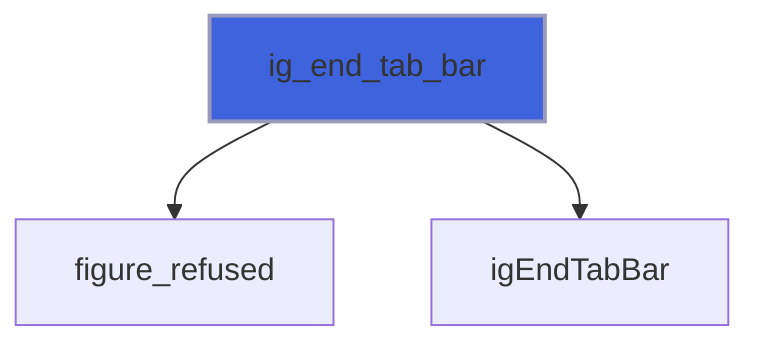

### ig_end_tab

End the content of a tab (only after `ig_begin_tab` returned true).

**Attributes**: recursive

```fortran
subroutine ig_end_tab()
```

**Call graph**

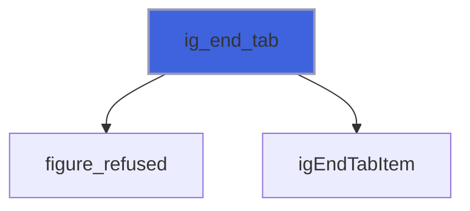

### ig_end_table

End a table (only after `ig_begin_table` returned true).

**Attributes**: recursive

```fortran
subroutine ig_end_table()
```

**Call graph**

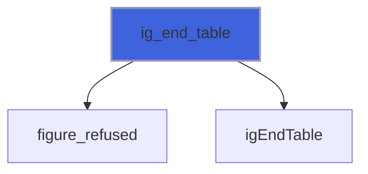

### ig_table_setup_column

Declare the next column (before the first row): its header label and, with `width` [pixels], a fixed width
 (default: the columns share the width left).

**Attributes**: recursive

```fortran
subroutine ig_table_setup_column(label, width)
```

**Arguments**

| Name | Type | Intent | Attributes | Description |
|------|------|--------|------------|-------------|
| `label` | character(len=*) | in |  | Header label. |
| `width` | real(kind=real64) | in | optional | Fixed width [pixels]. |

**Call graph**

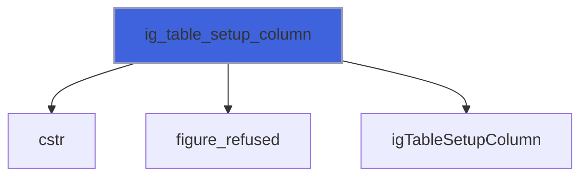

### ig_table_headers_row

A row with the labels of the columns declared by `ig_table_setup_column` (click a header to resize, ...).

**Attributes**: recursive

```fortran
subroutine ig_table_headers_row()
```

**Call graph**


### ig_table_next_row

Start a new row.

**Attributes**: recursive

```fortran
subroutine ig_table_next_row()
```

**Call graph**

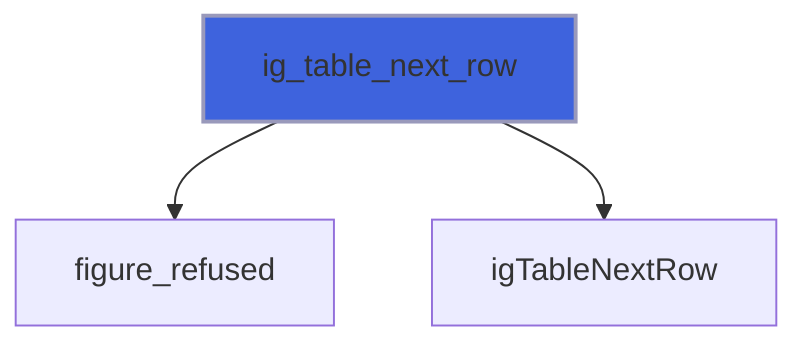

### ig_table_next_column

Move to the next cell of the row (the first after `ig_table_next_row`); the widgets that follow go in it.

**Attributes**: recursive

```fortran
subroutine ig_table_next_column()
```

**Call graph**

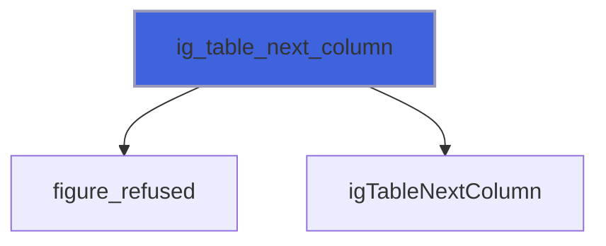

### ig_table_set_column

Move to cell `column` (1 to the number of columns) of the current row.

**Attributes**: recursive

```fortran
subroutine ig_table_set_column(column)
```

**Arguments**

| Name | Type | Intent | Attributes | Description |
|------|------|--------|------------|-------------|
| `column` | integer(kind=int32) | in |  | Column, 1-based. |

**Call graph**

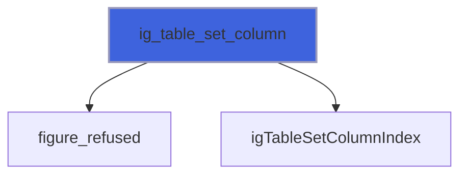

### ig_push_id_str

Open an id scope named `id`: widgets with the same label in different scopes are different widgets.

**Attributes**: recursive

```fortran
subroutine ig_push_id_str(id)
```

**Arguments**

| Name | Type | Intent | Attributes | Description |
|------|------|--------|------------|-------------|
| `id` | character(len=*) | in |  | Scope name. |

**Call graph**

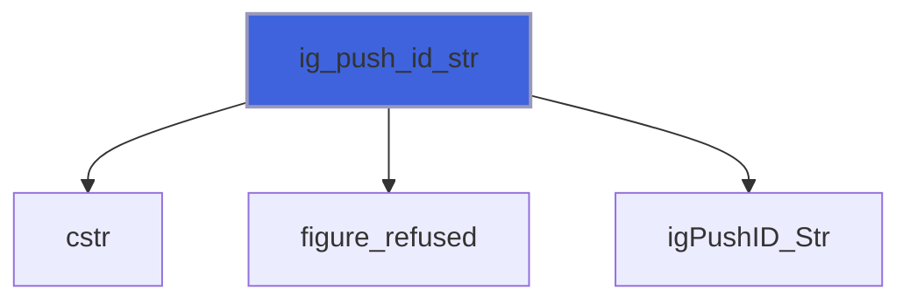

### ig_push_id_i32

Open an id scope numbered `id` (rows of a table, items of a loop).

**Attributes**: recursive

```fortran
subroutine ig_push_id_i32(id)
```

**Arguments**

| Name | Type | Intent | Attributes | Description |
|------|------|--------|------------|-------------|
| `id` | integer(kind=int32) | in |  | Scope number. |

**Call graph**

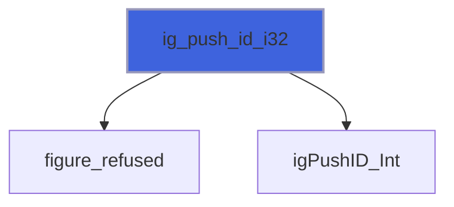

### ig_pop_id

Close the id scope opened by the last `ig_push_id`.

**Attributes**: recursive

```fortran
subroutine ig_pop_id()
```

**Call graph**

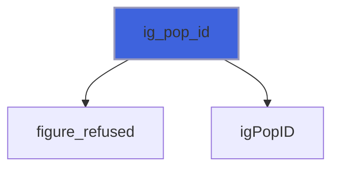

### ig_begin_disabled

Widgets up to `ig_end_disabled` are greyed out and ignore input (when `disabled`, default true).

**Attributes**: recursive

```fortran
subroutine ig_begin_disabled(disabled)
```

**Arguments**

| Name | Type | Intent | Attributes | Description |
|------|------|--------|------------|-------------|
| `disabled` | logical | in | optional | Disable (default true). |

**Call graph**

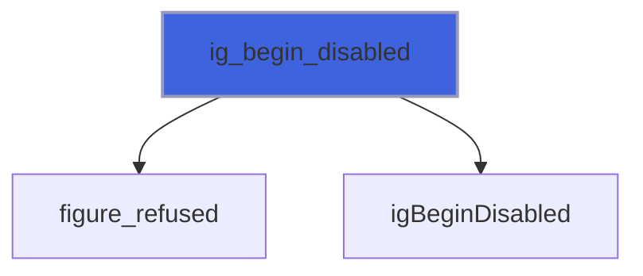

### ig_end_disabled

End the block opened by `ig_begin_disabled`.

**Attributes**: recursive

```fortran
subroutine ig_end_disabled()
```

**Call graph**

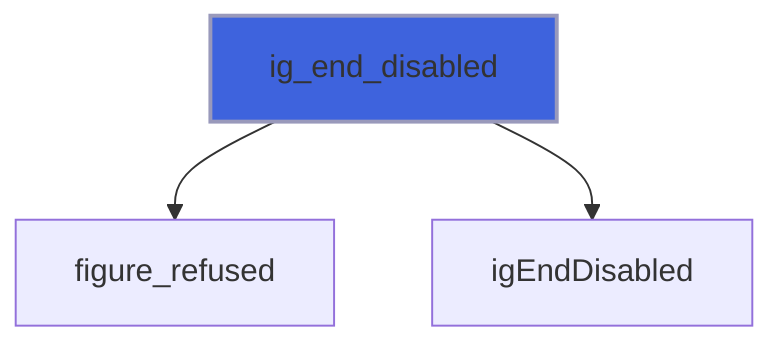

## Functions

### clipper_step

The next rows to draw, `self%first` to `self%last`: true while there are some (false: the clipper ended).

**Attributes**: recursive

**Returns**: `logical`

```fortran
function clipper_step(self) result(more)
```

**Arguments**

| Name | Type | Intent | Attributes | Description |
|------|------|--------|------------|-------------|
| `self` | class([list_clipper_object](/api/src/lib/figure_group#list-clipper-object)) | inout |  | Clipper. |

**Call graph**

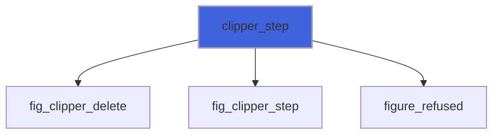

### ig_begin_child

A region inside the window, scrolling on its own (a list that scrolls while a help panel stays); always pair with
 `ig_end_child`, whatever this returned. `width`/`height` [pixels]: 0 or absent fills what is left, negative leaves
 that much.

**Attributes**: recursive

**Returns**: `logical`

```fortran
function ig_begin_child(id, width, height, border) result(visible)
```

**Arguments**

| Name | Type | Intent | Attributes | Description |
|------|------|--------|------------|-------------|
| `id` | character(len=*) | in |  | Id of the region (not shown). |
| `width` | real(kind=real64) | in | optional | Width [pixels]. |
| `height` | real(kind=real64) | in | optional | Height [pixels]. |
| `border` | logical | in | optional | Draw a border (default: none). |

**Call graph**

```mermaid
flowchart TD
  ig_begin_child["ig_begin_child"] --> cstr["cstr"]
  ig_begin_child["ig_begin_child"] --> figure_refused["figure_refused"]
  ig_begin_child["ig_begin_child"] --> igBeginChild_Str["igBeginChild_Str"]
  style ig_begin_child fill:#3e63dd,stroke:#99b,stroke-width:2px
```

### ig_collapsing_header

A header that shows or hides what follows it; true while open (then draw the content). No end call.

**Attributes**: recursive

**Returns**: `logical`

```fortran
function ig_collapsing_header(label, default_open) result(open)
```

**Arguments**

| Name | Type | Intent | Attributes | Description |
|------|------|--------|------------|-------------|
| `label` | character(len=*) | in |  | Label (also its id). |
| `default_open` | logical | in | optional | Open the first time it is shown (default: closed). |

**Call graph**

```mermaid
flowchart TD
  ig_collapsing_header["ig_collapsing_header"] --> cstr["cstr"]
  ig_collapsing_header["ig_collapsing_header"] --> figure_refused["figure_refused"]
  ig_collapsing_header["ig_collapsing_header"] --> igCollapsingHeader_TreeNodeFlags["igCollapsingHeader_TreeNodeFlags"]
  style ig_collapsing_header fill:#3e63dd,stroke:#99b,stroke-width:2px
```

### ig_tree_node

A node of a tree (`TreeNodeEx`); true while open: draw its children, then `ig_tree_pop` (only after true).
 The arrow, or a double-click on the label, opens and closes the node; a single click on the label is reported
 by `clicked` (`IsItemClicked` and not `IsItemToggledOpen`), so choosing a node and expanding it stay different.
 A leaf has no arrow and is always open: it too is popped.

**Attributes**: recursive

**Returns**: `logical`

```fortran
function ig_tree_node(label, default_open, selected, leaf, span_full_width, clicked) result(open)
```

**Arguments**

| Name | Type | Intent | Attributes | Description |
|------|------|--------|------------|-------------|
| `label` | character(len=*) | in |  | Label (also its id). |
| `default_open` | logical | in | optional | Open the first time it is shown (default: closed). |
| `selected` | logical | in | optional | Highlighted as selected (the program keeps it). |
| `leaf` | logical | in | optional | No children: no arrow (default: false). |
| `span_full_width` | logical | in | optional | Highlight and hit the whole width (or cell). |
| `clicked` | logical | out | optional | The label was clicked this frame (not the arrow). |

**Call graph**

```mermaid
flowchart TD
  ig_tree_node["ig_tree_node"] --> cstr["cstr"]
  ig_tree_node["ig_tree_node"] --> figure_refused["figure_refused"]
  ig_tree_node["ig_tree_node"] --> igIsItemClicked["igIsItemClicked"]
  ig_tree_node["ig_tree_node"] --> igIsItemToggledOpen["igIsItemToggledOpen"]
  ig_tree_node["ig_tree_node"] --> igTreeNodeEx_Str["igTreeNodeEx_Str"]
  style ig_tree_node fill:#3e63dd,stroke:#99b,stroke-width:2px
```

### ig_begin_tab_bar

Begin a bar of tabs; when true, declare the tabs (`ig_begin_tab`) and close it with `ig_end_tab_bar`.

**Attributes**: recursive

**Returns**: `logical`

```fortran
function ig_begin_tab_bar(id) result(visible)
```

**Arguments**

| Name | Type | Intent | Attributes | Description |
|------|------|--------|------------|-------------|
| `id` | character(len=*) | in |  | Id of the bar (not shown). |

**Call graph**

```mermaid
flowchart TD
  ig_begin_tab_bar["ig_begin_tab_bar"] --> cstr["cstr"]
  ig_begin_tab_bar["ig_begin_tab_bar"] --> figure_refused["figure_refused"]
  ig_begin_tab_bar["ig_begin_tab_bar"] --> igBeginTabBar["igBeginTabBar"]
  style ig_begin_tab_bar fill:#3e63dd,stroke:#99b,stroke-width:2px
```

### ig_begin_tab

A tab of the current bar; true when it is the selected one: draw its content, then `ig_end_tab`. With `open`,
 the tab has a close button that sets it false.

**Attributes**: recursive

**Returns**: `logical`

```fortran
function ig_begin_tab(label, open) result(selected)
```

**Arguments**

| Name | Type | Intent | Attributes | Description |
|------|------|--------|------------|-------------|
| `label` | character(len=*) | in |  | Label (also its id). |
| `open` | logical | inout | optional | Tab open. |

**Call graph**

```mermaid
flowchart TD
  ig_begin_tab["ig_begin_tab"] --> cstr["cstr"]
  ig_begin_tab["ig_begin_tab"] --> figure_refused["figure_refused"]
  ig_begin_tab["ig_begin_tab"] --> igBeginTabItem["igBeginTabItem"]
  style ig_begin_tab fill:#3e63dd,stroke:#99b,stroke-width:2px
```

### ig_begin_table

Begin a table of `columns` columns; when true, fill it and close it with `ig_end_table`. `flags` combine
 `ImGuiTableFlags_*` with `ior` (default: borders, alternating row background, resizable columns); `height`
 [pixels] fixes the table's height (with `ImGuiTableFlags_ScrollY`, the rows scroll inside it).

**Attributes**: recursive

**Returns**: `logical`

```fortran
function ig_begin_table(id, columns, flags, height) result(visible)
```

**Arguments**

| Name | Type | Intent | Attributes | Description |
|------|------|--------|------------|-------------|
| `id` | character(len=*) | in |  | Id of the table (not shown). |
| `columns` | integer(kind=int32) | in |  | Columns (1 to 512). |
| `flags` | integer(kind=int32) | in | optional | `ImGuiTableFlags_*`. |
| `height` | real(kind=real64) | in | optional | Height [pixels] (default: fit the rows). |

**Call graph**

```mermaid
flowchart TD
  ig_begin_table["ig_begin_table"] --> cstr["cstr"]
  ig_begin_table["ig_begin_table"] --> figure_refused["figure_refused"]
  ig_begin_table["ig_begin_table"] --> igBeginTable["igBeginTable"]
  style ig_begin_table fill:#3e63dd,stroke:#99b,stroke-width:2px
```
