# figure_group

> figure_group, widgets that group other widgets: child regions, headers, tabs, tables, trees, id scopes, disabled blocks,
 layout groups and aligned groups.

 Every drawing procedure of this module refuses a call from a task (`FIG_ERR_STATE`): see processes.md; and a call
 with no frame open, a usage error (`FIG_ERR_STATE`, `<procedure>: no frame open`). Every begin/end and push/pop
 pair registers in the scope record of the frame, which checks each end before Dear ImGui sees it: a wrong end is
 refused and reported by `app%next_frame` (`app%set_checks`; errors.md, "Pairing and frames").

 Pairing rules (Dear ImGui's): `ig_end_tab_bar` only when `ig_begin_tab_bar` returned true, `ig_end_tab` only when
 `ig_begin_tab` returned true, `ig_end_table` only when `ig_begin_table` returned true, `ig_tree_pop` only when
 `ig_tree_node` returned true (unlike `ig_begin`/`ig_end`,
 always paired); `ig_pop_id` after every `ig_push_id`, `ig_end_disabled` after every `ig_begin_disabled`,
 `ig_end_child` after every `ig_begin_child`, `ig_end_group` after every `ig_begin_group`, `ig_align_end` after every
 `ig_align_begin`. A collapsing header needs no end call.

 A table: `ig_begin_table`, then optionally one `ig_table_setup_column` per column and `ig_table_headers_row`, then
 per row `ig_table_next_row` and per cell `ig_table_next_column` (or `ig_table_set_column`) before its widgets.
 Widgets repeated on every row need an id scope per row (`ig_push_id(row)`) or distinct labels.
 A sortable table reports the order the user asks (`ig_table_sort`); the program sorts its rows (widgets.md,
 "Tables").

**Source**: `src/lib/figure_group.F90`

**Dependencies**

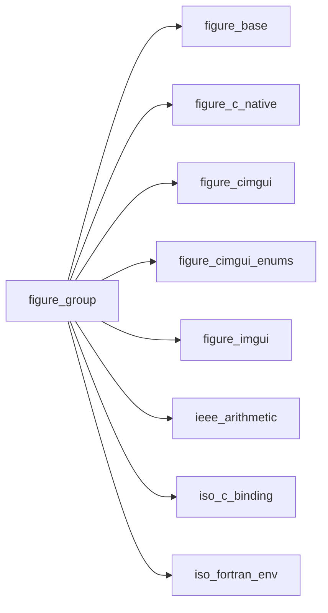

## Contents

- [list_clipper_object](#list-clipper-object)
- [selection_object](#selection-object)
- [ig_push_id](#ig-push-id)
- [clipper_begin](#clipper-begin)
- [selection_resize](#selection-resize)
- [selection_set](#selection-set)
- [selection_clear](#selection-clear)
- [ig_begin_multi_select](#ig-begin-multi-select)
- [ig_end_multi_select](#ig-end-multi-select)
- [clipper_final](#clipper-final)
- [ig_end_child](#ig-end-child)
- [ig_tree_pop](#ig-tree-pop)
- [ig_set_next_item_open](#ig-set-next-item-open)
- [ig_end_tab_bar](#ig-end-tab-bar)
- [ig_end_tab](#ig-end-tab)
- [ig_end_table](#ig-end-table)
- [ig_table_setup_column](#ig-table-setup-column)
- [ig_table_headers_row](#ig-table-headers-row)
- [ig_table_next_row](#ig-table-next-row)
- [ig_table_next_column](#ig-table-next-column)
- [ig_table_set_column](#ig-table-set-column)
- [ig_table_row_color](#ig-table-row-color)
- [ig_table_column_enabled](#ig-table-column-enabled)
- [table_refused](#table-refused)
- [flag_set](#flag-set)
- [ig_push_id_str](#ig-push-id-str)
- [ig_push_id_i32](#ig-push-id-i32)
- [ig_pop_id](#ig-pop-id)
- [ig_begin_group](#ig-begin-group)
- [ig_end_group](#ig-end-group)
- [ig_align_begin](#ig-align-begin)
- [ig_align_end](#ig-align-end)
- [ig_align_next](#ig-align-next)
- [ig_begin_disabled](#ig-begin-disabled)
- [ig_end_disabled](#ig-end-disabled)
- [clipper_step](#clipper-step)
- [selection_is_selected](#selection-is-selected)
- [selection_count](#selection-count)
- [selection_indices](#selection-indices)
- [selection_flags](#selection-flags)
- [ig_begin_child](#ig-begin-child)
- [ig_collapsing_header](#ig-collapsing-header)
- [ig_tree_node](#ig-tree-node)
- [ig_begin_tab_bar](#ig-begin-tab-bar)
- [ig_begin_tab](#ig-begin-tab)
- [ig_begin_table](#ig-begin-table)
- [ig_table_sort](#ig-table-sort)
- [ig_table_hovered_column](#ig-table-hovered-column)
- [align_where](#align-where)

## Derived Types

### list_clipper_object

Only the rows of a long list that are in view are drawn: `call clip%begin(n)`, then
 `do while (clip%step())`, drawing rows `clip%first` to `clip%last` (rows of equal height; in a window, a child
 region or a table). The loop ends by itself; a clipper left before its end is closed when it is begun again or
 goes out of scope.

**Components**

| Name | Type | Attributes | Description |
|------|------|------------|-------------|
| `first` | integer(kind=int32) |  | First row to draw (1-based). |
| `last` | integer(kind=int32) |  | Last row to draw. |
| `item_height` | real(kind=real64) |  | Row pitch [pixels]: given to `begin` or measured on the first row (0 until known); row `i` starts `(i - 1) * item_height` below the list's top (`ig_scroll_to_pos`). |
| `p` | type(c_ptr) |  | Dear ImGui's clipper. |

**Type-Bound Procedures**

| Name | Attributes | Description |
|------|------------|-------------|
| [`begin`](/api/src/lib/figure_group#clipper-begin) | pass(self) | Start: the number of rows. |
| [`step`](/api/src/lib/figure_group#clipper-step) | pass(self) | The next rows to draw: false at the end. |

### selection_object

What is selected in a list, a table or a tree of `n` items (`call sel%resize(n)`), under a multi-selection
 (`ig_begin_multi_select(sel)` ... `ig_end_multi_select(sel)`): one flag per item, updated by the user's clicks,
 shift and ctrl clicks, ctrl+a and box-selection; the program reads them (`is_selected`, `indices`) and may set
 them (`set`, `clear`).

**Components**

| Name | Type | Attributes | Description |
|------|------|------------|-------------|
| `keep` | integer(kind=int32) |  | The item a shift+click extends from (from 1; 0 none): a clipper keeps it drawn (`clip%begin(n, keep=sel%keep)`). |
| `flag` | logical(kind=c_bool) | allocatable | One per item. |

**Type-Bound Procedures**

| Name | Attributes | Description |
|------|------------|-------------|
| [`resize`](/api/src/lib/figure_group#selection-resize) | pass(self) | Number of items (flags kept). |
| [`is_selected`](/api/src/lib/figure_group#selection-is-selected) | pass(self) | Item i is selected. |
| [`set`](/api/src/lib/figure_group#selection-set) | pass(self) | Select or deselect item i. |
| [`clear`](/api/src/lib/figure_group#selection-clear) | pass(self) | Deselect all. |
| [`selected_count`](/api/src/lib/figure_group#selection-count) | pass(self) | Items selected. |
| [`indices`](/api/src/lib/figure_group#selection-indices) | pass(self) | The items selected, in order. |
| [`flags`](/api/src/lib/figure_group#selection-flags) | pass(self) | One logical per item. |

## Interfaces

### ig_push_id

Open an id scope, by a string or an integer.

**Module procedures**: [`ig_push_id_str`](/api/src/lib/figure_group#ig-push-id-str), [`ig_push_id_i32`](/api/src/lib/figure_group#ig-push-id-i32)

## Subroutines

### clipper_begin

Start clipping `count` rows; `item_height` [pixels] (default: measured on the first row drawn). `keep`: a row
 (from 1; 0 none) drawn whether in view or not, a multi-selection's range source (`sel%keep`).

**Attributes**: recursive

```fortran
subroutine clipper_begin(self, count, item_height, keep)
```

**Arguments**

| Name | Type | Intent | Attributes | Description |
|------|------|--------|------------|-------------|
| `self` | class([list_clipper_object](/api/src/lib/figure_group#list-clipper-object)) | inout |  | Clipper. |
| `count` | integer(kind=int32) | in |  | Rows. |
| `item_height` | real(kind=real64) | in | optional | Row height. |
| `keep` | integer(kind=int32) | in | optional | A row always drawn (from 1; 0 none). |

**Call graph**

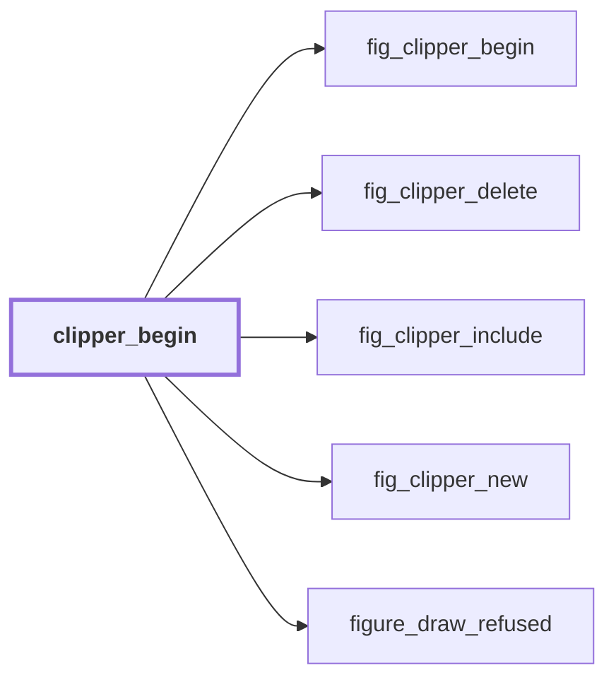

### selection_resize

`n` items: the flags of items 1..min(n, old n) kept, new items not selected.

```fortran
subroutine selection_resize(self, n)
```

**Arguments**

| Name | Type | Intent | Attributes | Description |
|------|------|--------|------------|-------------|
| `self` | class([selection_object](/api/src/lib/figure_group#selection-object)) | inout |  | Selection. |
| `n` | integer(kind=int32) | in |  | Items. |

### selection_set

Select (`on`) or deselect item `i` (from 1; ignored outside 1..n).

```fortran
subroutine selection_set(self, i, on)
```

**Arguments**

| Name | Type | Intent | Attributes | Description |
|------|------|--------|------------|-------------|
| `self` | class([selection_object](/api/src/lib/figure_group#selection-object)) | inout |  | Selection. |
| `i` | integer(kind=int32) | in |  | Item. |
| `on` | logical | in |  | Selected. |

### selection_clear

Deselect every item.

```fortran
subroutine selection_clear(self)
```

**Arguments**

| Name | Type | Intent | Attributes | Description |
|------|------|--------|------------|-------------|
| `self` | class([selection_object](/api/src/lib/figure_group#selection-object)) | inout |  | Selection. |

### ig_begin_multi_select

Begin a multi-selection (`BeginMultiSelect`) over the items of `sel` (`sel%resize(n)` first): the items drawn
 until `ig_end_multi_select(sel)` with `index=` (`ig_selectable`, `ig_tree_node`) are selected as in a file
 manager: a click selects one, shift+click a range, ctrl+click (cmd on macOS) toggles one, ctrl+a all, the
 arrows move with shift extending; `box_select` adds selection by a drag from an empty part of the window,
 `clear_on_escape` lets escape deselect all, `single` keeps one item at most, `no_select_all` refuses ctrl+a.
 Always paired with `ig_end_multi_select`. One at a time. Statuses: `FIG_ERR_STATE` inside another, outside a
 frame or from a task.

**Attributes**: recursive

```fortran
subroutine ig_begin_multi_select(sel, single, box_select, clear_on_escape, no_select_all, stat)
```

**Arguments**

| Name | Type | Intent | Attributes | Description |
|------|------|--------|------------|-------------|
| `sel` | type([selection_object](/api/src/lib/figure_group#selection-object)) | inout |  | What is selected. |
| `single` | logical | in | optional | One item at most (default: many). |
| `box_select` | logical | in | optional | Selection by a box (default: no). |
| `clear_on_escape` | logical | in | optional | Escape deselects all (default: no). |
| `no_select_all` | logical | in | optional | No ctrl+a (default: ctrl+a selects all). |
| `stat` | integer(kind=int32) | out | optional | Status. |

**Call graph**

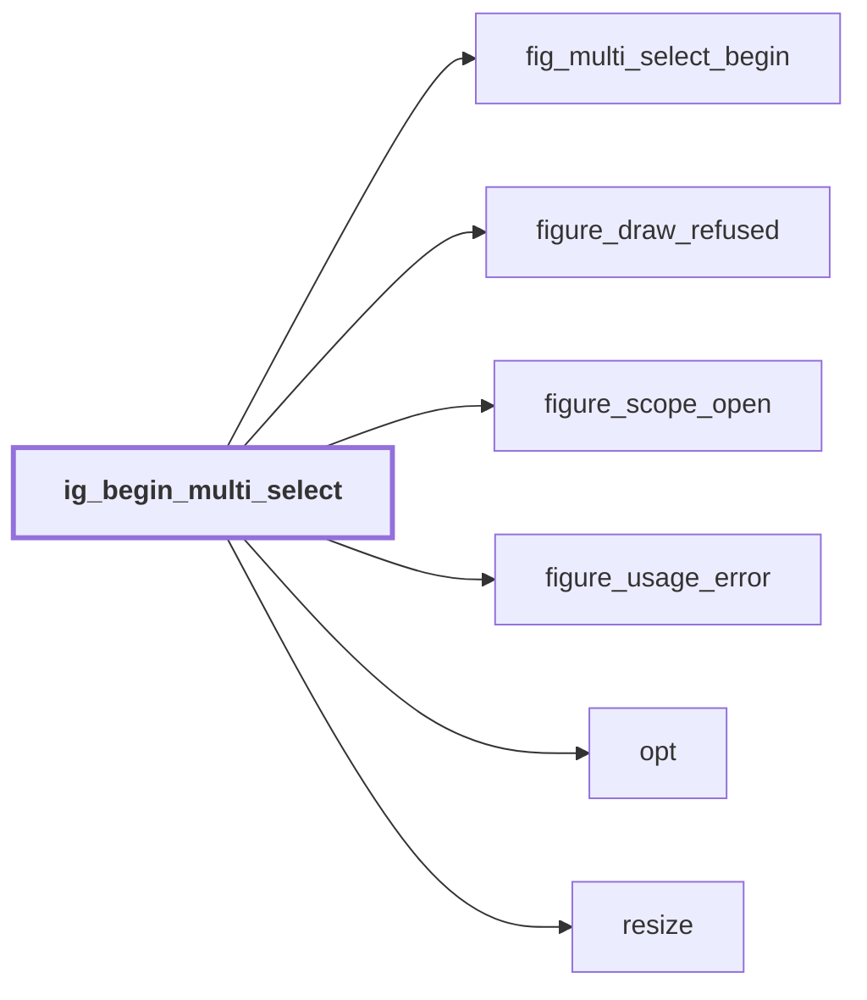

### ig_end_multi_select

End the multi-selection begun with `ig_begin_multi_select(sel)`: what the user did on its items is in `sel`.

**Attributes**: recursive

```fortran
subroutine ig_end_multi_select(sel, stat)
```

**Arguments**

| Name | Type | Intent | Attributes | Description |
|------|------|--------|------------|-------------|
| `sel` | type([selection_object](/api/src/lib/figure_group#selection-object)) | inout |  | What is selected. |
| `stat` | integer(kind=int32) | out | optional |  |

**Call graph**

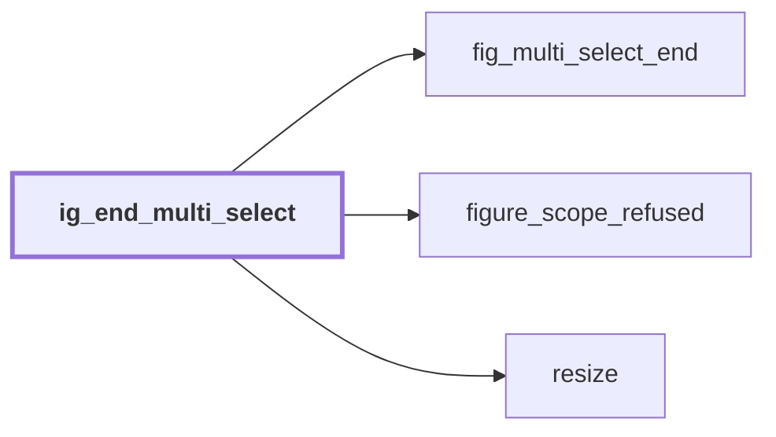

### clipper_final

A clipper going out of scope: freed.

```fortran
subroutine clipper_final(self)
```

**Arguments**

| Name | Type | Intent | Attributes | Description |
|------|------|--------|------------|-------------|
| `self` | type([list_clipper_object](/api/src/lib/figure_group#list-clipper-object)) | inout |  | Clipper. |

**Call graph**

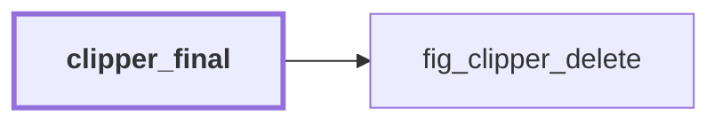

### ig_end_child

End the region opened by `ig_begin_child` (whatever it returned).

**Attributes**: recursive

```fortran
subroutine ig_end_child()
```

**Call graph**

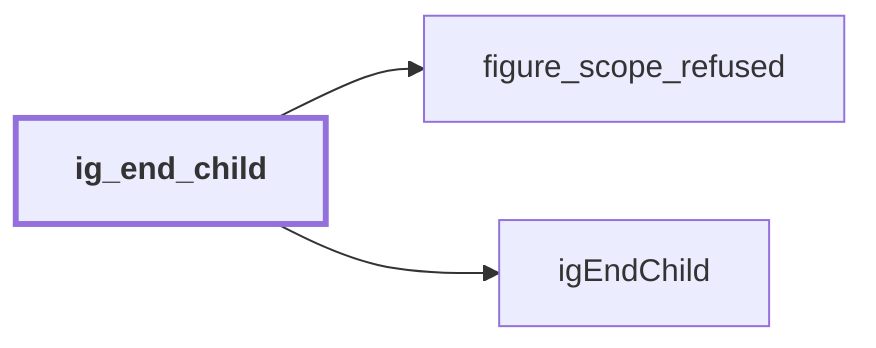

### ig_tree_pop

Close the children of a node (only after `ig_tree_node` returned true).

**Attributes**: recursive

```fortran
subroutine ig_tree_pop()
```

**Call graph**

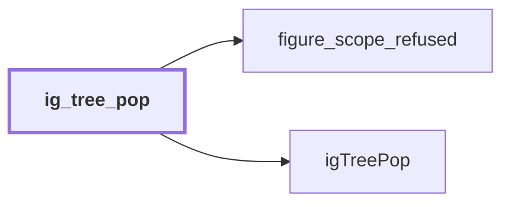

### ig_set_next_item_open

Open or close the next tree node (or collapsing header) from the program: the first time it is shown, or, with
 `always`, on this frame whatever its state (an "expand all" button calls it with `always` once per node).

**Attributes**: recursive

```fortran
subroutine ig_set_next_item_open(open, always)
```

**Arguments**

| Name | Type | Intent | Attributes | Description |
|------|------|--------|------------|-------------|
| `open` | logical | in |  | Open (true) or closed. |
| `always` | logical | in | optional | Enforce on this frame (default: only when the node has no state yet). |

**Call graph**

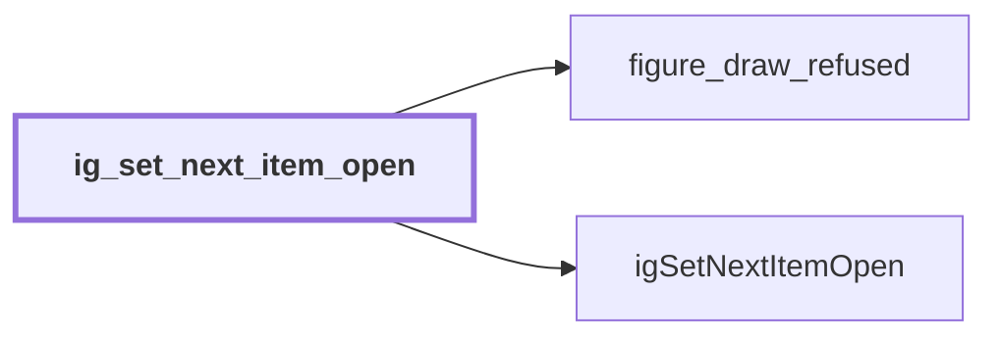

### ig_end_tab_bar

End a bar of tabs (only after `ig_begin_tab_bar` returned true).

**Attributes**: recursive

```fortran
subroutine ig_end_tab_bar()
```

**Call graph**

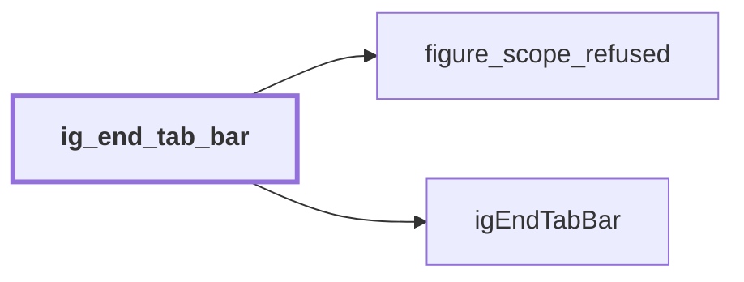

### ig_end_tab

End the content of a tab (only after `ig_begin_tab` returned true).

**Attributes**: recursive

```fortran
subroutine ig_end_tab()
```

**Call graph**

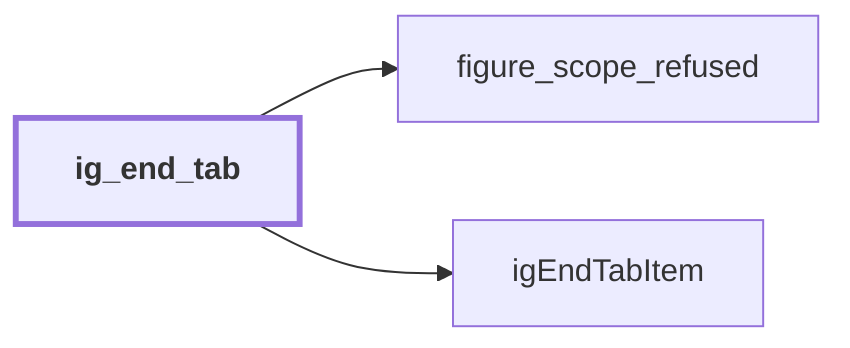

### ig_end_table

End a table (only after `ig_begin_table` returned true).

**Attributes**: recursive

```fortran
subroutine ig_end_table()
```

**Call graph**

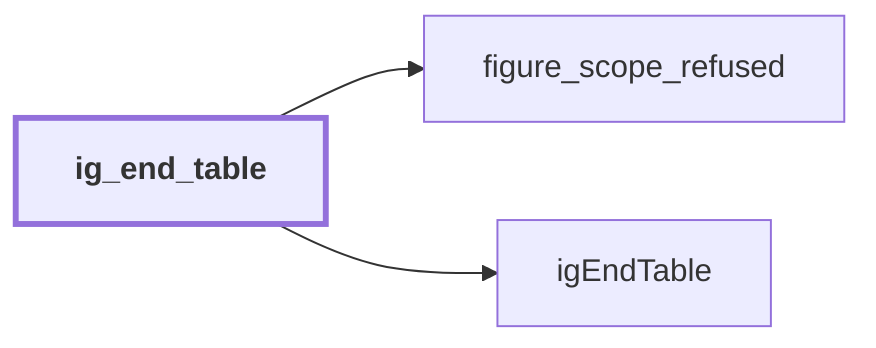

### ig_table_setup_column

Declare the next column (`TableSetupColumn`; before the first row, one call per column, in order): its header
 label and its width: `width` [pixels] fixed, or `stretch` a weight [relative] of the width left (default: weight
 1, the stretched columns share it equally). In a sortable table: `sort=.false.` keeps a click on its header from
 sorting; `default_sort` makes it the key of the first order (default: the first sortable column); `descending`
 sorts it from the largest first on its first click (and as the default key). In a hideable table: `hidden`
 hides it the first time the table is shown (the user shows it from the headers' context menu, the program with
 `ig_table_column_enabled`); `no_hide` keeps it shown. Dear ImGui keeps the order, the widths and the hidden
 columns between frames (and in the settings file): `default_sort` and `hidden` act only the first time.
 `width` and `stretch` together, a negative or NaN `width`, or a `stretch` not above 0: nothing declared,
 `FIG_ERR_ARGUMENT` in `stat` (or `error stop` without it). Outside a table: Dear ImGui's usage error. The same
 in window, headless and remote mode.

**Attributes**: recursive

```fortran
subroutine ig_table_setup_column(label, width, stretch, sort, default_sort, descending, hidden, no_hide, stat)
```

**Arguments**

| Name | Type | Intent | Attributes | Description |
|------|------|--------|------------|-------------|
| `label` | character(len=*) | in |  | Header label (also the column's id). |
| `width` | real(kind=real64) | in | optional | Fixed width [pixels]. |
| `stretch` | real(kind=real64) | in | optional | Share of the width left [relative weight, > 0]. |
| `sort` | logical | in | optional | Sorts on a header click (default: true). |
| `default_sort` | logical | in | optional | The key of the first order (default: false). |
| `descending` | logical | in | optional | Largest first on the first click (default: false). |
| `hidden` | logical | in | optional | Hidden at first (default: false). |
| `no_hide` | logical | in | optional | Cannot be hidden (default: false). |
| `stat` | integer(kind=int32) | out | optional | Status. |

**Call graph**

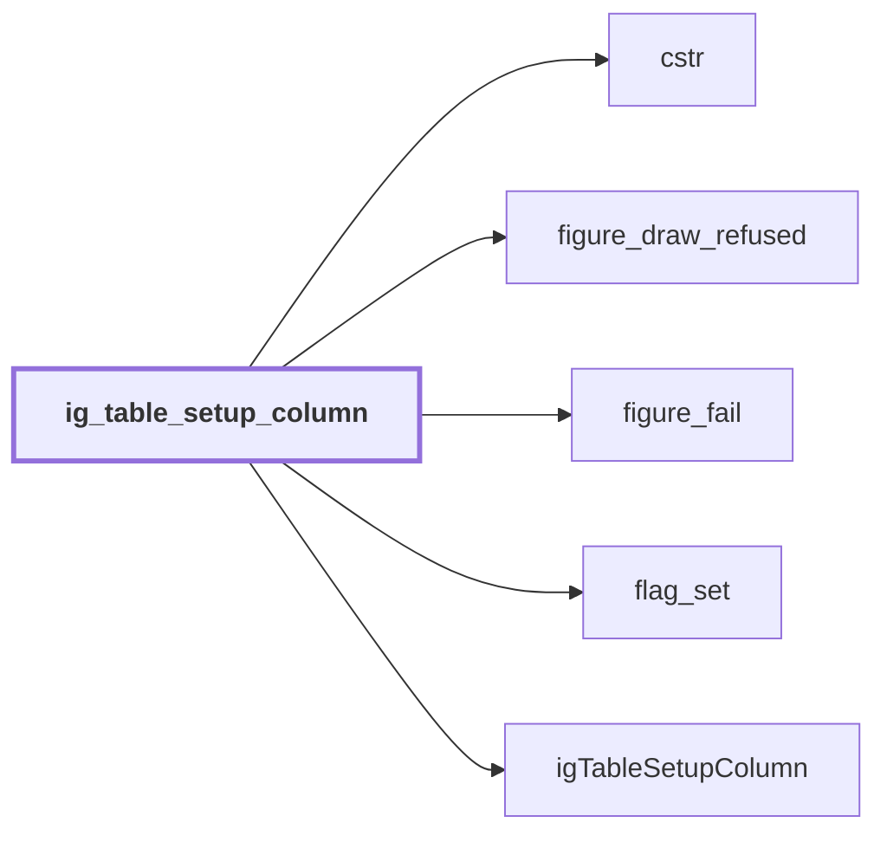

### ig_table_headers_row

A row with the labels of the columns declared by `ig_table_setup_column` (click a header to resize, ...).

**Attributes**: recursive

```fortran
subroutine ig_table_headers_row()
```

**Call graph**

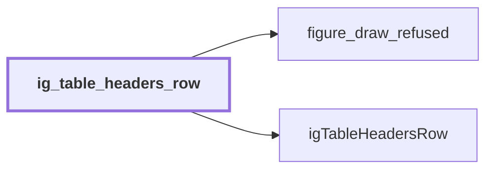

### ig_table_next_row

Start a new row.

**Attributes**: recursive

```fortran
subroutine ig_table_next_row()
```

**Call graph**

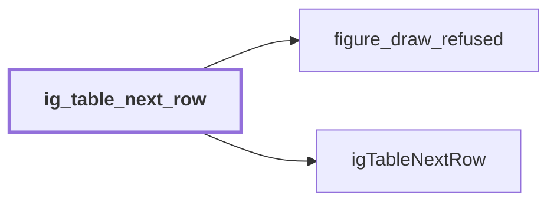

### ig_table_next_column

Move to the next cell of the row (the first after `ig_table_next_row`); the widgets that follow go in it.

**Attributes**: recursive

```fortran
subroutine ig_table_next_column()
```

**Call graph**

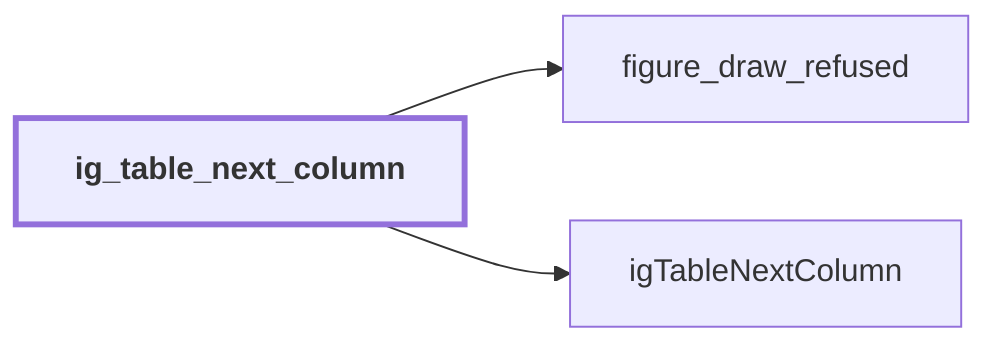

### ig_table_set_column

Move to cell `column` (1 to the number of columns) of the current row.

**Attributes**: recursive

```fortran
subroutine ig_table_set_column(column)
```

**Arguments**

| Name | Type | Intent | Attributes | Description |
|------|------|--------|------------|-------------|
| `column` | integer(kind=int32) | in |  | Column, 1-based. |

**Call graph**

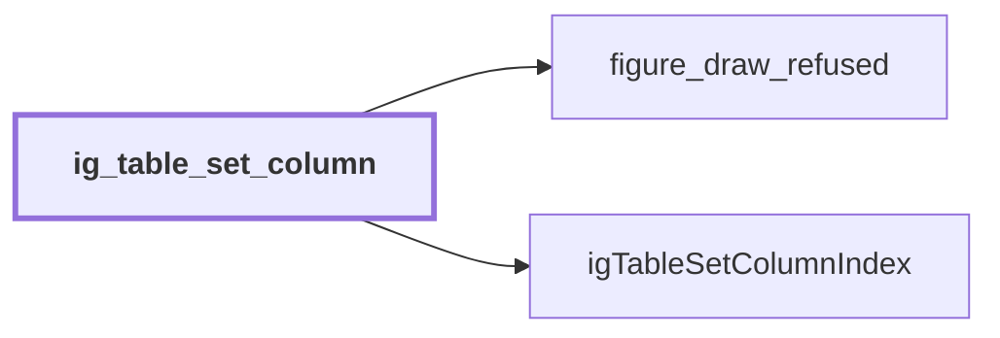

### ig_table_row_color

A colour behind the current row (`TableSetBgColor`, over the alternating background) or, with `cell`, behind
 that cell of it: call it in the row, after `ig_table_next_row`; it lasts that frame. `rgba` is `[r, g, b]` or
 `[r, g, b, a]` in [0, 1]; pair the colour with a mark or a word, so that the row's state does not rest on
 colour alone. A colour of another size or out of [0, 1], or a `cell` out of 1 to the columns: nothing done,
 `FIG_ERR_ARGUMENT` in `stat` (or `error stop` without it); no table or no row begun: `FIG_ERR_STATE`, a usage
 error. The same in window, headless and remote mode.

**Attributes**: recursive

```fortran
subroutine ig_table_row_color(rgba, cell, stat)
```

**Arguments**

| Name | Type | Intent | Attributes | Description |
|------|------|--------|------------|-------------|
| `rgba` | real(kind=real64) | in |  | Colour, `[r, g, b(, a)]` in [0, 1]. |
| `cell` | integer(kind=int32) | in | optional | Column of the cell (default: the whole row). |
| `stat` | integer(kind=int32) | out | optional | Status. |

**Call graph**

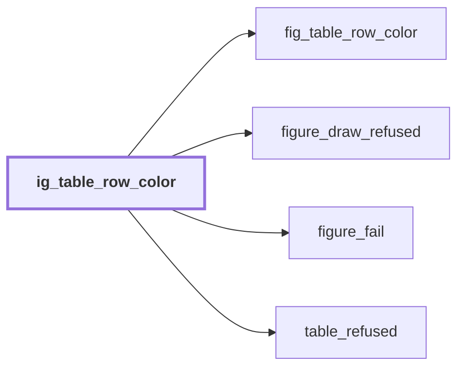

### ig_table_column_enabled

Show (`enabled`) or hide a column of the current hideable table from the program (`TableSetColumnEnabled`), as
 the headers' context menu does; it acts from the next frame and Dear ImGui keeps it. A column declared `no_hide`
 stays shown. A `column` out of 1 to the columns: `FIG_ERR_ARGUMENT` in `stat` (or `error stop` without it); no
 table or a table not hideable: `FIG_ERR_STATE`, a usage error. The same in window, headless and remote mode.

**Attributes**: recursive

```fortran
subroutine ig_table_column_enabled(column, enabled, stat)
```

**Arguments**

| Name | Type | Intent | Attributes | Description |
|------|------|--------|------------|-------------|
| `column` | integer(kind=int32) | in |  | Column, 1-based. |
| `enabled` | logical | in |  | Shown (true) or hidden. |
| `stat` | integer(kind=int32) | out | optional | Status. |

**Call graph**

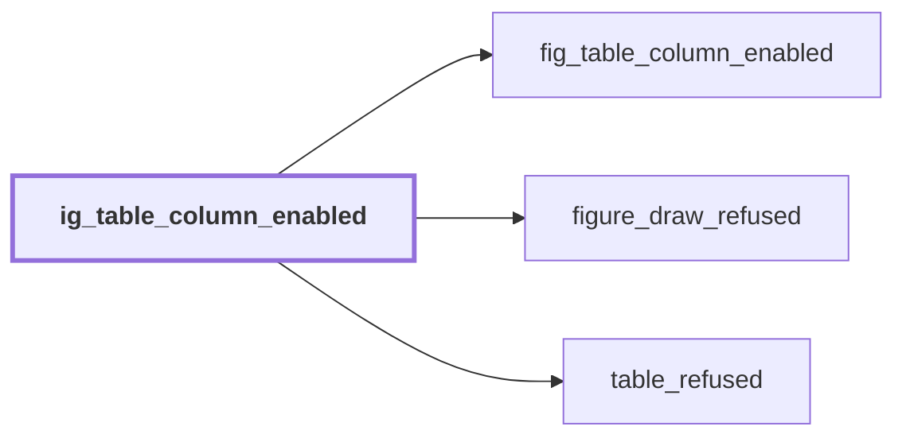

### table_refused

Report the native answer `code` of a table call: 1 no table, 2 the table lacks `need`, 4 no row, 5 columns not
 all declared (usage errors, `FIG_ERR_STATE`); 3 `column` out of range (`FIG_ERR_ARGUMENT`).

**Attributes**: recursive

```fortran
subroutine table_refused(who, code, column, need, stat)
```

**Arguments**

| Name | Type | Intent | Attributes | Description |
|------|------|--------|------------|-------------|
| `who` | character(len=*) | in |  | The procedure. |
| `code` | integer(kind=c_int) | in |  | Native answer. |
| `column` | integer(kind=int32) | in |  | The column asked (code 3). |
| `need` | character(len=*) | in |  | The flag the call needs (code 2): 'sortable', 'hideable'. |
| `stat` | integer(kind=int32) | out | optional | Status. |

**Call graph**

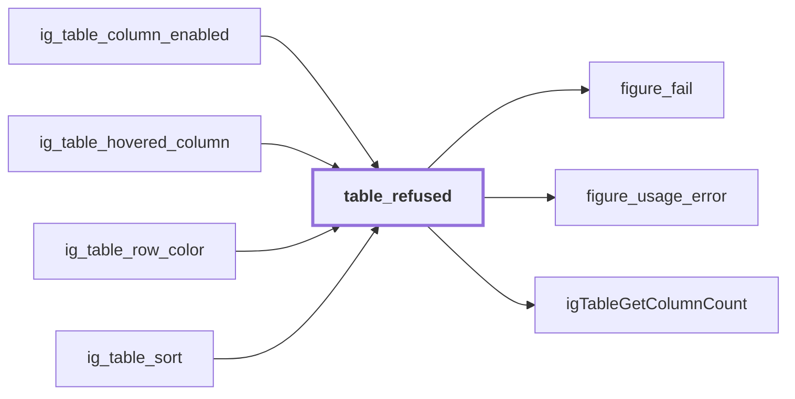

### flag_set

Set (`on` true) or clear (false) `flag` in `f`; nothing when `on` is absent.

**Attributes**: pure

```fortran
subroutine flag_set(f, flag, on)
```

**Arguments**

| Name | Type | Intent | Attributes | Description |
|------|------|--------|------------|-------------|
| `f` | integer(kind=c_int) | inout |  | Flags. |
| `flag` | integer(kind=c_int) | in |  | The flag. |
| `on` | logical | in | optional | Set or clear. |

**Call graph**

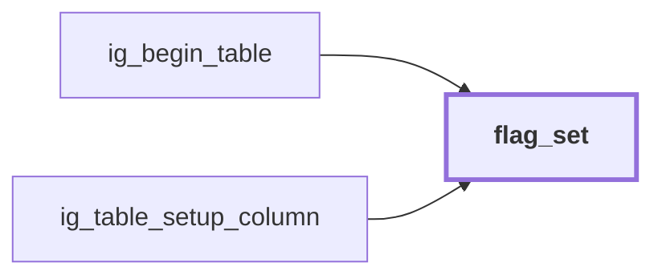

### ig_push_id_str

Open an id scope named `id`: widgets with the same label in different scopes are different widgets.

**Attributes**: recursive

```fortran
subroutine ig_push_id_str(id)
```

**Arguments**

| Name | Type | Intent | Attributes | Description |
|------|------|--------|------------|-------------|
| `id` | character(len=*) | in |  | Scope name. |

**Call graph**

```mermaid
flowchart LR
  ig_push_id_str["ig_push_id_str"] --> cstr["cstr"]
  ig_push_id_str["ig_push_id_str"] --> figure_draw_refused["figure_draw_refused"]
  ig_push_id_str["ig_push_id_str"] --> figure_scope_open["figure_scope_open"]
  ig_push_id_str["ig_push_id_str"] --> igPushID_Str["igPushID_Str"]
  classDef focus stroke-width:3px,font-weight:bold
  class ig_push_id_str focus
  click figure_draw_refused href "figure_base.html#figure-draw-refused" "figure_draw_refused"
  click igPushID_Str href "figure_cimgui.html#igpushid-str" "igPushID_Str"
  click cstr href "figure_base.html#cstr" "cstr"
  click figure_scope_open href "figure_base.html#figure-scope-open" "figure_scope_open"
```

### ig_push_id_i32

Open an id scope numbered `id` (rows of a table, items of a loop).

**Attributes**: recursive

```fortran
subroutine ig_push_id_i32(id)
```

**Arguments**

| Name | Type | Intent | Attributes | Description |
|------|------|--------|------------|-------------|
| `id` | integer(kind=int32) | in |  | Scope number. |

**Call graph**

```mermaid
flowchart LR
  ig_push_id_i32["ig_push_id_i32"] --> figure_draw_refused["figure_draw_refused"]
  ig_push_id_i32["ig_push_id_i32"] --> figure_scope_open["figure_scope_open"]
  ig_push_id_i32["ig_push_id_i32"] --> igPushID_Int["igPushID_Int"]
  classDef focus stroke-width:3px,font-weight:bold
  class ig_push_id_i32 focus
  click figure_draw_refused href "figure_base.html#figure-draw-refused" "figure_draw_refused"
  click igPushID_Int href "figure_cimgui.html#igpushid-int" "igPushID_Int"
  click figure_scope_open href "figure_base.html#figure-scope-open" "figure_scope_open"
```

### ig_pop_id

Close the id scope opened by the last `ig_push_id`.

**Attributes**: recursive

```fortran
subroutine ig_pop_id()
```

**Call graph**

```mermaid
flowchart LR
  ig_player["ig_player"] --> ig_pop_id["ig_pop_id"]
  ig_pop_id["ig_pop_id"] --> figure_scope_refused["figure_scope_refused"]
  ig_pop_id["ig_pop_id"] --> igPopID["igPopID"]
  classDef focus stroke-width:3px,font-weight:bold
  class ig_pop_id focus
  click ig_player href "figure_player.html#ig-player" "ig_player"
  click figure_scope_refused href "figure_base.html#figure-scope-refused" "figure_scope_refused"
  click igPopID href "figure_cimgui.html#igpopid" "igPopID"
```

### ig_begin_group

Begin a group (Dear ImGui's `BeginGroup`): the items up to `ig_end_group` are laid out as usual, then count as
 one item, their bounding rectangle: `ig_same_line` after `ig_end_group` puts the next item beside the whole group,
 `ig_last_item` reports its rectangle (hovered when one of its items is, edited when one of them changed). Always
 paired with `ig_end_group`, in the same window; a group nests and closes innermost first. No frame open or a task:
 nothing done (a usage error, reported by `app%next_frame`). The same in window, headless and remote mode.

**Attributes**: recursive

```fortran
subroutine ig_begin_group()
```

**Call graph**

```mermaid
flowchart LR
  ig_player["ig_player"] --> ig_begin_group["ig_begin_group"]
  ig_begin_group["ig_begin_group"] --> figure_draw_refused["figure_draw_refused"]
  ig_begin_group["ig_begin_group"] --> figure_scope_open["figure_scope_open"]
  ig_begin_group["ig_begin_group"] --> igBeginGroup["igBeginGroup"]
  classDef focus stroke-width:3px,font-weight:bold
  class ig_begin_group focus
  click ig_player href "figure_player.html#ig-player" "ig_player"
  click figure_draw_refused href "figure_base.html#figure-draw-refused" "figure_draw_refused"
  click igBeginGroup href "figure_cimgui.html#igbegingroup" "igBeginGroup"
  click figure_scope_open href "figure_base.html#figure-scope-open" "figure_scope_open"
```

### ig_end_group

End the group begun by the last `ig_begin_group`.

**Attributes**: recursive

```fortran
subroutine ig_end_group()
```

**Call graph**

```mermaid
flowchart LR
  ig_player["ig_player"] --> ig_end_group["ig_end_group"]
  ig_end_group["ig_end_group"] --> figure_scope_refused["figure_scope_refused"]
  ig_end_group["ig_end_group"] --> igEndGroup["igEndGroup"]
  classDef focus stroke-width:3px,font-weight:bold
  class ig_end_group focus
  click ig_player href "figure_player.html#ig-player" "ig_player"
  click figure_scope_refused href "figure_base.html#figure-scope-refused" "figure_scope_refused"
  click igEndGroup href "figure_cimgui.html#igendgroup" "igEndGroup"
```

### ig_align_begin

Begin a group centred (`where='centre'`) or right-aligned (`'right'`) in the space left on the line of the current
 window or region: buttons at the right of a dialog, a title in the middle. The group's width is the one it had on
 the previous frame, kept in Dear ImGui's storage of the window under `id` (a name unique in the window): on the
 first frame it is drawn where a group starts (at the left), and FIGURE asks for one more frame (under lazy redraw
 too), which draws it in place; so does a frame on which its width changed (a font size). Always paired with
 `ig_align_end`, as `ig_begin_group`; the group counts as one item. An unknown `where`: the group is begun, not
 moved, and `FIG_ERR_ARGUMENT` is returned in `stat` (or `error stop` without it). No frame open or a task:
 nothing begun, `FIG_ERR_STATE` (end it neither). The same in window, headless and remote mode.

**Attributes**: recursive

```fortran
subroutine ig_align_begin(id, where, stat)
```

**Arguments**

| Name | Type | Intent | Attributes | Description |
|------|------|--------|------------|-------------|
| `id` | character(len=*) | in |  | Name of the group, unique in its window. |
| `where` | character(len=*) | in |  | 'centre' or 'right'. |
| `stat` | integer(kind=int32) | out | optional | Status. |

**Call graph**

```mermaid
flowchart LR
  ig_align_begin["ig_align_begin"] --> align_where["align_where"]
  ig_align_begin["ig_align_begin"] --> fig_align_begin["fig_align_begin"]
  ig_align_begin["ig_align_begin"] --> figure_check["figure_check"]
  ig_align_begin["ig_align_begin"] --> figure_draw_refused["figure_draw_refused"]
  ig_align_begin["ig_align_begin"] --> figure_fail["figure_fail"]
  ig_align_begin["ig_align_begin"] --> figure_scope_open["figure_scope_open"]
  classDef focus stroke-width:3px,font-weight:bold
  class ig_align_begin focus
  click figure_draw_refused href "figure_base.html#figure-draw-refused" "figure_draw_refused"
  click align_where href "#align-where" "align_where"
  click fig_align_begin href "figure_c_native.html#fig-align-begin" "fig_align_begin"
  click figure_check href "figure_base.html#figure-check" "figure_check"
  click figure_scope_open href "figure_base.html#figure-scope-open" "figure_scope_open"
  click figure_fail href "figure_base.html#figure-fail" "figure_fail"
```

### ig_align_end

End the group begun by the last `ig_align_begin`; its width is kept for the next frame.

**Attributes**: recursive

```fortran
subroutine ig_align_end()
```

**Call graph**

```mermaid
flowchart LR
  ig_align_end["ig_align_end"] --> fig_align_end["fig_align_end"]
  ig_align_end["ig_align_end"] --> figure_scope_refused["figure_scope_refused"]
  classDef focus stroke-width:3px,font-weight:bold
  class ig_align_end focus
  click figure_scope_refused href "figure_base.html#figure-scope-refused" "figure_scope_refused"
  click fig_align_end href "figure_c_native.html#fig-align-end" "fig_align_end"
```

### ig_align_next

Centre (`where='centre'`) or right-align (`'right'`) the next item, `width` pixels wide, in the space left on the
 line: for an item whose width the program knows (`ig_set_next_item_width`, a button of a given width,
 `ig_text_size` of a text), right on the first frame. Nothing moves when the item is wider than the space. A
 negative or NaN `width` or an unknown `where`: nothing done, `FIG_ERR_ARGUMENT` in `stat` (or `error stop`
 without it); no frame open or a task: `FIG_ERR_STATE`. The same in window, headless and remote mode.

**Attributes**: recursive

```fortran
subroutine ig_align_next(width, where, stat)
```

**Arguments**

| Name | Type | Intent | Attributes | Description |
|------|------|--------|------------|-------------|
| `width` | real(kind=real64) | in |  | Width of the next item [pixels]. |
| `where` | character(len=*) | in |  | 'centre' or 'right'. |
| `stat` | integer(kind=int32) | out | optional | Status. |

**Call graph**

```mermaid
flowchart LR
  ig_align_next["ig_align_next"] --> align_where["align_where"]
  ig_align_next["ig_align_next"] --> fig_align_next["fig_align_next"]
  ig_align_next["ig_align_next"] --> figure_draw_refused["figure_draw_refused"]
  ig_align_next["ig_align_next"] --> figure_fail["figure_fail"]
  classDef focus stroke-width:3px,font-weight:bold
  class ig_align_next focus
  click figure_draw_refused href "figure_base.html#figure-draw-refused" "figure_draw_refused"
  click align_where href "#align-where" "align_where"
  click figure_fail href "figure_base.html#figure-fail" "figure_fail"
  click fig_align_next href "figure_c_native.html#fig-align-next" "fig_align_next"
```

### ig_begin_disabled

Widgets up to `ig_end_disabled` are greyed out and ignore input (when `disabled`, default true).

**Attributes**: recursive

```fortran
subroutine ig_begin_disabled(disabled)
```

**Arguments**

| Name | Type | Intent | Attributes | Description |
|------|------|--------|------------|-------------|
| `disabled` | logical | in | optional | Disable (default true). |

**Call graph**

```mermaid
flowchart LR
  ig_begin_disabled["ig_begin_disabled"] --> figure_draw_refused["figure_draw_refused"]
  ig_begin_disabled["ig_begin_disabled"] --> figure_scope_open["figure_scope_open"]
  ig_begin_disabled["ig_begin_disabled"] --> igBeginDisabled["igBeginDisabled"]
  classDef focus stroke-width:3px,font-weight:bold
  class ig_begin_disabled focus
  click figure_draw_refused href "figure_base.html#figure-draw-refused" "figure_draw_refused"
  click igBeginDisabled href "figure_cimgui.html#igbegindisabled" "igBeginDisabled"
  click figure_scope_open href "figure_base.html#figure-scope-open" "figure_scope_open"
```

### ig_end_disabled

End the block opened by `ig_begin_disabled`.

**Attributes**: recursive

```fortran
subroutine ig_end_disabled()
```

**Call graph**

```mermaid
flowchart LR
  ig_end_disabled["ig_end_disabled"] --> figure_scope_refused["figure_scope_refused"]
  ig_end_disabled["ig_end_disabled"] --> igEndDisabled["igEndDisabled"]
  classDef focus stroke-width:3px,font-weight:bold
  class ig_end_disabled focus
  click figure_scope_refused href "figure_base.html#figure-scope-refused" "figure_scope_refused"
  click igEndDisabled href "figure_cimgui.html#igenddisabled" "igEndDisabled"
```

## Functions

### clipper_step

The next rows to draw, `self%first` to `self%last`: true while there are some (false: the clipper ended).

**Attributes**: recursive

**Returns**: `logical`

```fortran
function clipper_step(self) result(more)
```

**Arguments**

| Name | Type | Intent | Attributes | Description |
|------|------|--------|------------|-------------|
| `self` | class([list_clipper_object](/api/src/lib/figure_group#list-clipper-object)) | inout |  | Clipper. |

**Call graph**

```mermaid
flowchart LR
  clipper_step["clipper_step"] --> fig_clipper_delete["fig_clipper_delete"]
  clipper_step["clipper_step"] --> fig_clipper_step["fig_clipper_step"]
  clipper_step["clipper_step"] --> figure_draw_refused["figure_draw_refused"]
  classDef focus stroke-width:3px,font-weight:bold
  class clipper_step focus
  click figure_draw_refused href "figure_base.html#figure-draw-refused" "figure_draw_refused"
  click fig_clipper_step href "figure_c_native.html#fig-clipper-step" "fig_clipper_step"
  click fig_clipper_delete href "figure_c_native.html#fig-clipper-delete" "fig_clipper_delete"
```

### selection_is_selected

Item `i` (from 1) is selected (false outside 1..n).

**Attributes**: pure

**Returns**: `logical`

```fortran
function selection_is_selected(self, i) result(on)
```

**Arguments**

| Name | Type | Intent | Attributes | Description |
|------|------|--------|------------|-------------|
| `self` | class([selection_object](/api/src/lib/figure_group#selection-object)) | in |  | Selection. |
| `i` | integer(kind=int32) | in |  | Item. |

### selection_count

The number of items selected.

**Attributes**: pure

**Returns**: `integer(kind=int32)`

```fortran
function selection_count(self) result(n)
```

**Arguments**

| Name | Type | Intent | Attributes | Description |
|------|------|--------|------------|-------------|
| `self` | class([selection_object](/api/src/lib/figure_group#selection-object)) | in |  | Selection. |

### selection_indices

The items selected (from 1), in increasing order.

**Attributes**: pure

**Returns**: `integer(kind=int32)`

```fortran
function selection_indices(self) result(idx)
```

**Arguments**

| Name | Type | Intent | Attributes | Description |
|------|------|--------|------------|-------------|
| `self` | class([selection_object](/api/src/lib/figure_group#selection-object)) | in |  | Selection. |

### selection_flags

One logical per item: selected.

**Attributes**: pure

**Returns**: `logical`

```fortran
function selection_flags(self) result(f)
```

**Arguments**

| Name | Type | Intent | Attributes | Description |
|------|------|--------|------------|-------------|
| `self` | class([selection_object](/api/src/lib/figure_group#selection-object)) | in |  | Selection. |

### ig_begin_child

A region inside the window, scrolling on its own (a list that scrolls while a help panel stays); always pair with
 `ig_end_child`, whatever this returned. `width`/`height` [pixels]: 0 or absent fills what is left, negative leaves
 that much.

**Attributes**: recursive

**Returns**: `logical`

```fortran
function ig_begin_child(id, width, height, border) result(visible)
```

**Arguments**

| Name | Type | Intent | Attributes | Description |
|------|------|--------|------------|-------------|
| `id` | character(len=*) | in |  | Id of the region (not shown). |
| `width` | real(kind=real64) | in | optional | Width [pixels]. |
| `height` | real(kind=real64) | in | optional | Height [pixels]. |
| `border` | logical | in | optional | Draw a border (default: none). |

**Call graph**

```mermaid
flowchart LR
  ig_begin_child["ig_begin_child"] --> cstr["cstr"]
  ig_begin_child["ig_begin_child"] --> figure_draw_refused["figure_draw_refused"]
  ig_begin_child["ig_begin_child"] --> figure_scope_open["figure_scope_open"]
  ig_begin_child["ig_begin_child"] --> igBeginChild_Str["igBeginChild_Str"]
  classDef focus stroke-width:3px,font-weight:bold
  class ig_begin_child focus
  click figure_draw_refused href "figure_base.html#figure-draw-refused" "figure_draw_refused"
  click igBeginChild_Str href "figure_cimgui.html#igbeginchild-str" "igBeginChild_Str"
  click cstr href "figure_base.html#cstr" "cstr"
  click figure_scope_open href "figure_base.html#figure-scope-open" "figure_scope_open"
```

### ig_collapsing_header

A header that shows or hides what follows it; true while open (then draw the content). No end call.

**Attributes**: recursive

**Returns**: `logical`

```fortran
function ig_collapsing_header(label, default_open) result(open)
```

**Arguments**

| Name | Type | Intent | Attributes | Description |
|------|------|--------|------------|-------------|
| `label` | character(len=*) | in |  | Label (also its id). |
| `default_open` | logical | in | optional | Open the first time it is shown (default: closed). |

**Call graph**

```mermaid
flowchart LR
  ig_collapsing_header["ig_collapsing_header"] --> cstr["cstr"]
  ig_collapsing_header["ig_collapsing_header"] --> figure_draw_refused["figure_draw_refused"]
  ig_collapsing_header["ig_collapsing_header"] --> igCollapsingHeader_TreeNodeFlags["igCollapsingHeader_TreeNodeFlags"]
  classDef focus stroke-width:3px,font-weight:bold
  class ig_collapsing_header focus
  click figure_draw_refused href "figure_base.html#figure-draw-refused" "figure_draw_refused"
  click igCollapsingHeader_TreeNodeFlags href "figure_cimgui.html#igcollapsingheader-treenodeflags" "igCollapsingHeader_TreeNodeFlags"
  click cstr href "figure_base.html#cstr" "cstr"
```

### ig_tree_node

A node of a tree (`TreeNodeEx`); true while open: draw its children, then `ig_tree_pop` (only after true).
 The arrow, or a double-click on the label, opens and closes the node; a single click on the label is reported
 by `clicked` (`IsItemClicked` and not `IsItemToggledOpen`), so choosing a node and expanding it stay different.
 A leaf has no arrow and is always open: it too is popped. In a table, `span_all_columns` makes the node's row
 its hit area and highlight across every column (a hierarchy with values in the columns to its right). With
 `index` (from 1) the node is item `index` of the multi-selection open (`ig_begin_multi_select`), as
 `ig_selectable`'s; statuses then as `ig_selectable`'s.

**Attributes**: recursive

**Returns**: `logical`

```fortran
function ig_tree_node(label, default_open, selected, leaf, span_full_width, clicked, span_all_columns, index, stat) result(open)
```

**Arguments**

| Name | Type | Intent | Attributes | Description |
|------|------|--------|------------|-------------|
| `label` | character(len=*) | in |  | Label (also its id). |
| `default_open` | logical | in | optional | Open the first time it is shown (default: closed). |
| `selected` | logical | in | optional | Highlighted as selected (the program keeps it). |
| `leaf` | logical | in | optional | No children: no arrow (default: false). |
| `span_full_width` | logical | in | optional | Highlight and hit the whole width (or cell). |
| `clicked` | logical | out | optional | The label was clicked this frame (not the arrow). |
| `span_all_columns` | logical | in | optional | In a table: hit and highlight every column of the row (default: false). |
| `index` | integer(kind=int32) | in | optional | The item in the multi-selection open (from 1). |
| `stat` | integer(kind=int32) | out | optional | Status (with `index`). |

**Call graph**

```mermaid
flowchart LR
  ig_tree_node["ig_tree_node"] --> cstr["cstr"]
  ig_tree_node["ig_tree_node"] --> figure_draw_refused["figure_draw_refused"]
  ig_tree_node["ig_tree_node"] --> figure_scope_open["figure_scope_open"]
  ig_tree_node["ig_tree_node"] --> igIsItemClicked["igIsItemClicked"]
  ig_tree_node["ig_tree_node"] --> igIsItemToggledOpen["igIsItemToggledOpen"]
  ig_tree_node["ig_tree_node"] --> igTreeNodeEx_Str["igTreeNodeEx_Str"]
  ig_tree_node["ig_tree_node"] --> item_index_refused["item_index_refused"]
  classDef focus stroke-width:3px,font-weight:bold
  class ig_tree_node focus
  click figure_draw_refused href "figure_base.html#figure-draw-refused" "figure_draw_refused"
  click item_index_refused href "figure_imgui.html#item-index-refused" "item_index_refused"
  click igTreeNodeEx_Str href "figure_cimgui.html#igtreenodeex-str" "igTreeNodeEx_Str"
  click cstr href "figure_base.html#cstr" "cstr"
  click figure_scope_open href "figure_base.html#figure-scope-open" "figure_scope_open"
  click igIsItemClicked href "figure_cimgui.html#igisitemclicked" "igIsItemClicked"
  click igIsItemToggledOpen href "figure_cimgui.html#igisitemtoggledopen" "igIsItemToggledOpen"
```

### ig_begin_tab_bar

Begin a bar of tabs; when true, declare the tabs (`ig_begin_tab`) and close it with `ig_end_tab_bar`.

**Attributes**: recursive

**Returns**: `logical`

```fortran
function ig_begin_tab_bar(id) result(visible)
```

**Arguments**

| Name | Type | Intent | Attributes | Description |
|------|------|--------|------------|-------------|
| `id` | character(len=*) | in |  | Id of the bar (not shown). |

**Call graph**

```mermaid
flowchart LR
  ig_begin_tab_bar["ig_begin_tab_bar"] --> cstr["cstr"]
  ig_begin_tab_bar["ig_begin_tab_bar"] --> figure_draw_refused["figure_draw_refused"]
  ig_begin_tab_bar["ig_begin_tab_bar"] --> figure_scope_open["figure_scope_open"]
  ig_begin_tab_bar["ig_begin_tab_bar"] --> igBeginTabBar["igBeginTabBar"]
  classDef focus stroke-width:3px,font-weight:bold
  class ig_begin_tab_bar focus
  click figure_draw_refused href "figure_base.html#figure-draw-refused" "figure_draw_refused"
  click igBeginTabBar href "figure_cimgui.html#igbegintabbar" "igBeginTabBar"
  click cstr href "figure_base.html#cstr" "cstr"
  click figure_scope_open href "figure_base.html#figure-scope-open" "figure_scope_open"
```

### ig_begin_tab

A tab of the current bar; true when it is the selected one: draw its content, then `ig_end_tab`. With `open`,
 the tab has a close button that sets it false.

**Attributes**: recursive

**Returns**: `logical`

```fortran
function ig_begin_tab(label, open) result(selected)
```

**Arguments**

| Name | Type | Intent | Attributes | Description |
|------|------|--------|------------|-------------|
| `label` | character(len=*) | in |  | Label (also its id). |
| `open` | logical | inout | optional | Tab open. |

**Call graph**

```mermaid
flowchart LR
  ig_begin_tab["ig_begin_tab"] --> cstr["cstr"]
  ig_begin_tab["ig_begin_tab"] --> figure_draw_refused["figure_draw_refused"]
  ig_begin_tab["ig_begin_tab"] --> figure_scope_open["figure_scope_open"]
  ig_begin_tab["ig_begin_tab"] --> igBeginTabItem["igBeginTabItem"]
  classDef focus stroke-width:3px,font-weight:bold
  class ig_begin_tab focus
  click figure_draw_refused href "figure_base.html#figure-draw-refused" "figure_draw_refused"
  click igBeginTabItem href "figure_cimgui.html#igbegintabitem" "igBeginTabItem"
  click cstr href "figure_base.html#cstr" "cstr"
  click figure_scope_open href "figure_base.html#figure-scope-open" "figure_scope_open"
```

### ig_begin_table

Begin a table of `columns` columns (`BeginTable`); when true, fill it and close it with `ig_end_table` (only
 after true). `flags` combine `ImGuiTableFlags_*` with `ior` (default: borders, alternating row background,
 resizable columns); the logical arguments then set (true) or clear (false) one flag each: `sortable` (a click on
 a header asks an order, `ig_table_sort`), `hideable` (the headers' context menu hides columns,
 `ig_table_column_enabled`), `reorderable` (headers dragged to reorder the columns), `scroll_x` (horizontal
 scrolling: columns keep their width). `height` [pixels] fixes the table's height (with `ImGuiTableFlags_ScrollY`,
 the rows scroll inside it). `freeze_rows` rows at the top (the headers row: 1) and `freeze_cols` columns at the
 left stay in view while the rest scrolls (`TableSetupScrollFreeze`): a frozen row turns vertical scrolling on, a
 frozen column horizontal scrolling; without `height`, a scrolling table fills the height left in its window.
 Out-of-range `columns` (1 to 511), `freeze_rows` (0 to 127) or `freeze_cols` (0 to `columns`): nothing begun,
 false, `FIG_ERR_ARGUMENT` in `stat` (or `error stop` without it); a task or no frame open: `FIG_ERR_STATE`.
 The same in window, headless and remote mode.

**Attributes**: recursive

**Returns**: `logical`

```fortran
function ig_begin_table(id, columns, flags, height, freeze_rows, freeze_cols, sortable, hideable, reorderable, scroll_x, stat) result(visible)
```

**Arguments**

| Name | Type | Intent | Attributes | Description |
|------|------|--------|------------|-------------|
| `id` | character(len=*) | in |  | Id of the table (not shown). |
| `columns` | integer(kind=int32) | in |  | Columns (1 to 511). |
| `flags` | integer(kind=int32) | in | optional | `ImGuiTableFlags_*`. |
| `height` | real(kind=real64) | in | optional | Height [pixels] (default: fit the rows; scrolling: the height left). |
| `freeze_rows` | integer(kind=int32) | in | optional | Rows kept in view at the top (default 0). |
| `freeze_cols` | integer(kind=int32) | in | optional | Columns kept in view at the left (default 0). |
| `sortable` | logical | in | optional | Headers sort (`ImGuiTableFlags_Sortable`). |
| `hideable` | logical | in | optional | Columns can be hidden (`ImGuiTableFlags_Hideable`). |
| `reorderable` | logical | in | optional | Columns can be reordered (`ImGuiTableFlags_Reorderable`). |
| `scroll_x` | logical | in | optional | Horizontal scrolling (`ImGuiTableFlags_ScrollX`). |
| `stat` | integer(kind=int32) | out | optional | Status. |

**Call graph**

```mermaid
flowchart LR
  ig_begin_table["ig_begin_table"] --> cstr["cstr"]
  ig_begin_table["ig_begin_table"] --> figure_draw_refused["figure_draw_refused"]
  ig_begin_table["ig_begin_table"] --> figure_fail["figure_fail"]
  ig_begin_table["ig_begin_table"] --> figure_scope_open["figure_scope_open"]
  ig_begin_table["ig_begin_table"] --> flag_set["flag_set"]
  ig_begin_table["ig_begin_table"] --> igBeginTable["igBeginTable"]
  ig_begin_table["ig_begin_table"] --> igTableSetupScrollFreeze["igTableSetupScrollFreeze"]
  classDef focus stroke-width:3px,font-weight:bold
  class ig_begin_table focus
  click figure_draw_refused href "figure_base.html#figure-draw-refused" "figure_draw_refused"
  click figure_fail href "figure_base.html#figure-fail" "figure_fail"
  click flag_set href "#flag-set" "flag_set"
  click igBeginTable href "figure_cimgui.html#igbegintable" "igBeginTable"
  click cstr href "figure_base.html#cstr" "cstr"
  click igTableSetupScrollFreeze href "figure_cimgui.html#igtablesetupscrollfreeze" "igTableSetupScrollFreeze"
  click figure_scope_open href "figure_base.html#figure-scope-open" "figure_scope_open"
```

### ig_table_sort

The order the user asks of the current sortable table (`TableGetSortSpecs`): true on the frame a new order is
 asked (a click on a header, and the first frame, which gives the default order); `column` is the key (1-based,
 the column's place in the declaration, whatever the user's reordering) and `descending` its direction, on every
 frame. FIGURE does not sort: on a true return the program sorts its rows (an index permutation, widgets.md,
 "Tables") and draws them in that order. Call it after the columns are declared (after `ig_table_setup_column`,
 before or after `ig_table_headers_row`). Only the first key is reported (`ImGuiTableFlags_SortMulti`'s others
 are not); `column` 0 when no order is asked (`ImGuiTableFlags_SortTristate`'s third click: the program's own
 order). No table, a table not sortable, or columns not all declared yet: false, `FIG_ERR_STATE`, a usage error.
 The same in window, headless and remote mode.

**Attributes**: recursive

**Returns**: `logical`

```fortran
function ig_table_sort(column, descending, stat) result(changed)
```

**Arguments**

| Name | Type | Intent | Attributes | Description |
|------|------|--------|------------|-------------|
| `column` | integer(kind=int32) | out |  | Key column, 1-based (0: no order). |
| `descending` | logical | out |  | Largest first. |
| `stat` | integer(kind=int32) | out | optional | Status. |

**Call graph**

```mermaid
flowchart LR
  ig_table_sort["ig_table_sort"] --> fig_table_sort["fig_table_sort"]
  ig_table_sort["ig_table_sort"] --> figure_draw_refused["figure_draw_refused"]
  ig_table_sort["ig_table_sort"] --> table_refused["table_refused"]
  classDef focus stroke-width:3px,font-weight:bold
  class ig_table_sort focus
  click figure_draw_refused href "figure_base.html#figure-draw-refused" "figure_draw_refused"
  click fig_table_sort href "figure_c_native.html#fig-table-sort" "fig_table_sort"
  click table_refused href "#table-refused" "table_refused"
```

### ig_table_hovered_column

The column of the current table under the pointer (`TableGetHoveredColumn`), headers included: 1-based, 0 when
 the pointer is not over a column of it. No table: 0, `FIG_ERR_STATE`, a usage error. The same in window,
 headless and remote mode.

**Attributes**: recursive

**Returns**: `integer(kind=int32)`

```fortran
function ig_table_hovered_column(stat) result(column)
```

**Arguments**

| Name | Type | Intent | Attributes | Description |
|------|------|--------|------------|-------------|
| `stat` | integer(kind=int32) | out | optional | Status. |

**Call graph**

```mermaid
flowchart LR
  ig_table_hovered_column["ig_table_hovered_column"] --> fig_table_hovered_column["fig_table_hovered_column"]
  ig_table_hovered_column["ig_table_hovered_column"] --> figure_draw_refused["figure_draw_refused"]
  ig_table_hovered_column["ig_table_hovered_column"] --> table_refused["table_refused"]
  classDef focus stroke-width:3px,font-weight:bold
  class ig_table_hovered_column focus
  click figure_draw_refused href "figure_base.html#figure-draw-refused" "figure_draw_refused"
  click fig_table_hovered_column href "figure_c_native.html#fig-table-hovered-column" "fig_table_hovered_column"
  click table_refused href "#table-refused" "table_refused"
```

### align_where

`where` of the alignment calls: 1 'centre', 2 'right', 0 anything else.

**Attributes**: pure

**Returns**: `integer(kind=c_int)`

```fortran
function align_where(where) result(w)
```

**Arguments**

| Name | Type | Intent | Attributes | Description |
|------|------|--------|------------|-------------|
| `where` | character(len=*) | in |  | 'centre' or 'right'. |

**Call graph**

```mermaid
flowchart LR
  ig_align_begin["ig_align_begin"] --> align_where["align_where"]
  ig_align_next["ig_align_next"] --> align_where["align_where"]
  classDef focus stroke-width:3px,font-weight:bold
  class align_where focus
  click ig_align_begin href "#ig-align-begin" "ig_align_begin"
  click ig_align_next href "#ig-align-next" "ig_align_next"
```
