# figure_imgui

> figure_imgui, Dear ImGui widgets with Fortran arguments.

 Immediate mode: call the widgets every frame; each returns what happened this frame (`ig_button` is true on the
 frame it is clicked, `ig_checkbox`/`ig_slider` are true when they changed the value). Values are ordinary Fortran
 variables, updated in place: no handles, no callbacks, no `target` requirements (the C `bool*` of a checkbox is a
 local copy, written back).

**Source**: `src/lib/figure_imgui.F90`

**Dependencies**

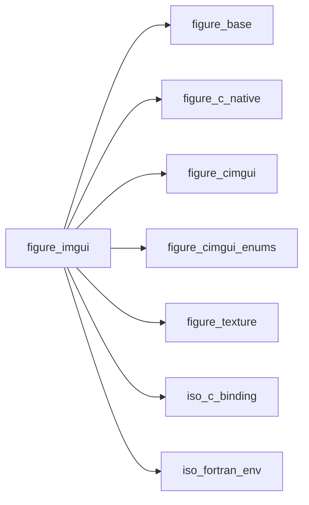

## Contents

- [ig_slider](#ig-slider)
- [ig_input](#ig-input)
- [ig_end](#ig-end)
- [ig_set_next_window](#ig-set-next-window)
- [ig_tooltip](#ig-tooltip)
- [ig_set_next_item_width](#ig-set-next-item-width)
- [ig_text](#ig-text)
- [ig_same_line](#ig-same-line)
- [ig_text_wrapped](#ig-text-wrapped)
- [ig_text_disabled](#ig-text-disabled)
- [ig_text_colored](#ig-text-colored)
- [ig_separator](#ig-separator)
- [ig_show_demo_window](#ig-show-demo-window)
- [ig_item_rect](#ig-item-rect)
- [ig_image](#ig-image)
- [ig_begin](#ig-begin)
- [ig_begin_side_bar](#ig-begin-side-bar)
- [ig_button](#ig-button)
- [ig_checkbox](#ig-checkbox)
- [ig_slider_i32](#ig-slider-i32)
- [ig_slider_r32](#ig-slider-r32)
- [ig_slider_r64](#ig-slider-r64)
- [ig_input_r64](#ig-input-r64)
- [ig_input_i32](#ig-input-i32)
- [ig_input_text](#ig-input-text)
- [ig_combo](#ig-combo)
- [ig_selectable](#ig-selectable)

## Interfaces

### ig_slider

Slider for an integer or a real value.

**Module procedures**: [`ig_slider_i32`](/api/src/lib/figure_imgui#ig-slider-i32), [`ig_slider_r32`](/api/src/lib/figure_imgui#ig-slider-r32), [`ig_slider_r64`](/api/src/lib/figure_imgui#ig-slider-r64)

### ig_input

Numeric field for an integer or a real value.

**Module procedures**: [`ig_input_i32`](/api/src/lib/figure_imgui#ig-input-i32), [`ig_input_r64`](/api/src/lib/figure_imgui#ig-input-r64)

## Subroutines

### ig_end

End the window opened by `ig_begin` (whatever it returned).

```fortran
subroutine ig_end()
```

**Call graph**

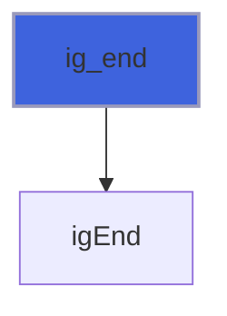

### ig_set_next_window

Position (and size) of the next window [pixels]: on first use only, or every frame if `always`.

```fortran
subroutine ig_set_next_window(x, y, width, height, always)
```

**Arguments**

| Name | Type | Intent | Attributes | Description |
|------|------|--------|------------|-------------|
| `x` | real(kind=real64) | in |  | Left [pixels]. |
| `y` | real(kind=real64) | in |  | Top [pixels]. |
| `width` | real(kind=real64) | in | optional | Width [pixels]. |
| `height` | real(kind=real64) | in | optional | Height [pixels]. |
| `always` | logical | in | optional | Enforce every frame (default: first use only). |

**Call graph**

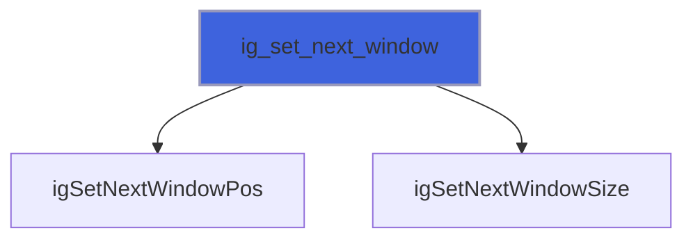

### ig_tooltip

A tooltip on the previous widget: `text` shows while the pointer rests on it (after Dear ImGui's usual delay).

```fortran
subroutine ig_tooltip(text)
```

**Arguments**

| Name | Type | Intent | Attributes | Description |
|------|------|--------|------------|-------------|
| `text` | character(len=*) | in |  | Text. |

**Call graph**

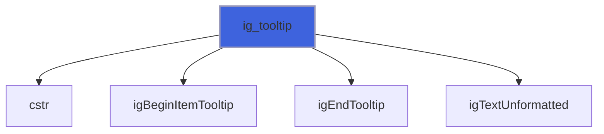

### ig_set_next_item_width

Width of the next widget's field [pixels]; negative: up to that distance from the window's right edge.

```fortran
subroutine ig_set_next_item_width(width)
```

**Arguments**

| Name | Type | Intent | Attributes | Description |
|------|------|--------|------------|-------------|
| `width` | real(kind=real64) | in |  | Width [pixels]. |

**Call graph**

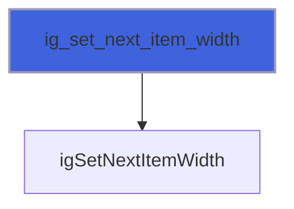

### ig_text

Plain text (no formatting: compose it with Fortran internal writes).

```fortran
subroutine ig_text(text)
```

**Arguments**

| Name | Type | Intent | Attributes | Description |
|------|------|--------|------------|-------------|
| `text` | character(len=*) | in |  | Text. |

**Call graph**

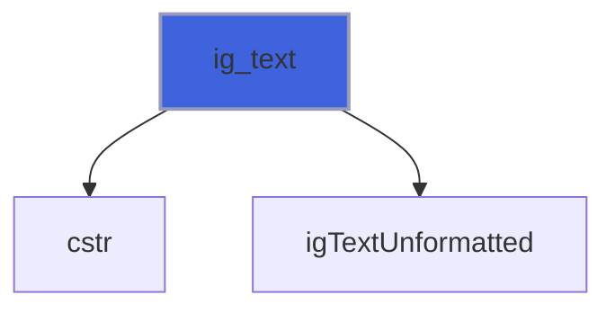

### ig_same_line

Put the next item on the same line as the previous one; with `offset`, at that distance [pixels] from the
 window's left edge (aligned columns of labels and fields).

```fortran
subroutine ig_same_line(offset)
```

**Arguments**

| Name | Type | Intent | Attributes | Description |
|------|------|--------|------------|-------------|
| `offset` | real(kind=real64) | in | optional | Distance from the window's left edge [pixels]. |

**Call graph**

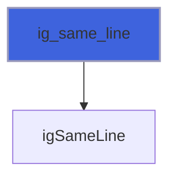

### ig_text_wrapped

Text wrapped at the right edge of the window or region (help text, long messages).

```fortran
subroutine ig_text_wrapped(text)
```

**Arguments**

| Name | Type | Intent | Attributes | Description |
|------|------|--------|------------|-------------|
| `text` | character(len=*) | in |  | Text. |

**Call graph**

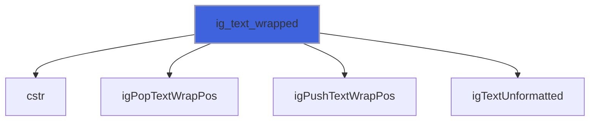

### ig_text_disabled

Text in the style's disabled colour (a default value, a hint, something that does not apply).

```fortran
subroutine ig_text_disabled(text)
```

**Arguments**

| Name | Type | Intent | Attributes | Description |
|------|------|--------|------------|-------------|
| `text` | character(len=*) | in |  | Text. |

**Call graph**

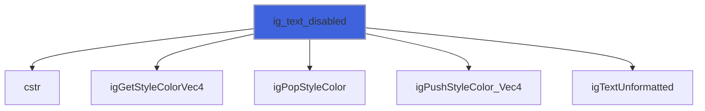

### ig_text_colored

Text in `color` ([r, g, b] or [r, g, b, a] in [0, 1]); pair a colour with a mark or a word (an error marker), so
 that it does not rest on colour alone.

```fortran
subroutine ig_text_colored(text, color)
```

**Arguments**

| Name | Type | Intent | Attributes | Description |
|------|------|--------|------------|-------------|
| `text` | character(len=*) | in |  | Text. |
| `color` | real(kind=real64) | in |  | [r, g, b] or [r, g, b, a]. |

**Call graph**

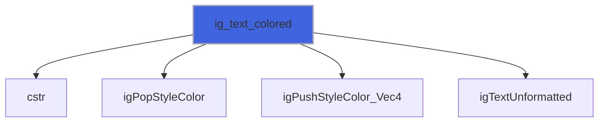

### ig_separator

Horizontal separator.

```fortran
subroutine ig_separator()
```

**Call graph**

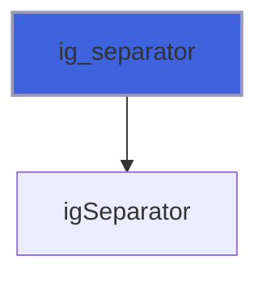

### ig_show_demo_window

The Dear ImGui demo window (a live catalogue of every widget).

```fortran
subroutine ig_show_demo_window(open)
```

**Arguments**

| Name | Type | Intent | Attributes | Description |
|------|------|--------|------------|-------------|
| `open` | logical | inout | optional | Window open (close button). |

**Call graph**

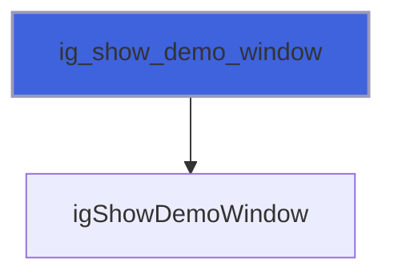

### ig_item_rect

Screen rectangle of the last item [pixels] (tests, custom layout).

```fortran
subroutine ig_item_rect(xmin, ymin, xmax, ymax)
```

**Arguments**

| Name | Type | Intent | Attributes | Description |
|------|------|--------|------------|-------------|
| `xmin` | real(kind=real64) | out |  | Left. |
| `ymin` | real(kind=real64) | out |  | Top. |
| `xmax` | real(kind=real64) | out |  | Right. |
| `ymax` | real(kind=real64) | out |  | Bottom. |

**Call graph**

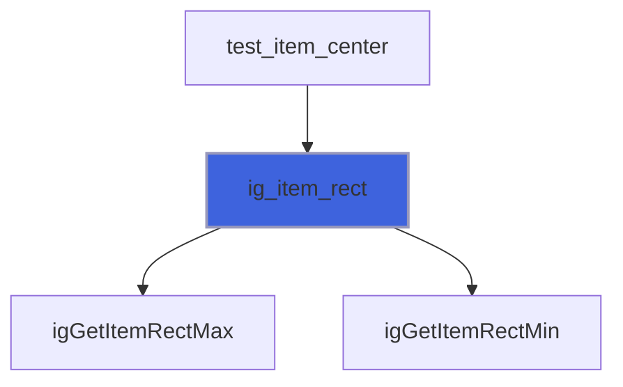

### ig_image

A texture, pixel row 1 at the top (screen and image-file convention), `width` x `height` pixels (default: the
 texture's size).

```fortran
subroutine ig_image(tex, width, height)
```

**Arguments**

| Name | Type | Intent | Attributes | Description |
|------|------|--------|------------|-------------|
| `tex` | type([texture_object](/api/src/lib/figure_texture#texture-object)) | in |  | Texture. |
| `width` | real(kind=real64) | in | optional | Width [pixels]. |
| `height` | real(kind=real64) | in | optional | Height [pixels]. |

**Call graph**

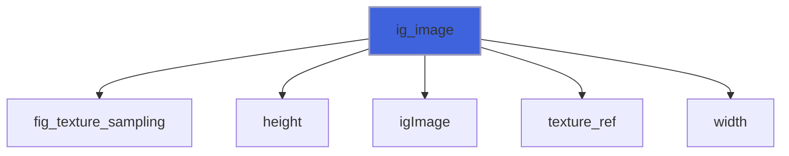

## Functions

### ig_begin

Begin a window; always pair with `ig_end`. With `open`, the window has a close button that sets it false.
 `flags` combine `ImGuiWindowFlags_*` with `ior` (`NoTitleBar`, `NoResize`, `NoMove`, `AlwaysAutoResize`,
 `NoBackground`, `NoDecoration`, `NoDocking`, ...).

**Returns**: `logical`

```fortran
function ig_begin(name, open, flags) result(visible)
```

**Arguments**

| Name | Type | Intent | Attributes | Description |
|------|------|--------|------------|-------------|
| `name` | character(len=*) | in |  | Window name (unique id and title). |
| `open` | logical | inout | optional | Window open. |
| `flags` | integer(kind=int32) | in | optional | `ImGuiWindowFlags_*` (default none). |

**Call graph**

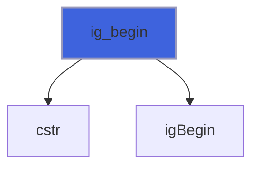

### ig_begin_side_bar

Begin a bar along one side of the display: a toolbar, a status bar. `side` is `'left'`, `'right'`, `'top'` or
 `'bottom'`; `size` its width (left, right) or height (top, bottom) [pixels]. It is a window without title bar,
 not movable, not resizable, not dockable, which the work area leaves out: a dock space (`ig_dock_space`) and
 the main menu bar's neighbours fill the rest. Declare it every frame, after the main menu bar and before the dock
 space; always pair with `ig_end`. An unknown side is taken as `'left'`.

**Returns**: `logical`

```fortran
function ig_begin_side_bar(name, side, size) result(visible)
```

**Arguments**

| Name | Type | Intent | Attributes | Description |
|------|------|--------|------------|-------------|
| `name` | character(len=*) | in |  | Window name (unique id). |
| `side` | character(len=*) | in |  | left, right, top, bottom. |
| `size` | real(kind=real64) | in |  | Width or height [pixels]. |

**Call graph**

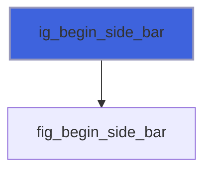

### ig_button

A button; true on the frame it is clicked.

**Returns**: `logical`

```fortran
function ig_button(label, width, height) result(pressed)
```

**Arguments**

| Name | Type | Intent | Attributes | Description |
|------|------|--------|------------|-------------|
| `label` | character(len=*) | in |  | Label. |
| `width` | real(kind=real64) | in | optional | Width [pixels] (default: fit the label). |
| `height` | real(kind=real64) | in | optional | Height [pixels] (default: fit the label). |

**Call graph**

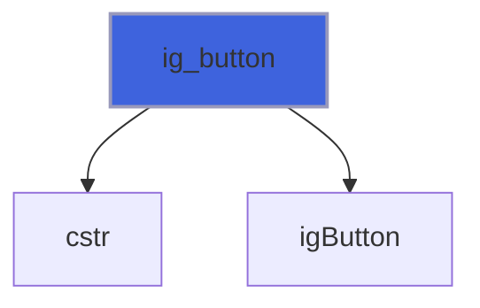

### ig_checkbox

A check box bound to `value`; true when the user toggled it.

**Returns**: `logical`

```fortran
function ig_checkbox(label, value) result(changed)
```

**Arguments**

| Name | Type | Intent | Attributes | Description |
|------|------|--------|------------|-------------|
| `label` | character(len=*) | in |  | Label. |
| `value` | logical | inout |  | Value. |

**Call graph**

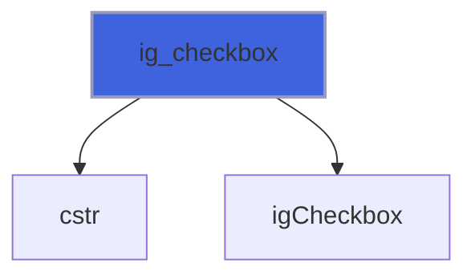

### ig_slider_i32

Integer slider; true when the user changed `value`.

**Returns**: `logical`

```fortran
function ig_slider_i32(label, value, vmin, vmax) result(changed)
```

**Arguments**

| Name | Type | Intent | Attributes | Description |
|------|------|--------|------------|-------------|
| `label` | character(len=*) | in |  | Label. |
| `value` | integer(kind=int32) | inout |  | Value. |
| `vmin` | integer(kind=int32) | in |  | Minimum. |
| `vmax` | integer(kind=int32) | in |  | Maximum. |

**Call graph**

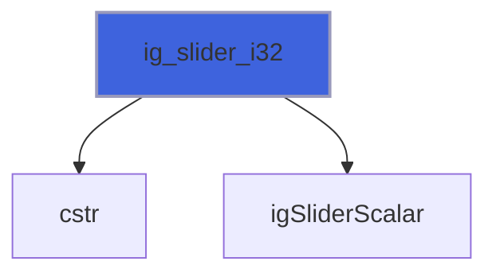

### ig_slider_r32

Single-precision slider; true when the user changed `value`.

**Returns**: `logical`

```fortran
function ig_slider_r32(label, value, vmin, vmax) result(changed)
```

**Arguments**

| Name | Type | Intent | Attributes | Description |
|------|------|--------|------------|-------------|
| `label` | character(len=*) | in |  | Label. |
| `value` | real(kind=real32) | inout |  | Value. |
| `vmin` | real(kind=real32) | in |  | Minimum. |
| `vmax` | real(kind=real32) | in |  | Maximum. |

**Call graph**


### ig_slider_r64

Double-precision slider; true when the user changed `value`.

**Returns**: `logical`

```fortran
function ig_slider_r64(label, value, vmin, vmax) result(changed)
```

**Arguments**

| Name | Type | Intent | Attributes | Description |
|------|------|--------|------------|-------------|
| `label` | character(len=*) | in |  | Label. |
| `value` | real(kind=real64) | inout |  | Value. |
| `vmin` | real(kind=real64) | in |  | Minimum. |
| `vmax` | real(kind=real64) | in |  | Maximum. |

**Call graph**

```mermaid
flowchart TD
  ig_slider_r64["ig_slider_r64"] --> cstr["cstr"]
  ig_slider_r64["ig_slider_r64"] --> igSliderScalar["igSliderScalar"]
  style ig_slider_r64 fill:#3e63dd,stroke:#99b,stroke-width:2px
```

### ig_input_r64

Numeric input field for a real value; true when the user changed it.

**Returns**: `logical`

```fortran
function ig_input_r64(label, value, step, format) result(changed)
```

**Arguments**

| Name | Type | Intent | Attributes | Description |
|------|------|--------|------------|-------------|
| `label` | character(len=*) | in |  | Label. |
| `value` | real(kind=real64) | inout |  | Value. |
| `step` | real(kind=real64) | in | optional | +/- buttons step (default: none). |
| `format` | character(len=*) | in | optional | printf format (default '%.6g'). |

**Call graph**

```mermaid
flowchart TD
  ig_input_r64["ig_input_r64"] --> cstr["cstr"]
  ig_input_r64["ig_input_r64"] --> igInputDouble["igInputDouble"]
  style ig_input_r64 fill:#3e63dd,stroke:#99b,stroke-width:2px
```

### ig_input_i32

Numeric input field for an integer value; true when the user changed it.

**Returns**: `logical`

```fortran
function ig_input_i32(label, value, step) result(changed)
```

**Arguments**

| Name | Type | Intent | Attributes | Description |
|------|------|--------|------------|-------------|
| `label` | character(len=*) | in |  | Label. |
| `value` | integer(kind=int32) | inout |  | Value. |
| `step` | integer(kind=int32) | in | optional | +/- buttons step (default: none). |

**Call graph**

```mermaid
flowchart TD
  ig_input_i32["ig_input_i32"] --> cstr["cstr"]
  ig_input_i32["ig_input_i32"] --> igInputInt["igInputInt"]
  style ig_input_i32 fill:#3e63dd,stroke:#99b,stroke-width:2px
```

### ig_input_text

A text field bound to `value`; true when the user edited it. The text can be as long as `value` (its length is
 the field's capacity); trailing blanks are not part of the text (Fortran pads with them). `hint` is shown while
 the field is empty; `flags` combine `ImGuiInputTextFlags_*` with `ior` (`CharsNoBlank`, `CharsDecimal`,
 `CharsScientific`, `ReadOnly`, `EnterReturnsTrue`, ...).

**Returns**: `logical`

```fortran
function ig_input_text(label, value, hint, flags) result(changed)
```

**Arguments**

| Name | Type | Intent | Attributes | Description |
|------|------|--------|------------|-------------|
| `label` | character(len=*) | in |  | Label. |
| `value` | character(len=*) | inout |  | Text. |
| `hint` | character(len=*) | in | optional | Shown while the field is empty. |
| `flags` | integer(kind=int32) | in | optional | `ImGuiInputTextFlags_*` (default none). |

**Call graph**

```mermaid
flowchart TD
  ig_input_text["ig_input_text"] --> fig_widget_input_text["fig_widget_input_text"]
  style ig_input_text fill:#3e63dd,stroke:#99b,stroke-width:2px
```

### ig_combo

A drop-down list of `items`; `current` is the index of the one chosen (1 to `size(items)`; any other value shows
 none chosen). True on the frame the user picks an item (`current` is then its index).

**Returns**: `logical`

```fortran
function ig_combo(label, current, items) result(changed)
```

**Arguments**

| Name | Type | Intent | Attributes | Description |
|------|------|--------|------------|-------------|
| `label` | character(len=*) | in |  | Label. |
| `current` | integer(kind=int32) | inout |  | Index of the chosen item. |
| `items` | character(len=*) | in |  | Items (trailing blanks are not shown). |

**Call graph**

```mermaid
flowchart TD
  ig_combo["ig_combo"] --> cstr["cstr"]
  ig_combo["ig_combo"] --> igBeginCombo["igBeginCombo"]
  ig_combo["ig_combo"] --> igEndCombo["igEndCombo"]
  ig_combo["ig_combo"] --> igPopID["igPopID"]
  ig_combo["ig_combo"] --> igPushID_Int["igPushID_Int"]
  ig_combo["ig_combo"] --> igSelectable_Bool["igSelectable_Bool"]
  ig_combo["ig_combo"] --> igSetItemDefaultFocus["igSetItemDefaultFocus"]
  style ig_combo fill:#3e63dd,stroke:#99b,stroke-width:2px
```

### ig_selectable

A line of a list, highlighted when `selected`; true on the frame it is clicked (the program then updates what is
 selected: the line does not change `selected` itself).

**Returns**: `logical`

```fortran
function ig_selectable(label, selected) result(clicked)
```

**Arguments**

| Name | Type | Intent | Attributes | Description |
|------|------|--------|------------|-------------|
| `label` | character(len=*) | in |  | Label (also its id). |
| `selected` | logical | in |  | Highlighted. |

**Call graph**

```mermaid
flowchart TD
  ig_selectable["ig_selectable"] --> cstr["cstr"]
  ig_selectable["ig_selectable"] --> igSelectable_Bool["igSelectable_Bool"]
  style ig_selectable fill:#3e63dd,stroke:#99b,stroke-width:2px
```
