# figure_imgui

> figure_imgui, Dear ImGui widgets with Fortran arguments.

 Every drawing procedure of this module refuses a call from a task (`FIG_ERR_STATE`): see processes.md; and a call
 with no frame open, a usage error (`FIG_ERR_STATE`, `<procedure>: no frame open`). Every begin/end and push/pop
 pair registers in the scope record of the frame, which checks each end before Dear ImGui sees it: a wrong end is
 refused and reported by `app%next_frame` (`app%set_checks`; errors.md, "Pairing and frames").

 Immediate mode: call the widgets every frame; each returns what happened this frame (`ig_button` is true on the
 frame it is clicked, `ig_checkbox` is true when it changed the value). Values are ordinary Fortran
 variables, updated in place: no handles, no callbacks, no `target` requirements (the C `bool*` of a checkbox is a
 local copy, written back).

**Source**: `src/lib/figure_imgui.F90`

**Dependencies**

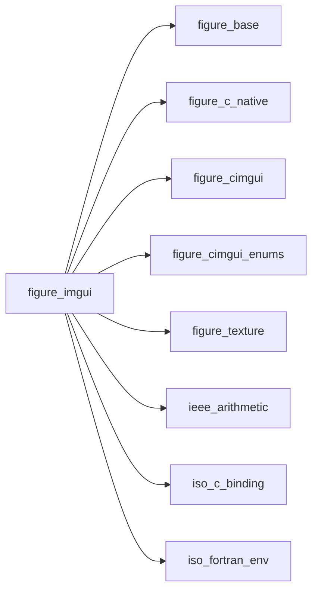

## Contents

- [text_buffer_object](#text-buffer-object)
- [item_status_object](#item-status-object)
- [ig_em](#ig-em)
- [ig_end](#ig-end)
- [ig_set_next_window](#ig-set-next-window)
- [ig_align_text_to_frame_padding](#ig-align-text-to-frame-padding)
- [ig_set_clipboard](#ig-set-clipboard)
- [text_buffer_set](#text-buffer-set)
- [text_buffer_final](#text-buffer-final)
- [ig_tooltip](#ig-tooltip)
- [ig_end_tooltip](#ig-end-tooltip)
- [ig_text_link_url](#ig-text-link-url)
- [ig_set_next_item_width](#ig-set-next-item-width)
- [ig_push_item_width](#ig-push-item-width)
- [ig_pop_item_width](#ig-pop-item-width)
- [ig_text](#ig-text)
- [ig_same_line](#ig-same-line)
- [ig_text_wrapped](#ig-text-wrapped)
- [ig_text_disabled](#ig-text-disabled)
- [ig_text_colored](#ig-text-colored)
- [ig_progress_bar](#ig-progress-bar)
- [ig_separator](#ig-separator)
- [ig_separator_text](#ig-separator-text)
- [ig_available](#ig-available)
- [ig_spacing](#ig-spacing)
- [ig_dummy](#ig-dummy)
- [ig_new_line](#ig-new-line)
- [ig_indent](#ig-indent)
- [ig_unindent](#ig-unindent)
- [ig_show_demo_window](#ig-show-demo-window)
- [ig_item_rect](#ig-item-rect)
- [ig_scroll_here](#ig-scroll-here)
- [ig_get_scroll](#ig-get-scroll)
- [ig_set_scroll](#ig-set-scroll)
- [ig_scroll_to_pos](#ig-scroll-to-pos)
- [ig_focus_here](#ig-focus-here)
- [ig_default_focus](#ig-default-focus)
- [ig_image](#ig-image)
- [take_payload](#take-payload)
- [ig_begin](#ig-begin)
- [ig_begin_side_bar](#ig-begin-side-bar)
- [ig_focus_window](#ig-focus-window)
- [ig_button](#ig-button)
- [ig_tool_button](#ig-tool-button)
- [ig_text_size](#ig-text-size)
- [ig_checkbox](#ig-checkbox)
- [ig_input_text](#ig-input-text)
- [ig_input_text_multiline](#ig-input-text-multiline)
- [ig_get_clipboard](#ig-get-clipboard)
- [text_buffer_text](#text-buffer-text)
- [text_buffer_length](#text-buffer-length)
- [ig_color_edit](#ig-color-edit)
- [ig_combo](#ig-combo)
- [ig_begin_tooltip](#ig-begin-tooltip)
- [ig_begin_item_tooltip](#ig-begin-item-tooltip)
- [ig_text_link](#ig-text-link)
- [ig_selectable](#ig-selectable)
- [ig_drag_source](#ig-drag-source)
- [ig_drop_target](#ig-drop-target)
- [ig_dragging](#ig-dragging)
- [ig_font_size](#ig-font-size)
- [ig_line_height](#ig-line-height)
- [ig_frame_height](#ig-frame-height)
- [ig_em_r64](#ig-em-r64)
- [ig_em_i32](#ig-em-i32)
- [ig_splitter](#ig-splitter)
- [ig_last_item](#ig-last-item)
- [ig_item_hovered](#ig-item-hovered)
- [ig_any_item_hovered](#ig-any-item-hovered)
- [ig_any_item_active](#ig-any-item-active)
- [scroll_arguments](#scroll-arguments)
- [item_index_refused](#item-index-refused)

## Derived Types

### text_buffer_object

Text of any length, edited by `ig_input_text_multiline`: a file shown or edited as text, notes, a read-only view.
 The text is kept by FIGURE's native layer, which grows it while the user types or pastes (no capacity to choose,
 no copy per frame); `set` replaces it, `text` returns a copy. Lines end with LF (`set` turns CRLF into LF).
 Usable before `init*` and from a task (it draws nothing). Not to be copied: the copy would share the text, and
 the first of the two to end would take it away from the other.

**Components**

| Name | Type | Attributes | Description |
|------|------|------------|-------------|
| `id` | integer(kind=c_int) |  | Native handle (0: no text yet, an empty one). |

**Type-Bound Procedures**

| Name | Attributes | Description |
|------|------------|-------------|
| [`set`](/api/src/lib/figure_imgui#text-buffer-set) | pass(self) | Replace the text. |
| [`text`](/api/src/lib/figure_imgui#text-buffer-text) | pass(self) | A copy of the text. |
| [`length`](/api/src/lib/figure_imgui#text-buffer-length) | pass(self) | Its length [bytes]. |

### item_status_object

What happened to an item, as `ig_last_item` found it right after the item was drawn: a snapshot, a plain value
 the program keeps (later items do not change it). The event states (`activated`, `edited`, `deactivated`,
 `deactivated_after_edit`, `toggled_open`, `clicked`, `double_clicked`) are true on one frame only, the frame of
 the event; the others (`hovered`, `active`, `focused`, `visible`) last as long as the condition. Which widgets
 report which states: widgets.md, "What happened to an item".

**Components**

| Name | Type | Attributes | Description |
|------|------|------------|-------------|
| `hovered` | logical |  | The pointer is over the item, and no other item is held. |
| `active` | logical |  | Held (a button pressed, a slider dragged) or being edited. |
| `focused` | logical |  | It has the keyboard focus (keyboard navigation's cursor). |
| `visible` | logical |  | Not clipped: inside its window or region's visible area. |
| `activated` | logical |  | It became active on this frame. |
| `edited` | logical |  | It changed its value on this frame. |
| `deactivated` | logical |  | It stopped being active on this frame. |
| `deactivated_after_edit` | logical |  | It stopped being active on this frame, its value changed meanwhile. |
| `toggled_open` | logical |  | A tree node or header opened or closed on this frame. |
| `clicked` | logical |  | Clicked on this frame, per button: left, right, middle. |
| `double_clicked` | logical |  | Double-clicked on this frame, per button: left, right, middle. |
| `rect` | real(kind=real64) |  | x, y (top left), width, height [pixels]. |

## Interfaces

### ig_em

A length of `x` em [pixels]: `x` times the current font size, so that a size given in lines of text follows the
 font and the display's scale.

**Module procedures**: [`ig_em_r64`](/api/src/lib/figure_imgui#ig-em-r64), [`ig_em_i32`](/api/src/lib/figure_imgui#ig-em-i32)

## Subroutines

### ig_end

End the window opened by `ig_begin` or `ig_begin_side_bar` (whatever it returned). Refused (`FIG_ERR_STATE`,
 reported by `app%next_frame`) when the innermost open scope is not a window: errors.md, "Pairing and frames".

**Attributes**: recursive

```fortran
subroutine ig_end()
```

**Call graph**

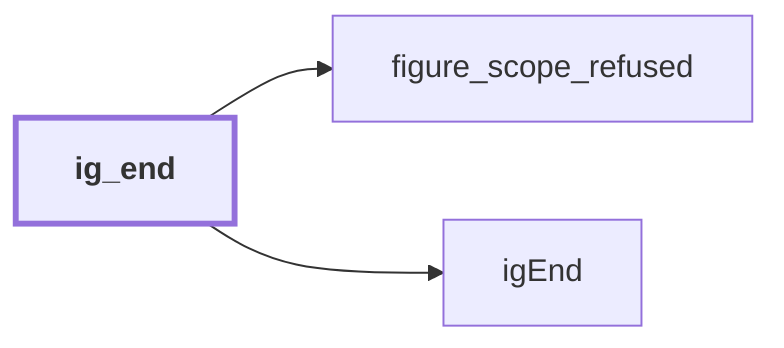

### ig_set_next_window

Position (and size) of the next window [pixels]: on first use only, or every frame if `always`.

**Attributes**: recursive

```fortran
subroutine ig_set_next_window(x, y, width, height, always)
```

**Arguments**

| Name | Type | Intent | Attributes | Description |
|------|------|--------|------------|-------------|
| `x` | real(kind=real64) | in |  | Left [pixels]. |
| `y` | real(kind=real64) | in |  | Top [pixels]. |
| `width` | real(kind=real64) | in | optional | Width [pixels]. |
| `height` | real(kind=real64) | in | optional | Height [pixels]. |
| `always` | logical | in | optional | Enforce every frame (default: first use only). |

**Call graph**

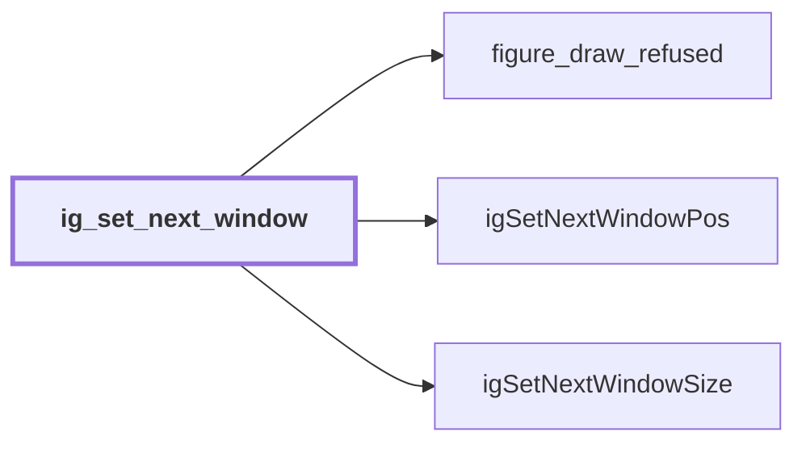

### ig_align_text_to_frame_padding

The text that follows on this line is lowered to the text of framed widgets (fields, buttons): a label or a value
 beside fields, in a table row of fields.

**Attributes**: recursive

```fortran
subroutine ig_align_text_to_frame_padding()
```

**Call graph**

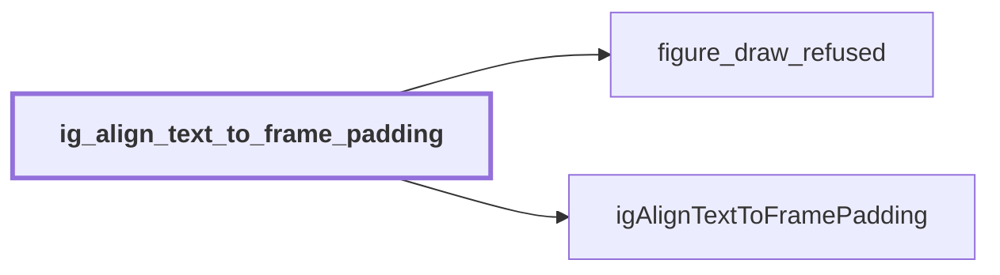

### ig_set_clipboard

Put `text` (UTF-8, trailing blanks included: pass `trim` of a padded variable) on the clipboard, as a copy in a
 field does. Window mode: the system's clipboard (SDL's). Headless mode: a clipboard of the program's own.
 Remote mode: the program's own on the server, also written to the browser's clipboard where the browser allows
 it (a page reached as https or localhost, and in a few browsers only right after a click or a key). Status:
 `FIG_ERR_STATE` before `init*` or from a task (`stat` optional: absent, `error stop` with the message).

**Attributes**: recursive

```fortran
subroutine ig_set_clipboard(text, stat)
```

**Arguments**

| Name | Type | Intent | Attributes | Description |
|------|------|--------|------------|-------------|
| `text` | character(len=*) | in |  | Text. |
| `stat` | integer(kind=int32) | out | optional | Status. |

**Call graph**

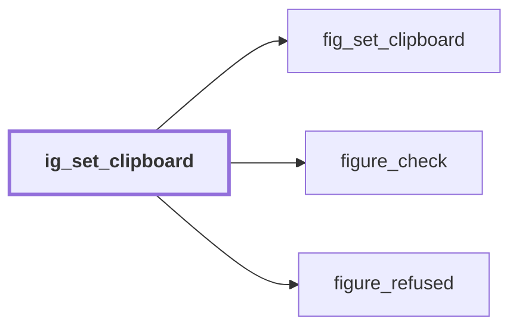

### text_buffer_set

Replace the text with `text` (UTF-8, lines ended by LF or CRLF; trailing blanks are part of it: pass `trim` of a
 padded line). A field being edited shows the new text at once, its undo history kept. A NUL byte ends the text.
 Status: `FIG_ERR_ARGUMENT` for a text of 2 GiB or more (`stat` optional: absent, `error stop` with the message).

**Attributes**: recursive

```fortran
subroutine text_buffer_set(self, text, stat)
```

**Arguments**

| Name | Type | Intent | Attributes | Description |
|------|------|--------|------------|-------------|
| `self` | class([text_buffer_object](/api/src/lib/figure_imgui#text-buffer-object)) | inout |  | Buffer. |
| `text` | character(len=*) | in |  | New text. |
| `stat` | integer(kind=int32) | out | optional | Status. |

**Call graph**

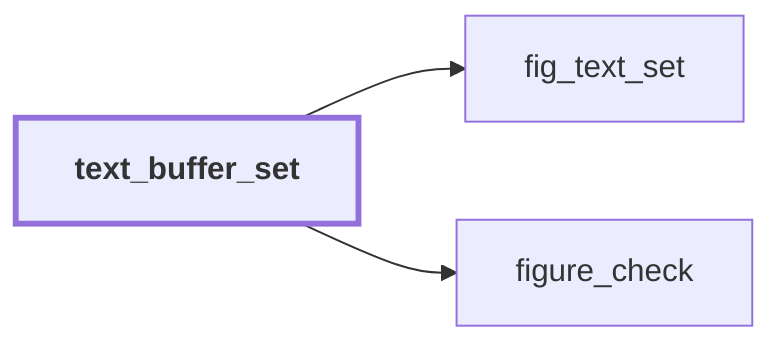

### text_buffer_final

The buffer ends: its text is released.

**Attributes**: recursive

```fortran
subroutine text_buffer_final(self)
```

**Arguments**

| Name | Type | Intent | Attributes | Description |
|------|------|--------|------------|-------------|
| `self` | type([text_buffer_object](/api/src/lib/figure_imgui#text-buffer-object)) | inout |  | Buffer. |

**Call graph**

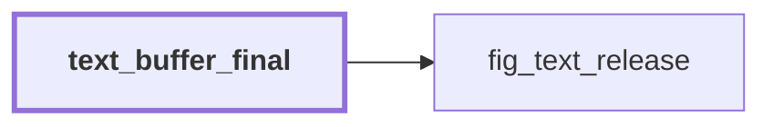

### ig_tooltip

A tooltip on the previous widget: `text` shows while the pointer rests on it (after Dear ImGui's usual delay).

**Attributes**: recursive

```fortran
subroutine ig_tooltip(text)
```

**Arguments**

| Name | Type | Intent | Attributes | Description |
|------|------|--------|------------|-------------|
| `text` | character(len=*) | in |  | Text. |

**Call graph**

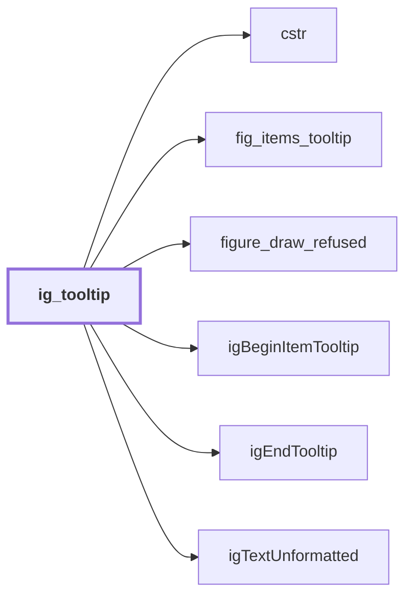

### ig_end_tooltip

End a tooltip (only after `ig_begin_tooltip` or `ig_begin_item_tooltip` returned true). A wrong end (after a false
 begin, or with another scope innermost) is refused and reported (`FIG_ERR_STATE`; errors.md, "Pairing and
 frames").

**Attributes**: recursive

```fortran
subroutine ig_end_tooltip()
```

**Call graph**

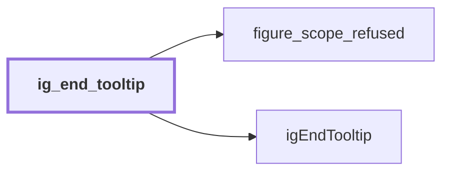

### ig_text_link_url

A link that opens `url` when clicked (Dear ImGui's `TextLinkOpenURL`): a window opens it with the system's
 handler (SDL_OpenURL: the browser, or the program a file's type is given to); remote mode sends it to the page,
 which opens it in a new tab of the browser (where the browser allows pop-ups); headless mode opens nothing
 (`test_opened_url` reads it). The pointer resting on it shows the URL; a right click offers "Copy Link". FIGURE
 does not check the URL: pass a link of your own, not text a user typed. No frame open or a task: refused
 (`FIG_ERR_STATE`).

**Attributes**: recursive

```fortran
subroutine ig_text_link_url(label, url)
```

**Arguments**

| Name | Type | Intent | Attributes | Description |
|------|------|--------|------------|-------------|
| `label` | character(len=*) | in |  | Label (also its id). |
| `url` | character(len=*) | in |  | The address, e.g. `'https://...'`. |

**Call graph**

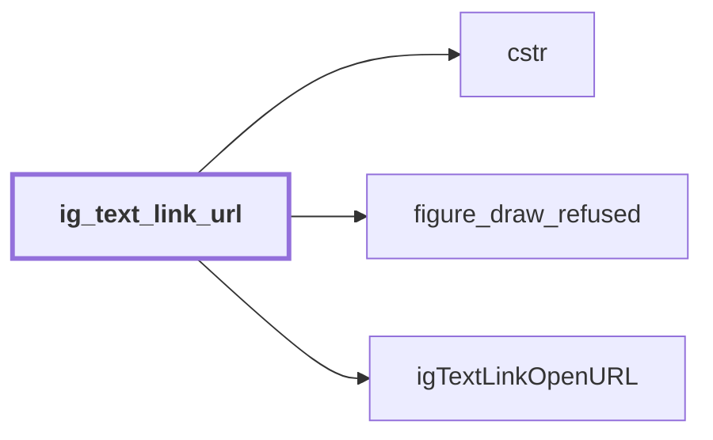

### ig_set_next_item_width

Width of the next widget's field [pixels]; negative: up to that distance from the window's right edge.

**Attributes**: recursive

```fortran
subroutine ig_set_next_item_width(width)
```

**Arguments**

| Name | Type | Intent | Attributes | Description |
|------|------|--------|------------|-------------|
| `width` | real(kind=real64) | in |  | Width [pixels]. |

**Call graph**

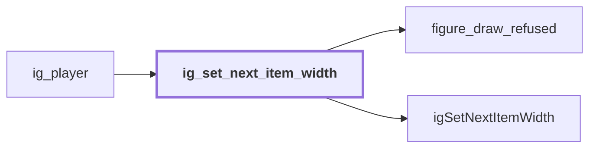

### ig_push_item_width

Width of the fields of every widget that follows in the current window [pixels] (Dear ImGui's `PushItemWidth`),
 until `ig_pop_item_width`; always paired, the pop in the same window and scope (a pop closes the innermost scope,
 as `ig_pop_id`). Negative: up to that distance from the right edge of the window or region; 0: the window's
 default. `ig_set_next_item_width` still sets the next widget's alone. No frame open or a task: nothing done (a
 usage error, reported by `app%next_frame`). The same in window, headless and remote mode.

**Attributes**: recursive

```fortran
subroutine ig_push_item_width(width)
```

**Arguments**

| Name | Type | Intent | Attributes | Description |
|------|------|--------|------------|-------------|
| `width` | real(kind=real64) | in |  | Width [pixels]; < 0: up to that distance from the right edge; 0: the default. |

**Call graph**

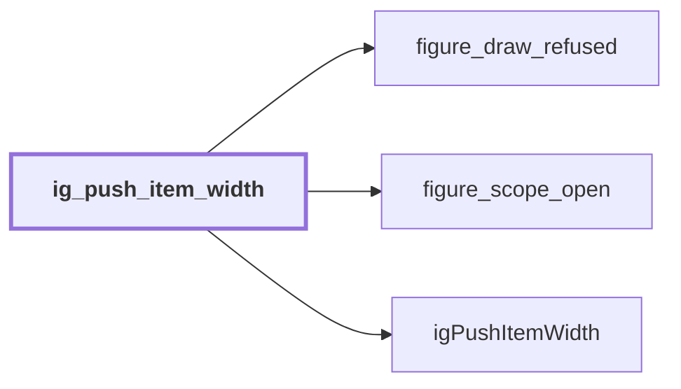

### ig_pop_item_width

Back to the width of the fields before the last `ig_push_item_width` (Dear ImGui's `PopItemWidth`).

**Attributes**: recursive

```fortran
subroutine ig_pop_item_width()
```

**Call graph**

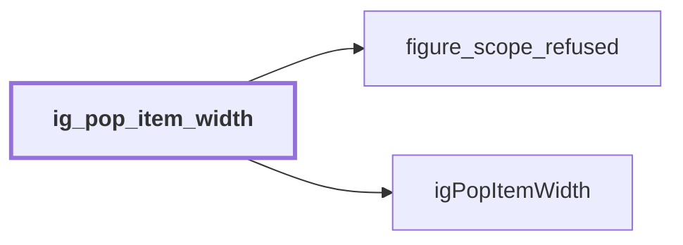

### ig_text

Plain text (no formatting: compose it with Fortran internal writes).

**Attributes**: recursive

```fortran
subroutine ig_text(text)
```

**Arguments**

| Name | Type | Intent | Attributes | Description |
|------|------|--------|------------|-------------|
| `text` | character(len=*) | in |  | Text. |

**Call graph**

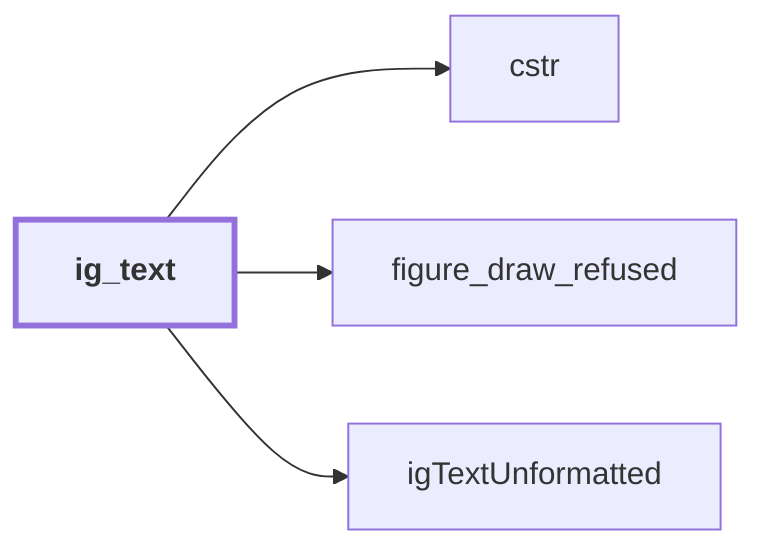

### ig_same_line

Put the next item on the same line as the previous one; with `offset`, at that distance [pixels] from the
 window's left edge (aligned columns of labels and fields).

**Attributes**: recursive

```fortran
subroutine ig_same_line(offset)
```

**Arguments**

| Name | Type | Intent | Attributes | Description |
|------|------|--------|------------|-------------|
| `offset` | real(kind=real64) | in | optional | Distance from the window's left edge [pixels]. |

**Call graph**

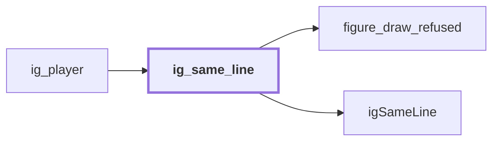

### ig_text_wrapped

Text wrapped at the right edge of the window or region (help text, long messages).

**Attributes**: recursive

```fortran
subroutine ig_text_wrapped(text)
```

**Arguments**

| Name | Type | Intent | Attributes | Description |
|------|------|--------|------------|-------------|
| `text` | character(len=*) | in |  | Text. |

**Call graph**

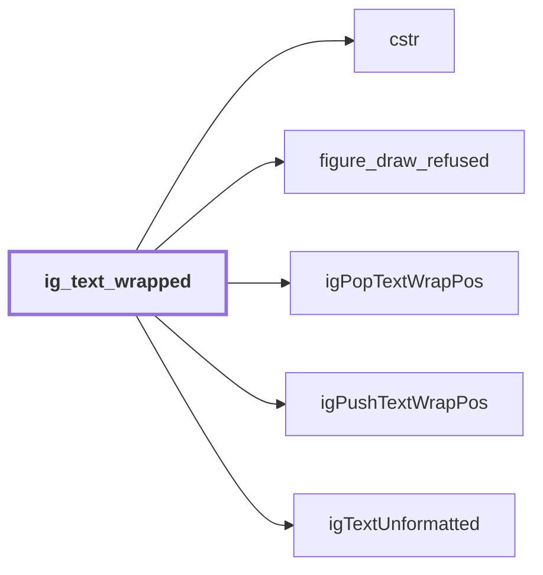

### ig_text_disabled

Text in the style's disabled colour (a default value, a hint, something that does not apply).

**Attributes**: recursive

```fortran
subroutine ig_text_disabled(text)
```

**Arguments**

| Name | Type | Intent | Attributes | Description |
|------|------|--------|------------|-------------|
| `text` | character(len=*) | in |  | Text. |

**Call graph**

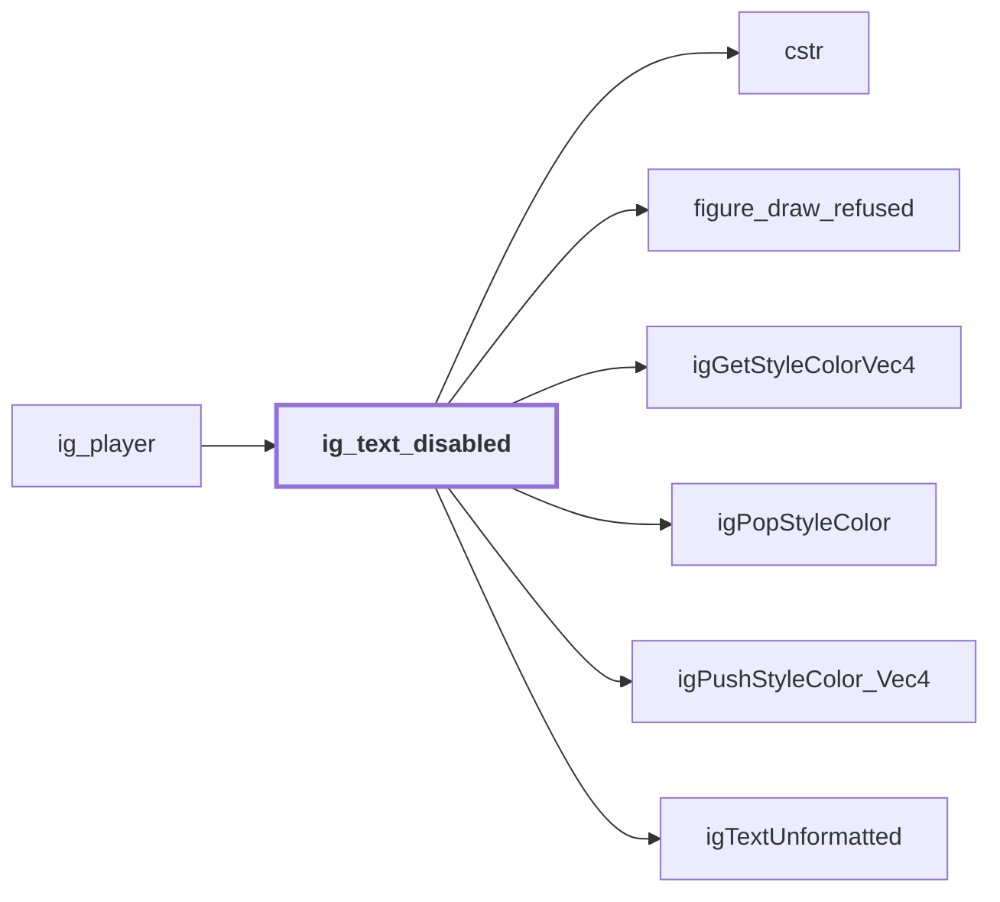

### ig_text_colored

Text in `color` ([r, g, b] or [r, g, b, a] in [0, 1]); pair a colour with a mark or a word (an error marker), so
 that it does not rest on colour alone.

**Attributes**: recursive

```fortran
subroutine ig_text_colored(text, color)
```

**Arguments**

| Name | Type | Intent | Attributes | Description |
|------|------|--------|------------|-------------|
| `text` | character(len=*) | in |  | Text. |
| `color` | real(kind=real64) | in |  | [r, g, b] or [r, g, b, a]. |

**Call graph**

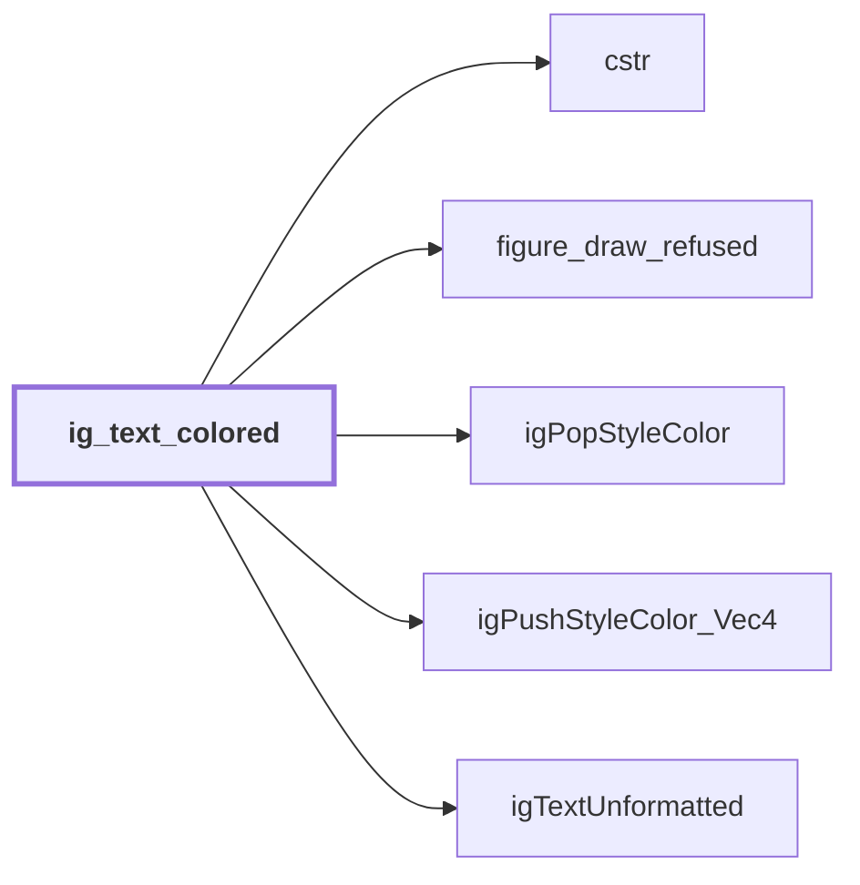

### ig_progress_bar

A progress bar (`ProgressBar`), `fraction` of it filled, in [0, 1] (clamped); `fraction` < 0 gives an
 indeterminate bar, a band sliding along it (animated by FIGURE with the frame clock: draw it every frame).
 `label` is written over it (default: the percentage; none for an indeterminate bar); `width` [pixels] (default:
 the width left; negative: up to that distance from the right edge). The same in every mode.

**Attributes**: recursive

```fortran
subroutine ig_progress_bar(fraction, label, width)
```

**Arguments**

| Name | Type | Intent | Attributes | Description |
|------|------|--------|------------|-------------|
| `fraction` | real(kind=real64) | in |  | Done, in [0, 1]; < 0: indeterminate. |
| `label` | character(len=*) | in | optional | Text over the bar. |
| `width` | real(kind=real64) | in | optional | Width [pixels]. |

**Call graph**

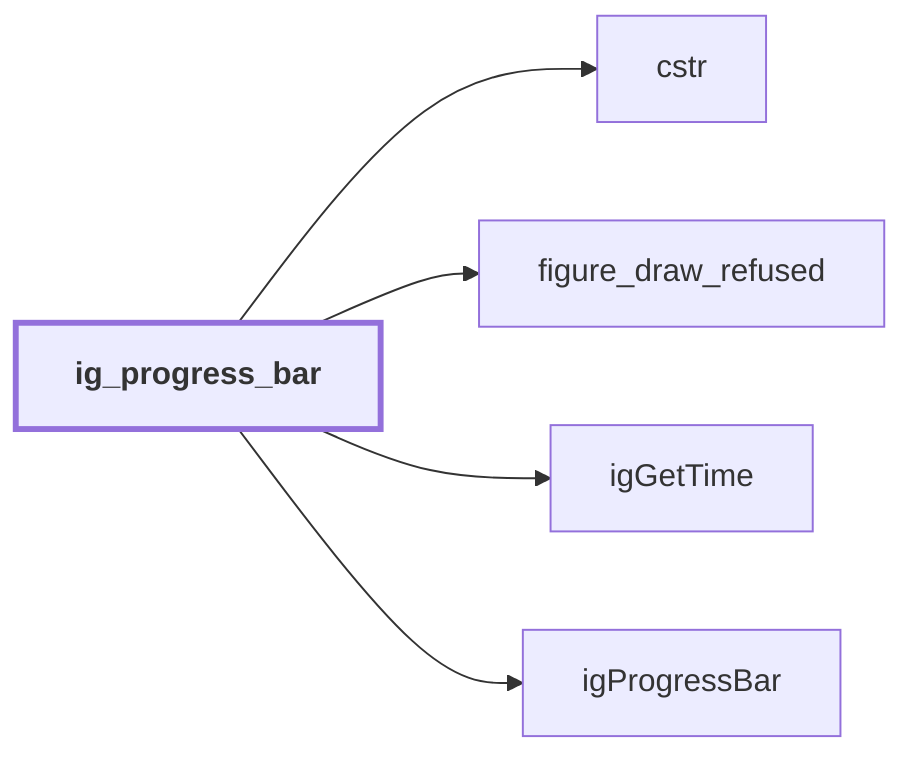

### ig_separator

Horizontal separator.

**Attributes**: recursive

```fortran
subroutine ig_separator()
```

**Call graph**

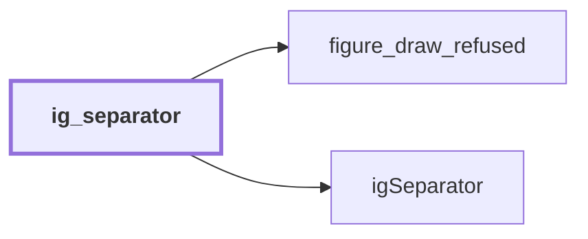

### ig_separator_text

A horizontal separator with `label` written in it, at its left (Dear ImGui's `SeparatorText`): the title of a
 part of a form. The text before `##` is shown. No frame open or a task: nothing drawn (a usage error, reported
 by `app%next_frame`). The same in window, headless and remote mode.

**Attributes**: recursive

```fortran
subroutine ig_separator_text(label)
```

**Arguments**

| Name | Type | Intent | Attributes | Description |
|------|------|--------|------------|-------------|
| `label` | character(len=*) | in |  | Text of the separator. |

**Call graph**

```mermaid
flowchart LR
  ig_separator_text["ig_separator_text"] --> cstr["cstr"]
  ig_separator_text["ig_separator_text"] --> figure_draw_refused["figure_draw_refused"]
  ig_separator_text["ig_separator_text"] --> igSeparatorText["igSeparatorText"]
  classDef focus stroke-width:3px,font-weight:bold
  class ig_separator_text focus
  click figure_draw_refused href "figure_base.html#figure-draw-refused" "figure_draw_refused"
  click igSeparatorText href "figure_cimgui.html#igseparatortext" "igSeparatorText"
  click cstr href "figure_base.html#cstr" "cstr"
```

### ig_available

The space left in the current window or region from where the next item goes [pixels] (Dear ImGui's
 `GetContentRegionAvail`): to the right edge of its content (`width`) and to its bottom (`height`); in a table
 cell, to the cell's right edge. A side bar or a child region drawn beside takes its width out of it. No frame
 open or a task: zeros (a usage error, reported by `app%next_frame`).

**Attributes**: recursive

```fortran
subroutine ig_available(width, height)
```

**Arguments**

| Name | Type | Intent | Attributes | Description |
|------|------|--------|------------|-------------|
| `width` | real(kind=real64) | out |  | Width left [pixels]. |
| `height` | real(kind=real64) | out |  | Height left [pixels]. |

**Call graph**

```mermaid
flowchart LR
  ig_available["ig_available"] --> figure_draw_refused["figure_draw_refused"]
  ig_available["ig_available"] --> igGetContentRegionAvail["igGetContentRegionAvail"]
  classDef focus stroke-width:3px,font-weight:bold
  class ig_available focus
  click figure_draw_refused href "figure_base.html#figure-draw-refused" "figure_draw_refused"
  click igGetContentRegionAvail href "figure_cimgui.html#iggetcontentregionavail" "igGetContentRegionAvail"
```

### ig_spacing

A vertical gap of the style's item spacing before the next item (Dear ImGui's `Spacing`).

**Attributes**: recursive

```fortran
subroutine ig_spacing()
```

**Call graph**

```mermaid
flowchart LR
  ig_spacing["ig_spacing"] --> figure_draw_refused["figure_draw_refused"]
  ig_spacing["ig_spacing"] --> igSpacing["igSpacing"]
  classDef focus stroke-width:3px,font-weight:bold
  class ig_spacing focus
  click figure_draw_refused href "figure_base.html#figure-draw-refused" "figure_draw_refused"
  click igSpacing href "figure_cimgui.html#igspacing" "igSpacing"
```

### ig_dummy

An empty item `width` x `height` pixels (Dear ImGui's `Dummy`): a gap of a given size, a place kept for something
 drawn later; it counts for `ig_same_line`, groups and the window's size like any item.

**Attributes**: recursive

```fortran
subroutine ig_dummy(width, height)
```

**Arguments**

| Name | Type | Intent | Attributes | Description |
|------|------|--------|------------|-------------|
| `width` | real(kind=real64) | in |  | Width [pixels]. |
| `height` | real(kind=real64) | in |  | Height [pixels]. |

**Call graph**

```mermaid
flowchart LR
  ig_dummy["ig_dummy"] --> figure_draw_refused["figure_draw_refused"]
  ig_dummy["ig_dummy"] --> igDummy["igDummy"]
  classDef focus stroke-width:3px,font-weight:bold
  class ig_dummy focus
  click figure_draw_refused href "figure_base.html#figure-draw-refused" "figure_draw_refused"
  click igDummy href "figure_cimgui.html#igdummy" "igDummy"
```

### ig_new_line

End the line (after `ig_same_line`), or add an empty line of text's height (Dear ImGui's `NewLine`).

**Attributes**: recursive

```fortran
subroutine ig_new_line()
```

**Call graph**

```mermaid
flowchart LR
  ig_new_line["ig_new_line"] --> figure_draw_refused["figure_draw_refused"]
  ig_new_line["ig_new_line"] --> igNewLine["igNewLine"]
  classDef focus stroke-width:3px,font-weight:bold
  class ig_new_line focus
  click figure_draw_refused href "figure_base.html#figure-draw-refused" "figure_draw_refused"
  click igNewLine href "figure_cimgui.html#ignewline" "igNewLine"
```

### ig_indent

Move the left edge of the lines that follow right by `width` pixels (default, or 0: the style's indent spacing),
 until `ig_unindent` with the same width (Dear ImGui's `Indent`). Not a scope: the program keeps the two balanced
 (a window's indent is reset when it begins).

**Attributes**: recursive

```fortran
subroutine ig_indent(width)
```

**Arguments**

| Name | Type | Intent | Attributes | Description |
|------|------|--------|------------|-------------|
| `width` | real(kind=real64) | in | optional | Indent [pixels] (default: the style's indent spacing). |

**Call graph**

```mermaid
flowchart LR
  ig_indent["ig_indent"] --> figure_draw_refused["figure_draw_refused"]
  ig_indent["ig_indent"] --> igIndent["igIndent"]
  classDef focus stroke-width:3px,font-weight:bold
  class ig_indent focus
  click figure_draw_refused href "figure_base.html#figure-draw-refused" "figure_draw_refused"
  click igIndent href "figure_cimgui.html#igindent" "igIndent"
```

### ig_unindent

Move the left edge of the lines that follow back left by `width` pixels (default, or 0: the style's indent
 spacing) (Dear ImGui's `Unindent`).

**Attributes**: recursive

```fortran
subroutine ig_unindent(width)
```

**Arguments**

| Name | Type | Intent | Attributes | Description |
|------|------|--------|------------|-------------|
| `width` | real(kind=real64) | in | optional | Indent removed [pixels] (default: the style's indent spacing). |

**Call graph**

```mermaid
flowchart LR
  ig_unindent["ig_unindent"] --> figure_draw_refused["figure_draw_refused"]
  ig_unindent["ig_unindent"] --> igUnindent["igUnindent"]
  classDef focus stroke-width:3px,font-weight:bold
  class ig_unindent focus
  click figure_draw_refused href "figure_base.html#figure-draw-refused" "figure_draw_refused"
  click igUnindent href "figure_cimgui.html#igunindent" "igUnindent"
```

### ig_show_demo_window

The Dear ImGui demo window (a live catalogue of every widget).

**Attributes**: recursive

```fortran
subroutine ig_show_demo_window(open)
```

**Arguments**

| Name | Type | Intent | Attributes | Description |
|------|------|--------|------------|-------------|
| `open` | logical | inout | optional | Window open (close button). |

**Call graph**

```mermaid
flowchart LR
  ig_show_demo_window["ig_show_demo_window"] --> figure_draw_refused["figure_draw_refused"]
  ig_show_demo_window["ig_show_demo_window"] --> igShowDemoWindow["igShowDemoWindow"]
  classDef focus stroke-width:3px,font-weight:bold
  class ig_show_demo_window focus
  click figure_draw_refused href "figure_base.html#figure-draw-refused" "figure_draw_refused"
  click igShowDemoWindow href "figure_cimgui.html#igshowdemowindow" "igShowDemoWindow"
```

### ig_item_rect

Screen rectangle of the last item [pixels] (tests, custom layout).

**Attributes**: recursive

```fortran
subroutine ig_item_rect(xmin, ymin, xmax, ymax)
```

**Arguments**

| Name | Type | Intent | Attributes | Description |
|------|------|--------|------------|-------------|
| `xmin` | real(kind=real64) | out |  | Left. |
| `ymin` | real(kind=real64) | out |  | Top. |
| `xmax` | real(kind=real64) | out |  | Right. |
| `ymax` | real(kind=real64) | out |  | Bottom. |

**Call graph**

```mermaid
flowchart LR
  test_item_center["test_item_center"] --> ig_item_rect["ig_item_rect"]
  ig_item_rect["ig_item_rect"] --> figure_draw_refused["figure_draw_refused"]
  ig_item_rect["ig_item_rect"] --> igGetItemRectMax["igGetItemRectMax"]
  ig_item_rect["ig_item_rect"] --> igGetItemRectMin["igGetItemRectMin"]
  classDef focus stroke-width:3px,font-weight:bold
  class ig_item_rect focus
  click test_item_center href "figure_testing.html#test-item-center" "test_item_center"
  click figure_draw_refused href "figure_base.html#figure-draw-refused" "figure_draw_refused"
  click igGetItemRectMin href "figure_cimgui.html#iggetitemrectmin" "igGetItemRectMin"
  click igGetItemRectMax href "figure_cimgui.html#iggetitemrectmax" "igGetItemRectMax"
```

### ig_scroll_here

Scroll the current window or region so that the line drawn last (the last item's line) is at `ratio` of its
 visible height: 0 top, 0.5 centre (default), 1 bottom (Dear ImGui's `SetScrollHereY`; `axis='x'`:
 `SetScrollHereX`, the last item at `ratio` of the visible width). Call it after the item, inside the window or
 region that scrolls. The scroll moves when that window or region is begun on the next frame: the item is in place
 one frame later. A ratio outside [0, 1] or an unknown axis: nothing done, `FIG_ERR_ARGUMENT` in `stat` (or
 `error stop` without it); no frame open or a task: `FIG_ERR_STATE`. The same in window, headless and remote mode.

**Attributes**: recursive

```fortran
subroutine ig_scroll_here(ratio, axis, stat)
```

**Arguments**

| Name | Type | Intent | Attributes | Description |
|------|------|--------|------------|-------------|
| `ratio` | real(kind=real64) | in | optional | Where the line goes, in [0, 1] of the visible height (width). |
| `axis` | character(len=*) | in | optional | 'y' (default) or 'x'. |
| `stat` | integer(kind=int32) | out | optional | Status. |

**Call graph**

```mermaid
flowchart LR
  log_draw["log_draw"] --> ig_scroll_here["ig_scroll_here"]
  ig_scroll_here["ig_scroll_here"] --> figure_draw_refused["figure_draw_refused"]
  ig_scroll_here["ig_scroll_here"] --> igSetScrollHereX["igSetScrollHereX"]
  ig_scroll_here["ig_scroll_here"] --> igSetScrollHereY["igSetScrollHereY"]
  ig_scroll_here["ig_scroll_here"] --> scroll_arguments["scroll_arguments"]
  classDef focus stroke-width:3px,font-weight:bold
  class ig_scroll_here focus
  click log_draw href "figure_process.html#log-draw" "log_draw"
  click figure_draw_refused href "figure_base.html#figure-draw-refused" "figure_draw_refused"
  click scroll_arguments href "#scroll-arguments" "scroll_arguments"
  click igSetScrollHereX href "figure_cimgui.html#igsetscrollherex" "igSetScrollHereX"
  click igSetScrollHereY href "figure_cimgui.html#igsetscrollherey" "igSetScrollHereY"
```

### ig_get_scroll

The scroll of the current window or region [pixels] (Dear ImGui's `GetScrollY`, `GetScrollMaxY`, `GetScrollX`,
 `GetScrollMaxX`): `y` from 0 (top) to `ymax` (bottom; 0: nothing to scroll), `x` from 0 (left) to `xmax`. The
 values of the last layout: a scroll asked for on this frame is not in them yet. No frame open or a task: zeros
 (a usage error, reported by `app%next_frame`). The same in window, headless and remote mode.

**Attributes**: recursive

```fortran
subroutine ig_get_scroll(y, ymax, x, xmax)
```

**Arguments**

| Name | Type | Intent | Attributes | Description |
|------|------|--------|------------|-------------|
| `y` | real(kind=real64) | out |  | Vertical scroll [pixels]. |
| `ymax` | real(kind=real64) | out |  | Largest vertical scroll [pixels]. |
| `x` | real(kind=real64) | out | optional | Horizontal scroll [pixels]. |
| `xmax` | real(kind=real64) | out | optional | Largest horizontal scroll [pixels]. |

**Call graph**

```mermaid
flowchart LR
  log_draw["log_draw"] --> ig_get_scroll["ig_get_scroll"]
  ig_get_scroll["ig_get_scroll"] --> figure_draw_refused["figure_draw_refused"]
  ig_get_scroll["ig_get_scroll"] --> igGetScrollMaxX["igGetScrollMaxX"]
  ig_get_scroll["ig_get_scroll"] --> igGetScrollMaxY["igGetScrollMaxY"]
  ig_get_scroll["ig_get_scroll"] --> igGetScrollX["igGetScrollX"]
  ig_get_scroll["ig_get_scroll"] --> igGetScrollY["igGetScrollY"]
  classDef focus stroke-width:3px,font-weight:bold
  class ig_get_scroll focus
  click log_draw href "figure_process.html#log-draw" "log_draw"
  click figure_draw_refused href "figure_base.html#figure-draw-refused" "figure_draw_refused"
  click igGetScrollY href "figure_cimgui.html#iggetscrolly" "igGetScrollY"
  click igGetScrollMaxY href "figure_cimgui.html#iggetscrollmaxy" "igGetScrollMaxY"
  click igGetScrollX href "figure_cimgui.html#iggetscrollx" "igGetScrollX"
  click igGetScrollMaxX href "figure_cimgui.html#iggetscrollmaxx" "igGetScrollMaxX"
```

### ig_set_scroll

Scroll the current window or region to `y` (and/or `x`) [pixels] (Dear ImGui's `SetScrollY`, `SetScrollX`):
 clamped to [0, the largest scroll] when applied, on the next frame (one frame late, as `ig_scroll_here`). An
 absent coordinate is left as it is. No frame open or a task: nothing done (a usage error, reported by
 `app%next_frame`). The same in window, headless and remote mode.

**Attributes**: recursive

```fortran
subroutine ig_set_scroll(y, x)
```

**Arguments**

| Name | Type | Intent | Attributes | Description |
|------|------|--------|------------|-------------|
| `y` | real(kind=real64) | in | optional | Vertical scroll [pixels]. |
| `x` | real(kind=real64) | in | optional | Horizontal scroll [pixels]. |

**Call graph**

```mermaid
flowchart LR
  ig_set_scroll["ig_set_scroll"] --> figure_draw_refused["figure_draw_refused"]
  ig_set_scroll["ig_set_scroll"] --> igSetScrollX_Float["igSetScrollX_Float"]
  ig_set_scroll["ig_set_scroll"] --> igSetScrollY_Float["igSetScrollY_Float"]
  classDef focus stroke-width:3px,font-weight:bold
  class ig_set_scroll focus
  click figure_draw_refused href "figure_base.html#figure-draw-refused" "figure_draw_refused"
  click igSetScrollY_Float href "figure_cimgui.html#igsetscrolly-float" "igSetScrollY_Float"
  click igSetScrollX_Float href "figure_cimgui.html#igsetscrollx-float" "igSetScrollX_Float"
```

### ig_scroll_to_pos

Scroll the current window or region so that the point `pos` [pixels] of its content is at `ratio` of its visible
 height: 0 top, 0.5 centre (default), 1 bottom (Dear ImGui's `SetScrollFromPosY`; `axis='x'`: `SetScrollFromPosX`
 and the width). `pos` is measured from the top (left) of the content, where its first item starts, whatever the
 scroll is now: row `i` of a list of rows `h` pixels apart starts at `(i - 1) * h`. It reaches a row that is not
 drawn on this frame (a list clipper's). Applied on the next frame, as `ig_scroll_here`. A ratio outside [0, 1] or
 an unknown axis: nothing done, `FIG_ERR_ARGUMENT` in `stat` (or `error stop` without it); no frame open or a
 task: `FIG_ERR_STATE`. The same in window, headless and remote mode.

**Attributes**: recursive

```fortran
subroutine ig_scroll_to_pos(pos, ratio, axis, stat)
```

**Arguments**

| Name | Type | Intent | Attributes | Description |
|------|------|--------|------------|-------------|
| `pos` | real(kind=real64) | in |  | Point of the content [pixels from its top (left)]. |
| `ratio` | real(kind=real64) | in | optional | Where it goes, in [0, 1] of the visible height (width). |
| `axis` | character(len=*) | in | optional | 'y' (default) or 'x'. |
| `stat` | integer(kind=int32) | out | optional | Status. |

**Call graph**

```mermaid
flowchart LR
  ig_scroll_to_pos["ig_scroll_to_pos"] --> figure_draw_refused["figure_draw_refused"]
  ig_scroll_to_pos["ig_scroll_to_pos"] --> igGetCursorStartPos["igGetCursorStartPos"]
  ig_scroll_to_pos["ig_scroll_to_pos"] --> igSetScrollFromPosX_Float["igSetScrollFromPosX_Float"]
  ig_scroll_to_pos["ig_scroll_to_pos"] --> igSetScrollFromPosY_Float["igSetScrollFromPosY_Float"]
  ig_scroll_to_pos["ig_scroll_to_pos"] --> scroll_arguments["scroll_arguments"]
  classDef focus stroke-width:3px,font-weight:bold
  class ig_scroll_to_pos focus
  click figure_draw_refused href "figure_base.html#figure-draw-refused" "figure_draw_refused"
  click scroll_arguments href "#scroll-arguments" "scroll_arguments"
  click igGetCursorStartPos href "figure_cimgui.html#iggetcursorstartpos" "igGetCursorStartPos"
  click igSetScrollFromPosX_Float href "figure_cimgui.html#igsetscrollfromposx-float" "igSetScrollFromPosX_Float"
  click igSetScrollFromPosY_Float href "figure_cimgui.html#igsetscrollfromposy-float" "igSetScrollFromPosY_Float"
```

### ig_focus_here

Give the keyboard focus to the next item (Dear ImGui's `SetKeyboardFocusHere`): call it before the item, on one
 frame (the frame a dialog opens, a button asks for it), not on every frame. A text or number field is then edited
 as if clicked: typed keys go into it, from the next frame. `offset` 1 is the item after the next, 2 the one after
 that; -1 is the item drawn last. The window or region is scrolled to show the item. An offset below -1: nothing
 done, `FIG_ERR_ARGUMENT` in `stat` (or `error stop` without it); no frame open or a task: `FIG_ERR_STATE`. The
 same in window, headless and remote mode.

**Attributes**: recursive

```fortran
subroutine ig_focus_here(offset, stat)
```

**Arguments**

| Name | Type | Intent | Attributes | Description |
|------|------|--------|------------|-------------|
| `offset` | integer(kind=int32) | in | optional | Which item: 0 the next (default), 1 the one after, -1 the last. |
| `stat` | integer(kind=int32) | out | optional | Status. |

**Call graph**

```mermaid
flowchart LR
  ig_focus_here["ig_focus_here"] --> figure_draw_refused["figure_draw_refused"]
  ig_focus_here["ig_focus_here"] --> figure_fail["figure_fail"]
  ig_focus_here["ig_focus_here"] --> igSetKeyboardFocusHere["igSetKeyboardFocusHere"]
  classDef focus stroke-width:3px,font-weight:bold
  class ig_focus_here focus
  click figure_draw_refused href "figure_base.html#figure-draw-refused" "figure_draw_refused"
  click figure_fail href "figure_base.html#figure-fail" "figure_fail"
  click igSetKeyboardFocusHere href "figure_cimgui.html#igsetkeyboardfocushere" "igSetKeyboardFocusHere"
```

### ig_default_focus

Make the item drawn last the one that has the keyboard focus when its window appears (Dear ImGui's
 `SetItemDefaultFocus`): a dialog's safe button, the field a form starts from. Call it after the item; it acts on
 the frame the window (a modal, a popup, a window opened by the program) appears, and does nothing on the others,
 so it may be called on every frame. The item is focused, not activated: enter or space presses it (keyboard
 navigation), a field is edited after enter. No frame open or a task: nothing done (a usage error, reported by
 `app%next_frame`). The same in window, headless and remote mode.

**Attributes**: recursive

```fortran
subroutine ig_default_focus()
```

**Call graph**

```mermaid
flowchart LR
  ig_default_focus["ig_default_focus"] --> figure_draw_refused["figure_draw_refused"]
  ig_default_focus["ig_default_focus"] --> igSetItemDefaultFocus["igSetItemDefaultFocus"]
  classDef focus stroke-width:3px,font-weight:bold
  class ig_default_focus focus
  click figure_draw_refused href "figure_base.html#figure-draw-refused" "figure_draw_refused"
  click igSetItemDefaultFocus href "figure_cimgui.html#igsetitemdefaultfocus" "igSetItemDefaultFocus"
```

### ig_image

A texture, pixel row 1 at the top (screen and image-file convention), `width` x `height` pixels (default: the
 texture's size).

**Attributes**: recursive

```fortran
subroutine ig_image(tex, width, height)
```

**Arguments**

| Name | Type | Intent | Attributes | Description |
|------|------|--------|------------|-------------|
| `tex` | type([texture_object](/api/src/lib/figure_texture#texture-object)) | in |  | Texture. |
| `width` | real(kind=real64) | in | optional | Width [pixels]. |
| `height` | real(kind=real64) | in | optional | Height [pixels]. |

**Call graph**

```mermaid
flowchart LR
  ig_image["ig_image"] --> fig_texture_sampling["fig_texture_sampling"]
  ig_image["ig_image"] --> figure_draw_refused["figure_draw_refused"]
  ig_image["ig_image"] --> height["height"]
  ig_image["ig_image"] --> igImage["igImage"]
  ig_image["ig_image"] --> texture_ref["texture_ref"]
  ig_image["ig_image"] --> width["width"]
  classDef focus stroke-width:3px,font-weight:bold
  class ig_image focus
  click figure_draw_refused href "figure_base.html#figure-draw-refused" "figure_draw_refused"
  click width href "figure_texture.html#width" "width"
  click height href "figure_texture.html#height" "height"
  click fig_texture_sampling href "figure_c_native.html#fig-texture-sampling" "fig_texture_sampling"
  click igImage href "figure_cimgui.html#igimage" "igImage"
  click texture_ref href "figure_texture.html#texture-ref" "texture_ref"
```

### take_payload

The payload delivered last, `n` characters, into `payload` (reallocated).

**Attributes**: recursive

```fortran
subroutine take_payload(n, payload)
```

**Arguments**

| Name | Type | Intent | Attributes | Description |
|------|------|--------|------------|-------------|
| `n` | integer(kind=c_int) | in |  | Its length. |
| `payload` | character(len=:) | inout | allocatable | The payload. |

**Call graph**

```mermaid
flowchart LR
  ig_drop_target["ig_drop_target"] --> take_payload["take_payload"]
  ip_drop_target["ip_drop_target"] --> take_payload["take_payload"]
  take_payload["take_payload"] --> fig_dnd_payload["fig_dnd_payload"]
  classDef focus stroke-width:3px,font-weight:bold
  class take_payload focus
  click ig_drop_target href "#ig-drop-target" "ig_drop_target"
  click ip_drop_target href "figure_implot.html#ip-drop-target" "ip_drop_target"
  click fig_dnd_payload href "figure_c_native.html#fig-dnd-payload" "fig_dnd_payload"
```

## Functions

### ig_begin

Begin a window; always pair with `ig_end`. With `open`, the window has a close button that sets it false.
 Without `open`, a window registered with `app%add_window` (closable, the default) has the close button, which
 hides it: `app%window_visible(name)` turns false. `flags` combine `ImGuiWindowFlags_*` with `ior`
 (`NoTitleBar`, `NoResize`, `NoMove`, `AlwaysAutoResize`, `NoBackground`, `NoDecoration`, `NoDocking`, ...).

**Attributes**: recursive

**Returns**: `logical`

```fortran
function ig_begin(name, open, flags) result(visible)
```

**Arguments**

| Name | Type | Intent | Attributes | Description |
|------|------|--------|------------|-------------|
| `name` | character(len=*) | in |  | Window name (unique id and title). |
| `open` | logical | inout | optional | Window open. |
| `flags` | integer(kind=int32) | in | optional | `ImGuiWindowFlags_*` (default none). |

**Call graph**

```mermaid
flowchart LR
  ig_begin["ig_begin"] --> cstr["cstr"]
  ig_begin["ig_begin"] --> fig_window_open_flag["fig_window_open_flag"]
  ig_begin["ig_begin"] --> figure_draw_refused["figure_draw_refused"]
  ig_begin["ig_begin"] --> figure_scope_open["figure_scope_open"]
  ig_begin["ig_begin"] --> igBegin["igBegin"]
  classDef focus stroke-width:3px,font-weight:bold
  class ig_begin focus
  click figure_draw_refused href "figure_base.html#figure-draw-refused" "figure_draw_refused"
  click fig_window_open_flag href "figure_c_native.html#fig-window-open-flag" "fig_window_open_flag"
  click igBegin href "figure_cimgui.html#igbegin" "igBegin"
  click cstr href "figure_base.html#cstr" "cstr"
  click figure_scope_open href "figure_base.html#figure-scope-open" "figure_scope_open"
```

### ig_begin_side_bar

Begin a bar along one side of the display: a toolbar, a status bar. `side` is `'left'`, `'right'`, `'top'` or
 `'bottom'`; `size` its width (left, right) or height (top, bottom) [pixels]. It is a window without title bar,
 not movable, not resizable, not dockable, which the work area leaves out: a dock space (`ig_dock_space`) and
 the main menu bar's neighbours fill the rest. Declare it every frame, after the main menu bar and before the dock
 space; always pair with `ig_end`. An unknown side is taken as `'left'`.

**Attributes**: recursive

**Returns**: `logical`

```fortran
function ig_begin_side_bar(name, side, size) result(visible)
```

**Arguments**

| Name | Type | Intent | Attributes | Description |
|------|------|--------|------------|-------------|
| `name` | character(len=*) | in |  | Window name (unique id). |
| `side` | character(len=*) | in |  | left, right, top, bottom. |
| `size` | real(kind=real64) | in |  | Width or height [pixels]. |

**Call graph**

```mermaid
flowchart LR
  ig_begin_side_bar["ig_begin_side_bar"] --> fig_begin_side_bar["fig_begin_side_bar"]
  ig_begin_side_bar["ig_begin_side_bar"] --> figure_draw_refused["figure_draw_refused"]
  ig_begin_side_bar["ig_begin_side_bar"] --> figure_scope_open["figure_scope_open"]
  classDef focus stroke-width:3px,font-weight:bold
  class ig_begin_side_bar focus
  click figure_draw_refused href "figure_base.html#figure-draw-refused" "figure_draw_refused"
  click fig_begin_side_bar href "figure_c_native.html#fig-begin-side-bar" "fig_begin_side_bar"
  click figure_scope_open href "figure_base.html#figure-scope-open" "figure_scope_open"
```

### ig_focus_window

Bring window `name` forward and give it the keyboard (a docked window: its tab is shown). Not while a popup or a
 modal is open, since focusing another window would close it: then nothing happens and the result is false; ask
 again on a later frame. A window not drawn yet (this frame or before) is not found: ask after its `ig_begin`.

**Attributes**: recursive

**Returns**: `logical`

```fortran
function ig_focus_window(name) result(focused)
```

**Arguments**

| Name | Type | Intent | Attributes | Description |
|------|------|--------|------------|-------------|
| `name` | character(len=*) | in |  | Window name (as given to `ig_begin`, or its `###id` part). |

**Call graph**

```mermaid
flowchart LR
  ig_focus_window["ig_focus_window"] --> cstr["cstr"]
  ig_focus_window["ig_focus_window"] --> figure_draw_refused["figure_draw_refused"]
  ig_focus_window["ig_focus_window"] --> igIsPopupOpen_Str["igIsPopupOpen_Str"]
  ig_focus_window["ig_focus_window"] --> igSetWindowFocus_Str["igSetWindowFocus_Str"]
  classDef focus stroke-width:3px,font-weight:bold
  class ig_focus_window focus
  click figure_draw_refused href "figure_base.html#figure-draw-refused" "figure_draw_refused"
  click igIsPopupOpen_Str href "figure_cimgui.html#igispopupopen-str" "igIsPopupOpen_Str"
  click igSetWindowFocus_Str href "figure_cimgui.html#igsetwindowfocus-str" "igSetWindowFocus_Str"
  click cstr href "figure_base.html#cstr" "cstr"
```

### ig_button

A button; true on the frame it is clicked.

**Attributes**: recursive

**Returns**: `logical`

```fortran
function ig_button(label, width, height) result(pressed)
```

**Arguments**

| Name | Type | Intent | Attributes | Description |
|------|------|--------|------------|-------------|
| `label` | character(len=*) | in |  | Label. |
| `width` | real(kind=real64) | in | optional | Width [pixels] (default: fit the label). |
| `height` | real(kind=real64) | in | optional | Height [pixels] (default: fit the label). |

**Call graph**

```mermaid
flowchart LR
  ig_player["ig_player"] --> ig_button["ig_button"]
  ig_button["ig_button"] --> cstr["cstr"]
  ig_button["ig_button"] --> figure_draw_refused["figure_draw_refused"]
  ig_button["ig_button"] --> igButton["igButton"]
  classDef focus stroke-width:3px,font-weight:bold
  class ig_button focus
  click ig_player href "figure_player.html#ig-player" "ig_player"
  click figure_draw_refused href "figure_base.html#figure-draw-refused" "figure_draw_refused"
  click igButton href "figure_cimgui.html#igbutton" "igButton"
  click cstr href "figure_base.html#cstr" "cstr"
```

### ig_tool_button

A workspace button, as Fusion 360's: `icon` (an `ICON_*`) above `label`, larger than it, on a framed, rounded button
 that shades under the pointer. `selected`: framed and tinted in the accent colour, the icon drawn in it (`accent`
 `[r, g, b]` in [0, 1]; default: the style's CheckMark colour). `width`, `height` [pixels]: default as wide as the
 label (at least 4.6 font sizes) and tall enough for the icon (1.8 font sizes) above the label. The text before
 `##` is shown, all of `label` is the id. True on the frame it is clicked; `ig_tooltip` and `ig_item_rect` apply to
 it as to any widget.

**Attributes**: recursive

**Returns**: `logical`

```fortran
function ig_tool_button(label, icon, width, height, selected, accent) result(clicked)
```

**Arguments**

| Name | Type | Intent | Attributes | Description |
|------|------|--------|------------|-------------|
| `label` | character(len=*) | in |  | Label (also its id). |
| `icon` | character(len=*) | in |  | Icon (UTF-8: an ICON_* constant). |
| `width` | real(kind=real64) | in | optional | Width [pixels]. |
| `height` | real(kind=real64) | in | optional | Height [pixels]. |
| `selected` | logical | in | optional | The one shown (default false). |
| `accent` | real(kind=real64) | in | optional | Accent colour. |

**Call graph**

```mermaid
flowchart LR
  ig_tool_button["ig_tool_button"] --> fig_tool_button["fig_tool_button"]
  ig_tool_button["ig_tool_button"] --> figure_draw_refused["figure_draw_refused"]
  classDef focus stroke-width:3px,font-weight:bold
  class ig_tool_button focus
  click figure_draw_refused href "figure_base.html#figure-draw-refused" "figure_draw_refused"
  click fig_tool_button href "figure_c_native.html#fig-tool-button" "fig_tool_button"
```

### ig_text_size

The size a text takes in the current font [pixels]: width and height (the text before `##` when it is a label):
 buttons of one width, a column as wide as its longest value.

**Attributes**: recursive

**Returns**: `real(kind=real64)`

```fortran
function ig_text_size(text) result(extent)
```

**Arguments**

| Name | Type | Intent | Attributes | Description |
|------|------|--------|------------|-------------|
| `text` | character(len=*) | in |  | Text (UTF-8). |

**Call graph**

```mermaid
flowchart LR
  ig_text_size["ig_text_size"] --> cstr["cstr"]
  ig_text_size["ig_text_size"] --> figure_refused["figure_refused"]
  ig_text_size["ig_text_size"] --> igCalcTextSize["igCalcTextSize"]
  classDef focus stroke-width:3px,font-weight:bold
  class ig_text_size focus
  click figure_refused href "figure_base.html#figure-refused" "figure_refused"
  click igCalcTextSize href "figure_cimgui.html#igcalctextsize" "igCalcTextSize"
  click cstr href "figure_base.html#cstr" "cstr"
```

### ig_checkbox

A check box bound to `value`; true when the user toggled it.

**Attributes**: recursive

**Returns**: `logical`

```fortran
function ig_checkbox(label, value) result(changed)
```

**Arguments**

| Name | Type | Intent | Attributes | Description |
|------|------|--------|------------|-------------|
| `label` | character(len=*) | in |  | Label. |
| `value` | logical | inout |  | Value. |

**Call graph**

```mermaid
flowchart LR
  ig_checkbox["ig_checkbox"] --> cstr["cstr"]
  ig_checkbox["ig_checkbox"] --> figure_draw_refused["figure_draw_refused"]
  ig_checkbox["ig_checkbox"] --> igCheckbox["igCheckbox"]
  classDef focus stroke-width:3px,font-weight:bold
  class ig_checkbox focus
  click figure_draw_refused href "figure_base.html#figure-draw-refused" "figure_draw_refused"
  click igCheckbox href "figure_cimgui.html#igcheckbox" "igCheckbox"
  click cstr href "figure_base.html#cstr" "cstr"
```

### ig_input_text

A text field bound to `value`; true when the user edited it. The text can be as long as `value` (its length is
 the field's capacity); trailing blanks are not part of the text (Fortran pads with them). `hint` is shown while
 the field is empty; `flags` combine `ImGuiInputTextFlags_*` with `ior` (`CharsNoBlank`, `CharsDecimal`,
 `CharsScientific`, `ReadOnly`, `EnterReturnsTrue`, ...).

**Attributes**: recursive

**Returns**: `logical`

```fortran
function ig_input_text(label, value, hint, flags) result(changed)
```

**Arguments**

| Name | Type | Intent | Attributes | Description |
|------|------|--------|------------|-------------|
| `label` | character(len=*) | in |  | Label. |
| `value` | character(len=*) | inout |  | Text. |
| `hint` | character(len=*) | in | optional | Shown while the field is empty. |
| `flags` | integer(kind=int32) | in | optional | `ImGuiInputTextFlags_*` (default none). |

**Call graph**

```mermaid
flowchart LR
  ig_input_text["ig_input_text"] --> fig_widget_input_text["fig_widget_input_text"]
  ig_input_text["ig_input_text"] --> figure_draw_refused["figure_draw_refused"]
  classDef focus stroke-width:3px,font-weight:bold
  class ig_input_text focus
  click figure_draw_refused href "figure_base.html#figure-draw-refused" "figure_draw_refused"
  click fig_widget_input_text href "figure_c_native.html#fig-widget-input-text" "fig_widget_input_text"
```

### ig_input_text_multiline

A multi-line text field (`InputTextMultiline`) over `buffer`; true on the frame the user edited the text.
 Enter inserts a newline; the field scrolls when the text is longer than it. Keys (cmd for ctrl on macOS):
 ctrl+z undoes, ctrl+y or ctrl+shift+z redoes, ctrl+a selects all, ctrl+c, ctrl+x and ctrl+v copy, cut and
 paste. `width`, `height` [pixels]: absent or 0, the item width and 8 lines; negative, up to that distance from
 the region's right or bottom edge. `read_only`: the text can be selected and copied, not changed. `tab_input`:
 Tab inserts a tab character (default: it moves to the next widget). `flags` add `ImGuiInputTextFlags_*` with
 `ior` (`WordWrap`, `NoUndoRedo`, ...). The same in every mode; from a task it draws nothing and returns false
 (the task's status becomes `FIG_ERR_STATE`).

**Attributes**: recursive

**Returns**: `logical`

```fortran
function ig_input_text_multiline(label, buffer, width, height, read_only, tab_input, flags) result(changed)
```

**Arguments**

| Name | Type | Intent | Attributes | Description |
|------|------|--------|------------|-------------|
| `label` | character(len=*) | in |  | Label (`'##text'`: none shown). |
| `buffer` | type([text_buffer_object](/api/src/lib/figure_imgui#text-buffer-object)) | inout |  | The text. |
| `width` | real(kind=real64) | in | optional | Width [pixels]. |
| `height` | real(kind=real64) | in | optional | Height [pixels]. |
| `read_only` | logical | in | optional | Selection and copy only (default false). |
| `tab_input` | logical | in | optional | Tab inserts a tab (default false). |
| `flags` | integer(kind=int32) | in | optional | More `ImGuiInputTextFlags_*` (default none). |

**Call graph**

```mermaid
flowchart LR
  ig_input_text_multiline["ig_input_text_multiline"] --> fig_widget_input_text_multiline["fig_widget_input_text_multiline"]
  ig_input_text_multiline["ig_input_text_multiline"] --> figure_draw_refused["figure_draw_refused"]
  classDef focus stroke-width:3px,font-weight:bold
  class ig_input_text_multiline focus
  click figure_draw_refused href "figure_base.html#figure-draw-refused" "figure_draw_refused"
  click fig_widget_input_text_multiline href "figure_c_native.html#fig-widget-input-text-multiline" "fig_widget_input_text_multiline"
```

### ig_get_clipboard

The clipboard's text (UTF-8), as a paste in a field reads it: the system's in window mode, the program's own in
 headless mode; in remote mode the program's own, which a paste in the page (ctrl+v, cmd+v) sets from the
 browser's clipboard first. `''` before `init*`, for an empty clipboard, or from a task.

**Attributes**: recursive

**Returns**: `character(len=:)`

```fortran
function ig_get_clipboard() result(text)
```

**Call graph**

```mermaid
flowchart LR
  ig_get_clipboard["ig_get_clipboard"] --> fig_get_clipboard["fig_get_clipboard"]
  ig_get_clipboard["ig_get_clipboard"] --> figure_refused["figure_refused"]
  classDef focus stroke-width:3px,font-weight:bold
  class ig_get_clipboard focus
  click figure_refused href "figure_base.html#figure-refused" "figure_refused"
  click fig_get_clipboard href "figure_c_native.html#fig-get-clipboard" "fig_get_clipboard"
```

### text_buffer_text

A copy of the text (`''` before any `set` or edit).

**Attributes**: recursive

**Returns**: `character(len=:)`

```fortran
function text_buffer_text(self) result(text)
```

**Arguments**

| Name | Type | Intent | Attributes | Description |
|------|------|--------|------------|-------------|
| `self` | class([text_buffer_object](/api/src/lib/figure_imgui#text-buffer-object)) | in |  | Buffer. |

**Call graph**

```mermaid
flowchart LR
  text_buffer_text["text_buffer_text"] --> fig_text_get["fig_text_get"]
  text_buffer_text["text_buffer_text"] --> fig_text_length["fig_text_length"]
  classDef focus stroke-width:3px,font-weight:bold
  class text_buffer_text focus
  click fig_text_length href "figure_c_native.html#fig-text-length" "fig_text_length"
  click fig_text_get href "figure_c_native.html#fig-text-get" "fig_text_get"
```

### text_buffer_length

The length of the text [bytes] (UTF-8: a character outside ASCII takes 2 to 4).

**Attributes**: recursive

**Returns**: `integer(kind=int64)`

```fortran
function text_buffer_length(self) result(length)
```

**Arguments**

| Name | Type | Intent | Attributes | Description |
|------|------|--------|------------|-------------|
| `self` | class([text_buffer_object](/api/src/lib/figure_imgui#text-buffer-object)) | in |  | Buffer. |

**Call graph**

```mermaid
flowchart LR
  text_buffer_length["text_buffer_length"] --> fig_text_length["fig_text_length"]
  classDef focus stroke-width:3px,font-weight:bold
  class text_buffer_length focus
  click fig_text_length href "figure_c_native.html#fig-text-length" "fig_text_length"
```

### ig_color_edit

A colour editor (`ColorEdit4`) bound to `rgba`, components in [0, 1]: a swatch that opens a picker (a
 saturation-value square and a hue bar) when clicked, and one field per component, dragged or typed (0-255). A
 `rgba` of 3 components is RGB; of 4, RGBA, with the alpha shown unless `alpha=.false.` (then `rgba(4)` is left
 alone). True on the frames the user changes the colour; `rgba` is written only then (Dear ImGui edits single
 precision: an untouched colour keeps its double precision bits). Right-click on the swatch: Dear ImGui's options
 (RGB, HSV or hexadecimal fields, copy as text). Statuses: `FIG_ERR_ARGUMENT` for a size other than 3 or 4,
 `FIG_ERR_STATE` from a task. The same in every mode.

**Attributes**: recursive

**Returns**: `logical`

```fortran
function ig_color_edit(label, rgba, alpha, stat) result(changed)
```

**Arguments**

| Name | Type | Intent | Attributes | Description |
|------|------|--------|------------|-------------|
| `label` | character(len=*) | in |  | Label (also the id; '##id' hides it). |
| `rgba` | real(kind=real64) | inout |  | Colour, RGB or RGBA in [0, 1]. |
| `alpha` | logical | in | optional | Show and edit the alpha (default: when size(rgba) is 4). |
| `stat` | integer(kind=int32) | out | optional | Status. |

**Call graph**

```mermaid
flowchart LR
  ig_color_edit["ig_color_edit"] --> cstr["cstr"]
  ig_color_edit["ig_color_edit"] --> figure_check["figure_check"]
  ig_color_edit["ig_color_edit"] --> figure_draw_refused["figure_draw_refused"]
  ig_color_edit["ig_color_edit"] --> figure_fail["figure_fail"]
  ig_color_edit["ig_color_edit"] --> igColorEdit4["igColorEdit4"]
  classDef focus stroke-width:3px,font-weight:bold
  class ig_color_edit focus
  click figure_draw_refused href "figure_base.html#figure-draw-refused" "figure_draw_refused"
  click figure_fail href "figure_base.html#figure-fail" "figure_fail"
  click igColorEdit4 href "figure_cimgui.html#igcoloredit4" "igColorEdit4"
  click cstr href "figure_base.html#cstr" "cstr"
  click figure_check href "figure_base.html#figure-check" "figure_check"
```

### ig_combo

A drop-down list of `items`; `current` is the index of the one chosen (1 to `size(items)`; any other value shows
 none chosen). True on the frame the user picks an item (`current` is then its index).

**Attributes**: recursive

**Returns**: `logical`

```fortran
function ig_combo(label, current, items) result(changed)
```

**Arguments**

| Name | Type | Intent | Attributes | Description |
|------|------|--------|------------|-------------|
| `label` | character(len=*) | in |  | Label. |
| `current` | integer(kind=int32) | inout |  | Index of the chosen item. |
| `items` | character(len=*) | in |  | Items (trailing blanks are not shown). |

**Call graph**

```mermaid
flowchart LR
  ig_combo["ig_combo"] --> cstr["cstr"]
  ig_combo["ig_combo"] --> fig_mark_last_item_edited["fig_mark_last_item_edited"]
  ig_combo["ig_combo"] --> figure_draw_refused["figure_draw_refused"]
  ig_combo["ig_combo"] --> igBeginCombo["igBeginCombo"]
  ig_combo["ig_combo"] --> igEndCombo["igEndCombo"]
  ig_combo["ig_combo"] --> igPopID["igPopID"]
  ig_combo["ig_combo"] --> igPushID_Int["igPushID_Int"]
  ig_combo["ig_combo"] --> igSelectable_Bool["igSelectable_Bool"]
  ig_combo["ig_combo"] --> igSetItemDefaultFocus["igSetItemDefaultFocus"]
  classDef focus stroke-width:3px,font-weight:bold
  class ig_combo focus
  click figure_draw_refused href "figure_base.html#figure-draw-refused" "figure_draw_refused"
  click igBeginCombo href "figure_cimgui.html#igbegincombo" "igBeginCombo"
  click cstr href "figure_base.html#cstr" "cstr"
  click igPushID_Int href "figure_cimgui.html#igpushid-int" "igPushID_Int"
  click igSelectable_Bool href "figure_cimgui.html#igselectable-bool" "igSelectable_Bool"
  click igSetItemDefaultFocus href "figure_cimgui.html#igsetitemdefaultfocus" "igSetItemDefaultFocus"
  click igPopID href "figure_cimgui.html#igpopid" "igPopID"
  click igEndCombo href "figure_cimgui.html#igendcombo" "igEndCombo"
  click fig_mark_last_item_edited href "figure_c_native.html#fig-mark-last-item-edited" "fig_mark_last_item_edited"
```

### ig_begin_tooltip

Begin a tooltip with any content (Dear ImGui's `BeginTooltip`): a window that follows the pointer, drawn this
 frame whatever is hovered; declare its content (text, a table, a plot), then `ig_end_tooltip`. Call it on the
 frames it must show, e.g. after `ig_last_item()` reported the item hovered. True in every frame (Dear ImGui's
 begin cannot fail today), but `ig_end_tooltip` only after true, as for every "after true" pair. No frame open or a
 task: false, refused (`FIG_ERR_STATE`). The same in window, headless and remote mode.

**Attributes**: recursive

**Returns**: `logical`

```fortran
function ig_begin_tooltip() result(shown)
```

**Call graph**

```mermaid
flowchart LR
  ig_begin_tooltip["ig_begin_tooltip"] --> figure_draw_refused["figure_draw_refused"]
  ig_begin_tooltip["ig_begin_tooltip"] --> figure_scope_open["figure_scope_open"]
  ig_begin_tooltip["ig_begin_tooltip"] --> igBeginTooltip["igBeginTooltip"]
  classDef focus stroke-width:3px,font-weight:bold
  class ig_begin_tooltip focus
  click figure_draw_refused href "figure_base.html#figure-draw-refused" "figure_draw_refused"
  click igBeginTooltip href "figure_cimgui.html#igbegintooltip" "igBeginTooltip"
  click figure_scope_open href "figure_base.html#figure-scope-open" "figure_scope_open"
```

### ig_begin_item_tooltip

Begin a tooltip on the item drawn just before (Dear ImGui's `BeginItemTooltip`): true while the pointer rests on
 it, after Dear ImGui's tooltip delay (`ig_tooltip`'s: still for 0.15 s, the style's `HoverStationaryDelay`, and
 hovered for 0.15 s, `HoverDelayShort`); declare the content, then `ig_end_tooltip` only after true. No frame open
 or a task: false, refused (`FIG_ERR_STATE`). The same in window, headless and remote mode.

**Attributes**: recursive

**Returns**: `logical`

```fortran
function ig_begin_item_tooltip() result(shown)
```

**Call graph**

```mermaid
flowchart LR
  ig_begin_item_tooltip["ig_begin_item_tooltip"] --> fig_items_tooltip["fig_items_tooltip"]
  ig_begin_item_tooltip["ig_begin_item_tooltip"] --> figure_draw_refused["figure_draw_refused"]
  ig_begin_item_tooltip["ig_begin_item_tooltip"] --> figure_scope_open["figure_scope_open"]
  ig_begin_item_tooltip["ig_begin_item_tooltip"] --> igBeginItemTooltip["igBeginItemTooltip"]
  classDef focus stroke-width:3px,font-weight:bold
  class ig_begin_item_tooltip focus
  click figure_draw_refused href "figure_base.html#figure-draw-refused" "figure_draw_refused"
  click fig_items_tooltip href "figure_c_native.html#fig-items-tooltip" "fig_items_tooltip"
  click igBeginItemTooltip href "figure_cimgui.html#igbeginitemtooltip" "igBeginItemTooltip"
  click figure_scope_open href "figure_base.html#figure-scope-open" "figure_scope_open"
```

### ig_text_link

Text drawn as a link (Dear ImGui's `TextLink`: the style's `TextLink` colour, underlined, a hand pointer over it);
 true on the frame it is clicked. The text before `##` is shown, all of `label` is the id. No frame open or a
 task: false, refused (`FIG_ERR_STATE`). The same in window, headless and remote mode.

**Attributes**: recursive

**Returns**: `logical`

```fortran
function ig_text_link(label) result(clicked)
```

**Arguments**

| Name | Type | Intent | Attributes | Description |
|------|------|--------|------------|-------------|
| `label` | character(len=*) | in |  | Label (also its id). |

**Call graph**

```mermaid
flowchart LR
  ig_text_link["ig_text_link"] --> cstr["cstr"]
  ig_text_link["ig_text_link"] --> figure_draw_refused["figure_draw_refused"]
  ig_text_link["ig_text_link"] --> igTextLink["igTextLink"]
  classDef focus stroke-width:3px,font-weight:bold
  class ig_text_link focus
  click figure_draw_refused href "figure_base.html#figure-draw-refused" "figure_draw_refused"
  click igTextLink href "figure_cimgui.html#igtextlink" "igTextLink"
  click cstr href "figure_base.html#cstr" "cstr"
```

### ig_selectable

A line of a list, highlighted when `selected`; true on the frame it is clicked (the program then updates what is
 selected: the line does not change `selected` itself). With `index` (from 1), the line is item `index` of the
 multi-selection open (`ig_begin_multi_select`): clicks, shift and ctrl clicks, ctrl+a and box-selection update
 the selection object, and `selected` is its `is_selected(index)`. Statuses (only with `index`):
 `FIG_ERR_STATE` with no multi-selection open, `FIG_ERR_ARGUMENT` for an index outside the selection's items.

**Attributes**: recursive

**Returns**: `logical`

```fortran
function ig_selectable(label, selected, index, stat) result(clicked)
```

**Arguments**

| Name | Type | Intent | Attributes | Description |
|------|------|--------|------------|-------------|
| `label` | character(len=*) | in |  | Label (also its id). |
| `selected` | logical | in |  | Highlighted. |
| `index` | integer(kind=int32) | in | optional | The item in the multi-selection open (from 1). |
| `stat` | integer(kind=int32) | out | optional | Status. |

**Call graph**

```mermaid
flowchart LR
  ig_selectable["ig_selectable"] --> cstr["cstr"]
  ig_selectable["ig_selectable"] --> figure_draw_refused["figure_draw_refused"]
  ig_selectable["ig_selectable"] --> igSelectable_Bool["igSelectable_Bool"]
  ig_selectable["ig_selectable"] --> item_index_refused["item_index_refused"]
  classDef focus stroke-width:3px,font-weight:bold
  class ig_selectable focus
  click figure_draw_refused href "figure_base.html#figure-draw-refused" "figure_draw_refused"
  click item_index_refused href "#item-index-refused" "item_index_refused"
  click igSelectable_Bool href "figure_cimgui.html#igselectable-bool" "igSelectable_Bool"
  click cstr href "figure_base.html#cstr" "cstr"
```

### ig_drag_source

Make the last item a source of drag and drop: pressed and dragged, it carries `payload` (text: an id, a name, a
 path) under the type `type`, shown under the pointer as `preview` (default: the payload itself). Call it right
 after the item, every frame. Only a target of the same type (`ig_drop_target`, `ip_drop_target`) receives the
 payload. Items without an id (`ig_text`) can be sources too. Statuses: `FIG_ERR_ARGUMENT` for a type of no or
 more than 32 characters, or one starting with `_` (Dear ImGui's own); `FIG_ERR_STATE` outside a frame or from a
 task.

**Attributes**: recursive

**Returns**: `logical`

```fortran
function ig_drag_source(type, payload, preview, stat) result(dragging)
```

**Arguments**

| Name | Type | Intent | Attributes | Description |
|------|------|--------|------------|-------------|
| `type` | character(len=*) | in |  | Type of the payload (1 to 32 characters). |
| `payload` | character(len=*) | in |  | Payload carried. |
| `preview` | character(len=*) | in | optional | Text under the pointer (default: the payload). |
| `stat` | integer(kind=int32) | out | optional | Status. |

**Call graph**

```mermaid
flowchart LR
  ig_drag_source["ig_drag_source"] --> fig_dnd_source["fig_dnd_source"]
  ig_drag_source["ig_drag_source"] --> figure_check["figure_check"]
  ig_drag_source["ig_drag_source"] --> figure_draw_refused["figure_draw_refused"]
  classDef focus stroke-width:3px,font-weight:bold
  class ig_drag_source focus
  click figure_draw_refused href "figure_base.html#figure-draw-refused" "figure_draw_refused"
  click fig_dnd_source href "figure_c_native.html#fig-dnd-source" "fig_dnd_source"
  click figure_check href "figure_base.html#figure-check" "figure_check"
```

### ig_drop_target

Make the last item a target of drag and drop for payloads of type `type`: true on the frame one is dropped on it,
 `payload` then holding it (as `ig_drag_source` gave it). While a payload of the type is dragged over the item,
 Dear ImGui outlines it. Call it right after the item, every frame. Statuses: as `ig_drag_source`.

**Attributes**: recursive

**Returns**: `logical`

```fortran
function ig_drop_target(type, payload, stat) result(dropped)
```

**Arguments**

| Name | Type | Intent | Attributes | Description |
|------|------|--------|------------|-------------|
| `type` | character(len=*) | in |  | Type accepted (1 to 32 characters). |
| `payload` | character(len=:) | inout | allocatable | The payload dropped (unchanged otherwise). |
| `stat` | integer(kind=int32) | out | optional | Status. |

**Call graph**

```mermaid
flowchart LR
  ig_drop_target["ig_drop_target"] --> fig_dnd_target["fig_dnd_target"]
  ig_drop_target["ig_drop_target"] --> figure_check["figure_check"]
  ig_drop_target["ig_drop_target"] --> figure_draw_refused["figure_draw_refused"]
  ig_drop_target["ig_drop_target"] --> take_payload["take_payload"]
  classDef focus stroke-width:3px,font-weight:bold
  class ig_drop_target focus
  click figure_draw_refused href "figure_base.html#figure-draw-refused" "figure_draw_refused"
  click fig_dnd_target href "figure_c_native.html#fig-dnd-target" "fig_dnd_target"
  click figure_check href "figure_base.html#figure-check" "figure_check"
  click take_payload href "#take-payload" "take_payload"
```

### ig_dragging

True while a payload of type `type` is being dragged (anywhere): a program can show its drop zones then.

**Attributes**: recursive

**Returns**: `logical`

```fortran
function ig_dragging(type) result(dragging)
```

**Arguments**

| Name | Type | Intent | Attributes | Description |
|------|------|--------|------------|-------------|
| `type` | character(len=*) | in |  | Type. |

**Call graph**

```mermaid
flowchart LR
  ig_dragging["ig_dragging"] --> fig_dnd_dragging["fig_dnd_dragging"]
  ig_dragging["ig_dragging"] --> figure_draw_refused["figure_draw_refused"]
  classDef focus stroke-width:3px,font-weight:bold
  class ig_dragging focus
  click figure_draw_refused href "figure_base.html#figure-draw-refused" "figure_draw_refused"
  click fig_dnd_dragging href "figure_c_native.html#fig-dnd-dragging" "fig_dnd_dragging"
```

### ig_font_size

The size of the current font [pixels] (Dear ImGui's `GetFontSize`): the size set by `app%set_font` (or pushed by
 `ig_push_font`) times the display's content scale (`app%content_scale()`), the height of a line of text without
 spacing. The unit of `ig_em`. No frame open or a task: 0 (a usage error, reported by `app%next_frame`). The same
 in window, headless and remote mode (headless and remote: content scale 1).

**Attributes**: recursive

**Returns**: `real(kind=real64)`

```fortran
function ig_font_size() result(size_px)
```

**Call graph**

```mermaid
flowchart LR
  ig_font_size["ig_font_size"] --> figure_draw_refused["figure_draw_refused"]
  ig_font_size["ig_font_size"] --> igGetFontSize["igGetFontSize"]
  classDef focus stroke-width:3px,font-weight:bold
  class ig_font_size focus
  click figure_draw_refused href "figure_base.html#figure-draw-refused" "figure_draw_refused"
  click igGetFontSize href "figure_cimgui.html#iggetfontsize" "igGetFontSize"
```

### ig_line_height

The height of a line of text [pixels] (Dear ImGui's `GetTextLineHeight`): the font size; with `spacing`, plus
 the style's vertical item spacing, the distance between two lines of text (`GetTextLineHeightWithSpacing`). No
 frame open or a task: 0 (a usage error, reported by `app%next_frame`).

**Attributes**: recursive

**Returns**: `real(kind=real64)`

```fortran
function ig_line_height(spacing) result(height)
```

**Arguments**

| Name | Type | Intent | Attributes | Description |
|------|------|--------|------------|-------------|
| `spacing` | logical | in | optional | Add the spacing below the line (default false). |

**Call graph**

```mermaid
flowchart LR
  ig_line_height["ig_line_height"] --> figure_draw_refused["figure_draw_refused"]
  ig_line_height["ig_line_height"] --> igGetTextLineHeight["igGetTextLineHeight"]
  ig_line_height["ig_line_height"] --> igGetTextLineHeightWithSpacing["igGetTextLineHeightWithSpacing"]
  classDef focus stroke-width:3px,font-weight:bold
  class ig_line_height focus
  click figure_draw_refused href "figure_base.html#figure-draw-refused" "figure_draw_refused"
  click igGetTextLineHeightWithSpacing href "figure_cimgui.html#iggettextlineheightwithspacing" "igGetTextLineHeightWithSpacing"
  click igGetTextLineHeight href "figure_cimgui.html#iggettextlineheight" "igGetTextLineHeight"
```

### ig_frame_height

The height of a framed widget (a button, a field, a combo) [pixels] (Dear ImGui's `GetFrameHeight`): the font
 size plus twice the style's vertical frame padding; with `spacing`, plus the vertical item spacing, the distance
 between two rows of fields (`GetFrameHeightWithSpacing`). No frame open or a task: 0 (a usage error).

**Attributes**: recursive

**Returns**: `real(kind=real64)`

```fortran
function ig_frame_height(spacing) result(height)
```

**Arguments**

| Name | Type | Intent | Attributes | Description |
|------|------|--------|------------|-------------|
| `spacing` | logical | in | optional | Add the spacing below the widget (default false). |

**Call graph**

```mermaid
flowchart LR
  ig_frame_height["ig_frame_height"] --> figure_draw_refused["figure_draw_refused"]
  ig_frame_height["ig_frame_height"] --> igGetFrameHeight["igGetFrameHeight"]
  ig_frame_height["ig_frame_height"] --> igGetFrameHeightWithSpacing["igGetFrameHeightWithSpacing"]
  classDef focus stroke-width:3px,font-weight:bold
  class ig_frame_height focus
  click figure_draw_refused href "figure_base.html#figure-draw-refused" "figure_draw_refused"
  click igGetFrameHeightWithSpacing href "figure_cimgui.html#iggetframeheightwithspacing" "igGetFrameHeightWithSpacing"
  click igGetFrameHeight href "figure_cimgui.html#iggetframeheight" "igGetFrameHeight"
```

### ig_em_r64

`x` em [pixels]: `x` times the current font size (`ig_font_size`). No frame open or a task: 0 (a usage error).

**Attributes**: recursive

**Returns**: `real(kind=real64)`

```fortran
function ig_em_r64(x) result(length)
```

**Arguments**

| Name | Type | Intent | Attributes | Description |
|------|------|--------|------------|-------------|
| `x` | real(kind=real64) | in |  | Length [em]. |

**Call graph**

```mermaid
flowchart LR
  ig_em_r64["ig_em_r64"] --> figure_draw_refused["figure_draw_refused"]
  ig_em_r64["ig_em_r64"] --> igGetFontSize["igGetFontSize"]
  classDef focus stroke-width:3px,font-weight:bold
  class ig_em_r64 focus
  click figure_draw_refused href "figure_base.html#figure-draw-refused" "figure_draw_refused"
  click igGetFontSize href "figure_cimgui.html#iggetfontsize" "igGetFontSize"
```

### ig_em_i32

`x` em [pixels], `x` an integer: `x` times the current font size. No frame open or a task: 0 (a usage error).

**Attributes**: recursive

**Returns**: `real(kind=real64)`

```fortran
function ig_em_i32(x) result(length)
```

**Arguments**

| Name | Type | Intent | Attributes | Description |
|------|------|--------|------------|-------------|
| `x` | integer(kind=int32) | in |  | Length [em]. |

**Call graph**

```mermaid
flowchart LR
  ig_em_i32["ig_em_i32"] --> figure_draw_refused["figure_draw_refused"]
  ig_em_i32["ig_em_i32"] --> igGetFontSize["igGetFontSize"]
  classDef focus stroke-width:3px,font-weight:bold
  class ig_em_i32 focus
  click figure_draw_refused href "figure_base.html#figure-draw-refused" "figure_draw_refused"
  click igGetFontSize href "figure_cimgui.html#iggetfontsize" "igGetFontSize"
```

### ig_splitter

A bar between two panes that the user drags to share the space between them: `sizes(1)` and `sizes(2)` are the
 panes' widths (side by side, the default) or heights (`vertical`: one above the other) [pixels], changed by the
 drag (their sum kept, neither below `min_size`); true on the frames they change. Call it between the two panes,
 at the cursor: side by side, after the first pane and `ig_same_line()`, then `ig_same_line()` again before the
 second; one above the other, between them. The bar is the style's item spacing thick (Dear ImGui's
 `SplitterBehavior`) and runs to the end of the region (give the panes the region's other extent: 0 for a child
 fills it). `id` names it in the window (a path finds it by it). Three panes: two
 splitters, each with its pair (`sizes(1:2)`, `sizes(2:3)`). Statuses: `FIG_ERR_ARGUMENT` when `sizes` is not
 two values, `FIG_ERR_STATE` with no frame open or from a task. The same in every mode.

**Attributes**: recursive

**Returns**: `logical`

```fortran
function ig_splitter(id, sizes, vertical, min_size, stat) result(changed)
```

**Arguments**

| Name | Type | Intent | Attributes | Description |
|------|------|--------|------------|-------------|
| `id` | character(len=*) | in |  | Id, unique in the window. |
| `sizes` | real(kind=real64) | inout |  | The two panes' sizes [pixels]. |
| `vertical` | logical | in | optional | The panes one above the other (default: side by side). |
| `min_size` | real(kind=real64) | in | optional | A pane's least size [pixels] (default: the frame height). |
| `stat` | integer(kind=int32) | out | optional | Status. |

**Call graph**

```mermaid
flowchart LR
  ig_splitter["ig_splitter"] --> fig_splitter["fig_splitter"]
  ig_splitter["ig_splitter"] --> figure_check["figure_check"]
  ig_splitter["ig_splitter"] --> figure_draw_refused["figure_draw_refused"]
  ig_splitter["ig_splitter"] --> figure_fail["figure_fail"]
  classDef focus stroke-width:3px,font-weight:bold
  class ig_splitter focus
  click figure_draw_refused href "figure_base.html#figure-draw-refused" "figure_draw_refused"
  click figure_fail href "figure_base.html#figure-fail" "figure_fail"
  click figure_check href "figure_base.html#figure-check" "figure_check"
  click fig_splitter href "figure_c_native.html#fig-splitter" "fig_splitter"
```

### ig_last_item

What happened to the item drawn last (Dear ImGui's `IsItem*`, `IsMouseDoubleClicked`, `GetItemRect*`), in one
 call: hovered, active, focused, visible, activated, edited, deactivated, deactivated_after_edit, toggled_open,
 clicked and double_clicked per button, its rectangle. Call it right after the item: the next item drawn replaces
 "the last item", the snapshot does not change. Event states are true on one frame. The same in window, headless
 and remote mode. No frame open or a task: all false (a usage error, reported by `app%next_frame`).

**Attributes**: recursive

**Returns**: type([item_status_object](/api/src/lib/figure_imgui#item-status-object))

```fortran
function ig_last_item() result(s)
```

**Call graph**

```mermaid
flowchart LR
  ig_last_item["ig_last_item"] --> fig_last_item["fig_last_item"]
  ig_last_item["ig_last_item"] --> figure_check["figure_check"]
  ig_last_item["ig_last_item"] --> figure_draw_refused["figure_draw_refused"]
  classDef focus stroke-width:3px,font-weight:bold
  class ig_last_item focus
  click figure_draw_refused href "figure_base.html#figure-draw-refused" "figure_draw_refused"
  click fig_last_item href "figure_c_native.html#fig-last-item" "fig_last_item"
  click figure_check href "figure_base.html#figure-check" "figure_check"
```

### ig_item_hovered

True while the pointer is over the item drawn last (Dear ImGui's `IsItemHovered`), and no other item is held.
 `delay`: `'none'` (default) at once; `'short'` (0.15 s) and `'normal'` (0.40 s) once the pointer has been over
 the item that long (Dear ImGui's `ImGuiHoveredFlags_DelayShort`/`DelayNormal`). The time counts only on frames
 that make a delayed call, so call it every frame; it is shared between items (moving to a neighbour keeps it) and
 cleared 0.25 s after the last delayed call over an item. An unknown delay: false, `FIG_ERR_ARGUMENT` in `stat`
 (or `error stop` without it); no frame open or a task: `FIG_ERR_STATE`. The same in window, headless and remote
 mode.

**Attributes**: recursive

**Returns**: `logical`

```fortran
function ig_item_hovered(delay, stat) result(hovered)
```

**Arguments**

| Name | Type | Intent | Attributes | Description |
|------|------|--------|------------|-------------|
| `delay` | character(len=*) | in | optional | 'none' (default), 'short' or 'normal'. |
| `stat` | integer(kind=int32) | out | optional | Status. |

**Call graph**

```mermaid
flowchart LR
  ig_item_hovered["ig_item_hovered"] --> figure_draw_refused["figure_draw_refused"]
  ig_item_hovered["ig_item_hovered"] --> figure_fail["figure_fail"]
  ig_item_hovered["ig_item_hovered"] --> igIsItemHovered["igIsItemHovered"]
  classDef focus stroke-width:3px,font-weight:bold
  class ig_item_hovered focus
  click figure_draw_refused href "figure_base.html#figure-draw-refused" "figure_draw_refused"
  click figure_fail href "figure_base.html#figure-fail" "figure_fail"
  click igIsItemHovered href "figure_cimgui.html#igisitemhovered" "igIsItemHovered"
```

### ig_any_item_hovered

True while the pointer is over any item (Dear ImGui's `IsAnyItemHovered`): a click there goes to a widget, not to
 the window's background. No frame open or a task: false (a usage error, reported by `app%next_frame`).

**Attributes**: recursive

**Returns**: `logical`

```fortran
function ig_any_item_hovered() result(hovered)
```

**Call graph**

```mermaid
flowchart LR
  ig_any_item_hovered["ig_any_item_hovered"] --> figure_draw_refused["figure_draw_refused"]
  ig_any_item_hovered["ig_any_item_hovered"] --> igIsAnyItemHovered["igIsAnyItemHovered"]
  classDef focus stroke-width:3px,font-weight:bold
  class ig_any_item_hovered focus
  click figure_draw_refused href "figure_base.html#figure-draw-refused" "figure_draw_refused"
  click igIsAnyItemHovered href "figure_cimgui.html#igisanyitemhovered" "igIsAnyItemHovered"
```

### ig_any_item_active

True while any item is active (Dear ImGui's `IsAnyItemActive`): a text field edited, a slider dragged, a button
 held. No frame open or a task: false (a usage error, reported by `app%next_frame`).

**Attributes**: recursive

**Returns**: `logical`

```fortran
function ig_any_item_active() result(active)
```

**Call graph**

```mermaid
flowchart LR
  ig_any_item_active["ig_any_item_active"] --> figure_draw_refused["figure_draw_refused"]
  ig_any_item_active["ig_any_item_active"] --> igIsAnyItemActive["igIsAnyItemActive"]
  classDef focus stroke-width:3px,font-weight:bold
  class ig_any_item_active focus
  click figure_draw_refused href "figure_base.html#figure-draw-refused" "figure_draw_refused"
  click igIsAnyItemActive href "figure_cimgui.html#igisanyitemactive" "igIsAnyItemActive"
```

### scroll_arguments

Check the ratio and axis of a scroll call: their values, or false with `FIG_ERR_ARGUMENT` reported.

**Attributes**: recursive

**Returns**: `logical`

```fortran
function scroll_arguments(name, ratio, axis, r, a, stat) result(ok)
```

**Arguments**

| Name | Type | Intent | Attributes | Description |
|------|------|--------|------------|-------------|
| `name` | character(len=*) | in |  | The calling procedure. |
| `ratio` | real(kind=real64) | in | optional | Ratio, in [0, 1] (default 0.5). |
| `axis` | character(len=*) | in | optional | 'y' (default) or 'x'. |
| `r` | real(kind=real64) | out |  | The ratio. |
| `a` | integer(kind=int32) | out |  | The axis: 1 x, 2 y. |
| `stat` | integer(kind=int32) | out | optional | Status. |

**Call graph**

```mermaid
flowchart LR
  ig_scroll_here["ig_scroll_here"] --> scroll_arguments["scroll_arguments"]
  ig_scroll_to_pos["ig_scroll_to_pos"] --> scroll_arguments["scroll_arguments"]
  scroll_arguments["scroll_arguments"] --> figure_fail["figure_fail"]
  classDef focus stroke-width:3px,font-weight:bold
  class scroll_arguments focus
  click ig_scroll_here href "#ig-scroll-here" "ig_scroll_here"
  click ig_scroll_to_pos href "#ig-scroll-to-pos" "ig_scroll_to_pos"
  click figure_fail href "figure_base.html#figure-fail" "figure_fail"
```

### item_index_refused

Give the next item its index (from 1) in the multi-selection open; true, reported, when none is open
 (`FIG_ERR_STATE`) or the index is outside its items (`FIG_ERR_ARGUMENT`).

**Attributes**: recursive

**Returns**: `logical`

```fortran
function item_index_refused(who, index, stat) result(refused)
```

**Arguments**

| Name | Type | Intent | Attributes | Description |
|------|------|--------|------------|-------------|
| `who` | character(len=*) | in |  | The procedure. |
| `index` | integer(kind=int32) | in |  | The item, from 1. |
| `stat` | integer(kind=int32) | out | optional | Status. |

**Call graph**

```mermaid
flowchart LR
  ig_selectable["ig_selectable"] --> item_index_refused["item_index_refused"]
  ig_tree_node["ig_tree_node"] --> item_index_refused["item_index_refused"]
  item_index_refused["item_index_refused"] --> fig_multi_select_item["fig_multi_select_item"]
  item_index_refused["item_index_refused"] --> figure_fail["figure_fail"]
  item_index_refused["item_index_refused"] --> figure_usage_error["figure_usage_error"]
  classDef focus stroke-width:3px,font-weight:bold
  class item_index_refused focus
  click ig_selectable href "#ig-selectable" "ig_selectable"
  click ig_tree_node href "figure_group.html#ig-tree-node" "ig_tree_node"
  click fig_multi_select_item href "figure_c_native.html#fig-multi-select-item" "fig_multi_select_item"
  click figure_usage_error href "figure_base.html#figure-usage-error" "figure_usage_error"
  click figure_fail href "figure_base.html#figure-fail" "figure_fail"
```
