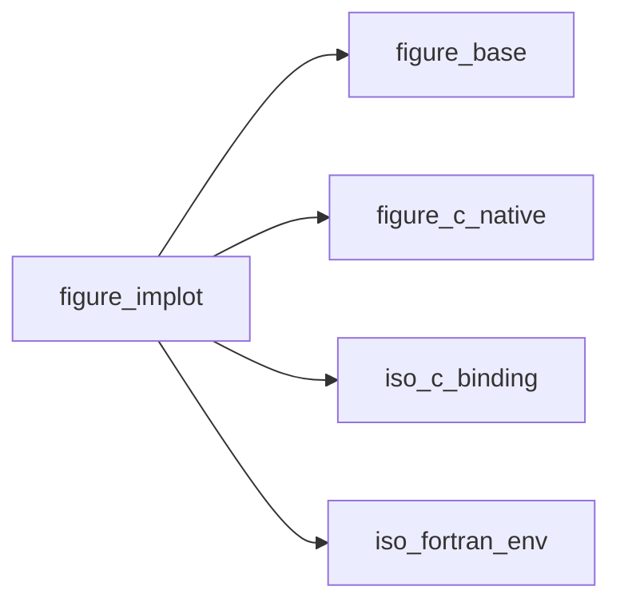
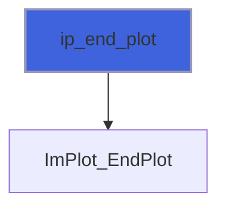
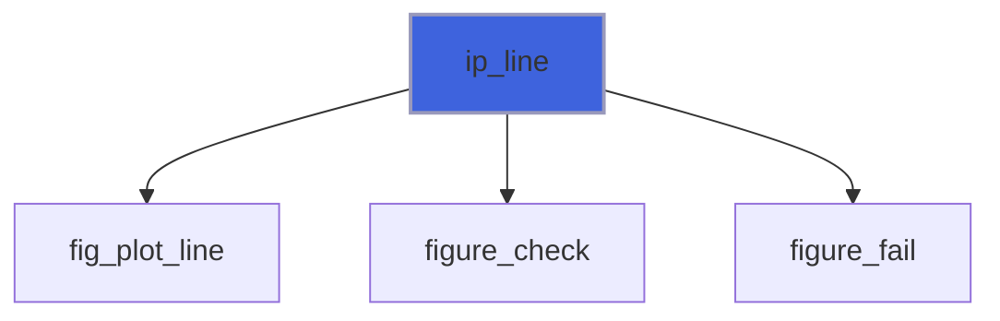
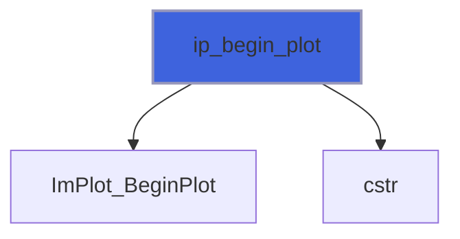

# figure_implot

> figure_implot, ImPlot plots with Fortran arrays.

 `ip_begin_plot` returns true when the plot is visible: then declare its axes and items and close it with
 `ip_end_plot` (only in that case). Arrays are read in place, without copies, during the call: `real(real64)` is
 passed straight to the C `double*` (the bind(C) interfaces reject at compile time a platform where the two kinds
 differ). A non-contiguous actual argument (e.g. a matrix row `y(i,:)`) is copied by the compiler into a temporary.

**Source**: `src/lib/figure_implot.F90`

**Dependencies**



## Contents

- [ip_end_plot](#ip-end-plot)
- [ip_setup_axes](#ip-setup-axes)
- [ip_line](#ip-line)
- [ip_begin_plot](#ip-begin-plot)

## Subroutines

### ip_end_plot

End the plot (only after `ip_begin_plot` returned true).

```fortran
subroutine ip_end_plot()
```

**Call graph**



### ip_setup_axes

Axis labels (call right after `ip_begin_plot`).

```fortran
subroutine ip_setup_axes(xlabel, ylabel)
```

**Arguments**

| Name | Type | Intent | Attributes | Description |
|------|------|--------|------------|-------------|
| `xlabel` | character(len=*) | in |  | X label. |
| `ylabel` | character(len=*) | in |  | Y label. |

**Call graph**


### ip_line

Line through the points (x(i), y(i)).

```fortran
subroutine ip_line(label, x, y, stat)
```

**Arguments**

| Name | Type | Intent | Attributes | Description |
|------|------|--------|------------|-------------|
| `label` | character(len=*) | in |  | Legend label. |
| `x` | real(kind=real64) | in | contiguous | Abscissae. |
| `y` | real(kind=real64) | in | contiguous | Ordinates. |
| `stat` | integer(kind=int32) | out | optional | Status. |

**Call graph**



## Functions

### ip_begin_plot

Begin a plot; if true, declare its content and call `ip_end_plot`.

**Returns**: `logical`

```fortran
function ip_begin_plot(title, width, height) result(visible)
```

**Arguments**

| Name | Type | Intent | Attributes | Description |
|------|------|--------|------------|-------------|
| `title` | character(len=*) | in |  | Title (also the plot id; '##id' hides it). |
| `width` | real(kind=real64) | in | optional | Width [pixels] (default: full width). |
| `height` | real(kind=real64) | in | optional | Height [pixels] (default: ImPlot's). |

**Call graph**


