# figure_implot

> figure_implot, ImPlot plots with Fortran arrays.

 `ip_begin_plot` returns true when the plot is visible: then declare its axes and items and close it with
 `ip_end_plot` (only in that case). Items (`ip_line`, `ip_scatter`, `ip_bars`, `ip_shaded`) take `real(real32)` or
 `real(real64)` arrays, read in place, without copies, during the call: they go straight to ImPlot's `float*` or
 `double*` items (ImPlot is templated on the element type). A non-contiguous actual argument (e.g. a matrix row
 `y(i,:)`) is copied by the compiler into a temporary: `ip_line(label, y, row)` plots a matrix row in place instead.

 Every item takes an optional `spec`, built by `ip_spec` from ImPlot's defaults (automatic colours, no markers):

```fortran
 call ip_line('residual', it, res, spec=ip_spec(line_color=[1.0_real64, 0.0_real64, 0.0_real64, 1.0_real64], &
                                               line_weight=2.0_real64, marker=ImPlotMarker_Circle))
```

**Source**: `src/lib/figure_implot.F90`

**Dependencies**

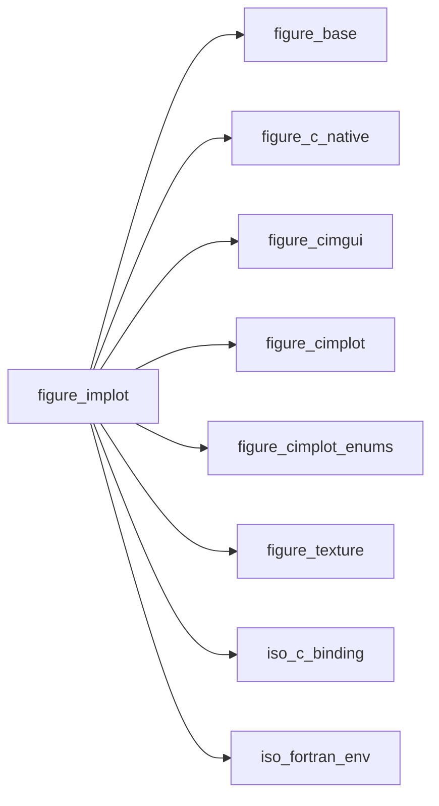

## Contents

- [plot_spec_object](#plot-spec-object)
- [ip_line](#ip-line)
- [ip_scatter](#ip-scatter)
- [ip_bars](#ip-bars)
- [ip_heatmap](#ip-heatmap)
- [ip_shaded](#ip-shaded)
- [ip_end_subplots](#ip-end-subplots)
- [ip_end_plot](#ip-end-plot)
- [ip_setup_axes](#ip-setup-axes)
- [ip_setup_axes_limits](#ip-setup-axes-limits)
- [ip_plot_limits](#ip-plot-limits)
- [ip_plot_size](#ip-plot-size)
- [ip_line_r32](#ip-line-r32)
- [ip_scatter_r32](#ip-scatter-r32)
- [ip_bars_r32](#ip-bars-r32)
- [ip_shaded_r32](#ip-shaded-r32)
- [ip_shaded_ref_r32](#ip-shaded-ref-r32)
- [ip_line_values_r32](#ip-line-values-r32)
- [ip_line_row_r32](#ip-line-row-r32)
- [ip_heatmap_r32](#ip-heatmap-r32)
- [ip_line_r64](#ip-line-r64)
- [ip_scatter_r64](#ip-scatter-r64)
- [ip_bars_r64](#ip-bars-r64)
- [ip_shaded_r64](#ip-shaded-r64)
- [ip_shaded_ref_r64](#ip-shaded-ref-r64)
- [ip_line_values_r64](#ip-line-values-r64)
- [ip_line_row_r64](#ip-line-row-r64)
- [ip_heatmap_r64](#ip-heatmap-r64)
- [ip_image](#ip-image)
- [ip_colormap_scale](#ip-colormap-scale)
- [ip_load_colormap](#ip-load-colormap)
- [ip_colormap_names](#ip-colormap-names)
- [ip_begin_plot](#ip-begin-plot)
- [ip_begin_subplots](#ip-begin-subplots)
- [ip_spec](#ip-spec)
- [ip_colormap](#ip-colormap)
- [colormap_ok](#colormap-ok)
- [series_ok](#series-ok)
- [field_ok](#field-ok)
- [row_ok](#row-ok)
- [uniform](#uniform)
- [addr_r32](#addr-r32)
- [addr_r64](#addr-r64)
- [spec_c](#spec-c)
- [rgba_ok](#rgba-ok)
- [rgba](#rgba)

## Variables

| Name | Type | Attributes | Description |
|------|------|------------|-------------|
| `subplots_seen` | character(len=128) | allocatable | Titles of the subplot figures drawn so far. |
| `fits_pending` | integer(kind=int32) |  | Plots of a new subplot figure still to fit to their data. |

## Derived Types

### plot_spec_object

Style of a plot item: colours, line weight, markers, flags. Build it with `ip_spec`.

 The C struct is private so that a spec always starts from ImPlot's defaults: a zeroed one would draw nothing
 (line weight 0, marker size 0).

#### Components

| Name | Type | Attributes | Description |
|------|------|------------|-------------|
| `c` | type([im_plot_spec](/api/src/lib/figure_cimplot#im-plot-spec)) |  | `ImPlotSpec`, as passed to ImPlot. |

## Interfaces

### ip_line

Line through the points (x(i), y(i)); or through y(i) at uniformly spaced x, from a vector or from a row of a
 matrix (read in place, with a stride: no copy).

**Module procedures**: [`ip_line_r32`](/api/src/lib/figure_implot#ip-line-r32), [`ip_line_r64`](/api/src/lib/figure_implot#ip-line-r64), [`ip_line_values_r32`](/api/src/lib/figure_implot#ip-line-values-r32), [`ip_line_values_r64`](/api/src/lib/figure_implot#ip-line-values-r64), [`ip_line_row_r32`](/api/src/lib/figure_implot#ip-line-row-r32), [`ip_line_row_r64`](/api/src/lib/figure_implot#ip-line-row-r64)

### ip_scatter

Markers at the points (x(i), y(i)).

**Module procedures**: [`ip_scatter_r32`](/api/src/lib/figure_implot#ip-scatter-r32), [`ip_scatter_r64`](/api/src/lib/figure_implot#ip-scatter-r64)

### ip_bars

Bars of height y(i) centred at x(i).

**Module procedures**: [`ip_bars_r32`](/api/src/lib/figure_implot#ip-bars-r32), [`ip_bars_r64`](/api/src/lib/figure_implot#ip-bars-r64)

### ip_heatmap

A 2D field f(i, j) as coloured cells: i along x, j along y, j = 1 at the bottom.

**Module procedures**: [`ip_heatmap_r32`](/api/src/lib/figure_implot#ip-heatmap-r32), [`ip_heatmap_r64`](/api/src/lib/figure_implot#ip-heatmap-r64)

### ip_shaded

Area between two curves y1(x) and y2(x), or between a curve y(x) and the line y = yref.

**Module procedures**: [`ip_shaded_r32`](/api/src/lib/figure_implot#ip-shaded-r32), [`ip_shaded_r64`](/api/src/lib/figure_implot#ip-shaded-r64), [`ip_shaded_ref_r32`](/api/src/lib/figure_implot#ip-shaded-ref-r32), [`ip_shaded_ref_r64`](/api/src/lib/figure_implot#ip-shaded-ref-r64)

## Subroutines

### ip_end_subplots

End the grid of plots (only after `ip_begin_subplots` returned true).

```fortran
subroutine ip_end_subplots()
```

**Call graph**

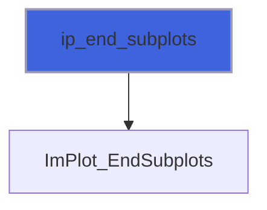

### ip_end_plot

End the plot (only after `ip_begin_plot` returned true).

```fortran
subroutine ip_end_plot()
```

**Call graph**

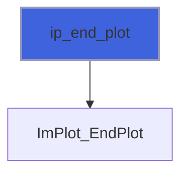

### ip_setup_axes

Axis labels (call right after `ip_begin_plot`); with `auto_fit=.true.` both axes fit the data every frame (data
 that grows while the user watches), instead of once on first use. `xlog`/`ylog`: a base-10 logarithmic axis
 (values <= 0 are not shown on it). `xformat`/`yformat`: a C printf format of the tick labels (`'%.6f'`,
 `'%.2e'`, `'%g s'`), for values whose default labels look alike (-3781.31, -3781.31, ...).

```fortran
subroutine ip_setup_axes(xlabel, ylabel, auto_fit, xlog, ylog, xformat, yformat)
```

**Arguments**

| Name | Type | Intent | Attributes | Description |
|------|------|--------|------------|-------------|
| `xlabel` | character(len=*) | in |  | X label. |
| `ylabel` | character(len=*) | in |  | Y label. |
| `auto_fit` | logical | in | optional | Fit the axes to the data every frame (default: first use only). |
| `xlog` | logical | in | optional | Logarithmic x axis (default: linear). |
| `ylog` | logical | in | optional | Logarithmic y axis (default: linear). |
| `xformat` | character(len=*) | in | optional | printf format of the x tick labels. |
| `yformat` | character(len=*) | in | optional | printf format of the y tick labels. |

**Call graph**

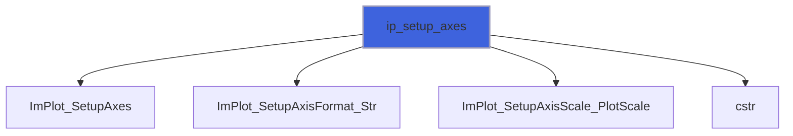

### ip_setup_axes_limits

Initial axis ranges (call right after `ip_begin_plot`): applied on first use only, so the user can pan and zoom
 afterwards, or every frame with `always=.true.`.

```fortran
subroutine ip_setup_axes_limits(xmin, xmax, ymin, ymax, always)
```

**Arguments**

| Name | Type | Intent | Attributes | Description |
|------|------|--------|------------|-------------|
| `xmin` | real(kind=real64) | in |  | Left end of the x axis. |
| `xmax` | real(kind=real64) | in |  | Right end of the x axis. |
| `ymin` | real(kind=real64) | in |  | Bottom end of the y axis. |
| `ymax` | real(kind=real64) | in |  | Top end of the y axis. |
| `always` | logical | in | optional | Enforce every frame (default: first use only). |

**Call graph**

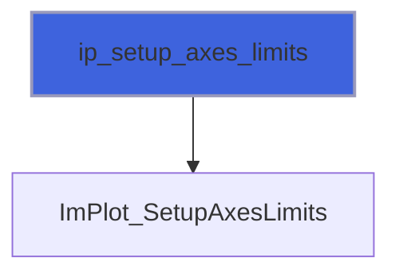

### ip_plot_limits

Axis ranges of the current plot, as the user has panned and zoomed them (between `ip_begin_plot` and
 `ip_end_plot`; ends the setup phase: call `ip_setup_axes*` before).

```fortran
subroutine ip_plot_limits(xmin, xmax, ymin, ymax)
```

**Arguments**

| Name | Type | Intent | Attributes | Description |
|------|------|--------|------------|-------------|
| `xmin` | real(kind=real64) | out |  | Left end of the x axis. |
| `xmax` | real(kind=real64) | out |  | Right end of the x axis. |
| `ymin` | real(kind=real64) | out |  | Bottom end of the y axis. |
| `ymax` | real(kind=real64) | out |  | Top end of the y axis. |

**Call graph**

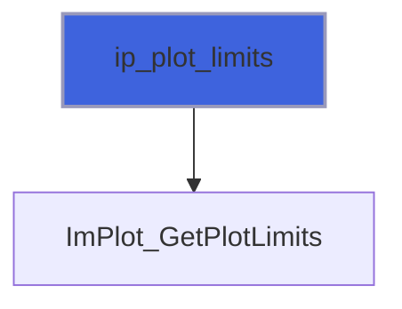

### ip_plot_size

Size of the current plot's data area [pixels] (between `ip_begin_plot` and `ip_end_plot`).

```fortran
subroutine ip_plot_size(width, height)
```

**Arguments**

| Name | Type | Intent | Attributes | Description |
|------|------|--------|------------|-------------|
| `width` | real(kind=real64) | out |  | Width [pixels]. |
| `height` | real(kind=real64) | out |  | Height [pixels]. |

**Call graph**

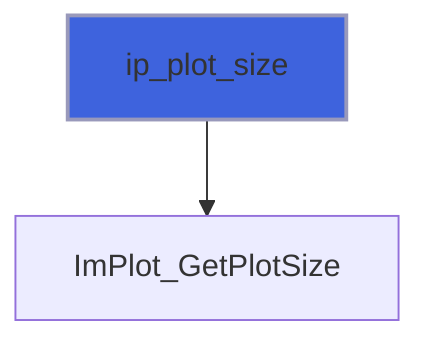

### ip_line_r32

Line through the points (x(i), y(i)), single precision.

```fortran
subroutine ip_line_r32(label, x, y, spec, stat)
```

**Arguments**

| Name | Type | Intent | Attributes | Description |
|------|------|--------|------------|-------------|
| `label` | character(len=*) | in |  | Legend label. |
| `x` | real(kind=real32) | in | contiguous, target | Abscissae. |
| `y` | real(kind=real32) | in | contiguous, target | Ordinates. |
| `spec` | type([plot_spec_object](/api/src/lib/figure_implot#plot-spec-object)) | in | optional | Style (default: ImPlot's). |
| `stat` | integer(kind=int32) | out | optional | Status. |

**Call graph**


### ip_scatter_r32

Markers at the points (x(i), y(i)), single precision.

```fortran
subroutine ip_scatter_r32(label, x, y, spec, stat)
```

**Arguments**

| Name | Type | Intent | Attributes | Description |
|------|------|--------|------------|-------------|
| `label` | character(len=*) | in |  | Legend label. |
| `x` | real(kind=real32) | in | contiguous, target | Abscissae. |
| `y` | real(kind=real32) | in | contiguous, target | Ordinates. |
| `spec` | type([plot_spec_object](/api/src/lib/figure_implot#plot-spec-object)) | in | optional | Style (default: ImPlot's). |
| `stat` | integer(kind=int32) | out | optional | Status. |

**Call graph**


### ip_bars_r32

Bars of height y(i) centred at x(i), `bar_size` wide (in x units), single precision.

```fortran
subroutine ip_bars_r32(label, x, y, bar_size, spec, stat)
```

**Arguments**

| Name | Type | Intent | Attributes | Description |
|------|------|--------|------------|-------------|
| `label` | character(len=*) | in |  | Legend label. |
| `x` | real(kind=real32) | in | contiguous, target | Bar positions. |
| `y` | real(kind=real32) | in | contiguous, target | Bar heights. |
| `bar_size` | real(kind=real64) | in |  | Bar width [x units]. |
| `spec` | type([plot_spec_object](/api/src/lib/figure_implot#plot-spec-object)) | in | optional | Style (default: ImPlot's). |
| `stat` | integer(kind=int32) | out | optional | Status. |

**Call graph**

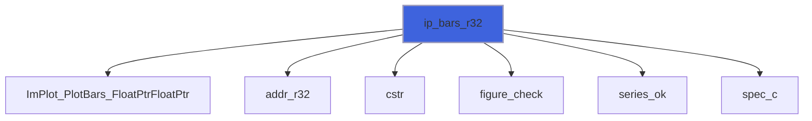

### ip_shaded_r32

Area between the curves y1(x) and y2(x), single precision.

```fortran
subroutine ip_shaded_r32(label, x, y1, y2, spec, stat)
```

**Arguments**

| Name | Type | Intent | Attributes | Description |
|------|------|--------|------------|-------------|
| `label` | character(len=*) | in |  | Legend label. |
| `x` | real(kind=real32) | in | contiguous, target | Abscissae. |
| `y1` | real(kind=real32) | in | contiguous, target | First curve. |
| `y2` | real(kind=real32) | in | contiguous, target | Second curve. |
| `spec` | type([plot_spec_object](/api/src/lib/figure_implot#plot-spec-object)) | in | optional | Style (default: ImPlot's). |
| `stat` | integer(kind=int32) | out | optional | Status. |

**Call graph**

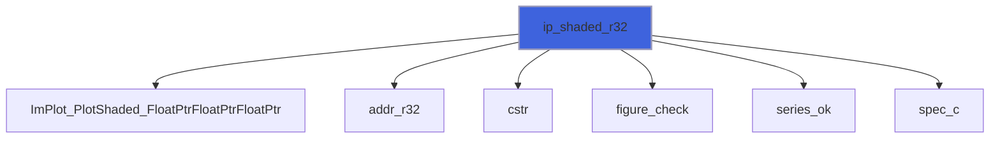

### ip_shaded_ref_r32

Area between the curve y(x) and the line y = yref, single precision.

```fortran
subroutine ip_shaded_ref_r32(label, x, y, yref, spec, stat)
```

**Arguments**

| Name | Type | Intent | Attributes | Description |
|------|------|--------|------------|-------------|
| `label` | character(len=*) | in |  | Legend label. |
| `x` | real(kind=real32) | in | contiguous, target | Abscissae. |
| `y` | real(kind=real32) | in | contiguous, target | Curve. |
| `yref` | real(kind=real64) | in |  | Reference line (-huge/+huge: to the plot edge). |
| `spec` | type([plot_spec_object](/api/src/lib/figure_implot#plot-spec-object)) | in | optional | Style (default: ImPlot's). |
| `stat` | integer(kind=int32) | out | optional | Status. |

**Call graph**


### ip_line_values_r32

Line through y(i) at x = xstart + (i - 1) xscale, single precision.

```fortran
subroutine ip_line_values_r32(label, y, xscale, xstart, spec, stat)
```

**Arguments**

| Name | Type | Intent | Attributes | Description |
|------|------|--------|------------|-------------|
| `label` | character(len=*) | in |  | Legend label. |
| `y` | real(kind=real32) | in | contiguous, target | Ordinates. |
| `xscale` | real(kind=real64) | in | optional | Spacing of the abscissae (default 1). |
| `xstart` | real(kind=real64) | in | optional | First abscissa (default 0). |
| `spec` | type([plot_spec_object](/api/src/lib/figure_implot#plot-spec-object)) | in | optional | Style (default: ImPlot's). |
| `stat` | integer(kind=int32) | out | optional | Status. |

**Call graph**

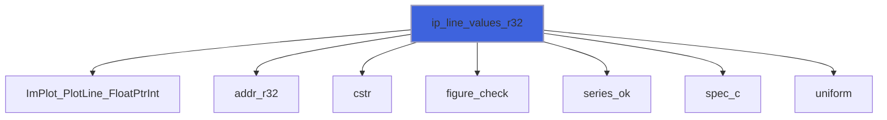

### ip_line_row_r32

Line through the row `row` of `y`, y(row, j) at x = xstart + (j - 1) xscale, read in place (no copy),
 single precision.

```fortran
subroutine ip_line_row_r32(label, y, row, xscale, xstart, spec, stat)
```

**Arguments**

| Name | Type | Intent | Attributes | Description |
|------|------|--------|------------|-------------|
| `label` | character(len=*) | in |  | Legend label. |
| `y` | real(kind=real32) | in | contiguous, target | Matrix; its row `row` is plotted. |
| `row` | integer(kind=int32) | in |  | Row to plot, in 1..size(y, 1). |
| `xscale` | real(kind=real64) | in | optional | Spacing of the abscissae (default 1). |
| `xstart` | real(kind=real64) | in | optional | First abscissa (default 0). |
| `spec` | type([plot_spec_object](/api/src/lib/figure_implot#plot-spec-object)) | in | optional | Style (default: ImPlot's). |
| `stat` | integer(kind=int32) | out | optional | Status. |

**Call graph**

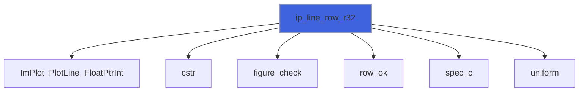

### ip_heatmap_r32

The field f(i, j) as coloured cells over [xmin, xmax] x [ymin, ymax], read in place (no copy, no transpose):
 cell (i, j) spans the i-th of size(f, 1) columns along x and the j-th of size(f, 2) rows along y, j = 1 at the
 bottom. Single precision.

```fortran
subroutine ip_heatmap_r32(label, f, xmin, xmax, ymin, ymax, scale_min, scale_max, label_format, colormap, spec, stat)
```

**Arguments**

| Name | Type | Intent | Attributes | Description |
|------|------|--------|------------|-------------|
| `label` | character(len=*) | in |  | Legend label. |
| `f` | real(kind=real32) | in | contiguous, target | Field: f(i, j), i along x, j along y. |
| `xmin` | real(kind=real64) | in |  | Left edge of the first column. |
| `xmax` | real(kind=real64) | in |  | Right edge of the last column. |
| `ymin` | real(kind=real64) | in |  | Bottom edge of row 1. |
| `ymax` | real(kind=real64) | in |  | Top edge of the last row. |
| `scale_min` | real(kind=real64) | in | optional | Value at the bottom of the colormap. |
| `scale_max` | real(kind=real64) | in | optional | Value at the top (both or none; none: data). |
| `label_format` | character(len=*) | in | optional | printf format printing each value in its cell. |
| `colormap` | integer(kind=int32) | in | optional | Colormap (`ip_colormap`; default: Viridis). |
| `spec` | type([plot_spec_object](/api/src/lib/figure_implot#plot-spec-object)) | in | optional | Style (default: ImPlot's). |
| `stat` | integer(kind=int32) | out | optional | Status. |

**Call graph**

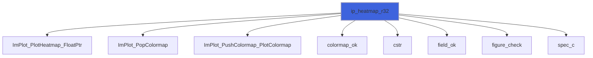

### ip_line_r64

Line through the points (x(i), y(i)), double precision.

```fortran
subroutine ip_line_r64(label, x, y, spec, stat)
```

**Arguments**

| Name | Type | Intent | Attributes | Description |
|------|------|--------|------------|-------------|
| `label` | character(len=*) | in |  | Legend label. |
| `x` | real(kind=real64) | in | contiguous, target | Abscissae. |
| `y` | real(kind=real64) | in | contiguous, target | Ordinates. |
| `spec` | type([plot_spec_object](/api/src/lib/figure_implot#plot-spec-object)) | in | optional | Style (default: ImPlot's). |
| `stat` | integer(kind=int32) | out | optional | Status. |

**Call graph**

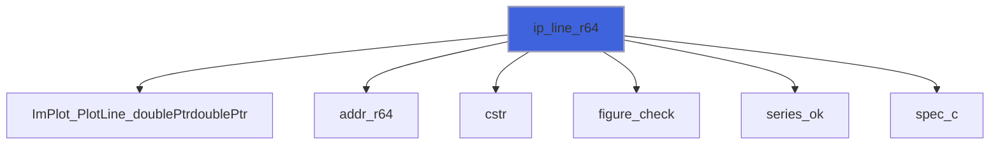

### ip_scatter_r64

Markers at the points (x(i), y(i)), double precision.

```fortran
subroutine ip_scatter_r64(label, x, y, spec, stat)
```

**Arguments**

| Name | Type | Intent | Attributes | Description |
|------|------|--------|------------|-------------|
| `label` | character(len=*) | in |  | Legend label. |
| `x` | real(kind=real64) | in | contiguous, target | Abscissae. |
| `y` | real(kind=real64) | in | contiguous, target | Ordinates. |
| `spec` | type([plot_spec_object](/api/src/lib/figure_implot#plot-spec-object)) | in | optional | Style (default: ImPlot's). |
| `stat` | integer(kind=int32) | out | optional | Status. |

**Call graph**

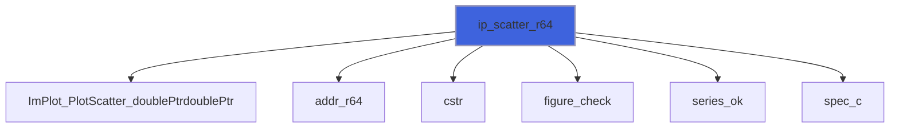

### ip_bars_r64

Bars of height y(i) centred at x(i), `bar_size` wide (in x units), double precision.

```fortran
subroutine ip_bars_r64(label, x, y, bar_size, spec, stat)
```

**Arguments**

| Name | Type | Intent | Attributes | Description |
|------|------|--------|------------|-------------|
| `label` | character(len=*) | in |  | Legend label. |
| `x` | real(kind=real64) | in | contiguous, target | Bar positions. |
| `y` | real(kind=real64) | in | contiguous, target | Bar heights. |
| `bar_size` | real(kind=real64) | in |  | Bar width [x units]. |
| `spec` | type([plot_spec_object](/api/src/lib/figure_implot#plot-spec-object)) | in | optional | Style (default: ImPlot's). |
| `stat` | integer(kind=int32) | out | optional | Status. |

**Call graph**


### ip_shaded_r64

Area between the curves y1(x) and y2(x), double precision.

```fortran
subroutine ip_shaded_r64(label, x, y1, y2, spec, stat)
```

**Arguments**

| Name | Type | Intent | Attributes | Description |
|------|------|--------|------------|-------------|
| `label` | character(len=*) | in |  | Legend label. |
| `x` | real(kind=real64) | in | contiguous, target | Abscissae. |
| `y1` | real(kind=real64) | in | contiguous, target | First curve. |
| `y2` | real(kind=real64) | in | contiguous, target | Second curve. |
| `spec` | type([plot_spec_object](/api/src/lib/figure_implot#plot-spec-object)) | in | optional | Style (default: ImPlot's). |
| `stat` | integer(kind=int32) | out | optional | Status. |

**Call graph**

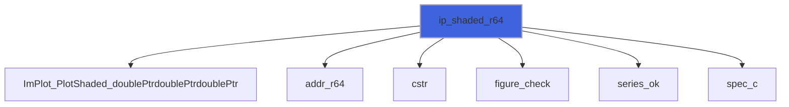

### ip_shaded_ref_r64

Area between the curve y(x) and the line y = yref, double precision.

```fortran
subroutine ip_shaded_ref_r64(label, x, y, yref, spec, stat)
```

**Arguments**

| Name | Type | Intent | Attributes | Description |
|------|------|--------|------------|-------------|
| `label` | character(len=*) | in |  | Legend label. |
| `x` | real(kind=real64) | in | contiguous, target | Abscissae. |
| `y` | real(kind=real64) | in | contiguous, target | Curve. |
| `yref` | real(kind=real64) | in |  | Reference line (-huge/+huge: to the plot edge). |
| `spec` | type([plot_spec_object](/api/src/lib/figure_implot#plot-spec-object)) | in | optional | Style (default: ImPlot's). |
| `stat` | integer(kind=int32) | out | optional | Status. |

**Call graph**

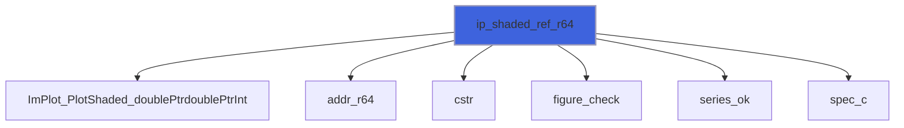

### ip_line_values_r64

Line through y(i) at x = xstart + (i - 1) xscale, double precision.

```fortran
subroutine ip_line_values_r64(label, y, xscale, xstart, spec, stat)
```

**Arguments**

| Name | Type | Intent | Attributes | Description |
|------|------|--------|------------|-------------|
| `label` | character(len=*) | in |  | Legend label. |
| `y` | real(kind=real64) | in | contiguous, target | Ordinates. |
| `xscale` | real(kind=real64) | in | optional | Spacing of the abscissae (default 1). |
| `xstart` | real(kind=real64) | in | optional | First abscissa (default 0). |
| `spec` | type([plot_spec_object](/api/src/lib/figure_implot#plot-spec-object)) | in | optional | Style (default: ImPlot's). |
| `stat` | integer(kind=int32) | out | optional | Status. |

**Call graph**

```mermaid
flowchart TD
  ip_line_values_r64["ip_line_values_r64"] --> ImPlot_PlotLine_doublePtrInt["ImPlot_PlotLine_doublePtrInt"]
  ip_line_values_r64["ip_line_values_r64"] --> addr_r64["addr_r64"]
  ip_line_values_r64["ip_line_values_r64"] --> cstr["cstr"]
  ip_line_values_r64["ip_line_values_r64"] --> figure_check["figure_check"]
  ip_line_values_r64["ip_line_values_r64"] --> series_ok["series_ok"]
  ip_line_values_r64["ip_line_values_r64"] --> spec_c["spec_c"]
  ip_line_values_r64["ip_line_values_r64"] --> uniform["uniform"]
  style ip_line_values_r64 fill:#3e63dd,stroke:#99b,stroke-width:2px
```

### ip_line_row_r64

Line through the row `row` of `y`, y(row, j) at x = xstart + (j - 1) xscale, read in place (no copy),
 double precision.

```fortran
subroutine ip_line_row_r64(label, y, row, xscale, xstart, spec, stat)
```

**Arguments**

| Name | Type | Intent | Attributes | Description |
|------|------|--------|------------|-------------|
| `label` | character(len=*) | in |  | Legend label. |
| `y` | real(kind=real64) | in | contiguous, target | Matrix; its row `row` is plotted. |
| `row` | integer(kind=int32) | in |  | Row to plot, in 1..size(y, 1). |
| `xscale` | real(kind=real64) | in | optional | Spacing of the abscissae (default 1). |
| `xstart` | real(kind=real64) | in | optional | First abscissa (default 0). |
| `spec` | type([plot_spec_object](/api/src/lib/figure_implot#plot-spec-object)) | in | optional | Style (default: ImPlot's). |
| `stat` | integer(kind=int32) | out | optional | Status. |

**Call graph**

```mermaid
flowchart TD
  ip_line_row_r64["ip_line_row_r64"] --> ImPlot_PlotLine_doublePtrInt["ImPlot_PlotLine_doublePtrInt"]
  ip_line_row_r64["ip_line_row_r64"] --> cstr["cstr"]
  ip_line_row_r64["ip_line_row_r64"] --> figure_check["figure_check"]
  ip_line_row_r64["ip_line_row_r64"] --> row_ok["row_ok"]
  ip_line_row_r64["ip_line_row_r64"] --> spec_c["spec_c"]
  ip_line_row_r64["ip_line_row_r64"] --> uniform["uniform"]
  style ip_line_row_r64 fill:#3e63dd,stroke:#99b,stroke-width:2px
```

### ip_heatmap_r64

The field f(i, j) as coloured cells over [xmin, xmax] x [ymin, ymax], read in place (no copy, no transpose):
 cell (i, j) spans the i-th of size(f, 1) columns along x and the j-th of size(f, 2) rows along y, j = 1 at the
 bottom. Double precision.

```fortran
subroutine ip_heatmap_r64(label, f, xmin, xmax, ymin, ymax, scale_min, scale_max, label_format, colormap, spec, stat)
```

**Arguments**

| Name | Type | Intent | Attributes | Description |
|------|------|--------|------------|-------------|
| `label` | character(len=*) | in |  | Legend label. |
| `f` | real(kind=real64) | in | contiguous, target | Field: f(i, j), i along x, j along y. |
| `xmin` | real(kind=real64) | in |  | Left edge of the first column. |
| `xmax` | real(kind=real64) | in |  | Right edge of the last column. |
| `ymin` | real(kind=real64) | in |  | Bottom edge of row 1. |
| `ymax` | real(kind=real64) | in |  | Top edge of the last row. |
| `scale_min` | real(kind=real64) | in | optional | Value at the bottom of the colormap. |
| `scale_max` | real(kind=real64) | in | optional | Value at the top (both or none; none: data). |
| `label_format` | character(len=*) | in | optional | printf format printing each value in its cell. |
| `colormap` | integer(kind=int32) | in | optional | Colormap (`ip_colormap`; default: Viridis). |
| `spec` | type([plot_spec_object](/api/src/lib/figure_implot#plot-spec-object)) | in | optional | Style (default: ImPlot's). |
| `stat` | integer(kind=int32) | out | optional | Status. |

**Call graph**

```mermaid
flowchart TD
  ip_heatmap_r64["ip_heatmap_r64"] --> ImPlot_PlotHeatmap_doublePtr["ImPlot_PlotHeatmap_doublePtr"]
  ip_heatmap_r64["ip_heatmap_r64"] --> ImPlot_PopColormap["ImPlot_PopColormap"]
  ip_heatmap_r64["ip_heatmap_r64"] --> ImPlot_PushColormap_PlotColormap["ImPlot_PushColormap_PlotColormap"]
  ip_heatmap_r64["ip_heatmap_r64"] --> colormap_ok["colormap_ok"]
  ip_heatmap_r64["ip_heatmap_r64"] --> cstr["cstr"]
  ip_heatmap_r64["ip_heatmap_r64"] --> field_ok["field_ok"]
  ip_heatmap_r64["ip_heatmap_r64"] --> figure_check["figure_check"]
  ip_heatmap_r64["ip_heatmap_r64"] --> spec_c["spec_c"]
  style ip_heatmap_r64 fill:#3e63dd,stroke:#99b,stroke-width:2px
```

### ip_image

A texture over [xmin, xmax] x [ymin, ymax], pixel row 1 at ymin (plot convention: y up).

```fortran
subroutine ip_image(label, tex, xmin, xmax, ymin, ymax, spec, stat)
```

**Arguments**

| Name | Type | Intent | Attributes | Description |
|------|------|--------|------------|-------------|
| `label` | character(len=*) | in |  | Legend label. |
| `tex` | type([texture_object](/api/src/lib/figure_texture#texture-object)) | in |  | Texture. |
| `xmin` | real(kind=real64) | in |  | Left edge. |
| `xmax` | real(kind=real64) | in |  | Right edge. |
| `ymin` | real(kind=real64) | in |  | Bottom edge (pixel row 1). |
| `ymax` | real(kind=real64) | in |  | Top edge (last pixel row). |
| `spec` | type([plot_spec_object](/api/src/lib/figure_implot#plot-spec-object)) | in | optional | Style (default: ImPlot's). |
| `stat` | integer(kind=int32) | out | optional | Status. |

**Call graph**

```mermaid
flowchart TD
  ip_image["ip_image"] --> ImPlot_PlotImage["ImPlot_PlotImage"]
  ip_image["ip_image"] --> cstr["cstr"]
  ip_image["ip_image"] --> fig_texture_sampling["fig_texture_sampling"]
  ip_image["ip_image"] --> figure_check["figure_check"]
  ip_image["ip_image"] --> figure_fail["figure_fail"]
  ip_image["ip_image"] --> is_initialized["is_initialized"]
  ip_image["ip_image"] --> spec_c["spec_c"]
  ip_image["ip_image"] --> texture_ref["texture_ref"]
  style ip_image fill:#3e63dd,stroke:#99b,stroke-width:2px
```

### ip_colormap_scale

A colour bar for [scale_min, scale_max], next to a heatmap (outside `ip_begin_plot`/`ip_end_plot`). Statuses:
 `FIG_ERR_ARGUMENT` for a colormap id that is not registered.

```fortran
subroutine ip_colormap_scale(label, scale_min, scale_max, width, height, label_format, colormap, stat)
```

**Arguments**

| Name | Type | Intent | Attributes | Description |
|------|------|--------|------------|-------------|
| `label` | character(len=*) | in |  | Label (also the widget id). |
| `scale_min` | real(kind=real64) | in |  | Value at the bottom. |
| `scale_max` | real(kind=real64) | in |  | Value at the top. |
| `width` | real(kind=real64) | in | optional | Width [pixels] (default: ImPlot's). |
| `height` | real(kind=real64) | in | optional | Height [pixels] (default: ImPlot's). |
| `label_format` | character(len=*) | in | optional | printf format of the tick labels (default '%g', ImPlot's). |
| `colormap` | integer(kind=int32) | in | optional | Colormap (`ip_colormap`; default: Viridis). |
| `stat` | integer(kind=int32) | out | optional | Status. |

**Call graph**

```mermaid
flowchart TD
  ip_colormap_scale["ip_colormap_scale"] --> ImPlot_ColormapScale["ImPlot_ColormapScale"]
  ip_colormap_scale["ip_colormap_scale"] --> colormap_ok["colormap_ok"]
  ip_colormap_scale["ip_colormap_scale"] --> cstr["cstr"]
  ip_colormap_scale["ip_colormap_scale"] --> figure_check["figure_check"]
  style ip_colormap_scale fill:#3e63dd,stroke:#99b,stroke-width:2px
```

### ip_load_colormap

Read a colormap from `file` and register it under `name` for `ip_colormap`. The file is a CSV table, one colour a
 row, `r, g, b` (or `x, r, g, b`, with `x` a position: resampled to 256 uniform positions), separated by commas,
 semicolons, blanks or tabs, components in [0, 1] (or [0, 255] when one exceeds 1), `#` comments and a header line
 allowed; or a ParaView JSON preset (a file of ParaView's "Export" of presets, or one preset): the one whose
 `Name` is `name`, or the only one, its `RGBPoints` sampled at 256 positions in its `ColorSpace` (RGB, Lab,
 Diverging, HSV or Step). The map is kept for the program's life. Statuses: `FIG_ERR_FAILED` if the file cannot be
 read, `FIG_ERR_ARGUMENT` if it is malformed (the message gives the line) or the name is taken (a map, or the
 reverse of one: ImPlot cannot replace a colormap), empty, holds `|` or starts with `'FIGURE '`; `FIG_ERR_STATE`
 from a task. The same in every mode, before `init*` too.

**Attributes**: recursive

```fortran
subroutine ip_load_colormap(name, file, stat)
```

**Arguments**

| Name | Type | Intent | Attributes | Description |
|------|------|--------|------------|-------------|
| `name` | character(len=*) | in |  | Name to register the map under. |
| `file` | character(len=*) | in |  | CSV table or ParaView JSON preset. |
| `stat` | integer(kind=int32) | out | optional | Status. |

**Call graph**

```mermaid
flowchart TD
  ip_load_colormap["ip_load_colormap"] --> fig_load_colormap["fig_load_colormap"]
  ip_load_colormap["ip_load_colormap"] --> figure_check["figure_check"]
  ip_load_colormap["ip_load_colormap"] --> figure_refused["figure_refused"]
  style ip_load_colormap fill:#3e63dd,stroke:#99b,stroke-width:2px
```

### ip_colormap_names

The names `ip_colormap` knows: the bundled maps (alphabetical), ImPlot's own (in ImPlot's order), then the maps
 loaded with `ip_load_colormap` (in load order); reversed and discrete maps are not listed. From a task: none.

**Attributes**: recursive

```fortran
subroutine ip_colormap_names(names)
```

**Arguments**

| Name | Type | Intent | Attributes | Description |
|------|------|--------|------------|-------------|
| `names` | character(len=:) | out | allocatable | Names (as long as the longest). |

**Call graph**

```mermaid
flowchart TD
  ip_colormap_names["ip_colormap_names"] --> fig_colormap_count["fig_colormap_count"]
  ip_colormap_names["ip_colormap_names"] --> fig_colormap_name["fig_colormap_name"]
  ip_colormap_names["ip_colormap_names"] --> figure_refused["figure_refused"]
  style ip_colormap_names fill:#3e63dd,stroke:#99b,stroke-width:2px
```

## Functions

### ip_begin_plot

Begin a plot; if true, declare its content and call `ip_end_plot`.

**Attributes**: recursive

**Returns**: `logical`

```fortran
function ip_begin_plot(title, width, height, equal) result(visible)
```

**Arguments**

| Name | Type | Intent | Attributes | Description |
|------|------|--------|------------|-------------|
| `title` | character(len=*) | in |  | Title (also the plot id; '##id' hides it). |
| `width` | real(kind=real64) | in | optional | Width [pixels] (default: full width). |
| `height` | real(kind=real64) | in | optional | Height [pixels] (default: ImPlot's). |
| `equal` | logical | in | optional | Same scale on both axes (one unit = as many pixels on x and y). |

**Call graph**

```mermaid
flowchart TD
  ip_begin_plot["ip_begin_plot"] --> ImPlot_BeginPlot["ImPlot_BeginPlot"]
  ip_begin_plot["ip_begin_plot"] --> ImPlot_SetNextAxisToFit["ImPlot_SetNextAxisToFit"]
  ip_begin_plot["ip_begin_plot"] --> cstr["cstr"]
  ip_begin_plot["ip_begin_plot"] --> figure_refused["figure_refused"]
  style ip_begin_plot fill:#3e63dd,stroke:#99b,stroke-width:2px
```

### ip_begin_subplots

A grid of `rows` x `cols` plots in one figure; when true, declare the plots (`ip_begin_plot`/`ip_end_plot`, one
 per cell, row by row), then `ip_end_subplots`. `link_x`/`link_y`: the plots share the x (y) range, so zooming one
 zooms all. Size as `ip_begin_plot` (a negative `height` fills the space left). The first time a figure is drawn,
 its plots fit to their data; linked axes take the range of the last plot (the common abscissa, in practice).

**Attributes**: recursive

**Returns**: `logical`

```fortran
function ip_begin_subplots(title, rows, cols, width, height, link_x, link_y) result(visible)
```

**Arguments**

| Name | Type | Intent | Attributes | Description |
|------|------|--------|------------|-------------|
| `title` | character(len=*) | in |  | Title (also the id; '##id' hides it). |
| `rows` | integer(kind=int32) | in |  | Rows of plots. |
| `cols` | integer(kind=int32) | in |  | Columns of plots. |
| `width` | real(kind=real64) | in | optional | Width [pixels] (default: full width). |
| `height` | real(kind=real64) | in | optional | Height [pixels] (default: ImPlot's for one plot per row). |
| `link_x` | logical | in | optional | Share the x range. |
| `link_y` | logical | in | optional | Share the y range. |

**Call graph**

```mermaid
flowchart TD
  ip_begin_subplots["ip_begin_subplots"] --> ImPlot_BeginSubplots["ImPlot_BeginSubplots"]
  ip_begin_subplots["ip_begin_subplots"] --> cstr["cstr"]
  ip_begin_subplots["ip_begin_subplots"] --> figure_refused["figure_refused"]
  style ip_begin_subplots fill:#3e63dd,stroke:#99b,stroke-width:2px
```

### ip_spec

Item style: ImPlot's defaults, with the given properties overridden. Colours are RGBA in [0, 1]; an absent
 colour stays automatic (from the colormap).

**Returns**: type([plot_spec_object](/api/src/lib/figure_implot#plot-spec-object))

```fortran
function ip_spec(line_color, line_weight, fill_color, fill_alpha, marker, marker_size, marker_line_color, marker_fill_color, size, flags, stat) result(spec)
```

**Arguments**

| Name | Type | Intent | Attributes | Description |
|------|------|--------|------------|-------------|
| `line_color` | real(kind=real64) | in | optional | Line colour, RGBA. |
| `line_weight` | real(kind=real64) | in | optional | Line weight [pixels] (lines, bar edges, markers). |
| `fill_color` | real(kind=real64) | in | optional | Fill colour, RGBA (bars, shaded areas). |
| `fill_alpha` | real(kind=real64) | in | optional | Alpha multiplier of the fill colours. |
| `marker` | integer(kind=int32) | in | optional | Marker shape (`ImPlotMarker_*`). |
| `marker_size` | real(kind=real64) | in | optional | Marker radius [pixels]. |
| `marker_line_color` | real(kind=real64) | in | optional | Marker outline colour, RGBA. |
| `marker_fill_color` | real(kind=real64) | in | optional | Marker fill colour, RGBA. |
| `size` | real(kind=real64) | in | optional | Error-bar whisker and digital-bar size [pixels]. |
| `flags` | integer(kind=int32) | in | optional | Item flags (`ImPlotItemFlags_*`, the item's own). |
| `stat` | integer(kind=int32) | out | optional | Status: `FIG_ERR_ARGUMENT` for a colour of size /= 4. |

**Call graph**

```mermaid
flowchart TD
  ip_spec["ip_spec"] --> figure_ImPlotSpec_default["figure_ImPlotSpec_default"]
  ip_spec["ip_spec"] --> figure_check["figure_check"]
  ip_spec["ip_spec"] --> figure_fail["figure_fail"]
  ip_spec["ip_spec"] --> rgba["rgba"]
  ip_spec["ip_spec"] --> rgba_ok["rgba_ok"]
  style ip_spec fill:#3e63dd,stroke:#99b,stroke-width:2px
```

### ip_colormap

The colormap `name` as an ImPlot id, for the `colormap` argument of `ip_heatmap` and `ip_colormap_scale`: a
 bundled map (`'cividis'`, `'batlow'`, `'cool-warm'`, ...), one of ImPlot's own (`'Viridis'`, `'Jet'`, ...) or a
 map loaded with `ip_load_colormap`; names are case-sensitive (`ip_colormap_names` lists them). `<name>_r` is the
 map reversed; `levels` gives that many discrete bands of equal width, each coloured as the map at its centre. A
 map is registered with ImPlot (`AddColormap`) at its first use, and the same id is returned after; ids hold for
 the application's life (a new `init` registers the maps again). Statuses: `FIG_ERR_ARGUMENT` for an unknown name
 or `levels` outside [2, 256], `FIG_ERR_STATE` before `init*` and from a task; the id is then -1 (and `ip_heatmap`
 refuses it). The same in every mode.

**Attributes**: recursive

**Returns**: `integer(kind=int32)`

```fortran
function ip_colormap(name, levels, stat) result(id)
```

**Arguments**

| Name | Type | Intent | Attributes | Description |
|------|------|--------|------------|-------------|
| `name` | character(len=*) | in |  | Colormap name; `_r`: reversed. |
| `levels` | integer(kind=int32) | in | optional | Discrete bands, in [2, 256] (default: continuous). |
| `stat` | integer(kind=int32) | out | optional | Status. |

**Call graph**

```mermaid
flowchart TD
  ip_colormap["ip_colormap"] --> fig_colormap["fig_colormap"]
  ip_colormap["ip_colormap"] --> figure_check["figure_check"]
  ip_colormap["ip_colormap"] --> figure_fail["figure_fail"]
  ip_colormap["ip_colormap"] --> figure_refused["figure_refused"]
  style ip_colormap fill:#3e63dd,stroke:#99b,stroke-width:2px
```

### colormap_ok

The colormap id to draw with (default ImPlot's Viridis); false, with `FIG_ERR_ARGUMENT`, if it is not registered.

**Returns**: `logical`

```fortran
function colormap_ok(caller, colormap, cmap, stat) result(ok)
```

**Arguments**

| Name | Type | Intent | Attributes | Description |
|------|------|--------|------------|-------------|
| `caller` | character(len=*) | in |  | Calling procedure, for the message. |
| `colormap` | integer(kind=int32) | in | optional | Colormap id, if given. |
| `cmap` | integer(kind=c_int) | out |  | The id to use. |
| `stat` | integer(kind=int32) | out | optional | Status, on a failure. |

**Call graph**

```mermaid
flowchart TD
  ip_colormap_scale["ip_colormap_scale"] --> colormap_ok["colormap_ok"]
  ip_heatmap_r32["ip_heatmap_r32"] --> colormap_ok["colormap_ok"]
  ip_heatmap_r64["ip_heatmap_r64"] --> colormap_ok["colormap_ok"]
  colormap_ok["colormap_ok"] --> ImPlot_GetColormapCount["ImPlot_GetColormapCount"]
  colormap_ok["colormap_ok"] --> figure_fail["figure_fail"]
  style colormap_ok fill:#3e63dd,stroke:#99b,stroke-width:2px
```

### series_ok

Whether two series can be plotted together: same size, and a size ImPlot's `int` count holds.

**Returns**: `logical`

```fortran
function series_ok(nx, ny, item, stat) result(ok)
```

**Arguments**

| Name | Type | Intent | Attributes | Description |
|------|------|--------|------------|-------------|
| `nx` | integer(kind=int64) | in |  | Size of the first series. |
| `ny` | integer(kind=int64) | in |  | Size of the second series. |
| `item` | character(len=*) | in |  | Item name, for the message. |
| `stat` | integer(kind=int32) | out | optional | Status. |

**Call graph**

```mermaid
flowchart TD
  ip_bars_r32["ip_bars_r32"] --> series_ok["series_ok"]
  ip_bars_r64["ip_bars_r64"] --> series_ok["series_ok"]
  ip_line_r32["ip_line_r32"] --> series_ok["series_ok"]
  ip_line_r64["ip_line_r64"] --> series_ok["series_ok"]
  ip_line_values_r32["ip_line_values_r32"] --> series_ok["series_ok"]
  ip_line_values_r64["ip_line_values_r64"] --> series_ok["series_ok"]
  ip_scatter_r32["ip_scatter_r32"] --> series_ok["series_ok"]
  ip_scatter_r64["ip_scatter_r64"] --> series_ok["series_ok"]
  ip_shaded_r32["ip_shaded_r32"] --> series_ok["series_ok"]
  ip_shaded_r64["ip_shaded_r64"] --> series_ok["series_ok"]
  ip_shaded_ref_r32["ip_shaded_ref_r32"] --> series_ok["series_ok"]
  ip_shaded_ref_r64["ip_shaded_ref_r64"] --> series_ok["series_ok"]
  series_ok["series_ok"] --> figure_fail["figure_fail"]
  style series_ok fill:#3e63dd,stroke:#99b,stroke-width:2px
```

### field_ok

Whether a field can be drawn as a heatmap: a cell count ImPlot's `int` holds, and both scale ends or none.

**Returns**: `logical`

```fortran
function field_ok(nx, ny, has_min, has_max, stat) result(ok)
```

**Arguments**

| Name | Type | Intent | Attributes | Description |
|------|------|--------|------------|-------------|
| `nx` | integer(kind=int64) | in |  | size(f, 1). |
| `ny` | integer(kind=int64) | in |  | size(f, 2). |
| `has_min` | logical | in |  | scale_min given. |
| `has_max` | logical | in |  | scale_max given. |
| `stat` | integer(kind=int32) | out | optional | Status. |

**Call graph**

```mermaid
flowchart TD
  ip_heatmap_r32["ip_heatmap_r32"] --> field_ok["field_ok"]
  ip_heatmap_r64["ip_heatmap_r64"] --> field_ok["field_ok"]
  field_ok["field_ok"] --> figure_fail["figure_fail"]
  style field_ok fill:#3e63dd,stroke:#99b,stroke-width:2px
```

### row_ok

Whether a matrix row can be plotted in place: the row exists, and ImPlot's `int` count and byte stride hold it.

**Returns**: `logical`

```fortran
function row_ok(rows, cols, bits, row, stat) result(ok)
```

**Arguments**

| Name | Type | Intent | Attributes | Description |
|------|------|--------|------------|-------------|
| `rows` | integer(kind=int64) | in |  | size(y, 1). |
| `cols` | integer(kind=int64) | in |  | size(y, 2): points. |
| `bits` | integer(kind=int64) | in |  | storage_size of an element [bits]. |
| `row` | integer(kind=int32) | in |  | Row to plot. |
| `stat` | integer(kind=int32) | out | optional | Status. |

**Call graph**

```mermaid
flowchart TD
  ip_line_row_r32["ip_line_row_r32"] --> row_ok["row_ok"]
  ip_line_row_r64["ip_line_row_r64"] --> row_ok["row_ok"]
  row_ok["row_ok"] --> figure_fail["figure_fail"]
  style row_ok fill:#3e63dd,stroke:#99b,stroke-width:2px
```

### uniform

An optional abscissa parameter, or its default, as a C double.

**Attributes**: pure

**Returns**: `real(kind=c_double)`

```fortran
function uniform(value, default) result(v)
```

**Arguments**

| Name | Type | Intent | Attributes | Description |
|------|------|--------|------------|-------------|
| `value` | real(kind=real64) | in | optional | Given value. |
| `default` | real(kind=real64) | in |  | Default. |

**Call graph**

```mermaid
flowchart TD
  ip_line_row_r32["ip_line_row_r32"] --> uniform["uniform"]
  ip_line_row_r64["ip_line_row_r64"] --> uniform["uniform"]
  ip_line_values_r32["ip_line_values_r32"] --> uniform["uniform"]
  ip_line_values_r64["ip_line_values_r64"] --> uniform["uniform"]
  style uniform fill:#3e63dd,stroke:#99b,stroke-width:2px
```

### addr_r32

Address of a contiguous array for ImPlot; null when empty: `c_loc` needs nonzero size (F2023 18.2.3.7).

 The address stays valid in the caller after the return: `a` is a TARGET dummy whose effective argument (the
 caller's CONTIGUOUS, TARGET dummy) is simply contiguous, so the association persists (F2023 15.5.2.5 p9).

**Returns**: `type(c_ptr)`

```fortran
function addr_r32(a) result(p)
```

**Arguments**

| Name | Type | Intent | Attributes | Description |
|------|------|--------|------------|-------------|
| `a` | real(kind=real32) | in | contiguous, target | Data. |

**Call graph**

```mermaid
flowchart TD
  ip_bars_r32["ip_bars_r32"] --> addr_r32["addr_r32"]
  ip_line_r32["ip_line_r32"] --> addr_r32["addr_r32"]
  ip_line_values_r32["ip_line_values_r32"] --> addr_r32["addr_r32"]
  ip_scatter_r32["ip_scatter_r32"] --> addr_r32["addr_r32"]
  ip_shaded_r32["ip_shaded_r32"] --> addr_r32["addr_r32"]
  ip_shaded_ref_r32["ip_shaded_ref_r32"] --> addr_r32["addr_r32"]
  style addr_r32 fill:#3e63dd,stroke:#99b,stroke-width:2px
```

### addr_r64

Address of a contiguous array for ImPlot; null when empty: `c_loc` needs nonzero size (F2023 18.2.3.7).

 The address stays valid in the caller after the return: `a` is a TARGET dummy whose effective argument (the
 caller's CONTIGUOUS, TARGET dummy) is simply contiguous, so the association persists (F2023 15.5.2.5 p9).

**Returns**: `type(c_ptr)`

```fortran
function addr_r64(a) result(p)
```

**Arguments**

| Name | Type | Intent | Attributes | Description |
|------|------|--------|------------|-------------|
| `a` | real(kind=real64) | in | contiguous, target | Data. |

**Call graph**

```mermaid
flowchart TD
  ip_bars_r64["ip_bars_r64"] --> addr_r64["addr_r64"]
  ip_line_r64["ip_line_r64"] --> addr_r64["addr_r64"]
  ip_line_values_r64["ip_line_values_r64"] --> addr_r64["addr_r64"]
  ip_scatter_r64["ip_scatter_r64"] --> addr_r64["addr_r64"]
  ip_shaded_r64["ip_shaded_r64"] --> addr_r64["addr_r64"]
  ip_shaded_ref_r64["ip_shaded_ref_r64"] --> addr_r64["addr_r64"]
  style addr_r64 fill:#3e63dd,stroke:#99b,stroke-width:2px
```

### spec_c

The C spec to pass: the given one, or ImPlot's defaults.

**Returns**: type([im_plot_spec](/api/src/lib/figure_cimplot#im-plot-spec))

```fortran
function spec_c(spec) result(c)
```

**Arguments**

| Name | Type | Intent | Attributes | Description |
|------|------|--------|------------|-------------|
| `spec` | type([plot_spec_object](/api/src/lib/figure_implot#plot-spec-object)) | in | optional | Style. |

**Call graph**

```mermaid
flowchart TD
  ip_bars_r32["ip_bars_r32"] --> spec_c["spec_c"]
  ip_bars_r64["ip_bars_r64"] --> spec_c["spec_c"]
  ip_heatmap_r32["ip_heatmap_r32"] --> spec_c["spec_c"]
  ip_heatmap_r64["ip_heatmap_r64"] --> spec_c["spec_c"]
  ip_image["ip_image"] --> spec_c["spec_c"]
  ip_line_r32["ip_line_r32"] --> spec_c["spec_c"]
  ip_line_r64["ip_line_r64"] --> spec_c["spec_c"]
  ip_line_row_r32["ip_line_row_r32"] --> spec_c["spec_c"]
  ip_line_row_r64["ip_line_row_r64"] --> spec_c["spec_c"]
  ip_line_values_r32["ip_line_values_r32"] --> spec_c["spec_c"]
  ip_line_values_r64["ip_line_values_r64"] --> spec_c["spec_c"]
  ip_scatter_r32["ip_scatter_r32"] --> spec_c["spec_c"]
  ip_scatter_r64["ip_scatter_r64"] --> spec_c["spec_c"]
  ip_shaded_r32["ip_shaded_r32"] --> spec_c["spec_c"]
  ip_shaded_r64["ip_shaded_r64"] --> spec_c["spec_c"]
  ip_shaded_ref_r32["ip_shaded_ref_r32"] --> spec_c["spec_c"]
  ip_shaded_ref_r64["ip_shaded_ref_r64"] --> spec_c["spec_c"]
  spec_c["spec_c"] --> figure_ImPlotSpec_default["figure_ImPlotSpec_default"]
  style spec_c fill:#3e63dd,stroke:#99b,stroke-width:2px
```

### rgba_ok

Whether an optional colour is absent or has 4 components.

**Attributes**: pure

**Returns**: `logical`

```fortran
function rgba_ok(color) result(ok)
```

**Arguments**

| Name | Type | Intent | Attributes | Description |
|------|------|--------|------------|-------------|
| `color` | real(kind=real64) | in | optional | Colour, RGBA. |

**Call graph**

```mermaid
flowchart TD
  ip_spec["ip_spec"] --> rgba_ok["rgba_ok"]
  style rgba_ok fill:#3e63dd,stroke:#99b,stroke-width:2px
```

### rgba

RGBA colour as an `ImVec4`.

**Attributes**: pure

**Returns**: type([im_vec4](/api/src/lib/figure_cimgui#im-vec4))

```fortran
function rgba(color) result(v)
```

**Arguments**

| Name | Type | Intent | Attributes | Description |
|------|------|--------|------------|-------------|
| `color` | real(kind=real64) | in |  | Colour, RGBA, 4 components. |

**Call graph**

```mermaid
flowchart TD
  ip_spec["ip_spec"] --> rgba["rgba"]
  style rgba fill:#3e63dd,stroke:#99b,stroke-width:2px
```
