# figure_implot

> figure_implot, ImPlot plots with Fortran arrays.

 Every drawing procedure of this module refuses a call from a task (`FIG_ERR_STATE`): see processes.md; and a call
 with no frame open, a usage error (`FIG_ERR_STATE`, `<procedure>: no frame open`). Every begin/end and push/pop
 pair registers in the scope record of the frame, which checks each end before Dear ImGui sees it: a wrong end is
 refused and reported by `app%next_frame` (`app%set_checks`; errors.md, "Pairing and frames").

 `ip_begin_plot` returns true when the plot is visible: then declare its axes and items and close it with
 `ip_end_plot` (only in that case). Items (`ip_line`, `ip_scatter`, `ip_bars`, `ip_shaded`, `ip_error_bars`) take
 `real(real32)` or `real(real64)` arrays of any stride (a matrix row `y(i,:)`, `y(::2)`, a component of an array of
 derived types `runs%cl`), read in place during the call: they go to ImPlot's `float*` or `double*` items with
 ImPlot's byte stride (`ImPlotSpec::Stride`). ImPlot has one stride for all the arrays of an item: an array whose
 stride differs from the ordinates' is copied, laid out at their stride. Abscissae may be `integer(int32)` or
 `integer(int64)` (iteration counters): ImPlot reads x and y of one type, so they are converted into a temporary.
 The items' array dummies are ASYNCHRONOUS: nvfortran then passes strided sections in place instead of copying them
 before the call (what each compiler passes: plots.md, "Data in place"). The stride helpers' dummies are too:
 without it nvfortran copies at the inner call, and the address given to ImPlot is that of a freed temporary.

 Every item takes an optional `spec`, built by `ip_spec` from ImPlot's defaults (automatic colours, no markers):

```fortran
 call ip_line('residual', it, res, spec=ip_spec(line_color=[1.0_real64, 0.0_real64, 0.0_real64, 1.0_real64], &
                                               line_weight=2.0_real64, marker=ImPlotMarker_Circle))
```

**Source**: `src/lib/figure_implot.F90`

**Dependencies**

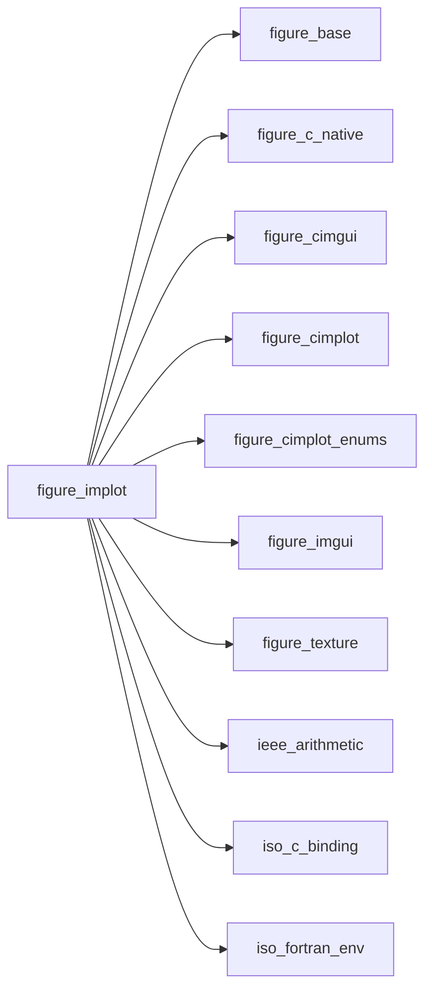

## Re-exports

| Name | Kind | Module | Description |
|------|------|--------|-------------|
| [`ImPlotMarker_None`](/api/src/lib/figure_cimplot_enums#variables) | parameter | [figure_cimplot_enums](/api/src/lib/figure_cimplot_enums) |  |
| [`ImPlotMarker_Auto`](/api/src/lib/figure_cimplot_enums#variables) | parameter | [figure_cimplot_enums](/api/src/lib/figure_cimplot_enums) |  |
| [`ImPlotMarker_Circle`](/api/src/lib/figure_cimplot_enums#variables) | parameter | [figure_cimplot_enums](/api/src/lib/figure_cimplot_enums) |  |
| [`ImPlotMarker_Square`](/api/src/lib/figure_cimplot_enums#variables) | parameter | [figure_cimplot_enums](/api/src/lib/figure_cimplot_enums) |  |
| [`ImPlotMarker_Diamond`](/api/src/lib/figure_cimplot_enums#variables) | parameter | [figure_cimplot_enums](/api/src/lib/figure_cimplot_enums) |  |
| [`ImPlotMarker_Up`](/api/src/lib/figure_cimplot_enums#variables) | parameter | [figure_cimplot_enums](/api/src/lib/figure_cimplot_enums) |  |
| [`ImPlotMarker_Down`](/api/src/lib/figure_cimplot_enums#variables) | parameter | [figure_cimplot_enums](/api/src/lib/figure_cimplot_enums) |  |
| [`ImPlotMarker_Left`](/api/src/lib/figure_cimplot_enums#variables) | parameter | [figure_cimplot_enums](/api/src/lib/figure_cimplot_enums) |  |
| [`ImPlotMarker_Right`](/api/src/lib/figure_cimplot_enums#variables) | parameter | [figure_cimplot_enums](/api/src/lib/figure_cimplot_enums) |  |
| [`ImPlotMarker_Cross`](/api/src/lib/figure_cimplot_enums#variables) | parameter | [figure_cimplot_enums](/api/src/lib/figure_cimplot_enums) |  |
| [`ImPlotMarker_Plus`](/api/src/lib/figure_cimplot_enums#variables) | parameter | [figure_cimplot_enums](/api/src/lib/figure_cimplot_enums) |  |
| [`ImPlotMarker_Asterisk`](/api/src/lib/figure_cimplot_enums#variables) | parameter | [figure_cimplot_enums](/api/src/lib/figure_cimplot_enums) |  |
| [`ImPlotMarker_Vertical`](/api/src/lib/figure_cimplot_enums#variables) | parameter | [figure_cimplot_enums](/api/src/lib/figure_cimplot_enums) |  |
| [`ImPlotMarker_Horizontal`](/api/src/lib/figure_cimplot_enums#variables) | parameter | [figure_cimplot_enums](/api/src/lib/figure_cimplot_enums) |  |
| [`ImPlotItemFlags_None`](/api/src/lib/figure_cimplot_enums#variables) | parameter | [figure_cimplot_enums](/api/src/lib/figure_cimplot_enums) |  |
| [`ImPlotItemFlags_NoLegend`](/api/src/lib/figure_cimplot_enums#variables) | parameter | [figure_cimplot_enums](/api/src/lib/figure_cimplot_enums) |  |
| [`ImPlotItemFlags_NoFit`](/api/src/lib/figure_cimplot_enums#variables) | parameter | [figure_cimplot_enums](/api/src/lib/figure_cimplot_enums) |  |
| [`ImPlotLineFlags_Segments`](/api/src/lib/figure_cimplot_enums#variables) | parameter | [figure_cimplot_enums](/api/src/lib/figure_cimplot_enums) |  |
| [`ImPlotLineFlags_Loop`](/api/src/lib/figure_cimplot_enums#variables) | parameter | [figure_cimplot_enums](/api/src/lib/figure_cimplot_enums) |  |
| [`ImPlotLineFlags_SkipNaN`](/api/src/lib/figure_cimplot_enums#variables) | parameter | [figure_cimplot_enums](/api/src/lib/figure_cimplot_enums) |  |
| [`ImPlotLineFlags_NoClip`](/api/src/lib/figure_cimplot_enums#variables) | parameter | [figure_cimplot_enums](/api/src/lib/figure_cimplot_enums) |  |
| [`ImPlotLineFlags_Shaded`](/api/src/lib/figure_cimplot_enums#variables) | parameter | [figure_cimplot_enums](/api/src/lib/figure_cimplot_enums) |  |
| [`ImPlotScatterFlags_NoClip`](/api/src/lib/figure_cimplot_enums#variables) | parameter | [figure_cimplot_enums](/api/src/lib/figure_cimplot_enums) |  |
| [`ImPlotBarsFlags_Horizontal`](/api/src/lib/figure_cimplot_enums#variables) | parameter | [figure_cimplot_enums](/api/src/lib/figure_cimplot_enums) |  |
| [`ImPlotStairsFlags_PreStep`](/api/src/lib/figure_cimplot_enums#variables) | parameter | [figure_cimplot_enums](/api/src/lib/figure_cimplot_enums) |  |
| [`ImPlotStairsFlags_Shaded`](/api/src/lib/figure_cimplot_enums#variables) | parameter | [figure_cimplot_enums](/api/src/lib/figure_cimplot_enums) |  |
| [`ImPlotStemsFlags_Horizontal`](/api/src/lib/figure_cimplot_enums#variables) | parameter | [figure_cimplot_enums](/api/src/lib/figure_cimplot_enums) |  |
| [`ImPlotInfLinesFlags_Horizontal`](/api/src/lib/figure_cimplot_enums#variables) | parameter | [figure_cimplot_enums](/api/src/lib/figure_cimplot_enums) |  |
| [`ImPlotHistogramFlags_Horizontal`](/api/src/lib/figure_cimplot_enums#variables) | parameter | [figure_cimplot_enums](/api/src/lib/figure_cimplot_enums) |  |
| [`ImPlotHistogramFlags_Cumulative`](/api/src/lib/figure_cimplot_enums#variables) | parameter | [figure_cimplot_enums](/api/src/lib/figure_cimplot_enums) |  |
| [`ImPlotHistogramFlags_Density`](/api/src/lib/figure_cimplot_enums#variables) | parameter | [figure_cimplot_enums](/api/src/lib/figure_cimplot_enums) |  |
| [`ImPlotHistogramFlags_NoOutliers`](/api/src/lib/figure_cimplot_enums#variables) | parameter | [figure_cimplot_enums](/api/src/lib/figure_cimplot_enums) |  |
| [`ImPlotBin_Sqrt`](/api/src/lib/figure_cimplot_enums#variables) | parameter | [figure_cimplot_enums](/api/src/lib/figure_cimplot_enums) |  |
| [`ImPlotBin_Sturges`](/api/src/lib/figure_cimplot_enums#variables) | parameter | [figure_cimplot_enums](/api/src/lib/figure_cimplot_enums) |  |
| [`ImPlotBin_Rice`](/api/src/lib/figure_cimplot_enums#variables) | parameter | [figure_cimplot_enums](/api/src/lib/figure_cimplot_enums) |  |
| [`ImPlotBin_Scott`](/api/src/lib/figure_cimplot_enums#variables) | parameter | [figure_cimplot_enums](/api/src/lib/figure_cimplot_enums) |  |
| [`ImPlotColormap_Deep`](/api/src/lib/figure_cimplot_enums#variables) | parameter | [figure_cimplot_enums](/api/src/lib/figure_cimplot_enums) |  |
| [`ImPlotColormap_Dark`](/api/src/lib/figure_cimplot_enums#variables) | parameter | [figure_cimplot_enums](/api/src/lib/figure_cimplot_enums) |  |
| [`ImPlotColormap_Pastel`](/api/src/lib/figure_cimplot_enums#variables) | parameter | [figure_cimplot_enums](/api/src/lib/figure_cimplot_enums) |  |
| [`ImPlotColormap_Paired`](/api/src/lib/figure_cimplot_enums#variables) | parameter | [figure_cimplot_enums](/api/src/lib/figure_cimplot_enums) |  |
| [`ImPlotColormap_Viridis`](/api/src/lib/figure_cimplot_enums#variables) | parameter | [figure_cimplot_enums](/api/src/lib/figure_cimplot_enums) |  |
| [`ImPlotColormap_Plasma`](/api/src/lib/figure_cimplot_enums#variables) | parameter | [figure_cimplot_enums](/api/src/lib/figure_cimplot_enums) |  |
| [`ImPlotColormap_Hot`](/api/src/lib/figure_cimplot_enums#variables) | parameter | [figure_cimplot_enums](/api/src/lib/figure_cimplot_enums) |  |
| [`ImPlotColormap_Cool`](/api/src/lib/figure_cimplot_enums#variables) | parameter | [figure_cimplot_enums](/api/src/lib/figure_cimplot_enums) |  |
| [`ImPlotColormap_Pink`](/api/src/lib/figure_cimplot_enums#variables) | parameter | [figure_cimplot_enums](/api/src/lib/figure_cimplot_enums) |  |
| [`ImPlotColormap_Jet`](/api/src/lib/figure_cimplot_enums#variables) | parameter | [figure_cimplot_enums](/api/src/lib/figure_cimplot_enums) |  |
| [`ImPlotColormap_Twilight`](/api/src/lib/figure_cimplot_enums#variables) | parameter | [figure_cimplot_enums](/api/src/lib/figure_cimplot_enums) |  |
| [`ImPlotColormap_RdBu`](/api/src/lib/figure_cimplot_enums#variables) | parameter | [figure_cimplot_enums](/api/src/lib/figure_cimplot_enums) |  |
| [`ImPlotColormap_BrBG`](/api/src/lib/figure_cimplot_enums#variables) | parameter | [figure_cimplot_enums](/api/src/lib/figure_cimplot_enums) |  |
| [`ImPlotColormap_PiYG`](/api/src/lib/figure_cimplot_enums#variables) | parameter | [figure_cimplot_enums](/api/src/lib/figure_cimplot_enums) |  |
| [`ImPlotColormap_Spectral`](/api/src/lib/figure_cimplot_enums#variables) | parameter | [figure_cimplot_enums](/api/src/lib/figure_cimplot_enums) |  |
| [`ImPlotColormap_Greys`](/api/src/lib/figure_cimplot_enums#variables) | parameter | [figure_cimplot_enums](/api/src/lib/figure_cimplot_enums) |  |

## Contents

- [plot_spec_object](#plot-spec-object)
- [buffer_r32](#buffer-r32)
- [buffer_r64](#buffer-r64)
- [series_r32](#series-r32)
- [series_r64](#series-r64)
- [ip_line](#ip-line)
- [ip_scatter](#ip-scatter)
- [ip_digital](#ip-digital)
- [ip_bar_groups](#ip-bar-groups)
- [ip_bars](#ip-bars)
- [ip_field_image](#ip-field-image)
- [ip_heatmap](#ip-heatmap)
- [ip_bubbles](#ip-bubbles)
- [ip_pie_chart](#ip-pie-chart)
- [ip_error_bars](#ip-error-bars)
- [ip_contour](#ip-contour)
- [ip_contour_lines](#ip-contour-lines)
- [ip_contour_levels](#ip-contour-levels)
- [ip_shaded](#ip-shaded)
- [ip_stairs](#ip-stairs)
- [ip_stems](#ip-stems)
- [ip_inf_lines](#ip-inf-lines)
- [ip_histogram](#ip-histogram)
- [ip_histogram2d](#ip-histogram2d)
- [in_line](#in-line)
- [series_lead](#series-lead)
- [series_put](#series-put)
- [series_spec](#series-spec)
- [series_gap](#series-gap)
- [series_scratch](#series-scratch)
- [scratch_copy](#scratch-copy)
- [ip_end_subplots](#ip-end-subplots)
- [ip_end_plot](#ip-end-plot)
- [ip_setup_axes](#ip-setup-axes)
- [ip_setup_axes_limits](#ip-setup-axes-limits)
- [ip_setup_axis](#ip-setup-axis)
- [ip_set_axes](#ip-set-axes)
- [ip_setup_axis_limits](#ip-setup-axis-limits)
- [ip_setup_axis_ticks](#ip-setup-axis-ticks)
- [ip_setup_axis_constraints](#ip-setup-axis-constraints)
- [ip_setup_legend](#ip-setup-legend)
- [ip_plot_limits](#ip-plot-limits)
- [ip_plot_size](#ip-plot-size)
- [ip_line_r32](#ip-line-r32)
- [ip_line_i32_r32](#ip-line-i32-r32)
- [ip_line_i64_r32](#ip-line-i64-r32)
- [ip_scatter_r32](#ip-scatter-r32)
- [ip_scatter_i32_r32](#ip-scatter-i32-r32)
- [ip_scatter_i64_r32](#ip-scatter-i64-r32)
- [ip_bars_r32](#ip-bars-r32)
- [ip_bars_i32_r32](#ip-bars-i32-r32)
- [ip_bars_i64_r32](#ip-bars-i64-r32)
- [ip_shaded_r32](#ip-shaded-r32)
- [ip_shaded_i32_r32](#ip-shaded-i32-r32)
- [ip_shaded_i64_r32](#ip-shaded-i64-r32)
- [ip_shaded_ref_r32](#ip-shaded-ref-r32)
- [ip_shaded_ref_i32_r32](#ip-shaded-ref-i32-r32)
- [ip_shaded_ref_i64_r32](#ip-shaded-ref-i64-r32)
- [ip_error_bars_r32](#ip-error-bars-r32)
- [ip_error_bars_i32_r32](#ip-error-bars-i32-r32)
- [ip_error_bars_i64_r32](#ip-error-bars-i64-r32)
- [ip_line_r64](#ip-line-r64)
- [ip_line_i32_r64](#ip-line-i32-r64)
- [ip_line_i64_r64](#ip-line-i64-r64)
- [ip_scatter_r64](#ip-scatter-r64)
- [ip_scatter_i32_r64](#ip-scatter-i32-r64)
- [ip_scatter_i64_r64](#ip-scatter-i64-r64)
- [ip_bubbles_r32](#ip-bubbles-r32)
- [ip_pie_chart_r32](#ip-pie-chart-r32)
- [ip_bubbles_r64](#ip-bubbles-r64)
- [ip_pie_chart_r64](#ip-pie-chart-r64)
- [ip_bars_r64](#ip-bars-r64)
- [ip_bars_i32_r64](#ip-bars-i32-r64)
- [ip_bars_i64_r64](#ip-bars-i64-r64)
- [ip_shaded_r64](#ip-shaded-r64)
- [ip_shaded_i32_r64](#ip-shaded-i32-r64)
- [ip_shaded_i64_r64](#ip-shaded-i64-r64)
- [ip_shaded_ref_r64](#ip-shaded-ref-r64)
- [ip_shaded_ref_i32_r64](#ip-shaded-ref-i32-r64)
- [ip_shaded_ref_i64_r64](#ip-shaded-ref-i64-r64)
- [ip_error_bars_r64](#ip-error-bars-r64)
- [ip_error_bars_i32_r64](#ip-error-bars-i32-r64)
- [ip_error_bars_i64_r64](#ip-error-bars-i64-r64)
- [ip_line_values_r32](#ip-line-values-r32)
- [ip_line_row_r32](#ip-line-row-r32)
- [ip_heatmap_r32](#ip-heatmap-r32)
- [ip_line_values_r64](#ip-line-values-r64)
- [ip_line_row_r64](#ip-line-row-r64)
- [ip_heatmap_r64](#ip-heatmap-r64)
- [ip_image](#ip-image)
- [ip_colormap_scale](#ip-colormap-scale)
- [ip_colormap_legend](#ip-colormap-legend)
- [legend](#legend)
- [ip_field_image_r32](#ip-field-image-r32)
- [ip_field_image_r64](#ip-field-image-r64)
- [field_image](#field-image)
- [ip_load_colormap](#ip-load-colormap)
- [ip_colormap_stops](#ip-colormap-stops)
- [ip_colormap_names](#ip-colormap-names)
- [ip_annotation](#ip-annotation)
- [ip_plot_mouse](#ip-plot-mouse)
- [ip_plot_to_pixels](#ip-plot-to-pixels)
- [ip_pixels_to_plot](#ip-pixels-to-plot)
- [ip_cancel_selection](#ip-cancel-selection)
- [ip_link_axis](#ip-link-axis)
- [ip_end_aligned](#ip-end-aligned)
- [ip_end_legend_popup](#ip-end-legend-popup)
- [ip_hide_next_item](#ip-hide-next-item)
- [ip_digital_r64](#ip-digital-r64)
- [ip_bar_groups_r64](#ip-bar-groups-r64)
- [ip_digital_r32](#ip-digital-r32)
- [ip_bar_groups_r32](#ip-bar-groups-r32)
- [ip_tag](#ip-tag)
- [ip_text](#ip-text)
- [ip_stairs_r32](#ip-stairs-r32)
- [ip_stairs_i32_r32](#ip-stairs-i32-r32)
- [ip_stairs_i64_r32](#ip-stairs-i64-r32)
- [ip_stairs_r64](#ip-stairs-r64)
- [ip_stairs_i32_r64](#ip-stairs-i32-r64)
- [ip_stairs_i64_r64](#ip-stairs-i64-r64)
- [ip_stems_r32](#ip-stems-r32)
- [ip_stems_i32_r32](#ip-stems-i32-r32)
- [ip_stems_i64_r32](#ip-stems-i64-r32)
- [ip_stems_r64](#ip-stems-r64)
- [ip_stems_i32_r64](#ip-stems-i32-r64)
- [ip_stems_i64_r64](#ip-stems-i64-r64)
- [ip_inf_lines_r32](#ip-inf-lines-r32)
- [ip_inf_lines_r64](#ip-inf-lines-r64)
- [ip_inf_lines_i32](#ip-inf-lines-i32)
- [ip_inf_lines_i64](#ip-inf-lines-i64)
- [ip_histogram_r32](#ip-histogram-r32)
- [ip_histogram2d_r32](#ip-histogram2d-r32)
- [ip_histogram_r64](#ip-histogram-r64)
- [ip_histogram2d_r64](#ip-histogram2d-r64)
- [ip_contour_r32](#ip-contour-r32)
- [ip_contour_r64](#ip-contour-r64)
- [ip_contour_lines_r32](#ip-contour-lines-r32)
- [ip_contour_lines_r64](#ip-contour-lines-r64)
- [cell_segments](#cell-segments)
- [finite_range_r32](#finite-range-r32)
- [finite_range_r64](#finite-range-r64)
- [contour_draw](#contour-draw)
- [widen](#widen)
- [set_flag](#set-flag)
- [lead_r32](#lead-r32)
- [put_r32](#put-r32)
- [put_i32_r32](#put-i32-r32)
- [put_i64_r32](#put-i64-r32)
- [lead_r64](#lead-r64)
- [put_r64](#put-r64)
- [put_i32_r64](#put-i32-r64)
- [put_i64_r64](#put-i64-r64)
- [scratch_age](#scratch-age)
- [scratch_slot_r32](#scratch-slot-r32)
- [scratch_slot_r64](#scratch-slot-r64)
- [scratch_reserve_r32](#scratch-reserve-r32)
- [copy_r32](#copy-r32)
- [copy_i32_r32](#copy-i32-r32)
- [copy_i64_r32](#copy-i64-r32)
- [scratch_reserve_r64](#scratch-reserve-r64)
- [copy_r64](#copy-r64)
- [copy_i32_r64](#copy-i32-r64)
- [copy_i64_r64](#copy-i64-r64)
- [ip_begin_plot](#ip-begin-plot)
- [ip_begin_subplots](#ip-begin-subplots)
- [ip_spec](#ip-spec)
- [ip_colormap_legend_edit](#ip-colormap-legend-edit)
- [field_scale_ok](#field-scale-ok)
- [ip_colormap](#ip-colormap)
- [ig_gradient_edit](#ig-gradient-edit)
- [ip_drag_line_x](#ip-drag-line-x)
- [ip_drag_line_y](#ip-drag-line-y)
- [ip_drag_point](#ip-drag-point)
- [ip_plot_hovered](#ip-plot-hovered)
- [ip_plot_selection](#ip-plot-selection)
- [ip_drag_rect](#ip-drag-rect)
- [ip_drop_target](#ip-drop-target)
- [ip_begin_aligned](#ip-begin-aligned)
- [ip_legend_hovered](#ip-legend-hovered)
- [ip_begin_legend_popup](#ip-begin-legend-popup)
- [ip_contour_levels_r32](#ip-contour-levels-r32)
- [ip_contour_levels_r64](#ip-contour-levels-r64)
- [nice_levels](#nice-levels)
- [contour_ok](#contour-ok)
- [level_text](#level-text)
- [drag_ok](#drag-ok)
- [drag_color](#drag-color)
- [colormap_ok](#colormap-ok)
- [axis_index](#axis-index)
- [scale_given_ok](#scale-given-ok)
- [plot_refused](#plot-refused)
- [setup_refused](#setup-refused)
- [axis_refused](#axis-refused)
- [pair_ok](#pair-ok)
- [range_ok](#range-ok)
- [axes_refused](#axes-refused)
- [inf_spec](#inf-spec)
- [bins_ok](#bins-ok)
- [ends_ok](#ends-ok)
- [rule_bins](#rule-bins)
- [std_dev](#std-dev)
- [in_line_r32](#in-line-r32)
- [in_line_r64](#in-line-r64)
- [series_ok](#series-ok)
- [field_ok](#field-ok)
- [row_ok](#row-ok)
- [uniform](#uniform)
- [spec_stride_r32](#spec-stride-r32)
- [spec_stride_r64](#spec-stride-r64)
- [gap](#gap)
- [spec_c](#spec-c)
- [rgba_ok](#rgba-ok)
- [rgba](#rgba)

## Variables

| Name | Type | Attributes | Description |
|------|------|------------|-------------|
| `subplots_seen` | character(len=128) | allocatable | Titles of the subplot figures drawn so far. |
| `fits_pending` | integer(kind=int32) |  | Plots of a new subplot figure still to fit to their data. |
| `plot_copies` | integer(kind=int64) |  | Arrays the items copied because ImPlot could not read them in place (strides, integer abscissae): `test_plot_copies`. |
| `plot_stride` | integer(kind=int64) |  | Byte stride given to ImPlot for the last item: `test_plot_stride`. |
| `scratch_r32` | type([buffer_r32](/api/src/lib/figure_implot#buffer-r32)) | target | Single precision. |
| `scratch_r64` | type([buffer_r64](/api/src/lib/figure_implot#buffer-r64)) | target | Double precision. |
| `scratch_frame` | integer(kind=int32) |  | Dear ImGui frame of the last copy into the scratch; -1: none kept. |

## Derived Types

### plot_spec_object

Style of a plot item: colours, line weight, markers, flags. Build it with `ip_spec`.

 The C struct is private so that a spec always starts from ImPlot's defaults: a zeroed one would draw nothing
 (line weight 0, marker size 0).

**Components**

| Name | Type | Attributes | Description |
|------|------|------------|-------------|
| `c` | type([im_plot_spec](/api/src/lib/figure_cimplot#im-plot-spec)) |  | `ImPlotSpec`, as passed to ImPlot. |

### buffer_r32

A scratch array of the items (single precision): the temporary of an array ImPlot cannot read in place.

**Components**

| Name | Type | Attributes | Description |
|------|------|------------|-------------|
| `v` | real(kind=real32) | allocatable | Values, at the item's stride. |

### buffer_r64

A scratch array of the items (double precision): the temporary of an array ImPlot cannot read in place.

**Components**

| Name | Type | Attributes | Description |
|------|------|------------|-------------|
| `v` | real(kind=real64) | allocatable | Values, at the item's stride. |

### series_r32

Where ImPlot reads the arrays of one item (single precision): one address per array and the byte stride they
 share (ImPlot applies one stride to all the arrays of an item); an array copied is read from its slot's scratch.

**Components**

| Name | Type | Attributes | Description |
|------|------|------------|-------------|
| `p` | type(c_ptr) |  | Addresses: 1 x, 2 y (sets the stride), 3-4 the other ordinates. |
| `stride` | integer(kind=int64) |  | Stride of every array [bytes]. |

### series_r64

Where ImPlot reads the arrays of one item (double precision): one address per array and the byte stride they
 share (ImPlot applies one stride to all the arrays of an item); an array copied is read from its slot's scratch.

**Components**

| Name | Type | Attributes | Description |
|------|------|------------|-------------|
| `p` | type(c_ptr) |  | Addresses: 1 x, 2 y (sets the stride), 3-4 the other ordinates. |
| `stride` | integer(kind=int64) |  | Stride of every array [bytes]. |

## Interfaces

### ip_line

Line through the points (x(i), y(i)); or through y(i) at uniformly spaced x, from a vector or from a row of a
 matrix. Arrays of any stride are read in place (plots.md, "Data in place"); x may be `int32` or `int64`.

**Module procedures**: [`ip_line_r32`](/api/src/lib/figure_implot#ip-line-r32), [`ip_line_r64`](/api/src/lib/figure_implot#ip-line-r64), [`ip_line_values_r32`](/api/src/lib/figure_implot#ip-line-values-r32), [`ip_line_values_r64`](/api/src/lib/figure_implot#ip-line-values-r64), [`ip_line_row_r32`](/api/src/lib/figure_implot#ip-line-row-r32), [`ip_line_row_r64`](/api/src/lib/figure_implot#ip-line-row-r64), [`ip_line_i32_r32`](/api/src/lib/figure_implot#ip-line-i32-r32), [`ip_line_i64_r32`](/api/src/lib/figure_implot#ip-line-i64-r32), [`ip_line_i32_r64`](/api/src/lib/figure_implot#ip-line-i32-r64), [`ip_line_i64_r64`](/api/src/lib/figure_implot#ip-line-i64-r64)

### ip_scatter

Markers at the points (x(i), y(i)).

**Module procedures**: [`ip_scatter_r32`](/api/src/lib/figure_implot#ip-scatter-r32), [`ip_scatter_r64`](/api/src/lib/figure_implot#ip-scatter-r64), [`ip_scatter_i32_r32`](/api/src/lib/figure_implot#ip-scatter-i32-r32), [`ip_scatter_i64_r32`](/api/src/lib/figure_implot#ip-scatter-i64-r32), [`ip_scatter_i32_r64`](/api/src/lib/figure_implot#ip-scatter-i32-r64), [`ip_scatter_i64_r64`](/api/src/lib/figure_implot#ip-scatter-i64-r64)

### ip_digital

A digital signal: y(i) at x(i), drawn as bars of the signal's height in a band at the bottom of the plot.

**Module procedures**: [`ip_digital_r32`](/api/src/lib/figure_implot#ip-digital-r32), [`ip_digital_r64`](/api/src/lib/figure_implot#ip-digital-r64)

### ip_bar_groups

Items in groups of bars: `values(g, i)`, item i in group g.

**Module procedures**: [`ip_bar_groups_r32`](/api/src/lib/figure_implot#ip-bar-groups-r32), [`ip_bar_groups_r64`](/api/src/lib/figure_implot#ip-bar-groups-r64)

### ip_bars

Bars of height y(i) centred at x(i).

**Module procedures**: [`ip_bars_r32`](/api/src/lib/figure_implot#ip-bars-r32), [`ip_bars_r64`](/api/src/lib/figure_implot#ip-bars-r64), [`ip_bars_i32_r32`](/api/src/lib/figure_implot#ip-bars-i32-r32), [`ip_bars_i64_r32`](/api/src/lib/figure_implot#ip-bars-i64-r32), [`ip_bars_i32_r64`](/api/src/lib/figure_implot#ip-bars-i32-r64), [`ip_bars_i64_r64`](/api/src/lib/figure_implot#ip-bars-i64-r64)

### ip_field_image

A field through a colormap, kept as a texture: `real32` or `real64`.

**Module procedures**: [`ip_field_image_r32`](/api/src/lib/figure_implot#ip-field-image-r32), [`ip_field_image_r64`](/api/src/lib/figure_implot#ip-field-image-r64)

### ip_heatmap

A 2D field f(i, j) as coloured cells: i along x, j along y, j = 1 at the bottom.

**Module procedures**: [`ip_heatmap_r32`](/api/src/lib/figure_implot#ip-heatmap-r32), [`ip_heatmap_r64`](/api/src/lib/figure_implot#ip-heatmap-r64)

### ip_bubbles

Circles at the points (x(i), y(i)) of radius radii(i), in plot units along both axes (`PlotBubbles`).

**Module procedures**: [`ip_bubbles_r32`](/api/src/lib/figure_implot#ip-bubbles-r32), [`ip_bubbles_r64`](/api/src/lib/figure_implot#ip-bubbles-r64)

### ip_pie_chart

A pie chart: one slice per value, labelled in the legend, centred at (x, y) with a radius in plot units.

**Module procedures**: [`ip_pie_chart_r32`](/api/src/lib/figure_implot#ip-pie-chart-r32), [`ip_pie_chart_r64`](/api/src/lib/figure_implot#ip-pie-chart-r64)

### ip_error_bars

Error bars at the points (x(i), y(i)): from y(i) - err(i) to y(i) + err(i), or to y(i) + err_high(i); along x
 with `horizontal=.true.`.

**Module procedures**: [`ip_error_bars_r32`](/api/src/lib/figure_implot#ip-error-bars-r32), [`ip_error_bars_r64`](/api/src/lib/figure_implot#ip-error-bars-r64), [`ip_error_bars_i32_r32`](/api/src/lib/figure_implot#ip-error-bars-i32-r32), [`ip_error_bars_i64_r32`](/api/src/lib/figure_implot#ip-error-bars-i64-r32), [`ip_error_bars_i32_r64`](/api/src/lib/figure_implot#ip-error-bars-i32-r64), [`ip_error_bars_i64_r64`](/api/src/lib/figure_implot#ip-error-bars-i64-r64)

### ip_contour

Contour lines of a 2D field f(i, j), sampled at uniformly spaced points, i along x, j along y.

**Module procedures**: [`ip_contour_r32`](/api/src/lib/figure_implot#ip-contour-r32), [`ip_contour_r64`](/api/src/lib/figure_implot#ip-contour-r64)

### ip_contour_lines

The segments of the contour lines of a 2D field (marching squares), without drawing them.

**Module procedures**: [`ip_contour_lines_r32`](/api/src/lib/figure_implot#ip-contour-lines-r32), [`ip_contour_lines_r64`](/api/src/lib/figure_implot#ip-contour-lines-r64)

### ip_contour_levels

Contour levels at round numbers ("nice" steps: 1, 2, 2.5 or 5 times a power of ten) inside a field's range.

**Module procedures**: [`ip_contour_levels_r32`](/api/src/lib/figure_implot#ip-contour-levels-r32), [`ip_contour_levels_r64`](/api/src/lib/figure_implot#ip-contour-levels-r64)

### ip_shaded

Area between two curves y1(x) and y2(x), or between a curve y(x) and the line y = yref.

**Module procedures**: [`ip_shaded_r32`](/api/src/lib/figure_implot#ip-shaded-r32), [`ip_shaded_r64`](/api/src/lib/figure_implot#ip-shaded-r64), [`ip_shaded_ref_r32`](/api/src/lib/figure_implot#ip-shaded-ref-r32), [`ip_shaded_ref_r64`](/api/src/lib/figure_implot#ip-shaded-ref-r64), [`ip_shaded_i32_r32`](/api/src/lib/figure_implot#ip-shaded-i32-r32), [`ip_shaded_i64_r32`](/api/src/lib/figure_implot#ip-shaded-i64-r32), [`ip_shaded_i32_r64`](/api/src/lib/figure_implot#ip-shaded-i32-r64), [`ip_shaded_i64_r64`](/api/src/lib/figure_implot#ip-shaded-i64-r64), [`ip_shaded_ref_i32_r32`](/api/src/lib/figure_implot#ip-shaded-ref-i32-r32), [`ip_shaded_ref_i64_r32`](/api/src/lib/figure_implot#ip-shaded-ref-i64-r32), [`ip_shaded_ref_i32_r64`](/api/src/lib/figure_implot#ip-shaded-ref-i32-r64), [`ip_shaded_ref_i64_r64`](/api/src/lib/figure_implot#ip-shaded-ref-i64-r64)

### ip_stairs

A staircase through the points (x(i), y(i)): y(i) held until x(i+1). Arrays read in place (plots.md, "Data in
 place"); x may be `int32` or `int64`.

**Module procedures**: [`ip_stairs_r32`](/api/src/lib/figure_implot#ip-stairs-r32), [`ip_stairs_r64`](/api/src/lib/figure_implot#ip-stairs-r64), [`ip_stairs_i32_r32`](/api/src/lib/figure_implot#ip-stairs-i32-r32), [`ip_stairs_i64_r32`](/api/src/lib/figure_implot#ip-stairs-i64-r32), [`ip_stairs_i32_r64`](/api/src/lib/figure_implot#ip-stairs-i32-r64), [`ip_stairs_i64_r64`](/api/src/lib/figure_implot#ip-stairs-i64-r64)

### ip_stems

Stems from y = ref to the points (x(i), y(i)), each with a marker.

**Module procedures**: [`ip_stems_r32`](/api/src/lib/figure_implot#ip-stems-r32), [`ip_stems_r64`](/api/src/lib/figure_implot#ip-stems-r64), [`ip_stems_i32_r32`](/api/src/lib/figure_implot#ip-stems-i32-r32), [`ip_stems_i64_r32`](/api/src/lib/figure_implot#ip-stems-i64-r32), [`ip_stems_i32_r64`](/api/src/lib/figure_implot#ip-stems-i32-r64), [`ip_stems_i64_r64`](/api/src/lib/figure_implot#ip-stems-i64-r64)

### ip_inf_lines

Lines across the whole plot at given x (or y) values: `real32`, `real64`, `int32` or `int64` positions.

**Module procedures**: [`ip_inf_lines_r32`](/api/src/lib/figure_implot#ip-inf-lines-r32), [`ip_inf_lines_r64`](/api/src/lib/figure_implot#ip-inf-lines-r64), [`ip_inf_lines_i32`](/api/src/lib/figure_implot#ip-inf-lines-i32), [`ip_inf_lines_i64`](/api/src/lib/figure_implot#ip-inf-lines-i64)

### ip_histogram

A histogram of values: bars as high as the values in each bin.

**Module procedures**: [`ip_histogram_r32`](/api/src/lib/figure_implot#ip-histogram-r32), [`ip_histogram_r64`](/api/src/lib/figure_implot#ip-histogram-r64)

### ip_histogram2d

A 2-D histogram of points: cells coloured by how many points fall in each.

**Module procedures**: [`ip_histogram2d_r32`](/api/src/lib/figure_implot#ip-histogram2d-r32), [`ip_histogram2d_r64`](/api/src/lib/figure_implot#ip-histogram2d-r64)

### in_line

Whether an array's elements are adjacent in memory.

**Module procedures**: [`in_line_r32`](/api/src/lib/figure_implot#in-line-r32), [`in_line_r64`](/api/src/lib/figure_implot#in-line-r64)

### series_lead

Place the array that sets an item's stride.

**Module procedures**: [`lead_r32`](/api/src/lib/figure_implot#lead-r32), [`lead_r64`](/api/src/lib/figure_implot#lead-r64)

### series_put

Place another array of an item, at its stride.

**Module procedures**: [`put_r32`](/api/src/lib/figure_implot#put-r32), [`put_r64`](/api/src/lib/figure_implot#put-r64), [`put_i32_r32`](/api/src/lib/figure_implot#put-i32-r32), [`put_i64_r32`](/api/src/lib/figure_implot#put-i64-r32), [`put_i32_r64`](/api/src/lib/figure_implot#put-i32-r64), [`put_i64_r64`](/api/src/lib/figure_implot#put-i64-r64)

### series_spec

The C spec of an item with its stride.

**Module procedures**: [`spec_stride_r32`](/api/src/lib/figure_implot#spec-stride-r32), [`spec_stride_r64`](/api/src/lib/figure_implot#spec-stride-r64)

### series_gap

Bytes from one address to the next one: the stride of an array, from the addresses of two consecutive elements.

**Module procedures**: [`gap`](/api/src/lib/figure_implot#gap)

### series_scratch

The scratch of a slot, at least `n` elements long, for an array an item lays out itself (a grid, a field).

**Module procedures**: [`scratch_slot_r32`](/api/src/lib/figure_implot#scratch-slot-r32), [`scratch_slot_r64`](/api/src/lib/figure_implot#scratch-slot-r64)

### scratch_copy

Copy an item's array into its slot's scratch at the item's stride (integer abscissae converted).

**Module procedures**: [`copy_r32`](/api/src/lib/figure_implot#copy-r32), [`copy_r64`](/api/src/lib/figure_implot#copy-r64), [`copy_i32_r32`](/api/src/lib/figure_implot#copy-i32-r32), [`copy_i64_r32`](/api/src/lib/figure_implot#copy-i64-r32), [`copy_i32_r64`](/api/src/lib/figure_implot#copy-i32-r64), [`copy_i64_r64`](/api/src/lib/figure_implot#copy-i64-r64)

## Subroutines

### ip_end_subplots

End the grid of plots (only after `ip_begin_subplots` returned true).

**Attributes**: recursive

```fortran
subroutine ip_end_subplots()
```

**Call graph**

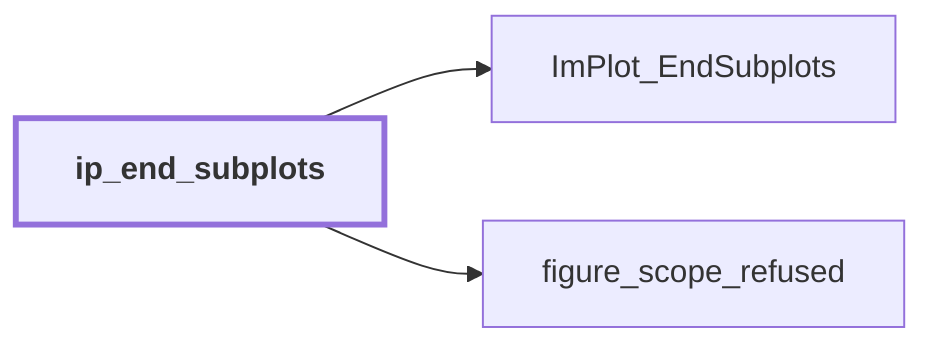

### ip_end_plot

End the plot (only after `ip_begin_plot` returned true).

**Attributes**: recursive

```fortran
subroutine ip_end_plot()
```

**Call graph**

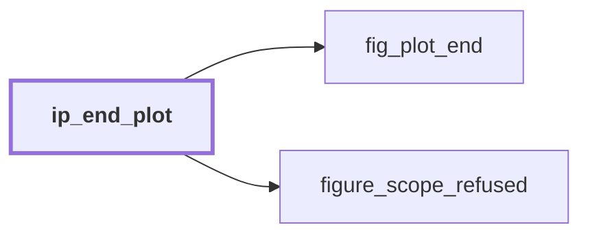

### ip_setup_axes

Labels of the axes X1 and Y1 (call right after `ip_begin_plot`, before any item); with `auto_fit=.true.` both
 axes fit the data every frame (data that grows while the user watches), instead of once on first use.
 `xscale`/`yscale`: `'linear'` (default), `'log'` (base 10: values <= 0 are not shown), `'symlog'` (symmetric
 log: linear within [-1, 1], logarithmic beyond, both signs) or `'time'` (x only: UNIX seconds, labelled as dates
 and times). `xlog`/`ylog` (deprecated, kept from v0.3): `.true.` is `'log'`. `xformat`/`yformat`: a C printf
 format of the tick labels (`'%.6f'`, `'%.2e'`, `'%g s'`), checked: one conversion `f`, `e`, `g` or `a`, with
 optional flags, width and precision, and any `%%`. Statuses: `FIG_ERR_ARGUMENT` for any other format, an unknown
 scale, `'time'` on y, or `xlog` and `xscale` that disagree (nothing is set up); `FIG_ERR_STATE` outside a plot,
 after its setup is over (an item, `ip_set_axes`, `ip_plot_limits`), or from a task; `stat` absent: `error stop`
 with the message (a usage error: as `app%set_checks` says).

**Attributes**: recursive

```fortran
subroutine ip_setup_axes(xlabel, ylabel, auto_fit, xlog, ylog, xformat, yformat, xscale, yscale, stat)
```

**Arguments**

| Name | Type | Intent | Attributes | Description |
|------|------|--------|------------|-------------|
| `xlabel` | character(len=*) | in |  | X label. |
| `ylabel` | character(len=*) | in |  | Y label. |
| `auto_fit` | logical | in | optional | Fit the axes to the data every frame (default: first use only). |
| `xlog` | logical | in | optional | Logarithmic x axis (deprecated: `xscale='log'`). |
| `ylog` | logical | in | optional | Logarithmic y axis (deprecated: `yscale='log'`). |
| `xformat` | character(len=*) | in | optional | printf format of the x tick labels (one real). |
| `yformat` | character(len=*) | in | optional | printf format of the y tick labels (one real). |
| `xscale` | character(len=*) | in | optional | Scale of x: 'linear', 'log', 'symlog', 'time'. |
| `yscale` | character(len=*) | in | optional | Scale of y: 'linear', 'log', 'symlog'. |
| `stat` | integer(kind=int32) | out | optional | Status. |

**Call graph**

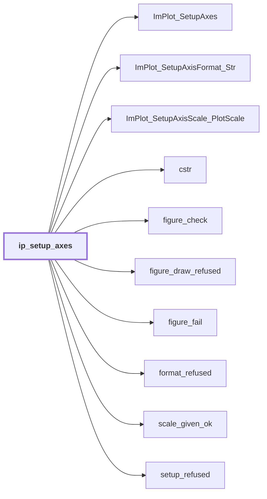

### ip_setup_axes_limits

Initial ranges of the axes X1 and Y1 (call right after `ip_begin_plot`): applied on first use only, so the user
 can pan and zoom afterwards, or every frame with `always=.true.`. Statuses: `FIG_ERR_STATE` outside a plot, after
 its setup is over, or from a task.

**Attributes**: recursive

```fortran
subroutine ip_setup_axes_limits(xmin, xmax, ymin, ymax, always, stat)
```

**Arguments**

| Name | Type | Intent | Attributes | Description |
|------|------|--------|------------|-------------|
| `xmin` | real(kind=real64) | in |  | Left end of the x axis. |
| `xmax` | real(kind=real64) | in |  | Right end of the x axis. |
| `ymin` | real(kind=real64) | in |  | Bottom end of the y axis. |
| `ymax` | real(kind=real64) | in |  | Top end of the y axis. |
| `always` | logical | in | optional | Enforce every frame (default: first use only). |
| `stat` | integer(kind=int32) | out | optional | Status. |

**Call graph**

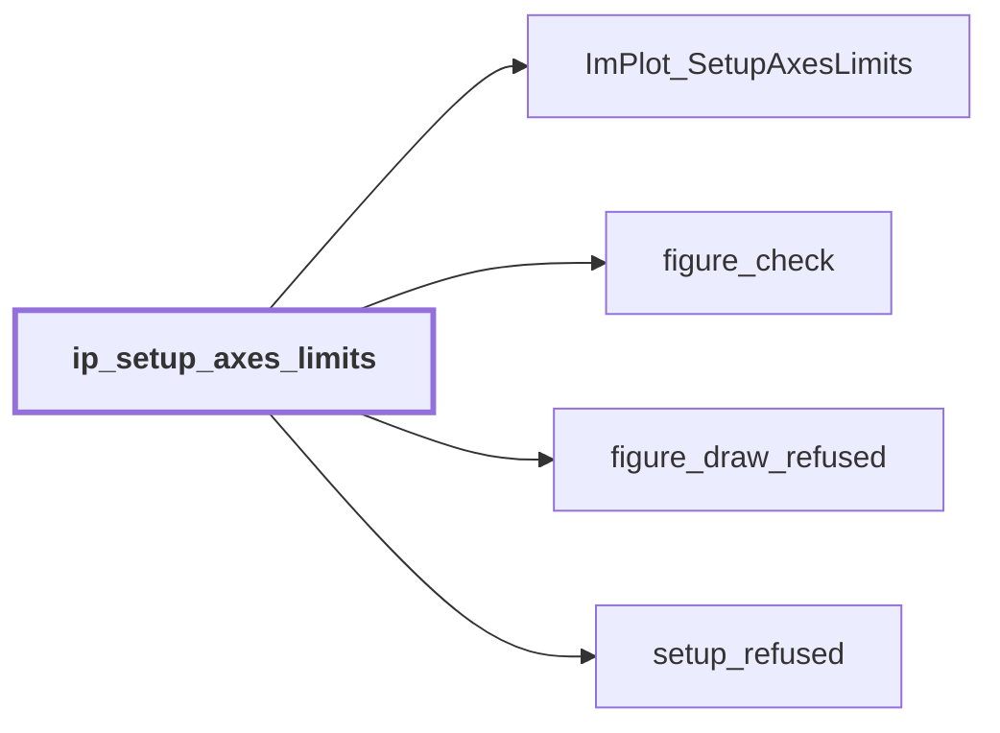

### ip_setup_axis

Set up one axis of the plot being declared (`SetupAxis`): `axis` is `'x1'`, `'x2'`, `'x3'`, `'y1'`, `'y2'` or
 `'y3'`. X1 and Y1 always exist; X2, X3, Y2 and Y3 exist on the frames this is called for them. Call it right
 after `ip_begin_plot`, before any item, every frame. `scale`: `'linear'` (default), `'log'`, `'symlog'`,
 `'time'` (x axes only). The secondary axes (2 and 3) are drawn on the opposite side (top, right) without grid
 lines unless `opposite`/`no_grid` say otherwise. `lock`: the user cannot pan or zoom it. Statuses:
 `FIG_ERR_ARGUMENT` for an unknown axis or scale, `'time'` on a y axis, a bad format (nothing set up);
 `FIG_ERR_STATE` outside a plot, after its setup is over, or from a task.

**Attributes**: recursive

```fortran
subroutine ip_setup_axis(axis, label, scale, auto_fit, format, opposite, invert, lock, no_grid, stat)
```

**Arguments**

| Name | Type | Intent | Attributes | Description |
|------|------|--------|------------|-------------|
| `axis` | character(len=*) | in |  | 'x1', 'x2', 'x3', 'y1', 'y2', 'y3'. |
| `label` | character(len=*) | in | optional | Label (default: none). |
| `scale` | character(len=*) | in | optional | 'linear' (default), 'log', 'symlog', 'time'. |
| `auto_fit` | logical | in | optional | Fit the data every frame (default: first use only). |
| `format` | character(len=*) | in | optional | printf format of the tick labels (one real). |
| `opposite` | logical | in | optional | Ticks and label on the opposite side (default: axes 2, 3). |
| `invert` | logical | in | optional | Values grow leftwards (x) or downwards (y). |
| `lock` | logical | in | optional | No pan or zoom by the user. |
| `no_grid` | logical | in | optional | No grid lines (default: axes 2, 3). |
| `stat` | integer(kind=int32) | out | optional | Status. |

**Call graph**

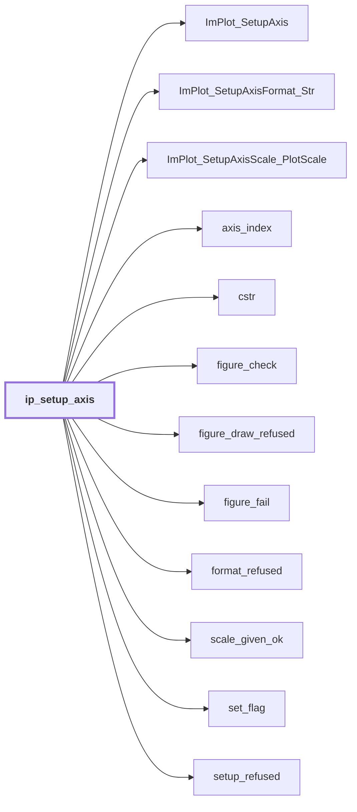

### ip_set_axes

The axes the next items of the plot being declared use (`SetAxes`), until the next call or the plot's end (each
 plot starts on X1 and Y1): `x` one of `'x1'`, `'x2'`, `'x3'`, `y` one of `'y1'`, `'y2'`, `'y3'`, each set up
 (`ip_setup_axis`) on this frame. It ends the setup: call every `ip_setup_*` first. Statuses: `FIG_ERR_ARGUMENT`
 for a name that is not an axis of its direction; `FIG_ERR_STATE` outside a plot, for an axis not set up, from a
 task.

**Attributes**: recursive

```fortran
subroutine ip_set_axes(x, y, stat)
```

**Arguments**

| Name | Type | Intent | Attributes | Description |
|------|------|--------|------------|-------------|
| `x` | character(len=*) | in |  | 'x1', 'x2' or 'x3'. |
| `y` | character(len=*) | in |  | 'y1', 'y2' or 'y3'. |
| `stat` | integer(kind=int32) | out | optional | Status. |

**Call graph**

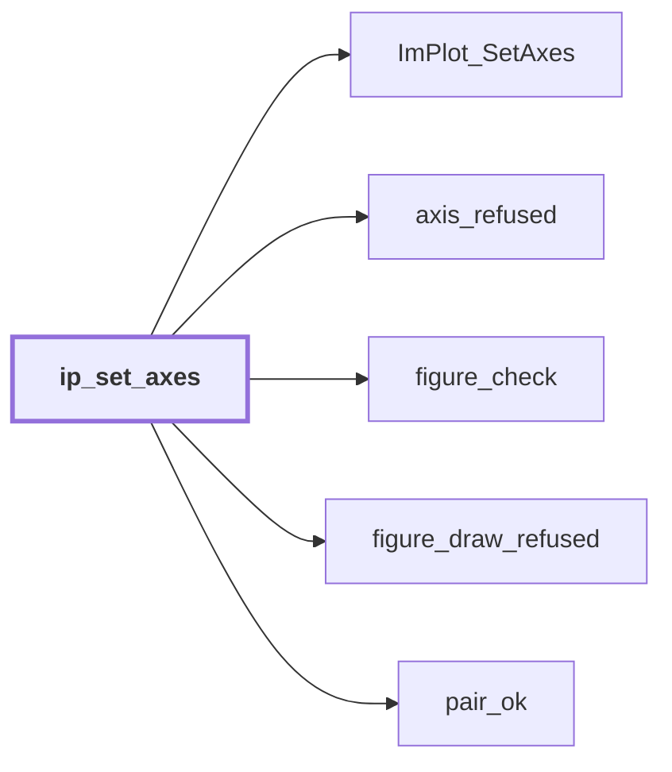

### ip_setup_axis_limits

Initial range of one axis (`SetupAxisLimits`), applied on first use only (the user pans and zooms afterwards),
 or every frame with `always=.true.`. After `ip_setup_axis` for that axis, before any item. Statuses:
 `FIG_ERR_ARGUMENT` for an unknown axis, a NaN end, `vmin >= vmax`; `FIG_ERR_STATE` outside a plot, after its
 setup is over, for an axis not set up, from a task.

**Attributes**: recursive

```fortran
subroutine ip_setup_axis_limits(axis, vmin, vmax, always, stat)
```

**Arguments**

| Name | Type | Intent | Attributes | Description |
|------|------|--------|------------|-------------|
| `axis` | character(len=*) | in |  | 'x1', 'x2', 'x3', 'y1', 'y2', 'y3'. |
| `vmin` | real(kind=real64) | in |  | Lower end [axis units]. |
| `vmax` | real(kind=real64) | in |  | Upper end [axis units]. |
| `always` | logical | in | optional | Enforce every frame (default: first use only). |
| `stat` | integer(kind=int32) | out | optional | Status. |

**Call graph**

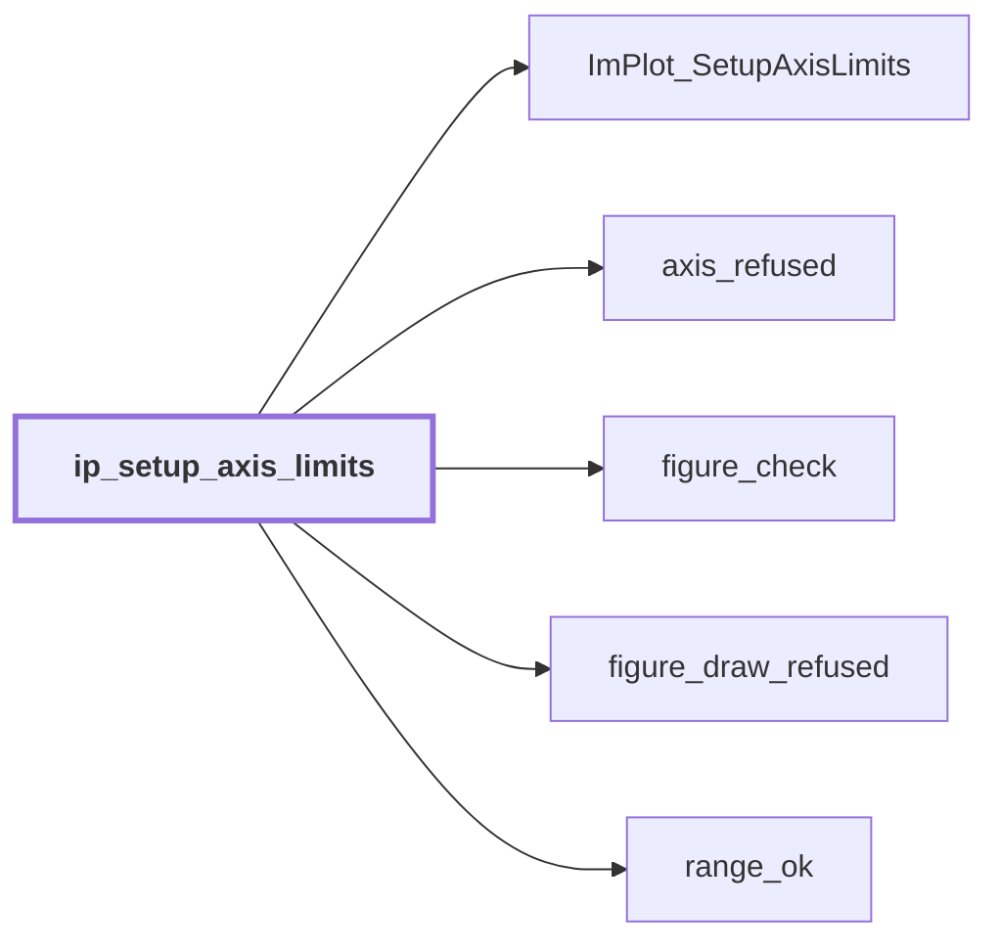

### ip_setup_axis_ticks

Ticks of one axis at the given values instead of the automatic ones (`SetupAxisTicks`), labelled `labels` (as
 given, trailing blanks dropped) or, without them, by the axis's format. After `ip_setup_axis` (and its `format`)
 for that axis, before any item. Statuses: `FIG_ERR_ARGUMENT` for an unknown axis, a NaN or infinite value,
 labels not one per value, more values than a C `int` counts; `FIG_ERR_STATE` outside a plot, after its setup is
 over, for an axis not set up, from a task.

**Attributes**: recursive

```fortran
subroutine ip_setup_axis_ticks(axis, values, labels, stat)
```

**Arguments**

| Name | Type | Intent | Attributes | Description |
|------|------|--------|------------|-------------|
| `axis` | character(len=*) | in |  | 'x1', 'x2', 'x3', 'y1', 'y2', 'y3'. |
| `values` | real(kind=real64) | in |  | Positions [axis units]. |
| `labels` | character(len=*) | in | optional | One label per value. |
| `stat` | integer(kind=int32) | out | optional | Status. |

**Call graph**

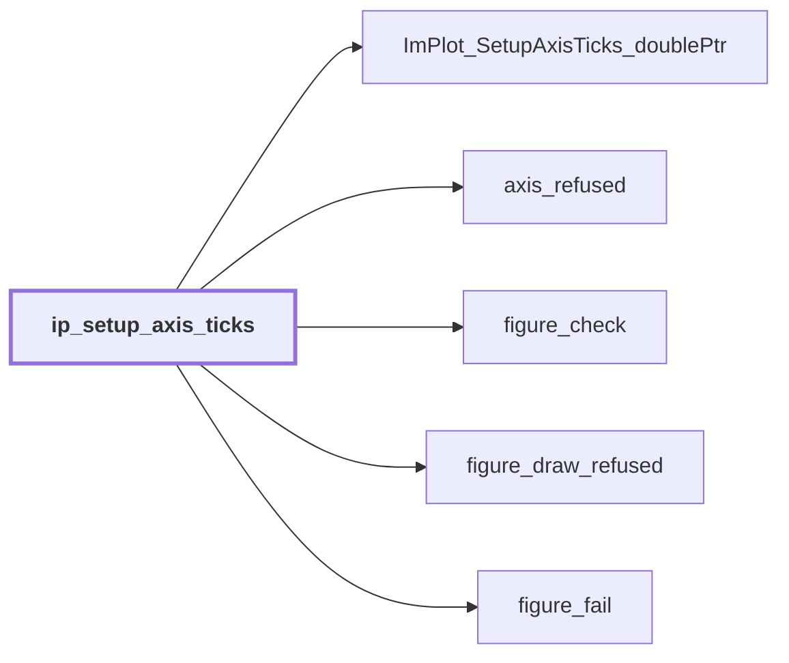

### ip_setup_axis_constraints

Bounds the user cannot pan or zoom one axis past (`SetupAxisLimitsConstraints`, `SetupAxisZoomConstraints`):
 the range stays within [`vmin`, `vmax`], its width within [`zoom_min`, `zoom_max`]; an end not given keeps its
 bound (none, or the scale's: a log axis stays above 0). After `ip_setup_axis` (and its `scale`) for that axis,
 before any item, every frame. Statuses: `FIG_ERR_ARGUMENT` for an unknown axis, a NaN, `vmin >= vmax`,
 `zoom_min > zoom_max`, a negative zoom width, `vmin <= 0` on a log axis; `FIG_ERR_STATE` outside a plot, after
 its setup is over, for an axis not set up, from a task.

**Attributes**: recursive

```fortran
subroutine ip_setup_axis_constraints(axis, vmin, vmax, zoom_min, zoom_max, stat)
```

**Arguments**

| Name | Type | Intent | Attributes | Description |
|------|------|--------|------------|-------------|
| `axis` | character(len=*) | in |  | 'x1', 'x2', 'x3', 'y1', 'y2', 'y3'. |
| `vmin` | real(kind=real64) | in | optional | Lowest value shown [axis units]. |
| `vmax` | real(kind=real64) | in | optional | Highest value shown [axis units]. |
| `zoom_min` | real(kind=real64) | in | optional | Narrowest range [axis units]. |
| `zoom_max` | real(kind=real64) | in | optional | Widest range [axis units]. |
| `stat` | integer(kind=int32) | out | optional | Status. |

**Call graph**

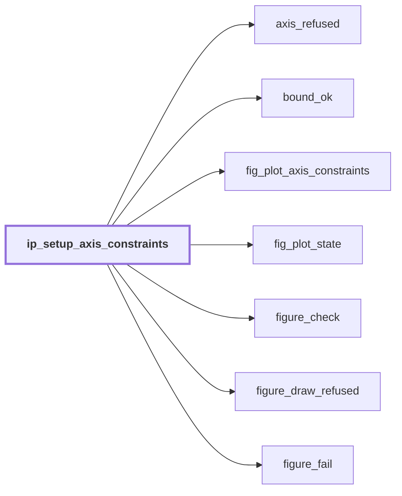

### ip_setup_legend

Where the plot's legend goes (`SetupLegend`): `location` a compass point, `'n'`, `'ne'`, `'e'`, `'se'`, `'s'`,
 `'sw'`, `'w'`, `'nw'` (default, ImPlot's) or `'c'` (centre); `outside=.true.` puts it outside the plot area, on
 that side, and the plot area shrinks to make room; `horizontal=.true.` lays the entries out in a row. Right
 after `ip_begin_plot`, before any item. Statuses: `FIG_ERR_ARGUMENT` for an unknown location; `FIG_ERR_STATE`
 outside a plot, after its setup is over, from a task.

**Attributes**: recursive

```fortran
subroutine ip_setup_legend(location, outside, horizontal, stat)
```

**Arguments**

| Name | Type | Intent | Attributes | Description |
|------|------|--------|------------|-------------|
| `location` | character(len=*) | in | optional | Compass point: 'n', 'ne', 'e', 'se', 's', 'sw', 'w', 'nw', 'c' (default 'nw'). |
| `outside` | logical | in | optional | Outside the plot area (default: inside). |
| `horizontal` | logical | in | optional | Entries in a row (default: a column). |
| `stat` | integer(kind=int32) | out | optional | Status. |

**Call graph**

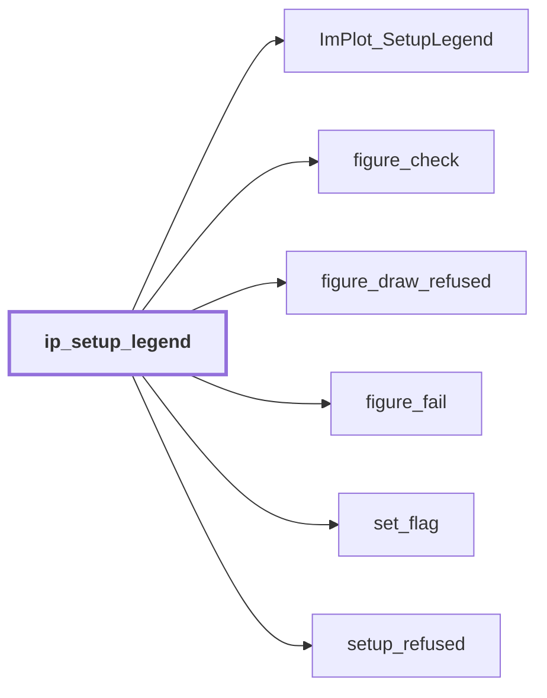

### ip_plot_limits

Axis ranges of the current plot, as the user has panned and zoomed them (between `ip_begin_plot` and
 `ip_end_plot`; ends the setup phase: call `ip_setup_*` before): of the axes the items use now (X1 and Y1, or
 those of the last `ip_set_axes`), or of `xaxis` (`'x1'`, `'x2'`, `'x3'`) and `yaxis` (`'y1'`, `'y2'`, `'y3'`).
 Statuses: `FIG_ERR_ARGUMENT` for a name that is not an axis of its direction; `FIG_ERR_STATE` outside a plot,
 for an axis not set up, from a task (the limits are then 0).

**Attributes**: recursive

```fortran
subroutine ip_plot_limits(xmin, xmax, ymin, ymax, xaxis, yaxis, stat)
```

**Arguments**

| Name | Type | Intent | Attributes | Description |
|------|------|--------|------------|-------------|
| `xmin` | real(kind=real64) | out |  | Left end of the x axis. |
| `xmax` | real(kind=real64) | out |  | Right end of the x axis. |
| `ymin` | real(kind=real64) | out |  | Bottom end of the y axis. |
| `ymax` | real(kind=real64) | out |  | Top end of the y axis. |
| `xaxis` | character(len=*) | in | optional | 'x1', 'x2' or 'x3' (default: the current one). |
| `yaxis` | character(len=*) | in | optional | 'y1', 'y2' or 'y3' (default: the current one). |
| `stat` | integer(kind=int32) | out | optional | Status. |

**Call graph**

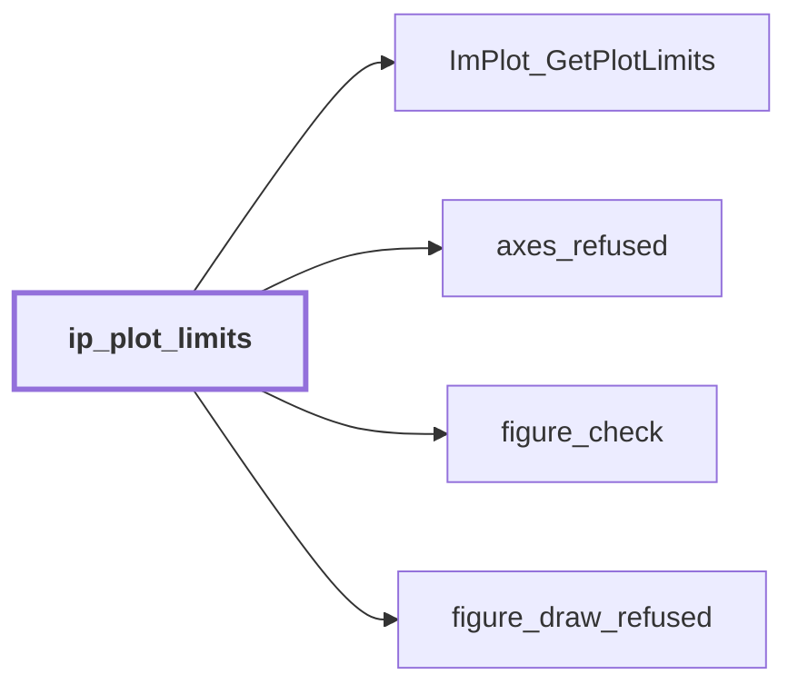

### ip_plot_size

Size of the current plot's data area [pixels] (between `ip_begin_plot` and `ip_end_plot`).

**Attributes**: recursive

```fortran
subroutine ip_plot_size(width, height)
```

**Arguments**

| Name | Type | Intent | Attributes | Description |
|------|------|--------|------------|-------------|
| `width` | real(kind=real64) | out |  | Width [pixels]. |
| `height` | real(kind=real64) | out |  | Height [pixels]. |

**Call graph**

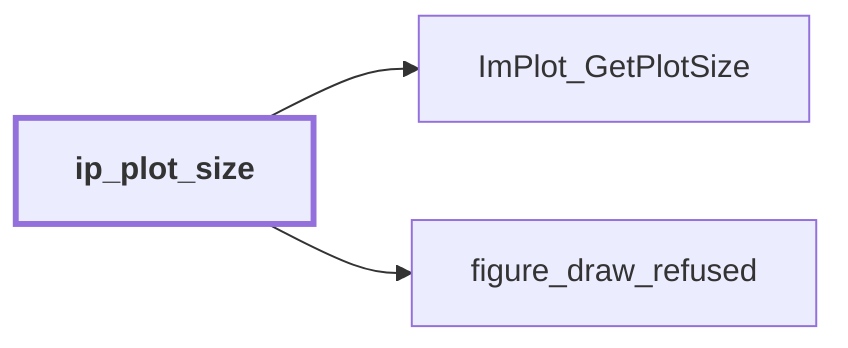

### ip_line_r32

Line through the points (x(i), y(i)), single precision; read in place with any stride (plots.md, "Data in place").

**Attributes**: recursive

```fortran
subroutine ip_line_r32(label, x, y, spec, stat)
```

**Arguments**

| Name | Type | Intent | Attributes | Description |
|------|------|--------|------------|-------------|
| `label` | character(len=*) | in |  | Legend label. |
| `x` | real(kind=real32) | in | target, asynchronous | Abscissae. |
| `y` | real(kind=real32) | in | target, asynchronous | Ordinates. |
| `spec` | type([plot_spec_object](/api/src/lib/figure_implot#plot-spec-object)) | in | optional | Style (default: ImPlot's). |
| `stat` | integer(kind=int32) | out | optional | Status. |

**Call graph**

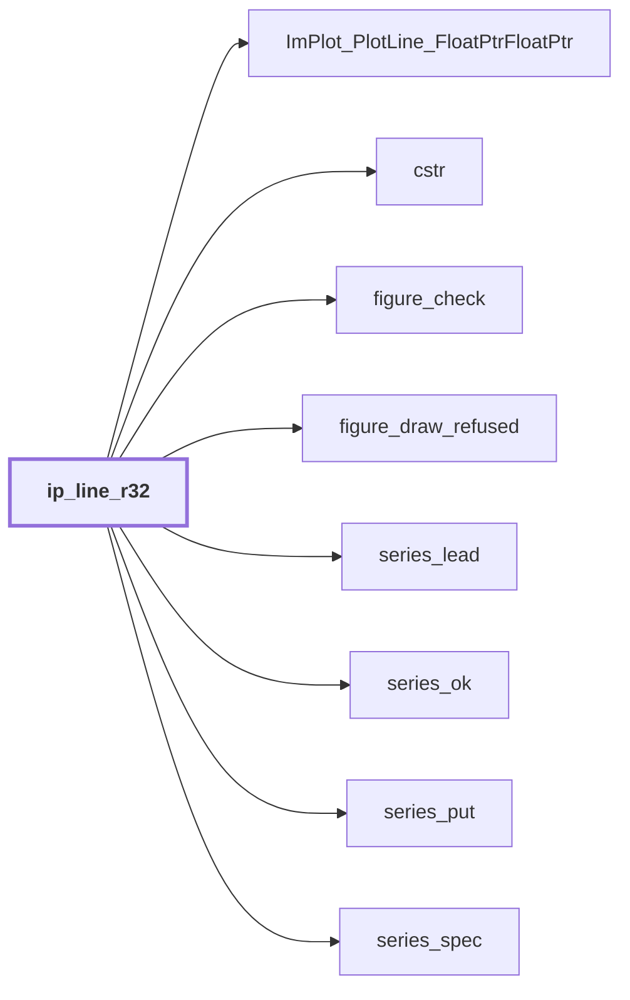

### ip_line_i32_r32

Line through the points (x(i), y(i)), single precision, abscissae `integer(int32)`: converted into one temporary,
 the ordinates read in place (plots.md, "Data in place").

**Attributes**: recursive

```fortran
subroutine ip_line_i32_r32(label, x, y, spec, stat)
```

**Arguments**

| Name | Type | Intent | Attributes | Description |
|------|------|--------|------------|-------------|
| `label` | character(len=*) | in |  | Legend label. |
| `x` | integer(kind=int32) | in | target, asynchronous | Abscissae. |
| `y` | real(kind=real32) | in | target, asynchronous | Ordinates. |
| `spec` | type([plot_spec_object](/api/src/lib/figure_implot#plot-spec-object)) | in | optional | Style (default: ImPlot's). |
| `stat` | integer(kind=int32) | out | optional | Status. |

**Call graph**


### ip_line_i64_r32

Line through the points (x(i), y(i)), single precision, abscissae `integer(int64)`: converted into one temporary,
 the ordinates read in place (plots.md, "Data in place").

**Attributes**: recursive

```fortran
subroutine ip_line_i64_r32(label, x, y, spec, stat)
```

**Arguments**

| Name | Type | Intent | Attributes | Description |
|------|------|--------|------------|-------------|
| `label` | character(len=*) | in |  | Legend label. |
| `x` | integer(kind=int64) | in | target, asynchronous | Abscissae. |
| `y` | real(kind=real32) | in | target, asynchronous | Ordinates. |
| `spec` | type([plot_spec_object](/api/src/lib/figure_implot#plot-spec-object)) | in | optional | Style (default: ImPlot's). |
| `stat` | integer(kind=int32) | out | optional | Status. |

**Call graph**

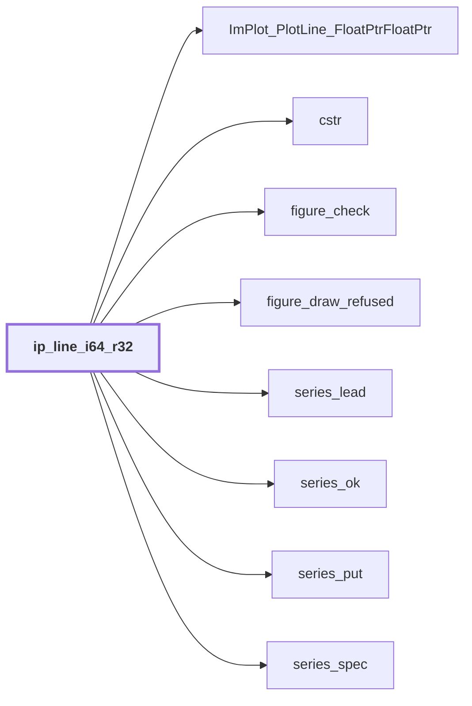

### ip_scatter_r32

Markers at the points (x(i), y(i)), single precision; read in place with any stride (plots.md, "Data in place").

**Attributes**: recursive

```fortran
subroutine ip_scatter_r32(label, x, y, spec, stat)
```

**Arguments**

| Name | Type | Intent | Attributes | Description |
|------|------|--------|------------|-------------|
| `label` | character(len=*) | in |  | Legend label. |
| `x` | real(kind=real32) | in | target, asynchronous | Abscissae. |
| `y` | real(kind=real32) | in | target, asynchronous | Ordinates. |
| `spec` | type([plot_spec_object](/api/src/lib/figure_implot#plot-spec-object)) | in | optional | Style (default: ImPlot's). |
| `stat` | integer(kind=int32) | out | optional | Status. |

**Call graph**

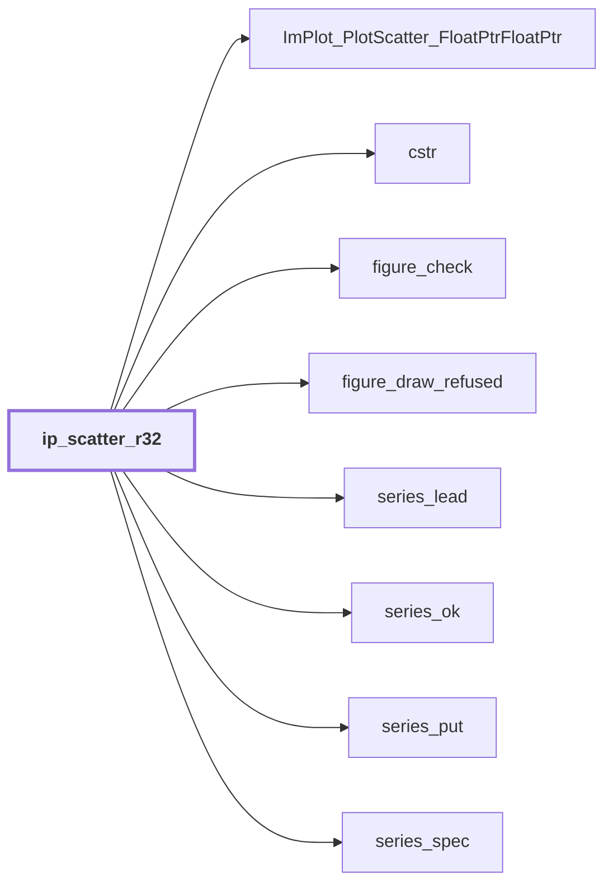

### ip_scatter_i32_r32

Markers at the points (x(i), y(i)), single precision, abscissae `integer(int32)`: converted into one temporary,
 the ordinates read in place (plots.md, "Data in place").

**Attributes**: recursive

```fortran
subroutine ip_scatter_i32_r32(label, x, y, spec, stat)
```

**Arguments**

| Name | Type | Intent | Attributes | Description |
|------|------|--------|------------|-------------|
| `label` | character(len=*) | in |  | Legend label. |
| `x` | integer(kind=int32) | in | target, asynchronous | Abscissae. |
| `y` | real(kind=real32) | in | target, asynchronous | Ordinates. |
| `spec` | type([plot_spec_object](/api/src/lib/figure_implot#plot-spec-object)) | in | optional | Style (default: ImPlot's). |
| `stat` | integer(kind=int32) | out | optional | Status. |

**Call graph**


### ip_scatter_i64_r32

Markers at the points (x(i), y(i)), single precision, abscissae `integer(int64)`: converted into one temporary,
 the ordinates read in place (plots.md, "Data in place").

**Attributes**: recursive

```fortran
subroutine ip_scatter_i64_r32(label, x, y, spec, stat)
```

**Arguments**

| Name | Type | Intent | Attributes | Description |
|------|------|--------|------------|-------------|
| `label` | character(len=*) | in |  | Legend label. |
| `x` | integer(kind=int64) | in | target, asynchronous | Abscissae. |
| `y` | real(kind=real32) | in | target, asynchronous | Ordinates. |
| `spec` | type([plot_spec_object](/api/src/lib/figure_implot#plot-spec-object)) | in | optional | Style (default: ImPlot's). |
| `stat` | integer(kind=int32) | out | optional | Status. |

**Call graph**

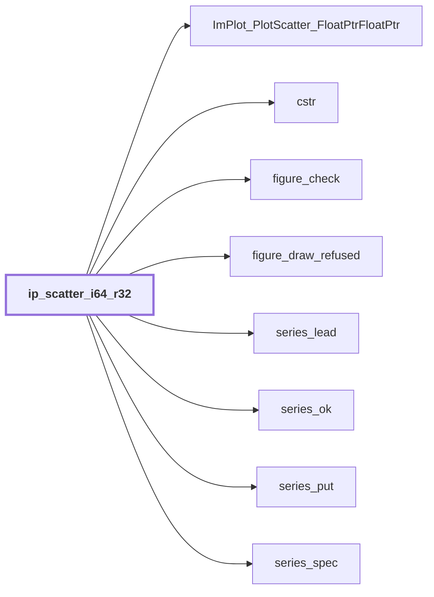

### ip_bars_r32

Bars of height y(i) centred at x(i), `bar_size` wide (in x units), single precision; read in place with any stride
 (plots.md, "Data in place").

**Attributes**: recursive

```fortran
subroutine ip_bars_r32(label, x, y, bar_size, spec, stat)
```

**Arguments**

| Name | Type | Intent | Attributes | Description |
|------|------|--------|------------|-------------|
| `label` | character(len=*) | in |  | Legend label. |
| `x` | real(kind=real32) | in | target, asynchronous | Bar positions. |
| `y` | real(kind=real32) | in | target, asynchronous | Bar heights. |
| `bar_size` | real(kind=real64) | in |  | Bar width [x units]. |
| `spec` | type([plot_spec_object](/api/src/lib/figure_implot#plot-spec-object)) | in | optional | Style (default: ImPlot's). |
| `stat` | integer(kind=int32) | out | optional | Status. |

**Call graph**

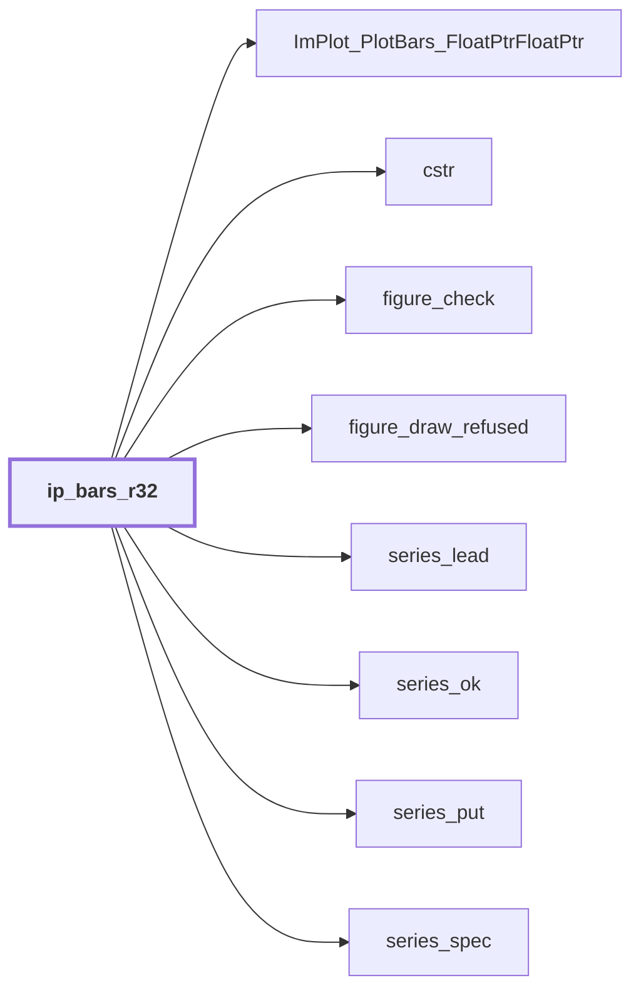

### ip_bars_i32_r32

Bars of height y(i) centred at x(i), `bar_size` wide (in x units), single precision, abscissae `integer(int32)`:
 converted into one temporary, the ordinates read in place (plots.md, "Data in place").

**Attributes**: recursive

```fortran
subroutine ip_bars_i32_r32(label, x, y, bar_size, spec, stat)
```

**Arguments**

| Name | Type | Intent | Attributes | Description |
|------|------|--------|------------|-------------|
| `label` | character(len=*) | in |  | Legend label. |
| `x` | integer(kind=int32) | in | target, asynchronous | Bar positions. |
| `y` | real(kind=real32) | in | target, asynchronous | Bar heights. |
| `bar_size` | real(kind=real64) | in |  | Bar width [x units]. |
| `spec` | type([plot_spec_object](/api/src/lib/figure_implot#plot-spec-object)) | in | optional | Style (default: ImPlot's). |
| `stat` | integer(kind=int32) | out | optional | Status. |

**Call graph**

```mermaid
flowchart LR
  ip_bars_i32_r32["ip_bars_i32_r32"] --> ImPlot_PlotBars_FloatPtrFloatPtr["ImPlot_PlotBars_FloatPtrFloatPtr"]
  ip_bars_i32_r32["ip_bars_i32_r32"] --> cstr["cstr"]
  ip_bars_i32_r32["ip_bars_i32_r32"] --> figure_check["figure_check"]
  ip_bars_i32_r32["ip_bars_i32_r32"] --> figure_draw_refused["figure_draw_refused"]
  ip_bars_i32_r32["ip_bars_i32_r32"] --> series_lead["series_lead"]
  ip_bars_i32_r32["ip_bars_i32_r32"] --> series_ok["series_ok"]
  ip_bars_i32_r32["ip_bars_i32_r32"] --> series_put["series_put"]
  ip_bars_i32_r32["ip_bars_i32_r32"] --> series_spec["series_spec"]
  classDef focus stroke-width:3px,font-weight:bold
  class ip_bars_i32_r32 focus
  click figure_draw_refused href "figure_base.html#figure-draw-refused" "figure_draw_refused"
  click series_ok href "#series-ok" "series_ok"
  click series_lead href "#series-lead" "series_lead"
  click series_put href "#series-put" "series_put"
  click ImPlot_PlotBars_FloatPtrFloatPtr href "figure_cimplot.html#implot-plotbars-floatptrfloatptr" "ImPlot_PlotBars_FloatPtrFloatPtr"
  click cstr href "figure_base.html#cstr" "cstr"
  click series_spec href "#series-spec" "series_spec"
  click figure_check href "figure_base.html#figure-check" "figure_check"
```

### ip_bars_i64_r32

Bars of height y(i) centred at x(i), `bar_size` wide (in x units), single precision, abscissae `integer(int64)`:
 converted into one temporary, the ordinates read in place (plots.md, "Data in place").

**Attributes**: recursive

```fortran
subroutine ip_bars_i64_r32(label, x, y, bar_size, spec, stat)
```

**Arguments**

| Name | Type | Intent | Attributes | Description |
|------|------|--------|------------|-------------|
| `label` | character(len=*) | in |  | Legend label. |
| `x` | integer(kind=int64) | in | target, asynchronous | Bar positions. |
| `y` | real(kind=real32) | in | target, asynchronous | Bar heights. |
| `bar_size` | real(kind=real64) | in |  | Bar width [x units]. |
| `spec` | type([plot_spec_object](/api/src/lib/figure_implot#plot-spec-object)) | in | optional | Style (default: ImPlot's). |
| `stat` | integer(kind=int32) | out | optional | Status. |

**Call graph**

```mermaid
flowchart LR
  ip_bars_i64_r32["ip_bars_i64_r32"] --> ImPlot_PlotBars_FloatPtrFloatPtr["ImPlot_PlotBars_FloatPtrFloatPtr"]
  ip_bars_i64_r32["ip_bars_i64_r32"] --> cstr["cstr"]
  ip_bars_i64_r32["ip_bars_i64_r32"] --> figure_check["figure_check"]
  ip_bars_i64_r32["ip_bars_i64_r32"] --> figure_draw_refused["figure_draw_refused"]
  ip_bars_i64_r32["ip_bars_i64_r32"] --> series_lead["series_lead"]
  ip_bars_i64_r32["ip_bars_i64_r32"] --> series_ok["series_ok"]
  ip_bars_i64_r32["ip_bars_i64_r32"] --> series_put["series_put"]
  ip_bars_i64_r32["ip_bars_i64_r32"] --> series_spec["series_spec"]
  classDef focus stroke-width:3px,font-weight:bold
  class ip_bars_i64_r32 focus
  click figure_draw_refused href "figure_base.html#figure-draw-refused" "figure_draw_refused"
  click series_ok href "#series-ok" "series_ok"
  click series_lead href "#series-lead" "series_lead"
  click series_put href "#series-put" "series_put"
  click ImPlot_PlotBars_FloatPtrFloatPtr href "figure_cimplot.html#implot-plotbars-floatptrfloatptr" "ImPlot_PlotBars_FloatPtrFloatPtr"
  click cstr href "figure_base.html#cstr" "cstr"
  click series_spec href "#series-spec" "series_spec"
  click figure_check href "figure_base.html#figure-check" "figure_check"
```

### ip_shaded_r32

Area between the curves y1(x) and y2(x), single precision; read in place with any stride (plots.md, "Data in
 place").

**Attributes**: recursive

```fortran
subroutine ip_shaded_r32(label, x, y1, y2, spec, stat)
```

**Arguments**

| Name | Type | Intent | Attributes | Description |
|------|------|--------|------------|-------------|
| `label` | character(len=*) | in |  | Legend label. |
| `x` | real(kind=real32) | in | target, asynchronous | Abscissae. |
| `y1` | real(kind=real32) | in | target, asynchronous | First curve. |
| `y2` | real(kind=real32) | in | target, asynchronous | Second curve. |
| `spec` | type([plot_spec_object](/api/src/lib/figure_implot#plot-spec-object)) | in | optional | Style (default: ImPlot's). |
| `stat` | integer(kind=int32) | out | optional | Status. |

**Call graph**

```mermaid
flowchart LR
  ip_shaded_r32["ip_shaded_r32"] --> ImPlot_PlotShaded_FloatPtrFloatPtrFloatPtr["ImPlot_PlotShaded_FloatPtrFloatPtrFloatPtr"]
  ip_shaded_r32["ip_shaded_r32"] --> cstr["cstr"]
  ip_shaded_r32["ip_shaded_r32"] --> figure_check["figure_check"]
  ip_shaded_r32["ip_shaded_r32"] --> figure_draw_refused["figure_draw_refused"]
  ip_shaded_r32["ip_shaded_r32"] --> series_lead["series_lead"]
  ip_shaded_r32["ip_shaded_r32"] --> series_ok["series_ok"]
  ip_shaded_r32["ip_shaded_r32"] --> series_put["series_put"]
  ip_shaded_r32["ip_shaded_r32"] --> series_spec["series_spec"]
  classDef focus stroke-width:3px,font-weight:bold
  class ip_shaded_r32 focus
  click figure_draw_refused href "figure_base.html#figure-draw-refused" "figure_draw_refused"
  click series_ok href "#series-ok" "series_ok"
  click series_lead href "#series-lead" "series_lead"
  click series_put href "#series-put" "series_put"
  click ImPlot_PlotShaded_FloatPtrFloatPtrFloatPtr href "figure_cimplot.html#implot-plotshaded-floatptrfloatptrfloatptr" "ImPlot_PlotShaded_FloatPtrFloatPtrFloatPtr"
  click cstr href "figure_base.html#cstr" "cstr"
  click series_spec href "#series-spec" "series_spec"
  click figure_check href "figure_base.html#figure-check" "figure_check"
```

### ip_shaded_i32_r32

Area between the curves y1(x) and y2(x), single precision, abscissae `integer(int32)`: converted into one
 temporary, the ordinates read in place (plots.md, "Data in place").

**Attributes**: recursive

```fortran
subroutine ip_shaded_i32_r32(label, x, y1, y2, spec, stat)
```

**Arguments**

| Name | Type | Intent | Attributes | Description |
|------|------|--------|------------|-------------|
| `label` | character(len=*) | in |  | Legend label. |
| `x` | integer(kind=int32) | in | target, asynchronous | Abscissae. |
| `y1` | real(kind=real32) | in | target, asynchronous | First curve. |
| `y2` | real(kind=real32) | in | target, asynchronous | Second curve. |
| `spec` | type([plot_spec_object](/api/src/lib/figure_implot#plot-spec-object)) | in | optional | Style (default: ImPlot's). |
| `stat` | integer(kind=int32) | out | optional | Status. |

**Call graph**

```mermaid
flowchart LR
  ip_shaded_i32_r32["ip_shaded_i32_r32"] --> ImPlot_PlotShaded_FloatPtrFloatPtrFloatPtr["ImPlot_PlotShaded_FloatPtrFloatPtrFloatPtr"]
  ip_shaded_i32_r32["ip_shaded_i32_r32"] --> cstr["cstr"]
  ip_shaded_i32_r32["ip_shaded_i32_r32"] --> figure_check["figure_check"]
  ip_shaded_i32_r32["ip_shaded_i32_r32"] --> figure_draw_refused["figure_draw_refused"]
  ip_shaded_i32_r32["ip_shaded_i32_r32"] --> series_lead["series_lead"]
  ip_shaded_i32_r32["ip_shaded_i32_r32"] --> series_ok["series_ok"]
  ip_shaded_i32_r32["ip_shaded_i32_r32"] --> series_put["series_put"]
  ip_shaded_i32_r32["ip_shaded_i32_r32"] --> series_spec["series_spec"]
  classDef focus stroke-width:3px,font-weight:bold
  class ip_shaded_i32_r32 focus
  click figure_draw_refused href "figure_base.html#figure-draw-refused" "figure_draw_refused"
  click series_ok href "#series-ok" "series_ok"
  click series_lead href "#series-lead" "series_lead"
  click series_put href "#series-put" "series_put"
  click ImPlot_PlotShaded_FloatPtrFloatPtrFloatPtr href "figure_cimplot.html#implot-plotshaded-floatptrfloatptrfloatptr" "ImPlot_PlotShaded_FloatPtrFloatPtrFloatPtr"
  click cstr href "figure_base.html#cstr" "cstr"
  click series_spec href "#series-spec" "series_spec"
  click figure_check href "figure_base.html#figure-check" "figure_check"
```

### ip_shaded_i64_r32

Area between the curves y1(x) and y2(x), single precision, abscissae `integer(int64)`: converted into one
 temporary, the ordinates read in place (plots.md, "Data in place").

**Attributes**: recursive

```fortran
subroutine ip_shaded_i64_r32(label, x, y1, y2, spec, stat)
```

**Arguments**

| Name | Type | Intent | Attributes | Description |
|------|------|--------|------------|-------------|
| `label` | character(len=*) | in |  | Legend label. |
| `x` | integer(kind=int64) | in | target, asynchronous | Abscissae. |
| `y1` | real(kind=real32) | in | target, asynchronous | First curve. |
| `y2` | real(kind=real32) | in | target, asynchronous | Second curve. |
| `spec` | type([plot_spec_object](/api/src/lib/figure_implot#plot-spec-object)) | in | optional | Style (default: ImPlot's). |
| `stat` | integer(kind=int32) | out | optional | Status. |

**Call graph**

```mermaid
flowchart LR
  ip_shaded_i64_r32["ip_shaded_i64_r32"] --> ImPlot_PlotShaded_FloatPtrFloatPtrFloatPtr["ImPlot_PlotShaded_FloatPtrFloatPtrFloatPtr"]
  ip_shaded_i64_r32["ip_shaded_i64_r32"] --> cstr["cstr"]
  ip_shaded_i64_r32["ip_shaded_i64_r32"] --> figure_check["figure_check"]
  ip_shaded_i64_r32["ip_shaded_i64_r32"] --> figure_draw_refused["figure_draw_refused"]
  ip_shaded_i64_r32["ip_shaded_i64_r32"] --> series_lead["series_lead"]
  ip_shaded_i64_r32["ip_shaded_i64_r32"] --> series_ok["series_ok"]
  ip_shaded_i64_r32["ip_shaded_i64_r32"] --> series_put["series_put"]
  ip_shaded_i64_r32["ip_shaded_i64_r32"] --> series_spec["series_spec"]
  classDef focus stroke-width:3px,font-weight:bold
  class ip_shaded_i64_r32 focus
  click figure_draw_refused href "figure_base.html#figure-draw-refused" "figure_draw_refused"
  click series_ok href "#series-ok" "series_ok"
  click series_lead href "#series-lead" "series_lead"
  click series_put href "#series-put" "series_put"
  click ImPlot_PlotShaded_FloatPtrFloatPtrFloatPtr href "figure_cimplot.html#implot-plotshaded-floatptrfloatptrfloatptr" "ImPlot_PlotShaded_FloatPtrFloatPtrFloatPtr"
  click cstr href "figure_base.html#cstr" "cstr"
  click series_spec href "#series-spec" "series_spec"
  click figure_check href "figure_base.html#figure-check" "figure_check"
```

### ip_shaded_ref_r32

Area between the curve y(x) and the line y = yref, single precision; read in place with any stride (plots.md,
 "Data in place").

**Attributes**: recursive

```fortran
subroutine ip_shaded_ref_r32(label, x, y, yref, spec, stat)
```

**Arguments**

| Name | Type | Intent | Attributes | Description |
|------|------|--------|------------|-------------|
| `label` | character(len=*) | in |  | Legend label. |
| `x` | real(kind=real32) | in | target, asynchronous | Abscissae. |
| `y` | real(kind=real32) | in | target, asynchronous | Curve. |
| `yref` | real(kind=real64) | in |  | Reference line (-huge/+huge: to the plot edge). |
| `spec` | type([plot_spec_object](/api/src/lib/figure_implot#plot-spec-object)) | in | optional | Style (default: ImPlot's). |
| `stat` | integer(kind=int32) | out | optional | Status. |

**Call graph**

```mermaid
flowchart LR
  ip_shaded_ref_r32["ip_shaded_ref_r32"] --> ImPlot_PlotShaded_FloatPtrFloatPtrInt["ImPlot_PlotShaded_FloatPtrFloatPtrInt"]
  ip_shaded_ref_r32["ip_shaded_ref_r32"] --> cstr["cstr"]
  ip_shaded_ref_r32["ip_shaded_ref_r32"] --> figure_check["figure_check"]
  ip_shaded_ref_r32["ip_shaded_ref_r32"] --> figure_draw_refused["figure_draw_refused"]
  ip_shaded_ref_r32["ip_shaded_ref_r32"] --> series_lead["series_lead"]
  ip_shaded_ref_r32["ip_shaded_ref_r32"] --> series_ok["series_ok"]
  ip_shaded_ref_r32["ip_shaded_ref_r32"] --> series_put["series_put"]
  ip_shaded_ref_r32["ip_shaded_ref_r32"] --> series_spec["series_spec"]
  classDef focus stroke-width:3px,font-weight:bold
  class ip_shaded_ref_r32 focus
  click figure_draw_refused href "figure_base.html#figure-draw-refused" "figure_draw_refused"
  click series_ok href "#series-ok" "series_ok"
  click series_lead href "#series-lead" "series_lead"
  click series_put href "#series-put" "series_put"
  click ImPlot_PlotShaded_FloatPtrFloatPtrInt href "figure_cimplot.html#implot-plotshaded-floatptrfloatptrint" "ImPlot_PlotShaded_FloatPtrFloatPtrInt"
  click cstr href "figure_base.html#cstr" "cstr"
  click series_spec href "#series-spec" "series_spec"
  click figure_check href "figure_base.html#figure-check" "figure_check"
```

### ip_shaded_ref_i32_r32

Area between the curve y(x) and the line y = yref, single precision, abscissae `integer(int32)`: converted into
 one temporary, the ordinates read in place (plots.md, "Data in place").

**Attributes**: recursive

```fortran
subroutine ip_shaded_ref_i32_r32(label, x, y, yref, spec, stat)
```

**Arguments**

| Name | Type | Intent | Attributes | Description |
|------|------|--------|------------|-------------|
| `label` | character(len=*) | in |  | Legend label. |
| `x` | integer(kind=int32) | in | target, asynchronous | Abscissae. |
| `y` | real(kind=real32) | in | target, asynchronous | Curve. |
| `yref` | real(kind=real64) | in |  | Reference line (-huge/+huge: to the plot edge). |
| `spec` | type([plot_spec_object](/api/src/lib/figure_implot#plot-spec-object)) | in | optional | Style (default: ImPlot's). |
| `stat` | integer(kind=int32) | out | optional | Status. |

**Call graph**

```mermaid
flowchart LR
  ip_shaded_ref_i32_r32["ip_shaded_ref_i32_r32"] --> ImPlot_PlotShaded_FloatPtrFloatPtrInt["ImPlot_PlotShaded_FloatPtrFloatPtrInt"]
  ip_shaded_ref_i32_r32["ip_shaded_ref_i32_r32"] --> cstr["cstr"]
  ip_shaded_ref_i32_r32["ip_shaded_ref_i32_r32"] --> figure_check["figure_check"]
  ip_shaded_ref_i32_r32["ip_shaded_ref_i32_r32"] --> figure_draw_refused["figure_draw_refused"]
  ip_shaded_ref_i32_r32["ip_shaded_ref_i32_r32"] --> series_lead["series_lead"]
  ip_shaded_ref_i32_r32["ip_shaded_ref_i32_r32"] --> series_ok["series_ok"]
  ip_shaded_ref_i32_r32["ip_shaded_ref_i32_r32"] --> series_put["series_put"]
  ip_shaded_ref_i32_r32["ip_shaded_ref_i32_r32"] --> series_spec["series_spec"]
  classDef focus stroke-width:3px,font-weight:bold
  class ip_shaded_ref_i32_r32 focus
  click figure_draw_refused href "figure_base.html#figure-draw-refused" "figure_draw_refused"
  click series_ok href "#series-ok" "series_ok"
  click series_lead href "#series-lead" "series_lead"
  click series_put href "#series-put" "series_put"
  click ImPlot_PlotShaded_FloatPtrFloatPtrInt href "figure_cimplot.html#implot-plotshaded-floatptrfloatptrint" "ImPlot_PlotShaded_FloatPtrFloatPtrInt"
  click cstr href "figure_base.html#cstr" "cstr"
  click series_spec href "#series-spec" "series_spec"
  click figure_check href "figure_base.html#figure-check" "figure_check"
```

### ip_shaded_ref_i64_r32

Area between the curve y(x) and the line y = yref, single precision, abscissae `integer(int64)`: converted into
 one temporary, the ordinates read in place (plots.md, "Data in place").

**Attributes**: recursive

```fortran
subroutine ip_shaded_ref_i64_r32(label, x, y, yref, spec, stat)
```

**Arguments**

| Name | Type | Intent | Attributes | Description |
|------|------|--------|------------|-------------|
| `label` | character(len=*) | in |  | Legend label. |
| `x` | integer(kind=int64) | in | target, asynchronous | Abscissae. |
| `y` | real(kind=real32) | in | target, asynchronous | Curve. |
| `yref` | real(kind=real64) | in |  | Reference line (-huge/+huge: to the plot edge). |
| `spec` | type([plot_spec_object](/api/src/lib/figure_implot#plot-spec-object)) | in | optional | Style (default: ImPlot's). |
| `stat` | integer(kind=int32) | out | optional | Status. |

**Call graph**

```mermaid
flowchart LR
  ip_shaded_ref_i64_r32["ip_shaded_ref_i64_r32"] --> ImPlot_PlotShaded_FloatPtrFloatPtrInt["ImPlot_PlotShaded_FloatPtrFloatPtrInt"]
  ip_shaded_ref_i64_r32["ip_shaded_ref_i64_r32"] --> cstr["cstr"]
  ip_shaded_ref_i64_r32["ip_shaded_ref_i64_r32"] --> figure_check["figure_check"]
  ip_shaded_ref_i64_r32["ip_shaded_ref_i64_r32"] --> figure_draw_refused["figure_draw_refused"]
  ip_shaded_ref_i64_r32["ip_shaded_ref_i64_r32"] --> series_lead["series_lead"]
  ip_shaded_ref_i64_r32["ip_shaded_ref_i64_r32"] --> series_ok["series_ok"]
  ip_shaded_ref_i64_r32["ip_shaded_ref_i64_r32"] --> series_put["series_put"]
  ip_shaded_ref_i64_r32["ip_shaded_ref_i64_r32"] --> series_spec["series_spec"]
  classDef focus stroke-width:3px,font-weight:bold
  class ip_shaded_ref_i64_r32 focus
  click figure_draw_refused href "figure_base.html#figure-draw-refused" "figure_draw_refused"
  click series_ok href "#series-ok" "series_ok"
  click series_lead href "#series-lead" "series_lead"
  click series_put href "#series-put" "series_put"
  click ImPlot_PlotShaded_FloatPtrFloatPtrInt href "figure_cimplot.html#implot-plotshaded-floatptrfloatptrint" "ImPlot_PlotShaded_FloatPtrFloatPtrInt"
  click cstr href "figure_base.html#cstr" "cstr"
  click series_spec href "#series-spec" "series_spec"
  click figure_check href "figure_base.html#figure-check" "figure_check"
```

### ip_error_bars_r32

Error bars at the points (x(i), y(i)), from y(i) - err(i) to y(i) + err(i); with `err_high`, to y(i) +
 err_high(i); with `horizontal=.true.`, along x instead, from x(i) - err(i), single precision; read in place
 with any stride (plots.md, "Data in place").

**Attributes**: recursive

```fortran
subroutine ip_error_bars_r32(label, x, y, err, err_high, spec, horizontal, stat)
```

**Arguments**

| Name | Type | Intent | Attributes | Description |
|------|------|--------|------------|-------------|
| `label` | character(len=*) | in |  | Legend label. |
| `x` | real(kind=real32) | in | target, asynchronous | Abscissae. |
| `y` | real(kind=real32) | in | target, asynchronous | Ordinates. |
| `err` | real(kind=real32) | in | target, asynchronous | Error below (and above) [y units, or x]. |
| `err_high` | real(kind=real32) | in | target, asynchronous, optional | Error above [y units, or x]. |
| `spec` | type([plot_spec_object](/api/src/lib/figure_implot#plot-spec-object)) | in | optional | Style (default: ImPlot's). |
| `horizontal` | logical | in | optional | Bars along x (`err` in x units). |
| `stat` | integer(kind=int32) | out | optional | Status. |

**Call graph**

```mermaid
flowchart LR
  ip_error_bars_r32["ip_error_bars_r32"] --> ImPlot_PlotErrorBars_FloatPtrFloatPtrFloatPtrFloatPtr["ImPlot_PlotErrorBars_FloatPtrFloatPtrFloatPtrFloatPtr"]
  ip_error_bars_r32["ip_error_bars_r32"] --> ImPlot_PlotErrorBars_FloatPtrFloatPtrFloatPtrInt["ImPlot_PlotErrorBars_FloatPtrFloatPtrFloatPtrInt"]
  ip_error_bars_r32["ip_error_bars_r32"] --> cstr["cstr"]
  ip_error_bars_r32["ip_error_bars_r32"] --> figure_check["figure_check"]
  ip_error_bars_r32["ip_error_bars_r32"] --> figure_draw_refused["figure_draw_refused"]
  ip_error_bars_r32["ip_error_bars_r32"] --> series_lead["series_lead"]
  ip_error_bars_r32["ip_error_bars_r32"] --> series_ok["series_ok"]
  ip_error_bars_r32["ip_error_bars_r32"] --> series_put["series_put"]
  ip_error_bars_r32["ip_error_bars_r32"] --> series_spec["series_spec"]
  classDef focus stroke-width:3px,font-weight:bold
  class ip_error_bars_r32 focus
  click figure_draw_refused href "figure_base.html#figure-draw-refused" "figure_draw_refused"
  click series_ok href "#series-ok" "series_ok"
  click series_lead href "#series-lead" "series_lead"
  click series_put href "#series-put" "series_put"
  click series_spec href "#series-spec" "series_spec"
  click ImPlot_PlotErrorBars_FloatPtrFloatPtrFloatPtrFloatPtr href "figure_cimplot.html#implot-ploterrorbars-floatptrfloatptrfloatptrfloatptr" "ImPlot_PlotErrorBars_FloatPtrFloatPtrFloatPtrFloatPtr"
  click cstr href "figure_base.html#cstr" "cstr"
  click ImPlot_PlotErrorBars_FloatPtrFloatPtrFloatPtrInt href "figure_cimplot.html#implot-ploterrorbars-floatptrfloatptrfloatptrint" "ImPlot_PlotErrorBars_FloatPtrFloatPtrFloatPtrInt"
  click figure_check href "figure_base.html#figure-check" "figure_check"
```

### ip_error_bars_i32_r32

Error bars at the points (x(i), y(i)), from y(i) - err(i) to y(i) + err(i); with `err_high`, to y(i) +
 err_high(i); with `horizontal=.true.`, along x instead, from x(i) - err(i), single precision, abscissae
 `integer(int32)`: converted into one temporary, the ordinates read in
 place (plots.md, "Data in place").

**Attributes**: recursive

```fortran
subroutine ip_error_bars_i32_r32(label, x, y, err, err_high, spec, horizontal, stat)
```

**Arguments**

| Name | Type | Intent | Attributes | Description |
|------|------|--------|------------|-------------|
| `label` | character(len=*) | in |  | Legend label. |
| `x` | integer(kind=int32) | in | target, asynchronous | Abscissae. |
| `y` | real(kind=real32) | in | target, asynchronous | Ordinates. |
| `err` | real(kind=real32) | in | target, asynchronous | Error below (and above) [y units, or x]. |
| `err_high` | real(kind=real32) | in | target, asynchronous, optional | Error above [y units, or x]. |
| `spec` | type([plot_spec_object](/api/src/lib/figure_implot#plot-spec-object)) | in | optional | Style (default: ImPlot's). |
| `horizontal` | logical | in | optional | Bars along x (`err` in x units). |
| `stat` | integer(kind=int32) | out | optional | Status. |

**Call graph**

```mermaid
flowchart LR
  ip_error_bars_i32_r32["ip_error_bars_i32_r32"] --> ImPlot_PlotErrorBars_FloatPtrFloatPtrFloatPtrFloatPtr["ImPlot_PlotErrorBars_FloatPtrFloatPtrFloatPtrFloatPtr"]
  ip_error_bars_i32_r32["ip_error_bars_i32_r32"] --> ImPlot_PlotErrorBars_FloatPtrFloatPtrFloatPtrInt["ImPlot_PlotErrorBars_FloatPtrFloatPtrFloatPtrInt"]
  ip_error_bars_i32_r32["ip_error_bars_i32_r32"] --> cstr["cstr"]
  ip_error_bars_i32_r32["ip_error_bars_i32_r32"] --> figure_check["figure_check"]
  ip_error_bars_i32_r32["ip_error_bars_i32_r32"] --> figure_draw_refused["figure_draw_refused"]
  ip_error_bars_i32_r32["ip_error_bars_i32_r32"] --> series_lead["series_lead"]
  ip_error_bars_i32_r32["ip_error_bars_i32_r32"] --> series_ok["series_ok"]
  ip_error_bars_i32_r32["ip_error_bars_i32_r32"] --> series_put["series_put"]
  ip_error_bars_i32_r32["ip_error_bars_i32_r32"] --> series_spec["series_spec"]
  classDef focus stroke-width:3px,font-weight:bold
  class ip_error_bars_i32_r32 focus
  click figure_draw_refused href "figure_base.html#figure-draw-refused" "figure_draw_refused"
  click series_ok href "#series-ok" "series_ok"
  click series_lead href "#series-lead" "series_lead"
  click series_put href "#series-put" "series_put"
  click series_spec href "#series-spec" "series_spec"
  click ImPlot_PlotErrorBars_FloatPtrFloatPtrFloatPtrFloatPtr href "figure_cimplot.html#implot-ploterrorbars-floatptrfloatptrfloatptrfloatptr" "ImPlot_PlotErrorBars_FloatPtrFloatPtrFloatPtrFloatPtr"
  click cstr href "figure_base.html#cstr" "cstr"
  click ImPlot_PlotErrorBars_FloatPtrFloatPtrFloatPtrInt href "figure_cimplot.html#implot-ploterrorbars-floatptrfloatptrfloatptrint" "ImPlot_PlotErrorBars_FloatPtrFloatPtrFloatPtrInt"
  click figure_check href "figure_base.html#figure-check" "figure_check"
```

### ip_error_bars_i64_r32

Error bars at the points (x(i), y(i)), from y(i) - err(i) to y(i) + err(i); with `err_high`, to y(i) +
 err_high(i); with `horizontal=.true.`, along x instead, from x(i) - err(i), single precision, abscissae
 `integer(int64)`: converted into one temporary, the ordinates read in
 place (plots.md, "Data in place").

**Attributes**: recursive

```fortran
subroutine ip_error_bars_i64_r32(label, x, y, err, err_high, spec, horizontal, stat)
```

**Arguments**

| Name | Type | Intent | Attributes | Description |
|------|------|--------|------------|-------------|
| `label` | character(len=*) | in |  | Legend label. |
| `x` | integer(kind=int64) | in | target, asynchronous | Abscissae. |
| `y` | real(kind=real32) | in | target, asynchronous | Ordinates. |
| `err` | real(kind=real32) | in | target, asynchronous | Error below (and above) [y units, or x]. |
| `err_high` | real(kind=real32) | in | target, asynchronous, optional | Error above [y units, or x]. |
| `spec` | type([plot_spec_object](/api/src/lib/figure_implot#plot-spec-object)) | in | optional | Style (default: ImPlot's). |
| `horizontal` | logical | in | optional | Bars along x (`err` in x units). |
| `stat` | integer(kind=int32) | out | optional | Status. |

**Call graph**

```mermaid
flowchart LR
  ip_error_bars_i64_r32["ip_error_bars_i64_r32"] --> ImPlot_PlotErrorBars_FloatPtrFloatPtrFloatPtrFloatPtr["ImPlot_PlotErrorBars_FloatPtrFloatPtrFloatPtrFloatPtr"]
  ip_error_bars_i64_r32["ip_error_bars_i64_r32"] --> ImPlot_PlotErrorBars_FloatPtrFloatPtrFloatPtrInt["ImPlot_PlotErrorBars_FloatPtrFloatPtrFloatPtrInt"]
  ip_error_bars_i64_r32["ip_error_bars_i64_r32"] --> cstr["cstr"]
  ip_error_bars_i64_r32["ip_error_bars_i64_r32"] --> figure_check["figure_check"]
  ip_error_bars_i64_r32["ip_error_bars_i64_r32"] --> figure_draw_refused["figure_draw_refused"]
  ip_error_bars_i64_r32["ip_error_bars_i64_r32"] --> series_lead["series_lead"]
  ip_error_bars_i64_r32["ip_error_bars_i64_r32"] --> series_ok["series_ok"]
  ip_error_bars_i64_r32["ip_error_bars_i64_r32"] --> series_put["series_put"]
  ip_error_bars_i64_r32["ip_error_bars_i64_r32"] --> series_spec["series_spec"]
  classDef focus stroke-width:3px,font-weight:bold
  class ip_error_bars_i64_r32 focus
  click figure_draw_refused href "figure_base.html#figure-draw-refused" "figure_draw_refused"
  click series_ok href "#series-ok" "series_ok"
  click series_lead href "#series-lead" "series_lead"
  click series_put href "#series-put" "series_put"
  click series_spec href "#series-spec" "series_spec"
  click ImPlot_PlotErrorBars_FloatPtrFloatPtrFloatPtrFloatPtr href "figure_cimplot.html#implot-ploterrorbars-floatptrfloatptrfloatptrfloatptr" "ImPlot_PlotErrorBars_FloatPtrFloatPtrFloatPtrFloatPtr"
  click cstr href "figure_base.html#cstr" "cstr"
  click ImPlot_PlotErrorBars_FloatPtrFloatPtrFloatPtrInt href "figure_cimplot.html#implot-ploterrorbars-floatptrfloatptrfloatptrint" "ImPlot_PlotErrorBars_FloatPtrFloatPtrFloatPtrInt"
  click figure_check href "figure_base.html#figure-check" "figure_check"
```

### ip_line_r64

Line through the points (x(i), y(i)), double precision; read in place with any stride (plots.md, "Data in place").

**Attributes**: recursive

```fortran
subroutine ip_line_r64(label, x, y, spec, stat)
```

**Arguments**

| Name | Type | Intent | Attributes | Description |
|------|------|--------|------------|-------------|
| `label` | character(len=*) | in |  | Legend label. |
| `x` | real(kind=real64) | in | target, asynchronous | Abscissae. |
| `y` | real(kind=real64) | in | target, asynchronous | Ordinates. |
| `spec` | type([plot_spec_object](/api/src/lib/figure_implot#plot-spec-object)) | in | optional | Style (default: ImPlot's). |
| `stat` | integer(kind=int32) | out | optional | Status. |

**Call graph**

```mermaid
flowchart LR
  ip_line_r64["ip_line_r64"] --> ImPlot_PlotLine_doublePtrdoublePtr["ImPlot_PlotLine_doublePtrdoublePtr"]
  ip_line_r64["ip_line_r64"] --> cstr["cstr"]
  ip_line_r64["ip_line_r64"] --> figure_check["figure_check"]
  ip_line_r64["ip_line_r64"] --> figure_draw_refused["figure_draw_refused"]
  ip_line_r64["ip_line_r64"] --> series_lead["series_lead"]
  ip_line_r64["ip_line_r64"] --> series_ok["series_ok"]
  ip_line_r64["ip_line_r64"] --> series_put["series_put"]
  ip_line_r64["ip_line_r64"] --> series_spec["series_spec"]
  classDef focus stroke-width:3px,font-weight:bold
  class ip_line_r64 focus
  click figure_draw_refused href "figure_base.html#figure-draw-refused" "figure_draw_refused"
  click series_ok href "#series-ok" "series_ok"
  click series_lead href "#series-lead" "series_lead"
  click series_put href "#series-put" "series_put"
  click ImPlot_PlotLine_doublePtrdoublePtr href "figure_cimplot.html#implot-plotline-doubleptrdoubleptr" "ImPlot_PlotLine_doublePtrdoublePtr"
  click cstr href "figure_base.html#cstr" "cstr"
  click series_spec href "#series-spec" "series_spec"
  click figure_check href "figure_base.html#figure-check" "figure_check"
```

### ip_line_i32_r64

Line through the points (x(i), y(i)), double precision, abscissae `integer(int32)`: converted into one temporary,
 the ordinates read in place (plots.md, "Data in place").

**Attributes**: recursive

```fortran
subroutine ip_line_i32_r64(label, x, y, spec, stat)
```

**Arguments**

| Name | Type | Intent | Attributes | Description |
|------|------|--------|------------|-------------|
| `label` | character(len=*) | in |  | Legend label. |
| `x` | integer(kind=int32) | in | target, asynchronous | Abscissae. |
| `y` | real(kind=real64) | in | target, asynchronous | Ordinates. |
| `spec` | type([plot_spec_object](/api/src/lib/figure_implot#plot-spec-object)) | in | optional | Style (default: ImPlot's). |
| `stat` | integer(kind=int32) | out | optional | Status. |

**Call graph**

```mermaid
flowchart LR
  ip_line_i32_r64["ip_line_i32_r64"] --> ImPlot_PlotLine_doublePtrdoublePtr["ImPlot_PlotLine_doublePtrdoublePtr"]
  ip_line_i32_r64["ip_line_i32_r64"] --> cstr["cstr"]
  ip_line_i32_r64["ip_line_i32_r64"] --> figure_check["figure_check"]
  ip_line_i32_r64["ip_line_i32_r64"] --> figure_draw_refused["figure_draw_refused"]
  ip_line_i32_r64["ip_line_i32_r64"] --> series_lead["series_lead"]
  ip_line_i32_r64["ip_line_i32_r64"] --> series_ok["series_ok"]
  ip_line_i32_r64["ip_line_i32_r64"] --> series_put["series_put"]
  ip_line_i32_r64["ip_line_i32_r64"] --> series_spec["series_spec"]
  classDef focus stroke-width:3px,font-weight:bold
  class ip_line_i32_r64 focus
  click figure_draw_refused href "figure_base.html#figure-draw-refused" "figure_draw_refused"
  click series_ok href "#series-ok" "series_ok"
  click series_lead href "#series-lead" "series_lead"
  click series_put href "#series-put" "series_put"
  click ImPlot_PlotLine_doublePtrdoublePtr href "figure_cimplot.html#implot-plotline-doubleptrdoubleptr" "ImPlot_PlotLine_doublePtrdoublePtr"
  click cstr href "figure_base.html#cstr" "cstr"
  click series_spec href "#series-spec" "series_spec"
  click figure_check href "figure_base.html#figure-check" "figure_check"
```

### ip_line_i64_r64

Line through the points (x(i), y(i)), double precision, abscissae `integer(int64)`: converted into one temporary,
 the ordinates read in place (plots.md, "Data in place").

**Attributes**: recursive

```fortran
subroutine ip_line_i64_r64(label, x, y, spec, stat)
```

**Arguments**

| Name | Type | Intent | Attributes | Description |
|------|------|--------|------------|-------------|
| `label` | character(len=*) | in |  | Legend label. |
| `x` | integer(kind=int64) | in | target, asynchronous | Abscissae. |
| `y` | real(kind=real64) | in | target, asynchronous | Ordinates. |
| `spec` | type([plot_spec_object](/api/src/lib/figure_implot#plot-spec-object)) | in | optional | Style (default: ImPlot's). |
| `stat` | integer(kind=int32) | out | optional | Status. |

**Call graph**

```mermaid
flowchart LR
  ip_line_i64_r64["ip_line_i64_r64"] --> ImPlot_PlotLine_doublePtrdoublePtr["ImPlot_PlotLine_doublePtrdoublePtr"]
  ip_line_i64_r64["ip_line_i64_r64"] --> cstr["cstr"]
  ip_line_i64_r64["ip_line_i64_r64"] --> figure_check["figure_check"]
  ip_line_i64_r64["ip_line_i64_r64"] --> figure_draw_refused["figure_draw_refused"]
  ip_line_i64_r64["ip_line_i64_r64"] --> series_lead["series_lead"]
  ip_line_i64_r64["ip_line_i64_r64"] --> series_ok["series_ok"]
  ip_line_i64_r64["ip_line_i64_r64"] --> series_put["series_put"]
  ip_line_i64_r64["ip_line_i64_r64"] --> series_spec["series_spec"]
  classDef focus stroke-width:3px,font-weight:bold
  class ip_line_i64_r64 focus
  click figure_draw_refused href "figure_base.html#figure-draw-refused" "figure_draw_refused"
  click series_ok href "#series-ok" "series_ok"
  click series_lead href "#series-lead" "series_lead"
  click series_put href "#series-put" "series_put"
  click ImPlot_PlotLine_doublePtrdoublePtr href "figure_cimplot.html#implot-plotline-doubleptrdoubleptr" "ImPlot_PlotLine_doublePtrdoublePtr"
  click cstr href "figure_base.html#cstr" "cstr"
  click series_spec href "#series-spec" "series_spec"
  click figure_check href "figure_base.html#figure-check" "figure_check"
```

### ip_scatter_r64

Markers at the points (x(i), y(i)), double precision; read in place with any stride (plots.md, "Data in place").

**Attributes**: recursive

```fortran
subroutine ip_scatter_r64(label, x, y, spec, stat)
```

**Arguments**

| Name | Type | Intent | Attributes | Description |
|------|------|--------|------------|-------------|
| `label` | character(len=*) | in |  | Legend label. |
| `x` | real(kind=real64) | in | target, asynchronous | Abscissae. |
| `y` | real(kind=real64) | in | target, asynchronous | Ordinates. |
| `spec` | type([plot_spec_object](/api/src/lib/figure_implot#plot-spec-object)) | in | optional | Style (default: ImPlot's). |
| `stat` | integer(kind=int32) | out | optional | Status. |

**Call graph**

```mermaid
flowchart LR
  ip_scatter_r64["ip_scatter_r64"] --> ImPlot_PlotScatter_doublePtrdoublePtr["ImPlot_PlotScatter_doublePtrdoublePtr"]
  ip_scatter_r64["ip_scatter_r64"] --> cstr["cstr"]
  ip_scatter_r64["ip_scatter_r64"] --> figure_check["figure_check"]
  ip_scatter_r64["ip_scatter_r64"] --> figure_draw_refused["figure_draw_refused"]
  ip_scatter_r64["ip_scatter_r64"] --> series_lead["series_lead"]
  ip_scatter_r64["ip_scatter_r64"] --> series_ok["series_ok"]
  ip_scatter_r64["ip_scatter_r64"] --> series_put["series_put"]
  ip_scatter_r64["ip_scatter_r64"] --> series_spec["series_spec"]
  classDef focus stroke-width:3px,font-weight:bold
  class ip_scatter_r64 focus
  click figure_draw_refused href "figure_base.html#figure-draw-refused" "figure_draw_refused"
  click series_ok href "#series-ok" "series_ok"
  click series_lead href "#series-lead" "series_lead"
  click series_put href "#series-put" "series_put"
  click ImPlot_PlotScatter_doublePtrdoublePtr href "figure_cimplot.html#implot-plotscatter-doubleptrdoubleptr" "ImPlot_PlotScatter_doublePtrdoublePtr"
  click cstr href "figure_base.html#cstr" "cstr"
  click series_spec href "#series-spec" "series_spec"
  click figure_check href "figure_base.html#figure-check" "figure_check"
```

### ip_scatter_i32_r64

Markers at the points (x(i), y(i)), double precision, abscissae `integer(int32)`: converted into one temporary,
 the ordinates read in place (plots.md, "Data in place").

**Attributes**: recursive

```fortran
subroutine ip_scatter_i32_r64(label, x, y, spec, stat)
```

**Arguments**

| Name | Type | Intent | Attributes | Description |
|------|------|--------|------------|-------------|
| `label` | character(len=*) | in |  | Legend label. |
| `x` | integer(kind=int32) | in | target, asynchronous | Abscissae. |
| `y` | real(kind=real64) | in | target, asynchronous | Ordinates. |
| `spec` | type([plot_spec_object](/api/src/lib/figure_implot#plot-spec-object)) | in | optional | Style (default: ImPlot's). |
| `stat` | integer(kind=int32) | out | optional | Status. |

**Call graph**

```mermaid
flowchart LR
  ip_scatter_i32_r64["ip_scatter_i32_r64"] --> ImPlot_PlotScatter_doublePtrdoublePtr["ImPlot_PlotScatter_doublePtrdoublePtr"]
  ip_scatter_i32_r64["ip_scatter_i32_r64"] --> cstr["cstr"]
  ip_scatter_i32_r64["ip_scatter_i32_r64"] --> figure_check["figure_check"]
  ip_scatter_i32_r64["ip_scatter_i32_r64"] --> figure_draw_refused["figure_draw_refused"]
  ip_scatter_i32_r64["ip_scatter_i32_r64"] --> series_lead["series_lead"]
  ip_scatter_i32_r64["ip_scatter_i32_r64"] --> series_ok["series_ok"]
  ip_scatter_i32_r64["ip_scatter_i32_r64"] --> series_put["series_put"]
  ip_scatter_i32_r64["ip_scatter_i32_r64"] --> series_spec["series_spec"]
  classDef focus stroke-width:3px,font-weight:bold
  class ip_scatter_i32_r64 focus
  click figure_draw_refused href "figure_base.html#figure-draw-refused" "figure_draw_refused"
  click series_ok href "#series-ok" "series_ok"
  click series_lead href "#series-lead" "series_lead"
  click series_put href "#series-put" "series_put"
  click ImPlot_PlotScatter_doublePtrdoublePtr href "figure_cimplot.html#implot-plotscatter-doubleptrdoubleptr" "ImPlot_PlotScatter_doublePtrdoublePtr"
  click cstr href "figure_base.html#cstr" "cstr"
  click series_spec href "#series-spec" "series_spec"
  click figure_check href "figure_base.html#figure-check" "figure_check"
```

### ip_scatter_i64_r64

Markers at the points (x(i), y(i)), double precision, abscissae `integer(int64)`: converted into one temporary,
 the ordinates read in place (plots.md, "Data in place").

**Attributes**: recursive

```fortran
subroutine ip_scatter_i64_r64(label, x, y, spec, stat)
```

**Arguments**

| Name | Type | Intent | Attributes | Description |
|------|------|--------|------------|-------------|
| `label` | character(len=*) | in |  | Legend label. |
| `x` | integer(kind=int64) | in | target, asynchronous | Abscissae. |
| `y` | real(kind=real64) | in | target, asynchronous | Ordinates. |
| `spec` | type([plot_spec_object](/api/src/lib/figure_implot#plot-spec-object)) | in | optional | Style (default: ImPlot's). |
| `stat` | integer(kind=int32) | out | optional | Status. |

**Call graph**

```mermaid
flowchart LR
  ip_scatter_i64_r64["ip_scatter_i64_r64"] --> ImPlot_PlotScatter_doublePtrdoublePtr["ImPlot_PlotScatter_doublePtrdoublePtr"]
  ip_scatter_i64_r64["ip_scatter_i64_r64"] --> cstr["cstr"]
  ip_scatter_i64_r64["ip_scatter_i64_r64"] --> figure_check["figure_check"]
  ip_scatter_i64_r64["ip_scatter_i64_r64"] --> figure_draw_refused["figure_draw_refused"]
  ip_scatter_i64_r64["ip_scatter_i64_r64"] --> series_lead["series_lead"]
  ip_scatter_i64_r64["ip_scatter_i64_r64"] --> series_ok["series_ok"]
  ip_scatter_i64_r64["ip_scatter_i64_r64"] --> series_put["series_put"]
  ip_scatter_i64_r64["ip_scatter_i64_r64"] --> series_spec["series_spec"]
  classDef focus stroke-width:3px,font-weight:bold
  class ip_scatter_i64_r64 focus
  click figure_draw_refused href "figure_base.html#figure-draw-refused" "figure_draw_refused"
  click series_ok href "#series-ok" "series_ok"
  click series_lead href "#series-lead" "series_lead"
  click series_put href "#series-put" "series_put"
  click ImPlot_PlotScatter_doublePtrdoublePtr href "figure_cimplot.html#implot-plotscatter-doubleptrdoubleptr" "ImPlot_PlotScatter_doublePtrdoublePtr"
  click cstr href "figure_base.html#cstr" "cstr"
  click series_spec href "#series-spec" "series_spec"
  click figure_check href "figure_base.html#figure-check" "figure_check"
```

### ip_bubbles_r32

Circles at the points (x(i), y(i)) of radius radii(i) (`PlotBubbles`), single precision: the radius is in plot
 units along both axes (a circle on equal axes; an ellipse where their scales differ), filled with the item's fill colour
 (`ip_spec(fill_color=..., fill_alpha=...)`) and outlined with its line colour. Read in place with any stride
 (plots.md, "Data in place").

**Attributes**: recursive

```fortran
subroutine ip_bubbles_r32(label, x, y, radii, spec, stat)
```

**Arguments**

| Name | Type | Intent | Attributes | Description |
|------|------|--------|------------|-------------|
| `label` | character(len=*) | in |  | Legend label. |
| `x` | real(kind=real32) | in | target, asynchronous | Abscissae. |
| `y` | real(kind=real32) | in | target, asynchronous | Ordinates. |
| `radii` | real(kind=real32) | in | target, asynchronous | Radii [plot units]. |
| `spec` | type([plot_spec_object](/api/src/lib/figure_implot#plot-spec-object)) | in | optional | Style (default: ImPlot's). |
| `stat` | integer(kind=int32) | out | optional | Status. |

**Call graph**

```mermaid
flowchart LR
  ip_bubbles_r32["ip_bubbles_r32"] --> ImPlot_PlotBubbles_FloatPtrFloatPtrFloatPtr["ImPlot_PlotBubbles_FloatPtrFloatPtrFloatPtr"]
  ip_bubbles_r32["ip_bubbles_r32"] --> cstr["cstr"]
  ip_bubbles_r32["ip_bubbles_r32"] --> figure_check["figure_check"]
  ip_bubbles_r32["ip_bubbles_r32"] --> figure_draw_refused["figure_draw_refused"]
  ip_bubbles_r32["ip_bubbles_r32"] --> series_lead["series_lead"]
  ip_bubbles_r32["ip_bubbles_r32"] --> series_ok["series_ok"]
  ip_bubbles_r32["ip_bubbles_r32"] --> series_put["series_put"]
  ip_bubbles_r32["ip_bubbles_r32"] --> series_spec["series_spec"]
  classDef focus stroke-width:3px,font-weight:bold
  class ip_bubbles_r32 focus
  click figure_draw_refused href "figure_base.html#figure-draw-refused" "figure_draw_refused"
  click series_ok href "#series-ok" "series_ok"
  click series_lead href "#series-lead" "series_lead"
  click series_put href "#series-put" "series_put"
  click ImPlot_PlotBubbles_FloatPtrFloatPtrFloatPtr href "figure_cimplot.html#implot-plotbubbles-floatptrfloatptrfloatptr" "ImPlot_PlotBubbles_FloatPtrFloatPtrFloatPtr"
  click cstr href "figure_base.html#cstr" "cstr"
  click series_spec href "#series-spec" "series_spec"
  click figure_check href "figure_base.html#figure-check" "figure_check"
```

### ip_pie_chart_r32

A pie chart (`PlotPieChart`), single precision: one slice per value, its label in the legend, centred at (x, y) with
 `radius`, all in plot units (equal axes keep it round: `ip_begin_plot(..., equal=.true.)`). The slices start at
 `angle0` degrees (default 90, the top) and go clockwise. Each slice shows its value with `label_format`, a C
 printf format of one real (default `'%.1f'`; `''` shows none). Values summing to 1 or more make a full circle;
 below 1, the slices are fractions of one and the circle is partial, unless `normalize=.true.`, which always makes
 a full circle. The slices' colours are the colormap's, in order: the plot's, or `colormap` (`ip_colormap`); a
 spec's colours do not apply to them. Statuses: `FIG_ERR_ARGUMENT` for labels not one per value, a radius not
 above 0, a value below 0 or not finite, a format refused, a colormap not registered; `FIG_ERR_STATE` from a task.

**Attributes**: recursive

```fortran
subroutine ip_pie_chart_r32(labels, values, x, y, radius, label_format, angle0, normalize, colormap, spec, stat)
```

**Arguments**

| Name | Type | Intent | Attributes | Description |
|------|------|--------|------------|-------------|
| `labels` | character(len=*) | in |  | One label per slice (trailing blanks are not shown). |
| `values` | real(kind=real32) | in |  | Slice values (0 or more). |
| `x` | real(kind=real64) | in |  | Centre's abscissa [plot units]. |
| `y` | real(kind=real64) | in |  | Centre's ordinate [plot units]. |
| `radius` | real(kind=real64) | in |  | Radius [plot units]. |
| `label_format` | character(len=*) | in | optional | printf format of a slice's value (default '%.1f'). |
| `angle0` | real(kind=real64) | in | optional | Where the first slice starts [degrees]. |
| `normalize` | logical | in | optional | Always a full circle (default `.false.`). |
| `colormap` | integer(kind=int32) | in | optional | The slices' colours (default: the plot's colormap). |
| `spec` | type([plot_spec_object](/api/src/lib/figure_implot#plot-spec-object)) | in | optional | Style (default: ImPlot's). |
| `stat` | integer(kind=int32) | out | optional | Status. |

**Call graph**

```mermaid
flowchart LR
  ip_pie_chart_r32["ip_pie_chart_r32"] --> ImPlot_PlotPieChart_FloatPtrStr["ImPlot_PlotPieChart_FloatPtrStr"]
  ip_pie_chart_r32["ip_pie_chart_r32"] --> ImPlot_PopColormap["ImPlot_PopColormap"]
  ip_pie_chart_r32["ip_pie_chart_r32"] --> ImPlot_PushColormap_PlotColormap["ImPlot_PushColormap_PlotColormap"]
  ip_pie_chart_r32["ip_pie_chart_r32"] --> colormap_ok["colormap_ok"]
  ip_pie_chart_r32["ip_pie_chart_r32"] --> figure_check["figure_check"]
  ip_pie_chart_r32["ip_pie_chart_r32"] --> figure_draw_refused["figure_draw_refused"]
  ip_pie_chart_r32["ip_pie_chart_r32"] --> figure_fail["figure_fail"]
  ip_pie_chart_r32["ip_pie_chart_r32"] --> format_refused["format_refused"]
  ip_pie_chart_r32["ip_pie_chart_r32"] --> spec_c["spec_c"]
  classDef focus stroke-width:3px,font-weight:bold
  class ip_pie_chart_r32 focus
  click figure_draw_refused href "figure_base.html#figure-draw-refused" "figure_draw_refused"
  click colormap_ok href "#colormap-ok" "colormap_ok"
  click figure_fail href "figure_base.html#figure-fail" "figure_fail"
  click format_refused href "figure_base.html#format-refused" "format_refused"
  click spec_c href "#spec-c" "spec_c"
  click ImPlot_PushColormap_PlotColormap href "figure_cimplot.html#implot-pushcolormap-plotcolormap" "ImPlot_PushColormap_PlotColormap"
  click ImPlot_PlotPieChart_FloatPtrStr href "figure_cimplot.html#implot-plotpiechart-floatptrstr" "ImPlot_PlotPieChart_FloatPtrStr"
  click ImPlot_PopColormap href "figure_cimplot.html#implot-popcolormap" "ImPlot_PopColormap"
  click figure_check href "figure_base.html#figure-check" "figure_check"
```

### ip_bubbles_r64

Circles at the points (x(i), y(i)) of radius radii(i) (`PlotBubbles`), double precision: the radius is in plot
 units along both axes (a circle on equal axes; an ellipse where their scales differ), filled with the item's fill colour
 (`ip_spec(fill_color=..., fill_alpha=...)`) and outlined with its line colour. Read in place with any stride
 (plots.md, "Data in place").

**Attributes**: recursive

```fortran
subroutine ip_bubbles_r64(label, x, y, radii, spec, stat)
```

**Arguments**

| Name | Type | Intent | Attributes | Description |
|------|------|--------|------------|-------------|
| `label` | character(len=*) | in |  | Legend label. |
| `x` | real(kind=real64) | in | target, asynchronous | Abscissae. |
| `y` | real(kind=real64) | in | target, asynchronous | Ordinates. |
| `radii` | real(kind=real64) | in | target, asynchronous | Radii [plot units]. |
| `spec` | type([plot_spec_object](/api/src/lib/figure_implot#plot-spec-object)) | in | optional | Style (default: ImPlot's). |
| `stat` | integer(kind=int32) | out | optional | Status. |

**Call graph**

```mermaid
flowchart LR
  ip_bubbles_r64["ip_bubbles_r64"] --> ImPlot_PlotBubbles_doublePtrdoublePtrdoublePtr["ImPlot_PlotBubbles_doublePtrdoublePtrdoublePtr"]
  ip_bubbles_r64["ip_bubbles_r64"] --> cstr["cstr"]
  ip_bubbles_r64["ip_bubbles_r64"] --> figure_check["figure_check"]
  ip_bubbles_r64["ip_bubbles_r64"] --> figure_draw_refused["figure_draw_refused"]
  ip_bubbles_r64["ip_bubbles_r64"] --> series_lead["series_lead"]
  ip_bubbles_r64["ip_bubbles_r64"] --> series_ok["series_ok"]
  ip_bubbles_r64["ip_bubbles_r64"] --> series_put["series_put"]
  ip_bubbles_r64["ip_bubbles_r64"] --> series_spec["series_spec"]
  classDef focus stroke-width:3px,font-weight:bold
  class ip_bubbles_r64 focus
  click figure_draw_refused href "figure_base.html#figure-draw-refused" "figure_draw_refused"
  click series_ok href "#series-ok" "series_ok"
  click series_lead href "#series-lead" "series_lead"
  click series_put href "#series-put" "series_put"
  click ImPlot_PlotBubbles_doublePtrdoublePtrdoublePtr href "figure_cimplot.html#implot-plotbubbles-doubleptrdoubleptrdoubleptr" "ImPlot_PlotBubbles_doublePtrdoublePtrdoublePtr"
  click cstr href "figure_base.html#cstr" "cstr"
  click series_spec href "#series-spec" "series_spec"
  click figure_check href "figure_base.html#figure-check" "figure_check"
```

### ip_pie_chart_r64

A pie chart (`PlotPieChart`), double precision: one slice per value, its label in the legend, centred at (x, y) with
 `radius`, all in plot units (equal axes keep it round: `ip_begin_plot(..., equal=.true.)`). The slices start at
 `angle0` degrees (default 90, the top) and go clockwise. Each slice shows its value with `label_format`, a C
 printf format of one real (default `'%.1f'`; `''` shows none). Values summing to 1 or more make a full circle;
 below 1, the slices are fractions of one and the circle is partial, unless `normalize=.true.`, which always makes
 a full circle. The slices' colours are the colormap's, in order: the plot's, or `colormap` (`ip_colormap`); a
 spec's colours do not apply to them. Statuses: `FIG_ERR_ARGUMENT` for labels not one per value, a radius not
 above 0, a value below 0 or not finite, a format refused, a colormap not registered; `FIG_ERR_STATE` from a task.

**Attributes**: recursive

```fortran
subroutine ip_pie_chart_r64(labels, values, x, y, radius, label_format, angle0, normalize, colormap, spec, stat)
```

**Arguments**

| Name | Type | Intent | Attributes | Description |
|------|------|--------|------------|-------------|
| `labels` | character(len=*) | in |  | One label per slice (trailing blanks are not shown). |
| `values` | real(kind=real64) | in |  | Slice values (0 or more). |
| `x` | real(kind=real64) | in |  | Centre's abscissa [plot units]. |
| `y` | real(kind=real64) | in |  | Centre's ordinate [plot units]. |
| `radius` | real(kind=real64) | in |  | Radius [plot units]. |
| `label_format` | character(len=*) | in | optional | printf format of a slice's value (default '%.1f'). |
| `angle0` | real(kind=real64) | in | optional | Where the first slice starts [degrees]. |
| `normalize` | logical | in | optional | Always a full circle (default `.false.`). |
| `colormap` | integer(kind=int32) | in | optional | The slices' colours (default: the plot's colormap). |
| `spec` | type([plot_spec_object](/api/src/lib/figure_implot#plot-spec-object)) | in | optional | Style (default: ImPlot's). |
| `stat` | integer(kind=int32) | out | optional | Status. |

**Call graph**

```mermaid
flowchart LR
  ip_pie_chart_r64["ip_pie_chart_r64"] --> ImPlot_PlotPieChart_doublePtrStr["ImPlot_PlotPieChart_doublePtrStr"]
  ip_pie_chart_r64["ip_pie_chart_r64"] --> ImPlot_PopColormap["ImPlot_PopColormap"]
  ip_pie_chart_r64["ip_pie_chart_r64"] --> ImPlot_PushColormap_PlotColormap["ImPlot_PushColormap_PlotColormap"]
  ip_pie_chart_r64["ip_pie_chart_r64"] --> colormap_ok["colormap_ok"]
  ip_pie_chart_r64["ip_pie_chart_r64"] --> figure_check["figure_check"]
  ip_pie_chart_r64["ip_pie_chart_r64"] --> figure_draw_refused["figure_draw_refused"]
  ip_pie_chart_r64["ip_pie_chart_r64"] --> figure_fail["figure_fail"]
  ip_pie_chart_r64["ip_pie_chart_r64"] --> format_refused["format_refused"]
  ip_pie_chart_r64["ip_pie_chart_r64"] --> spec_c["spec_c"]
  classDef focus stroke-width:3px,font-weight:bold
  class ip_pie_chart_r64 focus
  click figure_draw_refused href "figure_base.html#figure-draw-refused" "figure_draw_refused"
  click colormap_ok href "#colormap-ok" "colormap_ok"
  click figure_fail href "figure_base.html#figure-fail" "figure_fail"
  click format_refused href "figure_base.html#format-refused" "format_refused"
  click spec_c href "#spec-c" "spec_c"
  click ImPlot_PushColormap_PlotColormap href "figure_cimplot.html#implot-pushcolormap-plotcolormap" "ImPlot_PushColormap_PlotColormap"
  click ImPlot_PlotPieChart_doublePtrStr href "figure_cimplot.html#implot-plotpiechart-doubleptrstr" "ImPlot_PlotPieChart_doublePtrStr"
  click ImPlot_PopColormap href "figure_cimplot.html#implot-popcolormap" "ImPlot_PopColormap"
  click figure_check href "figure_base.html#figure-check" "figure_check"
```

### ip_bars_r64

Bars of height y(i) centred at x(i), `bar_size` wide (in x units), double precision; read in place with any stride
 (plots.md, "Data in place").

**Attributes**: recursive

```fortran
subroutine ip_bars_r64(label, x, y, bar_size, spec, stat)
```

**Arguments**

| Name | Type | Intent | Attributes | Description |
|------|------|--------|------------|-------------|
| `label` | character(len=*) | in |  | Legend label. |
| `x` | real(kind=real64) | in | target, asynchronous | Bar positions. |
| `y` | real(kind=real64) | in | target, asynchronous | Bar heights. |
| `bar_size` | real(kind=real64) | in |  | Bar width [x units]. |
| `spec` | type([plot_spec_object](/api/src/lib/figure_implot#plot-spec-object)) | in | optional | Style (default: ImPlot's). |
| `stat` | integer(kind=int32) | out | optional | Status. |

**Call graph**

```mermaid
flowchart LR
  ip_bars_r64["ip_bars_r64"] --> ImPlot_PlotBars_doublePtrdoublePtr["ImPlot_PlotBars_doublePtrdoublePtr"]
  ip_bars_r64["ip_bars_r64"] --> cstr["cstr"]
  ip_bars_r64["ip_bars_r64"] --> figure_check["figure_check"]
  ip_bars_r64["ip_bars_r64"] --> figure_draw_refused["figure_draw_refused"]
  ip_bars_r64["ip_bars_r64"] --> series_lead["series_lead"]
  ip_bars_r64["ip_bars_r64"] --> series_ok["series_ok"]
  ip_bars_r64["ip_bars_r64"] --> series_put["series_put"]
  ip_bars_r64["ip_bars_r64"] --> series_spec["series_spec"]
  classDef focus stroke-width:3px,font-weight:bold
  class ip_bars_r64 focus
  click figure_draw_refused href "figure_base.html#figure-draw-refused" "figure_draw_refused"
  click series_ok href "#series-ok" "series_ok"
  click series_lead href "#series-lead" "series_lead"
  click series_put href "#series-put" "series_put"
  click ImPlot_PlotBars_doublePtrdoublePtr href "figure_cimplot.html#implot-plotbars-doubleptrdoubleptr" "ImPlot_PlotBars_doublePtrdoublePtr"
  click cstr href "figure_base.html#cstr" "cstr"
  click series_spec href "#series-spec" "series_spec"
  click figure_check href "figure_base.html#figure-check" "figure_check"
```

### ip_bars_i32_r64

Bars of height y(i) centred at x(i), `bar_size` wide (in x units), double precision, abscissae `integer(int32)`:
 converted into one temporary, the ordinates read in place (plots.md, "Data in place").

**Attributes**: recursive

```fortran
subroutine ip_bars_i32_r64(label, x, y, bar_size, spec, stat)
```

**Arguments**

| Name | Type | Intent | Attributes | Description |
|------|------|--------|------------|-------------|
| `label` | character(len=*) | in |  | Legend label. |
| `x` | integer(kind=int32) | in | target, asynchronous | Bar positions. |
| `y` | real(kind=real64) | in | target, asynchronous | Bar heights. |
| `bar_size` | real(kind=real64) | in |  | Bar width [x units]. |
| `spec` | type([plot_spec_object](/api/src/lib/figure_implot#plot-spec-object)) | in | optional | Style (default: ImPlot's). |
| `stat` | integer(kind=int32) | out | optional | Status. |

**Call graph**

```mermaid
flowchart LR
  ip_bars_i32_r64["ip_bars_i32_r64"] --> ImPlot_PlotBars_doublePtrdoublePtr["ImPlot_PlotBars_doublePtrdoublePtr"]
  ip_bars_i32_r64["ip_bars_i32_r64"] --> cstr["cstr"]
  ip_bars_i32_r64["ip_bars_i32_r64"] --> figure_check["figure_check"]
  ip_bars_i32_r64["ip_bars_i32_r64"] --> figure_draw_refused["figure_draw_refused"]
  ip_bars_i32_r64["ip_bars_i32_r64"] --> series_lead["series_lead"]
  ip_bars_i32_r64["ip_bars_i32_r64"] --> series_ok["series_ok"]
  ip_bars_i32_r64["ip_bars_i32_r64"] --> series_put["series_put"]
  ip_bars_i32_r64["ip_bars_i32_r64"] --> series_spec["series_spec"]
  classDef focus stroke-width:3px,font-weight:bold
  class ip_bars_i32_r64 focus
  click figure_draw_refused href "figure_base.html#figure-draw-refused" "figure_draw_refused"
  click series_ok href "#series-ok" "series_ok"
  click series_lead href "#series-lead" "series_lead"
  click series_put href "#series-put" "series_put"
  click ImPlot_PlotBars_doublePtrdoublePtr href "figure_cimplot.html#implot-plotbars-doubleptrdoubleptr" "ImPlot_PlotBars_doublePtrdoublePtr"
  click cstr href "figure_base.html#cstr" "cstr"
  click series_spec href "#series-spec" "series_spec"
  click figure_check href "figure_base.html#figure-check" "figure_check"
```

### ip_bars_i64_r64

Bars of height y(i) centred at x(i), `bar_size` wide (in x units), double precision, abscissae `integer(int64)`:
 converted into one temporary, the ordinates read in place (plots.md, "Data in place").

**Attributes**: recursive

```fortran
subroutine ip_bars_i64_r64(label, x, y, bar_size, spec, stat)
```

**Arguments**

| Name | Type | Intent | Attributes | Description |
|------|------|--------|------------|-------------|
| `label` | character(len=*) | in |  | Legend label. |
| `x` | integer(kind=int64) | in | target, asynchronous | Bar positions. |
| `y` | real(kind=real64) | in | target, asynchronous | Bar heights. |
| `bar_size` | real(kind=real64) | in |  | Bar width [x units]. |
| `spec` | type([plot_spec_object](/api/src/lib/figure_implot#plot-spec-object)) | in | optional | Style (default: ImPlot's). |
| `stat` | integer(kind=int32) | out | optional | Status. |

**Call graph**

```mermaid
flowchart LR
  ip_bars_i64_r64["ip_bars_i64_r64"] --> ImPlot_PlotBars_doublePtrdoublePtr["ImPlot_PlotBars_doublePtrdoublePtr"]
  ip_bars_i64_r64["ip_bars_i64_r64"] --> cstr["cstr"]
  ip_bars_i64_r64["ip_bars_i64_r64"] --> figure_check["figure_check"]
  ip_bars_i64_r64["ip_bars_i64_r64"] --> figure_draw_refused["figure_draw_refused"]
  ip_bars_i64_r64["ip_bars_i64_r64"] --> series_lead["series_lead"]
  ip_bars_i64_r64["ip_bars_i64_r64"] --> series_ok["series_ok"]
  ip_bars_i64_r64["ip_bars_i64_r64"] --> series_put["series_put"]
  ip_bars_i64_r64["ip_bars_i64_r64"] --> series_spec["series_spec"]
  classDef focus stroke-width:3px,font-weight:bold
  class ip_bars_i64_r64 focus
  click figure_draw_refused href "figure_base.html#figure-draw-refused" "figure_draw_refused"
  click series_ok href "#series-ok" "series_ok"
  click series_lead href "#series-lead" "series_lead"
  click series_put href "#series-put" "series_put"
  click ImPlot_PlotBars_doublePtrdoublePtr href "figure_cimplot.html#implot-plotbars-doubleptrdoubleptr" "ImPlot_PlotBars_doublePtrdoublePtr"
  click cstr href "figure_base.html#cstr" "cstr"
  click series_spec href "#series-spec" "series_spec"
  click figure_check href "figure_base.html#figure-check" "figure_check"
```

### ip_shaded_r64

Area between the curves y1(x) and y2(x), double precision; read in place with any stride (plots.md, "Data in
 place").

**Attributes**: recursive

```fortran
subroutine ip_shaded_r64(label, x, y1, y2, spec, stat)
```

**Arguments**

| Name | Type | Intent | Attributes | Description |
|------|------|--------|------------|-------------|
| `label` | character(len=*) | in |  | Legend label. |
| `x` | real(kind=real64) | in | target, asynchronous | Abscissae. |
| `y1` | real(kind=real64) | in | target, asynchronous | First curve. |
| `y2` | real(kind=real64) | in | target, asynchronous | Second curve. |
| `spec` | type([plot_spec_object](/api/src/lib/figure_implot#plot-spec-object)) | in | optional | Style (default: ImPlot's). |
| `stat` | integer(kind=int32) | out | optional | Status. |

**Call graph**

```mermaid
flowchart LR
  ip_shaded_r64["ip_shaded_r64"] --> ImPlot_PlotShaded_doublePtrdoublePtrdoublePtr["ImPlot_PlotShaded_doublePtrdoublePtrdoublePtr"]
  ip_shaded_r64["ip_shaded_r64"] --> cstr["cstr"]
  ip_shaded_r64["ip_shaded_r64"] --> figure_check["figure_check"]
  ip_shaded_r64["ip_shaded_r64"] --> figure_draw_refused["figure_draw_refused"]
  ip_shaded_r64["ip_shaded_r64"] --> series_lead["series_lead"]
  ip_shaded_r64["ip_shaded_r64"] --> series_ok["series_ok"]
  ip_shaded_r64["ip_shaded_r64"] --> series_put["series_put"]
  ip_shaded_r64["ip_shaded_r64"] --> series_spec["series_spec"]
  classDef focus stroke-width:3px,font-weight:bold
  class ip_shaded_r64 focus
  click figure_draw_refused href "figure_base.html#figure-draw-refused" "figure_draw_refused"
  click series_ok href "#series-ok" "series_ok"
  click series_lead href "#series-lead" "series_lead"
  click series_put href "#series-put" "series_put"
  click ImPlot_PlotShaded_doublePtrdoublePtrdoublePtr href "figure_cimplot.html#implot-plotshaded-doubleptrdoubleptrdoubleptr" "ImPlot_PlotShaded_doublePtrdoublePtrdoublePtr"
  click cstr href "figure_base.html#cstr" "cstr"
  click series_spec href "#series-spec" "series_spec"
  click figure_check href "figure_base.html#figure-check" "figure_check"
```

### ip_shaded_i32_r64

Area between the curves y1(x) and y2(x), double precision, abscissae `integer(int32)`: converted into one
 temporary, the ordinates read in place (plots.md, "Data in place").

**Attributes**: recursive

```fortran
subroutine ip_shaded_i32_r64(label, x, y1, y2, spec, stat)
```

**Arguments**

| Name | Type | Intent | Attributes | Description |
|------|------|--------|------------|-------------|
| `label` | character(len=*) | in |  | Legend label. |
| `x` | integer(kind=int32) | in | target, asynchronous | Abscissae. |
| `y1` | real(kind=real64) | in | target, asynchronous | First curve. |
| `y2` | real(kind=real64) | in | target, asynchronous | Second curve. |
| `spec` | type([plot_spec_object](/api/src/lib/figure_implot#plot-spec-object)) | in | optional | Style (default: ImPlot's). |
| `stat` | integer(kind=int32) | out | optional | Status. |

**Call graph**

```mermaid
flowchart LR
  ip_shaded_i32_r64["ip_shaded_i32_r64"] --> ImPlot_PlotShaded_doublePtrdoublePtrdoublePtr["ImPlot_PlotShaded_doublePtrdoublePtrdoublePtr"]
  ip_shaded_i32_r64["ip_shaded_i32_r64"] --> cstr["cstr"]
  ip_shaded_i32_r64["ip_shaded_i32_r64"] --> figure_check["figure_check"]
  ip_shaded_i32_r64["ip_shaded_i32_r64"] --> figure_draw_refused["figure_draw_refused"]
  ip_shaded_i32_r64["ip_shaded_i32_r64"] --> series_lead["series_lead"]
  ip_shaded_i32_r64["ip_shaded_i32_r64"] --> series_ok["series_ok"]
  ip_shaded_i32_r64["ip_shaded_i32_r64"] --> series_put["series_put"]
  ip_shaded_i32_r64["ip_shaded_i32_r64"] --> series_spec["series_spec"]
  classDef focus stroke-width:3px,font-weight:bold
  class ip_shaded_i32_r64 focus
  click figure_draw_refused href "figure_base.html#figure-draw-refused" "figure_draw_refused"
  click series_ok href "#series-ok" "series_ok"
  click series_lead href "#series-lead" "series_lead"
  click series_put href "#series-put" "series_put"
  click ImPlot_PlotShaded_doublePtrdoublePtrdoublePtr href "figure_cimplot.html#implot-plotshaded-doubleptrdoubleptrdoubleptr" "ImPlot_PlotShaded_doublePtrdoublePtrdoublePtr"
  click cstr href "figure_base.html#cstr" "cstr"
  click series_spec href "#series-spec" "series_spec"
  click figure_check href "figure_base.html#figure-check" "figure_check"
```

### ip_shaded_i64_r64

Area between the curves y1(x) and y2(x), double precision, abscissae `integer(int64)`: converted into one
 temporary, the ordinates read in place (plots.md, "Data in place").

**Attributes**: recursive

```fortran
subroutine ip_shaded_i64_r64(label, x, y1, y2, spec, stat)
```

**Arguments**

| Name | Type | Intent | Attributes | Description |
|------|------|--------|------------|-------------|
| `label` | character(len=*) | in |  | Legend label. |
| `x` | integer(kind=int64) | in | target, asynchronous | Abscissae. |
| `y1` | real(kind=real64) | in | target, asynchronous | First curve. |
| `y2` | real(kind=real64) | in | target, asynchronous | Second curve. |
| `spec` | type([plot_spec_object](/api/src/lib/figure_implot#plot-spec-object)) | in | optional | Style (default: ImPlot's). |
| `stat` | integer(kind=int32) | out | optional | Status. |

**Call graph**

```mermaid
flowchart LR
  ip_shaded_i64_r64["ip_shaded_i64_r64"] --> ImPlot_PlotShaded_doublePtrdoublePtrdoublePtr["ImPlot_PlotShaded_doublePtrdoublePtrdoublePtr"]
  ip_shaded_i64_r64["ip_shaded_i64_r64"] --> cstr["cstr"]
  ip_shaded_i64_r64["ip_shaded_i64_r64"] --> figure_check["figure_check"]
  ip_shaded_i64_r64["ip_shaded_i64_r64"] --> figure_draw_refused["figure_draw_refused"]
  ip_shaded_i64_r64["ip_shaded_i64_r64"] --> series_lead["series_lead"]
  ip_shaded_i64_r64["ip_shaded_i64_r64"] --> series_ok["series_ok"]
  ip_shaded_i64_r64["ip_shaded_i64_r64"] --> series_put["series_put"]
  ip_shaded_i64_r64["ip_shaded_i64_r64"] --> series_spec["series_spec"]
  classDef focus stroke-width:3px,font-weight:bold
  class ip_shaded_i64_r64 focus
  click figure_draw_refused href "figure_base.html#figure-draw-refused" "figure_draw_refused"
  click series_ok href "#series-ok" "series_ok"
  click series_lead href "#series-lead" "series_lead"
  click series_put href "#series-put" "series_put"
  click ImPlot_PlotShaded_doublePtrdoublePtrdoublePtr href "figure_cimplot.html#implot-plotshaded-doubleptrdoubleptrdoubleptr" "ImPlot_PlotShaded_doublePtrdoublePtrdoublePtr"
  click cstr href "figure_base.html#cstr" "cstr"
  click series_spec href "#series-spec" "series_spec"
  click figure_check href "figure_base.html#figure-check" "figure_check"
```

### ip_shaded_ref_r64

Area between the curve y(x) and the line y = yref, double precision; read in place with any stride (plots.md,
 "Data in place").

**Attributes**: recursive

```fortran
subroutine ip_shaded_ref_r64(label, x, y, yref, spec, stat)
```

**Arguments**

| Name | Type | Intent | Attributes | Description |
|------|------|--------|------------|-------------|
| `label` | character(len=*) | in |  | Legend label. |
| `x` | real(kind=real64) | in | target, asynchronous | Abscissae. |
| `y` | real(kind=real64) | in | target, asynchronous | Curve. |
| `yref` | real(kind=real64) | in |  | Reference line (-huge/+huge: to the plot edge). |
| `spec` | type([plot_spec_object](/api/src/lib/figure_implot#plot-spec-object)) | in | optional | Style (default: ImPlot's). |
| `stat` | integer(kind=int32) | out | optional | Status. |

**Call graph**

```mermaid
flowchart LR
  ip_shaded_ref_r64["ip_shaded_ref_r64"] --> ImPlot_PlotShaded_doublePtrdoublePtrInt["ImPlot_PlotShaded_doublePtrdoublePtrInt"]
  ip_shaded_ref_r64["ip_shaded_ref_r64"] --> cstr["cstr"]
  ip_shaded_ref_r64["ip_shaded_ref_r64"] --> figure_check["figure_check"]
  ip_shaded_ref_r64["ip_shaded_ref_r64"] --> figure_draw_refused["figure_draw_refused"]
  ip_shaded_ref_r64["ip_shaded_ref_r64"] --> series_lead["series_lead"]
  ip_shaded_ref_r64["ip_shaded_ref_r64"] --> series_ok["series_ok"]
  ip_shaded_ref_r64["ip_shaded_ref_r64"] --> series_put["series_put"]
  ip_shaded_ref_r64["ip_shaded_ref_r64"] --> series_spec["series_spec"]
  classDef focus stroke-width:3px,font-weight:bold
  class ip_shaded_ref_r64 focus
  click figure_draw_refused href "figure_base.html#figure-draw-refused" "figure_draw_refused"
  click series_ok href "#series-ok" "series_ok"
  click series_lead href "#series-lead" "series_lead"
  click series_put href "#series-put" "series_put"
  click ImPlot_PlotShaded_doublePtrdoublePtrInt href "figure_cimplot.html#implot-plotshaded-doubleptrdoubleptrint" "ImPlot_PlotShaded_doublePtrdoublePtrInt"
  click cstr href "figure_base.html#cstr" "cstr"
  click series_spec href "#series-spec" "series_spec"
  click figure_check href "figure_base.html#figure-check" "figure_check"
```

### ip_shaded_ref_i32_r64

Area between the curve y(x) and the line y = yref, double precision, abscissae `integer(int32)`: converted into
 one temporary, the ordinates read in place (plots.md, "Data in place").

**Attributes**: recursive

```fortran
subroutine ip_shaded_ref_i32_r64(label, x, y, yref, spec, stat)
```

**Arguments**

| Name | Type | Intent | Attributes | Description |
|------|------|--------|------------|-------------|
| `label` | character(len=*) | in |  | Legend label. |
| `x` | integer(kind=int32) | in | target, asynchronous | Abscissae. |
| `y` | real(kind=real64) | in | target, asynchronous | Curve. |
| `yref` | real(kind=real64) | in |  | Reference line (-huge/+huge: to the plot edge). |
| `spec` | type([plot_spec_object](/api/src/lib/figure_implot#plot-spec-object)) | in | optional | Style (default: ImPlot's). |
| `stat` | integer(kind=int32) | out | optional | Status. |

**Call graph**

```mermaid
flowchart LR
  ip_shaded_ref_i32_r64["ip_shaded_ref_i32_r64"] --> ImPlot_PlotShaded_doublePtrdoublePtrInt["ImPlot_PlotShaded_doublePtrdoublePtrInt"]
  ip_shaded_ref_i32_r64["ip_shaded_ref_i32_r64"] --> cstr["cstr"]
  ip_shaded_ref_i32_r64["ip_shaded_ref_i32_r64"] --> figure_check["figure_check"]
  ip_shaded_ref_i32_r64["ip_shaded_ref_i32_r64"] --> figure_draw_refused["figure_draw_refused"]
  ip_shaded_ref_i32_r64["ip_shaded_ref_i32_r64"] --> series_lead["series_lead"]
  ip_shaded_ref_i32_r64["ip_shaded_ref_i32_r64"] --> series_ok["series_ok"]
  ip_shaded_ref_i32_r64["ip_shaded_ref_i32_r64"] --> series_put["series_put"]
  ip_shaded_ref_i32_r64["ip_shaded_ref_i32_r64"] --> series_spec["series_spec"]
  classDef focus stroke-width:3px,font-weight:bold
  class ip_shaded_ref_i32_r64 focus
  click figure_draw_refused href "figure_base.html#figure-draw-refused" "figure_draw_refused"
  click series_ok href "#series-ok" "series_ok"
  click series_lead href "#series-lead" "series_lead"
  click series_put href "#series-put" "series_put"
  click ImPlot_PlotShaded_doublePtrdoublePtrInt href "figure_cimplot.html#implot-plotshaded-doubleptrdoubleptrint" "ImPlot_PlotShaded_doublePtrdoublePtrInt"
  click cstr href "figure_base.html#cstr" "cstr"
  click series_spec href "#series-spec" "series_spec"
  click figure_check href "figure_base.html#figure-check" "figure_check"
```

### ip_shaded_ref_i64_r64

Area between the curve y(x) and the line y = yref, double precision, abscissae `integer(int64)`: converted into
 one temporary, the ordinates read in place (plots.md, "Data in place").

**Attributes**: recursive

```fortran
subroutine ip_shaded_ref_i64_r64(label, x, y, yref, spec, stat)
```

**Arguments**

| Name | Type | Intent | Attributes | Description |
|------|------|--------|------------|-------------|
| `label` | character(len=*) | in |  | Legend label. |
| `x` | integer(kind=int64) | in | target, asynchronous | Abscissae. |
| `y` | real(kind=real64) | in | target, asynchronous | Curve. |
| `yref` | real(kind=real64) | in |  | Reference line (-huge/+huge: to the plot edge). |
| `spec` | type([plot_spec_object](/api/src/lib/figure_implot#plot-spec-object)) | in | optional | Style (default: ImPlot's). |
| `stat` | integer(kind=int32) | out | optional | Status. |

**Call graph**

```mermaid
flowchart LR
  ip_shaded_ref_i64_r64["ip_shaded_ref_i64_r64"] --> ImPlot_PlotShaded_doublePtrdoublePtrInt["ImPlot_PlotShaded_doublePtrdoublePtrInt"]
  ip_shaded_ref_i64_r64["ip_shaded_ref_i64_r64"] --> cstr["cstr"]
  ip_shaded_ref_i64_r64["ip_shaded_ref_i64_r64"] --> figure_check["figure_check"]
  ip_shaded_ref_i64_r64["ip_shaded_ref_i64_r64"] --> figure_draw_refused["figure_draw_refused"]
  ip_shaded_ref_i64_r64["ip_shaded_ref_i64_r64"] --> series_lead["series_lead"]
  ip_shaded_ref_i64_r64["ip_shaded_ref_i64_r64"] --> series_ok["series_ok"]
  ip_shaded_ref_i64_r64["ip_shaded_ref_i64_r64"] --> series_put["series_put"]
  ip_shaded_ref_i64_r64["ip_shaded_ref_i64_r64"] --> series_spec["series_spec"]
  classDef focus stroke-width:3px,font-weight:bold
  class ip_shaded_ref_i64_r64 focus
  click figure_draw_refused href "figure_base.html#figure-draw-refused" "figure_draw_refused"
  click series_ok href "#series-ok" "series_ok"
  click series_lead href "#series-lead" "series_lead"
  click series_put href "#series-put" "series_put"
  click ImPlot_PlotShaded_doublePtrdoublePtrInt href "figure_cimplot.html#implot-plotshaded-doubleptrdoubleptrint" "ImPlot_PlotShaded_doublePtrdoublePtrInt"
  click cstr href "figure_base.html#cstr" "cstr"
  click series_spec href "#series-spec" "series_spec"
  click figure_check href "figure_base.html#figure-check" "figure_check"
```

### ip_error_bars_r64

Error bars at the points (x(i), y(i)), from y(i) - err(i) to y(i) + err(i); with `err_high`, to y(i) +
 err_high(i); with `horizontal=.true.`, along x instead, from x(i) - err(i), double precision; read in place
 with any stride (plots.md, "Data in place").

**Attributes**: recursive

```fortran
subroutine ip_error_bars_r64(label, x, y, err, err_high, spec, horizontal, stat)
```

**Arguments**

| Name | Type | Intent | Attributes | Description |
|------|------|--------|------------|-------------|
| `label` | character(len=*) | in |  | Legend label. |
| `x` | real(kind=real64) | in | target, asynchronous | Abscissae. |
| `y` | real(kind=real64) | in | target, asynchronous | Ordinates. |
| `err` | real(kind=real64) | in | target, asynchronous | Error below (and above) [y units, or x]. |
| `err_high` | real(kind=real64) | in | target, asynchronous, optional | Error above [y units, or x]. |
| `spec` | type([plot_spec_object](/api/src/lib/figure_implot#plot-spec-object)) | in | optional | Style (default: ImPlot's). |
| `horizontal` | logical | in | optional | Bars along x (`err` in x units). |
| `stat` | integer(kind=int32) | out | optional | Status. |

**Call graph**

```mermaid
flowchart LR
  ip_error_bars_r64["ip_error_bars_r64"] --> ImPlot_PlotErrorBars_doublePtrdoublePtrdoublePtrInt["ImPlot_PlotErrorBars_doublePtrdoublePtrdoublePtrInt"]
  ip_error_bars_r64["ip_error_bars_r64"] --> ImPlot_PlotErrorBars_doublePtrdoublePtrdoublePtrdoublePtr["ImPlot_PlotErrorBars_doublePtrdoublePtrdoublePtrdoublePtr"]
  ip_error_bars_r64["ip_error_bars_r64"] --> cstr["cstr"]
  ip_error_bars_r64["ip_error_bars_r64"] --> figure_check["figure_check"]
  ip_error_bars_r64["ip_error_bars_r64"] --> figure_draw_refused["figure_draw_refused"]
  ip_error_bars_r64["ip_error_bars_r64"] --> series_lead["series_lead"]
  ip_error_bars_r64["ip_error_bars_r64"] --> series_ok["series_ok"]
  ip_error_bars_r64["ip_error_bars_r64"] --> series_put["series_put"]
  ip_error_bars_r64["ip_error_bars_r64"] --> series_spec["series_spec"]
  classDef focus stroke-width:3px,font-weight:bold
  class ip_error_bars_r64 focus
  click figure_draw_refused href "figure_base.html#figure-draw-refused" "figure_draw_refused"
  click series_ok href "#series-ok" "series_ok"
  click series_lead href "#series-lead" "series_lead"
  click series_put href "#series-put" "series_put"
  click series_spec href "#series-spec" "series_spec"
  click ImPlot_PlotErrorBars_doublePtrdoublePtrdoublePtrdoublePtr href "figure_cimplot.html#implot-ploterrorbars-doubleptrdoubleptrdoubleptrdoubleptr" "ImPlot_PlotErrorBars_doublePtrdoublePtrdoublePtrdoublePtr"
  click cstr href "figure_base.html#cstr" "cstr"
  click ImPlot_PlotErrorBars_doublePtrdoublePtrdoublePtrInt href "figure_cimplot.html#implot-ploterrorbars-doubleptrdoubleptrdoubleptrint" "ImPlot_PlotErrorBars_doublePtrdoublePtrdoublePtrInt"
  click figure_check href "figure_base.html#figure-check" "figure_check"
```

### ip_error_bars_i32_r64

Error bars at the points (x(i), y(i)), from y(i) - err(i) to y(i) + err(i); with `err_high`, to y(i) +
 err_high(i); with `horizontal=.true.`, along x instead, from x(i) - err(i), double precision, abscissae
 `integer(int32)`: converted into one temporary, the ordinates read in
 place (plots.md, "Data in place").

**Attributes**: recursive

```fortran
subroutine ip_error_bars_i32_r64(label, x, y, err, err_high, spec, horizontal, stat)
```

**Arguments**

| Name | Type | Intent | Attributes | Description |
|------|------|--------|------------|-------------|
| `label` | character(len=*) | in |  | Legend label. |
| `x` | integer(kind=int32) | in | target, asynchronous | Abscissae. |
| `y` | real(kind=real64) | in | target, asynchronous | Ordinates. |
| `err` | real(kind=real64) | in | target, asynchronous | Error below (and above) [y units, or x]. |
| `err_high` | real(kind=real64) | in | target, asynchronous, optional | Error above [y units, or x]. |
| `spec` | type([plot_spec_object](/api/src/lib/figure_implot#plot-spec-object)) | in | optional | Style (default: ImPlot's). |
| `horizontal` | logical | in | optional | Bars along x (`err` in x units). |
| `stat` | integer(kind=int32) | out | optional | Status. |

**Call graph**

```mermaid
flowchart LR
  ip_error_bars_i32_r64["ip_error_bars_i32_r64"] --> ImPlot_PlotErrorBars_doublePtrdoublePtrdoublePtrInt["ImPlot_PlotErrorBars_doublePtrdoublePtrdoublePtrInt"]
  ip_error_bars_i32_r64["ip_error_bars_i32_r64"] --> ImPlot_PlotErrorBars_doublePtrdoublePtrdoublePtrdoublePtr["ImPlot_PlotErrorBars_doublePtrdoublePtrdoublePtrdoublePtr"]
  ip_error_bars_i32_r64["ip_error_bars_i32_r64"] --> cstr["cstr"]
  ip_error_bars_i32_r64["ip_error_bars_i32_r64"] --> figure_check["figure_check"]
  ip_error_bars_i32_r64["ip_error_bars_i32_r64"] --> figure_draw_refused["figure_draw_refused"]
  ip_error_bars_i32_r64["ip_error_bars_i32_r64"] --> series_lead["series_lead"]
  ip_error_bars_i32_r64["ip_error_bars_i32_r64"] --> series_ok["series_ok"]
  ip_error_bars_i32_r64["ip_error_bars_i32_r64"] --> series_put["series_put"]
  ip_error_bars_i32_r64["ip_error_bars_i32_r64"] --> series_spec["series_spec"]
  classDef focus stroke-width:3px,font-weight:bold
  class ip_error_bars_i32_r64 focus
  click figure_draw_refused href "figure_base.html#figure-draw-refused" "figure_draw_refused"
  click series_ok href "#series-ok" "series_ok"
  click series_lead href "#series-lead" "series_lead"
  click series_put href "#series-put" "series_put"
  click series_spec href "#series-spec" "series_spec"
  click ImPlot_PlotErrorBars_doublePtrdoublePtrdoublePtrdoublePtr href "figure_cimplot.html#implot-ploterrorbars-doubleptrdoubleptrdoubleptrdoubleptr" "ImPlot_PlotErrorBars_doublePtrdoublePtrdoublePtrdoublePtr"
  click cstr href "figure_base.html#cstr" "cstr"
  click ImPlot_PlotErrorBars_doublePtrdoublePtrdoublePtrInt href "figure_cimplot.html#implot-ploterrorbars-doubleptrdoubleptrdoubleptrint" "ImPlot_PlotErrorBars_doublePtrdoublePtrdoublePtrInt"
  click figure_check href "figure_base.html#figure-check" "figure_check"
```

### ip_error_bars_i64_r64

Error bars at the points (x(i), y(i)), from y(i) - err(i) to y(i) + err(i); with `err_high`, to y(i) +
 err_high(i); with `horizontal=.true.`, along x instead, from x(i) - err(i), double precision, abscissae
 `integer(int64)`: converted into one temporary, the ordinates read in
 place (plots.md, "Data in place").

**Attributes**: recursive

```fortran
subroutine ip_error_bars_i64_r64(label, x, y, err, err_high, spec, horizontal, stat)
```

**Arguments**

| Name | Type | Intent | Attributes | Description |
|------|------|--------|------------|-------------|
| `label` | character(len=*) | in |  | Legend label. |
| `x` | integer(kind=int64) | in | target, asynchronous | Abscissae. |
| `y` | real(kind=real64) | in | target, asynchronous | Ordinates. |
| `err` | real(kind=real64) | in | target, asynchronous | Error below (and above) [y units, or x]. |
| `err_high` | real(kind=real64) | in | target, asynchronous, optional | Error above [y units, or x]. |
| `spec` | type([plot_spec_object](/api/src/lib/figure_implot#plot-spec-object)) | in | optional | Style (default: ImPlot's). |
| `horizontal` | logical | in | optional | Bars along x (`err` in x units). |
| `stat` | integer(kind=int32) | out | optional | Status. |

**Call graph**

```mermaid
flowchart LR
  ip_error_bars_i64_r64["ip_error_bars_i64_r64"] --> ImPlot_PlotErrorBars_doublePtrdoublePtrdoublePtrInt["ImPlot_PlotErrorBars_doublePtrdoublePtrdoublePtrInt"]
  ip_error_bars_i64_r64["ip_error_bars_i64_r64"] --> ImPlot_PlotErrorBars_doublePtrdoublePtrdoublePtrdoublePtr["ImPlot_PlotErrorBars_doublePtrdoublePtrdoublePtrdoublePtr"]
  ip_error_bars_i64_r64["ip_error_bars_i64_r64"] --> cstr["cstr"]
  ip_error_bars_i64_r64["ip_error_bars_i64_r64"] --> figure_check["figure_check"]
  ip_error_bars_i64_r64["ip_error_bars_i64_r64"] --> figure_draw_refused["figure_draw_refused"]
  ip_error_bars_i64_r64["ip_error_bars_i64_r64"] --> series_lead["series_lead"]
  ip_error_bars_i64_r64["ip_error_bars_i64_r64"] --> series_ok["series_ok"]
  ip_error_bars_i64_r64["ip_error_bars_i64_r64"] --> series_put["series_put"]
  ip_error_bars_i64_r64["ip_error_bars_i64_r64"] --> series_spec["series_spec"]
  classDef focus stroke-width:3px,font-weight:bold
  class ip_error_bars_i64_r64 focus
  click figure_draw_refused href "figure_base.html#figure-draw-refused" "figure_draw_refused"
  click series_ok href "#series-ok" "series_ok"
  click series_lead href "#series-lead" "series_lead"
  click series_put href "#series-put" "series_put"
  click series_spec href "#series-spec" "series_spec"
  click ImPlot_PlotErrorBars_doublePtrdoublePtrdoublePtrdoublePtr href "figure_cimplot.html#implot-ploterrorbars-doubleptrdoubleptrdoubleptrdoubleptr" "ImPlot_PlotErrorBars_doublePtrdoublePtrdoublePtrdoublePtr"
  click cstr href "figure_base.html#cstr" "cstr"
  click ImPlot_PlotErrorBars_doublePtrdoublePtrdoublePtrInt href "figure_cimplot.html#implot-ploterrorbars-doubleptrdoubleptrdoubleptrint" "ImPlot_PlotErrorBars_doublePtrdoublePtrdoublePtrInt"
  click figure_check href "figure_base.html#figure-check" "figure_check"
```

### ip_line_values_r32

Line through y(i) at x = xstart + (i - 1) xscale, single precision; read in place with any stride (plots.md,
 "Data in place").

**Attributes**: recursive

```fortran
subroutine ip_line_values_r32(label, y, xscale, xstart, spec, stat)
```

**Arguments**

| Name | Type | Intent | Attributes | Description |
|------|------|--------|------------|-------------|
| `label` | character(len=*) | in |  | Legend label. |
| `y` | real(kind=real32) | in | target, asynchronous | Ordinates. |
| `xscale` | real(kind=real64) | in | optional | Spacing of the abscissae (default 1). |
| `xstart` | real(kind=real64) | in | optional | First abscissa (default 0). |
| `spec` | type([plot_spec_object](/api/src/lib/figure_implot#plot-spec-object)) | in | optional | Style (default: ImPlot's). |
| `stat` | integer(kind=int32) | out | optional | Status. |

**Call graph**

```mermaid
flowchart LR
  ip_line_values_r32["ip_line_values_r32"] --> ImPlot_PlotLine_FloatPtrInt["ImPlot_PlotLine_FloatPtrInt"]
  ip_line_values_r32["ip_line_values_r32"] --> cstr["cstr"]
  ip_line_values_r32["ip_line_values_r32"] --> figure_check["figure_check"]
  ip_line_values_r32["ip_line_values_r32"] --> figure_draw_refused["figure_draw_refused"]
  ip_line_values_r32["ip_line_values_r32"] --> series_lead["series_lead"]
  ip_line_values_r32["ip_line_values_r32"] --> series_ok["series_ok"]
  ip_line_values_r32["ip_line_values_r32"] --> series_spec["series_spec"]
  ip_line_values_r32["ip_line_values_r32"] --> uniform["uniform"]
  classDef focus stroke-width:3px,font-weight:bold
  class ip_line_values_r32 focus
  click figure_draw_refused href "figure_base.html#figure-draw-refused" "figure_draw_refused"
  click series_ok href "#series-ok" "series_ok"
  click series_lead href "#series-lead" "series_lead"
  click ImPlot_PlotLine_FloatPtrInt href "figure_cimplot.html#implot-plotline-floatptrint" "ImPlot_PlotLine_FloatPtrInt"
  click cstr href "figure_base.html#cstr" "cstr"
  click uniform href "#uniform" "uniform"
  click series_spec href "#series-spec" "series_spec"
  click figure_check href "figure_base.html#figure-check" "figure_check"
```

### ip_line_row_r32

Line through the row `row` of `y`, y(row, j) at x = xstart + (j - 1) xscale, read in place (no copy),
 single precision.

**Attributes**: recursive

```fortran
subroutine ip_line_row_r32(label, y, row, xscale, xstart, spec, stat)
```

**Arguments**

| Name | Type | Intent | Attributes | Description |
|------|------|--------|------------|-------------|
| `label` | character(len=*) | in |  | Legend label. |
| `y` | real(kind=real32) | in | contiguous, target | Matrix; its row `row` is plotted. |
| `row` | integer(kind=int32) | in |  | Row to plot, in 1..size(y, 1). |
| `xscale` | real(kind=real64) | in | optional | Spacing of the abscissae (default 1). |
| `xstart` | real(kind=real64) | in | optional | First abscissa (default 0). |
| `spec` | type([plot_spec_object](/api/src/lib/figure_implot#plot-spec-object)) | in | optional | Style (default: ImPlot's). |
| `stat` | integer(kind=int32) | out | optional | Status. |

**Call graph**

```mermaid
flowchart LR
  ip_line_row_r32["ip_line_row_r32"] --> ImPlot_PlotLine_FloatPtrInt["ImPlot_PlotLine_FloatPtrInt"]
  ip_line_row_r32["ip_line_row_r32"] --> cstr["cstr"]
  ip_line_row_r32["ip_line_row_r32"] --> figure_check["figure_check"]
  ip_line_row_r32["ip_line_row_r32"] --> figure_draw_refused["figure_draw_refused"]
  ip_line_row_r32["ip_line_row_r32"] --> row_ok["row_ok"]
  ip_line_row_r32["ip_line_row_r32"] --> spec_c["spec_c"]
  ip_line_row_r32["ip_line_row_r32"] --> uniform["uniform"]
  classDef focus stroke-width:3px,font-weight:bold
  class ip_line_row_r32 focus
  click figure_draw_refused href "figure_base.html#figure-draw-refused" "figure_draw_refused"
  click row_ok href "#row-ok" "row_ok"
  click spec_c href "#spec-c" "spec_c"
  click ImPlot_PlotLine_FloatPtrInt href "figure_cimplot.html#implot-plotline-floatptrint" "ImPlot_PlotLine_FloatPtrInt"
  click cstr href "figure_base.html#cstr" "cstr"
  click uniform href "#uniform" "uniform"
  click figure_check href "figure_base.html#figure-check" "figure_check"
```

### ip_heatmap_r32

The field f(i, j) as coloured cells over [xmin, xmax] x [ymin, ymax], read in place (no copy, no transpose):
 cell (i, j) spans the i-th of size(f, 1) columns along x and the j-th of size(f, 2) rows along y, j = 1 at the
 bottom. Single precision.

**Attributes**: recursive

```fortran
subroutine ip_heatmap_r32(label, f, xmin, xmax, ymin, ymax, scale_min, scale_max, label_format, colormap, spec, stat)
```

**Arguments**

| Name | Type | Intent | Attributes | Description |
|------|------|--------|------------|-------------|
| `label` | character(len=*) | in |  | Legend label. |
| `f` | real(kind=real32) | in | contiguous, target | Field: f(i, j), i along x, j along y. |
| `xmin` | real(kind=real64) | in |  | Left edge of the first column. |
| `xmax` | real(kind=real64) | in |  | Right edge of the last column. |
| `ymin` | real(kind=real64) | in |  | Bottom edge of row 1. |
| `ymax` | real(kind=real64) | in |  | Top edge of the last row. |
| `scale_min` | real(kind=real64) | in | optional | Value at the bottom of the colormap. |
| `scale_max` | real(kind=real64) | in | optional | Value at the top (both or none; none: data). |
| `label_format` | character(len=*) | in | optional | printf format of one real, printing each value in its cell (checked: FIG_ERR_ARGUMENT). |
| `colormap` | integer(kind=int32) | in | optional | Colormap (`ip_colormap`; default: Viridis). |
| `spec` | type([plot_spec_object](/api/src/lib/figure_implot#plot-spec-object)) | in | optional | Style (default: ImPlot's). |
| `stat` | integer(kind=int32) | out | optional | Status. |

**Call graph**

```mermaid
flowchart LR
  ip_heatmap_r32["ip_heatmap_r32"] --> ImPlot_PlotHeatmap_FloatPtr["ImPlot_PlotHeatmap_FloatPtr"]
  ip_heatmap_r32["ip_heatmap_r32"] --> ImPlot_PopColormap["ImPlot_PopColormap"]
  ip_heatmap_r32["ip_heatmap_r32"] --> ImPlot_PushColormap_PlotColormap["ImPlot_PushColormap_PlotColormap"]
  ip_heatmap_r32["ip_heatmap_r32"] --> colormap_ok["colormap_ok"]
  ip_heatmap_r32["ip_heatmap_r32"] --> cstr["cstr"]
  ip_heatmap_r32["ip_heatmap_r32"] --> field_ok["field_ok"]
  ip_heatmap_r32["ip_heatmap_r32"] --> figure_check["figure_check"]
  ip_heatmap_r32["ip_heatmap_r32"] --> figure_draw_refused["figure_draw_refused"]
  ip_heatmap_r32["ip_heatmap_r32"] --> format_refused["format_refused"]
  ip_heatmap_r32["ip_heatmap_r32"] --> spec_c["spec_c"]
  classDef focus stroke-width:3px,font-weight:bold
  class ip_heatmap_r32 focus
  click figure_draw_refused href "figure_base.html#figure-draw-refused" "figure_draw_refused"
  click field_ok href "#field-ok" "field_ok"
  click colormap_ok href "#colormap-ok" "colormap_ok"
  click format_refused href "figure_base.html#format-refused" "format_refused"
  click cstr href "figure_base.html#cstr" "cstr"
  click ImPlot_PushColormap_PlotColormap href "figure_cimplot.html#implot-pushcolormap-plotcolormap" "ImPlot_PushColormap_PlotColormap"
  click ImPlot_PlotHeatmap_FloatPtr href "figure_cimplot.html#implot-plotheatmap-floatptr" "ImPlot_PlotHeatmap_FloatPtr"
  click spec_c href "#spec-c" "spec_c"
  click ImPlot_PopColormap href "figure_cimplot.html#implot-popcolormap" "ImPlot_PopColormap"
  click figure_check href "figure_base.html#figure-check" "figure_check"
```

### ip_line_values_r64

Line through y(i) at x = xstart + (i - 1) xscale, double precision; read in place with any stride (plots.md,
 "Data in place").

**Attributes**: recursive

```fortran
subroutine ip_line_values_r64(label, y, xscale, xstart, spec, stat)
```

**Arguments**

| Name | Type | Intent | Attributes | Description |
|------|------|--------|------------|-------------|
| `label` | character(len=*) | in |  | Legend label. |
| `y` | real(kind=real64) | in | target, asynchronous | Ordinates. |
| `xscale` | real(kind=real64) | in | optional | Spacing of the abscissae (default 1). |
| `xstart` | real(kind=real64) | in | optional | First abscissa (default 0). |
| `spec` | type([plot_spec_object](/api/src/lib/figure_implot#plot-spec-object)) | in | optional | Style (default: ImPlot's). |
| `stat` | integer(kind=int32) | out | optional | Status. |

**Call graph**

```mermaid
flowchart LR
  ip_line_values_r64["ip_line_values_r64"] --> ImPlot_PlotLine_doublePtrInt["ImPlot_PlotLine_doublePtrInt"]
  ip_line_values_r64["ip_line_values_r64"] --> cstr["cstr"]
  ip_line_values_r64["ip_line_values_r64"] --> figure_check["figure_check"]
  ip_line_values_r64["ip_line_values_r64"] --> figure_draw_refused["figure_draw_refused"]
  ip_line_values_r64["ip_line_values_r64"] --> series_lead["series_lead"]
  ip_line_values_r64["ip_line_values_r64"] --> series_ok["series_ok"]
  ip_line_values_r64["ip_line_values_r64"] --> series_spec["series_spec"]
  ip_line_values_r64["ip_line_values_r64"] --> uniform["uniform"]
  classDef focus stroke-width:3px,font-weight:bold
  class ip_line_values_r64 focus
  click figure_draw_refused href "figure_base.html#figure-draw-refused" "figure_draw_refused"
  click series_ok href "#series-ok" "series_ok"
  click series_lead href "#series-lead" "series_lead"
  click ImPlot_PlotLine_doublePtrInt href "figure_cimplot.html#implot-plotline-doubleptrint" "ImPlot_PlotLine_doublePtrInt"
  click cstr href "figure_base.html#cstr" "cstr"
  click uniform href "#uniform" "uniform"
  click series_spec href "#series-spec" "series_spec"
  click figure_check href "figure_base.html#figure-check" "figure_check"
```

### ip_line_row_r64

Line through the row `row` of `y`, y(row, j) at x = xstart + (j - 1) xscale, read in place (no copy),
 double precision.

**Attributes**: recursive

```fortran
subroutine ip_line_row_r64(label, y, row, xscale, xstart, spec, stat)
```

**Arguments**

| Name | Type | Intent | Attributes | Description |
|------|------|--------|------------|-------------|
| `label` | character(len=*) | in |  | Legend label. |
| `y` | real(kind=real64) | in | contiguous, target | Matrix; its row `row` is plotted. |
| `row` | integer(kind=int32) | in |  | Row to plot, in 1..size(y, 1). |
| `xscale` | real(kind=real64) | in | optional | Spacing of the abscissae (default 1). |
| `xstart` | real(kind=real64) | in | optional | First abscissa (default 0). |
| `spec` | type([plot_spec_object](/api/src/lib/figure_implot#plot-spec-object)) | in | optional | Style (default: ImPlot's). |
| `stat` | integer(kind=int32) | out | optional | Status. |

**Call graph**

```mermaid
flowchart LR
  ip_line_row_r64["ip_line_row_r64"] --> ImPlot_PlotLine_doublePtrInt["ImPlot_PlotLine_doublePtrInt"]
  ip_line_row_r64["ip_line_row_r64"] --> cstr["cstr"]
  ip_line_row_r64["ip_line_row_r64"] --> figure_check["figure_check"]
  ip_line_row_r64["ip_line_row_r64"] --> figure_draw_refused["figure_draw_refused"]
  ip_line_row_r64["ip_line_row_r64"] --> row_ok["row_ok"]
  ip_line_row_r64["ip_line_row_r64"] --> spec_c["spec_c"]
  ip_line_row_r64["ip_line_row_r64"] --> uniform["uniform"]
  classDef focus stroke-width:3px,font-weight:bold
  class ip_line_row_r64 focus
  click figure_draw_refused href "figure_base.html#figure-draw-refused" "figure_draw_refused"
  click row_ok href "#row-ok" "row_ok"
  click spec_c href "#spec-c" "spec_c"
  click ImPlot_PlotLine_doublePtrInt href "figure_cimplot.html#implot-plotline-doubleptrint" "ImPlot_PlotLine_doublePtrInt"
  click cstr href "figure_base.html#cstr" "cstr"
  click uniform href "#uniform" "uniform"
  click figure_check href "figure_base.html#figure-check" "figure_check"
```

### ip_heatmap_r64

The field f(i, j) as coloured cells over [xmin, xmax] x [ymin, ymax], read in place (no copy, no transpose):
 cell (i, j) spans the i-th of size(f, 1) columns along x and the j-th of size(f, 2) rows along y, j = 1 at the
 bottom. Double precision.

**Attributes**: recursive

```fortran
subroutine ip_heatmap_r64(label, f, xmin, xmax, ymin, ymax, scale_min, scale_max, label_format, colormap, spec, stat)
```

**Arguments**

| Name | Type | Intent | Attributes | Description |
|------|------|--------|------------|-------------|
| `label` | character(len=*) | in |  | Legend label. |
| `f` | real(kind=real64) | in | contiguous, target | Field: f(i, j), i along x, j along y. |
| `xmin` | real(kind=real64) | in |  | Left edge of the first column. |
| `xmax` | real(kind=real64) | in |  | Right edge of the last column. |
| `ymin` | real(kind=real64) | in |  | Bottom edge of row 1. |
| `ymax` | real(kind=real64) | in |  | Top edge of the last row. |
| `scale_min` | real(kind=real64) | in | optional | Value at the bottom of the colormap. |
| `scale_max` | real(kind=real64) | in | optional | Value at the top (both or none; none: data). |
| `label_format` | character(len=*) | in | optional | printf format of one real, printing each value in its cell (checked: FIG_ERR_ARGUMENT). |
| `colormap` | integer(kind=int32) | in | optional | Colormap (`ip_colormap`; default: Viridis). |
| `spec` | type([plot_spec_object](/api/src/lib/figure_implot#plot-spec-object)) | in | optional | Style (default: ImPlot's). |
| `stat` | integer(kind=int32) | out | optional | Status. |

**Call graph**

```mermaid
flowchart LR
  ip_heatmap_r64["ip_heatmap_r64"] --> ImPlot_PlotHeatmap_doublePtr["ImPlot_PlotHeatmap_doublePtr"]
  ip_heatmap_r64["ip_heatmap_r64"] --> ImPlot_PopColormap["ImPlot_PopColormap"]
  ip_heatmap_r64["ip_heatmap_r64"] --> ImPlot_PushColormap_PlotColormap["ImPlot_PushColormap_PlotColormap"]
  ip_heatmap_r64["ip_heatmap_r64"] --> colormap_ok["colormap_ok"]
  ip_heatmap_r64["ip_heatmap_r64"] --> cstr["cstr"]
  ip_heatmap_r64["ip_heatmap_r64"] --> field_ok["field_ok"]
  ip_heatmap_r64["ip_heatmap_r64"] --> figure_check["figure_check"]
  ip_heatmap_r64["ip_heatmap_r64"] --> figure_draw_refused["figure_draw_refused"]
  ip_heatmap_r64["ip_heatmap_r64"] --> format_refused["format_refused"]
  ip_heatmap_r64["ip_heatmap_r64"] --> spec_c["spec_c"]
  classDef focus stroke-width:3px,font-weight:bold
  class ip_heatmap_r64 focus
  click figure_draw_refused href "figure_base.html#figure-draw-refused" "figure_draw_refused"
  click field_ok href "#field-ok" "field_ok"
  click colormap_ok href "#colormap-ok" "colormap_ok"
  click format_refused href "figure_base.html#format-refused" "format_refused"
  click cstr href "figure_base.html#cstr" "cstr"
  click ImPlot_PushColormap_PlotColormap href "figure_cimplot.html#implot-pushcolormap-plotcolormap" "ImPlot_PushColormap_PlotColormap"
  click ImPlot_PlotHeatmap_doublePtr href "figure_cimplot.html#implot-plotheatmap-doubleptr" "ImPlot_PlotHeatmap_doublePtr"
  click spec_c href "#spec-c" "spec_c"
  click ImPlot_PopColormap href "figure_cimplot.html#implot-popcolormap" "ImPlot_PopColormap"
  click figure_check href "figure_base.html#figure-check" "figure_check"
```

### ip_image

A texture over [xmin, xmax] x [ymin, ymax], pixel row 1 at ymin (plot convention: y up).

**Attributes**: recursive

```fortran
subroutine ip_image(label, tex, xmin, xmax, ymin, ymax, spec, stat)
```

**Arguments**

| Name | Type | Intent | Attributes | Description |
|------|------|--------|------------|-------------|
| `label` | character(len=*) | in |  | Legend label. |
| `tex` | type([texture_object](/api/src/lib/figure_texture#texture-object)) | in |  | Texture. |
| `xmin` | real(kind=real64) | in |  | Left edge. |
| `xmax` | real(kind=real64) | in |  | Right edge. |
| `ymin` | real(kind=real64) | in |  | Bottom edge (pixel row 1). |
| `ymax` | real(kind=real64) | in |  | Top edge (last pixel row). |
| `spec` | type([plot_spec_object](/api/src/lib/figure_implot#plot-spec-object)) | in | optional | Style (default: ImPlot's). |
| `stat` | integer(kind=int32) | out | optional | Status. |

**Call graph**

```mermaid
flowchart LR
  ip_image["ip_image"] --> ImPlot_PlotImage["ImPlot_PlotImage"]
  ip_image["ip_image"] --> cstr["cstr"]
  ip_image["ip_image"] --> fig_texture_sampling["fig_texture_sampling"]
  ip_image["ip_image"] --> figure_check["figure_check"]
  ip_image["ip_image"] --> figure_draw_refused["figure_draw_refused"]
  ip_image["ip_image"] --> figure_fail["figure_fail"]
  ip_image["ip_image"] --> is_initialized["is_initialized"]
  ip_image["ip_image"] --> spec_c["spec_c"]
  ip_image["ip_image"] --> texture_ref["texture_ref"]
  classDef focus stroke-width:3px,font-weight:bold
  class ip_image focus
  click figure_draw_refused href "figure_base.html#figure-draw-refused" "figure_draw_refused"
  click is_initialized href "figure_view3d.html#is-initialized" "is_initialized"
  click figure_fail href "figure_base.html#figure-fail" "figure_fail"
  click fig_texture_sampling href "figure_c_native.html#fig-texture-sampling" "fig_texture_sampling"
  click ImPlot_PlotImage href "figure_cimplot.html#implot-plotimage" "ImPlot_PlotImage"
  click cstr href "figure_base.html#cstr" "cstr"
  click texture_ref href "figure_texture.html#texture-ref" "texture_ref"
  click spec_c href "#spec-c" "spec_c"
  click figure_check href "figure_base.html#figure-check" "figure_check"
```

### ip_colormap_scale

A colour bar for [scale_min, scale_max], next to a heatmap (outside `ip_begin_plot`/`ip_end_plot`). Statuses:
 `FIG_ERR_ARGUMENT` for a colormap id that is not registered, or a `label_format` that is not a printf format of
 one real.

**Attributes**: recursive

```fortran
subroutine ip_colormap_scale(label, scale_min, scale_max, width, height, label_format, colormap, stat)
```

**Arguments**

| Name | Type | Intent | Attributes | Description |
|------|------|--------|------------|-------------|
| `label` | character(len=*) | in |  | Label (also the widget id). |
| `scale_min` | real(kind=real64) | in |  | Value at the bottom. |
| `scale_max` | real(kind=real64) | in |  | Value at the top. |
| `width` | real(kind=real64) | in | optional | Width [pixels] (default: ImPlot's). |
| `height` | real(kind=real64) | in | optional | Height [pixels] (default: ImPlot's). |
| `label_format` | character(len=*) | in | optional | printf format of one real, the tick labels (default '%g'). |
| `colormap` | integer(kind=int32) | in | optional | Colormap (`ip_colormap`; default: Viridis). |
| `stat` | integer(kind=int32) | out | optional | Status. |

**Call graph**

```mermaid
flowchart LR
  ip_colormap_scale["ip_colormap_scale"] --> ImPlot_ColormapScale["ImPlot_ColormapScale"]
  ip_colormap_scale["ip_colormap_scale"] --> colormap_ok["colormap_ok"]
  ip_colormap_scale["ip_colormap_scale"] --> cstr["cstr"]
  ip_colormap_scale["ip_colormap_scale"] --> figure_check["figure_check"]
  ip_colormap_scale["ip_colormap_scale"] --> figure_draw_refused["figure_draw_refused"]
  ip_colormap_scale["ip_colormap_scale"] --> format_refused["format_refused"]
  classDef focus stroke-width:3px,font-weight:bold
  class ip_colormap_scale focus
  click figure_draw_refused href "figure_base.html#figure-draw-refused" "figure_draw_refused"
  click colormap_ok href "#colormap-ok" "colormap_ok"
  click format_refused href "figure_base.html#format-refused" "format_refused"
  click ImPlot_ColormapScale href "figure_cimplot.html#implot-colormapscale" "ImPlot_ColormapScale"
  click cstr href "figure_base.html#cstr" "cstr"
  click figure_check href "figure_base.html#figure-check" "figure_check"
```

### ip_colormap_legend

A colour-scale legend: a bar coloured by `colormap` from `vmin` to `vmax` (bottom to top, or left to right with
 `horizontal=.true.`), with ticks and their values on its right (or below). An item of the current window, outside
 a plot: beside any plot (`ig_same_line`), above or below it, or in any window. With `levels`: that many bands of
 equal width, each the map's colour at its centre (as `ip_colormap(name, levels)` colours a field), the ticks at the
 bands' edges, labelled with the digits they need to show the edge (`label_format`'s precision raised, up to 6
 decimals for `%f` or 7 significant digits for `%e` and `%g`: 87.5 with `'%.0f'`, as `ip_contour` labels it);
 without: a continuous bar, ticks at round values (a step of 1, 2, 2.5 or 5 times a power of ten) about every 40
 pixels (100 horizontal), labelled with `label_format` as it is. `scale` (`'linear'`, `'log'`, `'symlog'`) puts
 the ticks where `ip_field_image` with that scale puts the values' colours: decades on `'log'`, 0 and the signed
 decades on `'symlog'` (thinned to the room their labels need), band edges equally spaced in the scale.
 `vmin > vmax` turns the scale over. Sizes [pixels]: positive given, negative the space left in the window, absent
 the default (vertical: 300 long, as wide as the bar and the labels; horizontal: the space left, as tall as the bar
 and a line of labels). The user cannot change the range: `ip_colormap_legend_edit` is the same legend, dragged
 and scrolled. Statuses: `FIG_ERR_ARGUMENT` for a colormap that is not registered, equal or non-finite
 `vmin`/`vmax`, ends not above 0 on `'log'`, an unknown scale, `levels` outside [2, 256], a `label_format` with
 a conversion that is not one of a real (a format without conversion is text, printed as it is; `''` is the
 default); `FIG_ERR_STATE` outside a window and from a task. The same in every mode.

**Attributes**: recursive

```fortran
subroutine ip_colormap_legend(id, colormap, vmin, vmax, levels, horizontal, width, height, label_format, scale, stat)
```

**Arguments**

| Name | Type | Intent | Attributes | Description |
|------|------|--------|------------|-------------|
| `id` | character(len=*) | in |  | Widget id, unique in the window (not shown). |
| `colormap` | integer(kind=int32) | in |  | Colormap (`ip_colormap`). |
| `vmin` | real(kind=real64) | in |  | Value at the bottom (left). |
| `vmax` | real(kind=real64) | in |  | Value at the top (right). |
| `levels` | integer(kind=int32) | in | optional | Discrete bands, in [2, 256] (default: continuous). |
| `horizontal` | logical | in | optional | Horizontal bar (default: vertical). |
| `width` | real(kind=real64) | in | optional | Width [pixels]. |
| `height` | real(kind=real64) | in | optional | Height [pixels]. |
| `label_format` | character(len=*) | in | optional | printf format of one real, the values, or text (default, and '': '%g'). |
| `scale` | character(len=*) | in | optional | 'linear' (default), 'log', 'symlog'. |
| `stat` | integer(kind=int32) | out | optional | Status. |

**Call graph**

```mermaid
flowchart LR
  ip_colormap_legend["ip_colormap_legend"] --> legend["legend"]
  classDef focus stroke-width:3px,font-weight:bold
  class ip_colormap_legend focus
  click legend href "#legend" "legend"
```

### legend

The legend of `ip_colormap_legend` and `ip_colormap_legend_edit`: arguments checked, then drawn natively.

**Attributes**: recursive

```fortran
subroutine legend(caller, id, colormap, vmin, vmax, levels, horizontal, width, height, label_format, scale, interactive, range, changed, stat)
```

**Arguments**

| Name | Type | Intent | Attributes | Description |
|------|------|--------|------------|-------------|
| `caller` | character(len=*) | in |  | The procedure, for the messages. |
| `id` | character(len=*) | in |  | Widget id. |
| `colormap` | integer(kind=int32) | in |  | Colormap. |
| `vmin` | real(kind=real64) | in |  | Value at the bottom (left). |
| `vmax` | real(kind=real64) | in |  | Value at the top (right). |
| `levels` | integer(kind=int32) | in | optional | Bands. |
| `horizontal` | logical | in | optional | Horizontal bar. |
| `width` | real(kind=real64) | in | optional | Width [pixels]. |
| `height` | real(kind=real64) | in | optional | Height [pixels]. |
| `label_format` | character(len=*) | in | optional | printf format, or text. |
| `scale` | character(len=*) | in | optional | Scale name. |
| `interactive` | logical | in |  | Dragged and scrolled by the user. |
| `range` | real(kind=real64) | out |  | The range after this frame's input. |
| `changed` | logical | out |  | The user changed it. |
| `stat` | integer(kind=int32) | out | optional | Status. |

**Call graph**

```mermaid
flowchart LR
  ip_colormap_legend["ip_colormap_legend"] --> legend["legend"]
  ip_colormap_legend_edit["ip_colormap_legend_edit"] --> legend["legend"]
  legend["legend"] --> field_scale_ok["field_scale_ok"]
  legend["legend"] --> fig_colormap_legend["fig_colormap_legend"]
  legend["legend"] --> figure_check["figure_check"]
  legend["legend"] --> figure_draw_refused["figure_draw_refused"]
  legend["legend"] --> figure_fail["figure_fail"]
  legend["legend"] --> format_refused["format_refused"]
  legend["legend"] --> uniform["uniform"]
  classDef focus stroke-width:3px,font-weight:bold
  class legend focus
  click ip_colormap_legend href "#ip-colormap-legend" "ip_colormap_legend"
  click ip_colormap_legend_edit href "#ip-colormap-legend-edit" "ip_colormap_legend_edit"
  click figure_draw_refused href "figure_base.html#figure-draw-refused" "figure_draw_refused"
  click format_refused href "figure_base.html#format-refused" "format_refused"
  click field_scale_ok href "#field-scale-ok" "field_scale_ok"
  click figure_fail href "figure_base.html#figure-fail" "figure_fail"
  click figure_check href "figure_base.html#figure-check" "figure_check"
  click fig_colormap_legend href "figure_c_native.html#fig-colormap-legend" "fig_colormap_legend"
  click uniform href "#uniform" "uniform"
```

### ip_field_image_r32

The field f(i, j) through a colormap, as one image over [x0, x1] x [y0, y1] of the current plot: value (i, j) is
 the pixel in the i-th of size(f, 1) columns along x and the j-th of size(f, 2) rows along y, j = 1 at y0 (read
 in place, column-major as Fortran stores it). Coloured into a texture kept between frames (cached by the label's
 id) and coloured again only when `changed` is true or the array (address, shape), `vmin`, `vmax`, `colormap`,
 `scale` or `nan_color` differ from the last colouring; a texture not drawn for 10 s is released. Single
 precision. See plots.md, "Fields".

**Attributes**: recursive

```fortran
subroutine ip_field_image_r32(label, f, x0, x1, y0, y1, colormap, vmin, vmax, scale, nan_color, changed, range, stat)
```

**Arguments**

| Name | Type | Intent | Attributes | Description |
|------|------|--------|------------|-------------|
| `label` | character(len=*) | in |  | Legend label (also the cache's id). |
| `f` | real(kind=real32) | in | contiguous, target | Field: f(i, j), i along x, j along y. |
| `x0` | real(kind=real64) | in |  | Left edge of the first column [plot units]. |
| `x1` | real(kind=real64) | in |  | Right edge of the last column [plot units]. |
| `y0` | real(kind=real64) | in |  | Bottom edge of row 1 [plot units]. |
| `y1` | real(kind=real64) | in |  | Top edge of the last row [plot units]. |
| `colormap` | integer(kind=int32) | in | optional | Colormap (`ip_colormap`; default: Viridis). |
| `vmin` | real(kind=real64) | in | optional | Value at the colormap's bottom (default: the smallest finite value, positive on 'log'). |
| `vmax` | real(kind=real64) | in | optional | Value at its top (default: the largest). |
| `scale` | character(len=*) | in | optional | 'linear' (default), 'log', 'symlog'. |
| `nan_color` | real(kind=real64) | in | optional | Colour of NaN and infinite values (and of values <= 0 on 'log'), RGBA in [0, 1] (default: transparent). |
| `changed` | logical | in | optional | The values changed since the last frame (default: false; FIGURE cannot see a change in place). |
| `range` | real(kind=real64) | out | optional | The range the colours were computed for. |
| `stat` | integer(kind=int32) | out | optional | Status. |

**Call graph**

```mermaid
flowchart LR
  ip_field_image_r32["ip_field_image_r32"] --> field_image["field_image"]
  classDef focus stroke-width:3px,font-weight:bold
  class ip_field_image_r32 focus
  click field_image href "#field-image" "field_image"
```

### ip_field_image_r64

The field f(i, j) through a colormap, as `ip_field_image_r32`; double precision.

**Attributes**: recursive

```fortran
subroutine ip_field_image_r64(label, f, x0, x1, y0, y1, colormap, vmin, vmax, scale, nan_color, changed, range, stat)
```

**Arguments**

| Name | Type | Intent | Attributes | Description |
|------|------|--------|------------|-------------|
| `label` | character(len=*) | in |  | Legend label (also the cache's id). |
| `f` | real(kind=real64) | in | contiguous, target | Field: f(i, j), i along x, j along y. |
| `x0` | real(kind=real64) | in |  | Left edge of the first column [plot units]. |
| `x1` | real(kind=real64) | in |  | Right edge of the last column [plot units]. |
| `y0` | real(kind=real64) | in |  | Bottom edge of row 1 [plot units]. |
| `y1` | real(kind=real64) | in |  | Top edge of the last row [plot units]. |
| `colormap` | integer(kind=int32) | in | optional | Colormap (`ip_colormap`; default: Viridis). |
| `vmin` | real(kind=real64) | in | optional | Value at the colormap's bottom (default: the smallest finite value, positive on 'log'). |
| `vmax` | real(kind=real64) | in | optional | Value at its top (default: the largest). |
| `scale` | character(len=*) | in | optional | 'linear' (default), 'log', 'symlog'. |
| `nan_color` | real(kind=real64) | in | optional | Colour of NaN and infinite values (and of values <= 0 on 'log'), RGBA in [0, 1] (default: transparent). |
| `changed` | logical | in | optional | The values changed since the last frame (default: false). |
| `range` | real(kind=real64) | out | optional | The range the colours were computed for. |
| `stat` | integer(kind=int32) | out | optional | Status. |

**Call graph**

```mermaid
flowchart LR
  ip_field_image_r64["ip_field_image_r64"] --> field_image["field_image"]
  classDef focus stroke-width:3px,font-weight:bold
  class ip_field_image_r64 focus
  click field_image href "#field-image" "field_image"
```

### field_image

`ip_field_image` of either kind: arguments checked, then coloured and drawn natively.

**Attributes**: recursive

```fortran
subroutine field_image(caller, label, p, kind, nx, ny, x0, x1, y0, y1, colormap, vmin, vmax, scale, nan_color, changed, range, stat)
```

**Arguments**

| Name | Type | Intent | Attributes | Description |
|------|------|--------|------------|-------------|
| `caller` | character(len=*) | in |  | The procedure, for the messages. |
| `label` | character(len=*) | in |  | Legend label. |
| `p` | type(c_ptr) | in |  | Field address (null when empty). |
| `kind` | integer(kind=c_int) | in |  | 4 or 8. |
| `nx` | integer(kind=int64) | in |  | size(f, 1). |
| `ny` | integer(kind=int64) | in |  | size(f, 2). |
| `x0` | real(kind=real64) | in |  | Left edge. |
| `x1` | real(kind=real64) | in |  | Right edge. |
| `y0` | real(kind=real64) | in |  | Bottom edge. |
| `y1` | real(kind=real64) | in |  | Top edge. |
| `colormap` | integer(kind=int32) | in | optional | Colormap. |
| `vmin` | real(kind=real64) | in | optional | Colormap bottom. |
| `vmax` | real(kind=real64) | in | optional | Colormap top. |
| `scale` | character(len=*) | in | optional | Scale name. |
| `nan_color` | real(kind=real64) | in | optional | NaN colour. |
| `changed` | logical | in | optional | Values changed. |
| `range` | real(kind=real64) | out | optional | The range applied. |
| `stat` | integer(kind=int32) | out | optional | Status. |

**Call graph**

```mermaid
flowchart LR
  ip_field_image_r32["ip_field_image_r32"] --> field_image["field_image"]
  ip_field_image_r64["ip_field_image_r64"] --> field_image["field_image"]
  field_image["field_image"] --> colormap_ok["colormap_ok"]
  field_image["field_image"] --> field_scale_ok["field_scale_ok"]
  field_image["field_image"] --> fig_field_image["fig_field_image"]
  field_image["field_image"] --> figure_check["figure_check"]
  field_image["field_image"] --> figure_draw_refused["figure_draw_refused"]
  field_image["field_image"] --> figure_fail["figure_fail"]
  field_image["field_image"] --> plot_refused["plot_refused"]
  field_image["field_image"] --> uniform["uniform"]
  classDef focus stroke-width:3px,font-weight:bold
  class field_image focus
  click ip_field_image_r32 href "#ip-field-image-r32" "ip_field_image_r32"
  click ip_field_image_r64 href "#ip-field-image-r64" "ip_field_image_r64"
  click figure_draw_refused href "figure_base.html#figure-draw-refused" "figure_draw_refused"
  click plot_refused href "#plot-refused" "plot_refused"
  click colormap_ok href "#colormap-ok" "colormap_ok"
  click field_scale_ok href "#field-scale-ok" "field_scale_ok"
  click figure_fail href "figure_base.html#figure-fail" "figure_fail"
  click figure_check href "figure_base.html#figure-check" "figure_check"
  click fig_field_image href "figure_c_native.html#fig-field-image" "fig_field_image"
  click uniform href "#uniform" "uniform"
```

### ip_load_colormap

Read a colormap from `file` and register it under `name` for `ip_colormap`. The file is a CSV table, one colour a
 row, `r, g, b` (or `x, r, g, b`, with `x` a position: resampled to 256 uniform positions), separated by commas,
 semicolons, blanks or tabs, components in [0, 1] (or [0, 255] when one exceeds 1), `#` comments and a header line
 allowed; or a ParaView JSON preset (a file of ParaView's "Export" of presets, or one preset): the one whose
 `Name` is `name`, or the only one, its `RGBPoints` sampled at 256 positions in its `ColorSpace` (RGB, Lab,
 Diverging, HSV or Step). The map is kept for the program's life. Statuses: `FIG_ERR_FAILED` if the file cannot be
 read, `FIG_ERR_ARGUMENT` if it is malformed (the message gives the line) or the name is taken (a map, or the
 reverse of one: ImPlot cannot replace a colormap), empty, holds `|` or starts with `'FIGURE '`; `FIG_ERR_STATE`
 from a task. The same in every mode, before `init*` too.

**Attributes**: recursive

```fortran
subroutine ip_load_colormap(name, file, stat)
```

**Arguments**

| Name | Type | Intent | Attributes | Description |
|------|------|--------|------------|-------------|
| `name` | character(len=*) | in |  | Name to register the map under. |
| `file` | character(len=*) | in |  | CSV table or ParaView JSON preset. |
| `stat` | integer(kind=int32) | out | optional | Status. |

**Call graph**

```mermaid
flowchart LR
  ip_load_colormap["ip_load_colormap"] --> fig_load_colormap["fig_load_colormap"]
  ip_load_colormap["ip_load_colormap"] --> figure_check["figure_check"]
  ip_load_colormap["ip_load_colormap"] --> figure_refused["figure_refused"]
  classDef focus stroke-width:3px,font-weight:bold
  class ip_load_colormap focus
  click figure_refused href "figure_base.html#figure-refused" "figure_refused"
  click figure_check href "figure_base.html#figure-check" "figure_check"
  click fig_load_colormap href "figure_c_native.html#fig-load-colormap" "fig_load_colormap"
```

### ip_colormap_stops

The stops of the colormap `name`, sorted by position: as `ig_gradient_edit` shows and edits them. A map not
 edited yet has stops derived from its colours: every key of a short table (ImPlot's own maps, a CSV of up to 16
 rows), else some of its 256 colours, each the farthest from the last between which the map is linear within 2
 levels of 0-255 per channel (10 to 21 stops for the bundled maps). A CSV file of the rows `x, r, g, b` written
 from them is read back by `ip_load_colormap` as the same map. Statuses as `ig_gradient_edit` (`FIG_ERR_STATE`
 before `init*` and from a task); on a failure the arrays have size 0.

**Attributes**: recursive

```fortran
subroutine ip_colormap_stops(name, positions, colours, stat)
```

**Arguments**

| Name | Type | Intent | Attributes | Description |
|------|------|--------|------------|-------------|
| `name` | character(len=*) | in |  | Colormap name. |
| `positions` | real(kind=real64) | out | allocatable | Positions, in [0, 1]. |
| `colours` | real(kind=real64) | out | allocatable | Colours, `colours(:, k)` RGB in [0, 1]. |
| `stat` | integer(kind=int32) | out | optional | Status. |

**Call graph**

```mermaid
flowchart LR
  ip_colormap_stops["ip_colormap_stops"] --> fig_colormap_stops["fig_colormap_stops"]
  ip_colormap_stops["ip_colormap_stops"] --> figure_check["figure_check"]
  ip_colormap_stops["ip_colormap_stops"] --> figure_refused["figure_refused"]
  classDef focus stroke-width:3px,font-weight:bold
  class ip_colormap_stops focus
  click figure_refused href "figure_base.html#figure-refused" "figure_refused"
  click fig_colormap_stops href "figure_c_native.html#fig-colormap-stops" "fig_colormap_stops"
  click figure_check href "figure_base.html#figure-check" "figure_check"
```

### ip_colormap_names

The names `ip_colormap` knows: the bundled maps (alphabetical), ImPlot's own (in ImPlot's order), then the maps
 loaded with `ip_load_colormap` (in load order); reversed and discrete maps are not listed. From a task: none.

**Attributes**: recursive

```fortran
subroutine ip_colormap_names(names)
```

**Arguments**

| Name | Type | Intent | Attributes | Description |
|------|------|--------|------------|-------------|
| `names` | character(len=:) | out | allocatable | Names (as long as the longest). |

**Call graph**

```mermaid
flowchart LR
  ip_colormap_names["ip_colormap_names"] --> fig_colormap_count["fig_colormap_count"]
  ip_colormap_names["ip_colormap_names"] --> fig_colormap_name["fig_colormap_name"]
  ip_colormap_names["ip_colormap_names"] --> figure_refused["figure_refused"]
  classDef focus stroke-width:3px,font-weight:bold
  class ip_colormap_names focus
  click fig_colormap_count href "figure_c_native.html#fig-colormap-count" "fig_colormap_count"
  click figure_refused href "figure_base.html#figure-refused" "figure_refused"
  click fig_colormap_name href "figure_c_native.html#fig-colormap-name" "fig_colormap_name"
```

### ip_annotation

A text at the point (x, y) of the current plot (between `ip_begin_plot` and `ip_end_plot`), drawn when the plot
 ends, over its items and kept inside the plot area. Without `color`: the text alone, in the plot's text colour; with
 it: in a box of that colour, the text black or white for contrast. `offset` moves it [pixels] from the point, with a
 leader line to it (x right, y down); a zero component centres it on the point along that axis (the default).
 Statuses: `FIG_ERR_ARGUMENT` for a colour of size /= 4 or an offset of size /= 2, `FIG_ERR_STATE` outside a plot
 and from a task.

**Attributes**: recursive

```fortran
subroutine ip_annotation(x, y, text, color, offset, stat)
```

**Arguments**

| Name | Type | Intent | Attributes | Description |
|------|------|--------|------------|-------------|
| `x` | real(kind=real64) | in |  | Abscissa [plot units]. |
| `y` | real(kind=real64) | in |  | Ordinate [plot units]. |
| `text` | character(len=*) | in |  | Text (UTF-8). |
| `color` | real(kind=real64) | in | optional | Box colour, RGBA in [0, 1] (default: no box). |
| `offset` | real(kind=real64) | in | optional | Offset [pixels], (x right, y down) (default: centred). |
| `stat` | integer(kind=int32) | out | optional | Status. |

**Call graph**

```mermaid
flowchart LR
  ip_annotation["ip_annotation"] --> fig_plot_annotation["fig_plot_annotation"]
  ip_annotation["ip_annotation"] --> figure_check["figure_check"]
  ip_annotation["ip_annotation"] --> figure_draw_refused["figure_draw_refused"]
  ip_annotation["ip_annotation"] --> figure_fail["figure_fail"]
  ip_annotation["ip_annotation"] --> rgba_ok["rgba_ok"]
  classDef focus stroke-width:3px,font-weight:bold
  class ip_annotation focus
  click figure_draw_refused href "figure_base.html#figure-draw-refused" "figure_draw_refused"
  click rgba_ok href "#rgba-ok" "rgba_ok"
  click figure_fail href "figure_base.html#figure-fail" "figure_fail"
  click figure_check href "figure_base.html#figure-check" "figure_check"
  click fig_plot_annotation href "figure_c_native.html#fig-plot-annotation" "fig_plot_annotation"
```

### ip_plot_mouse

The pointer's position in plot units (`GetPlotMousePos`), on the axes the items use now or on `xaxis`/`yaxis`:
 wherever the pointer is (`ip_plot_hovered` tells whether it is over the plot); `-huge(1.0_real64)` for both when
 there is no pointer (no mouse event yet). Between `ip_begin_plot` and `ip_end_plot`; it ends the setup.
 Statuses: `FIG_ERR_ARGUMENT` for a name that is not an axis of its direction; `FIG_ERR_STATE` outside a plot,
 for an axis not set up, from a task (x and y are then 0).

**Attributes**: recursive

```fortran
subroutine ip_plot_mouse(x, y, xaxis, yaxis, stat)
```

**Arguments**

| Name | Type | Intent | Attributes | Description |
|------|------|--------|------------|-------------|
| `x` | real(kind=real64) | out |  | Abscissa [x axis units]. |
| `y` | real(kind=real64) | out |  | Ordinate [y axis units]. |
| `xaxis` | character(len=*) | in | optional | 'x1', 'x2' or 'x3' (default: the current one). |
| `yaxis` | character(len=*) | in | optional | 'y1', 'y2' or 'y3' (default: the current one). |
| `stat` | integer(kind=int32) | out | optional | Status. |

**Call graph**

```mermaid
flowchart LR
  ip_plot_mouse["ip_plot_mouse"] --> ImPlot_GetPlotMousePos["ImPlot_GetPlotMousePos"]
  ip_plot_mouse["ip_plot_mouse"] --> axes_refused["axes_refused"]
  ip_plot_mouse["ip_plot_mouse"] --> figure_check["figure_check"]
  ip_plot_mouse["ip_plot_mouse"] --> figure_draw_refused["figure_draw_refused"]
  ip_plot_mouse["ip_plot_mouse"] --> igIsMousePosValid["igIsMousePosValid"]
  classDef focus stroke-width:3px,font-weight:bold
  class ip_plot_mouse focus
  click figure_draw_refused href "figure_base.html#figure-draw-refused" "figure_draw_refused"
  click axes_refused href "#axes-refused" "axes_refused"
  click igIsMousePosValid href "figure_cimgui.html#igismouseposvalid" "igIsMousePosValid"
  click figure_check href "figure_base.html#figure-check" "figure_check"
  click ImPlot_GetPlotMousePos href "figure_cimplot.html#implot-getplotmousepos" "ImPlot_GetPlotMousePos"
```

### ip_plot_to_pixels

The display pixel of the plot point (x, y) (`PlotToPixels`), on the axes the items use now or on
 `xaxis`/`yaxis`: where `test_click` aims, where `ig_draw_*` draw on the window's layer. Between `ip_begin_plot`
 and `ip_end_plot`; it ends the setup. Statuses: `FIG_ERR_ARGUMENT` for a NaN coordinate or a name that is not an
 axis of its direction; `FIG_ERR_STATE` outside a plot, for an axis not set up, from a task (px and py are then 0).

**Attributes**: recursive

```fortran
subroutine ip_plot_to_pixels(x, y, px, py, xaxis, yaxis, stat)
```

**Arguments**

| Name | Type | Intent | Attributes | Description |
|------|------|--------|------------|-------------|
| `x` | real(kind=real64) | in |  | Abscissa [x axis units]. |
| `y` | real(kind=real64) | in |  | Ordinate [y axis units]. |
| `px` | real(kind=real64) | out |  | Abscissa [pixels], right from the display's left edge. |
| `py` | real(kind=real64) | out |  | Ordinate [pixels], down from the display's top edge. |
| `xaxis` | character(len=*) | in | optional | 'x1', 'x2' or 'x3' (default: the current one). |
| `yaxis` | character(len=*) | in | optional | 'y1', 'y2' or 'y3' (default: the current one). |
| `stat` | integer(kind=int32) | out | optional | Status. |

**Call graph**

```mermaid
flowchart LR
  ip_plot_to_pixels["ip_plot_to_pixels"] --> ImPlot_PlotToPixels_double["ImPlot_PlotToPixels_double"]
  ip_plot_to_pixels["ip_plot_to_pixels"] --> axes_refused["axes_refused"]
  ip_plot_to_pixels["ip_plot_to_pixels"] --> figure_check["figure_check"]
  ip_plot_to_pixels["ip_plot_to_pixels"] --> figure_draw_refused["figure_draw_refused"]
  ip_plot_to_pixels["ip_plot_to_pixels"] --> figure_fail["figure_fail"]
  classDef focus stroke-width:3px,font-weight:bold
  class ip_plot_to_pixels focus
  click figure_draw_refused href "figure_base.html#figure-draw-refused" "figure_draw_refused"
  click figure_fail href "figure_base.html#figure-fail" "figure_fail"
  click axes_refused href "#axes-refused" "axes_refused"
  click ImPlot_PlotToPixels_double href "figure_cimplot.html#implot-plottopixels-double" "ImPlot_PlotToPixels_double"
  click figure_check href "figure_base.html#figure-check" "figure_check"
```

### ip_pixels_to_plot

The plot point at the display pixel (px, py) (`PixelsToPlot`), on the axes the items use now or on
 `xaxis`/`yaxis`: the inverse of `ip_plot_to_pixels`. Between `ip_begin_plot` and `ip_end_plot`; it ends the
 setup. Statuses: `FIG_ERR_ARGUMENT` for a NaN pixel or a name that is not an axis of its direction;
 `FIG_ERR_STATE` outside a plot, for an axis not set up, from a task (x and y are then 0).

**Attributes**: recursive

```fortran
subroutine ip_pixels_to_plot(px, py, x, y, xaxis, yaxis, stat)
```

**Arguments**

| Name | Type | Intent | Attributes | Description |
|------|------|--------|------------|-------------|
| `px` | real(kind=real64) | in |  | Abscissa [pixels], right from the display's left edge. |
| `py` | real(kind=real64) | in |  | Ordinate [pixels], down from the display's top edge. |
| `x` | real(kind=real64) | out |  | Abscissa [x axis units]. |
| `y` | real(kind=real64) | out |  | Ordinate [y axis units]. |
| `xaxis` | character(len=*) | in | optional | 'x1', 'x2' or 'x3' (default: the current one). |
| `yaxis` | character(len=*) | in | optional | 'y1', 'y2' or 'y3' (default: the current one). |
| `stat` | integer(kind=int32) | out | optional | Status. |

**Call graph**

```mermaid
flowchart LR
  ip_pixels_to_plot["ip_pixels_to_plot"] --> ImPlot_PixelsToPlot_Float["ImPlot_PixelsToPlot_Float"]
  ip_pixels_to_plot["ip_pixels_to_plot"] --> axes_refused["axes_refused"]
  ip_pixels_to_plot["ip_pixels_to_plot"] --> figure_check["figure_check"]
  ip_pixels_to_plot["ip_pixels_to_plot"] --> figure_draw_refused["figure_draw_refused"]
  ip_pixels_to_plot["ip_pixels_to_plot"] --> figure_fail["figure_fail"]
  classDef focus stroke-width:3px,font-weight:bold
  class ip_pixels_to_plot focus
  click figure_draw_refused href "figure_base.html#figure-draw-refused" "figure_draw_refused"
  click figure_fail href "figure_base.html#figure-fail" "figure_fail"
  click axes_refused href "#axes-refused" "axes_refused"
  click ImPlot_PixelsToPlot_Float href "figure_cimplot.html#implot-pixelstoplot-float" "ImPlot_PixelsToPlot_Float"
  click figure_check href "figure_base.html#figure-check" "figure_check"
```

### ip_cancel_selection

End the box the user is dragging (`CancelPlotSelection`) without the zoom ImPlot applies on release: the
 program keeps the box (`ip_plot_selection` on this frame) as its own choice. Nothing happens without a box.
 Between `ip_begin_plot` and `ip_end_plot`; it ends the setup. Statuses: `FIG_ERR_STATE` outside a plot, from a
 task.

**Attributes**: recursive

```fortran
subroutine ip_cancel_selection(stat)
```

**Arguments**

| Name | Type | Intent | Attributes | Description |
|------|------|--------|------------|-------------|
| `stat` | integer(kind=int32) | out | optional | Status. |

**Call graph**

```mermaid
flowchart LR
  ip_cancel_selection["ip_cancel_selection"] --> ImPlot_CancelPlotSelection["ImPlot_CancelPlotSelection"]
  ip_cancel_selection["ip_cancel_selection"] --> figure_check["figure_check"]
  ip_cancel_selection["ip_cancel_selection"] --> figure_draw_refused["figure_draw_refused"]
  ip_cancel_selection["ip_cancel_selection"] --> plot_refused["plot_refused"]
  classDef focus stroke-width:3px,font-weight:bold
  class ip_cancel_selection focus
  click figure_draw_refused href "figure_base.html#figure-draw-refused" "figure_draw_refused"
  click plot_refused href "#plot-refused" "plot_refused"
  click ImPlot_CancelPlotSelection href "figure_cimplot.html#implot-cancelplotselection" "ImPlot_CancelPlotSelection"
  click figure_check href "figure_base.html#figure-check" "figure_check"
```

### ip_link_axis

Link `axis` (`'x1'`..`'y3'`) of the plot being set up to the group `group` (`SetupAxisLinks`): every plot linked
 to a group shows the same range, and a pan or a zoom in any of them moves all. FIGURE keeps the group's range;
 a new group takes the range its first plot fits on its first frame. Call it in the setup, after
 `ip_setup_axes`/`ip_setup_axis`, every frame. Statuses: `FIG_ERR_ARGUMENT` for an unknown axis or an empty group
 name; `FIG_ERR_STATE` outside a plot, after its setup is over, for an axis not set up, from a task.

**Attributes**: recursive

```fortran
subroutine ip_link_axis(axis, group, stat)
```

**Arguments**

| Name | Type | Intent | Attributes | Description |
|------|------|--------|------------|-------------|
| `axis` | character(len=*) | in |  | 'x1', 'x2', 'x3', 'y1', 'y2', 'y3'. |
| `group` | character(len=*) | in |  | The group's name (any text, not empty). |
| `stat` | integer(kind=int32) | out | optional | Status. |

**Call graph**

```mermaid
flowchart LR
  ip_link_axis["ip_link_axis"] --> axis_refused["axis_refused"]
  ip_link_axis["ip_link_axis"] --> fig_plot_link["fig_plot_link"]
  ip_link_axis["ip_link_axis"] --> figure_check["figure_check"]
  ip_link_axis["ip_link_axis"] --> figure_draw_refused["figure_draw_refused"]
  ip_link_axis["ip_link_axis"] --> figure_fail["figure_fail"]
  classDef focus stroke-width:3px,font-weight:bold
  class ip_link_axis focus
  click figure_draw_refused href "figure_base.html#figure-draw-refused" "figure_draw_refused"
  click axis_refused href "#axis-refused" "axis_refused"
  click figure_fail href "figure_base.html#figure-fail" "figure_fail"
  click fig_plot_link href "figure_c_native.html#fig-plot-link" "fig_plot_link"
  click figure_check href "figure_base.html#figure-check" "figure_check"
```

### ip_end_aligned

End a group of aligned plots (only after `ip_begin_aligned` returned true).

**Attributes**: recursive

```fortran
subroutine ip_end_aligned(stat)
```

**Arguments**

| Name | Type | Intent | Attributes | Description |
|------|------|--------|------------|-------------|
| `stat` | integer(kind=int32) | out | optional |  |

**Call graph**

```mermaid
flowchart LR
  ip_end_aligned["ip_end_aligned"] --> ImPlot_EndAlignedPlots["ImPlot_EndAlignedPlots"]
  ip_end_aligned["ip_end_aligned"] --> figure_scope_refused["figure_scope_refused"]
  classDef focus stroke-width:3px,font-weight:bold
  class ip_end_aligned focus
  click figure_scope_refused href "figure_base.html#figure-scope-refused" "figure_scope_refused"
  click ImPlot_EndAlignedPlots href "figure_cimplot.html#implot-endalignedplots" "ImPlot_EndAlignedPlots"
```

### ip_end_legend_popup

End a legend entry's popup (only after `ip_begin_legend_popup` returned true).

**Attributes**: recursive

```fortran
subroutine ip_end_legend_popup(stat)
```

**Arguments**

| Name | Type | Intent | Attributes | Description |
|------|------|--------|------------|-------------|
| `stat` | integer(kind=int32) | out | optional |  |

**Call graph**

```mermaid
flowchart LR
  ip_end_legend_popup["ip_end_legend_popup"] --> ImPlot_EndLegendPopup["ImPlot_EndLegendPopup"]
  ip_end_legend_popup["ip_end_legend_popup"] --> figure_scope_refused["figure_scope_refused"]
  classDef focus stroke-width:3px,font-weight:bold
  class ip_end_legend_popup focus
  click figure_scope_refused href "figure_base.html#figure-scope-refused" "figure_scope_refused"
  click ImPlot_EndLegendPopup href "figure_cimplot.html#implot-endlegendpopup" "ImPlot_EndLegendPopup"
```

### ip_hide_next_item

Hide (default) or show the next item (`HideNextItem`): its legend entry stays, greyed while hidden, and a click
 on it shows it again. The first time the item is drawn only, unless `always=.true.`: then on this frame, whatever
 the user did (the program decides, every frame it calls it). Before the item, inside a plot. Statuses:
 `FIG_ERR_STATE` outside a plot or from a task.

**Attributes**: recursive

```fortran
subroutine ip_hide_next_item(hidden, always, stat)
```

**Arguments**

| Name | Type | Intent | Attributes | Description |
|------|------|--------|------------|-------------|
| `hidden` | logical | in | optional | Hidden (default true) or shown. |
| `always` | logical | in | optional | On this frame (default: the item's first frame only). |
| `stat` | integer(kind=int32) | out | optional | Status. |

**Call graph**

```mermaid
flowchart LR
  ip_hide_next_item["ip_hide_next_item"] --> ImPlot_HideNextItem["ImPlot_HideNextItem"]
  ip_hide_next_item["ip_hide_next_item"] --> figure_check["figure_check"]
  ip_hide_next_item["ip_hide_next_item"] --> figure_draw_refused["figure_draw_refused"]
  ip_hide_next_item["ip_hide_next_item"] --> plot_refused["plot_refused"]
  classDef focus stroke-width:3px,font-weight:bold
  class ip_hide_next_item focus
  click figure_draw_refused href "figure_base.html#figure-draw-refused" "figure_draw_refused"
  click plot_refused href "#plot-refused" "plot_refused"
  click ImPlot_HideNextItem href "figure_cimplot.html#implot-hidenextitem" "ImPlot_HideNextItem"
  click figure_check href "figure_base.html#figure-check" "figure_check"
```

### ip_digital_r64

A digital signal (`PlotDigital`): y(i) at x(i), held to x(i+1), drawn in a band of its own at the bottom of the
 plot whatever the y axis (0 and 1 as low and high; larger values as taller steps), double precision; read in place with
 any stride (plots.md, "Data in place"). The y axis does not fit it; the x axis does. `spec`'s `size` is the
 band's height [pixels].

**Attributes**: recursive

```fortran
subroutine ip_digital_r64(label, x, y, spec, stat)
```

**Arguments**

| Name | Type | Intent | Attributes | Description |
|------|------|--------|------------|-------------|
| `label` | character(len=*) | in |  | Legend label. |
| `x` | real(kind=real64) | in | target, asynchronous | Abscissae. |
| `y` | real(kind=real64) | in | target, asynchronous | Values. |
| `spec` | type([plot_spec_object](/api/src/lib/figure_implot#plot-spec-object)) | in | optional | Style (default: ImPlot's). |
| `stat` | integer(kind=int32) | out | optional | Status. |

**Call graph**

```mermaid
flowchart LR
  ip_digital_r64["ip_digital_r64"] --> ImPlot_PlotDigital_doublePtr["ImPlot_PlotDigital_doublePtr"]
  ip_digital_r64["ip_digital_r64"] --> cstr["cstr"]
  ip_digital_r64["ip_digital_r64"] --> figure_check["figure_check"]
  ip_digital_r64["ip_digital_r64"] --> figure_draw_refused["figure_draw_refused"]
  ip_digital_r64["ip_digital_r64"] --> plot_refused["plot_refused"]
  ip_digital_r64["ip_digital_r64"] --> series_lead["series_lead"]
  ip_digital_r64["ip_digital_r64"] --> series_ok["series_ok"]
  ip_digital_r64["ip_digital_r64"] --> series_put["series_put"]
  ip_digital_r64["ip_digital_r64"] --> series_spec["series_spec"]
  classDef focus stroke-width:3px,font-weight:bold
  class ip_digital_r64 focus
  click figure_draw_refused href "figure_base.html#figure-draw-refused" "figure_draw_refused"
  click plot_refused href "#plot-refused" "plot_refused"
  click series_ok href "#series-ok" "series_ok"
  click series_lead href "#series-lead" "series_lead"
  click series_put href "#series-put" "series_put"
  click ImPlot_PlotDigital_doublePtr href "figure_cimplot.html#implot-plotdigital-doubleptr" "ImPlot_PlotDigital_doublePtr"
  click cstr href "figure_base.html#cstr" "cstr"
  click series_spec href "#series-spec" "series_spec"
  click figure_check href "figure_base.html#figure-check" "figure_check"
```

### ip_bar_groups_r64

Items in groups of bars (`PlotBarGroups`), double precision: `values(g, i)` is item i in group g, group g centred at
 x = g - 1 (0, 1, ...; `shift` moves them all), the items of a group side by side in `group_size` (a fraction of
 the unit, in (0, 1], default 0.67) or, `stacked=.true.`, on top of each other (negative values below 0);
 `horizontal=.true.`: along y. `labels(i)` names item i (its legend entry; trailing blanks dropped). The items take
 the colours of `colormap` (an id of `ip_colormap`) in order, default the plot's line colours; `spec`'s
 `fill_color` paints them all. Statuses: `FIG_ERR_ARGUMENT` for `size(labels)` not `size(values, 2)`, no values,
 `group_size` outside (0, 1], an unknown colormap; `FIG_ERR_STATE` outside a plot or from a task.

**Attributes**: recursive

```fortran
subroutine ip_bar_groups_r64(labels, values, group_size, shift, horizontal, stacked, colormap, spec, stat)
```

**Arguments**

| Name | Type | Intent | Attributes | Description |
|------|------|--------|------------|-------------|
| `labels` | character(len=*) | in |  | One per item. |
| `values` | real(kind=real64) | in |  | values(group, item). |
| `group_size` | real(kind=real64) | in | optional | Width of a group [x units] (default 0.67). |
| `shift` | real(kind=real64) | in | optional | Shift of every group [x units] (default 0). |
| `horizontal` | logical | in | optional | Groups along y (default: along x). |
| `stacked` | logical | in | optional | Items stacked (default: side by side). |
| `colormap` | integer(kind=int32) | in | optional | The items' colours (default: the plot's). |
| `spec` | type([plot_spec_object](/api/src/lib/figure_implot#plot-spec-object)) | in | optional | Style (default: ImPlot's). |
| `stat` | integer(kind=int32) | out | optional | Status. |

**Call graph**

```mermaid
flowchart LR
  ip_bar_groups_r64["ip_bar_groups_r64"] --> ImPlot_PlotBarGroups_doublePtr["ImPlot_PlotBarGroups_doublePtr"]
  ip_bar_groups_r64["ip_bar_groups_r64"] --> ImPlot_PopColormap["ImPlot_PopColormap"]
  ip_bar_groups_r64["ip_bar_groups_r64"] --> ImPlot_PushColormap_PlotColormap["ImPlot_PushColormap_PlotColormap"]
  ip_bar_groups_r64["ip_bar_groups_r64"] --> colormap_ok["colormap_ok"]
  ip_bar_groups_r64["ip_bar_groups_r64"] --> figure_check["figure_check"]
  ip_bar_groups_r64["ip_bar_groups_r64"] --> figure_draw_refused["figure_draw_refused"]
  ip_bar_groups_r64["ip_bar_groups_r64"] --> figure_fail["figure_fail"]
  ip_bar_groups_r64["ip_bar_groups_r64"] --> plot_refused["plot_refused"]
  ip_bar_groups_r64["ip_bar_groups_r64"] --> series_lead["series_lead"]
  ip_bar_groups_r64["ip_bar_groups_r64"] --> series_spec["series_spec"]
  classDef focus stroke-width:3px,font-weight:bold
  class ip_bar_groups_r64 focus
  click figure_draw_refused href "figure_base.html#figure-draw-refused" "figure_draw_refused"
  click figure_fail href "figure_base.html#figure-fail" "figure_fail"
  click colormap_ok href "#colormap-ok" "colormap_ok"
  click plot_refused href "#plot-refused" "plot_refused"
  click series_lead href "#series-lead" "series_lead"
  click series_spec href "#series-spec" "series_spec"
  click ImPlot_PushColormap_PlotColormap href "figure_cimplot.html#implot-pushcolormap-plotcolormap" "ImPlot_PushColormap_PlotColormap"
  click ImPlot_PlotBarGroups_doublePtr href "figure_cimplot.html#implot-plotbargroups-doubleptr" "ImPlot_PlotBarGroups_doublePtr"
  click ImPlot_PopColormap href "figure_cimplot.html#implot-popcolormap" "ImPlot_PopColormap"
  click figure_check href "figure_base.html#figure-check" "figure_check"
```

### ip_digital_r32

A digital signal (`PlotDigital`): y(i) at x(i), held to x(i+1), drawn in a band of its own at the bottom of the
 plot whatever the y axis (0 and 1 as low and high; larger values as taller steps), single precision; read in place with
 any stride (plots.md, "Data in place"). The y axis does not fit it; the x axis does. `spec`'s `size` is the
 band's height [pixels].

**Attributes**: recursive

```fortran
subroutine ip_digital_r32(label, x, y, spec, stat)
```

**Arguments**

| Name | Type | Intent | Attributes | Description |
|------|------|--------|------------|-------------|
| `label` | character(len=*) | in |  | Legend label. |
| `x` | real(kind=real32) | in | target, asynchronous | Abscissae. |
| `y` | real(kind=real32) | in | target, asynchronous | Values. |
| `spec` | type([plot_spec_object](/api/src/lib/figure_implot#plot-spec-object)) | in | optional | Style (default: ImPlot's). |
| `stat` | integer(kind=int32) | out | optional | Status. |

**Call graph**

```mermaid
flowchart LR
  ip_digital_r32["ip_digital_r32"] --> ImPlot_PlotDigital_FloatPtr["ImPlot_PlotDigital_FloatPtr"]
  ip_digital_r32["ip_digital_r32"] --> cstr["cstr"]
  ip_digital_r32["ip_digital_r32"] --> figure_check["figure_check"]
  ip_digital_r32["ip_digital_r32"] --> figure_draw_refused["figure_draw_refused"]
  ip_digital_r32["ip_digital_r32"] --> plot_refused["plot_refused"]
  ip_digital_r32["ip_digital_r32"] --> series_lead["series_lead"]
  ip_digital_r32["ip_digital_r32"] --> series_ok["series_ok"]
  ip_digital_r32["ip_digital_r32"] --> series_put["series_put"]
  ip_digital_r32["ip_digital_r32"] --> series_spec["series_spec"]
  classDef focus stroke-width:3px,font-weight:bold
  class ip_digital_r32 focus
  click figure_draw_refused href "figure_base.html#figure-draw-refused" "figure_draw_refused"
  click plot_refused href "#plot-refused" "plot_refused"
  click series_ok href "#series-ok" "series_ok"
  click series_lead href "#series-lead" "series_lead"
  click series_put href "#series-put" "series_put"
  click ImPlot_PlotDigital_FloatPtr href "figure_cimplot.html#implot-plotdigital-floatptr" "ImPlot_PlotDigital_FloatPtr"
  click cstr href "figure_base.html#cstr" "cstr"
  click series_spec href "#series-spec" "series_spec"
  click figure_check href "figure_base.html#figure-check" "figure_check"
```

### ip_bar_groups_r32

Items in groups of bars (`PlotBarGroups`), single precision: `values(g, i)` is item i in group g, group g centred at
 x = g - 1 (0, 1, ...; `shift` moves them all), the items of a group side by side in `group_size` (a fraction of
 the unit, in (0, 1], default 0.67) or, `stacked=.true.`, on top of each other (negative values below 0);
 `horizontal=.true.`: along y. `labels(i)` names item i (its legend entry; trailing blanks dropped). The items take
 the colours of `colormap` (an id of `ip_colormap`) in order, default the plot's line colours; `spec`'s
 `fill_color` paints them all. Statuses: `FIG_ERR_ARGUMENT` for `size(labels)` not `size(values, 2)`, no values,
 `group_size` outside (0, 1], an unknown colormap; `FIG_ERR_STATE` outside a plot or from a task.

**Attributes**: recursive

```fortran
subroutine ip_bar_groups_r32(labels, values, group_size, shift, horizontal, stacked, colormap, spec, stat)
```

**Arguments**

| Name | Type | Intent | Attributes | Description |
|------|------|--------|------------|-------------|
| `labels` | character(len=*) | in |  | One per item. |
| `values` | real(kind=real32) | in |  | values(group, item). |
| `group_size` | real(kind=real64) | in | optional | Width of a group [x units] (default 0.67). |
| `shift` | real(kind=real64) | in | optional | Shift of every group [x units] (default 0). |
| `horizontal` | logical | in | optional | Groups along y (default: along x). |
| `stacked` | logical | in | optional | Items stacked (default: side by side). |
| `colormap` | integer(kind=int32) | in | optional | The items' colours (default: the plot's). |
| `spec` | type([plot_spec_object](/api/src/lib/figure_implot#plot-spec-object)) | in | optional | Style (default: ImPlot's). |
| `stat` | integer(kind=int32) | out | optional | Status. |

**Call graph**

```mermaid
flowchart LR
  ip_bar_groups_r32["ip_bar_groups_r32"] --> ImPlot_PlotBarGroups_FloatPtr["ImPlot_PlotBarGroups_FloatPtr"]
  ip_bar_groups_r32["ip_bar_groups_r32"] --> ImPlot_PopColormap["ImPlot_PopColormap"]
  ip_bar_groups_r32["ip_bar_groups_r32"] --> ImPlot_PushColormap_PlotColormap["ImPlot_PushColormap_PlotColormap"]
  ip_bar_groups_r32["ip_bar_groups_r32"] --> colormap_ok["colormap_ok"]
  ip_bar_groups_r32["ip_bar_groups_r32"] --> figure_check["figure_check"]
  ip_bar_groups_r32["ip_bar_groups_r32"] --> figure_draw_refused["figure_draw_refused"]
  ip_bar_groups_r32["ip_bar_groups_r32"] --> figure_fail["figure_fail"]
  ip_bar_groups_r32["ip_bar_groups_r32"] --> plot_refused["plot_refused"]
  ip_bar_groups_r32["ip_bar_groups_r32"] --> series_lead["series_lead"]
  ip_bar_groups_r32["ip_bar_groups_r32"] --> series_spec["series_spec"]
  classDef focus stroke-width:3px,font-weight:bold
  class ip_bar_groups_r32 focus
  click figure_draw_refused href "figure_base.html#figure-draw-refused" "figure_draw_refused"
  click figure_fail href "figure_base.html#figure-fail" "figure_fail"
  click colormap_ok href "#colormap-ok" "colormap_ok"
  click plot_refused href "#plot-refused" "plot_refused"
  click series_lead href "#series-lead" "series_lead"
  click series_spec href "#series-spec" "series_spec"
  click ImPlot_PushColormap_PlotColormap href "figure_cimplot.html#implot-pushcolormap-plotcolormap" "ImPlot_PushColormap_PlotColormap"
  click ImPlot_PlotBarGroups_FloatPtr href "figure_cimplot.html#implot-plotbargroups-floatptr" "ImPlot_PlotBarGroups_FloatPtr"
  click ImPlot_PopColormap href "figure_cimplot.html#implot-popcolormap" "ImPlot_PopColormap"
  click figure_check href "figure_base.html#figure-check" "figure_check"
```

### ip_tag

A tag on an axis of the current plot (`TagX`, `TagY`): a box at `value` over the axis, holding `text` or, without
 it, the value labelled as the axis labels its ticks (its format). Drawn when the plot ends, over the axis's tick
 labels. Default colour: that of the last item drawn (a tag after a line marks the line's last value). `axis` is
 one of `'x1'`..`'x3'`, `'y1'`..`'y3'`, set up on this frame. Statuses: `FIG_ERR_ARGUMENT` for an unknown axis, a
 colour of size /= 4 or a NaN value; `FIG_ERR_STATE` outside a plot, for an axis not set up, from a task.

**Attributes**: recursive

```fortran
subroutine ip_tag(axis, value, color, text, stat)
```

**Arguments**

| Name | Type | Intent | Attributes | Description |
|------|------|--------|------------|-------------|
| `axis` | character(len=*) | in |  | 'x1', 'x2', 'x3', 'y1', 'y2', 'y3'. |
| `value` | real(kind=real64) | in |  | Position [axis units]. |
| `color` | real(kind=real64) | in | optional | Box colour, RGBA in [0, 1] (default: the last item's). |
| `text` | character(len=*) | in | optional | Text (UTF-8; default: the value, in the axis's format). |
| `stat` | integer(kind=int32) | out | optional | Status. |

**Call graph**

```mermaid
flowchart LR
  ip_tag["ip_tag"] --> axis_refused["axis_refused"]
  ip_tag["ip_tag"] --> fig_plot_tag["fig_plot_tag"]
  ip_tag["ip_tag"] --> figure_check["figure_check"]
  ip_tag["ip_tag"] --> figure_draw_refused["figure_draw_refused"]
  ip_tag["ip_tag"] --> figure_fail["figure_fail"]
  ip_tag["ip_tag"] --> rgba_ok["rgba_ok"]
  classDef focus stroke-width:3px,font-weight:bold
  class ip_tag focus
  click figure_draw_refused href "figure_base.html#figure-draw-refused" "figure_draw_refused"
  click rgba_ok href "#rgba-ok" "rgba_ok"
  click figure_fail href "figure_base.html#figure-fail" "figure_fail"
  click axis_refused href "#axis-refused" "axis_refused"
  click figure_check href "figure_base.html#figure-check" "figure_check"
  click fig_plot_tag href "figure_c_native.html#fig-plot-tag" "fig_plot_tag"
```

### ip_text

A text centred on the plot point (x, y) of the current plot (`PlotText`), in the plot's inlay text colour, clipped
 to the plot area; `offset` moves it [pixels] (x right, y down), `vertical=.true.` writes it bottom to top. Not
 an item: no legend entry; it takes part in fitting the axes. Statuses: `FIG_ERR_ARGUMENT` for a NaN coordinate
 or an offset of size /= 2; `FIG_ERR_STATE` outside a plot, from a task.

**Attributes**: recursive

```fortran
subroutine ip_text(text, x, y, offset, vertical, stat)
```

**Arguments**

| Name | Type | Intent | Attributes | Description |
|------|------|--------|------------|-------------|
| `text` | character(len=*) | in |  | Text (UTF-8). |
| `x` | real(kind=real64) | in |  | Abscissa [plot units]. |
| `y` | real(kind=real64) | in |  | Ordinate [plot units]. |
| `offset` | real(kind=real64) | in | optional | Offset [pixels], (x right, y down) (default: none). |
| `vertical` | logical | in | optional | Written bottom to top (default: horizontal). |
| `stat` | integer(kind=int32) | out | optional | Status. |

**Call graph**

```mermaid
flowchart LR
  ip_text["ip_text"] --> ImPlot_PlotText["ImPlot_PlotText"]
  ip_text["ip_text"] --> cstr["cstr"]
  ip_text["ip_text"] --> figure_ImPlotSpec_default["figure_ImPlotSpec_default"]
  ip_text["ip_text"] --> figure_check["figure_check"]
  ip_text["ip_text"] --> figure_draw_refused["figure_draw_refused"]
  ip_text["ip_text"] --> figure_fail["figure_fail"]
  ip_text["ip_text"] --> plot_refused["plot_refused"]
  ip_text["ip_text"] --> set_flag["set_flag"]
  classDef focus stroke-width:3px,font-weight:bold
  class ip_text focus
  click figure_draw_refused href "figure_base.html#figure-draw-refused" "figure_draw_refused"
  click figure_fail href "figure_base.html#figure-fail" "figure_fail"
  click plot_refused href "#plot-refused" "plot_refused"
  click figure_ImPlotSpec_default href "figure_cimplot.html#figure-implotspec-default" "figure_ImPlotSpec_default"
  click set_flag href "#set-flag" "set_flag"
  click ImPlot_PlotText href "figure_cimplot.html#implot-plottext" "ImPlot_PlotText"
  click cstr href "figure_base.html#cstr" "cstr"
  click figure_check href "figure_base.html#figure-check" "figure_check"
```

### ip_stairs_r32

A staircase through the points (x(i), y(i)) (`PlotStairs`): y(i) held from x(i) to x(i+1) (with
 `ImPlotStairsFlags_PreStep` in the spec, from x(i-1) to x(i)), single precision; read in place with any
 stride (plots.md, "Data in place").

**Attributes**: recursive

```fortran
subroutine ip_stairs_r32(label, x, y, spec, stat)
```

**Arguments**

| Name | Type | Intent | Attributes | Description |
|------|------|--------|------------|-------------|
| `label` | character(len=*) | in |  | Legend label. |
| `x` | real(kind=real32) | in | target, asynchronous | Abscissae. |
| `y` | real(kind=real32) | in | target, asynchronous | Ordinates. |
| `spec` | type([plot_spec_object](/api/src/lib/figure_implot#plot-spec-object)) | in | optional | Style (default: ImPlot's). |
| `stat` | integer(kind=int32) | out | optional | Status. |

**Call graph**

```mermaid
flowchart LR
  ip_stairs_r32["ip_stairs_r32"] --> ImPlot_PlotStairs_FloatPtrFloatPtr["ImPlot_PlotStairs_FloatPtrFloatPtr"]
  ip_stairs_r32["ip_stairs_r32"] --> cstr["cstr"]
  ip_stairs_r32["ip_stairs_r32"] --> figure_check["figure_check"]
  ip_stairs_r32["ip_stairs_r32"] --> figure_draw_refused["figure_draw_refused"]
  ip_stairs_r32["ip_stairs_r32"] --> plot_refused["plot_refused"]
  ip_stairs_r32["ip_stairs_r32"] --> series_lead["series_lead"]
  ip_stairs_r32["ip_stairs_r32"] --> series_ok["series_ok"]
  ip_stairs_r32["ip_stairs_r32"] --> series_put["series_put"]
  ip_stairs_r32["ip_stairs_r32"] --> series_spec["series_spec"]
  classDef focus stroke-width:3px,font-weight:bold
  class ip_stairs_r32 focus
  click figure_draw_refused href "figure_base.html#figure-draw-refused" "figure_draw_refused"
  click plot_refused href "#plot-refused" "plot_refused"
  click series_ok href "#series-ok" "series_ok"
  click series_lead href "#series-lead" "series_lead"
  click series_put href "#series-put" "series_put"
  click ImPlot_PlotStairs_FloatPtrFloatPtr href "figure_cimplot.html#implot-plotstairs-floatptrfloatptr" "ImPlot_PlotStairs_FloatPtrFloatPtr"
  click cstr href "figure_base.html#cstr" "cstr"
  click series_spec href "#series-spec" "series_spec"
  click figure_check href "figure_base.html#figure-check" "figure_check"
```

### ip_stairs_i32_r32

A staircase through the points (x(i), y(i)) (`PlotStairs`): y(i) held from x(i) to x(i+1) (with
 `ImPlotStairsFlags_PreStep` in the spec, from x(i-1) to x(i)), single precision, abscissae `integer(int32)`:
 converted into one temporary, the ordinates read in place (plots.md, "Data in place").

**Attributes**: recursive

```fortran
subroutine ip_stairs_i32_r32(label, x, y, spec, stat)
```

**Arguments**

| Name | Type | Intent | Attributes | Description |
|------|------|--------|------------|-------------|
| `label` | character(len=*) | in |  | Legend label. |
| `x` | integer(kind=int32) | in | target, asynchronous | Abscissae. |
| `y` | real(kind=real32) | in | target, asynchronous | Ordinates. |
| `spec` | type([plot_spec_object](/api/src/lib/figure_implot#plot-spec-object)) | in | optional | Style (default: ImPlot's). |
| `stat` | integer(kind=int32) | out | optional | Status. |

**Call graph**

```mermaid
flowchart LR
  ip_stairs_i32_r32["ip_stairs_i32_r32"] --> ImPlot_PlotStairs_FloatPtrFloatPtr["ImPlot_PlotStairs_FloatPtrFloatPtr"]
  ip_stairs_i32_r32["ip_stairs_i32_r32"] --> cstr["cstr"]
  ip_stairs_i32_r32["ip_stairs_i32_r32"] --> figure_check["figure_check"]
  ip_stairs_i32_r32["ip_stairs_i32_r32"] --> figure_draw_refused["figure_draw_refused"]
  ip_stairs_i32_r32["ip_stairs_i32_r32"] --> plot_refused["plot_refused"]
  ip_stairs_i32_r32["ip_stairs_i32_r32"] --> series_lead["series_lead"]
  ip_stairs_i32_r32["ip_stairs_i32_r32"] --> series_ok["series_ok"]
  ip_stairs_i32_r32["ip_stairs_i32_r32"] --> series_put["series_put"]
  ip_stairs_i32_r32["ip_stairs_i32_r32"] --> series_spec["series_spec"]
  classDef focus stroke-width:3px,font-weight:bold
  class ip_stairs_i32_r32 focus
  click figure_draw_refused href "figure_base.html#figure-draw-refused" "figure_draw_refused"
  click plot_refused href "#plot-refused" "plot_refused"
  click series_ok href "#series-ok" "series_ok"
  click series_lead href "#series-lead" "series_lead"
  click series_put href "#series-put" "series_put"
  click ImPlot_PlotStairs_FloatPtrFloatPtr href "figure_cimplot.html#implot-plotstairs-floatptrfloatptr" "ImPlot_PlotStairs_FloatPtrFloatPtr"
  click cstr href "figure_base.html#cstr" "cstr"
  click series_spec href "#series-spec" "series_spec"
  click figure_check href "figure_base.html#figure-check" "figure_check"
```

### ip_stairs_i64_r32

A staircase through the points (x(i), y(i)) (`PlotStairs`): y(i) held from x(i) to x(i+1) (with
 `ImPlotStairsFlags_PreStep` in the spec, from x(i-1) to x(i)), single precision, abscissae `integer(int64)`:
 converted into one temporary, the ordinates read in place (plots.md, "Data in place").

**Attributes**: recursive

```fortran
subroutine ip_stairs_i64_r32(label, x, y, spec, stat)
```

**Arguments**

| Name | Type | Intent | Attributes | Description |
|------|------|--------|------------|-------------|
| `label` | character(len=*) | in |  | Legend label. |
| `x` | integer(kind=int64) | in | target, asynchronous | Abscissae. |
| `y` | real(kind=real32) | in | target, asynchronous | Ordinates. |
| `spec` | type([plot_spec_object](/api/src/lib/figure_implot#plot-spec-object)) | in | optional | Style (default: ImPlot's). |
| `stat` | integer(kind=int32) | out | optional | Status. |

**Call graph**

```mermaid
flowchart LR
  ip_stairs_i64_r32["ip_stairs_i64_r32"] --> ImPlot_PlotStairs_FloatPtrFloatPtr["ImPlot_PlotStairs_FloatPtrFloatPtr"]
  ip_stairs_i64_r32["ip_stairs_i64_r32"] --> cstr["cstr"]
  ip_stairs_i64_r32["ip_stairs_i64_r32"] --> figure_check["figure_check"]
  ip_stairs_i64_r32["ip_stairs_i64_r32"] --> figure_draw_refused["figure_draw_refused"]
  ip_stairs_i64_r32["ip_stairs_i64_r32"] --> plot_refused["plot_refused"]
  ip_stairs_i64_r32["ip_stairs_i64_r32"] --> series_lead["series_lead"]
  ip_stairs_i64_r32["ip_stairs_i64_r32"] --> series_ok["series_ok"]
  ip_stairs_i64_r32["ip_stairs_i64_r32"] --> series_put["series_put"]
  ip_stairs_i64_r32["ip_stairs_i64_r32"] --> series_spec["series_spec"]
  classDef focus stroke-width:3px,font-weight:bold
  class ip_stairs_i64_r32 focus
  click figure_draw_refused href "figure_base.html#figure-draw-refused" "figure_draw_refused"
  click plot_refused href "#plot-refused" "plot_refused"
  click series_ok href "#series-ok" "series_ok"
  click series_lead href "#series-lead" "series_lead"
  click series_put href "#series-put" "series_put"
  click ImPlot_PlotStairs_FloatPtrFloatPtr href "figure_cimplot.html#implot-plotstairs-floatptrfloatptr" "ImPlot_PlotStairs_FloatPtrFloatPtr"
  click cstr href "figure_base.html#cstr" "cstr"
  click series_spec href "#series-spec" "series_spec"
  click figure_check href "figure_base.html#figure-check" "figure_check"
```

### ip_stairs_r64

A staircase through the points (x(i), y(i)) (`PlotStairs`): y(i) held from x(i) to x(i+1) (with
 `ImPlotStairsFlags_PreStep` in the spec, from x(i-1) to x(i)), double precision; read in place with any
 stride (plots.md, "Data in place").

**Attributes**: recursive

```fortran
subroutine ip_stairs_r64(label, x, y, spec, stat)
```

**Arguments**

| Name | Type | Intent | Attributes | Description |
|------|------|--------|------------|-------------|
| `label` | character(len=*) | in |  | Legend label. |
| `x` | real(kind=real64) | in | target, asynchronous | Abscissae. |
| `y` | real(kind=real64) | in | target, asynchronous | Ordinates. |
| `spec` | type([plot_spec_object](/api/src/lib/figure_implot#plot-spec-object)) | in | optional | Style (default: ImPlot's). |
| `stat` | integer(kind=int32) | out | optional | Status. |

**Call graph**

```mermaid
flowchart LR
  ip_stairs_r64["ip_stairs_r64"] --> ImPlot_PlotStairs_doublePtrdoublePtr["ImPlot_PlotStairs_doublePtrdoublePtr"]
  ip_stairs_r64["ip_stairs_r64"] --> cstr["cstr"]
  ip_stairs_r64["ip_stairs_r64"] --> figure_check["figure_check"]
  ip_stairs_r64["ip_stairs_r64"] --> figure_draw_refused["figure_draw_refused"]
  ip_stairs_r64["ip_stairs_r64"] --> plot_refused["plot_refused"]
  ip_stairs_r64["ip_stairs_r64"] --> series_lead["series_lead"]
  ip_stairs_r64["ip_stairs_r64"] --> series_ok["series_ok"]
  ip_stairs_r64["ip_stairs_r64"] --> series_put["series_put"]
  ip_stairs_r64["ip_stairs_r64"] --> series_spec["series_spec"]
  classDef focus stroke-width:3px,font-weight:bold
  class ip_stairs_r64 focus
  click figure_draw_refused href "figure_base.html#figure-draw-refused" "figure_draw_refused"
  click plot_refused href "#plot-refused" "plot_refused"
  click series_ok href "#series-ok" "series_ok"
  click series_lead href "#series-lead" "series_lead"
  click series_put href "#series-put" "series_put"
  click ImPlot_PlotStairs_doublePtrdoublePtr href "figure_cimplot.html#implot-plotstairs-doubleptrdoubleptr" "ImPlot_PlotStairs_doublePtrdoublePtr"
  click cstr href "figure_base.html#cstr" "cstr"
  click series_spec href "#series-spec" "series_spec"
  click figure_check href "figure_base.html#figure-check" "figure_check"
```

### ip_stairs_i32_r64

A staircase through the points (x(i), y(i)) (`PlotStairs`): y(i) held from x(i) to x(i+1) (with
 `ImPlotStairsFlags_PreStep` in the spec, from x(i-1) to x(i)), double precision, abscissae `integer(int32)`:
 converted into one temporary, the ordinates read in place (plots.md, "Data in place").

**Attributes**: recursive

```fortran
subroutine ip_stairs_i32_r64(label, x, y, spec, stat)
```

**Arguments**

| Name | Type | Intent | Attributes | Description |
|------|------|--------|------------|-------------|
| `label` | character(len=*) | in |  | Legend label. |
| `x` | integer(kind=int32) | in | target, asynchronous | Abscissae. |
| `y` | real(kind=real64) | in | target, asynchronous | Ordinates. |
| `spec` | type([plot_spec_object](/api/src/lib/figure_implot#plot-spec-object)) | in | optional | Style (default: ImPlot's). |
| `stat` | integer(kind=int32) | out | optional | Status. |

**Call graph**

```mermaid
flowchart LR
  ip_stairs_i32_r64["ip_stairs_i32_r64"] --> ImPlot_PlotStairs_doublePtrdoublePtr["ImPlot_PlotStairs_doublePtrdoublePtr"]
  ip_stairs_i32_r64["ip_stairs_i32_r64"] --> cstr["cstr"]
  ip_stairs_i32_r64["ip_stairs_i32_r64"] --> figure_check["figure_check"]
  ip_stairs_i32_r64["ip_stairs_i32_r64"] --> figure_draw_refused["figure_draw_refused"]
  ip_stairs_i32_r64["ip_stairs_i32_r64"] --> plot_refused["plot_refused"]
  ip_stairs_i32_r64["ip_stairs_i32_r64"] --> series_lead["series_lead"]
  ip_stairs_i32_r64["ip_stairs_i32_r64"] --> series_ok["series_ok"]
  ip_stairs_i32_r64["ip_stairs_i32_r64"] --> series_put["series_put"]
  ip_stairs_i32_r64["ip_stairs_i32_r64"] --> series_spec["series_spec"]
  classDef focus stroke-width:3px,font-weight:bold
  class ip_stairs_i32_r64 focus
  click figure_draw_refused href "figure_base.html#figure-draw-refused" "figure_draw_refused"
  click plot_refused href "#plot-refused" "plot_refused"
  click series_ok href "#series-ok" "series_ok"
  click series_lead href "#series-lead" "series_lead"
  click series_put href "#series-put" "series_put"
  click ImPlot_PlotStairs_doublePtrdoublePtr href "figure_cimplot.html#implot-plotstairs-doubleptrdoubleptr" "ImPlot_PlotStairs_doublePtrdoublePtr"
  click cstr href "figure_base.html#cstr" "cstr"
  click series_spec href "#series-spec" "series_spec"
  click figure_check href "figure_base.html#figure-check" "figure_check"
```

### ip_stairs_i64_r64

A staircase through the points (x(i), y(i)) (`PlotStairs`): y(i) held from x(i) to x(i+1) (with
 `ImPlotStairsFlags_PreStep` in the spec, from x(i-1) to x(i)), double precision, abscissae `integer(int64)`:
 converted into one temporary, the ordinates read in place (plots.md, "Data in place").

**Attributes**: recursive

```fortran
subroutine ip_stairs_i64_r64(label, x, y, spec, stat)
```

**Arguments**

| Name | Type | Intent | Attributes | Description |
|------|------|--------|------------|-------------|
| `label` | character(len=*) | in |  | Legend label. |
| `x` | integer(kind=int64) | in | target, asynchronous | Abscissae. |
| `y` | real(kind=real64) | in | target, asynchronous | Ordinates. |
| `spec` | type([plot_spec_object](/api/src/lib/figure_implot#plot-spec-object)) | in | optional | Style (default: ImPlot's). |
| `stat` | integer(kind=int32) | out | optional | Status. |

**Call graph**

```mermaid
flowchart LR
  ip_stairs_i64_r64["ip_stairs_i64_r64"] --> ImPlot_PlotStairs_doublePtrdoublePtr["ImPlot_PlotStairs_doublePtrdoublePtr"]
  ip_stairs_i64_r64["ip_stairs_i64_r64"] --> cstr["cstr"]
  ip_stairs_i64_r64["ip_stairs_i64_r64"] --> figure_check["figure_check"]
  ip_stairs_i64_r64["ip_stairs_i64_r64"] --> figure_draw_refused["figure_draw_refused"]
  ip_stairs_i64_r64["ip_stairs_i64_r64"] --> plot_refused["plot_refused"]
  ip_stairs_i64_r64["ip_stairs_i64_r64"] --> series_lead["series_lead"]
  ip_stairs_i64_r64["ip_stairs_i64_r64"] --> series_ok["series_ok"]
  ip_stairs_i64_r64["ip_stairs_i64_r64"] --> series_put["series_put"]
  ip_stairs_i64_r64["ip_stairs_i64_r64"] --> series_spec["series_spec"]
  classDef focus stroke-width:3px,font-weight:bold
  class ip_stairs_i64_r64 focus
  click figure_draw_refused href "figure_base.html#figure-draw-refused" "figure_draw_refused"
  click plot_refused href "#plot-refused" "plot_refused"
  click series_ok href "#series-ok" "series_ok"
  click series_lead href "#series-lead" "series_lead"
  click series_put href "#series-put" "series_put"
  click ImPlot_PlotStairs_doublePtrdoublePtr href "figure_cimplot.html#implot-plotstairs-doubleptrdoubleptr" "ImPlot_PlotStairs_doublePtrdoublePtr"
  click cstr href "figure_base.html#cstr" "cstr"
  click series_spec href "#series-spec" "series_spec"
  click figure_check href "figure_base.html#figure-check" "figure_check"
```

### ip_stems_r32

A stem from y = ref to each point (x(i), y(i)), with a marker at its end (`PlotStems`), single precision;
 read in place with any stride (plots.md, "Data in place").

**Attributes**: recursive

```fortran
subroutine ip_stems_r32(label, x, y, ref, spec, stat)
```

**Arguments**

| Name | Type | Intent | Attributes | Description |
|------|------|--------|------------|-------------|
| `label` | character(len=*) | in |  | Legend label. |
| `x` | real(kind=real32) | in | target, asynchronous | Abscissae. |
| `y` | real(kind=real32) | in | target, asynchronous | Ordinates. |
| `ref` | real(kind=real64) | in | optional | Base of the stems [y units] (default 0). |
| `spec` | type([plot_spec_object](/api/src/lib/figure_implot#plot-spec-object)) | in | optional | Style (default: ImPlot's). |
| `stat` | integer(kind=int32) | out | optional | Status. |

**Call graph**

```mermaid
flowchart LR
  ip_stems_r32["ip_stems_r32"] --> ImPlot_PlotStems_FloatPtrFloatPtr["ImPlot_PlotStems_FloatPtrFloatPtr"]
  ip_stems_r32["ip_stems_r32"] --> cstr["cstr"]
  ip_stems_r32["ip_stems_r32"] --> figure_check["figure_check"]
  ip_stems_r32["ip_stems_r32"] --> figure_draw_refused["figure_draw_refused"]
  ip_stems_r32["ip_stems_r32"] --> plot_refused["plot_refused"]
  ip_stems_r32["ip_stems_r32"] --> series_lead["series_lead"]
  ip_stems_r32["ip_stems_r32"] --> series_ok["series_ok"]
  ip_stems_r32["ip_stems_r32"] --> series_put["series_put"]
  ip_stems_r32["ip_stems_r32"] --> series_spec["series_spec"]
  ip_stems_r32["ip_stems_r32"] --> uniform["uniform"]
  classDef focus stroke-width:3px,font-weight:bold
  class ip_stems_r32 focus
  click figure_draw_refused href "figure_base.html#figure-draw-refused" "figure_draw_refused"
  click plot_refused href "#plot-refused" "plot_refused"
  click series_ok href "#series-ok" "series_ok"
  click series_lead href "#series-lead" "series_lead"
  click series_put href "#series-put" "series_put"
  click ImPlot_PlotStems_FloatPtrFloatPtr href "figure_cimplot.html#implot-plotstems-floatptrfloatptr" "ImPlot_PlotStems_FloatPtrFloatPtr"
  click cstr href "figure_base.html#cstr" "cstr"
  click uniform href "#uniform" "uniform"
  click series_spec href "#series-spec" "series_spec"
  click figure_check href "figure_base.html#figure-check" "figure_check"
```

### ip_stems_i32_r32

A stem from y = ref to each point (x(i), y(i)), with a marker at its end (`PlotStems`), single precision,
 abscissae `integer(int32)`: converted into one temporary, the ordinates read in place (plots.md, "Data in
 place").

**Attributes**: recursive

```fortran
subroutine ip_stems_i32_r32(label, x, y, ref, spec, stat)
```

**Arguments**

| Name | Type | Intent | Attributes | Description |
|------|------|--------|------------|-------------|
| `label` | character(len=*) | in |  | Legend label. |
| `x` | integer(kind=int32) | in | target, asynchronous | Abscissae. |
| `y` | real(kind=real32) | in | target, asynchronous | Ordinates. |
| `ref` | real(kind=real64) | in | optional | Base of the stems [y units] (default 0). |
| `spec` | type([plot_spec_object](/api/src/lib/figure_implot#plot-spec-object)) | in | optional | Style (default: ImPlot's). |
| `stat` | integer(kind=int32) | out | optional | Status. |

**Call graph**

```mermaid
flowchart LR
  ip_stems_i32_r32["ip_stems_i32_r32"] --> ImPlot_PlotStems_FloatPtrFloatPtr["ImPlot_PlotStems_FloatPtrFloatPtr"]
  ip_stems_i32_r32["ip_stems_i32_r32"] --> cstr["cstr"]
  ip_stems_i32_r32["ip_stems_i32_r32"] --> figure_check["figure_check"]
  ip_stems_i32_r32["ip_stems_i32_r32"] --> figure_draw_refused["figure_draw_refused"]
  ip_stems_i32_r32["ip_stems_i32_r32"] --> plot_refused["plot_refused"]
  ip_stems_i32_r32["ip_stems_i32_r32"] --> series_lead["series_lead"]
  ip_stems_i32_r32["ip_stems_i32_r32"] --> series_ok["series_ok"]
  ip_stems_i32_r32["ip_stems_i32_r32"] --> series_put["series_put"]
  ip_stems_i32_r32["ip_stems_i32_r32"] --> series_spec["series_spec"]
  ip_stems_i32_r32["ip_stems_i32_r32"] --> uniform["uniform"]
  classDef focus stroke-width:3px,font-weight:bold
  class ip_stems_i32_r32 focus
  click figure_draw_refused href "figure_base.html#figure-draw-refused" "figure_draw_refused"
  click plot_refused href "#plot-refused" "plot_refused"
  click series_ok href "#series-ok" "series_ok"
  click series_lead href "#series-lead" "series_lead"
  click series_put href "#series-put" "series_put"
  click ImPlot_PlotStems_FloatPtrFloatPtr href "figure_cimplot.html#implot-plotstems-floatptrfloatptr" "ImPlot_PlotStems_FloatPtrFloatPtr"
  click cstr href "figure_base.html#cstr" "cstr"
  click uniform href "#uniform" "uniform"
  click series_spec href "#series-spec" "series_spec"
  click figure_check href "figure_base.html#figure-check" "figure_check"
```

### ip_stems_i64_r32

A stem from y = ref to each point (x(i), y(i)), with a marker at its end (`PlotStems`), single precision,
 abscissae `integer(int64)`: converted into one temporary, the ordinates read in place (plots.md, "Data in
 place").

**Attributes**: recursive

```fortran
subroutine ip_stems_i64_r32(label, x, y, ref, spec, stat)
```

**Arguments**

| Name | Type | Intent | Attributes | Description |
|------|------|--------|------------|-------------|
| `label` | character(len=*) | in |  | Legend label. |
| `x` | integer(kind=int64) | in | target, asynchronous | Abscissae. |
| `y` | real(kind=real32) | in | target, asynchronous | Ordinates. |
| `ref` | real(kind=real64) | in | optional | Base of the stems [y units] (default 0). |
| `spec` | type([plot_spec_object](/api/src/lib/figure_implot#plot-spec-object)) | in | optional | Style (default: ImPlot's). |
| `stat` | integer(kind=int32) | out | optional | Status. |

**Call graph**

```mermaid
flowchart LR
  ip_stems_i64_r32["ip_stems_i64_r32"] --> ImPlot_PlotStems_FloatPtrFloatPtr["ImPlot_PlotStems_FloatPtrFloatPtr"]
  ip_stems_i64_r32["ip_stems_i64_r32"] --> cstr["cstr"]
  ip_stems_i64_r32["ip_stems_i64_r32"] --> figure_check["figure_check"]
  ip_stems_i64_r32["ip_stems_i64_r32"] --> figure_draw_refused["figure_draw_refused"]
  ip_stems_i64_r32["ip_stems_i64_r32"] --> plot_refused["plot_refused"]
  ip_stems_i64_r32["ip_stems_i64_r32"] --> series_lead["series_lead"]
  ip_stems_i64_r32["ip_stems_i64_r32"] --> series_ok["series_ok"]
  ip_stems_i64_r32["ip_stems_i64_r32"] --> series_put["series_put"]
  ip_stems_i64_r32["ip_stems_i64_r32"] --> series_spec["series_spec"]
  ip_stems_i64_r32["ip_stems_i64_r32"] --> uniform["uniform"]
  classDef focus stroke-width:3px,font-weight:bold
  class ip_stems_i64_r32 focus
  click figure_draw_refused href "figure_base.html#figure-draw-refused" "figure_draw_refused"
  click plot_refused href "#plot-refused" "plot_refused"
  click series_ok href "#series-ok" "series_ok"
  click series_lead href "#series-lead" "series_lead"
  click series_put href "#series-put" "series_put"
  click ImPlot_PlotStems_FloatPtrFloatPtr href "figure_cimplot.html#implot-plotstems-floatptrfloatptr" "ImPlot_PlotStems_FloatPtrFloatPtr"
  click cstr href "figure_base.html#cstr" "cstr"
  click uniform href "#uniform" "uniform"
  click series_spec href "#series-spec" "series_spec"
  click figure_check href "figure_base.html#figure-check" "figure_check"
```

### ip_stems_r64

A stem from y = ref to each point (x(i), y(i)), with a marker at its end (`PlotStems`), double precision;
 read in place with any stride (plots.md, "Data in place").

**Attributes**: recursive

```fortran
subroutine ip_stems_r64(label, x, y, ref, spec, stat)
```

**Arguments**

| Name | Type | Intent | Attributes | Description |
|------|------|--------|------------|-------------|
| `label` | character(len=*) | in |  | Legend label. |
| `x` | real(kind=real64) | in | target, asynchronous | Abscissae. |
| `y` | real(kind=real64) | in | target, asynchronous | Ordinates. |
| `ref` | real(kind=real64) | in | optional | Base of the stems [y units] (default 0). |
| `spec` | type([plot_spec_object](/api/src/lib/figure_implot#plot-spec-object)) | in | optional | Style (default: ImPlot's). |
| `stat` | integer(kind=int32) | out | optional | Status. |

**Call graph**

```mermaid
flowchart LR
  ip_stems_r64["ip_stems_r64"] --> ImPlot_PlotStems_doublePtrdoublePtr["ImPlot_PlotStems_doublePtrdoublePtr"]
  ip_stems_r64["ip_stems_r64"] --> cstr["cstr"]
  ip_stems_r64["ip_stems_r64"] --> figure_check["figure_check"]
  ip_stems_r64["ip_stems_r64"] --> figure_draw_refused["figure_draw_refused"]
  ip_stems_r64["ip_stems_r64"] --> plot_refused["plot_refused"]
  ip_stems_r64["ip_stems_r64"] --> series_lead["series_lead"]
  ip_stems_r64["ip_stems_r64"] --> series_ok["series_ok"]
  ip_stems_r64["ip_stems_r64"] --> series_put["series_put"]
  ip_stems_r64["ip_stems_r64"] --> series_spec["series_spec"]
  ip_stems_r64["ip_stems_r64"] --> uniform["uniform"]
  classDef focus stroke-width:3px,font-weight:bold
  class ip_stems_r64 focus
  click figure_draw_refused href "figure_base.html#figure-draw-refused" "figure_draw_refused"
  click plot_refused href "#plot-refused" "plot_refused"
  click series_ok href "#series-ok" "series_ok"
  click series_lead href "#series-lead" "series_lead"
  click series_put href "#series-put" "series_put"
  click ImPlot_PlotStems_doublePtrdoublePtr href "figure_cimplot.html#implot-plotstems-doubleptrdoubleptr" "ImPlot_PlotStems_doublePtrdoublePtr"
  click cstr href "figure_base.html#cstr" "cstr"
  click uniform href "#uniform" "uniform"
  click series_spec href "#series-spec" "series_spec"
  click figure_check href "figure_base.html#figure-check" "figure_check"
```

### ip_stems_i32_r64

A stem from y = ref to each point (x(i), y(i)), with a marker at its end (`PlotStems`), double precision,
 abscissae `integer(int32)`: converted into one temporary, the ordinates read in place (plots.md, "Data in
 place").

**Attributes**: recursive

```fortran
subroutine ip_stems_i32_r64(label, x, y, ref, spec, stat)
```

**Arguments**

| Name | Type | Intent | Attributes | Description |
|------|------|--------|------------|-------------|
| `label` | character(len=*) | in |  | Legend label. |
| `x` | integer(kind=int32) | in | target, asynchronous | Abscissae. |
| `y` | real(kind=real64) | in | target, asynchronous | Ordinates. |
| `ref` | real(kind=real64) | in | optional | Base of the stems [y units] (default 0). |
| `spec` | type([plot_spec_object](/api/src/lib/figure_implot#plot-spec-object)) | in | optional | Style (default: ImPlot's). |
| `stat` | integer(kind=int32) | out | optional | Status. |

**Call graph**

```mermaid
flowchart LR
  ip_stems_i32_r64["ip_stems_i32_r64"] --> ImPlot_PlotStems_doublePtrdoublePtr["ImPlot_PlotStems_doublePtrdoublePtr"]
  ip_stems_i32_r64["ip_stems_i32_r64"] --> cstr["cstr"]
  ip_stems_i32_r64["ip_stems_i32_r64"] --> figure_check["figure_check"]
  ip_stems_i32_r64["ip_stems_i32_r64"] --> figure_draw_refused["figure_draw_refused"]
  ip_stems_i32_r64["ip_stems_i32_r64"] --> plot_refused["plot_refused"]
  ip_stems_i32_r64["ip_stems_i32_r64"] --> series_lead["series_lead"]
  ip_stems_i32_r64["ip_stems_i32_r64"] --> series_ok["series_ok"]
  ip_stems_i32_r64["ip_stems_i32_r64"] --> series_put["series_put"]
  ip_stems_i32_r64["ip_stems_i32_r64"] --> series_spec["series_spec"]
  ip_stems_i32_r64["ip_stems_i32_r64"] --> uniform["uniform"]
  classDef focus stroke-width:3px,font-weight:bold
  class ip_stems_i32_r64 focus
  click figure_draw_refused href "figure_base.html#figure-draw-refused" "figure_draw_refused"
  click plot_refused href "#plot-refused" "plot_refused"
  click series_ok href "#series-ok" "series_ok"
  click series_lead href "#series-lead" "series_lead"
  click series_put href "#series-put" "series_put"
  click ImPlot_PlotStems_doublePtrdoublePtr href "figure_cimplot.html#implot-plotstems-doubleptrdoubleptr" "ImPlot_PlotStems_doublePtrdoublePtr"
  click cstr href "figure_base.html#cstr" "cstr"
  click uniform href "#uniform" "uniform"
  click series_spec href "#series-spec" "series_spec"
  click figure_check href "figure_base.html#figure-check" "figure_check"
```

### ip_stems_i64_r64

A stem from y = ref to each point (x(i), y(i)), with a marker at its end (`PlotStems`), double precision,
 abscissae `integer(int64)`: converted into one temporary, the ordinates read in place (plots.md, "Data in
 place").

**Attributes**: recursive

```fortran
subroutine ip_stems_i64_r64(label, x, y, ref, spec, stat)
```

**Arguments**

| Name | Type | Intent | Attributes | Description |
|------|------|--------|------------|-------------|
| `label` | character(len=*) | in |  | Legend label. |
| `x` | integer(kind=int64) | in | target, asynchronous | Abscissae. |
| `y` | real(kind=real64) | in | target, asynchronous | Ordinates. |
| `ref` | real(kind=real64) | in | optional | Base of the stems [y units] (default 0). |
| `spec` | type([plot_spec_object](/api/src/lib/figure_implot#plot-spec-object)) | in | optional | Style (default: ImPlot's). |
| `stat` | integer(kind=int32) | out | optional | Status. |

**Call graph**

```mermaid
flowchart LR
  ip_stems_i64_r64["ip_stems_i64_r64"] --> ImPlot_PlotStems_doublePtrdoublePtr["ImPlot_PlotStems_doublePtrdoublePtr"]
  ip_stems_i64_r64["ip_stems_i64_r64"] --> cstr["cstr"]
  ip_stems_i64_r64["ip_stems_i64_r64"] --> figure_check["figure_check"]
  ip_stems_i64_r64["ip_stems_i64_r64"] --> figure_draw_refused["figure_draw_refused"]
  ip_stems_i64_r64["ip_stems_i64_r64"] --> plot_refused["plot_refused"]
  ip_stems_i64_r64["ip_stems_i64_r64"] --> series_lead["series_lead"]
  ip_stems_i64_r64["ip_stems_i64_r64"] --> series_ok["series_ok"]
  ip_stems_i64_r64["ip_stems_i64_r64"] --> series_put["series_put"]
  ip_stems_i64_r64["ip_stems_i64_r64"] --> series_spec["series_spec"]
  ip_stems_i64_r64["ip_stems_i64_r64"] --> uniform["uniform"]
  classDef focus stroke-width:3px,font-weight:bold
  class ip_stems_i64_r64 focus
  click figure_draw_refused href "figure_base.html#figure-draw-refused" "figure_draw_refused"
  click plot_refused href "#plot-refused" "plot_refused"
  click series_ok href "#series-ok" "series_ok"
  click series_lead href "#series-lead" "series_lead"
  click series_put href "#series-put" "series_put"
  click ImPlot_PlotStems_doublePtrdoublePtr href "figure_cimplot.html#implot-plotstems-doubleptrdoubleptr" "ImPlot_PlotStems_doublePtrdoublePtr"
  click cstr href "figure_base.html#cstr" "cstr"
  click uniform href "#uniform" "uniform"
  click series_spec href "#series-spec" "series_spec"
  click figure_check href "figure_base.html#figure-check" "figure_check"
```

### ip_inf_lines_r32

Lines across the whole plot (`PlotInfLines`): vertical at x = values(i), or horizontal at y = values(i) with
 `horizontal=.true.`, single precision; read in place with any stride (plots.md, "Data in place").

**Attributes**: recursive

```fortran
subroutine ip_inf_lines_r32(label, values, horizontal, spec, stat)
```

**Arguments**

| Name | Type | Intent | Attributes | Description |
|------|------|--------|------------|-------------|
| `label` | character(len=*) | in |  | Legend label. |
| `values` | real(kind=real32) | in | target, asynchronous | Positions [x units; y units when horizontal]. |
| `horizontal` | logical | in | optional | Horizontal lines (default: vertical). |
| `spec` | type([plot_spec_object](/api/src/lib/figure_implot#plot-spec-object)) | in | optional | Style (default: ImPlot's). |
| `stat` | integer(kind=int32) | out | optional | Status. |

**Call graph**

```mermaid
flowchart LR
  ip_inf_lines_r32["ip_inf_lines_r32"] --> ImPlot_PlotInfLines_FloatPtr["ImPlot_PlotInfLines_FloatPtr"]
  ip_inf_lines_r32["ip_inf_lines_r32"] --> cstr["cstr"]
  ip_inf_lines_r32["ip_inf_lines_r32"] --> figure_check["figure_check"]
  ip_inf_lines_r32["ip_inf_lines_r32"] --> figure_draw_refused["figure_draw_refused"]
  ip_inf_lines_r32["ip_inf_lines_r32"] --> inf_spec["inf_spec"]
  ip_inf_lines_r32["ip_inf_lines_r32"] --> plot_refused["plot_refused"]
  ip_inf_lines_r32["ip_inf_lines_r32"] --> series_lead["series_lead"]
  ip_inf_lines_r32["ip_inf_lines_r32"] --> series_ok["series_ok"]
  ip_inf_lines_r32["ip_inf_lines_r32"] --> series_spec["series_spec"]
  classDef focus stroke-width:3px,font-weight:bold
  class ip_inf_lines_r32 focus
  click figure_draw_refused href "figure_base.html#figure-draw-refused" "figure_draw_refused"
  click plot_refused href "#plot-refused" "plot_refused"
  click series_ok href "#series-ok" "series_ok"
  click series_lead href "#series-lead" "series_lead"
  click ImPlot_PlotInfLines_FloatPtr href "figure_cimplot.html#implot-plotinflines-floatptr" "ImPlot_PlotInfLines_FloatPtr"
  click cstr href "figure_base.html#cstr" "cstr"
  click inf_spec href "#inf-spec" "inf_spec"
  click series_spec href "#series-spec" "series_spec"
  click figure_check href "figure_base.html#figure-check" "figure_check"
```

### ip_inf_lines_r64

Lines across the whole plot (`PlotInfLines`): vertical at x = values(i), or horizontal at y = values(i) with
 `horizontal=.true.`, double precision; read in place with any stride (plots.md, "Data in place").

**Attributes**: recursive

```fortran
subroutine ip_inf_lines_r64(label, values, horizontal, spec, stat)
```

**Arguments**

| Name | Type | Intent | Attributes | Description |
|------|------|--------|------------|-------------|
| `label` | character(len=*) | in |  | Legend label. |
| `values` | real(kind=real64) | in | target, asynchronous | Positions [x units; y units when horizontal]. |
| `horizontal` | logical | in | optional | Horizontal lines (default: vertical). |
| `spec` | type([plot_spec_object](/api/src/lib/figure_implot#plot-spec-object)) | in | optional | Style (default: ImPlot's). |
| `stat` | integer(kind=int32) | out | optional | Status. |

**Call graph**

```mermaid
flowchart LR
  ip_inf_lines_r64["ip_inf_lines_r64"] --> ImPlot_PlotInfLines_doublePtr["ImPlot_PlotInfLines_doublePtr"]
  ip_inf_lines_r64["ip_inf_lines_r64"] --> cstr["cstr"]
  ip_inf_lines_r64["ip_inf_lines_r64"] --> figure_check["figure_check"]
  ip_inf_lines_r64["ip_inf_lines_r64"] --> figure_draw_refused["figure_draw_refused"]
  ip_inf_lines_r64["ip_inf_lines_r64"] --> inf_spec["inf_spec"]
  ip_inf_lines_r64["ip_inf_lines_r64"] --> plot_refused["plot_refused"]
  ip_inf_lines_r64["ip_inf_lines_r64"] --> series_lead["series_lead"]
  ip_inf_lines_r64["ip_inf_lines_r64"] --> series_ok["series_ok"]
  ip_inf_lines_r64["ip_inf_lines_r64"] --> series_spec["series_spec"]
  classDef focus stroke-width:3px,font-weight:bold
  class ip_inf_lines_r64 focus
  click figure_draw_refused href "figure_base.html#figure-draw-refused" "figure_draw_refused"
  click plot_refused href "#plot-refused" "plot_refused"
  click series_ok href "#series-ok" "series_ok"
  click series_lead href "#series-lead" "series_lead"
  click ImPlot_PlotInfLines_doublePtr href "figure_cimplot.html#implot-plotinflines-doubleptr" "ImPlot_PlotInfLines_doublePtr"
  click cstr href "figure_base.html#cstr" "cstr"
  click inf_spec href "#inf-spec" "inf_spec"
  click series_spec href "#series-spec" "series_spec"
  click figure_check href "figure_base.html#figure-check" "figure_check"
```

### ip_inf_lines_i32

Lines across the whole plot (`PlotInfLines`) at integer positions (iterations): vertical at x = values(i), or
 horizontal with `horizontal=.true.`; converted to double precision into one temporary.

**Attributes**: recursive

```fortran
subroutine ip_inf_lines_i32(label, values, horizontal, spec, stat)
```

**Arguments**

| Name | Type | Intent | Attributes | Description |
|------|------|--------|------------|-------------|
| `label` | character(len=*) | in |  | Legend label. |
| `values` | integer(kind=int32) | in | asynchronous | Positions [x units; y units when horizontal]. |
| `horizontal` | logical | in | optional | Horizontal lines (default: vertical). |
| `spec` | type([plot_spec_object](/api/src/lib/figure_implot#plot-spec-object)) | in | optional | Style (default: ImPlot's). |
| `stat` | integer(kind=int32) | out | optional | Status. |

**Call graph**

```mermaid
flowchart LR
  ip_inf_lines_i32["ip_inf_lines_i32"] --> ImPlot_PlotInfLines_doublePtr["ImPlot_PlotInfLines_doublePtr"]
  ip_inf_lines_i32["ip_inf_lines_i32"] --> cstr["cstr"]
  ip_inf_lines_i32["ip_inf_lines_i32"] --> figure_check["figure_check"]
  ip_inf_lines_i32["ip_inf_lines_i32"] --> figure_draw_refused["figure_draw_refused"]
  ip_inf_lines_i32["ip_inf_lines_i32"] --> inf_spec["inf_spec"]
  ip_inf_lines_i32["ip_inf_lines_i32"] --> plot_refused["plot_refused"]
  ip_inf_lines_i32["ip_inf_lines_i32"] --> series_ok["series_ok"]
  ip_inf_lines_i32["ip_inf_lines_i32"] --> series_put["series_put"]
  ip_inf_lines_i32["ip_inf_lines_i32"] --> series_spec["series_spec"]
  classDef focus stroke-width:3px,font-weight:bold
  class ip_inf_lines_i32 focus
  click figure_draw_refused href "figure_base.html#figure-draw-refused" "figure_draw_refused"
  click plot_refused href "#plot-refused" "plot_refused"
  click series_ok href "#series-ok" "series_ok"
  click series_put href "#series-put" "series_put"
  click ImPlot_PlotInfLines_doublePtr href "figure_cimplot.html#implot-plotinflines-doubleptr" "ImPlot_PlotInfLines_doublePtr"
  click cstr href "figure_base.html#cstr" "cstr"
  click inf_spec href "#inf-spec" "inf_spec"
  click series_spec href "#series-spec" "series_spec"
  click figure_check href "figure_base.html#figure-check" "figure_check"
```

### ip_inf_lines_i64

Lines across the whole plot (`PlotInfLines`) at integer positions (iterations): vertical at x = values(i), or
 horizontal with `horizontal=.true.`; converted to double precision into one temporary.

**Attributes**: recursive

```fortran
subroutine ip_inf_lines_i64(label, values, horizontal, spec, stat)
```

**Arguments**

| Name | Type | Intent | Attributes | Description |
|------|------|--------|------------|-------------|
| `label` | character(len=*) | in |  | Legend label. |
| `values` | integer(kind=int64) | in | asynchronous | Positions [x units; y units when horizontal]. |
| `horizontal` | logical | in | optional | Horizontal lines (default: vertical). |
| `spec` | type([plot_spec_object](/api/src/lib/figure_implot#plot-spec-object)) | in | optional | Style (default: ImPlot's). |
| `stat` | integer(kind=int32) | out | optional | Status. |

**Call graph**

```mermaid
flowchart LR
  ip_inf_lines_i64["ip_inf_lines_i64"] --> ImPlot_PlotInfLines_doublePtr["ImPlot_PlotInfLines_doublePtr"]
  ip_inf_lines_i64["ip_inf_lines_i64"] --> cstr["cstr"]
  ip_inf_lines_i64["ip_inf_lines_i64"] --> figure_check["figure_check"]
  ip_inf_lines_i64["ip_inf_lines_i64"] --> figure_draw_refused["figure_draw_refused"]
  ip_inf_lines_i64["ip_inf_lines_i64"] --> inf_spec["inf_spec"]
  ip_inf_lines_i64["ip_inf_lines_i64"] --> plot_refused["plot_refused"]
  ip_inf_lines_i64["ip_inf_lines_i64"] --> series_ok["series_ok"]
  ip_inf_lines_i64["ip_inf_lines_i64"] --> series_put["series_put"]
  ip_inf_lines_i64["ip_inf_lines_i64"] --> series_spec["series_spec"]
  classDef focus stroke-width:3px,font-weight:bold
  class ip_inf_lines_i64 focus
  click figure_draw_refused href "figure_base.html#figure-draw-refused" "figure_draw_refused"
  click plot_refused href "#plot-refused" "plot_refused"
  click series_ok href "#series-ok" "series_ok"
  click series_put href "#series-put" "series_put"
  click ImPlot_PlotInfLines_doublePtr href "figure_cimplot.html#implot-plotinflines-doubleptr" "ImPlot_PlotInfLines_doublePtr"
  click cstr href "figure_base.html#cstr" "cstr"
  click inf_spec href "#inf-spec" "inf_spec"
  click series_spec href "#series-spec" "series_spec"
  click figure_check href "figure_base.html#figure-check" "figure_check"
```

### ip_histogram_r32

A histogram of `values` (`PlotHistogram`): `bins` bars over [vmin, vmax] (default: the range of the finite
 values), each as high as the values that fall in its bin, single precision. NaN and infinite values are left out (a
 temporary of the finite ones); a strided array is copied contiguous (ImPlot passes the item's stride on to the
 bars it draws from its own counts). Flags in the spec: `ImPlotHistogramFlags_Horizontal`, `_Cumulative`,
 `_Density`, `_NoOutliers`.

**Attributes**: recursive

```fortran
subroutine ip_histogram_r32(label, values, bins, vmin, vmax, bar_scale, max_count, spec, stat)
```

**Arguments**

| Name | Type | Intent | Attributes | Description |
|------|------|--------|------------|-------------|
| `label` | character(len=*) | in |  | Legend label. |
| `values` | real(kind=real32) | in | target | Values. |
| `bins` | integer(kind=int32) | in | optional | A count > 0, or a rule: `ImPlotBin_Sqrt`, `ImPlotBin_Sturges` (default), `ImPlotBin_Rice`, `ImPlotBin_Scott`. |
| `vmin` | real(kind=real64) | in | optional | Left end of the first bin [values units] (with `vmax`). |
| `vmax` | real(kind=real64) | in | optional | Right end of the last bin [values units] (with `vmin`). |
| `bar_scale` | real(kind=real64) | in | optional | Bar width over bin width (default 1). |
| `max_count` | real(kind=real64) | out | optional | Height of the tallest bar (a count, or a density). |
| `spec` | type([plot_spec_object](/api/src/lib/figure_implot#plot-spec-object)) | in | optional | Style (default: ImPlot's). |
| `stat` | integer(kind=int32) | out | optional | Status. |

**Call graph**

```mermaid
flowchart LR
  ip_histogram_r32["ip_histogram_r32"] --> ImPlot_PlotHistogram_FloatPtr["ImPlot_PlotHistogram_FloatPtr"]
  ip_histogram_r32["ip_histogram_r32"] --> bins_ok["bins_ok"]
  ip_histogram_r32["ip_histogram_r32"] --> cstr["cstr"]
  ip_histogram_r32["ip_histogram_r32"] --> ends_ok["ends_ok"]
  ip_histogram_r32["ip_histogram_r32"] --> figure_check["figure_check"]
  ip_histogram_r32["ip_histogram_r32"] --> figure_draw_refused["figure_draw_refused"]
  ip_histogram_r32["ip_histogram_r32"] --> in_line["in_line"]
  ip_histogram_r32["ip_histogram_r32"] --> plot_refused["plot_refused"]
  ip_histogram_r32["ip_histogram_r32"] --> rule_bins["rule_bins"]
  ip_histogram_r32["ip_histogram_r32"] --> series_ok["series_ok"]
  ip_histogram_r32["ip_histogram_r32"] --> spec_c["spec_c"]
  ip_histogram_r32["ip_histogram_r32"] --> std_dev["std_dev"]
  ip_histogram_r32["ip_histogram_r32"] --> uniform["uniform"]
  ip_histogram_r32["ip_histogram_r32"] --> widen["widen"]
  classDef focus stroke-width:3px,font-weight:bold
  class ip_histogram_r32 focus
  click figure_draw_refused href "figure_base.html#figure-draw-refused" "figure_draw_refused"
  click bins_ok href "#bins-ok" "bins_ok"
  click ends_ok href "#ends-ok" "ends_ok"
  click plot_refused href "#plot-refused" "plot_refused"
  click series_ok href "#series-ok" "series_ok"
  click in_line href "#in-line" "in_line"
  click figure_check href "figure_base.html#figure-check" "figure_check"
  click widen href "#widen" "widen"
  click std_dev href "#std-dev" "std_dev"
  click rule_bins href "#rule-bins" "rule_bins"
  click spec_c href "#spec-c" "spec_c"
  click ImPlot_PlotHistogram_FloatPtr href "figure_cimplot.html#implot-plothistogram-floatptr" "ImPlot_PlotHistogram_FloatPtr"
  click cstr href "figure_base.html#cstr" "cstr"
  click uniform href "#uniform" "uniform"
```

### ip_histogram2d_r32

A 2-D histogram of the points (x(i), y(i)) (`PlotHistogram2D`): `xbins` x `ybins` cells over [xmin, xmax] x
 [ymin, ymax] (default: the range of the finite points), coloured through `colormap` by how many points fall in
 each, single precision; read in place with any stride (plots.md, "Data in place"). Points with a NaN or infinite
 coordinate are left out (temporaries of the finite ones). Flags in the spec: `ImPlotHistogramFlags_Density`,
 `_NoOutliers`.

**Attributes**: recursive

```fortran
subroutine ip_histogram2d_r32(label, x, y, xbins, ybins, xmin, xmax, ymin, ymax, colormap, max_count, spec, stat)
```

**Arguments**

| Name | Type | Intent | Attributes | Description |
|------|------|--------|------------|-------------|
| `label` | character(len=*) | in |  | Legend label. |
| `x` | real(kind=real32) | in | target, asynchronous | Abscissae. |
| `y` | real(kind=real32) | in | target, asynchronous | Ordinates. |
| `xbins` | integer(kind=int32) | in | optional | Bins along x: a count > 0 or an `ImPlotBin_*` rule (default `ImPlotBin_Sturges`). |
| `ybins` | integer(kind=int32) | in | optional | Bins along y: the same. |
| `xmin` | real(kind=real64) | in | optional | Left end [x units] (with `xmax`). |
| `xmax` | real(kind=real64) | in | optional | Right end [x units] (with `xmin`). |
| `ymin` | real(kind=real64) | in | optional | Bottom end [y units] (with `ymax`). |
| `ymax` | real(kind=real64) | in | optional | Top end [y units] (with `ymin`). |
| `colormap` | integer(kind=int32) | in | optional | Colormap (`ip_colormap`; default: Viridis). |
| `max_count` | real(kind=real64) | out | optional | Points in the fullest cell (a count, or a density). |
| `spec` | type([plot_spec_object](/api/src/lib/figure_implot#plot-spec-object)) | in | optional | Style (default: ImPlot's). |
| `stat` | integer(kind=int32) | out | optional | Status. |

**Call graph**

```mermaid
flowchart LR
  ip_histogram2d_r32["ip_histogram2d_r32"] --> ImPlot_PlotHistogram2D_FloatPtr["ImPlot_PlotHistogram2D_FloatPtr"]
  ip_histogram2d_r32["ip_histogram2d_r32"] --> ImPlot_PopColormap["ImPlot_PopColormap"]
  ip_histogram2d_r32["ip_histogram2d_r32"] --> ImPlot_PushColormap_PlotColormap["ImPlot_PushColormap_PlotColormap"]
  ip_histogram2d_r32["ip_histogram2d_r32"] --> bins_ok["bins_ok"]
  ip_histogram2d_r32["ip_histogram2d_r32"] --> colormap_ok["colormap_ok"]
  ip_histogram2d_r32["ip_histogram2d_r32"] --> cstr["cstr"]
  ip_histogram2d_r32["ip_histogram2d_r32"] --> ends_ok["ends_ok"]
  ip_histogram2d_r32["ip_histogram2d_r32"] --> figure_check["figure_check"]
  ip_histogram2d_r32["ip_histogram2d_r32"] --> figure_draw_refused["figure_draw_refused"]
  ip_histogram2d_r32["ip_histogram2d_r32"] --> plot_refused["plot_refused"]
  ip_histogram2d_r32["ip_histogram2d_r32"] --> rule_bins["rule_bins"]
  ip_histogram2d_r32["ip_histogram2d_r32"] --> series_lead["series_lead"]
  ip_histogram2d_r32["ip_histogram2d_r32"] --> series_ok["series_ok"]
  ip_histogram2d_r32["ip_histogram2d_r32"] --> series_put["series_put"]
  ip_histogram2d_r32["ip_histogram2d_r32"] --> series_spec["series_spec"]
  ip_histogram2d_r32["ip_histogram2d_r32"] --> std_dev["std_dev"]
  ip_histogram2d_r32["ip_histogram2d_r32"] --> widen["widen"]
  classDef focus stroke-width:3px,font-weight:bold
  class ip_histogram2d_r32 focus
  click figure_draw_refused href "figure_base.html#figure-draw-refused" "figure_draw_refused"
  click bins_ok href "#bins-ok" "bins_ok"
  click ends_ok href "#ends-ok" "ends_ok"
  click colormap_ok href "#colormap-ok" "colormap_ok"
  click plot_refused href "#plot-refused" "plot_refused"
  click series_ok href "#series-ok" "series_ok"
  click series_lead href "#series-lead" "series_lead"
  click series_put href "#series-put" "series_put"
  click figure_check href "figure_base.html#figure-check" "figure_check"
  click widen href "#widen" "widen"
  click std_dev href "#std-dev" "std_dev"
  click rule_bins href "#rule-bins" "rule_bins"
  click series_spec href "#series-spec" "series_spec"
  click ImPlot_PushColormap_PlotColormap href "figure_cimplot.html#implot-pushcolormap-plotcolormap" "ImPlot_PushColormap_PlotColormap"
  click ImPlot_PlotHistogram2D_FloatPtr href "figure_cimplot.html#implot-plothistogram2d-floatptr" "ImPlot_PlotHistogram2D_FloatPtr"
  click cstr href "figure_base.html#cstr" "cstr"
  click ImPlot_PopColormap href "figure_cimplot.html#implot-popcolormap" "ImPlot_PopColormap"
```

### ip_histogram_r64

A histogram of `values` (`PlotHistogram`): `bins` bars over [vmin, vmax] (default: the range of the finite
 values), each as high as the values that fall in its bin, double precision. NaN and infinite values are left out (a
 temporary of the finite ones); a strided array is copied contiguous (ImPlot passes the item's stride on to the
 bars it draws from its own counts). Flags in the spec: `ImPlotHistogramFlags_Horizontal`, `_Cumulative`,
 `_Density`, `_NoOutliers`.

**Attributes**: recursive

```fortran
subroutine ip_histogram_r64(label, values, bins, vmin, vmax, bar_scale, max_count, spec, stat)
```

**Arguments**

| Name | Type | Intent | Attributes | Description |
|------|------|--------|------------|-------------|
| `label` | character(len=*) | in |  | Legend label. |
| `values` | real(kind=real64) | in | target | Values. |
| `bins` | integer(kind=int32) | in | optional | A count > 0, or a rule: `ImPlotBin_Sqrt`, `ImPlotBin_Sturges` (default), `ImPlotBin_Rice`, `ImPlotBin_Scott`. |
| `vmin` | real(kind=real64) | in | optional | Left end of the first bin [values units] (with `vmax`). |
| `vmax` | real(kind=real64) | in | optional | Right end of the last bin [values units] (with `vmin`). |
| `bar_scale` | real(kind=real64) | in | optional | Bar width over bin width (default 1). |
| `max_count` | real(kind=real64) | out | optional | Height of the tallest bar (a count, or a density). |
| `spec` | type([plot_spec_object](/api/src/lib/figure_implot#plot-spec-object)) | in | optional | Style (default: ImPlot's). |
| `stat` | integer(kind=int32) | out | optional | Status. |

**Call graph**

```mermaid
flowchart LR
  ip_histogram_r64["ip_histogram_r64"] --> ImPlot_PlotHistogram_doublePtr["ImPlot_PlotHistogram_doublePtr"]
  ip_histogram_r64["ip_histogram_r64"] --> bins_ok["bins_ok"]
  ip_histogram_r64["ip_histogram_r64"] --> cstr["cstr"]
  ip_histogram_r64["ip_histogram_r64"] --> ends_ok["ends_ok"]
  ip_histogram_r64["ip_histogram_r64"] --> figure_check["figure_check"]
  ip_histogram_r64["ip_histogram_r64"] --> figure_draw_refused["figure_draw_refused"]
  ip_histogram_r64["ip_histogram_r64"] --> in_line["in_line"]
  ip_histogram_r64["ip_histogram_r64"] --> plot_refused["plot_refused"]
  ip_histogram_r64["ip_histogram_r64"] --> rule_bins["rule_bins"]
  ip_histogram_r64["ip_histogram_r64"] --> series_ok["series_ok"]
  ip_histogram_r64["ip_histogram_r64"] --> spec_c["spec_c"]
  ip_histogram_r64["ip_histogram_r64"] --> std_dev["std_dev"]
  ip_histogram_r64["ip_histogram_r64"] --> uniform["uniform"]
  ip_histogram_r64["ip_histogram_r64"] --> widen["widen"]
  classDef focus stroke-width:3px,font-weight:bold
  class ip_histogram_r64 focus
  click figure_draw_refused href "figure_base.html#figure-draw-refused" "figure_draw_refused"
  click bins_ok href "#bins-ok" "bins_ok"
  click ends_ok href "#ends-ok" "ends_ok"
  click plot_refused href "#plot-refused" "plot_refused"
  click series_ok href "#series-ok" "series_ok"
  click in_line href "#in-line" "in_line"
  click figure_check href "figure_base.html#figure-check" "figure_check"
  click widen href "#widen" "widen"
  click std_dev href "#std-dev" "std_dev"
  click rule_bins href "#rule-bins" "rule_bins"
  click spec_c href "#spec-c" "spec_c"
  click ImPlot_PlotHistogram_doublePtr href "figure_cimplot.html#implot-plothistogram-doubleptr" "ImPlot_PlotHistogram_doublePtr"
  click cstr href "figure_base.html#cstr" "cstr"
  click uniform href "#uniform" "uniform"
```

### ip_histogram2d_r64

A 2-D histogram of the points (x(i), y(i)) (`PlotHistogram2D`): `xbins` x `ybins` cells over [xmin, xmax] x
 [ymin, ymax] (default: the range of the finite points), coloured through `colormap` by how many points fall in
 each, double precision; read in place with any stride (plots.md, "Data in place"). Points with a NaN or infinite
 coordinate are left out (temporaries of the finite ones). Flags in the spec: `ImPlotHistogramFlags_Density`,
 `_NoOutliers`.

**Attributes**: recursive

```fortran
subroutine ip_histogram2d_r64(label, x, y, xbins, ybins, xmin, xmax, ymin, ymax, colormap, max_count, spec, stat)
```

**Arguments**

| Name | Type | Intent | Attributes | Description |
|------|------|--------|------------|-------------|
| `label` | character(len=*) | in |  | Legend label. |
| `x` | real(kind=real64) | in | target, asynchronous | Abscissae. |
| `y` | real(kind=real64) | in | target, asynchronous | Ordinates. |
| `xbins` | integer(kind=int32) | in | optional | Bins along x: a count > 0 or an `ImPlotBin_*` rule (default `ImPlotBin_Sturges`). |
| `ybins` | integer(kind=int32) | in | optional | Bins along y: the same. |
| `xmin` | real(kind=real64) | in | optional | Left end [x units] (with `xmax`). |
| `xmax` | real(kind=real64) | in | optional | Right end [x units] (with `xmin`). |
| `ymin` | real(kind=real64) | in | optional | Bottom end [y units] (with `ymax`). |
| `ymax` | real(kind=real64) | in | optional | Top end [y units] (with `ymin`). |
| `colormap` | integer(kind=int32) | in | optional | Colormap (`ip_colormap`; default: Viridis). |
| `max_count` | real(kind=real64) | out | optional | Points in the fullest cell (a count, or a density). |
| `spec` | type([plot_spec_object](/api/src/lib/figure_implot#plot-spec-object)) | in | optional | Style (default: ImPlot's). |
| `stat` | integer(kind=int32) | out | optional | Status. |

**Call graph**

```mermaid
flowchart LR
  ip_histogram2d_r64["ip_histogram2d_r64"] --> ImPlot_PlotHistogram2D_doublePtr["ImPlot_PlotHistogram2D_doublePtr"]
  ip_histogram2d_r64["ip_histogram2d_r64"] --> ImPlot_PopColormap["ImPlot_PopColormap"]
  ip_histogram2d_r64["ip_histogram2d_r64"] --> ImPlot_PushColormap_PlotColormap["ImPlot_PushColormap_PlotColormap"]
  ip_histogram2d_r64["ip_histogram2d_r64"] --> bins_ok["bins_ok"]
  ip_histogram2d_r64["ip_histogram2d_r64"] --> colormap_ok["colormap_ok"]
  ip_histogram2d_r64["ip_histogram2d_r64"] --> cstr["cstr"]
  ip_histogram2d_r64["ip_histogram2d_r64"] --> ends_ok["ends_ok"]
  ip_histogram2d_r64["ip_histogram2d_r64"] --> figure_check["figure_check"]
  ip_histogram2d_r64["ip_histogram2d_r64"] --> figure_draw_refused["figure_draw_refused"]
  ip_histogram2d_r64["ip_histogram2d_r64"] --> plot_refused["plot_refused"]
  ip_histogram2d_r64["ip_histogram2d_r64"] --> rule_bins["rule_bins"]
  ip_histogram2d_r64["ip_histogram2d_r64"] --> series_lead["series_lead"]
  ip_histogram2d_r64["ip_histogram2d_r64"] --> series_ok["series_ok"]
  ip_histogram2d_r64["ip_histogram2d_r64"] --> series_put["series_put"]
  ip_histogram2d_r64["ip_histogram2d_r64"] --> series_spec["series_spec"]
  ip_histogram2d_r64["ip_histogram2d_r64"] --> std_dev["std_dev"]
  ip_histogram2d_r64["ip_histogram2d_r64"] --> widen["widen"]
  classDef focus stroke-width:3px,font-weight:bold
  class ip_histogram2d_r64 focus
  click figure_draw_refused href "figure_base.html#figure-draw-refused" "figure_draw_refused"
  click bins_ok href "#bins-ok" "bins_ok"
  click ends_ok href "#ends-ok" "ends_ok"
  click colormap_ok href "#colormap-ok" "colormap_ok"
  click plot_refused href "#plot-refused" "plot_refused"
  click series_ok href "#series-ok" "series_ok"
  click series_lead href "#series-lead" "series_lead"
  click series_put href "#series-put" "series_put"
  click figure_check href "figure_base.html#figure-check" "figure_check"
  click widen href "#widen" "widen"
  click std_dev href "#std-dev" "std_dev"
  click rule_bins href "#rule-bins" "rule_bins"
  click series_spec href "#series-spec" "series_spec"
  click ImPlot_PushColormap_PlotColormap href "figure_cimplot.html#implot-pushcolormap-plotcolormap" "ImPlot_PushColormap_PlotColormap"
  click ImPlot_PlotHistogram2D_doublePtr href "figure_cimplot.html#implot-plothistogram2d-doubleptr" "ImPlot_PlotHistogram2D_doublePtr"
  click cstr href "figure_base.html#cstr" "cstr"
  click ImPlot_PopColormap href "figure_cimplot.html#implot-popcolormap" "ImPlot_PopColormap"
```

### ip_contour_r32

Contour lines of the field f(i, j), sampled at x = x0 .. x1 (i = 1 .. size(f, 1)) and y = y0 .. y1 (j = 1 ..
 size(f, 2)), uniformly spaced, read in place: as `ip_contour_r64`. Single precision.

**Attributes**: recursive

```fortran
subroutine ip_contour_r32(label, f, x0, x1, y0, y1, levels, nlevels, colormap, color, labels, line_weight, stat)
```

**Arguments**

| Name | Type | Intent | Attributes | Description |
|------|------|--------|------------|-------------|
| `label` | character(len=*) | in |  | Legend label (one entry for every level). |
| `f` | real(kind=real32) | in |  | Field: f(i, j), i along x, j along y. |
| `x0` | real(kind=real64) | in |  | Abscissa of f(1, :). |
| `x1` | real(kind=real64) | in |  | Abscissa of f(size(f, 1), :). |
| `y0` | real(kind=real64) | in |  | Ordinate of f(:, 1). |
| `y1` | real(kind=real64) | in |  | Ordinate of f(:, size(f, 2)). |
| `levels` | real(kind=real64) | in | optional | Levels (default: `ip_contour_levels(f, nlevels)`). |
| `nlevels` | integer(kind=int32) | in | optional | Automatic levels wanted, about (default 10). |
| `colormap` | integer(kind=int32) | in | optional | Colour each level from this colormap (`ip_colormap`). |
| `color` | real(kind=real64) | in | optional | One colour for every level, RGBA in [0, 1]. |
| `labels` | logical | in | optional | Label each level with its value (default: no). |
| `line_weight` | real(kind=real64) | in | optional | Line weight [pixels] (default: ImPlot's). |
| `stat` | integer(kind=int32) | out | optional | Status. |

**Call graph**

```mermaid
flowchart LR
  ip_contour_r32["ip_contour_r32"] --> contour_draw["contour_draw"]
  ip_contour_r32["ip_contour_r32"] --> contour_ok["contour_ok"]
  ip_contour_r32["ip_contour_r32"] --> figure_draw_refused["figure_draw_refused"]
  ip_contour_r32["ip_contour_r32"] --> finite_range_r32["finite_range_r32"]
  ip_contour_r32["ip_contour_r32"] --> ip_contour_levels["ip_contour_levels"]
  ip_contour_r32["ip_contour_r32"] --> ip_contour_lines["ip_contour_lines"]
  classDef focus stroke-width:3px,font-weight:bold
  class ip_contour_r32 focus
  click figure_draw_refused href "figure_base.html#figure-draw-refused" "figure_draw_refused"
  click contour_ok href "#contour-ok" "contour_ok"
  click ip_contour_levels href "#ip-contour-levels" "ip_contour_levels"
  click ip_contour_lines href "#ip-contour-lines" "ip_contour_lines"
  click finite_range_r32 href "#finite-range-r32" "finite_range_r32"
  click contour_draw href "#contour-draw" "contour_draw"
```

### ip_contour_r64

Contour lines of the field f(i, j), sampled at x = x0 .. x1 (i = 1 .. size(f, 1)) and y = y0 .. y1 (j = 1 ..
 size(f, 2)), uniformly spaced, read in place (between `ip_begin_plot` and `ip_end_plot`). The segments are
 computed every call (`ip_contour_lines`, marching squares) and drawn as one ImPlot line item per level, with one
 legend entry (`label`). Levels: `levels`, or about `nlevels` round numbers inside the field's range
 (`ip_contour_levels`). Colours: from `colormap`, the level's value placed in the field's finite range (as a heatmap
 of the field with the same colormap colours it); or `color` for every level; or the item's automatic colour.
 `labels=.true.`: each level's value in a box of its colour on one of its segments (an annotation, drawn when the
 plot ends), the segments chosen part-way through each level's list so that labels of nearby levels fall apart.
 Non-finite values (NaN, infinities) leave holes: a cell with one is skipped. A field with fewer than 2 points
 along an axis has no lines. Statuses: `FIG_ERR_ARGUMENT` for a colour of size /= 4, a colormap that is not
 registered, `nlevels` < 1, or a level with more segments than a C int counts; `FIG_ERR_STATE` from a task.
 Double precision.

**Attributes**: recursive

```fortran
subroutine ip_contour_r64(label, f, x0, x1, y0, y1, levels, nlevels, colormap, color, labels, line_weight, stat)
```

**Arguments**

| Name | Type | Intent | Attributes | Description |
|------|------|--------|------------|-------------|
| `label` | character(len=*) | in |  | Legend label (one entry for every level). |
| `f` | real(kind=real64) | in |  | Field: f(i, j), i along x, j along y. |
| `x0` | real(kind=real64) | in |  | Abscissa of f(1, :). |
| `x1` | real(kind=real64) | in |  | Abscissa of f(size(f, 1), :). |
| `y0` | real(kind=real64) | in |  | Ordinate of f(:, 1). |
| `y1` | real(kind=real64) | in |  | Ordinate of f(:, size(f, 2)). |
| `levels` | real(kind=real64) | in | optional | Levels (default: `ip_contour_levels(f, nlevels)`). |
| `nlevels` | integer(kind=int32) | in | optional | Automatic levels wanted, about (default 10). |
| `colormap` | integer(kind=int32) | in | optional | Colour each level from this colormap (`ip_colormap`). |
| `color` | real(kind=real64) | in | optional | One colour for every level, RGBA in [0, 1]. |
| `labels` | logical | in | optional | Label each level with its value (default: no). |
| `line_weight` | real(kind=real64) | in | optional | Line weight [pixels] (default: ImPlot's). |
| `stat` | integer(kind=int32) | out | optional | Status. |

**Call graph**

```mermaid
flowchart LR
  ip_contour_r64["ip_contour_r64"] --> contour_draw["contour_draw"]
  ip_contour_r64["ip_contour_r64"] --> contour_ok["contour_ok"]
  ip_contour_r64["ip_contour_r64"] --> figure_draw_refused["figure_draw_refused"]
  ip_contour_r64["ip_contour_r64"] --> finite_range_r64["finite_range_r64"]
  ip_contour_r64["ip_contour_r64"] --> ip_contour_levels["ip_contour_levels"]
  ip_contour_r64["ip_contour_r64"] --> ip_contour_lines["ip_contour_lines"]
  classDef focus stroke-width:3px,font-weight:bold
  class ip_contour_r64 focus
  click figure_draw_refused href "figure_base.html#figure-draw-refused" "figure_draw_refused"
  click contour_ok href "#contour-ok" "contour_ok"
  click ip_contour_levels href "#ip-contour-levels" "ip_contour_levels"
  click ip_contour_lines href "#ip-contour-lines" "ip_contour_lines"
  click finite_range_r64 href "#finite-range-r64" "finite_range_r64"
  click contour_draw href "#contour-draw" "contour_draw"
```

### ip_contour_lines_r32

The contour lines of f at `levels`, as segments: as `ip_contour_lines_r64`. Single precision.

**Attributes**: pure

```fortran
subroutine ip_contour_lines_r32(f, x0, x1, y0, y1, levels, x, y, first)
```

**Arguments**

| Name | Type | Intent | Attributes | Description |
|------|------|--------|------------|-------------|
| `f` | real(kind=real32) | in |  | Field: f(i, j), i along x, j along y. |
| `x0` | real(kind=real64) | in |  | Abscissa of f(1, :). |
| `x1` | real(kind=real64) | in |  | Abscissa of f(size(f, 1), :). |
| `y0` | real(kind=real64) | in |  | Ordinate of f(:, 1). |
| `y1` | real(kind=real64) | in |  | Ordinate of f(:, size(f, 2)). |
| `levels` | real(kind=real64) | in |  | Levels. |
| `x` | real(kind=real64) | out | allocatable | Segment ends, x: (x(2s-1), y(2s-1)) to (x(2s), y(2s)). |
| `y` | real(kind=real64) | out | allocatable | Segment ends, y. |
| `first` | integer(kind=int64) | out | allocatable | Ends of level k: first(k) .. first(k+1)-1. |

**Call graph**

```mermaid
flowchart LR
  ip_contour_lines_r32["ip_contour_lines_r32"] --> cell_segments["cell_segments"]
  classDef focus stroke-width:3px,font-weight:bold
  class ip_contour_lines_r32 focus
  click cell_segments href "#cell-segments" "cell_segments"
```

### ip_contour_lines_r64

The contour lines of f at `levels`, as segments, without drawing them (no GUI needed): marching squares on the
 cells of four neighbouring samples, f sampled at x = x0 .. x1 and y = y0 .. y1 (uniformly spaced). Level k's
 segments join (x(e), y(e)) to (x(e+1), y(e+1)) for e = first(k), first(k) + 2, ... < first(k+1). A line crosses
 a cell's edge where linear interpolation of the edge's two values gives the level (a value equal to the level
 counts as above it); in a saddle cell (two opposite corners above, the others below) the cell's centre value, the
 mean of its corners, decides which corners the lines join. A shared edge gives its point exactly the same in both
 cells: closed lines close. Cells with a non-finite corner are skipped (holes); so are non-finite levels.
 Double precision.

**Attributes**: pure

```fortran
subroutine ip_contour_lines_r64(f, x0, x1, y0, y1, levels, x, y, first)
```

**Arguments**

| Name | Type | Intent | Attributes | Description |
|------|------|--------|------------|-------------|
| `f` | real(kind=real64) | in |  | Field: f(i, j), i along x, j along y. |
| `x0` | real(kind=real64) | in |  | Abscissa of f(1, :). |
| `x1` | real(kind=real64) | in |  | Abscissa of f(size(f, 1), :). |
| `y0` | real(kind=real64) | in |  | Ordinate of f(:, 1). |
| `y1` | real(kind=real64) | in |  | Ordinate of f(:, size(f, 2)). |
| `levels` | real(kind=real64) | in |  | Levels. |
| `x` | real(kind=real64) | out | allocatable | Segment ends, x: (x(2s-1), y(2s-1)) to (x(2s), y(2s)). |
| `y` | real(kind=real64) | out | allocatable | Segment ends, y. |
| `first` | integer(kind=int64) | out | allocatable | Ends of level k: first(k) .. first(k+1)-1. |

**Call graph**

```mermaid
flowchart LR
  ip_contour_lines_r64["ip_contour_lines_r64"] --> cell_segments["cell_segments"]
  classDef focus stroke-width:3px,font-weight:bold
  class ip_contour_lines_r64 focus
  click cell_segments href "#cell-segments" "cell_segments"
```

### cell_segments

Marching squares in one cell: the segments of the contour line at `level` through the cell with corner values
 v = (bottom-left, bottom-right, top-right, top-left). An edge is crossed when its ends lie on opposite sides of
 the level (a value equal to it is above); its point is interpolated from the edge's left (bottom) end, so a shared
 edge gives the same point in both cells. A saddle (four edges crossed) is resolved by the centre value, the mean
 of the corners: the corners on its side are joined through the centre. A non-finite corner: no segments.

**Attributes**: pure

```fortran
subroutine cell_segments(v, level, xl, xr, yb, yt, m, sx, sy)
```

**Arguments**

| Name | Type | Intent | Attributes | Description |
|------|------|--------|------------|-------------|
| `v` | real(kind=real64) | in |  | Corner values: bottom-left, bottom-right, top-right, top-left. |
| `level` | real(kind=real64) | in |  | Level. |
| `xl` | real(kind=real64) | in |  | Left abscissa. |
| `xr` | real(kind=real64) | in |  | Right abscissa. |
| `yb` | real(kind=real64) | in |  | Bottom ordinate. |
| `yt` | real(kind=real64) | in |  | Top ordinate. |
| `m` | integer(kind=int32) | out |  | Segments: 0, 1 or 2. |
| `sx` | real(kind=real64) | out |  | Segment ends, x: (sx(1), sy(1)) to (sx(2), sy(2)), then 3 to 4. |
| `sy` | real(kind=real64) | out |  | Segment ends, y. |

**Call graph**

```mermaid
flowchart LR
  ip_contour_lines_r32["ip_contour_lines_r32"] --> cell_segments["cell_segments"]
  ip_contour_lines_r64["ip_contour_lines_r64"] --> cell_segments["cell_segments"]
  classDef focus stroke-width:3px,font-weight:bold
  class cell_segments focus
  click ip_contour_lines_r32 href "#ip-contour-lines-r32" "ip_contour_lines_r32"
  click ip_contour_lines_r64 href "#ip-contour-lines-r64" "ip_contour_lines_r64"
```

### finite_range_r32

The smallest and largest finite values of f (0, 0 and found false if none).

**Attributes**: pure

```fortran
subroutine finite_range_r32(f, fmin, fmax, found)
```

**Arguments**

| Name | Type | Intent | Attributes | Description |
|------|------|--------|------------|-------------|
| `f` | real(kind=real32) | in |  | Field. |
| `fmin` | real(kind=real64) | out |  | Smallest finite value. |
| `fmax` | real(kind=real64) | out |  | Largest finite value. |
| `found` | logical | out |  | f has finite values. |

**Call graph**

```mermaid
flowchart LR
  ip_contour_levels_r32["ip_contour_levels_r32"] --> finite_range_r32["finite_range_r32"]
  ip_contour_r32["ip_contour_r32"] --> finite_range_r32["finite_range_r32"]
  classDef focus stroke-width:3px,font-weight:bold
  class finite_range_r32 focus
  click ip_contour_levels_r32 href "#ip-contour-levels-r32" "ip_contour_levels_r32"
  click ip_contour_r32 href "#ip-contour-r32" "ip_contour_r32"
```

### finite_range_r64

The smallest and largest finite values of f (0, 0 and found false if none).

**Attributes**: pure

```fortran
subroutine finite_range_r64(f, fmin, fmax, found)
```

**Arguments**

| Name | Type | Intent | Attributes | Description |
|------|------|--------|------------|-------------|
| `f` | real(kind=real64) | in |  | Field. |
| `fmin` | real(kind=real64) | out |  | Smallest finite value. |
| `fmax` | real(kind=real64) | out |  | Largest finite value. |
| `found` | logical | out |  | f has finite values. |

**Call graph**

```mermaid
flowchart LR
  ip_contour_levels_r64["ip_contour_levels_r64"] --> finite_range_r64["finite_range_r64"]
  ip_contour_r64["ip_contour_r64"] --> finite_range_r64["finite_range_r64"]
  classDef focus stroke-width:3px,font-weight:bold
  class finite_range_r64 focus
  click ip_contour_levels_r64 href "#ip-contour-levels-r64" "ip_contour_levels_r64"
  click ip_contour_r64 href "#ip-contour-r64" "ip_contour_r64"
```

### contour_draw

Draw contour segments, one line item per level, all under `label`.

```fortran
subroutine contour_draw(label, lev, xs, ys, first, fmin, fmax, by_map, cmap, color, labels, line_weight, stat)
```

**Arguments**

| Name | Type | Intent | Attributes | Description |
|------|------|--------|------------|-------------|
| `label` | character(len=*) | in |  | Legend label. |
| `lev` | real(kind=real64) | in |  | Levels. |
| `xs` | real(kind=real64) | in | target | Segment ends, x. |
| `ys` | real(kind=real64) | in | target | Segment ends, y. |
| `first` | integer(kind=int64) | in |  | First end of each level. |
| `fmin` | real(kind=real64) | in |  | Field's finite range: the colormap's bottom ... |
| `fmax` | real(kind=real64) | in |  | ... and top. |
| `by_map` | logical | in |  | Colour from the colormap. |
| `cmap` | integer(kind=c_int) | in |  | Colormap id. |
| `color` | real(kind=real64) | in | optional | One colour, RGBA. |
| `labels` | logical | in | optional | Write the levels' values. |
| `line_weight` | real(kind=real64) | in | optional | Line weight [pixels]. |
| `stat` | integer(kind=int32) | out | optional | Status. |

**Call graph**

```mermaid
flowchart LR
  ip_contour_r32["ip_contour_r32"] --> contour_draw["contour_draw"]
  ip_contour_r64["ip_contour_r64"] --> contour_draw["contour_draw"]
  contour_draw["contour_draw"] --> ImPlot_GetLastItemColor["ImPlot_GetLastItemColor"]
  contour_draw["contour_draw"] --> ImPlot_PlotLine_doublePtrdoublePtr["ImPlot_PlotLine_doublePtrdoublePtr"]
  contour_draw["contour_draw"] --> ImPlot_SampleColormap["ImPlot_SampleColormap"]
  contour_draw["contour_draw"] --> cstr["cstr"]
  contour_draw["contour_draw"] --> fig_plot_annotation["fig_plot_annotation"]
  contour_draw["contour_draw"] --> figure_ImPlotSpec_default["figure_ImPlotSpec_default"]
  contour_draw["contour_draw"] --> figure_check["figure_check"]
  contour_draw["contour_draw"] --> figure_fail["figure_fail"]
  contour_draw["contour_draw"] --> level_text["level_text"]
  contour_draw["contour_draw"] --> rgba["rgba"]
  classDef focus stroke-width:3px,font-weight:bold
  class contour_draw focus
  click ip_contour_r32 href "#ip-contour-r32" "ip_contour_r32"
  click ip_contour_r64 href "#ip-contour-r64" "ip_contour_r64"
  click figure_fail href "figure_base.html#figure-fail" "figure_fail"
  click figure_ImPlotSpec_default href "figure_cimplot.html#figure-implotspec-default" "figure_ImPlotSpec_default"
  click rgba href "#rgba" "rgba"
  click ImPlot_SampleColormap href "figure_cimplot.html#implot-samplecolormap" "ImPlot_SampleColormap"
  click ImPlot_PlotLine_doublePtrdoublePtr href "figure_cimplot.html#implot-plotline-doubleptrdoubleptr" "ImPlot_PlotLine_doublePtrdoublePtr"
  click cstr href "figure_base.html#cstr" "cstr"
  click ImPlot_GetLastItemColor href "figure_cimplot.html#implot-getlastitemcolor" "ImPlot_GetLastItemColor"
  click fig_plot_annotation href "figure_c_native.html#fig-plot-annotation" "fig_plot_annotation"
  click level_text href "#level-text" "level_text"
  click figure_check href "figure_base.html#figure-check" "figure_check"
```

### widen

A range of one value made one unit wide around it: ImPlot divides by the width of a bin.

**Attributes**: pure

```fortran
subroutine widen(r)
```

**Arguments**

| Name | Type | Intent | Attributes | Description |
|------|------|--------|------------|-------------|
| `r` | type([im_plot_range](/api/src/lib/figure_cimplot#im-plot-range)) | inout |  | Range. |

**Call graph**

```mermaid
flowchart LR
  ip_histogram2d_r32["ip_histogram2d_r32"] --> widen["widen"]
  ip_histogram2d_r64["ip_histogram2d_r64"] --> widen["widen"]
  ip_histogram_r32["ip_histogram_r32"] --> widen["widen"]
  ip_histogram_r64["ip_histogram_r64"] --> widen["widen"]
  classDef focus stroke-width:3px,font-weight:bold
  class widen focus
  click ip_histogram2d_r32 href "#ip-histogram2d-r32" "ip_histogram2d_r32"
  click ip_histogram2d_r64 href "#ip-histogram2d-r64" "ip_histogram2d_r64"
  click ip_histogram_r32 href "#ip-histogram-r32" "ip_histogram_r32"
  click ip_histogram_r64 href "#ip-histogram-r64" "ip_histogram_r64"
```

### set_flag

Set (`on` true) or clear (`on` false) `flag` in `flags`; unchanged when `on` is absent.

**Attributes**: pure

```fortran
subroutine set_flag(flags, flag, on)
```

**Arguments**

| Name | Type | Intent | Attributes | Description |
|------|------|--------|------------|-------------|
| `flags` | integer(kind=c_int) | inout |  | Flags. |
| `flag` | integer(kind=c_int) | in |  | The flag. |
| `on` | logical | in | optional | Set or clear. |

**Call graph**

```mermaid
flowchart LR
  ip_setup_axis["ip_setup_axis"] --> set_flag["set_flag"]
  ip_setup_legend["ip_setup_legend"] --> set_flag["set_flag"]
  ip_text["ip_text"] --> set_flag["set_flag"]
  classDef focus stroke-width:3px,font-weight:bold
  class set_flag focus
  click ip_setup_axis href "#ip-setup-axis" "ip_setup_axis"
  click ip_setup_legend href "#ip-setup-legend" "ip_setup_legend"
  click ip_text href "#ip-text" "ip_text"
```

### lead_r32

Place the array that sets an item's stride (its ordinates) in slot `k`: read in place with its own stride when
 that is a positive multiple of the element size within a C int; otherwise (a reversed section, a stride beyond a
 C int) copied, contiguous, into the slot's scratch.

```fortran
subroutine lead_r32(d, k, a)
```

**Arguments**

| Name | Type | Intent | Attributes | Description |
|------|------|--------|------------|-------------|
| `d` | type([series_r32](/api/src/lib/figure_implot#series-r32)) | inout |  | The item's arrays. |
| `k` | integer(kind=int32) | in |  | Slot. |
| `a` | real(kind=real32) | in | target, asynchronous | Array. |

**Call graph**

```mermaid
flowchart LR
  lead_r32["lead_r32"] --> gap["gap"]
  lead_r32["lead_r32"] --> scratch_age["scratch_age"]
  lead_r32["lead_r32"] --> scratch_copy["scratch_copy"]
  lead_r32["lead_r32"] --> scratch_reserve_r32["scratch_reserve_r32"]
  classDef focus stroke-width:3px,font-weight:bold
  class lead_r32 focus
  click scratch_age href "#scratch-age" "scratch_age"
  click gap href "#gap" "gap"
  click scratch_reserve_r32 href "#scratch-reserve-r32" "scratch_reserve_r32"
  click scratch_copy href "#scratch-copy" "scratch_copy"
```

### put_r32

Place an array of an item in slot `k`: read in place when its stride is the item's (set by `series_lead`, which
 comes first); otherwise copied at the item's stride into the slot's scratch.

```fortran
subroutine put_r32(d, k, a)
```

**Arguments**

| Name | Type | Intent | Attributes | Description |
|------|------|--------|------------|-------------|
| `d` | type([series_r32](/api/src/lib/figure_implot#series-r32)) | inout |  | The item's arrays. |
| `k` | integer(kind=int32) | in |  | Slot. |
| `a` | real(kind=real32) | in | target, asynchronous | Array. |

**Call graph**

```mermaid
flowchart LR
  put_r32["put_r32"] --> gap["gap"]
  put_r32["put_r32"] --> scratch_copy["scratch_copy"]
  put_r32["put_r32"] --> scratch_reserve_r32["scratch_reserve_r32"]
  classDef focus stroke-width:3px,font-weight:bold
  class put_r32 focus
  click gap href "#gap" "gap"
  click scratch_reserve_r32 href "#scratch-reserve-r32" "scratch_reserve_r32"
  click scratch_copy href "#scratch-copy" "scratch_copy"
```

### put_i32_r32

Place integer abscissae of an item in slot `k`: converted to `real(real32)` (ImPlot reads x and y of one type),
 into the slot's scratch laid out at the item's stride, so that the ordinates stay in place.

```fortran
subroutine put_i32_r32(d, k, a)
```

**Arguments**

| Name | Type | Intent | Attributes | Description |
|------|------|--------|------------|-------------|
| `d` | type([series_r32](/api/src/lib/figure_implot#series-r32)) | inout |  | The item's arrays. |
| `k` | integer(kind=int32) | in |  | Slot. |
| `a` | integer(kind=int32) | in | asynchronous | Abscissae. |

**Call graph**

```mermaid
flowchart LR
  put_i32_r32["put_i32_r32"] --> scratch_copy["scratch_copy"]
  put_i32_r32["put_i32_r32"] --> scratch_reserve_r32["scratch_reserve_r32"]
  classDef focus stroke-width:3px,font-weight:bold
  class put_i32_r32 focus
  click scratch_reserve_r32 href "#scratch-reserve-r32" "scratch_reserve_r32"
  click scratch_copy href "#scratch-copy" "scratch_copy"
```

### put_i64_r32

Place integer abscissae of an item in slot `k`: converted to `real(real32)` (ImPlot reads x and y of one type),
 into the slot's scratch laid out at the item's stride, so that the ordinates stay in place.

```fortran
subroutine put_i64_r32(d, k, a)
```

**Arguments**

| Name | Type | Intent | Attributes | Description |
|------|------|--------|------------|-------------|
| `d` | type([series_r32](/api/src/lib/figure_implot#series-r32)) | inout |  | The item's arrays. |
| `k` | integer(kind=int32) | in |  | Slot. |
| `a` | integer(kind=int64) | in | asynchronous | Abscissae. |

**Call graph**

```mermaid
flowchart LR
  put_i64_r32["put_i64_r32"] --> scratch_copy["scratch_copy"]
  put_i64_r32["put_i64_r32"] --> scratch_reserve_r32["scratch_reserve_r32"]
  classDef focus stroke-width:3px,font-weight:bold
  class put_i64_r32 focus
  click scratch_reserve_r32 href "#scratch-reserve-r32" "scratch_reserve_r32"
  click scratch_copy href "#scratch-copy" "scratch_copy"
```

### lead_r64

Place the array that sets an item's stride (its ordinates) in slot `k`: read in place with its own stride when
 that is a positive multiple of the element size within a C int; otherwise (a reversed section, a stride beyond a
 C int) copied, contiguous, into the slot's scratch.

```fortran
subroutine lead_r64(d, k, a)
```

**Arguments**

| Name | Type | Intent | Attributes | Description |
|------|------|--------|------------|-------------|
| `d` | type([series_r64](/api/src/lib/figure_implot#series-r64)) | inout |  | The item's arrays. |
| `k` | integer(kind=int32) | in |  | Slot. |
| `a` | real(kind=real64) | in | target, asynchronous | Array. |

**Call graph**

```mermaid
flowchart LR
  lead_r64["lead_r64"] --> gap["gap"]
  lead_r64["lead_r64"] --> scratch_age["scratch_age"]
  lead_r64["lead_r64"] --> scratch_copy["scratch_copy"]
  lead_r64["lead_r64"] --> scratch_reserve_r64["scratch_reserve_r64"]
  classDef focus stroke-width:3px,font-weight:bold
  class lead_r64 focus
  click scratch_age href "#scratch-age" "scratch_age"
  click gap href "#gap" "gap"
  click scratch_reserve_r64 href "#scratch-reserve-r64" "scratch_reserve_r64"
  click scratch_copy href "#scratch-copy" "scratch_copy"
```

### put_r64

Place an array of an item in slot `k`: read in place when its stride is the item's (set by `series_lead`, which
 comes first); otherwise copied at the item's stride into the slot's scratch.

```fortran
subroutine put_r64(d, k, a)
```

**Arguments**

| Name | Type | Intent | Attributes | Description |
|------|------|--------|------------|-------------|
| `d` | type([series_r64](/api/src/lib/figure_implot#series-r64)) | inout |  | The item's arrays. |
| `k` | integer(kind=int32) | in |  | Slot. |
| `a` | real(kind=real64) | in | target, asynchronous | Array. |

**Call graph**

```mermaid
flowchart LR
  put_r64["put_r64"] --> gap["gap"]
  put_r64["put_r64"] --> scratch_copy["scratch_copy"]
  put_r64["put_r64"] --> scratch_reserve_r64["scratch_reserve_r64"]
  classDef focus stroke-width:3px,font-weight:bold
  class put_r64 focus
  click gap href "#gap" "gap"
  click scratch_reserve_r64 href "#scratch-reserve-r64" "scratch_reserve_r64"
  click scratch_copy href "#scratch-copy" "scratch_copy"
```

### put_i32_r64

Place integer abscissae of an item in slot `k`: converted to `real(real64)` (ImPlot reads x and y of one type),
 into the slot's scratch laid out at the item's stride, so that the ordinates stay in place.

```fortran
subroutine put_i32_r64(d, k, a)
```

**Arguments**

| Name | Type | Intent | Attributes | Description |
|------|------|--------|------------|-------------|
| `d` | type([series_r64](/api/src/lib/figure_implot#series-r64)) | inout |  | The item's arrays. |
| `k` | integer(kind=int32) | in |  | Slot. |
| `a` | integer(kind=int32) | in | asynchronous | Abscissae. |

**Call graph**

```mermaid
flowchart LR
  put_i32_r64["put_i32_r64"] --> scratch_copy["scratch_copy"]
  put_i32_r64["put_i32_r64"] --> scratch_reserve_r64["scratch_reserve_r64"]
  classDef focus stroke-width:3px,font-weight:bold
  class put_i32_r64 focus
  click scratch_reserve_r64 href "#scratch-reserve-r64" "scratch_reserve_r64"
  click scratch_copy href "#scratch-copy" "scratch_copy"
```

### put_i64_r64

Place integer abscissae of an item in slot `k`: converted to `real(real64)` (ImPlot reads x and y of one type),
 into the slot's scratch laid out at the item's stride, so that the ordinates stay in place.

```fortran
subroutine put_i64_r64(d, k, a)
```

**Arguments**

| Name | Type | Intent | Attributes | Description |
|------|------|--------|------------|-------------|
| `d` | type([series_r64](/api/src/lib/figure_implot#series-r64)) | inout |  | The item's arrays. |
| `k` | integer(kind=int32) | in |  | Slot. |
| `a` | integer(kind=int64) | in | asynchronous | Abscissae. |

**Call graph**

```mermaid
flowchart LR
  put_i64_r64["put_i64_r64"] --> scratch_copy["scratch_copy"]
  put_i64_r64["put_i64_r64"] --> scratch_reserve_r64["scratch_reserve_r64"]
  classDef focus stroke-width:3px,font-weight:bold
  class put_i64_r64 focus
  click scratch_reserve_r64 href "#scratch-reserve-r64" "scratch_reserve_r64"
  click scratch_copy href "#scratch-copy" "scratch_copy"
```

### scratch_age

Free the items' scratch (both precisions) when no item has copied into it in this frame or the one before: a
 program that stops plotting reversed or converted data gives the memory back at its next item. A new Dear ImGui
 context (its frame count restarted) frees it too.

```fortran
subroutine scratch_age()
```

**Call graph**

```mermaid
flowchart LR
  lead_r32["lead_r32"] --> scratch_age["scratch_age"]
  lead_r64["lead_r64"] --> scratch_age["scratch_age"]
  scratch_slot_r32["scratch_slot_r32"] --> scratch_age["scratch_age"]
  scratch_slot_r64["scratch_slot_r64"] --> scratch_age["scratch_age"]
  scratch_age["scratch_age"] --> igGetFrameCount["igGetFrameCount"]
  classDef focus stroke-width:3px,font-weight:bold
  class scratch_age focus
  click lead_r32 href "#lead-r32" "lead_r32"
  click lead_r64 href "#lead-r64" "lead_r64"
  click scratch_slot_r32 href "#scratch-slot-r32" "scratch_slot_r32"
  click scratch_slot_r64 href "#scratch-slot-r64" "scratch_slot_r64"
  click igGetFrameCount href "figure_cimgui.html#iggetframecount" "igGetFrameCount"
```

### scratch_slot_r32

The scratch of slot `k` (single precision), at least `n` elements long, for an array an item lays out itself
 (figure_implot3d: a surface's grid), counted as a copy (`test_plot_copies`). Valid until the next item.

```fortran
subroutine scratch_slot_r32(k, n, v)
```

**Arguments**

| Name | Type | Intent | Attributes | Description |
|------|------|--------|------------|-------------|
| `k` | integer(kind=int32) | in |  | Slot. |
| `n` | integer(kind=int64) | in |  | Elements needed. |
| `v` | real(kind=real32) | out | pointer, contiguous | The slot's first n elements. |

**Call graph**

```mermaid
flowchart LR
  scratch_slot_r32["scratch_slot_r32"] --> scratch_age["scratch_age"]
  scratch_slot_r32["scratch_slot_r32"] --> scratch_reserve_r32["scratch_reserve_r32"]
  classDef focus stroke-width:3px,font-weight:bold
  class scratch_slot_r32 focus
  click scratch_age href "#scratch-age" "scratch_age"
  click scratch_reserve_r32 href "#scratch-reserve-r32" "scratch_reserve_r32"
```

### scratch_slot_r64

The scratch of slot `k` (double precision), at least `n` elements long, for an array an item lays out itself
 (figure_implot3d: a surface's grid), counted as a copy (`test_plot_copies`). Valid until the next item.

```fortran
subroutine scratch_slot_r64(k, n, v)
```

**Arguments**

| Name | Type | Intent | Attributes | Description |
|------|------|--------|------------|-------------|
| `k` | integer(kind=int32) | in |  | Slot. |
| `n` | integer(kind=int64) | in |  | Elements needed. |
| `v` | real(kind=real64) | out | pointer, contiguous | The slot's first n elements. |

**Call graph**

```mermaid
flowchart LR
  scratch_slot_r64["scratch_slot_r64"] --> scratch_age["scratch_age"]
  scratch_slot_r64["scratch_slot_r64"] --> scratch_reserve_r64["scratch_reserve_r64"]
  classDef focus stroke-width:3px,font-weight:bold
  class scratch_slot_r64 focus
  click scratch_age href "#scratch-age" "scratch_age"
  click scratch_reserve_r64 href "#scratch-reserve-r64" "scratch_reserve_r64"
```

### scratch_reserve_r32

Make the scratch of slot `k` (single precision) at least `n` elements long: kept from item to item and from frame
 to frame, grown by half again when too short (a series that grows by a point per frame is not reallocated every
 frame), freed by `scratch_age`. A temporary allocated and freed by every item can cost the memory's first touch
 every frame (nvfortran 26.9 with glibc: 2.4 ms against 1.0 ms to copy 10**6 doubles; plots.md, "Data in place").

```fortran
subroutine scratch_reserve_r32(k, n)
```

**Arguments**

| Name | Type | Intent | Attributes | Description |
|------|------|--------|------------|-------------|
| `k` | integer(kind=int32) | in |  | Slot. |
| `n` | integer(kind=int64) | in |  | Elements needed. |

**Call graph**

```mermaid
flowchart LR
  lead_r32["lead_r32"] --> scratch_reserve_r32["scratch_reserve_r32"]
  put_i32_r32["put_i32_r32"] --> scratch_reserve_r32["scratch_reserve_r32"]
  put_i64_r32["put_i64_r32"] --> scratch_reserve_r32["scratch_reserve_r32"]
  put_r32["put_r32"] --> scratch_reserve_r32["scratch_reserve_r32"]
  scratch_slot_r32["scratch_slot_r32"] --> scratch_reserve_r32["scratch_reserve_r32"]
  scratch_reserve_r32["scratch_reserve_r32"] --> igGetFrameCount["igGetFrameCount"]
  classDef focus stroke-width:3px,font-weight:bold
  class scratch_reserve_r32 focus
  click lead_r32 href "#lead-r32" "lead_r32"
  click put_i32_r32 href "#put-i32-r32" "put_i32_r32"
  click put_i64_r32 href "#put-i64-r32" "put_i64_r32"
  click put_r32 href "#put-r32" "put_r32"
  click scratch_slot_r32 href "#scratch-slot-r32" "scratch_slot_r32"
  click igGetFrameCount href "figure_cimgui.html#iggetframecount" "igGetFrameCount"
```

### copy_r32

Copy `a` into `v` at a stride of `m` elements, v(1), v(1 + m), ... (the elements between left as they are), single
 precision. A reversed section of adjacent elements (`a(n:1:-1)`) is read through a contiguous view of its memory:
 with the descending unit stride known to the compiler, the copy runs as fast as a contiguous one (nvfortran 26.9
 takes twice as long through the section's descriptor).

```fortran
subroutine copy_r32(a, v, m)
```

**Arguments**

| Name | Type | Intent | Attributes | Description |
|------|------|--------|------------|-------------|
| `a` | real(kind=real32) | in | target, asynchronous | Array, any stride. |
| `v` | real(kind=real32) | inout |  | Scratch, at least (size(a) - 1) m + 1 elements long. |
| `m` | integer(kind=int64) | in |  | Stride in v [elements]. |

**Call graph**

```mermaid
flowchart LR
  copy_r32["copy_r32"] --> gap["gap"]
  classDef focus stroke-width:3px,font-weight:bold
  class copy_r32 focus
  click gap href "#gap" "gap"
```

### copy_i32_r32

Convert `int32` values to `real(real32)` into `v` at a stride of `m` elements.

```fortran
subroutine copy_i32_r32(a, v, m)
```

**Arguments**

| Name | Type | Intent | Attributes | Description |
|------|------|--------|------------|-------------|
| `a` | integer(kind=int32) | in | asynchronous | Values, any stride. |
| `v` | real(kind=real32) | inout |  | Scratch, at least (size(a) - 1) m + 1 elements long. |
| `m` | integer(kind=int64) | in |  | Stride in v [elements]. |

### copy_i64_r32

Convert `int64` values to `real(real32)` into `v` at a stride of `m` elements.

```fortran
subroutine copy_i64_r32(a, v, m)
```

**Arguments**

| Name | Type | Intent | Attributes | Description |
|------|------|--------|------------|-------------|
| `a` | integer(kind=int64) | in | asynchronous | Values, any stride. |
| `v` | real(kind=real32) | inout |  | Scratch, at least (size(a) - 1) m + 1 elements long. |
| `m` | integer(kind=int64) | in |  | Stride in v [elements]. |

### scratch_reserve_r64

Make the scratch of slot `k` (double precision) at least `n` elements long: kept from item to item and from frame
 to frame, grown by half again when too short (a series that grows by a point per frame is not reallocated every
 frame), freed by `scratch_age`. A temporary allocated and freed by every item can cost the memory's first touch
 every frame (nvfortran 26.9 with glibc: 2.4 ms against 1.0 ms to copy 10**6 doubles; plots.md, "Data in place").

```fortran
subroutine scratch_reserve_r64(k, n)
```

**Arguments**

| Name | Type | Intent | Attributes | Description |
|------|------|--------|------------|-------------|
| `k` | integer(kind=int32) | in |  | Slot. |
| `n` | integer(kind=int64) | in |  | Elements needed. |

**Call graph**

```mermaid
flowchart LR
  lead_r64["lead_r64"] --> scratch_reserve_r64["scratch_reserve_r64"]
  put_i32_r64["put_i32_r64"] --> scratch_reserve_r64["scratch_reserve_r64"]
  put_i64_r64["put_i64_r64"] --> scratch_reserve_r64["scratch_reserve_r64"]
  put_r64["put_r64"] --> scratch_reserve_r64["scratch_reserve_r64"]
  scratch_slot_r64["scratch_slot_r64"] --> scratch_reserve_r64["scratch_reserve_r64"]
  scratch_reserve_r64["scratch_reserve_r64"] --> igGetFrameCount["igGetFrameCount"]
  classDef focus stroke-width:3px,font-weight:bold
  class scratch_reserve_r64 focus
  click lead_r64 href "#lead-r64" "lead_r64"
  click put_i32_r64 href "#put-i32-r64" "put_i32_r64"
  click put_i64_r64 href "#put-i64-r64" "put_i64_r64"
  click put_r64 href "#put-r64" "put_r64"
  click scratch_slot_r64 href "#scratch-slot-r64" "scratch_slot_r64"
  click igGetFrameCount href "figure_cimgui.html#iggetframecount" "igGetFrameCount"
```

### copy_r64

Copy `a` into `v` at a stride of `m` elements, v(1), v(1 + m), ... (the elements between left as they are), double
 precision. A reversed section of adjacent elements (`a(n:1:-1)`) is read through a contiguous view of its memory:
 with the descending unit stride known to the compiler, the copy runs as fast as a contiguous one (nvfortran 26.9
 takes twice as long through the section's descriptor).

```fortran
subroutine copy_r64(a, v, m)
```

**Arguments**

| Name | Type | Intent | Attributes | Description |
|------|------|--------|------------|-------------|
| `a` | real(kind=real64) | in | target, asynchronous | Array, any stride. |
| `v` | real(kind=real64) | inout |  | Scratch, at least (size(a) - 1) m + 1 elements long. |
| `m` | integer(kind=int64) | in |  | Stride in v [elements]. |

**Call graph**

```mermaid
flowchart LR
  copy_r64["copy_r64"] --> gap["gap"]
  classDef focus stroke-width:3px,font-weight:bold
  class copy_r64 focus
  click gap href "#gap" "gap"
```

### copy_i32_r64

Convert `int32` values to `real(real64)` into `v` at a stride of `m` elements.

```fortran
subroutine copy_i32_r64(a, v, m)
```

**Arguments**

| Name | Type | Intent | Attributes | Description |
|------|------|--------|------------|-------------|
| `a` | integer(kind=int32) | in | asynchronous | Values, any stride. |
| `v` | real(kind=real64) | inout |  | Scratch, at least (size(a) - 1) m + 1 elements long. |
| `m` | integer(kind=int64) | in |  | Stride in v [elements]. |

### copy_i64_r64

Convert `int64` values to `real(real64)` into `v` at a stride of `m` elements.

```fortran
subroutine copy_i64_r64(a, v, m)
```

**Arguments**

| Name | Type | Intent | Attributes | Description |
|------|------|--------|------------|-------------|
| `a` | integer(kind=int64) | in | asynchronous | Values, any stride. |
| `v` | real(kind=real64) | inout |  | Scratch, at least (size(a) - 1) m + 1 elements long. |
| `m` | integer(kind=int64) | in |  | Stride in v [elements]. |

## Functions

### ip_begin_plot

Begin a plot; if true, declare its content and call `ip_end_plot`.

**Attributes**: recursive

**Returns**: `logical`

```fortran
function ip_begin_plot(title, width, height, equal) result(visible)
```

**Arguments**

| Name | Type | Intent | Attributes | Description |
|------|------|--------|------------|-------------|
| `title` | character(len=*) | in |  | Title (also the plot id; '##id' hides it). |
| `width` | real(kind=real64) | in | optional | Width [pixels] (default: full width). |
| `height` | real(kind=real64) | in | optional | Height [pixels] (default: ImPlot's). |
| `equal` | logical | in | optional | Same scale on both axes (one unit = as many pixels on x and y). |

**Call graph**

```mermaid
flowchart LR
  ip_begin_plot["ip_begin_plot"] --> ImPlot_BeginPlot["ImPlot_BeginPlot"]
  ip_begin_plot["ip_begin_plot"] --> ImPlot_SetNextAxisToFit["ImPlot_SetNextAxisToFit"]
  ip_begin_plot["ip_begin_plot"] --> cstr["cstr"]
  ip_begin_plot["ip_begin_plot"] --> figure_draw_refused["figure_draw_refused"]
  ip_begin_plot["ip_begin_plot"] --> figure_scope_open["figure_scope_open"]
  classDef focus stroke-width:3px,font-weight:bold
  class ip_begin_plot focus
  click figure_draw_refused href "figure_base.html#figure-draw-refused" "figure_draw_refused"
  click ImPlot_SetNextAxisToFit href "figure_cimplot.html#implot-setnextaxistofit" "ImPlot_SetNextAxisToFit"
  click ImPlot_BeginPlot href "figure_cimplot.html#implot-beginplot" "ImPlot_BeginPlot"
  click cstr href "figure_base.html#cstr" "cstr"
  click figure_scope_open href "figure_base.html#figure-scope-open" "figure_scope_open"
```

### ip_begin_subplots

A grid of `rows` x `cols` plots in one figure; when true, declare the plots (`ip_begin_plot`/`ip_end_plot`, one
 per cell, row by row), then `ip_end_subplots`. `link_x`/`link_y`: the plots share the x (y) range, so zooming one
 zooms all. Size as `ip_begin_plot` (a negative `height` fills the space left). The first time a figure is drawn,
 its plots fit to their data; linked axes take the range of the last plot (the common abscissa, in practice).

**Attributes**: recursive

**Returns**: `logical`

```fortran
function ip_begin_subplots(title, rows, cols, width, height, link_x, link_y) result(visible)
```

**Arguments**

| Name | Type | Intent | Attributes | Description |
|------|------|--------|------------|-------------|
| `title` | character(len=*) | in |  | Title (also the id; '##id' hides it). |
| `rows` | integer(kind=int32) | in |  | Rows of plots. |
| `cols` | integer(kind=int32) | in |  | Columns of plots. |
| `width` | real(kind=real64) | in | optional | Width [pixels] (default: full width). |
| `height` | real(kind=real64) | in | optional | Height [pixels] (default: 300 per row). |
| `link_x` | logical | in | optional | Share the x range. |
| `link_y` | logical | in | optional | Share the y range. |

**Call graph**

```mermaid
flowchart LR
  ip_begin_subplots["ip_begin_subplots"] --> ImPlot_BeginSubplots["ImPlot_BeginSubplots"]
  ip_begin_subplots["ip_begin_subplots"] --> cstr["cstr"]
  ip_begin_subplots["ip_begin_subplots"] --> figure_draw_refused["figure_draw_refused"]
  ip_begin_subplots["ip_begin_subplots"] --> figure_scope_open["figure_scope_open"]
  classDef focus stroke-width:3px,font-weight:bold
  class ip_begin_subplots focus
  click figure_draw_refused href "figure_base.html#figure-draw-refused" "figure_draw_refused"
  click ImPlot_BeginSubplots href "figure_cimplot.html#implot-beginsubplots" "ImPlot_BeginSubplots"
  click cstr href "figure_base.html#cstr" "cstr"
  click figure_scope_open href "figure_base.html#figure-scope-open" "figure_scope_open"
```

### ip_spec

Item style: ImPlot's defaults, with the given properties overridden. Colours are RGBA in [0, 1]; an absent
 colour stays automatic (from the colormap).

**Returns**: type([plot_spec_object](/api/src/lib/figure_implot#plot-spec-object))

```fortran
function ip_spec(line_color, line_weight, fill_color, fill_alpha, marker, marker_size, marker_line_color, marker_fill_color, size, flags, stat) result(spec)
```

**Arguments**

| Name | Type | Intent | Attributes | Description |
|------|------|--------|------------|-------------|
| `line_color` | real(kind=real64) | in | optional | Line colour, RGBA. |
| `line_weight` | real(kind=real64) | in | optional | Line weight [pixels] (lines, bar edges, markers). |
| `fill_color` | real(kind=real64) | in | optional | Fill colour, RGBA (bars, shaded areas). |
| `fill_alpha` | real(kind=real64) | in | optional | Alpha multiplier of the fill colours. |
| `marker` | integer(kind=int32) | in | optional | Marker shape (`ImPlotMarker_*`). |
| `marker_size` | real(kind=real64) | in | optional | Marker radius [pixels]. |
| `marker_line_color` | real(kind=real64) | in | optional | Marker outline colour, RGBA. |
| `marker_fill_color` | real(kind=real64) | in | optional | Marker fill colour, RGBA. |
| `size` | real(kind=real64) | in | optional | Error-bar whisker and digital-bar size [pixels]. |
| `flags` | integer(kind=int32) | in | optional | Item flags (`ImPlotItemFlags_*`, the item's own). |
| `stat` | integer(kind=int32) | out | optional | Status: `FIG_ERR_ARGUMENT` for a colour of size /= 4. |

**Call graph**

```mermaid
flowchart LR
  ip_spec["ip_spec"] --> figure_ImPlotSpec_default["figure_ImPlotSpec_default"]
  ip_spec["ip_spec"] --> figure_check["figure_check"]
  ip_spec["ip_spec"] --> figure_fail["figure_fail"]
  ip_spec["ip_spec"] --> rgba["rgba"]
  ip_spec["ip_spec"] --> rgba_ok["rgba_ok"]
  classDef focus stroke-width:3px,font-weight:bold
  class ip_spec focus
  click figure_ImPlotSpec_default href "figure_cimplot.html#figure-implotspec-default" "figure_ImPlotSpec_default"
  click rgba_ok href "#rgba-ok" "rgba_ok"
  click figure_fail href "figure_base.html#figure-fail" "figure_fail"
  click rgba href "#rgba" "rgba"
  click figure_check href "figure_base.html#figure-check" "figure_check"
```

### ip_colormap_legend_edit

`ip_colormap_legend` whose range the user changes (ImPlotExtra.jl's `colorbar!`): dragging along the bar moves
 [vmin, vmax] with the pointer, the mouse wheel over it zooms the range about the value under the pointer (10% a
 step; wheel up narrows it), both in the scale's space (on `'log'` the range moves by factors and stays positive).
 `vmin` and `vmax` are updated in place; true on the frame they changed: pass them to `ip_field_image`, which
 colours the field again. The wheel is the legend's while the pointer is over it (a scrolling window does not
 scroll). The program keeps its own reset (a button setting vmin and vmax back). Arguments, statuses and modes as
 `ip_colormap_legend`; on a failure the range is unchanged and the result false.

**Attributes**: recursive

**Returns**: `logical`

```fortran
function ip_colormap_legend_edit(id, colormap, vmin, vmax, levels, horizontal, width, height, label_format, scale, stat) result(changed)
```

**Arguments**

| Name | Type | Intent | Attributes | Description |
|------|------|--------|------------|-------------|
| `id` | character(len=*) | in |  | Widget id, unique in the window (not shown). |
| `colormap` | integer(kind=int32) | in |  | Colormap (`ip_colormap`). |
| `vmin` | real(kind=real64) | inout |  | Value at the bottom (left); updated by the user. |
| `vmax` | real(kind=real64) | inout |  | Value at the top (right); updated by the user. |
| `levels` | integer(kind=int32) | in | optional | Discrete bands, in [2, 256] (default: continuous). |
| `horizontal` | logical | in | optional | Horizontal bar (default: vertical). |
| `width` | real(kind=real64) | in | optional | Width [pixels]. |
| `height` | real(kind=real64) | in | optional | Height [pixels]. |
| `label_format` | character(len=*) | in | optional | printf format of one real, the values, or text (default, and '': '%g'). |
| `scale` | character(len=*) | in | optional | 'linear' (default), 'log', 'symlog'. |
| `stat` | integer(kind=int32) | out | optional | Status. |

**Call graph**

```mermaid
flowchart LR
  ip_colormap_legend_edit["ip_colormap_legend_edit"] --> legend["legend"]
  classDef focus stroke-width:3px,font-weight:bold
  class ip_colormap_legend_edit focus
  click legend href "#legend" "legend"
```

### field_scale_ok

The scale of a field or a legend: 0 linear (also when absent), 1 log, 2 symlog; false (reported,
 `FIG_ERR_ARGUMENT`) for any other name ('time' included: a field has no time scale).

**Returns**: `logical`

```fortran
function field_scale_ok(caller, scale, code, stat) result(ok)
```

**Arguments**

| Name | Type | Intent | Attributes | Description |
|------|------|--------|------------|-------------|
| `caller` | character(len=*) | in |  | The procedure. |
| `scale` | character(len=*) | in | optional | 'linear', 'log', 'symlog'. |
| `code` | integer(kind=c_int) | out |  | Scale code. |
| `stat` | integer(kind=int32) | out | optional | Status, on a refusal. |

**Call graph**

```mermaid
flowchart LR
  field_image["field_image"] --> field_scale_ok["field_scale_ok"]
  legend["legend"] --> field_scale_ok["field_scale_ok"]
  field_scale_ok["field_scale_ok"] --> figure_fail["figure_fail"]
  classDef focus stroke-width:3px,font-weight:bold
  class field_scale_ok focus
  click field_image href "#field-image" "field_image"
  click legend href "#legend" "legend"
  click figure_fail href "figure_base.html#figure-fail" "figure_fail"
```

### ip_colormap

The colormap `name` as an ImPlot id, for the `colormap` argument of `ip_heatmap` and `ip_colormap_scale`: a
 bundled map (`'cividis'`, `'batlow'`, `'cool-warm'`, ...), one of ImPlot's own (`'Viridis'`, `'Jet'`, ...) or a
 map loaded with `ip_load_colormap`; names are case-sensitive, their trailing blanks ignored (`ip_colormap_names`
 lists them). `<name>_r` is the map reversed; `levels` gives that many discrete bands of equal width, each
 coloured as the map at its centre. A map is registered with ImPlot (`AddColormap`) at its first use, and the same
 id is returned after; ids hold for the application's life (a new `init` registers the maps again). Statuses:
 `FIG_ERR_ARGUMENT` for an unknown name or `levels` outside [2, 256], `FIG_ERR_STATE` before `init*` and from a
 task; the id is then -1 (and `ip_heatmap` refuses it). The same in every mode.

**Attributes**: recursive

**Returns**: `integer(kind=int32)`

```fortran
function ip_colormap(name, levels, stat) result(id)
```

**Arguments**

| Name | Type | Intent | Attributes | Description |
|------|------|--------|------------|-------------|
| `name` | character(len=*) | in |  | Colormap name; `_r`: reversed. |
| `levels` | integer(kind=int32) | in | optional | Discrete bands, in [2, 256] (default: continuous). |
| `stat` | integer(kind=int32) | out | optional | Status. |

**Call graph**

```mermaid
flowchart LR
  ip_colormap["ip_colormap"] --> fig_colormap["fig_colormap"]
  ip_colormap["ip_colormap"] --> figure_check["figure_check"]
  ip_colormap["ip_colormap"] --> figure_fail["figure_fail"]
  ip_colormap["ip_colormap"] --> figure_refused["figure_refused"]
  classDef focus stroke-width:3px,font-weight:bold
  class ip_colormap focus
  click figure_refused href "figure_base.html#figure-refused" "figure_refused"
  click figure_fail href "figure_base.html#figure-fail" "figure_fail"
  click figure_check href "figure_base.html#figure-check" "figure_check"
  click fig_colormap href "figure_c_native.html#fig-colormap" "fig_colormap"
```

### ig_gradient_edit

A gradient editor of the colormap named `colormap` (ImGuizmo's ImGradient): the map's strip, its stops below it
 (a square each, of the stop's colour), and on their right the selected stop's colour and a Remove button. A stop
 dragged along the strip moves, a double click on the stops' row adds one there (the map's colour at that point),
 a click selects one, whose colour the colour button changes (Dear ImGui's picker) and Remove removes (a map keeps
 two). Each change resamples the map from its stops, linearly between them and constant beyond the first and the
 last: its table (256 colours for a bundled or loaded map, its keys for one of ImPlot's) and every variant
 registered (`<name>_r`, discrete levels), so heatmaps, fields, legends and 3-D views drawn with it show the new
 colours from this frame on (fields and views are coloured again). True on the frame the map changed. The stops
 are those `ip_colormap_stops` gives; the edit lasts for the program's life. An item of the current window.
 Sizes [pixels]: `width` positive given, else the space left plus it (default 0: all of it); `height` the strip
 and the stops' row (default: two rows of a frame). Statuses: `FIG_ERR_ARGUMENT` for an unknown name, a reversed
 (`_r`) or discrete map or a qualitative one (Deep, Dark, Pastel, Paired: lists of colours); `FIG_ERR_STATE`
 outside a frame and from a task. The same in every mode.

**Attributes**: recursive

**Returns**: `logical`

```fortran
function ig_gradient_edit(id, colormap, width, height, stat) result(changed)
```

**Arguments**

| Name | Type | Intent | Attributes | Description |
|------|------|--------|------------|-------------|
| `id` | character(len=*) | in |  | Widget id, unique in the window (not shown). |
| `colormap` | character(len=*) | in |  | Colormap name (`ip_colormap_names`). |
| `width` | real(kind=real64) | in | optional | Width [pixels]. |
| `height` | real(kind=real64) | in | optional | Height [pixels]. |
| `stat` | integer(kind=int32) | out | optional | Status. |

**Call graph**

```mermaid
flowchart LR
  ig_gradient_edit["ig_gradient_edit"] --> fig_gradient_edit["fig_gradient_edit"]
  ig_gradient_edit["ig_gradient_edit"] --> figure_check["figure_check"]
  ig_gradient_edit["ig_gradient_edit"] --> figure_draw_refused["figure_draw_refused"]
  classDef focus stroke-width:3px,font-weight:bold
  class ig_gradient_edit focus
  click figure_draw_refused href "figure_base.html#figure-draw-refused" "figure_draw_refused"
  click figure_check href "figure_base.html#figure-check" "figure_check"
  click fig_gradient_edit href "figure_c_native.html#fig-gradient-edit" "fig_gradient_edit"
```

### ip_drag_line_x

A vertical line at `x` in the current plot that the user drags along x (between `ip_begin_plot` and
 `ip_end_plot`): `x` is updated in place, and the result is true in the frames it moves. `id` tells the drag
 tools of a plot apart (any integer, unique in the plot). Statuses: `FIG_ERR_ARGUMENT` for a colour of size /= 4,
 `FIG_ERR_STATE` outside a plot (a usage error, from v0.4.0) and from a task.

**Attributes**: recursive

**Returns**: `logical`

```fortran
function ip_drag_line_x(id, x, color, thickness, stat) result(moved)
```

**Arguments**

| Name | Type | Intent | Attributes | Description |
|------|------|--------|------------|-------------|
| `id` | integer(kind=int32) | in |  | Id, unique among the plot's drag tools. |
| `x` | real(kind=real64) | inout | target | Position [plot units]. |
| `color` | real(kind=real64) | in | optional | Colour, RGBA in [0, 1] (default: the text colour). |
| `thickness` | real(kind=real64) | in | optional | Line thickness [pixels] (default 1). |
| `stat` | integer(kind=int32) | out | optional | Status. |

**Call graph**

```mermaid
flowchart LR
  ip_drag_line_x["ip_drag_line_x"] --> ImPlot_DragLineX["ImPlot_DragLineX"]
  ip_drag_line_x["ip_drag_line_x"] --> drag_color["drag_color"]
  ip_drag_line_x["ip_drag_line_x"] --> drag_ok["drag_ok"]
  ip_drag_line_x["ip_drag_line_x"] --> figure_check["figure_check"]
  ip_drag_line_x["ip_drag_line_x"] --> figure_draw_refused["figure_draw_refused"]
  ip_drag_line_x["ip_drag_line_x"] --> plot_refused["plot_refused"]
  ip_drag_line_x["ip_drag_line_x"] --> uniform["uniform"]
  classDef focus stroke-width:3px,font-weight:bold
  class ip_drag_line_x focus
  click figure_draw_refused href "figure_base.html#figure-draw-refused" "figure_draw_refused"
  click drag_ok href "#drag-ok" "drag_ok"
  click plot_refused href "#plot-refused" "plot_refused"
  click ImPlot_DragLineX href "figure_cimplot.html#implot-draglinex" "ImPlot_DragLineX"
  click drag_color href "#drag-color" "drag_color"
  click uniform href "#uniform" "uniform"
  click figure_check href "figure_base.html#figure-check" "figure_check"
```

### ip_drag_line_y

A horizontal line at `y` in the current plot that the user drags along y: as `ip_drag_line_x`.

**Attributes**: recursive

**Returns**: `logical`

```fortran
function ip_drag_line_y(id, y, color, thickness, stat) result(moved)
```

**Arguments**

| Name | Type | Intent | Attributes | Description |
|------|------|--------|------------|-------------|
| `id` | integer(kind=int32) | in |  | Id, unique among the plot's drag tools. |
| `y` | real(kind=real64) | inout | target | Position [plot units]. |
| `color` | real(kind=real64) | in | optional | Colour, RGBA in [0, 1] (default: the text colour). |
| `thickness` | real(kind=real64) | in | optional | Line thickness [pixels] (default 1). |
| `stat` | integer(kind=int32) | out | optional | Status. |

**Call graph**

```mermaid
flowchart LR
  ip_drag_line_y["ip_drag_line_y"] --> ImPlot_DragLineY["ImPlot_DragLineY"]
  ip_drag_line_y["ip_drag_line_y"] --> drag_color["drag_color"]
  ip_drag_line_y["ip_drag_line_y"] --> drag_ok["drag_ok"]
  ip_drag_line_y["ip_drag_line_y"] --> figure_check["figure_check"]
  ip_drag_line_y["ip_drag_line_y"] --> figure_draw_refused["figure_draw_refused"]
  ip_drag_line_y["ip_drag_line_y"] --> plot_refused["plot_refused"]
  ip_drag_line_y["ip_drag_line_y"] --> uniform["uniform"]
  classDef focus stroke-width:3px,font-weight:bold
  class ip_drag_line_y focus
  click figure_draw_refused href "figure_base.html#figure-draw-refused" "figure_draw_refused"
  click drag_ok href "#drag-ok" "drag_ok"
  click plot_refused href "#plot-refused" "plot_refused"
  click ImPlot_DragLineY href "figure_cimplot.html#implot-dragliney" "ImPlot_DragLineY"
  click drag_color href "#drag-color" "drag_color"
  click uniform href "#uniform" "uniform"
  click figure_check href "figure_base.html#figure-check" "figure_check"
```

### ip_drag_point

A point at (x, y) in the current plot that the user drags: as `ip_drag_line_x`, both coordinates updated.

**Attributes**: recursive

**Returns**: `logical`

```fortran
function ip_drag_point(id, x, y, color, radius, stat) result(moved)
```

**Arguments**

| Name | Type | Intent | Attributes | Description |
|------|------|--------|------------|-------------|
| `id` | integer(kind=int32) | in |  | Id, unique among the plot's drag tools. |
| `x` | real(kind=real64) | inout | target | Abscissa [plot units]. |
| `y` | real(kind=real64) | inout | target | Ordinate [plot units]. |
| `color` | real(kind=real64) | in | optional | Colour, RGBA in [0, 1] (default: the text colour). |
| `radius` | real(kind=real64) | in | optional | Radius [pixels] (default 4). |
| `stat` | integer(kind=int32) | out | optional | Status. |

**Call graph**

```mermaid
flowchart LR
  ip_drag_point["ip_drag_point"] --> ImPlot_DragPoint["ImPlot_DragPoint"]
  ip_drag_point["ip_drag_point"] --> drag_color["drag_color"]
  ip_drag_point["ip_drag_point"] --> drag_ok["drag_ok"]
  ip_drag_point["ip_drag_point"] --> figure_check["figure_check"]
  ip_drag_point["ip_drag_point"] --> figure_draw_refused["figure_draw_refused"]
  ip_drag_point["ip_drag_point"] --> plot_refused["plot_refused"]
  ip_drag_point["ip_drag_point"] --> uniform["uniform"]
  classDef focus stroke-width:3px,font-weight:bold
  class ip_drag_point focus
  click figure_draw_refused href "figure_base.html#figure-draw-refused" "figure_draw_refused"
  click drag_ok href "#drag-ok" "drag_ok"
  click plot_refused href "#plot-refused" "plot_refused"
  click ImPlot_DragPoint href "figure_cimplot.html#implot-dragpoint" "ImPlot_DragPoint"
  click drag_color href "#drag-color" "drag_color"
  click uniform href "#uniform" "uniform"
  click figure_check href "figure_base.html#figure-check" "figure_check"
```

### ip_plot_hovered

Whether the pointer is over the data area of the plot being declared (`IsPlotHovered`), on this frame. Between
 `ip_begin_plot` and `ip_end_plot`; it ends the setup. Statuses: `FIG_ERR_STATE` outside a plot, from a task.

**Attributes**: recursive

**Returns**: `logical`

```fortran
function ip_plot_hovered(stat) result(hovered)
```

**Arguments**

| Name | Type | Intent | Attributes | Description |
|------|------|--------|------------|-------------|
| `stat` | integer(kind=int32) | out | optional | Status. |

**Call graph**

```mermaid
flowchart LR
  ip_plot_hovered["ip_plot_hovered"] --> ImPlot_IsPlotHovered["ImPlot_IsPlotHovered"]
  ip_plot_hovered["ip_plot_hovered"] --> figure_check["figure_check"]
  ip_plot_hovered["ip_plot_hovered"] --> figure_draw_refused["figure_draw_refused"]
  ip_plot_hovered["ip_plot_hovered"] --> plot_refused["plot_refused"]
  classDef focus stroke-width:3px,font-weight:bold
  class ip_plot_hovered focus
  click figure_draw_refused href "figure_base.html#figure-draw-refused" "figure_draw_refused"
  click plot_refused href "#plot-refused" "plot_refused"
  click ImPlot_IsPlotHovered href "figure_cimplot.html#implot-isplothovered" "ImPlot_IsPlotHovered"
  click figure_check href "figure_base.html#figure-check" "figure_check"
```

### ip_plot_selection

The box the user is dragging with the right button (ImPlot's box selection, `IsPlotSelected`,
 `GetPlotSelection`): true on the frames the box is drawn, with its extent in plot units on the axes the items use
 now or on `xaxis`/`yaxis` (a locked axis spans its whole range). When the button is released ImPlot zooms to
 the box; a program that takes the box as its own window calls `ip_cancel_selection` on the frame it takes it.
 Between `ip_begin_plot` and `ip_end_plot`; it ends the setup. Statuses: `FIG_ERR_ARGUMENT` for a name that is not
 an axis of its direction; `FIG_ERR_STATE` outside a plot, for an axis not set up, from a task (the extent is 0).

**Attributes**: recursive

**Returns**: `logical`

```fortran
function ip_plot_selection(xmin, xmax, ymin, ymax, xaxis, yaxis, stat) result(selected)
```

**Arguments**

| Name | Type | Intent | Attributes | Description |
|------|------|--------|------------|-------------|
| `xmin` | real(kind=real64) | out |  | Left end [x axis units] (0 without a box). |
| `xmax` | real(kind=real64) | out |  | Right end [x axis units]. |
| `ymin` | real(kind=real64) | out |  | Bottom end [y axis units]. |
| `ymax` | real(kind=real64) | out |  | Top end [y axis units]. |
| `xaxis` | character(len=*) | in | optional | 'x1', 'x2' or 'x3' (default: the current one). |
| `yaxis` | character(len=*) | in | optional | 'y1', 'y2' or 'y3' (default: the current one). |
| `stat` | integer(kind=int32) | out | optional | Status. |

**Call graph**

```mermaid
flowchart LR
  ip_plot_selection["ip_plot_selection"] --> ImPlot_GetPlotSelection["ImPlot_GetPlotSelection"]
  ip_plot_selection["ip_plot_selection"] --> ImPlot_IsPlotSelected["ImPlot_IsPlotSelected"]
  ip_plot_selection["ip_plot_selection"] --> axes_refused["axes_refused"]
  ip_plot_selection["ip_plot_selection"] --> figure_check["figure_check"]
  ip_plot_selection["ip_plot_selection"] --> figure_draw_refused["figure_draw_refused"]
  classDef focus stroke-width:3px,font-weight:bold
  class ip_plot_selection focus
  click figure_draw_refused href "figure_base.html#figure-draw-refused" "figure_draw_refused"
  click axes_refused href "#axes-refused" "axes_refused"
  click ImPlot_IsPlotSelected href "figure_cimplot.html#implot-isplotselected" "ImPlot_IsPlotSelected"
  click ImPlot_GetPlotSelection href "figure_cimplot.html#implot-getplotselection" "ImPlot_GetPlotSelection"
  click figure_check href "figure_base.html#figure-check" "figure_check"
```

### ip_drag_rect

A rectangle [xmin, xmax] x [ymin, ymax] in the current plot that the user drags (`DragRect`): by its centre to
 move it, by a corner or an edge to resize it; the four values are updated in place and the result is true in the
 frames it changes. An edge dragged past the opposite one crosses it while the button is held; the values are put
 in order when it is released. A rectangle of no width and no height cannot be grabbed. `id` as the other drag
 tools. Statuses: `FIG_ERR_ARGUMENT` for a colour of size /= 4 or a NaN; `FIG_ERR_STATE` outside a plot, from a
 task.

**Attributes**: recursive

**Returns**: `logical`

```fortran
function ip_drag_rect(id, xmin, xmax, ymin, ymax, color, stat) result(moved)
```

**Arguments**

| Name | Type | Intent | Attributes | Description |
|------|------|--------|------------|-------------|
| `id` | integer(kind=int32) | in |  | Id, unique among the plot's drag tools. |
| `xmin` | real(kind=real64) | inout | target | Left edge [plot units]. |
| `xmax` | real(kind=real64) | inout | target | Right edge [plot units]. |
| `ymin` | real(kind=real64) | inout | target | Bottom edge [plot units]. |
| `ymax` | real(kind=real64) | inout | target | Top edge [plot units]. |
| `color` | real(kind=real64) | in | optional | Colour, RGBA in [0, 1] (default: the text colour). |
| `stat` | integer(kind=int32) | out | optional | Status. |

**Call graph**

```mermaid
flowchart LR
  ip_drag_rect["ip_drag_rect"] --> ImPlot_DragRect["ImPlot_DragRect"]
  ip_drag_rect["ip_drag_rect"] --> drag_color["drag_color"]
  ip_drag_rect["ip_drag_rect"] --> drag_ok["drag_ok"]
  ip_drag_rect["ip_drag_rect"] --> figure_check["figure_check"]
  ip_drag_rect["ip_drag_rect"] --> figure_draw_refused["figure_draw_refused"]
  ip_drag_rect["ip_drag_rect"] --> figure_fail["figure_fail"]
  ip_drag_rect["ip_drag_rect"] --> plot_refused["plot_refused"]
  classDef focus stroke-width:3px,font-weight:bold
  class ip_drag_rect focus
  click figure_draw_refused href "figure_base.html#figure-draw-refused" "figure_draw_refused"
  click drag_ok href "#drag-ok" "drag_ok"
  click figure_fail href "figure_base.html#figure-fail" "figure_fail"
  click plot_refused href "#plot-refused" "plot_refused"
  click ImPlot_DragRect href "figure_cimplot.html#implot-dragrect" "ImPlot_DragRect"
  click drag_color href "#drag-color" "drag_color"
  click figure_check href "figure_base.html#figure-check" "figure_check"
```

### ip_drop_target

Make the plot being declared a target of drag and drop for payloads of type `type` (as `ig_drop_target`): true
 on the frame one is dropped, `payload` then holding it and (x, y) the point it was dropped at, in plot units.
 With `axis` (`'x1'`, ..., `'y3'`) only that axis receives it, with `legend` only the legend. Call it after the
 plot's items, before `ip_end_plot`, every frame. Statuses: `FIG_ERR_ARGUMENT` for a bad type (as
 `ig_drag_source`), an unknown axis or both `axis` and `legend`; `FIG_ERR_STATE` outside a plot, for an axis not
 set up, or from a task.

**Attributes**: recursive

**Returns**: `logical`

```fortran
function ip_drop_target(type, payload, axis, legend, x, y, stat) result(dropped)
```

**Arguments**

| Name | Type | Intent | Attributes | Description |
|------|------|--------|------------|-------------|
| `type` | character(len=*) | in |  | Type accepted (1 to 32 characters). |
| `payload` | character(len=:) | inout | allocatable | The payload dropped (unchanged otherwise). |
| `axis` | character(len=*) | in | optional | Only this axis receives (default: the plot). |
| `legend` | logical | in | optional | Only the legend receives (default: false). |
| `x` | real(kind=real64) | inout | optional | Abscissa of the drop [plot units]. |
| `y` | real(kind=real64) | inout | optional | Ordinate of the drop [plot units]. |
| `stat` | integer(kind=int32) | out | optional | Status. |

**Call graph**

```mermaid
flowchart LR
  ip_drop_target["ip_drop_target"] --> axis_refused["axis_refused"]
  ip_drop_target["ip_drop_target"] --> fig_dnd_plot_target["fig_dnd_plot_target"]
  ip_drop_target["ip_drop_target"] --> figure_check["figure_check"]
  ip_drop_target["ip_drop_target"] --> figure_draw_refused["figure_draw_refused"]
  ip_drop_target["ip_drop_target"] --> figure_fail["figure_fail"]
  ip_drop_target["ip_drop_target"] --> plot_refused["plot_refused"]
  ip_drop_target["ip_drop_target"] --> take_payload["take_payload"]
  classDef focus stroke-width:3px,font-weight:bold
  class ip_drop_target focus
  click figure_draw_refused href "figure_base.html#figure-draw-refused" "figure_draw_refused"
  click figure_fail href "figure_base.html#figure-fail" "figure_fail"
  click axis_refused href "#axis-refused" "axis_refused"
  click plot_refused href "#plot-refused" "plot_refused"
  click fig_dnd_plot_target href "figure_c_native.html#fig-dnd-plot-target" "fig_dnd_plot_target"
  click figure_check href "figure_base.html#figure-check" "figure_check"
  click take_payload href "figure_imgui.html#take-payload" "take_payload"
```

### ip_begin_aligned

Begin a group of aligned plots (`BeginAlignedPlots`): the plots begun until `ip_end_aligned` have their plot areas
 start and end at the same pixels, whatever the width of their tick labels (stacked plots: the same left and right
 edges; `horizontal=.true.`, side by side: the same top and bottom). When true, close it with `ip_end_aligned`.
 One group at a time. Statuses: `FIG_ERR_STATE` inside another group, outside a frame or from a task.

**Attributes**: recursive

**Returns**: `logical`

```fortran
function ip_begin_aligned(group, horizontal, stat) result(open)
```

**Arguments**

| Name | Type | Intent | Attributes | Description |
|------|------|--------|------------|-------------|
| `group` | character(len=*) | in |  | The group's id. |
| `horizontal` | logical | in | optional | Plots side by side (default: stacked). |
| `stat` | integer(kind=int32) | out | optional | Status. |

**Call graph**

```mermaid
flowchart LR
  ip_begin_aligned["ip_begin_aligned"] --> ImPlot_BeginAlignedPlots["ImPlot_BeginAlignedPlots"]
  ip_begin_aligned["ip_begin_aligned"] --> cstr["cstr"]
  ip_begin_aligned["ip_begin_aligned"] --> fig_aligned_open["fig_aligned_open"]
  ip_begin_aligned["ip_begin_aligned"] --> figure_check["figure_check"]
  ip_begin_aligned["ip_begin_aligned"] --> figure_draw_refused["figure_draw_refused"]
  ip_begin_aligned["ip_begin_aligned"] --> figure_scope_open["figure_scope_open"]
  ip_begin_aligned["ip_begin_aligned"] --> figure_usage_error["figure_usage_error"]
  classDef focus stroke-width:3px,font-weight:bold
  class ip_begin_aligned focus
  click figure_draw_refused href "figure_base.html#figure-draw-refused" "figure_draw_refused"
  click fig_aligned_open href "figure_c_native.html#fig-aligned-open" "fig_aligned_open"
  click figure_usage_error href "figure_base.html#figure-usage-error" "figure_usage_error"
  click ImPlot_BeginAlignedPlots href "figure_cimplot.html#implot-beginalignedplots" "ImPlot_BeginAlignedPlots"
  click cstr href "figure_base.html#cstr" "cstr"
  click figure_scope_open href "figure_base.html#figure-scope-open" "figure_scope_open"
  click figure_check href "figure_base.html#figure-check" "figure_check"
```

### ip_legend_hovered

True while the pointer is on the legend entry of the item `label` (`IsLegendEntryHovered`): a program shows more
 about the item then (a tooltip). After the item, before `ip_end_plot`. Statuses: `FIG_ERR_STATE` outside a plot
 or from a task.

**Attributes**: recursive

**Returns**: `logical`

```fortran
function ip_legend_hovered(label, stat) result(hovered)
```

**Arguments**

| Name | Type | Intent | Attributes | Description |
|------|------|--------|------------|-------------|
| `label` | character(len=*) | in |  | The item's label. |
| `stat` | integer(kind=int32) | out | optional | Status. |

**Call graph**

```mermaid
flowchart LR
  ip_legend_hovered["ip_legend_hovered"] --> ImPlot_IsLegendEntryHovered["ImPlot_IsLegendEntryHovered"]
  ip_legend_hovered["ip_legend_hovered"] --> cstr["cstr"]
  ip_legend_hovered["ip_legend_hovered"] --> figure_check["figure_check"]
  ip_legend_hovered["ip_legend_hovered"] --> figure_draw_refused["figure_draw_refused"]
  ip_legend_hovered["ip_legend_hovered"] --> plot_refused["plot_refused"]
  classDef focus stroke-width:3px,font-weight:bold
  class ip_legend_hovered focus
  click figure_draw_refused href "figure_base.html#figure-draw-refused" "figure_draw_refused"
  click plot_refused href "#plot-refused" "plot_refused"
  click ImPlot_IsLegendEntryHovered href "figure_cimplot.html#implot-islegendentryhovered" "ImPlot_IsLegendEntryHovered"
  click cstr href "figure_base.html#cstr" "cstr"
  click figure_check href "figure_base.html#figure-check" "figure_check"
```

### ip_begin_legend_popup

A popup of the legend entry of the item `label` (`BeginLegendPopup`), opened by a click of `button` (`'right'`,
 default, `'left'` or `'middle'`) on the entry: when true, draw its contents (widgets), then
 `ip_end_legend_popup`. After the item, before `ip_end_plot`. Statuses: `FIG_ERR_ARGUMENT` for an unknown button;
 `FIG_ERR_STATE` outside a plot or from a task.

**Attributes**: recursive

**Returns**: `logical`

```fortran
function ip_begin_legend_popup(label, button, stat) result(open)
```

**Arguments**

| Name | Type | Intent | Attributes | Description |
|------|------|--------|------------|-------------|
| `label` | character(len=*) | in |  | The item's label. |
| `button` | character(len=*) | in | optional | 'right' (default), 'left' or 'middle'. |
| `stat` | integer(kind=int32) | out | optional | Status. |

**Call graph**

```mermaid
flowchart LR
  ip_begin_legend_popup["ip_begin_legend_popup"] --> ImPlot_BeginLegendPopup["ImPlot_BeginLegendPopup"]
  ip_begin_legend_popup["ip_begin_legend_popup"] --> cstr["cstr"]
  ip_begin_legend_popup["ip_begin_legend_popup"] --> figure_check["figure_check"]
  ip_begin_legend_popup["ip_begin_legend_popup"] --> figure_draw_refused["figure_draw_refused"]
  ip_begin_legend_popup["ip_begin_legend_popup"] --> figure_fail["figure_fail"]
  ip_begin_legend_popup["ip_begin_legend_popup"] --> figure_scope_open["figure_scope_open"]
  ip_begin_legend_popup["ip_begin_legend_popup"] --> plot_refused["plot_refused"]
  classDef focus stroke-width:3px,font-weight:bold
  class ip_begin_legend_popup focus
  click figure_draw_refused href "figure_base.html#figure-draw-refused" "figure_draw_refused"
  click figure_fail href "figure_base.html#figure-fail" "figure_fail"
  click plot_refused href "#plot-refused" "plot_refused"
  click ImPlot_BeginLegendPopup href "figure_cimplot.html#implot-beginlegendpopup" "ImPlot_BeginLegendPopup"
  click cstr href "figure_base.html#cstr" "cstr"
  click figure_scope_open href "figure_base.html#figure-scope-open" "figure_scope_open"
  click figure_check href "figure_base.html#figure-check" "figure_check"
```

### ip_contour_levels_r32

About `count` levels at round numbers strictly inside the finite range of f: as `ip_contour_levels_r64`.

**Attributes**: pure

**Returns**: `real(kind=real64)`

```fortran
function ip_contour_levels_r32(f, count) result(levels)
```

**Arguments**

| Name | Type | Intent | Attributes | Description |
|------|------|--------|------------|-------------|
| `f` | real(kind=real32) | in |  | Field. |
| `count` | integer(kind=int32) | in | optional | Levels wanted, about (default 10). |

**Call graph**

```mermaid
flowchart LR
  ip_contour_levels_r32["ip_contour_levels_r32"] --> finite_range_r32["finite_range_r32"]
  ip_contour_levels_r32["ip_contour_levels_r32"] --> nice_levels["nice_levels"]
  classDef focus stroke-width:3px,font-weight:bold
  class ip_contour_levels_r32 focus
  click finite_range_r32 href "#finite-range-r32" "finite_range_r32"
  click nice_levels href "#nice-levels" "nice_levels"
```

### ip_contour_levels_r64

About `count` levels at round numbers strictly inside the finite range [fmin, fmax] of f (NaNs and infinities
 ignored): the multiples of a step of 1, 2, 2.5 or 5 times a power of ten, the smallest such step not below
 (fmax - fmin) / count. None for a constant field, one without finite values, or `count` < 1. Double precision.

**Attributes**: pure

**Returns**: `real(kind=real64)`

```fortran
function ip_contour_levels_r64(f, count) result(levels)
```

**Arguments**

| Name | Type | Intent | Attributes | Description |
|------|------|--------|------------|-------------|
| `f` | real(kind=real64) | in |  | Field. |
| `count` | integer(kind=int32) | in | optional | Levels wanted, about (default 10). |

**Call graph**

```mermaid
flowchart LR
  ip_contour_levels_r64["ip_contour_levels_r64"] --> finite_range_r64["finite_range_r64"]
  ip_contour_levels_r64["ip_contour_levels_r64"] --> nice_levels["nice_levels"]
  classDef focus stroke-width:3px,font-weight:bold
  class ip_contour_levels_r64 focus
  click finite_range_r64 href "#finite-range-r64" "finite_range_r64"
  click nice_levels href "#nice-levels" "nice_levels"
```

### nice_levels

About `count` levels at multiples of a round step strictly inside (fmin, fmax) (see `ip_contour_levels_r64`).

**Attributes**: pure

**Returns**: `real(kind=real64)`

```fortran
function nice_levels(fmin, fmax, found, count) result(levels)
```

**Arguments**

| Name | Type | Intent | Attributes | Description |
|------|------|--------|------------|-------------|
| `fmin` | real(kind=real64) | in |  | Smallest value. |
| `fmax` | real(kind=real64) | in |  | Largest value. |
| `found` | logical | in |  | The range exists. |
| `count` | integer(kind=int32) | in | optional | Levels wanted (default 10). |

**Call graph**

```mermaid
flowchart LR
  ip_contour_levels_r32["ip_contour_levels_r32"] --> nice_levels["nice_levels"]
  ip_contour_levels_r64["ip_contour_levels_r64"] --> nice_levels["nice_levels"]
  classDef focus stroke-width:3px,font-weight:bold
  class nice_levels focus
  click ip_contour_levels_r32 href "#ip-contour-levels-r32" "ip_contour_levels_r32"
  click ip_contour_levels_r64 href "#ip-contour-levels-r64" "ip_contour_levels_r64"
```

### contour_ok

Whether ip_contour's options are valid; the colormap id to draw with.

**Returns**: `logical`

```fortran
function contour_ok(nlevels, colormap, color, cmap, stat) result(ok)
```

**Arguments**

| Name | Type | Intent | Attributes | Description |
|------|------|--------|------------|-------------|
| `nlevels` | integer(kind=int32) | in | optional | Automatic levels wanted. |
| `colormap` | integer(kind=int32) | in | optional | Colormap id. |
| `color` | real(kind=real64) | in | optional | One colour, RGBA. |
| `cmap` | integer(kind=c_int) | out |  | The colormap id (Viridis when absent). |
| `stat` | integer(kind=int32) | out | optional | Status, on a failure. |

**Call graph**

```mermaid
flowchart LR
  ip_contour_r32["ip_contour_r32"] --> contour_ok["contour_ok"]
  ip_contour_r64["ip_contour_r64"] --> contour_ok["contour_ok"]
  contour_ok["contour_ok"] --> colormap_ok["colormap_ok"]
  contour_ok["contour_ok"] --> figure_fail["figure_fail"]
  contour_ok["contour_ok"] --> rgba_ok["rgba_ok"]
  classDef focus stroke-width:3px,font-weight:bold
  class contour_ok focus
  click ip_contour_r32 href "#ip-contour-r32" "ip_contour_r32"
  click ip_contour_r64 href "#ip-contour-r64" "ip_contour_r64"
  click rgba_ok href "#rgba-ok" "rgba_ok"
  click figure_fail href "figure_base.html#figure-fail" "figure_fail"
  click colormap_ok href "#colormap-ok" "colormap_ok"
```

### level_text

A level's value, short: 0.25, -3, 1.5e+06.

**Attributes**: pure

**Returns**: `character(len=:)`

```fortran
function level_text(v) result(text)
```

**Arguments**

| Name | Type | Intent | Attributes | Description |
|------|------|--------|------------|-------------|
| `v` | real(kind=real64) | in |  | Value. |

**Call graph**

```mermaid
flowchart LR
  contour_draw["contour_draw"] --> level_text["level_text"]
  classDef focus stroke-width:3px,font-weight:bold
  class level_text focus
  click contour_draw href "#contour-draw" "contour_draw"
```

### drag_ok

Whether a drag tool can be drawn: not from a task, a colour of 4 components if given.

**Attributes**: recursive

**Returns**: `logical`

```fortran
function drag_ok(caller, color, stat) result(ok)
```

**Arguments**

| Name | Type | Intent | Attributes | Description |
|------|------|--------|------------|-------------|
| `caller` | character(len=*) | in |  | The entry point. |
| `color` | real(kind=real64) | in | optional | Colour, RGBA. |
| `stat` | integer(kind=int32) | out | optional | Status, on a failure. |

**Call graph**

```mermaid
flowchart LR
  ip_drag_line_x["ip_drag_line_x"] --> drag_ok["drag_ok"]
  ip_drag_line_y["ip_drag_line_y"] --> drag_ok["drag_ok"]
  ip_drag_point["ip_drag_point"] --> drag_ok["drag_ok"]
  ip_drag_rect["ip_drag_rect"] --> drag_ok["drag_ok"]
  drag_ok["drag_ok"] --> figure_fail["figure_fail"]
  drag_ok["drag_ok"] --> figure_refused["figure_refused"]
  drag_ok["drag_ok"] --> rgba_ok["rgba_ok"]
  classDef focus stroke-width:3px,font-weight:bold
  class drag_ok focus
  click ip_drag_line_x href "#ip-drag-line-x" "ip_drag_line_x"
  click ip_drag_line_y href "#ip-drag-line-y" "ip_drag_line_y"
  click ip_drag_point href "#ip-drag-point" "ip_drag_point"
  click ip_drag_rect href "#ip-drag-rect" "ip_drag_rect"
  click figure_refused href "figure_base.html#figure-refused" "figure_refused"
  click rgba_ok href "#rgba-ok" "rgba_ok"
  click figure_fail href "figure_base.html#figure-fail" "figure_fail"
```

### drag_color

A drag tool's colour: the given one, or ImPlot's automatic colour (IMPLOT_AUTO_COL: alpha -1).

**Attributes**: pure

**Returns**: type([im_vec4](/api/src/lib/figure_cimgui#im-vec4))

```fortran
function drag_color(color) result(v)
```

**Arguments**

| Name | Type | Intent | Attributes | Description |
|------|------|--------|------------|-------------|
| `color` | real(kind=real64) | in | optional | Colour, RGBA. |

**Call graph**

```mermaid
flowchart LR
  ip_drag_line_x["ip_drag_line_x"] --> drag_color["drag_color"]
  ip_drag_line_y["ip_drag_line_y"] --> drag_color["drag_color"]
  ip_drag_point["ip_drag_point"] --> drag_color["drag_color"]
  ip_drag_rect["ip_drag_rect"] --> drag_color["drag_color"]
  drag_color["drag_color"] --> rgba["rgba"]
  classDef focus stroke-width:3px,font-weight:bold
  class drag_color focus
  click ip_drag_line_x href "#ip-drag-line-x" "ip_drag_line_x"
  click ip_drag_line_y href "#ip-drag-line-y" "ip_drag_line_y"
  click ip_drag_point href "#ip-drag-point" "ip_drag_point"
  click ip_drag_rect href "#ip-drag-rect" "ip_drag_rect"
  click rgba href "#rgba" "rgba"
```

### colormap_ok

The colormap id to draw with (default ImPlot's Viridis); false, with `FIG_ERR_ARGUMENT`, if it is not registered.

**Returns**: `logical`

```fortran
function colormap_ok(caller, colormap, cmap, stat) result(ok)
```

**Arguments**

| Name | Type | Intent | Attributes | Description |
|------|------|--------|------------|-------------|
| `caller` | character(len=*) | in |  | Calling procedure, for the message. |
| `colormap` | integer(kind=int32) | in | optional | Colormap id, if given. |
| `cmap` | integer(kind=c_int) | out |  | The id to use. |
| `stat` | integer(kind=int32) | out | optional | Status, on a failure. |

**Call graph**

```mermaid
flowchart LR
  contour_ok["contour_ok"] --> colormap_ok["colormap_ok"]
  field_image["field_image"] --> colormap_ok["colormap_ok"]
  ip_bar_groups_r32["ip_bar_groups_r32"] --> colormap_ok["colormap_ok"]
  ip_bar_groups_r64["ip_bar_groups_r64"] --> colormap_ok["colormap_ok"]
  ip_colormap_scale["ip_colormap_scale"] --> colormap_ok["colormap_ok"]
  ip_heatmap_r32["ip_heatmap_r32"] --> colormap_ok["colormap_ok"]
  ip_heatmap_r64["ip_heatmap_r64"] --> colormap_ok["colormap_ok"]
  ip_histogram2d_r32["ip_histogram2d_r32"] --> colormap_ok["colormap_ok"]
  ip_histogram2d_r64["ip_histogram2d_r64"] --> colormap_ok["colormap_ok"]
  ip_pie_chart_r32["ip_pie_chart_r32"] --> colormap_ok["colormap_ok"]
  ip_pie_chart_r64["ip_pie_chart_r64"] --> colormap_ok["colormap_ok"]
  colormap_ok["colormap_ok"] --> ImPlot_GetColormapCount["ImPlot_GetColormapCount"]
  colormap_ok["colormap_ok"] --> figure_fail["figure_fail"]
  classDef focus stroke-width:3px,font-weight:bold
  class colormap_ok focus
  click contour_ok href "#contour-ok" "contour_ok"
  click field_image href "#field-image" "field_image"
  click ip_bar_groups_r32 href "#ip-bar-groups-r32" "ip_bar_groups_r32"
  click ip_bar_groups_r64 href "#ip-bar-groups-r64" "ip_bar_groups_r64"
  click ip_colormap_scale href "#ip-colormap-scale" "ip_colormap_scale"
  click ip_heatmap_r32 href "#ip-heatmap-r32" "ip_heatmap_r32"
  click ip_heatmap_r64 href "#ip-heatmap-r64" "ip_heatmap_r64"
  click ip_histogram2d_r32 href "#ip-histogram2d-r32" "ip_histogram2d_r32"
  click ip_histogram2d_r64 href "#ip-histogram2d-r64" "ip_histogram2d_r64"
  click ip_pie_chart_r32 href "#ip-pie-chart-r32" "ip_pie_chart_r32"
  click ip_pie_chart_r64 href "#ip-pie-chart-r64" "ip_pie_chart_r64"
  click ImPlot_GetColormapCount href "figure_cimplot.html#implot-getcolormapcount" "ImPlot_GetColormapCount"
  click figure_fail href "figure_base.html#figure-fail" "figure_fail"
```

### axis_index

ImAxis of an axis name: 'x1', 'x2', 'x3', 'y1', 'y2', 'y3' ('x' and 'y': x1 and y1); -1 for any other.

**Attributes**: pure

**Returns**: `integer(kind=c_int)`

```fortran
function axis_index(name) result(code)
```

**Arguments**

| Name | Type | Intent | Attributes | Description |
|------|------|--------|------------|-------------|
| `name` | character(len=*) | in |  | Axis name. |

**Call graph**

```mermaid
flowchart LR
  axis_refused["axis_refused"] --> axis_index["axis_index"]
  ip_setup_axis["ip_setup_axis"] --> axis_index["axis_index"]
  pair_ok["pair_ok"] --> axis_index["axis_index"]
  classDef focus stroke-width:3px,font-weight:bold
  class axis_index focus
  click axis_refused href "#axis-refused" "axis_refused"
  click ip_setup_axis href "#ip-setup-axis" "ip_setup_axis"
  click pair_ok href "#pair-ok" "pair_ok"
```

### scale_given_ok

The scale asked by a `log` flag (v0.3) and a `scale` name: its ImPlotScale in `code`; false (reported,
 `FIG_ERR_ARGUMENT`) for an unknown name or a flag and a name that disagree.

**Returns**: `logical`

```fortran
function scale_given_ok(caller, prefix, log, scale, code, stat) result(ok)
```

**Arguments**

| Name | Type | Intent | Attributes | Description |
|------|------|--------|------------|-------------|
| `caller` | character(len=*) | in |  | The procedure. |
| `prefix` | character(len=*) | in |  | 'x', 'y' (`xscale`, `xlog`) or '' (`scale`). |
| `log` | logical | in | optional | Logarithmic (deprecated flag). |
| `scale` | character(len=*) | in | optional | 'linear', 'log', 'symlog', 'time'. |
| `code` | integer(kind=c_int) | out |  | ImPlotScale. |
| `stat` | integer(kind=int32) | out | optional | Status, on a refusal. |

**Call graph**

```mermaid
flowchart LR
  ip_setup_axes["ip_setup_axes"] --> scale_given_ok["scale_given_ok"]
  ip_setup_axis["ip_setup_axis"] --> scale_given_ok["scale_given_ok"]
  scale_given_ok["scale_given_ok"] --> figure_fail["figure_fail"]
  classDef focus stroke-width:3px,font-weight:bold
  class scale_given_ok focus
  click ip_setup_axes href "#ip-setup-axes" "ip_setup_axes"
  click ip_setup_axis href "#ip-setup-axis" "ip_setup_axis"
  click figure_fail href "figure_base.html#figure-fail" "figure_fail"
```

### plot_refused

True (a usage error reported, `FIG_ERR_STATE`) with no plot being declared or, when `setup`, with its setup over.

**Attributes**: recursive

**Returns**: `logical`

```fortran
function plot_refused(caller, setup, stat) result(refused)
```

**Arguments**

| Name | Type | Intent | Attributes | Description |
|------|------|--------|------------|-------------|
| `caller` | character(len=*) | in |  | The procedure. |
| `setup` | logical | in |  | The call is part of the setup. |
| `stat` | integer(kind=int32) | out | optional | Status, on a refusal. |

**Call graph**

```mermaid
flowchart LR
  axes_refused["axes_refused"] --> plot_refused["plot_refused"]
  axis_refused["axis_refused"] --> plot_refused["plot_refused"]
  field_image["field_image"] --> plot_refused["plot_refused"]
  ip_bar_groups_r32["ip_bar_groups_r32"] --> plot_refused["plot_refused"]
  ip_bar_groups_r64["ip_bar_groups_r64"] --> plot_refused["plot_refused"]
  ip_begin_legend_popup["ip_begin_legend_popup"] --> plot_refused["plot_refused"]
  ip_cancel_selection["ip_cancel_selection"] --> plot_refused["plot_refused"]
  ip_digital_r32["ip_digital_r32"] --> plot_refused["plot_refused"]
  ip_digital_r64["ip_digital_r64"] --> plot_refused["plot_refused"]
  ip_drag_line_x["ip_drag_line_x"] --> plot_refused["plot_refused"]
  ip_drag_line_y["ip_drag_line_y"] --> plot_refused["plot_refused"]
  ip_drag_point["ip_drag_point"] --> plot_refused["plot_refused"]
  ip_drag_rect["ip_drag_rect"] --> plot_refused["plot_refused"]
  ip_drop_target["ip_drop_target"] --> plot_refused["plot_refused"]
  ip_hide_next_item["ip_hide_next_item"] --> plot_refused["plot_refused"]
  ip_histogram2d_r32["ip_histogram2d_r32"] --> plot_refused["plot_refused"]
  ip_histogram2d_r64["ip_histogram2d_r64"] --> plot_refused["plot_refused"]
  ip_histogram_r32["ip_histogram_r32"] --> plot_refused["plot_refused"]
  ip_histogram_r64["ip_histogram_r64"] --> plot_refused["plot_refused"]
  ip_inf_lines_i32["ip_inf_lines_i32"] --> plot_refused["plot_refused"]
  ip_inf_lines_i64["ip_inf_lines_i64"] --> plot_refused["plot_refused"]
  ip_inf_lines_r32["ip_inf_lines_r32"] --> plot_refused["plot_refused"]
  ip_inf_lines_r64["ip_inf_lines_r64"] --> plot_refused["plot_refused"]
  ip_legend_hovered["ip_legend_hovered"] --> plot_refused["plot_refused"]
  ip_plot_hovered["ip_plot_hovered"] --> plot_refused["plot_refused"]
  ip_stairs_i32_r32["ip_stairs_i32_r32"] --> plot_refused["plot_refused"]
  ip_stairs_i32_r64["ip_stairs_i32_r64"] --> plot_refused["plot_refused"]
  ip_stairs_i64_r32["ip_stairs_i64_r32"] --> plot_refused["plot_refused"]
  ip_stairs_i64_r64["ip_stairs_i64_r64"] --> plot_refused["plot_refused"]
  ip_stairs_r32["ip_stairs_r32"] --> plot_refused["plot_refused"]
  ip_stairs_r64["ip_stairs_r64"] --> plot_refused["plot_refused"]
  ip_stems_i32_r32["ip_stems_i32_r32"] --> plot_refused["plot_refused"]
  ip_stems_i32_r64["ip_stems_i32_r64"] --> plot_refused["plot_refused"]
  ip_stems_i64_r32["ip_stems_i64_r32"] --> plot_refused["plot_refused"]
  ip_stems_i64_r64["ip_stems_i64_r64"] --> plot_refused["plot_refused"]
  ip_stems_r32["ip_stems_r32"] --> plot_refused["plot_refused"]
  ip_stems_r64["ip_stems_r64"] --> plot_refused["plot_refused"]
  ip_text["ip_text"] --> plot_refused["plot_refused"]
  setup_refused["setup_refused"] --> plot_refused["plot_refused"]
  plot_refused["plot_refused"] --> fig_plot_state["fig_plot_state"]
  plot_refused["plot_refused"] --> figure_usage_error["figure_usage_error"]
  classDef focus stroke-width:3px,font-weight:bold
  class plot_refused focus
  click axes_refused href "#axes-refused" "axes_refused"
  click axis_refused href "#axis-refused" "axis_refused"
  click field_image href "#field-image" "field_image"
  click ip_bar_groups_r32 href "#ip-bar-groups-r32" "ip_bar_groups_r32"
  click ip_bar_groups_r64 href "#ip-bar-groups-r64" "ip_bar_groups_r64"
  click ip_begin_legend_popup href "#ip-begin-legend-popup" "ip_begin_legend_popup"
  click ip_cancel_selection href "#ip-cancel-selection" "ip_cancel_selection"
  click ip_digital_r32 href "#ip-digital-r32" "ip_digital_r32"
  click ip_digital_r64 href "#ip-digital-r64" "ip_digital_r64"
  click ip_drag_line_x href "#ip-drag-line-x" "ip_drag_line_x"
  click ip_drag_line_y href "#ip-drag-line-y" "ip_drag_line_y"
  click ip_drag_point href "#ip-drag-point" "ip_drag_point"
  click ip_drag_rect href "#ip-drag-rect" "ip_drag_rect"
  click ip_drop_target href "#ip-drop-target" "ip_drop_target"
  click ip_hide_next_item href "#ip-hide-next-item" "ip_hide_next_item"
  click ip_histogram2d_r32 href "#ip-histogram2d-r32" "ip_histogram2d_r32"
  click ip_histogram2d_r64 href "#ip-histogram2d-r64" "ip_histogram2d_r64"
  click ip_histogram_r32 href "#ip-histogram-r32" "ip_histogram_r32"
  click ip_histogram_r64 href "#ip-histogram-r64" "ip_histogram_r64"
  click ip_inf_lines_i32 href "#ip-inf-lines-i32" "ip_inf_lines_i32"
  click ip_inf_lines_i64 href "#ip-inf-lines-i64" "ip_inf_lines_i64"
  click ip_inf_lines_r32 href "#ip-inf-lines-r32" "ip_inf_lines_r32"
  click ip_inf_lines_r64 href "#ip-inf-lines-r64" "ip_inf_lines_r64"
  click ip_legend_hovered href "#ip-legend-hovered" "ip_legend_hovered"
  click ip_plot_hovered href "#ip-plot-hovered" "ip_plot_hovered"
  click ip_stairs_i32_r32 href "#ip-stairs-i32-r32" "ip_stairs_i32_r32"
  click ip_stairs_i32_r64 href "#ip-stairs-i32-r64" "ip_stairs_i32_r64"
  click ip_stairs_i64_r32 href "#ip-stairs-i64-r32" "ip_stairs_i64_r32"
  click ip_stairs_i64_r64 href "#ip-stairs-i64-r64" "ip_stairs_i64_r64"
  click ip_stairs_r32 href "#ip-stairs-r32" "ip_stairs_r32"
  click ip_stairs_r64 href "#ip-stairs-r64" "ip_stairs_r64"
  click ip_stems_i32_r32 href "#ip-stems-i32-r32" "ip_stems_i32_r32"
  click ip_stems_i32_r64 href "#ip-stems-i32-r64" "ip_stems_i32_r64"
  click ip_stems_i64_r32 href "#ip-stems-i64-r32" "ip_stems_i64_r32"
  click ip_stems_i64_r64 href "#ip-stems-i64-r64" "ip_stems_i64_r64"
  click ip_stems_r32 href "#ip-stems-r32" "ip_stems_r32"
  click ip_stems_r64 href "#ip-stems-r64" "ip_stems_r64"
  click ip_text href "#ip-text" "ip_text"
  click setup_refused href "#setup-refused" "setup_refused"
  click fig_plot_state href "figure_c_native.html#fig-plot-state" "fig_plot_state"
  click figure_usage_error href "figure_base.html#figure-usage-error" "figure_usage_error"
```

### setup_refused

True (a usage error reported) outside a plot or after its setup is over: the ImPlot setup calls assert there.

**Attributes**: recursive

**Returns**: `logical`

```fortran
function setup_refused(caller, stat) result(refused)
```

**Arguments**

| Name | Type | Intent | Attributes | Description |
|------|------|--------|------------|-------------|
| `caller` | character(len=*) | in |  | The procedure. |
| `stat` | integer(kind=int32) | out | optional | Status, on a refusal. |

**Call graph**

```mermaid
flowchart LR
  ip_setup_axes["ip_setup_axes"] --> setup_refused["setup_refused"]
  ip_setup_axes_limits["ip_setup_axes_limits"] --> setup_refused["setup_refused"]
  ip_setup_axis["ip_setup_axis"] --> setup_refused["setup_refused"]
  ip_setup_legend["ip_setup_legend"] --> setup_refused["setup_refused"]
  setup_refused["setup_refused"] --> plot_refused["plot_refused"]
  classDef focus stroke-width:3px,font-weight:bold
  class setup_refused focus
  click ip_setup_axes href "#ip-setup-axes" "ip_setup_axes"
  click ip_setup_axes_limits href "#ip-setup-axes-limits" "ip_setup_axes_limits"
  click ip_setup_axis href "#ip-setup-axis" "ip_setup_axis"
  click ip_setup_legend href "#ip-setup-legend" "ip_setup_legend"
  click plot_refused href "#plot-refused" "plot_refused"
```

### axis_refused

True (reported) for an unknown axis name (`FIG_ERR_ARGUMENT`), no plot being declared, its setup over when
 `setup`, or an axis not set up on this frame (usage errors, `FIG_ERR_STATE`). `code`: the axis's ImAxis.

**Attributes**: recursive

**Returns**: `logical`

```fortran
function axis_refused(caller, axis, code, setup, stat) result(refused)
```

**Arguments**

| Name | Type | Intent | Attributes | Description |
|------|------|--------|------------|-------------|
| `caller` | character(len=*) | in |  | The procedure. |
| `axis` | character(len=*) | in |  | Axis name. |
| `code` | integer(kind=c_int) | out |  | ImAxis. |
| `setup` | logical | in |  | The call is part of the setup. |
| `stat` | integer(kind=int32) | out | optional | Status, on a refusal. |

**Call graph**

```mermaid
flowchart LR
  axes_refused["axes_refused"] --> axis_refused["axis_refused"]
  ip_drop_target["ip_drop_target"] --> axis_refused["axis_refused"]
  ip_link_axis["ip_link_axis"] --> axis_refused["axis_refused"]
  ip_set_axes["ip_set_axes"] --> axis_refused["axis_refused"]
  ip_setup_axis_constraints["ip_setup_axis_constraints"] --> axis_refused["axis_refused"]
  ip_setup_axis_limits["ip_setup_axis_limits"] --> axis_refused["axis_refused"]
  ip_setup_axis_ticks["ip_setup_axis_ticks"] --> axis_refused["axis_refused"]
  ip_tag["ip_tag"] --> axis_refused["axis_refused"]
  axis_refused["axis_refused"] --> axis_index["axis_index"]
  axis_refused["axis_refused"] --> fig_plot_state["fig_plot_state"]
  axis_refused["axis_refused"] --> figure_fail["figure_fail"]
  axis_refused["axis_refused"] --> figure_usage_error["figure_usage_error"]
  axis_refused["axis_refused"] --> plot_refused["plot_refused"]
  classDef focus stroke-width:3px,font-weight:bold
  class axis_refused focus
  click axes_refused href "#axes-refused" "axes_refused"
  click ip_drop_target href "#ip-drop-target" "ip_drop_target"
  click ip_link_axis href "#ip-link-axis" "ip_link_axis"
  click ip_set_axes href "#ip-set-axes" "ip_set_axes"
  click ip_setup_axis_constraints href "#ip-setup-axis-constraints" "ip_setup_axis_constraints"
  click ip_setup_axis_limits href "#ip-setup-axis-limits" "ip_setup_axis_limits"
  click ip_setup_axis_ticks href "#ip-setup-axis-ticks" "ip_setup_axis_ticks"
  click ip_tag href "#ip-tag" "ip_tag"
  click axis_index href "#axis-index" "axis_index"
  click figure_fail href "figure_base.html#figure-fail" "figure_fail"
  click plot_refused href "#plot-refused" "plot_refused"
  click fig_plot_state href "figure_c_native.html#fig-plot-state" "fig_plot_state"
  click figure_usage_error href "figure_base.html#figure-usage-error" "figure_usage_error"
```

### pair_ok

The ImAxis of an x axis name `x` (argument `xname`, skipped when '') and of a y axis name `y`; false (reported,
 `FIG_ERR_ARGUMENT`) for a name that is not an axis of its direction.

**Returns**: `logical`

```fortran
function pair_ok(caller, xname, x, yname, y, cx, cy, stat) result(ok)
```

**Arguments**

| Name | Type | Intent | Attributes | Description |
|------|------|--------|------------|-------------|
| `caller` | character(len=*) | in |  | The procedure. |
| `xname` | character(len=*) | in |  | Argument name of x ('': no x). |
| `x` | character(len=*) | in |  | X axis name. |
| `yname` | character(len=*) | in |  | Argument name of y ('': no y). |
| `y` | character(len=*) | in |  | Y axis name. |
| `cx` | integer(kind=c_int) | inout |  | ImAxis of x (unchanged without x). |
| `cy` | integer(kind=c_int) | inout |  | ImAxis of y (unchanged without y). |
| `stat` | integer(kind=int32) | out | optional | Status, on a refusal. |

**Call graph**

```mermaid
flowchart LR
  axes_refused["axes_refused"] --> pair_ok["pair_ok"]
  ip_set_axes["ip_set_axes"] --> pair_ok["pair_ok"]
  pair_ok["pair_ok"] --> axis_index["axis_index"]
  pair_ok["pair_ok"] --> figure_fail["figure_fail"]
  classDef focus stroke-width:3px,font-weight:bold
  class pair_ok focus
  click axes_refused href "#axes-refused" "axes_refused"
  click ip_set_axes href "#ip-set-axes" "ip_set_axes"
  click axis_index href "#axis-index" "axis_index"
  click figure_fail href "figure_base.html#figure-fail" "figure_fail"
```

### range_ok

False (reported, `FIG_ERR_ARGUMENT`) for a NaN end or `lo >= hi`.

**Returns**: `logical`

```fortran
function range_ok(caller, lo_name, lo, hi_name, hi, stat) result(ok)
```

**Arguments**

| Name | Type | Intent | Attributes | Description |
|------|------|--------|------------|-------------|
| `caller` | character(len=*) | in |  | The procedure. |
| `lo_name` | character(len=*) | in |  | Name of the lower end. |
| `lo` | real(kind=real64) | in |  | Lower end. |
| `hi_name` | character(len=*) | in |  | Name of the upper end. |
| `hi` | real(kind=real64) | in |  | Upper end. |
| `stat` | integer(kind=int32) | out | optional | Status, on a refusal. |

**Call graph**

```mermaid
flowchart LR
  ends_ok["ends_ok"] --> range_ok["range_ok"]
  ip_setup_axis_limits["ip_setup_axis_limits"] --> range_ok["range_ok"]
  range_ok["range_ok"] --> figure_fail["figure_fail"]
  classDef focus stroke-width:3px,font-weight:bold
  class range_ok focus
  click ends_ok href "#ends-ok" "ends_ok"
  click ip_setup_axis_limits href "#ip-setup-axis-limits" "ip_setup_axis_limits"
  click figure_fail href "figure_base.html#figure-fail" "figure_fail"
```

### axes_refused

The ImAxis of an optional x axis name and y axis name (-1, the current axes, when absent); true (reported) for a
 name that is not an axis of its direction (`FIG_ERR_ARGUMENT`), no plot being declared or an axis not set up
 (usage errors, `FIG_ERR_STATE`).

**Attributes**: recursive

**Returns**: `logical`

```fortran
function axes_refused(caller, xaxis, yaxis, cx, cy, stat) result(refused)
```

**Arguments**

| Name | Type | Intent | Attributes | Description |
|------|------|--------|------------|-------------|
| `caller` | character(len=*) | in |  | The procedure. |
| `xaxis` | character(len=*) | in | optional | 'x1', 'x2' or 'x3'. |
| `yaxis` | character(len=*) | in | optional | 'y1', 'y2' or 'y3'. |
| `cx` | integer(kind=c_int) | out |  | ImAxis of x (-1: the current one). |
| `cy` | integer(kind=c_int) | out |  | ImAxis of y (-1: the current one). |
| `stat` | integer(kind=int32) | out | optional | Status, on a refusal. |

**Call graph**

```mermaid
flowchart LR
  ip_pixels_to_plot["ip_pixels_to_plot"] --> axes_refused["axes_refused"]
  ip_plot_limits["ip_plot_limits"] --> axes_refused["axes_refused"]
  ip_plot_mouse["ip_plot_mouse"] --> axes_refused["axes_refused"]
  ip_plot_selection["ip_plot_selection"] --> axes_refused["axes_refused"]
  ip_plot_to_pixels["ip_plot_to_pixels"] --> axes_refused["axes_refused"]
  axes_refused["axes_refused"] --> axis_refused["axis_refused"]
  axes_refused["axes_refused"] --> pair_ok["pair_ok"]
  axes_refused["axes_refused"] --> plot_refused["plot_refused"]
  classDef focus stroke-width:3px,font-weight:bold
  class axes_refused focus
  click ip_pixels_to_plot href "#ip-pixels-to-plot" "ip_pixels_to_plot"
  click ip_plot_limits href "#ip-plot-limits" "ip_plot_limits"
  click ip_plot_mouse href "#ip-plot-mouse" "ip_plot_mouse"
  click ip_plot_selection href "#ip-plot-selection" "ip_plot_selection"
  click ip_plot_to_pixels href "#ip-plot-to-pixels" "ip_plot_to_pixels"
  click pair_ok href "#pair-ok" "pair_ok"
  click axis_refused href "#axis-refused" "axis_refused"
  click plot_refused href "#plot-refused" "plot_refused"
```

### inf_spec

The spec of infinite lines: `c` with ImPlot's horizontal flag set when `horizontal` is true.

**Attributes**: pure

**Returns**: type([im_plot_spec](/api/src/lib/figure_cimplot#im-plot-spec))

```fortran
function inf_spec(c, horizontal) result(s)
```

**Arguments**

| Name | Type | Intent | Attributes | Description |
|------|------|--------|------------|-------------|
| `c` | type([im_plot_spec](/api/src/lib/figure_cimplot#im-plot-spec)) | in |  | Spec. |
| `horizontal` | logical | in | optional | Horizontal lines. |

**Call graph**

```mermaid
flowchart LR
  ip_inf_lines_i32["ip_inf_lines_i32"] --> inf_spec["inf_spec"]
  ip_inf_lines_i64["ip_inf_lines_i64"] --> inf_spec["inf_spec"]
  ip_inf_lines_r32["ip_inf_lines_r32"] --> inf_spec["inf_spec"]
  ip_inf_lines_r64["ip_inf_lines_r64"] --> inf_spec["inf_spec"]
  classDef focus stroke-width:3px,font-weight:bold
  class inf_spec focus
  click ip_inf_lines_i32 href "#ip-inf-lines-i32" "ip_inf_lines_i32"
  click ip_inf_lines_i64 href "#ip-inf-lines-i64" "ip_inf_lines_i64"
  click ip_inf_lines_r32 href "#ip-inf-lines-r32" "ip_inf_lines_r32"
  click ip_inf_lines_r64 href "#ip-inf-lines-r64" "ip_inf_lines_r64"
```

### bins_ok

The bins of a histogram: a count > 0 or an `ImPlotBin_*` rule (default Sturges'), in `nb`; false (reported,
 `FIG_ERR_ARGUMENT`) for any other value.

**Returns**: `logical`

```fortran
function bins_ok(caller, name, bins, nb, stat) result(ok)
```

**Arguments**

| Name | Type | Intent | Attributes | Description |
|------|------|--------|------------|-------------|
| `caller` | character(len=*) | in |  | The procedure. |
| `name` | character(len=*) | in |  | The argument's name. |
| `bins` | integer(kind=int32) | in | optional | Bins given. |
| `nb` | integer(kind=c_int) | out |  | Bins: a count, or a rule (negative). |
| `stat` | integer(kind=int32) | out | optional | Status, on a refusal. |

**Call graph**

```mermaid
flowchart LR
  ip_histogram2d_r32["ip_histogram2d_r32"] --> bins_ok["bins_ok"]
  ip_histogram2d_r64["ip_histogram2d_r64"] --> bins_ok["bins_ok"]
  ip_histogram_r32["ip_histogram_r32"] --> bins_ok["bins_ok"]
  ip_histogram_r64["ip_histogram_r64"] --> bins_ok["bins_ok"]
  bins_ok["bins_ok"] --> figure_fail["figure_fail"]
  classDef focus stroke-width:3px,font-weight:bold
  class bins_ok focus
  click ip_histogram2d_r32 href "#ip-histogram2d-r32" "ip_histogram2d_r32"
  click ip_histogram2d_r64 href "#ip-histogram2d-r64" "ip_histogram2d_r64"
  click ip_histogram_r32 href "#ip-histogram-r32" "ip_histogram_r32"
  click ip_histogram_r64 href "#ip-histogram-r64" "ip_histogram_r64"
  click figure_fail href "figure_base.html#figure-fail" "figure_fail"
```

### ends_ok

Two optional ends of a range: both or neither, not NaN, `lo < hi`; false (reported, `FIG_ERR_ARGUMENT`) otherwise.

**Returns**: `logical`

```fortran
function ends_ok(caller, lo_name, lo, hi_name, hi, stat) result(ok)
```

**Arguments**

| Name | Type | Intent | Attributes | Description |
|------|------|--------|------------|-------------|
| `caller` | character(len=*) | in |  | The procedure. |
| `lo_name` | character(len=*) | in |  | Name of the lower end. |
| `lo` | real(kind=real64) | in | optional | Lower end. |
| `hi_name` | character(len=*) | in |  | Name of the upper end. |
| `hi` | real(kind=real64) | in | optional | Upper end. |
| `stat` | integer(kind=int32) | out | optional | Status, on a refusal. |

**Call graph**

```mermaid
flowchart LR
  ip_histogram2d_r32["ip_histogram2d_r32"] --> ends_ok["ends_ok"]
  ip_histogram2d_r64["ip_histogram2d_r64"] --> ends_ok["ends_ok"]
  ip_histogram_r32["ip_histogram_r32"] --> ends_ok["ends_ok"]
  ip_histogram_r64["ip_histogram_r64"] --> ends_ok["ends_ok"]
  ends_ok["ends_ok"] --> figure_fail["figure_fail"]
  ends_ok["ends_ok"] --> range_ok["range_ok"]
  classDef focus stroke-width:3px,font-weight:bold
  class ends_ok focus
  click ip_histogram2d_r32 href "#ip-histogram2d-r32" "ip_histogram2d_r32"
  click ip_histogram2d_r64 href "#ip-histogram2d-r64" "ip_histogram2d_r64"
  click ip_histogram_r32 href "#ip-histogram-r32" "ip_histogram_r32"
  click ip_histogram_r64 href "#ip-histogram-r64" "ip_histogram_r64"
  click figure_fail href "figure_base.html#figure-fail" "figure_fail"
  click range_ok href "#range-ok" "range_ok"
```

### rule_bins

A count of bins: `nb` when it is one, or by its rule over `n` values in the range `r` (ImPlot's formulas,
 computed here: ImPlot's Scott rule divides by a zero spread or gives no bin for a narrow range).

**Attributes**: pure

**Returns**: `integer(kind=c_int)`

```fortran
function rule_bins(nb, n, r, sd) result(bins)
```

**Arguments**

| Name | Type | Intent | Attributes | Description |
|------|------|--------|------------|-------------|
| `nb` | integer(kind=c_int) | in |  | A count (> 0) or an `ImPlotBin_*` rule. |
| `n` | integer(kind=int64) | in |  | Values. |
| `r` | type([im_plot_range](/api/src/lib/figure_cimplot#im-plot-range)) | in |  | Range. |
| `sd` | real(kind=real64) | in |  | Standard deviation of the values (Scott's rule). |

**Call graph**

```mermaid
flowchart LR
  ip_histogram2d_r32["ip_histogram2d_r32"] --> rule_bins["rule_bins"]
  ip_histogram2d_r64["ip_histogram2d_r64"] --> rule_bins["rule_bins"]
  ip_histogram_r32["ip_histogram_r32"] --> rule_bins["rule_bins"]
  ip_histogram_r64["ip_histogram_r64"] --> rule_bins["rule_bins"]
  classDef focus stroke-width:3px,font-weight:bold
  class rule_bins focus
  click ip_histogram2d_r32 href "#ip-histogram2d-r32" "ip_histogram2d_r32"
  click ip_histogram2d_r64 href "#ip-histogram2d-r64" "ip_histogram2d_r64"
  click ip_histogram_r32 href "#ip-histogram-r32" "ip_histogram_r32"
  click ip_histogram_r64 href "#ip-histogram-r64" "ip_histogram_r64"
```

### std_dev

Standard deviation of values (population: divided by their count; 0 for none).

**Attributes**: pure

**Returns**: `real(kind=real64)`

```fortran
function std_dev(v) result(s)
```

**Arguments**

| Name | Type | Intent | Attributes | Description |
|------|------|--------|------------|-------------|
| `v` | real(kind=real64) | in |  | Values. |

**Call graph**

```mermaid
flowchart LR
  ip_histogram2d_r32["ip_histogram2d_r32"] --> std_dev["std_dev"]
  ip_histogram2d_r64["ip_histogram2d_r64"] --> std_dev["std_dev"]
  ip_histogram_r32["ip_histogram_r32"] --> std_dev["std_dev"]
  ip_histogram_r64["ip_histogram_r64"] --> std_dev["std_dev"]
  classDef focus stroke-width:3px,font-weight:bold
  class std_dev focus
  click ip_histogram2d_r32 href "#ip-histogram2d-r32" "ip_histogram2d_r32"
  click ip_histogram2d_r64 href "#ip-histogram2d-r64" "ip_histogram2d_r64"
  click ip_histogram_r32 href "#ip-histogram-r32" "ip_histogram_r32"
  click ip_histogram_r64 href "#ip-histogram-r64" "ip_histogram_r64"
```

### in_line_r32

Whether an array's elements are adjacent in memory (its stride is its element size).

**Returns**: `logical`

```fortran
function in_line_r32(a) result(contiguous_)
```

**Arguments**

| Name | Type | Intent | Attributes | Description |
|------|------|--------|------------|-------------|
| `a` | real(kind=real32) | in | target | Array. |

**Call graph**

```mermaid
flowchart LR
  in_line_r32["in_line_r32"] --> gap["gap"]
  classDef focus stroke-width:3px,font-weight:bold
  class in_line_r32 focus
  click gap href "#gap" "gap"
```

### in_line_r64

Whether an array's elements are adjacent in memory (its stride is its element size).

**Returns**: `logical`

```fortran
function in_line_r64(a) result(contiguous_)
```

**Arguments**

| Name | Type | Intent | Attributes | Description |
|------|------|--------|------------|-------------|
| `a` | real(kind=real64) | in | target | Array. |

**Call graph**

```mermaid
flowchart LR
  in_line_r64["in_line_r64"] --> gap["gap"]
  classDef focus stroke-width:3px,font-weight:bold
  class in_line_r64 focus
  click gap href "#gap" "gap"
```

### series_ok

Whether two series can be plotted together: same size, and a size ImPlot's `int` count holds.

**Returns**: `logical`

```fortran
function series_ok(nx, ny, item, stat) result(ok)
```

**Arguments**

| Name | Type | Intent | Attributes | Description |
|------|------|--------|------------|-------------|
| `nx` | integer(kind=int64) | in |  | Size of the first series. |
| `ny` | integer(kind=int64) | in |  | Size of the second series. |
| `item` | character(len=*) | in |  | Item name, for the message. |
| `stat` | integer(kind=int32) | out | optional | Status. |

**Call graph**

```mermaid
flowchart LR
  ip_bars_i32_r32["ip_bars_i32_r32"] --> series_ok["series_ok"]
  ip_bars_i32_r64["ip_bars_i32_r64"] --> series_ok["series_ok"]
  ip_bars_i64_r32["ip_bars_i64_r32"] --> series_ok["series_ok"]
  ip_bars_i64_r64["ip_bars_i64_r64"] --> series_ok["series_ok"]
  ip_bars_r32["ip_bars_r32"] --> series_ok["series_ok"]
  ip_bars_r64["ip_bars_r64"] --> series_ok["series_ok"]
  ip_bubbles_r32["ip_bubbles_r32"] --> series_ok["series_ok"]
  ip_bubbles_r64["ip_bubbles_r64"] --> series_ok["series_ok"]
  ip_digital_r32["ip_digital_r32"] --> series_ok["series_ok"]
  ip_digital_r64["ip_digital_r64"] --> series_ok["series_ok"]
  ip_error_bars_i32_r32["ip_error_bars_i32_r32"] --> series_ok["series_ok"]
  ip_error_bars_i32_r64["ip_error_bars_i32_r64"] --> series_ok["series_ok"]
  ip_error_bars_i64_r32["ip_error_bars_i64_r32"] --> series_ok["series_ok"]
  ip_error_bars_i64_r64["ip_error_bars_i64_r64"] --> series_ok["series_ok"]
  ip_error_bars_r32["ip_error_bars_r32"] --> series_ok["series_ok"]
  ip_error_bars_r64["ip_error_bars_r64"] --> series_ok["series_ok"]
  ip_histogram2d_r32["ip_histogram2d_r32"] --> series_ok["series_ok"]
  ip_histogram2d_r64["ip_histogram2d_r64"] --> series_ok["series_ok"]
  ip_histogram_r32["ip_histogram_r32"] --> series_ok["series_ok"]
  ip_histogram_r64["ip_histogram_r64"] --> series_ok["series_ok"]
  ip_inf_lines_i32["ip_inf_lines_i32"] --> series_ok["series_ok"]
  ip_inf_lines_i64["ip_inf_lines_i64"] --> series_ok["series_ok"]
  ip_inf_lines_r32["ip_inf_lines_r32"] --> series_ok["series_ok"]
  ip_inf_lines_r64["ip_inf_lines_r64"] --> series_ok["series_ok"]
  ip_line_i32_r32["ip_line_i32_r32"] --> series_ok["series_ok"]
  ip_line_i32_r64["ip_line_i32_r64"] --> series_ok["series_ok"]
  ip_line_i64_r32["ip_line_i64_r32"] --> series_ok["series_ok"]
  ip_line_i64_r64["ip_line_i64_r64"] --> series_ok["series_ok"]
  ip_line_r32["ip_line_r32"] --> series_ok["series_ok"]
  ip_line_r64["ip_line_r64"] --> series_ok["series_ok"]
  ip_line_values_r32["ip_line_values_r32"] --> series_ok["series_ok"]
  ip_line_values_r64["ip_line_values_r64"] --> series_ok["series_ok"]
  ip_scatter_i32_r32["ip_scatter_i32_r32"] --> series_ok["series_ok"]
  ip_scatter_i32_r64["ip_scatter_i32_r64"] --> series_ok["series_ok"]
  ip_scatter_i64_r32["ip_scatter_i64_r32"] --> series_ok["series_ok"]
  ip_scatter_i64_r64["ip_scatter_i64_r64"] --> series_ok["series_ok"]
  ip_scatter_r32["ip_scatter_r32"] --> series_ok["series_ok"]
  ip_scatter_r64["ip_scatter_r64"] --> series_ok["series_ok"]
  ip_shaded_i32_r32["ip_shaded_i32_r32"] --> series_ok["series_ok"]
  ip_shaded_i32_r64["ip_shaded_i32_r64"] --> series_ok["series_ok"]
  ip_shaded_i64_r32["ip_shaded_i64_r32"] --> series_ok["series_ok"]
  ip_shaded_i64_r64["ip_shaded_i64_r64"] --> series_ok["series_ok"]
  ip_shaded_r32["ip_shaded_r32"] --> series_ok["series_ok"]
  ip_shaded_r64["ip_shaded_r64"] --> series_ok["series_ok"]
  ip_shaded_ref_i32_r32["ip_shaded_ref_i32_r32"] --> series_ok["series_ok"]
  ip_shaded_ref_i32_r64["ip_shaded_ref_i32_r64"] --> series_ok["series_ok"]
  ip_shaded_ref_i64_r32["ip_shaded_ref_i64_r32"] --> series_ok["series_ok"]
  ip_shaded_ref_i64_r64["ip_shaded_ref_i64_r64"] --> series_ok["series_ok"]
  ip_shaded_ref_r32["ip_shaded_ref_r32"] --> series_ok["series_ok"]
  ip_shaded_ref_r64["ip_shaded_ref_r64"] --> series_ok["series_ok"]
  ip_stairs_i32_r32["ip_stairs_i32_r32"] --> series_ok["series_ok"]
  ip_stairs_i32_r64["ip_stairs_i32_r64"] --> series_ok["series_ok"]
  ip_stairs_i64_r32["ip_stairs_i64_r32"] --> series_ok["series_ok"]
  ip_stairs_i64_r64["ip_stairs_i64_r64"] --> series_ok["series_ok"]
  ip_stairs_r32["ip_stairs_r32"] --> series_ok["series_ok"]
  ip_stairs_r64["ip_stairs_r64"] --> series_ok["series_ok"]
  ip_stems_i32_r32["ip_stems_i32_r32"] --> series_ok["series_ok"]
  ip_stems_i32_r64["ip_stems_i32_r64"] --> series_ok["series_ok"]
  ip_stems_i64_r32["ip_stems_i64_r32"] --> series_ok["series_ok"]
  ip_stems_i64_r64["ip_stems_i64_r64"] --> series_ok["series_ok"]
  ip_stems_r32["ip_stems_r32"] --> series_ok["series_ok"]
  ip_stems_r64["ip_stems_r64"] --> series_ok["series_ok"]
  series_ok["series_ok"] --> figure_fail["figure_fail"]
  classDef focus stroke-width:3px,font-weight:bold
  class series_ok focus
  click ip_bars_i32_r32 href "#ip-bars-i32-r32" "ip_bars_i32_r32"
  click ip_bars_i32_r64 href "#ip-bars-i32-r64" "ip_bars_i32_r64"
  click ip_bars_i64_r32 href "#ip-bars-i64-r32" "ip_bars_i64_r32"
  click ip_bars_i64_r64 href "#ip-bars-i64-r64" "ip_bars_i64_r64"
  click ip_bars_r32 href "#ip-bars-r32" "ip_bars_r32"
  click ip_bars_r64 href "#ip-bars-r64" "ip_bars_r64"
  click ip_bubbles_r32 href "#ip-bubbles-r32" "ip_bubbles_r32"
  click ip_bubbles_r64 href "#ip-bubbles-r64" "ip_bubbles_r64"
  click ip_digital_r32 href "#ip-digital-r32" "ip_digital_r32"
  click ip_digital_r64 href "#ip-digital-r64" "ip_digital_r64"
  click ip_error_bars_i32_r32 href "#ip-error-bars-i32-r32" "ip_error_bars_i32_r32"
  click ip_error_bars_i32_r64 href "#ip-error-bars-i32-r64" "ip_error_bars_i32_r64"
  click ip_error_bars_i64_r32 href "#ip-error-bars-i64-r32" "ip_error_bars_i64_r32"
  click ip_error_bars_i64_r64 href "#ip-error-bars-i64-r64" "ip_error_bars_i64_r64"
  click ip_error_bars_r32 href "#ip-error-bars-r32" "ip_error_bars_r32"
  click ip_error_bars_r64 href "#ip-error-bars-r64" "ip_error_bars_r64"
  click ip_histogram2d_r32 href "#ip-histogram2d-r32" "ip_histogram2d_r32"
  click ip_histogram2d_r64 href "#ip-histogram2d-r64" "ip_histogram2d_r64"
  click ip_histogram_r32 href "#ip-histogram-r32" "ip_histogram_r32"
  click ip_histogram_r64 href "#ip-histogram-r64" "ip_histogram_r64"
  click ip_inf_lines_i32 href "#ip-inf-lines-i32" "ip_inf_lines_i32"
  click ip_inf_lines_i64 href "#ip-inf-lines-i64" "ip_inf_lines_i64"
  click ip_inf_lines_r32 href "#ip-inf-lines-r32" "ip_inf_lines_r32"
  click ip_inf_lines_r64 href "#ip-inf-lines-r64" "ip_inf_lines_r64"
  click ip_line_i32_r32 href "#ip-line-i32-r32" "ip_line_i32_r32"
  click ip_line_i32_r64 href "#ip-line-i32-r64" "ip_line_i32_r64"
  click ip_line_i64_r32 href "#ip-line-i64-r32" "ip_line_i64_r32"
  click ip_line_i64_r64 href "#ip-line-i64-r64" "ip_line_i64_r64"
  click ip_line_r32 href "#ip-line-r32" "ip_line_r32"
  click ip_line_r64 href "#ip-line-r64" "ip_line_r64"
  click ip_line_values_r32 href "#ip-line-values-r32" "ip_line_values_r32"
  click ip_line_values_r64 href "#ip-line-values-r64" "ip_line_values_r64"
  click ip_scatter_i32_r32 href "#ip-scatter-i32-r32" "ip_scatter_i32_r32"
  click ip_scatter_i32_r64 href "#ip-scatter-i32-r64" "ip_scatter_i32_r64"
  click ip_scatter_i64_r32 href "#ip-scatter-i64-r32" "ip_scatter_i64_r32"
  click ip_scatter_i64_r64 href "#ip-scatter-i64-r64" "ip_scatter_i64_r64"
  click ip_scatter_r32 href "#ip-scatter-r32" "ip_scatter_r32"
  click ip_scatter_r64 href "#ip-scatter-r64" "ip_scatter_r64"
  click ip_shaded_i32_r32 href "#ip-shaded-i32-r32" "ip_shaded_i32_r32"
  click ip_shaded_i32_r64 href "#ip-shaded-i32-r64" "ip_shaded_i32_r64"
  click ip_shaded_i64_r32 href "#ip-shaded-i64-r32" "ip_shaded_i64_r32"
  click ip_shaded_i64_r64 href "#ip-shaded-i64-r64" "ip_shaded_i64_r64"
  click ip_shaded_r32 href "#ip-shaded-r32" "ip_shaded_r32"
  click ip_shaded_r64 href "#ip-shaded-r64" "ip_shaded_r64"
  click ip_shaded_ref_i32_r32 href "#ip-shaded-ref-i32-r32" "ip_shaded_ref_i32_r32"
  click ip_shaded_ref_i32_r64 href "#ip-shaded-ref-i32-r64" "ip_shaded_ref_i32_r64"
  click ip_shaded_ref_i64_r32 href "#ip-shaded-ref-i64-r32" "ip_shaded_ref_i64_r32"
  click ip_shaded_ref_i64_r64 href "#ip-shaded-ref-i64-r64" "ip_shaded_ref_i64_r64"
  click ip_shaded_ref_r32 href "#ip-shaded-ref-r32" "ip_shaded_ref_r32"
  click ip_shaded_ref_r64 href "#ip-shaded-ref-r64" "ip_shaded_ref_r64"
  click ip_stairs_i32_r32 href "#ip-stairs-i32-r32" "ip_stairs_i32_r32"
  click ip_stairs_i32_r64 href "#ip-stairs-i32-r64" "ip_stairs_i32_r64"
  click ip_stairs_i64_r32 href "#ip-stairs-i64-r32" "ip_stairs_i64_r32"
  click ip_stairs_i64_r64 href "#ip-stairs-i64-r64" "ip_stairs_i64_r64"
  click ip_stairs_r32 href "#ip-stairs-r32" "ip_stairs_r32"
  click ip_stairs_r64 href "#ip-stairs-r64" "ip_stairs_r64"
  click ip_stems_i32_r32 href "#ip-stems-i32-r32" "ip_stems_i32_r32"
  click ip_stems_i32_r64 href "#ip-stems-i32-r64" "ip_stems_i32_r64"
  click ip_stems_i64_r32 href "#ip-stems-i64-r32" "ip_stems_i64_r32"
  click ip_stems_i64_r64 href "#ip-stems-i64-r64" "ip_stems_i64_r64"
  click ip_stems_r32 href "#ip-stems-r32" "ip_stems_r32"
  click ip_stems_r64 href "#ip-stems-r64" "ip_stems_r64"
  click figure_fail href "figure_base.html#figure-fail" "figure_fail"
```

### field_ok

Whether a field can be drawn as a heatmap: a cell count ImPlot's `int` holds, and both scale ends or none.

**Returns**: `logical`

```fortran
function field_ok(nx, ny, has_min, has_max, stat) result(ok)
```

**Arguments**

| Name | Type | Intent | Attributes | Description |
|------|------|--------|------------|-------------|
| `nx` | integer(kind=int64) | in |  | size(f, 1). |
| `ny` | integer(kind=int64) | in |  | size(f, 2). |
| `has_min` | logical | in |  | scale_min given. |
| `has_max` | logical | in |  | scale_max given. |
| `stat` | integer(kind=int32) | out | optional | Status. |

**Call graph**

```mermaid
flowchart LR
  ip_heatmap_r32["ip_heatmap_r32"] --> field_ok["field_ok"]
  ip_heatmap_r64["ip_heatmap_r64"] --> field_ok["field_ok"]
  field_ok["field_ok"] --> figure_fail["figure_fail"]
  classDef focus stroke-width:3px,font-weight:bold
  class field_ok focus
  click ip_heatmap_r32 href "#ip-heatmap-r32" "ip_heatmap_r32"
  click ip_heatmap_r64 href "#ip-heatmap-r64" "ip_heatmap_r64"
  click figure_fail href "figure_base.html#figure-fail" "figure_fail"
```

### row_ok

Whether a matrix row can be plotted in place: the row exists, and ImPlot's `int` count and byte stride hold it.

**Returns**: `logical`

```fortran
function row_ok(rows, cols, bits, row, stat) result(ok)
```

**Arguments**

| Name | Type | Intent | Attributes | Description |
|------|------|--------|------------|-------------|
| `rows` | integer(kind=int64) | in |  | size(y, 1). |
| `cols` | integer(kind=int64) | in |  | size(y, 2): points. |
| `bits` | integer(kind=int64) | in |  | storage_size of an element [bits]. |
| `row` | integer(kind=int32) | in |  | Row to plot. |
| `stat` | integer(kind=int32) | out | optional | Status. |

**Call graph**

```mermaid
flowchart LR
  ip_line_row_r32["ip_line_row_r32"] --> row_ok["row_ok"]
  ip_line_row_r64["ip_line_row_r64"] --> row_ok["row_ok"]
  row_ok["row_ok"] --> figure_fail["figure_fail"]
  classDef focus stroke-width:3px,font-weight:bold
  class row_ok focus
  click ip_line_row_r32 href "#ip-line-row-r32" "ip_line_row_r32"
  click ip_line_row_r64 href "#ip-line-row-r64" "ip_line_row_r64"
  click figure_fail href "figure_base.html#figure-fail" "figure_fail"
```

### uniform

An optional abscissa parameter, or its default, as a C double.

**Attributes**: pure

**Returns**: `real(kind=c_double)`

```fortran
function uniform(value, default) result(v)
```

**Arguments**

| Name | Type | Intent | Attributes | Description |
|------|------|--------|------------|-------------|
| `value` | real(kind=real64) | in | optional | Given value. |
| `default` | real(kind=real64) | in |  | Default. |

**Call graph**

```mermaid
flowchart LR
  field_image["field_image"] --> uniform["uniform"]
  ip_drag_line_x["ip_drag_line_x"] --> uniform["uniform"]
  ip_drag_line_y["ip_drag_line_y"] --> uniform["uniform"]
  ip_drag_point["ip_drag_point"] --> uniform["uniform"]
  ip_histogram_r32["ip_histogram_r32"] --> uniform["uniform"]
  ip_histogram_r64["ip_histogram_r64"] --> uniform["uniform"]
  ip_line_row_r32["ip_line_row_r32"] --> uniform["uniform"]
  ip_line_row_r64["ip_line_row_r64"] --> uniform["uniform"]
  ip_line_values_r32["ip_line_values_r32"] --> uniform["uniform"]
  ip_line_values_r64["ip_line_values_r64"] --> uniform["uniform"]
  ip_stems_i32_r32["ip_stems_i32_r32"] --> uniform["uniform"]
  ip_stems_i32_r64["ip_stems_i32_r64"] --> uniform["uniform"]
  ip_stems_i64_r32["ip_stems_i64_r32"] --> uniform["uniform"]
  ip_stems_i64_r64["ip_stems_i64_r64"] --> uniform["uniform"]
  ip_stems_r32["ip_stems_r32"] --> uniform["uniform"]
  ip_stems_r64["ip_stems_r64"] --> uniform["uniform"]
  legend["legend"] --> uniform["uniform"]
  classDef focus stroke-width:3px,font-weight:bold
  class uniform focus
  click field_image href "#field-image" "field_image"
  click ip_drag_line_x href "#ip-drag-line-x" "ip_drag_line_x"
  click ip_drag_line_y href "#ip-drag-line-y" "ip_drag_line_y"
  click ip_drag_point href "#ip-drag-point" "ip_drag_point"
  click ip_histogram_r32 href "#ip-histogram-r32" "ip_histogram_r32"
  click ip_histogram_r64 href "#ip-histogram-r64" "ip_histogram_r64"
  click ip_line_row_r32 href "#ip-line-row-r32" "ip_line_row_r32"
  click ip_line_row_r64 href "#ip-line-row-r64" "ip_line_row_r64"
  click ip_line_values_r32 href "#ip-line-values-r32" "ip_line_values_r32"
  click ip_line_values_r64 href "#ip-line-values-r64" "ip_line_values_r64"
  click ip_stems_i32_r32 href "#ip-stems-i32-r32" "ip_stems_i32_r32"
  click ip_stems_i32_r64 href "#ip-stems-i32-r64" "ip_stems_i32_r64"
  click ip_stems_i64_r32 href "#ip-stems-i64-r32" "ip_stems_i64_r32"
  click ip_stems_i64_r64 href "#ip-stems-i64-r64" "ip_stems_i64_r64"
  click ip_stems_r32 href "#ip-stems-r32" "ip_stems_r32"
  click ip_stems_r64 href "#ip-stems-r64" "ip_stems_r64"
  click legend href "#legend" "legend"
```

### spec_stride_r32

The C spec to pass: the given one, or ImPlot's defaults, with the item's stride.

**Returns**: type([im_plot_spec](/api/src/lib/figure_cimplot#im-plot-spec))

```fortran
function spec_stride_r32(d, spec) result(c)
```

**Arguments**

| Name | Type | Intent | Attributes | Description |
|------|------|--------|------------|-------------|
| `d` | type([series_r32](/api/src/lib/figure_implot#series-r32)) | in |  | The item's arrays. |
| `spec` | type([plot_spec_object](/api/src/lib/figure_implot#plot-spec-object)) | in | optional | Style. |

**Call graph**

```mermaid
flowchart LR
  spec_stride_r32["spec_stride_r32"] --> spec_c["spec_c"]
  classDef focus stroke-width:3px,font-weight:bold
  class spec_stride_r32 focus
  click spec_c href "#spec-c" "spec_c"
```

### spec_stride_r64

The C spec to pass: the given one, or ImPlot's defaults, with the item's stride.

**Returns**: type([im_plot_spec](/api/src/lib/figure_cimplot#im-plot-spec))

```fortran
function spec_stride_r64(d, spec) result(c)
```

**Arguments**

| Name | Type | Intent | Attributes | Description |
|------|------|--------|------------|-------------|
| `d` | type([series_r64](/api/src/lib/figure_implot#series-r64)) | in |  | The item's arrays. |
| `spec` | type([plot_spec_object](/api/src/lib/figure_implot#plot-spec-object)) | in | optional | Style. |

**Call graph**

```mermaid
flowchart LR
  spec_stride_r64["spec_stride_r64"] --> spec_c["spec_c"]
  classDef focus stroke-width:3px,font-weight:bold
  class spec_stride_r64 focus
  click spec_c href "#spec-c" "spec_c"
```

### gap

Bytes from one address to the next one: the stride of an array, from the addresses of two consecutive elements.
 The integer TRANSFER gives for a C address is processor-dependent; gfortran, nvfortran and ifx give the address.

**Returns**: `integer(kind=int64)`

```fortran
function gap(first, second) result(bytes)
```

**Arguments**

| Name | Type | Intent | Attributes | Description |
|------|------|--------|------------|-------------|
| `first` | type(c_ptr) | in |  | Address of a(i). |
| `second` | type(c_ptr) | in |  | Address of a(i + 1). |

**Call graph**

```mermaid
flowchart LR
  copy_r32["copy_r32"] --> gap["gap"]
  copy_r64["copy_r64"] --> gap["gap"]
  in_line_r32["in_line_r32"] --> gap["gap"]
  in_line_r64["in_line_r64"] --> gap["gap"]
  lead_r32["lead_r32"] --> gap["gap"]
  lead_r64["lead_r64"] --> gap["gap"]
  put_r32["put_r32"] --> gap["gap"]
  put_r64["put_r64"] --> gap["gap"]
  classDef focus stroke-width:3px,font-weight:bold
  class gap focus
  click copy_r32 href "#copy-r32" "copy_r32"
  click copy_r64 href "#copy-r64" "copy_r64"
  click in_line_r32 href "#in-line-r32" "in_line_r32"
  click in_line_r64 href "#in-line-r64" "in_line_r64"
  click lead_r32 href "#lead-r32" "lead_r32"
  click lead_r64 href "#lead-r64" "lead_r64"
  click put_r32 href "#put-r32" "put_r32"
  click put_r64 href "#put-r64" "put_r64"
```

### spec_c

The C spec to pass: the given one, or ImPlot's defaults.

**Returns**: type([im_plot_spec](/api/src/lib/figure_cimplot#im-plot-spec))

```fortran
function spec_c(spec) result(c)
```

**Arguments**

| Name | Type | Intent | Attributes | Description |
|------|------|--------|------------|-------------|
| `spec` | type([plot_spec_object](/api/src/lib/figure_implot#plot-spec-object)) | in | optional | Style. |

**Call graph**

```mermaid
flowchart LR
  ip_heatmap_r32["ip_heatmap_r32"] --> spec_c["spec_c"]
  ip_heatmap_r64["ip_heatmap_r64"] --> spec_c["spec_c"]
  ip_histogram_r32["ip_histogram_r32"] --> spec_c["spec_c"]
  ip_histogram_r64["ip_histogram_r64"] --> spec_c["spec_c"]
  ip_image["ip_image"] --> spec_c["spec_c"]
  ip_line_row_r32["ip_line_row_r32"] --> spec_c["spec_c"]
  ip_line_row_r64["ip_line_row_r64"] --> spec_c["spec_c"]
  ip_pie_chart_r32["ip_pie_chart_r32"] --> spec_c["spec_c"]
  ip_pie_chart_r64["ip_pie_chart_r64"] --> spec_c["spec_c"]
  spec_stride_r32["spec_stride_r32"] --> spec_c["spec_c"]
  spec_stride_r64["spec_stride_r64"] --> spec_c["spec_c"]
  spec_c["spec_c"] --> figure_ImPlotSpec_default["figure_ImPlotSpec_default"]
  classDef focus stroke-width:3px,font-weight:bold
  class spec_c focus
  click ip_heatmap_r32 href "#ip-heatmap-r32" "ip_heatmap_r32"
  click ip_heatmap_r64 href "#ip-heatmap-r64" "ip_heatmap_r64"
  click ip_histogram_r32 href "#ip-histogram-r32" "ip_histogram_r32"
  click ip_histogram_r64 href "#ip-histogram-r64" "ip_histogram_r64"
  click ip_image href "#ip-image" "ip_image"
  click ip_line_row_r32 href "#ip-line-row-r32" "ip_line_row_r32"
  click ip_line_row_r64 href "#ip-line-row-r64" "ip_line_row_r64"
  click ip_pie_chart_r32 href "#ip-pie-chart-r32" "ip_pie_chart_r32"
  click ip_pie_chart_r64 href "#ip-pie-chart-r64" "ip_pie_chart_r64"
  click spec_stride_r32 href "#spec-stride-r32" "spec_stride_r32"
  click spec_stride_r64 href "#spec-stride-r64" "spec_stride_r64"
  click figure_ImPlotSpec_default href "figure_cimplot.html#figure-implotspec-default" "figure_ImPlotSpec_default"
```

### rgba_ok

Whether an optional colour is absent or has 4 components.

**Attributes**: pure

**Returns**: `logical`

```fortran
function rgba_ok(color) result(ok)
```

**Arguments**

| Name | Type | Intent | Attributes | Description |
|------|------|--------|------------|-------------|
| `color` | real(kind=real64) | in | optional | Colour, RGBA. |

**Call graph**

```mermaid
flowchart LR
  contour_ok["contour_ok"] --> rgba_ok["rgba_ok"]
  drag_ok["drag_ok"] --> rgba_ok["rgba_ok"]
  ip3_spec["ip3_spec"] --> rgba_ok["rgba_ok"]
  ip_annotation["ip_annotation"] --> rgba_ok["rgba_ok"]
  ip_spec["ip_spec"] --> rgba_ok["rgba_ok"]
  ip_tag["ip_tag"] --> rgba_ok["rgba_ok"]
  classDef focus stroke-width:3px,font-weight:bold
  class rgba_ok focus
  click contour_ok href "#contour-ok" "contour_ok"
  click drag_ok href "#drag-ok" "drag_ok"
  click ip3_spec href "figure_implot3d.html#ip3-spec" "ip3_spec"
  click ip_annotation href "#ip-annotation" "ip_annotation"
  click ip_spec href "#ip-spec" "ip_spec"
  click ip_tag href "#ip-tag" "ip_tag"
```

### rgba

RGBA colour as an `ImVec4`.

**Attributes**: pure

**Returns**: type([im_vec4](/api/src/lib/figure_cimgui#im-vec4))

```fortran
function rgba(color) result(v)
```

**Arguments**

| Name | Type | Intent | Attributes | Description |
|------|------|--------|------------|-------------|
| `color` | real(kind=real64) | in |  | Colour, RGBA, 4 components. |

**Call graph**

```mermaid
flowchart LR
  contour_draw["contour_draw"] --> rgba["rgba"]
  drag_color["drag_color"] --> rgba["rgba"]
  ip3_spec["ip3_spec"] --> rgba["rgba"]
  ip_spec["ip_spec"] --> rgba["rgba"]
  classDef focus stroke-width:3px,font-weight:bold
  class rgba focus
  click contour_draw href "#contour-draw" "contour_draw"
  click drag_color href "#drag-color" "drag_color"
  click ip3_spec href "figure_implot3d.html#ip3-spec" "ip3_spec"
  click ip_spec href "#ip-spec" "ip_spec"
```
