# figure_implot

> figure_implot, ImPlot plots with Fortran arrays.

 `ip_begin_plot` returns true when the plot is visible: then declare its axes and items and close it with
 `ip_end_plot` (only in that case). Items (`ip_line`, `ip_scatter`, `ip_bars`, `ip_shaded`) take `real(real32)` or
 `real(real64)` arrays, read in place, without copies, during the call: they go straight to ImPlot's `float*` or
 `double*` items (ImPlot is templated on the element type). A non-contiguous actual argument (e.g. a matrix row
 `y(i,:)`) is copied by the compiler into a temporary.

 Every item takes an optional `spec`, built by `ip_spec` from ImPlot's defaults (automatic colours, no markers):

```fortran
 call ip_line('residual', it, res, spec=ip_spec(line_color=[1.0_real64, 0.0_real64, 0.0_real64, 1.0_real64], &
                                               line_weight=2.0_real64, marker=ImPlotMarker_Circle))
```

**Source**: `src/lib/figure_implot.F90`

**Dependencies**

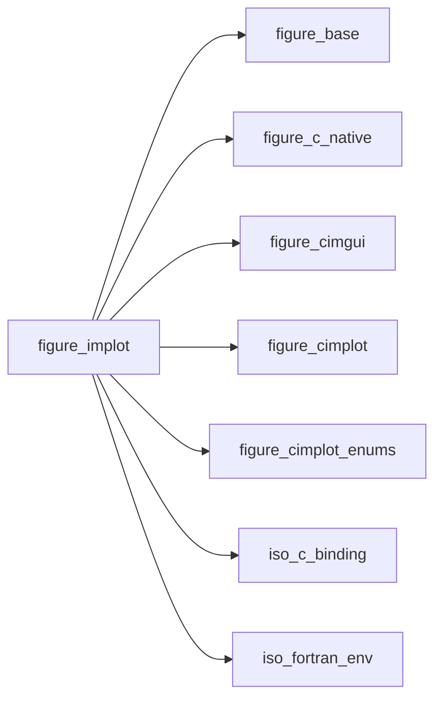

## Contents

- [plot_spec_object](#plot-spec-object)
- [ip_line](#ip-line)
- [ip_scatter](#ip-scatter)
- [ip_bars](#ip-bars)
- [ip_shaded](#ip-shaded)
- [ip_end_plot](#ip-end-plot)
- [ip_setup_axes](#ip-setup-axes)
- [ip_line_r32](#ip-line-r32)
- [ip_scatter_r32](#ip-scatter-r32)
- [ip_bars_r32](#ip-bars-r32)
- [ip_shaded_r32](#ip-shaded-r32)
- [ip_shaded_ref_r32](#ip-shaded-ref-r32)
- [ip_line_r64](#ip-line-r64)
- [ip_scatter_r64](#ip-scatter-r64)
- [ip_bars_r64](#ip-bars-r64)
- [ip_shaded_r64](#ip-shaded-r64)
- [ip_shaded_ref_r64](#ip-shaded-ref-r64)
- [ip_begin_plot](#ip-begin-plot)
- [ip_spec](#ip-spec)
- [series_ok](#series-ok)
- [addr_r32](#addr-r32)
- [addr_r64](#addr-r64)
- [spec_c](#spec-c)
- [rgba_ok](#rgba-ok)
- [rgba](#rgba)

## Derived Types

### plot_spec_object

Style of a plot item: colours, line weight, markers, flags. Build it with `ip_spec`.

 The C struct is private so that a spec always starts from ImPlot's defaults: a zeroed one would draw nothing
 (line weight 0, marker size 0).

#### Components

| Name | Type | Attributes | Description |
|------|------|------------|-------------|
| `c` | type([im_plot_spec](/api/src/lib/figure_cimplot#im-plot-spec)) |  | `ImPlotSpec`, as passed to ImPlot. |

## Interfaces

### ip_line

Line through the points (x(i), y(i)).

**Module procedures**: [`ip_line_r32`](/api/src/lib/figure_implot#ip-line-r32), [`ip_line_r64`](/api/src/lib/figure_implot#ip-line-r64)

### ip_scatter

Markers at the points (x(i), y(i)).

**Module procedures**: [`ip_scatter_r32`](/api/src/lib/figure_implot#ip-scatter-r32), [`ip_scatter_r64`](/api/src/lib/figure_implot#ip-scatter-r64)

### ip_bars

Bars of height y(i) centred at x(i).

**Module procedures**: [`ip_bars_r32`](/api/src/lib/figure_implot#ip-bars-r32), [`ip_bars_r64`](/api/src/lib/figure_implot#ip-bars-r64)

### ip_shaded

Area between two curves y1(x) and y2(x), or between a curve y(x) and the line y = yref.

**Module procedures**: [`ip_shaded_r32`](/api/src/lib/figure_implot#ip-shaded-r32), [`ip_shaded_r64`](/api/src/lib/figure_implot#ip-shaded-r64), [`ip_shaded_ref_r32`](/api/src/lib/figure_implot#ip-shaded-ref-r32), [`ip_shaded_ref_r64`](/api/src/lib/figure_implot#ip-shaded-ref-r64)

## Subroutines

### ip_end_plot

End the plot (only after `ip_begin_plot` returned true).

```fortran
subroutine ip_end_plot()
```

**Call graph**

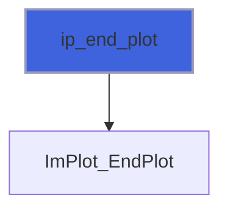

### ip_setup_axes

Axis labels (call right after `ip_begin_plot`).

```fortran
subroutine ip_setup_axes(xlabel, ylabel)
```

**Arguments**

| Name | Type | Intent | Attributes | Description |
|------|------|--------|------------|-------------|
| `xlabel` | character(len=*) | in |  | X label. |
| `ylabel` | character(len=*) | in |  | Y label. |

**Call graph**


### ip_line_r32

Line through the points (x(i), y(i)), single precision.

```fortran
subroutine ip_line_r32(label, x, y, spec, stat)
```

**Arguments**

| Name | Type | Intent | Attributes | Description |
|------|------|--------|------------|-------------|
| `label` | character(len=*) | in |  | Legend label. |
| `x` | real(kind=real32) | in | contiguous, target | Abscissae. |
| `y` | real(kind=real32) | in | contiguous, target | Ordinates. |
| `spec` | type([plot_spec_object](/api/src/lib/figure_implot#plot-spec-object)) | in | optional | Style (default: ImPlot's). |
| `stat` | integer(kind=int32) | out | optional | Status. |

**Call graph**


### ip_scatter_r32

Markers at the points (x(i), y(i)), single precision.

```fortran
subroutine ip_scatter_r32(label, x, y, spec, stat)
```

**Arguments**

| Name | Type | Intent | Attributes | Description |
|------|------|--------|------------|-------------|
| `label` | character(len=*) | in |  | Legend label. |
| `x` | real(kind=real32) | in | contiguous, target | Abscissae. |
| `y` | real(kind=real32) | in | contiguous, target | Ordinates. |
| `spec` | type([plot_spec_object](/api/src/lib/figure_implot#plot-spec-object)) | in | optional | Style (default: ImPlot's). |
| `stat` | integer(kind=int32) | out | optional | Status. |

**Call graph**


### ip_bars_r32

Bars of height y(i) centred at x(i), `bar_size` wide (in x units), single precision.

```fortran
subroutine ip_bars_r32(label, x, y, bar_size, spec, stat)
```

**Arguments**

| Name | Type | Intent | Attributes | Description |
|------|------|--------|------------|-------------|
| `label` | character(len=*) | in |  | Legend label. |
| `x` | real(kind=real32) | in | contiguous, target | Bar positions. |
| `y` | real(kind=real32) | in | contiguous, target | Bar heights. |
| `bar_size` | real(kind=real64) | in |  | Bar width [x units]. |
| `spec` | type([plot_spec_object](/api/src/lib/figure_implot#plot-spec-object)) | in | optional | Style (default: ImPlot's). |
| `stat` | integer(kind=int32) | out | optional | Status. |

**Call graph**

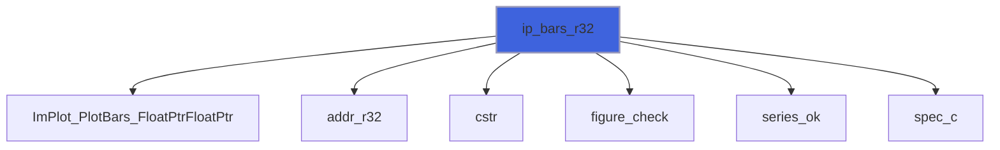

### ip_shaded_r32

Area between the curves y1(x) and y2(x), single precision.

```fortran
subroutine ip_shaded_r32(label, x, y1, y2, spec, stat)
```

**Arguments**

| Name | Type | Intent | Attributes | Description |
|------|------|--------|------------|-------------|
| `label` | character(len=*) | in |  | Legend label. |
| `x` | real(kind=real32) | in | contiguous, target | Abscissae. |
| `y1` | real(kind=real32) | in | contiguous, target | First curve. |
| `y2` | real(kind=real32) | in | contiguous, target | Second curve. |
| `spec` | type([plot_spec_object](/api/src/lib/figure_implot#plot-spec-object)) | in | optional | Style (default: ImPlot's). |
| `stat` | integer(kind=int32) | out | optional | Status. |

**Call graph**

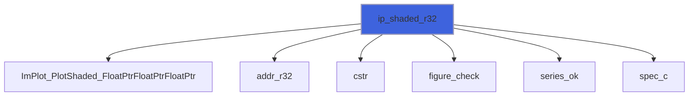

### ip_shaded_ref_r32

Area between the curve y(x) and the line y = yref, single precision.

```fortran
subroutine ip_shaded_ref_r32(label, x, y, yref, spec, stat)
```

**Arguments**

| Name | Type | Intent | Attributes | Description |
|------|------|--------|------------|-------------|
| `label` | character(len=*) | in |  | Legend label. |
| `x` | real(kind=real32) | in | contiguous, target | Abscissae. |
| `y` | real(kind=real32) | in | contiguous, target | Curve. |
| `yref` | real(kind=real64) | in |  | Reference line (-huge/+huge: to the plot edge). |
| `spec` | type([plot_spec_object](/api/src/lib/figure_implot#plot-spec-object)) | in | optional | Style (default: ImPlot's). |
| `stat` | integer(kind=int32) | out | optional | Status. |

**Call graph**


### ip_line_r64

Line through the points (x(i), y(i)), double precision.

```fortran
subroutine ip_line_r64(label, x, y, spec, stat)
```

**Arguments**

| Name | Type | Intent | Attributes | Description |
|------|------|--------|------------|-------------|
| `label` | character(len=*) | in |  | Legend label. |
| `x` | real(kind=real64) | in | contiguous, target | Abscissae. |
| `y` | real(kind=real64) | in | contiguous, target | Ordinates. |
| `spec` | type([plot_spec_object](/api/src/lib/figure_implot#plot-spec-object)) | in | optional | Style (default: ImPlot's). |
| `stat` | integer(kind=int32) | out | optional | Status. |

**Call graph**

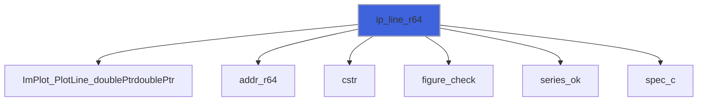

### ip_scatter_r64

Markers at the points (x(i), y(i)), double precision.

```fortran
subroutine ip_scatter_r64(label, x, y, spec, stat)
```

**Arguments**

| Name | Type | Intent | Attributes | Description |
|------|------|--------|------------|-------------|
| `label` | character(len=*) | in |  | Legend label. |
| `x` | real(kind=real64) | in | contiguous, target | Abscissae. |
| `y` | real(kind=real64) | in | contiguous, target | Ordinates. |
| `spec` | type([plot_spec_object](/api/src/lib/figure_implot#plot-spec-object)) | in | optional | Style (default: ImPlot's). |
| `stat` | integer(kind=int32) | out | optional | Status. |

**Call graph**

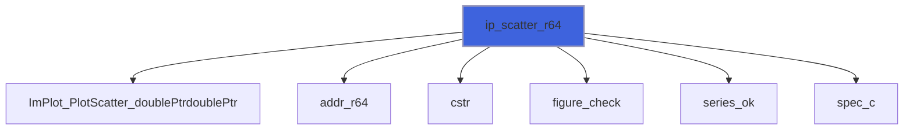

### ip_bars_r64

Bars of height y(i) centred at x(i), `bar_size` wide (in x units), double precision.

```fortran
subroutine ip_bars_r64(label, x, y, bar_size, spec, stat)
```

**Arguments**

| Name | Type | Intent | Attributes | Description |
|------|------|--------|------------|-------------|
| `label` | character(len=*) | in |  | Legend label. |
| `x` | real(kind=real64) | in | contiguous, target | Bar positions. |
| `y` | real(kind=real64) | in | contiguous, target | Bar heights. |
| `bar_size` | real(kind=real64) | in |  | Bar width [x units]. |
| `spec` | type([plot_spec_object](/api/src/lib/figure_implot#plot-spec-object)) | in | optional | Style (default: ImPlot's). |
| `stat` | integer(kind=int32) | out | optional | Status. |

**Call graph**


### ip_shaded_r64

Area between the curves y1(x) and y2(x), double precision.

```fortran
subroutine ip_shaded_r64(label, x, y1, y2, spec, stat)
```

**Arguments**

| Name | Type | Intent | Attributes | Description |
|------|------|--------|------------|-------------|
| `label` | character(len=*) | in |  | Legend label. |
| `x` | real(kind=real64) | in | contiguous, target | Abscissae. |
| `y1` | real(kind=real64) | in | contiguous, target | First curve. |
| `y2` | real(kind=real64) | in | contiguous, target | Second curve. |
| `spec` | type([plot_spec_object](/api/src/lib/figure_implot#plot-spec-object)) | in | optional | Style (default: ImPlot's). |
| `stat` | integer(kind=int32) | out | optional | Status. |

**Call graph**

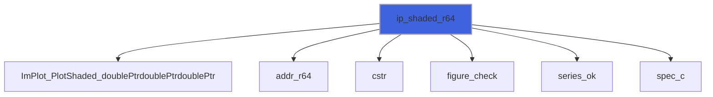

### ip_shaded_ref_r64

Area between the curve y(x) and the line y = yref, double precision.

```fortran
subroutine ip_shaded_ref_r64(label, x, y, yref, spec, stat)
```

**Arguments**

| Name | Type | Intent | Attributes | Description |
|------|------|--------|------------|-------------|
| `label` | character(len=*) | in |  | Legend label. |
| `x` | real(kind=real64) | in | contiguous, target | Abscissae. |
| `y` | real(kind=real64) | in | contiguous, target | Curve. |
| `yref` | real(kind=real64) | in |  | Reference line (-huge/+huge: to the plot edge). |
| `spec` | type([plot_spec_object](/api/src/lib/figure_implot#plot-spec-object)) | in | optional | Style (default: ImPlot's). |
| `stat` | integer(kind=int32) | out | optional | Status. |

**Call graph**

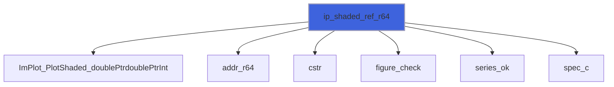

## Functions

### ip_begin_plot

Begin a plot; if true, declare its content and call `ip_end_plot`.

**Returns**: `logical`

```fortran
function ip_begin_plot(title, width, height) result(visible)
```

**Arguments**

| Name | Type | Intent | Attributes | Description |
|------|------|--------|------------|-------------|
| `title` | character(len=*) | in |  | Title (also the plot id; '##id' hides it). |
| `width` | real(kind=real64) | in | optional | Width [pixels] (default: full width). |
| `height` | real(kind=real64) | in | optional | Height [pixels] (default: ImPlot's). |

**Call graph**

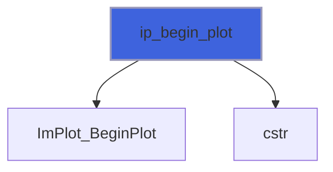

### ip_spec

Item style: ImPlot's defaults, with the given properties overridden. Colours are RGBA in [0, 1]; an absent
 colour stays automatic (from the colormap).

**Returns**: type([plot_spec_object](/api/src/lib/figure_implot#plot-spec-object))

```fortran
function ip_spec(line_color, line_weight, fill_color, fill_alpha, marker, marker_size, marker_line_color, marker_fill_color, size, flags, stat) result(spec)
```

**Arguments**

| Name | Type | Intent | Attributes | Description |
|------|------|--------|------------|-------------|
| `line_color` | real(kind=real64) | in | optional | Line colour, RGBA. |
| `line_weight` | real(kind=real64) | in | optional | Line weight [pixels] (lines, bar edges, markers). |
| `fill_color` | real(kind=real64) | in | optional | Fill colour, RGBA (bars, shaded areas). |
| `fill_alpha` | real(kind=real64) | in | optional | Alpha multiplier of the fill colours. |
| `marker` | integer(kind=int32) | in | optional | Marker shape (`ImPlotMarker_*`). |
| `marker_size` | real(kind=real64) | in | optional | Marker radius [pixels]. |
| `marker_line_color` | real(kind=real64) | in | optional | Marker outline colour, RGBA. |
| `marker_fill_color` | real(kind=real64) | in | optional | Marker fill colour, RGBA. |
| `size` | real(kind=real64) | in | optional | Error-bar whisker and digital-bar size [pixels]. |
| `flags` | integer(kind=int32) | in | optional | Item flags (`ImPlotItemFlags_*`, the item's own). |
| `stat` | integer(kind=int32) | out | optional | Status: `FIG_ERR_ARGUMENT` for a colour of size /= 4. |

**Call graph**

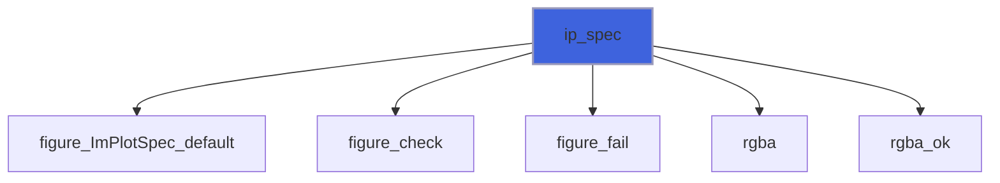

### series_ok

Whether two series can be plotted together: same size, and a size ImPlot's `int` count holds.

**Returns**: `logical`

```fortran
function series_ok(nx, ny, item, stat) result(ok)
```

**Arguments**

| Name | Type | Intent | Attributes | Description |
|------|------|--------|------------|-------------|
| `nx` | integer(kind=int64) | in |  | Size of the first series. |
| `ny` | integer(kind=int64) | in |  | Size of the second series. |
| `item` | character(len=*) | in |  | Item name, for the message. |
| `stat` | integer(kind=int32) | out | optional | Status. |

**Call graph**

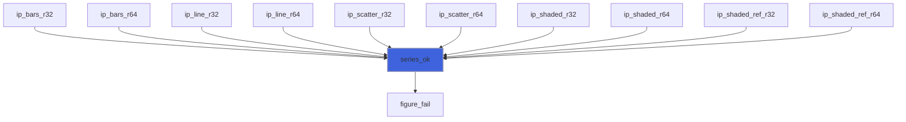

### addr_r32

Address of a contiguous array for ImPlot; null when empty: `c_loc` needs nonzero size (F2023 18.2.3.7).

 The address stays valid in the caller after the return: `a` is a TARGET dummy whose effective argument (the
 caller's CONTIGUOUS, TARGET dummy) is simply contiguous, so the association persists (F2023 15.5.2.5 p9).

**Returns**: `type(c_ptr)`

```fortran
function addr_r32(a) result(p)
```

**Arguments**

| Name | Type | Intent | Attributes | Description |
|------|------|--------|------------|-------------|
| `a` | real(kind=real32) | in | contiguous, target | Data. |

**Call graph**


### addr_r64

Address of a contiguous array for ImPlot; null when empty: `c_loc` needs nonzero size (F2023 18.2.3.7).

 The address stays valid in the caller after the return: `a` is a TARGET dummy whose effective argument (the
 caller's CONTIGUOUS, TARGET dummy) is simply contiguous, so the association persists (F2023 15.5.2.5 p9).

**Returns**: `type(c_ptr)`

```fortran
function addr_r64(a) result(p)
```

**Arguments**

| Name | Type | Intent | Attributes | Description |
|------|------|--------|------------|-------------|
| `a` | real(kind=real64) | in | contiguous, target | Data. |

**Call graph**

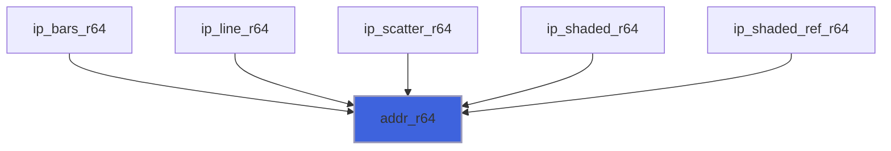

### spec_c

The C spec to pass: the given one, or ImPlot's defaults.

**Returns**: type([im_plot_spec](/api/src/lib/figure_cimplot#im-plot-spec))

```fortran
function spec_c(spec) result(c)
```

**Arguments**

| Name | Type | Intent | Attributes | Description |
|------|------|--------|------------|-------------|
| `spec` | type([plot_spec_object](/api/src/lib/figure_implot#plot-spec-object)) | in | optional | Style. |

**Call graph**

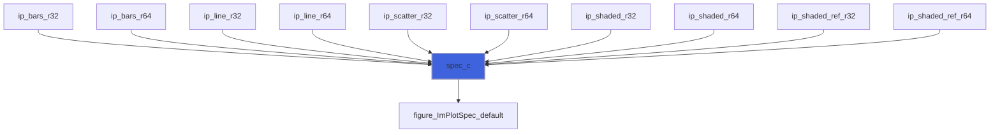

### rgba_ok

Whether an optional colour is absent or has 4 components.

**Attributes**: pure

**Returns**: `logical`

```fortran
function rgba_ok(color) result(ok)
```

**Arguments**

| Name | Type | Intent | Attributes | Description |
|------|------|--------|------------|-------------|
| `color` | real(kind=real64) | in | optional | Colour, RGBA. |

**Call graph**

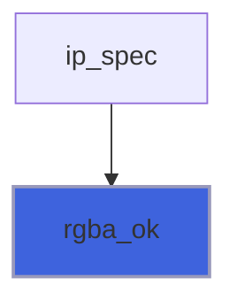

### rgba

RGBA colour as an `ImVec4`.

**Attributes**: pure

**Returns**: type([im_vec4](/api/src/lib/figure_cimgui#im-vec4))

```fortran
function rgba(color) result(v)
```

**Arguments**

| Name | Type | Intent | Attributes | Description |
|------|------|--------|------------|-------------|
| `color` | real(kind=real64) | in |  | Colour, RGBA, 4 components. |

**Call graph**

```mermaid
flowchart TD
  ip_spec["ip_spec"] --> rgba["rgba"]
  style rgba fill:#3e63dd,stroke:#99b,stroke-width:2px
```
