# figure_implot3d

> figure_implot3d, small 3-D figures with Fortran arrays (ImPlot3D).

 ImPlot3D (brenocq/implot3d, MIT) draws plots in a box the user turns with the mouse (right drag: rotate; left drag:
 pan; wheel or middle drag: zoom; right double click: back to the initial rotation; right click: the plot's menu),
 through Dear ImGui's draw lists: the same in every mode. It is for figures that are plots, not scenes: probe
 positions, trajectories, a field as a height surface, up to about 10**4 primitives; meshes of millions of faces
 belong to `view3d_object` (plots.md, "3-D plots").

 `ip3_begin_plot` returns true when the plot is visible: then declare its axes (`ip3_setup_axes`) and items, and close
 it with `ip3_end_plot` (only in that case). Items (`ip3_line`, `ip3_scatter`, `ip3_surface`, `ip3_mesh`) take
 `real(real32)` or `real(real64)` arrays of any stride, read in place during the call as the 2-D items are
 (figure_implot: ImPlot3D has one byte stride for all the arrays of an item, an array of another stride is copied at
 it; the dummies are ASYNCHRONOUS). Every item takes an optional `spec`, built by `ip3_spec` from ImPlot3D's
 defaults. A surface is coloured by FIGURE's colormaps (`ip_colormap`), copied into ImPlot3D's registry at their
 first use and followed when `ig_gradient_edit` changes them.

 Every procedure refuses a call from a task and a call with no frame open (`FIG_ERR_STATE`); an item or `ip3_text`
 outside a 3-D plot, and `ip3_setup_axes` after the plot's first item, are usage errors (`FIG_ERR_STATE`, as
 `app%set_checks` says). The begin/end pair registers in the scope record of the frame (errors.md, "Pairing and
 frames").

**Source**: `src/lib/figure_implot3d.F90`

**Dependencies**

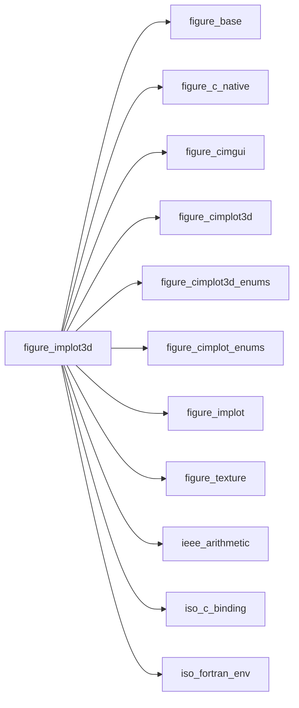

## Re-exports

| Name | Kind | Module | Description |
|------|------|--------|-------------|
| [`ImPlot3DMarker_None`](/api/src/lib/figure_cimplot3d_enums#variables) | parameter | [figure_cimplot3d_enums](/api/src/lib/figure_cimplot3d_enums) |  |
| [`ImPlot3DMarker_Auto`](/api/src/lib/figure_cimplot3d_enums#variables) | parameter | [figure_cimplot3d_enums](/api/src/lib/figure_cimplot3d_enums) |  |
| [`ImPlot3DMarker_Circle`](/api/src/lib/figure_cimplot3d_enums#variables) | parameter | [figure_cimplot3d_enums](/api/src/lib/figure_cimplot3d_enums) |  |
| [`ImPlot3DMarker_Square`](/api/src/lib/figure_cimplot3d_enums#variables) | parameter | [figure_cimplot3d_enums](/api/src/lib/figure_cimplot3d_enums) |  |
| [`ImPlot3DMarker_Diamond`](/api/src/lib/figure_cimplot3d_enums#variables) | parameter | [figure_cimplot3d_enums](/api/src/lib/figure_cimplot3d_enums) |  |
| [`ImPlot3DMarker_Up`](/api/src/lib/figure_cimplot3d_enums#variables) | parameter | [figure_cimplot3d_enums](/api/src/lib/figure_cimplot3d_enums) |  |
| [`ImPlot3DMarker_Down`](/api/src/lib/figure_cimplot3d_enums#variables) | parameter | [figure_cimplot3d_enums](/api/src/lib/figure_cimplot3d_enums) |  |
| [`ImPlot3DMarker_Left`](/api/src/lib/figure_cimplot3d_enums#variables) | parameter | [figure_cimplot3d_enums](/api/src/lib/figure_cimplot3d_enums) |  |
| [`ImPlot3DMarker_Right`](/api/src/lib/figure_cimplot3d_enums#variables) | parameter | [figure_cimplot3d_enums](/api/src/lib/figure_cimplot3d_enums) |  |
| [`ImPlot3DMarker_Cross`](/api/src/lib/figure_cimplot3d_enums#variables) | parameter | [figure_cimplot3d_enums](/api/src/lib/figure_cimplot3d_enums) |  |
| [`ImPlot3DMarker_Plus`](/api/src/lib/figure_cimplot3d_enums#variables) | parameter | [figure_cimplot3d_enums](/api/src/lib/figure_cimplot3d_enums) |  |
| [`ImPlot3DMarker_Asterisk`](/api/src/lib/figure_cimplot3d_enums#variables) | parameter | [figure_cimplot3d_enums](/api/src/lib/figure_cimplot3d_enums) |  |
| [`ImPlot3DItemFlags_None`](/api/src/lib/figure_cimplot3d_enums#variables) | parameter | [figure_cimplot3d_enums](/api/src/lib/figure_cimplot3d_enums) |  |
| [`ImPlot3DItemFlags_NoLegend`](/api/src/lib/figure_cimplot3d_enums#variables) | parameter | [figure_cimplot3d_enums](/api/src/lib/figure_cimplot3d_enums) |  |
| [`ImPlot3DItemFlags_NoFit`](/api/src/lib/figure_cimplot3d_enums#variables) | parameter | [figure_cimplot3d_enums](/api/src/lib/figure_cimplot3d_enums) |  |
| [`ImPlot3DLineFlags_Segments`](/api/src/lib/figure_cimplot3d_enums#variables) | parameter | [figure_cimplot3d_enums](/api/src/lib/figure_cimplot3d_enums) |  |
| [`ImPlot3DLineFlags_Loop`](/api/src/lib/figure_cimplot3d_enums#variables) | parameter | [figure_cimplot3d_enums](/api/src/lib/figure_cimplot3d_enums) |  |
| [`ImPlot3DLineFlags_SkipNaN`](/api/src/lib/figure_cimplot3d_enums#variables) | parameter | [figure_cimplot3d_enums](/api/src/lib/figure_cimplot3d_enums) |  |
| [`ImPlot3DSurfaceFlags_NoLines`](/api/src/lib/figure_cimplot3d_enums#variables) | parameter | [figure_cimplot3d_enums](/api/src/lib/figure_cimplot3d_enums) |  |
| [`ImPlot3DSurfaceFlags_NoFill`](/api/src/lib/figure_cimplot3d_enums#variables) | parameter | [figure_cimplot3d_enums](/api/src/lib/figure_cimplot3d_enums) |  |
| [`ImPlot3DSurfaceFlags_NoMarkers`](/api/src/lib/figure_cimplot3d_enums#variables) | parameter | [figure_cimplot3d_enums](/api/src/lib/figure_cimplot3d_enums) |  |
| [`ImPlot3DMeshFlags_NoLines`](/api/src/lib/figure_cimplot3d_enums#variables) | parameter | [figure_cimplot3d_enums](/api/src/lib/figure_cimplot3d_enums) |  |
| [`ImPlot3DMeshFlags_NoFill`](/api/src/lib/figure_cimplot3d_enums#variables) | parameter | [figure_cimplot3d_enums](/api/src/lib/figure_cimplot3d_enums) |  |
| [`ImPlot3DMeshFlags_NoMarkers`](/api/src/lib/figure_cimplot3d_enums#variables) | parameter | [figure_cimplot3d_enums](/api/src/lib/figure_cimplot3d_enums) |  |

## Contents

- [plot3d_spec_object](#plot3d-spec-object)
- [ip3_triangles](#ip3-triangles)
- [ip3_quads](#ip3-quads)
- [ip3_line](#ip3-line)
- [ip3_scatter](#ip3-scatter)
- [ip3_surface](#ip3-surface)
- [ip3_mesh](#ip3-mesh)
- [place_field](#place-field)
- [ip3_end_plot](#ip3-end-plot)
- [ip3_setup_axes](#ip3-setup-axes)
- [ip3_line_r32](#ip3-line-r32)
- [ip3_scatter_r32](#ip3-scatter-r32)
- [ip3_surface_r32](#ip3-surface-r32)
- [ip3_surface_grid_r32](#ip3-surface-grid-r32)
- [ip3_mesh_r32](#ip3-mesh-r32)
- [ip3_line_r64](#ip3-line-r64)
- [ip3_scatter_r64](#ip3-scatter-r64)
- [ip3_surface_r64](#ip3-surface-r64)
- [ip3_surface_grid_r64](#ip3-surface-grid-r64)
- [ip3_mesh_r64](#ip3-mesh-r64)
- [ip3_text](#ip3-text)
- [ip3_image](#ip3-image)
- [ip3_setup_axis](#ip3-setup-axis)
- [ip3_setup_box](#ip3-setup-box)
- [ip3_setup_legend](#ip3-setup-legend)
- [ip3_plot_to_pixels](#ip3-plot-to-pixels)
- [ip3_triangles_r64](#ip3-triangles-r64)
- [ip3_quads_r64](#ip3-quads-r64)
- [ip3_triangles_r32](#ip3-triangles-r32)
- [ip3_quads_r32](#ip3-quads-r32)
- [field_range_r32](#field-range-r32)
- [field_range_r64](#field-range-r64)
- [place_field_r32](#place-field-r32)
- [place_field_r64](#place-field-r64)
- [ip3_begin_plot](#ip3-begin-plot)
- [ip3_spec](#ip3-spec)
- [ip3_mouse_ray](#ip3-mouse-ray)
- [setup3d_refused](#setup3d-refused)
- [opt](#opt)
- [outside_plot](#outside-plot)
- [item_refused](#item-refused)
- [surface_ok](#surface-ok)
- [grid_ok](#grid-ok)
- [colormap3d_ok](#colormap3d-ok)
- [triangles_ok](#triangles-ok)
- [spec_at](#spec-at)
- [rgba_ok](#rgba-ok)
- [rgba](#rgba)

## Variables

| Name | Type | Attributes | Description |
|------|------|------------|-------------|
| `mesh_index` | integer(kind=c_int) | allocatable, target | The triangles of the last mesh, 0-based (kept and grown). |

## Derived Types

### plot3d_spec_object

Style of a 3-D plot item: colours, line weight, markers, flags. Build it with `ip3_spec`.

 The C struct is private so that a spec always starts from ImPlot3D's defaults (a zeroed one draws nothing).

**Components**

| Name | Type | Attributes | Description |
|------|------|------------|-------------|
| `c` | type([im_plot3d_spec](/api/src/lib/figure_cimplot3d#im-plot3d-spec)) |  | `ImPlot3DSpec`, as passed to ImPlot3D. |

## Interfaces

### ip3_triangles

Triangles: each three points (x(i), y(i), z(i)) in a row are one.

**Module procedures**: [`ip3_triangles_r32`](/api/src/lib/figure_implot3d#ip3-triangles-r32), [`ip3_triangles_r64`](/api/src/lib/figure_implot3d#ip3-triangles-r64)

### ip3_quads

Quadrilaterals: each four points in a row are one.

**Module procedures**: [`ip3_quads_r32`](/api/src/lib/figure_implot3d#ip3-quads-r32), [`ip3_quads_r64`](/api/src/lib/figure_implot3d#ip3-quads-r64)

### ip3_line

A line through the points (x(i), y(i), z(i)).

**Module procedures**: [`ip3_line_r32`](/api/src/lib/figure_implot3d#ip3-line-r32), [`ip3_line_r64`](/api/src/lib/figure_implot3d#ip3-line-r64)

### ip3_scatter

Markers at the points (x(i), y(i), z(i)).

**Module procedures**: [`ip3_scatter_r32`](/api/src/lib/figure_implot3d#ip3-scatter-r32), [`ip3_scatter_r64`](/api/src/lib/figure_implot3d#ip3-scatter-r64)

### ip3_surface

A surface z(i, j) over a grid: x(i), y(j) (a rectilinear grid) or x(i, j), y(i, j) (any grid of quadrilaterals).

**Module procedures**: [`ip3_surface_r32`](/api/src/lib/figure_implot3d#ip3-surface-r32), [`ip3_surface_r64`](/api/src/lib/figure_implot3d#ip3-surface-r64), [`ip3_surface_grid_r32`](/api/src/lib/figure_implot3d#ip3-surface-grid-r32), [`ip3_surface_grid_r64`](/api/src/lib/figure_implot3d#ip3-surface-grid-r64)

### ip3_mesh

A mesh of triangles: vertices (x(i), y(i), z(i)), triangles(:, k) the vertices of the k-th (from 1).

**Module procedures**: [`ip3_mesh_r32`](/api/src/lib/figure_implot3d#ip3-mesh-r32), [`ip3_mesh_r64`](/api/src/lib/figure_implot3d#ip3-mesh-r64)

### place_field

Place a rank-2 array of an item (a surface's field or grid) in a slot.

**Module procedures**: [`place_field_r32`](/api/src/lib/figure_implot3d#place-field-r32), [`place_field_r64`](/api/src/lib/figure_implot3d#place-field-r64)

## Subroutines

### ip3_end_plot

End the 3-D plot (only after `ip3_begin_plot` returned true).

**Attributes**: recursive

```fortran
subroutine ip3_end_plot()
```

**Call graph**

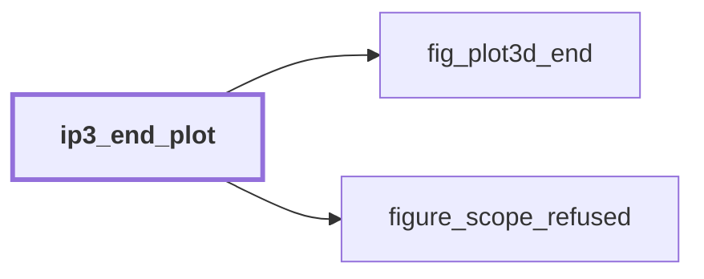

### ip3_setup_axes

Labels of the three axes (call right after `ip3_begin_plot`, before any item); with `auto_fit=.true.` the axes
 fit the data every frame, instead of once on first use. `limits` = [xmin, xmax, ymin, ymax, zmin, zmax]: the
 initial ranges (set once; the user zooms and pans from them). `elevation` and `azimuth` [degrees], both or
 neither: the initial rotation of the box (set once; a right double click goes back to it). Statuses:
 `FIG_ERR_ARGUMENT` for `limits` of size /= 6 or with a minimum not below its maximum, or one angle without the
 other (nothing is set up); `FIG_ERR_STATE` outside a 3-D plot, after its first item, or from a task.

**Attributes**: recursive

```fortran
subroutine ip3_setup_axes(xlabel, ylabel, zlabel, auto_fit, limits, elevation, azimuth, stat)
```

**Arguments**

| Name | Type | Intent | Attributes | Description |
|------|------|--------|------------|-------------|
| `xlabel` | character(len=*) | in |  | X label. |
| `ylabel` | character(len=*) | in |  | Y label. |
| `zlabel` | character(len=*) | in |  | Z label. |
| `auto_fit` | logical | in | optional | Fit the axes to the data every frame (default: first use). |
| `limits` | real(kind=real64) | in | optional | Initial ranges [xmin, xmax, ymin, ymax, zmin, zmax]. |
| `elevation` | real(kind=real64) | in | optional | Initial elevation [degrees]. |
| `azimuth` | real(kind=real64) | in | optional | Initial azimuth [degrees]. |
| `stat` | integer(kind=int32) | out | optional | Status. |

**Call graph**

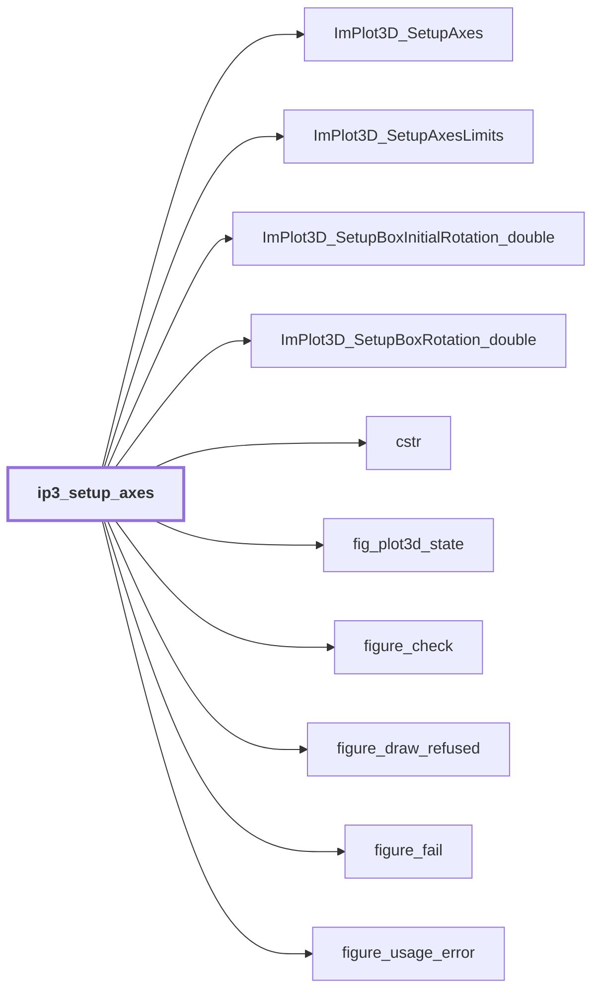

### ip3_line_r32

A line through the points (x(i), y(i), z(i)), single precision; read in place with any stride. Statuses:
 `FIG_ERR_ARGUMENT` for series of different sizes; `FIG_ERR_STATE` outside a 3-D plot, from a task.

**Attributes**: recursive

```fortran
subroutine ip3_line_r32(label, x, y, z, spec, stat)
```

**Arguments**

| Name | Type | Intent | Attributes | Description |
|------|------|--------|------------|-------------|
| `label` | character(len=*) | in |  | Legend label. |
| `x` | real(kind=real32) | in | target, asynchronous | Abscissae. |
| `y` | real(kind=real32) | in | target, asynchronous | Ordinates. |
| `z` | real(kind=real32) | in | target, asynchronous | Heights. |
| `spec` | type([plot3d_spec_object](/api/src/lib/figure_implot3d#plot3d-spec-object)) | in | optional | Style (default: ImPlot3D's). |
| `stat` | integer(kind=int32) | out | optional | Status. |

**Call graph**


### ip3_scatter_r32

Markers at the points (x(i), y(i), z(i)), single precision; read in place with any stride. Statuses as
 `ip3_line`.

**Attributes**: recursive

```fortran
subroutine ip3_scatter_r32(label, x, y, z, spec, stat)
```

**Arguments**

| Name | Type | Intent | Attributes | Description |
|------|------|--------|------------|-------------|
| `label` | character(len=*) | in |  | Legend label. |
| `x` | real(kind=real32) | in | target, asynchronous | Abscissae. |
| `y` | real(kind=real32) | in | target, asynchronous | Ordinates. |
| `z` | real(kind=real32) | in | target, asynchronous | Heights. |
| `spec` | type([plot3d_spec_object](/api/src/lib/figure_implot3d#plot3d-spec-object)) | in | optional | Style (default: ImPlot3D's). |
| `stat` | integer(kind=int32) | out | optional | Status. |

**Call graph**

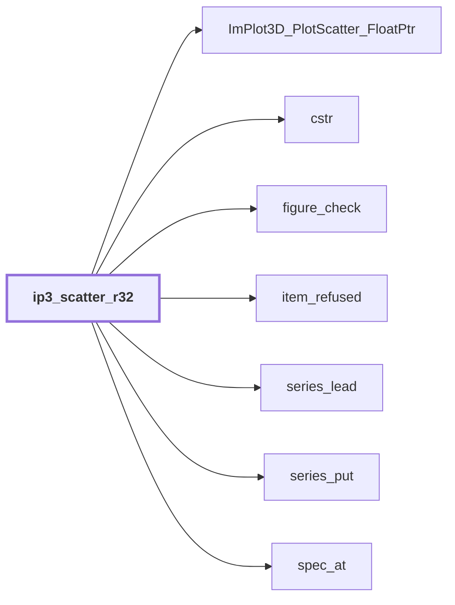

### ip3_surface_r32

A surface of heights z(i, j) over the rectilinear grid x(i), y(j), single precision, coloured by `colormap` from
 `scale_min` to `scale_max` (default: z's finite range). z is read in place when its elements are equally spaced in
 memory (a whole array, `z(:, j1:j2)`, `a(k, :, :)`), else copied; x and y are expanded into the grid's two
 coordinate arrays (two copies: ImPlot3D reads one value per vertex). Statuses: `FIG_ERR_ARGUMENT` for x, y that do
 not match z's shape, one scale end without the other or a minimum not below the maximum, more vertices than a
 C int counts, a colormap not registered; `FIG_ERR_STATE` outside a 3-D plot, from a task.

**Attributes**: recursive

```fortran
subroutine ip3_surface_r32(label, x, y, z, colormap, scale_min, scale_max, spec, stat)
```

**Arguments**

| Name | Type | Intent | Attributes | Description |
|------|------|--------|------------|-------------|
| `label` | character(len=*) | in |  | Legend label. |
| `x` | real(kind=real32) | in | target, asynchronous | Abscissae of the grid, size(z, 1). |
| `y` | real(kind=real32) | in | target, asynchronous | Ordinates of the grid, size(z, 2). |
| `z` | real(kind=real32) | in | target, asynchronous | Heights. |
| `colormap` | integer(kind=int32) | in | optional | Colormap (`ip_colormap`; default Viridis). |
| `scale_min` | real(kind=real64) | in | optional | Height at the colormap's first colour. |
| `scale_max` | real(kind=real64) | in | optional | Height at its last colour. |
| `spec` | type([plot3d_spec_object](/api/src/lib/figure_implot3d#plot3d-spec-object)) | in | optional | Style (default: ImPlot3D's). |
| `stat` | integer(kind=int32) | out | optional | Status. |

**Call graph**


### ip3_surface_grid_r32

A surface over any grid of quadrilaterals: the vertex (i, j) at (x(i, j), y(i, j), z(i, j)), single precision,
 coloured as `ip3_surface`. The three arrays are read in place when their elements are equally spaced in memory
 with one stride, else copied at the stride of z. Statuses as `ip3_surface` (x and y of z's shape).

**Attributes**: recursive

```fortran
subroutine ip3_surface_grid_r32(label, x, y, z, colormap, scale_min, scale_max, spec, stat)
```

**Arguments**

| Name | Type | Intent | Attributes | Description |
|------|------|--------|------------|-------------|
| `label` | character(len=*) | in |  | Legend label. |
| `x` | real(kind=real32) | in | target, asynchronous | Abscissae of the vertices. |
| `y` | real(kind=real32) | in | target, asynchronous | Ordinates of the vertices. |
| `z` | real(kind=real32) | in | target, asynchronous | Heights of the vertices. |
| `colormap` | integer(kind=int32) | in | optional | Colormap (`ip_colormap`; default Viridis). |
| `scale_min` | real(kind=real64) | in | optional | Height at the colormap's first colour. |
| `scale_max` | real(kind=real64) | in | optional | Height at its last colour. |
| `spec` | type([plot3d_spec_object](/api/src/lib/figure_implot3d#plot3d-spec-object)) | in | optional | Style (default: ImPlot3D's). |
| `stat` | integer(kind=int32) | out | optional | Status. |

**Call graph**

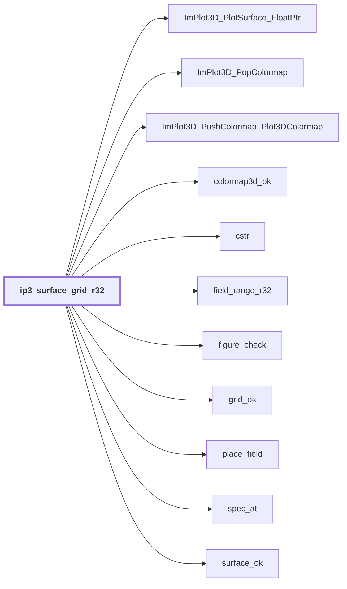

### ip3_mesh_r32

A mesh of triangles, single precision: vertices (x(i), y(i), z(i)) read in place with any stride,
 `triangles(1:3, k)` the vertices of the k-th triangle (from 1; converted to ImPlot3D's 0-based indices: one copy).
 Statuses: `FIG_ERR_ARGUMENT` for series of different sizes, `triangles` without 3 rows or with a vertex outside
 [1, size(x)]; `FIG_ERR_STATE` outside a 3-D plot, from a task.

**Attributes**: recursive

```fortran
subroutine ip3_mesh_r32(label, x, y, z, triangles, spec, stat)
```

**Arguments**

| Name | Type | Intent | Attributes | Description |
|------|------|--------|------------|-------------|
| `label` | character(len=*) | in |  | Legend label. |
| `x` | real(kind=real32) | in | target, asynchronous | Abscissae of the vertices. |
| `y` | real(kind=real32) | in | target, asynchronous | Ordinates of the vertices. |
| `z` | real(kind=real32) | in | target, asynchronous | Heights of the vertices. |
| `triangles` | integer(kind=int32) | in |  | Vertices of each triangle. |
| `spec` | type([plot3d_spec_object](/api/src/lib/figure_implot3d#plot3d-spec-object)) | in | optional | Style (default: ImPlot3D's). |
| `stat` | integer(kind=int32) | out | optional | Status. |

**Call graph**

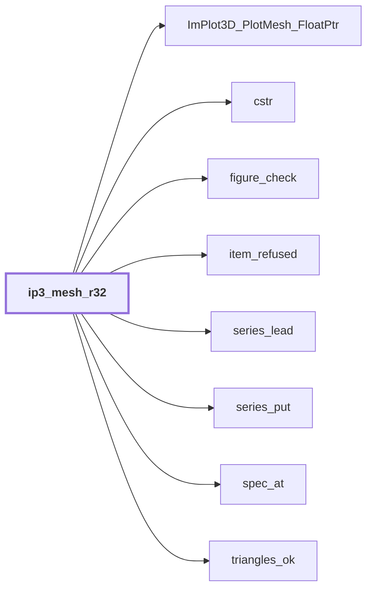

### ip3_line_r64

A line through the points (x(i), y(i), z(i)), double precision; read in place with any stride. Statuses:
 `FIG_ERR_ARGUMENT` for series of different sizes; `FIG_ERR_STATE` outside a 3-D plot, from a task.

**Attributes**: recursive

```fortran
subroutine ip3_line_r64(label, x, y, z, spec, stat)
```

**Arguments**

| Name | Type | Intent | Attributes | Description |
|------|------|--------|------------|-------------|
| `label` | character(len=*) | in |  | Legend label. |
| `x` | real(kind=real64) | in | target, asynchronous | Abscissae. |
| `y` | real(kind=real64) | in | target, asynchronous | Ordinates. |
| `z` | real(kind=real64) | in | target, asynchronous | Heights. |
| `spec` | type([plot3d_spec_object](/api/src/lib/figure_implot3d#plot3d-spec-object)) | in | optional | Style (default: ImPlot3D's). |
| `stat` | integer(kind=int32) | out | optional | Status. |

**Call graph**

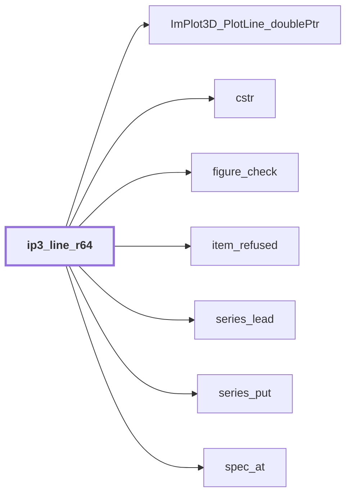

### ip3_scatter_r64

Markers at the points (x(i), y(i), z(i)), double precision; read in place with any stride. Statuses as
 `ip3_line`.

**Attributes**: recursive

```fortran
subroutine ip3_scatter_r64(label, x, y, z, spec, stat)
```

**Arguments**

| Name | Type | Intent | Attributes | Description |
|------|------|--------|------------|-------------|
| `label` | character(len=*) | in |  | Legend label. |
| `x` | real(kind=real64) | in | target, asynchronous | Abscissae. |
| `y` | real(kind=real64) | in | target, asynchronous | Ordinates. |
| `z` | real(kind=real64) | in | target, asynchronous | Heights. |
| `spec` | type([plot3d_spec_object](/api/src/lib/figure_implot3d#plot3d-spec-object)) | in | optional | Style (default: ImPlot3D's). |
| `stat` | integer(kind=int32) | out | optional | Status. |

**Call graph**

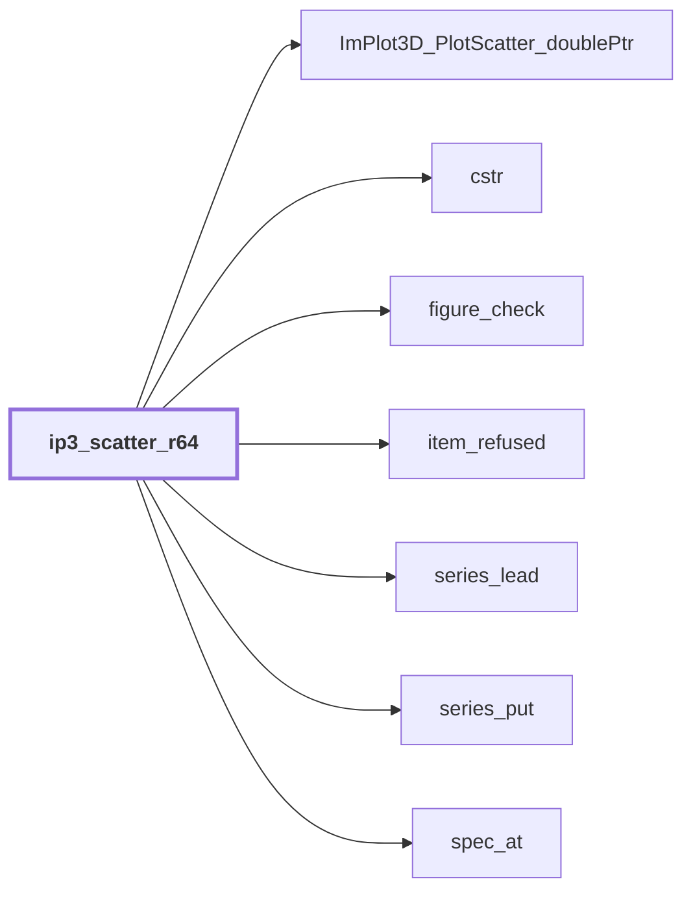

### ip3_surface_r64

A surface of heights z(i, j) over the rectilinear grid x(i), y(j), double precision, coloured by `colormap` from
 `scale_min` to `scale_max` (default: z's finite range). z is read in place when its elements are equally spaced in
 memory (a whole array, `z(:, j1:j2)`, `a(k, :, :)`), else copied; x and y are expanded into the grid's two
 coordinate arrays (two copies: ImPlot3D reads one value per vertex). Statuses: `FIG_ERR_ARGUMENT` for x, y that do
 not match z's shape, one scale end without the other or a minimum not below the maximum, more vertices than a
 C int counts, a colormap not registered; `FIG_ERR_STATE` outside a 3-D plot, from a task.

**Attributes**: recursive

```fortran
subroutine ip3_surface_r64(label, x, y, z, colormap, scale_min, scale_max, spec, stat)
```

**Arguments**

| Name | Type | Intent | Attributes | Description |
|------|------|--------|------------|-------------|
| `label` | character(len=*) | in |  | Legend label. |
| `x` | real(kind=real64) | in | target, asynchronous | Abscissae of the grid, size(z, 1). |
| `y` | real(kind=real64) | in | target, asynchronous | Ordinates of the grid, size(z, 2). |
| `z` | real(kind=real64) | in | target, asynchronous | Heights. |
| `colormap` | integer(kind=int32) | in | optional | Colormap (`ip_colormap`; default Viridis). |
| `scale_min` | real(kind=real64) | in | optional | Height at the colormap's first colour. |
| `scale_max` | real(kind=real64) | in | optional | Height at its last colour. |
| `spec` | type([plot3d_spec_object](/api/src/lib/figure_implot3d#plot3d-spec-object)) | in | optional | Style (default: ImPlot3D's). |
| `stat` | integer(kind=int32) | out | optional | Status. |

**Call graph**

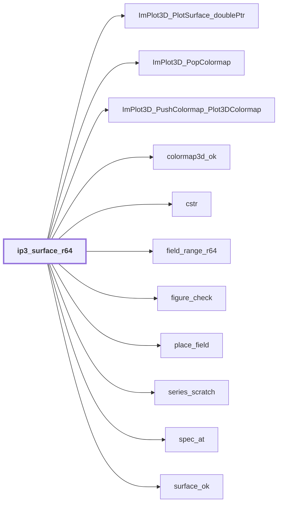

### ip3_surface_grid_r64

A surface over any grid of quadrilaterals: the vertex (i, j) at (x(i, j), y(i, j), z(i, j)), double precision,
 coloured as `ip3_surface`. The three arrays are read in place when their elements are equally spaced in memory
 with one stride, else copied at the stride of z. Statuses as `ip3_surface` (x and y of z's shape).

**Attributes**: recursive

```fortran
subroutine ip3_surface_grid_r64(label, x, y, z, colormap, scale_min, scale_max, spec, stat)
```

**Arguments**

| Name | Type | Intent | Attributes | Description |
|------|------|--------|------------|-------------|
| `label` | character(len=*) | in |  | Legend label. |
| `x` | real(kind=real64) | in | target, asynchronous | Abscissae of the vertices. |
| `y` | real(kind=real64) | in | target, asynchronous | Ordinates of the vertices. |
| `z` | real(kind=real64) | in | target, asynchronous | Heights of the vertices. |
| `colormap` | integer(kind=int32) | in | optional | Colormap (`ip_colormap`; default Viridis). |
| `scale_min` | real(kind=real64) | in | optional | Height at the colormap's first colour. |
| `scale_max` | real(kind=real64) | in | optional | Height at its last colour. |
| `spec` | type([plot3d_spec_object](/api/src/lib/figure_implot3d#plot3d-spec-object)) | in | optional | Style (default: ImPlot3D's). |
| `stat` | integer(kind=int32) | out | optional | Status. |

**Call graph**

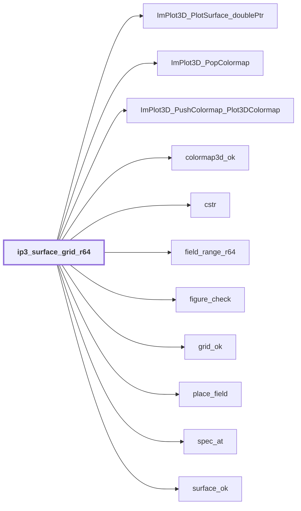

### ip3_mesh_r64

A mesh of triangles, double precision: vertices (x(i), y(i), z(i)) read in place with any stride,
 `triangles(1:3, k)` the vertices of the k-th triangle (from 1; converted to ImPlot3D's 0-based indices: one copy).
 Statuses: `FIG_ERR_ARGUMENT` for series of different sizes, `triangles` without 3 rows or with a vertex outside
 [1, size(x)]; `FIG_ERR_STATE` outside a 3-D plot, from a task.

**Attributes**: recursive

```fortran
subroutine ip3_mesh_r64(label, x, y, z, triangles, spec, stat)
```

**Arguments**

| Name | Type | Intent | Attributes | Description |
|------|------|--------|------------|-------------|
| `label` | character(len=*) | in |  | Legend label. |
| `x` | real(kind=real64) | in | target, asynchronous | Abscissae of the vertices. |
| `y` | real(kind=real64) | in | target, asynchronous | Ordinates of the vertices. |
| `z` | real(kind=real64) | in | target, asynchronous | Heights of the vertices. |
| `triangles` | integer(kind=int32) | in |  | Vertices of each triangle. |
| `spec` | type([plot3d_spec_object](/api/src/lib/figure_implot3d#plot3d-spec-object)) | in | optional | Style (default: ImPlot3D's). |
| `stat` | integer(kind=int32) | out | optional | Status. |

**Call graph**

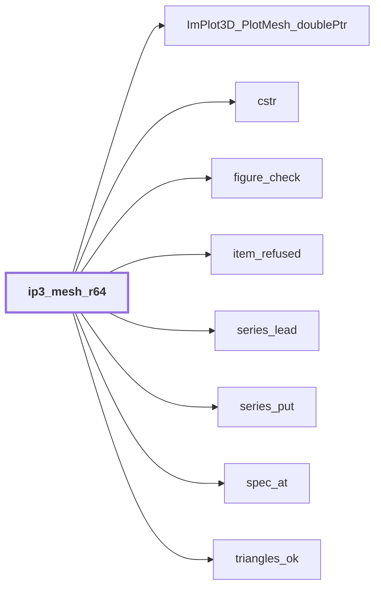

### ip3_text

A text centred on the point (x, y, z) of the current 3-D plot (`PlotText`), in the plot's inlay text colour,
 hidden when the point is outside the box; `angle` turns it [radians, counter-clockwise], `offset` moves it
 [pixels] (x right, y down). Not an item: no legend entry, no part in fitting the axes. Statuses:
 `FIG_ERR_ARGUMENT` for a NaN coordinate or an offset of size /= 2; `FIG_ERR_STATE` outside a 3-D plot, from a
 task.

**Attributes**: recursive

```fortran
subroutine ip3_text(text, x, y, z, angle, offset, stat)
```

**Arguments**

| Name | Type | Intent | Attributes | Description |
|------|------|--------|------------|-------------|
| `text` | character(len=*) | in |  | Text (UTF-8). |
| `x` | real(kind=real64) | in |  | Abscissa [plot units]. |
| `y` | real(kind=real64) | in |  | Ordinate [plot units]. |
| `z` | real(kind=real64) | in |  | Height [plot units]. |
| `angle` | real(kind=real64) | in | optional | Angle [radians] (default: 0, horizontal). |
| `offset` | real(kind=real64) | in | optional | Offset [pixels], (x right, y down) (default: none). |
| `stat` | integer(kind=int32) | out | optional | Status. |

**Call graph**

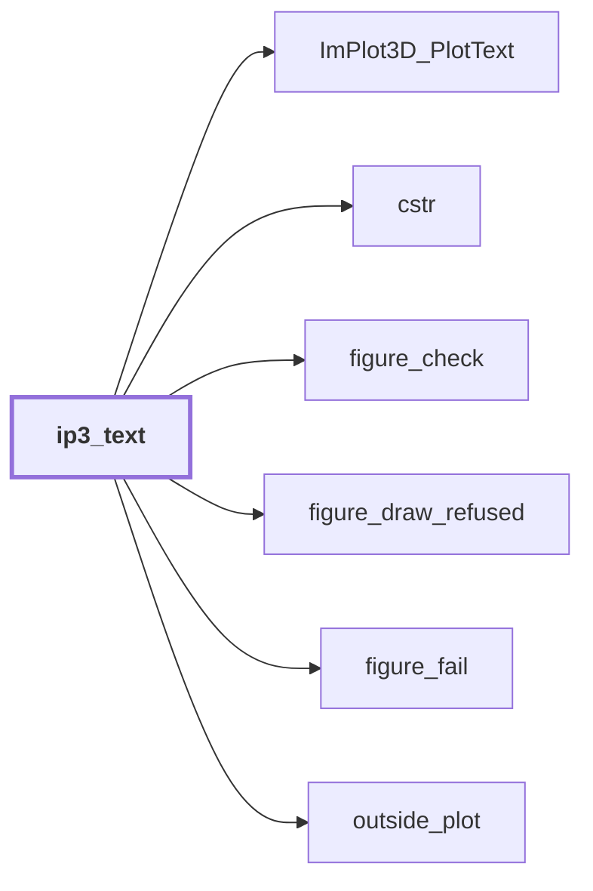

### ip3_image

An image on a quadrilateral of the box (`PlotImage`): `corners(:, k)` the x, y, z of its four corners, in the
 image's top-left, top-right, bottom-right, bottom-left order (a rectangle on a plane: a field on a cut, a
 picture on the floor); `tint` multiplies its colours (RGBA, default white). An item: a legend entry, part of the
 fit. Drawn as two triangles, sorted with the other items. Statuses: `FIG_ERR_ARGUMENT` for `corners` not 3 x 4, a
 tint without 4 components, a texture not initialized; `FIG_ERR_STATE` outside a 3-D plot, from a task.

**Attributes**: recursive

```fortran
subroutine ip3_image(label, texture, corners, tint, stat)
```

**Arguments**

| Name | Type | Intent | Attributes | Description |
|------|------|--------|------------|-------------|
| `label` | character(len=*) | in |  | Legend label. |
| `texture` | type([texture_object](/api/src/lib/figure_texture#texture-object)) | in |  | The image. |
| `corners` | real(kind=real64) | in |  | x, y, z of the four corners (3 x 4). |
| `tint` | real(kind=real64) | in | optional | RGBA multiplier (default 1, 1, 1, 1). |
| `stat` | integer(kind=int32) | out | optional | Status. |

**Call graph**

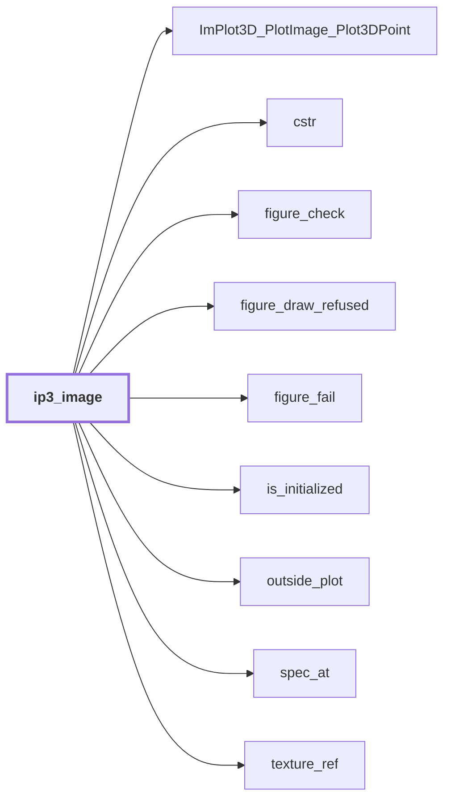

### ip3_setup_axis

Set up one axis of the 3-D plot being declared (`SetupAxis`, `SetupAxisScale`): `axis` `'x'`, `'y'` or `'z'`;
 `scale` `'linear'` (default), `'log'` (base 10: values <= 0 are not shown) or `'symlog'`; `auto_fit` fits the data
 every frame; `invert` grows the axis the other way; `lock` fixes its range against the mouse; `no_grid`: no grid
 lines. After `ip3_begin_plot` (and `ip3_setup_axes`, which it overrides for that axis), before any item.
 Statuses: `FIG_ERR_ARGUMENT` for an unknown axis or scale; `FIG_ERR_STATE` outside a 3-D plot, after its first
 item, from a task.

**Attributes**: recursive

```fortran
subroutine ip3_setup_axis(axis, label, scale, auto_fit, invert, lock, no_grid, stat)
```

**Arguments**

| Name | Type | Intent | Attributes | Description |
|------|------|--------|------------|-------------|
| `axis` | character(len=*) | in |  | 'x', 'y' or 'z'. |
| `label` | character(len=*) | in | optional | Label (default: none). |
| `scale` | character(len=*) | in | optional | 'linear' (default), 'log', 'symlog'. |
| `auto_fit` | logical | in | optional | Fit the data every frame. |
| `invert` | logical | in | optional | Values grow the other way. |
| `lock` | logical | in | optional | No pan or zoom by the user. |
| `no_grid` | logical | in | optional | No grid lines. |
| `stat` | integer(kind=int32) | out | optional | Status. |

**Call graph**

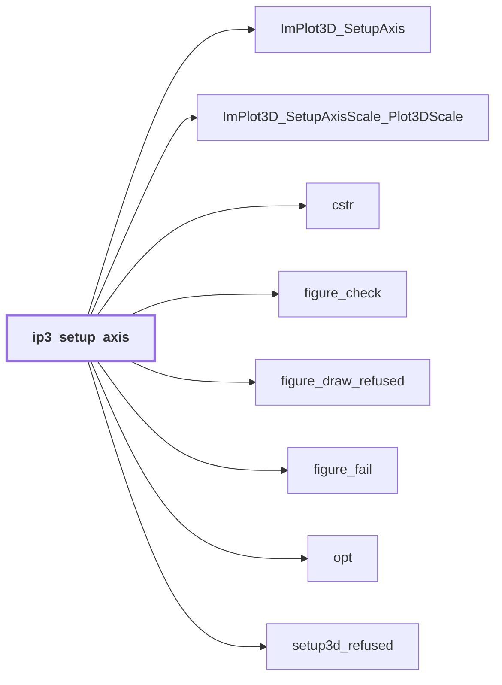

### ip3_setup_box

The box of the 3-D plot being declared: `scale` its x, y, z sides relative to each other (`SetupBoxScale`,
 default 1, 1, 1: a cube); `elevation` and `azimuth` [degrees], both or neither, turn it to that view on this
 frame (`SetupBoxRotation`: a "top view" button calls it once; called every frame, the user cannot turn it),
 `animate=.true.` turning it there smoothly. Before any item. Statuses: `FIG_ERR_ARGUMENT` for a scale without 3
 positive values, one angle without the other; `FIG_ERR_STATE` outside a 3-D plot, after its first item, from a
 task.

**Attributes**: recursive

```fortran
subroutine ip3_setup_box(scale, elevation, azimuth, animate, stat)
```

**Arguments**

| Name | Type | Intent | Attributes | Description |
|------|------|--------|------------|-------------|
| `scale` | real(kind=real64) | in | optional | Relative sides [x, y, z]. |
| `elevation` | real(kind=real64) | in | optional | Elevation [degrees]. |
| `azimuth` | real(kind=real64) | in | optional | Azimuth [degrees]. |
| `animate` | logical | in | optional | Turn there smoothly (default: at once). |
| `stat` | integer(kind=int32) | out | optional | Status. |

**Call graph**

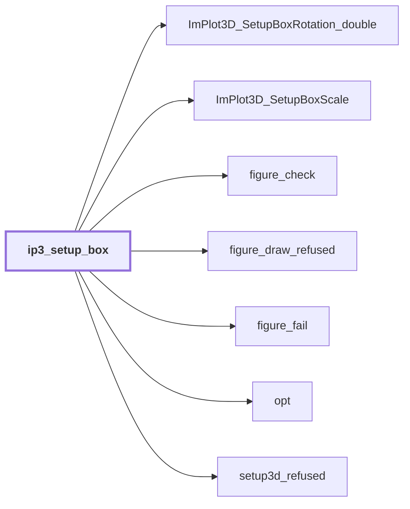

### ip3_setup_legend

Where the 3-D plot's legend goes (`SetupLegend`): `location` a compass point, `'n'`, `'ne'`, `'e'`, `'se'`,
 `'s'`, `'sw'`, `'w'`, `'nw'` (default, ImPlot3D's) or `'c'`; `horizontal=.true.`: entries in a row;
 `no_buttons=.true.`: a click on an entry does not hide its item. Before any item. Statuses: `FIG_ERR_ARGUMENT`
 for an unknown location; `FIG_ERR_STATE` outside a 3-D plot, after its first item, from a task.

**Attributes**: recursive

```fortran
subroutine ip3_setup_legend(location, horizontal, no_buttons, stat)
```

**Arguments**

| Name | Type | Intent | Attributes | Description |
|------|------|--------|------------|-------------|
| `location` | character(len=*) | in | optional | Compass point (default 'nw'). |
| `horizontal` | logical | in | optional | Entries in a row (default: a column). |
| `no_buttons` | logical | in | optional | Entries do not hide their items. |
| `stat` | integer(kind=int32) | out | optional | Status. |

**Call graph**

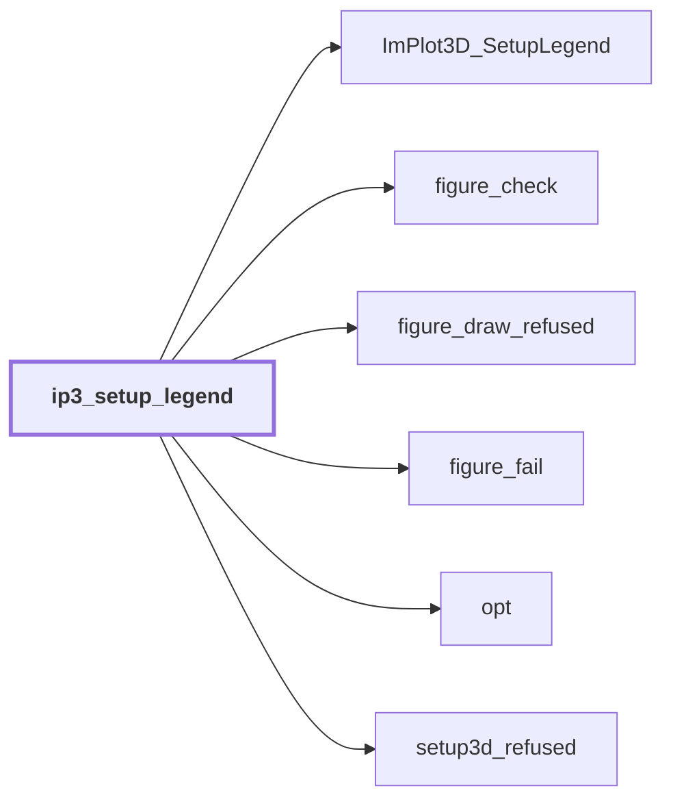

### ip3_plot_to_pixels

The pixel (px, py) where the point (x, y, z) of the 3-D plot being declared is drawn (`PlotToPixels`), as the
 box is turned now: a label beside a point, a test's click. Statuses: `FIG_ERR_STATE` outside a 3-D plot, from a
 task.

**Attributes**: recursive

```fortran
subroutine ip3_plot_to_pixels(x, y, z, px, py, stat)
```

**Arguments**

| Name | Type | Intent | Attributes | Description |
|------|------|--------|------------|-------------|
| `x` | real(kind=real64) | in |  | Abscissa. |
| `y` | real(kind=real64) | in |  | Ordinate. |
| `z` | real(kind=real64) | in |  | Height. |
| `px` | real(kind=real64) | out |  | Pixel abscissa. |
| `py` | real(kind=real64) | out |  | Pixel ordinate. |
| `stat` | integer(kind=int32) | out | optional | Status. |

**Call graph**

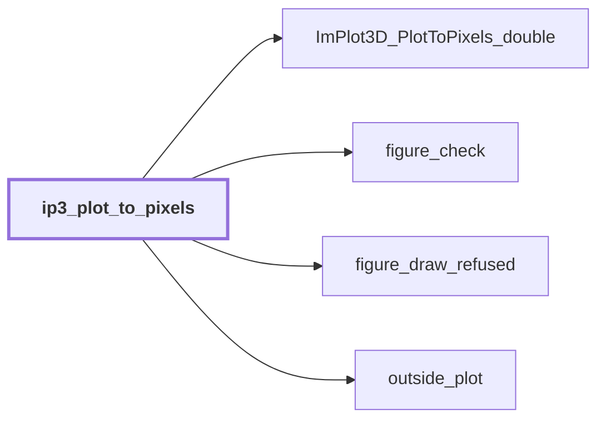

### ip3_triangles_r64

Filled with the spec's `fill_color` (default: the item's colour), edged with its `line_color`. Statuses:
 `FIG_ERR_ARGUMENT` for series of different sizes or a size not a multiple of 3; `FIG_ERR_STATE` outside a 3-D
 plot, from a task.

**Attributes**: recursive

```fortran
subroutine ip3_triangles_r64(label, x, y, z, spec, stat)
```

**Arguments**

| Name | Type | Intent | Attributes | Description |
|------|------|--------|------------|-------------|
| `label` | character(len=*) | in |  | Legend label. |
| `x` | real(kind=real64) | in | target, asynchronous | Abscissae of the vertices. |
| `y` | real(kind=real64) | in | target, asynchronous | Ordinates. |
| `z` | real(kind=real64) | in | target, asynchronous | Heights. |
| `spec` | type([plot3d_spec_object](/api/src/lib/figure_implot3d#plot3d-spec-object)) | in | optional | Style (default: ImPlot3D's). |
| `stat` | integer(kind=int32) | out | optional | Status. |

**Call graph**

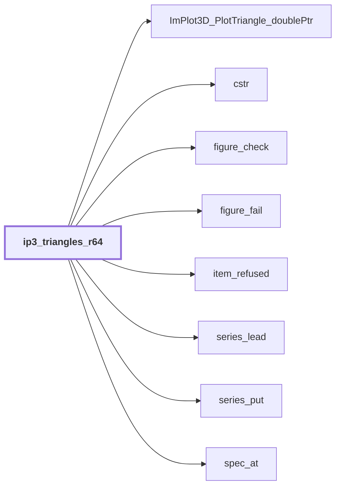

### ip3_quads_r64

Filled with the spec's `fill_color` (default: the item's colour), edged with its `line_color`. Statuses:
 `FIG_ERR_ARGUMENT` for series of different sizes or a size not a multiple of 4; `FIG_ERR_STATE` outside a 3-D
 plot, from a task.

**Attributes**: recursive

```fortran
subroutine ip3_quads_r64(label, x, y, z, spec, stat)
```

**Arguments**

| Name | Type | Intent | Attributes | Description |
|------|------|--------|------------|-------------|
| `label` | character(len=*) | in |  | Legend label. |
| `x` | real(kind=real64) | in | target, asynchronous | Abscissae of the vertices. |
| `y` | real(kind=real64) | in | target, asynchronous | Ordinates. |
| `z` | real(kind=real64) | in | target, asynchronous | Heights. |
| `spec` | type([plot3d_spec_object](/api/src/lib/figure_implot3d#plot3d-spec-object)) | in | optional | Style (default: ImPlot3D's). |
| `stat` | integer(kind=int32) | out | optional | Status. |

**Call graph**

```mermaid
flowchart LR
  ip3_quads_r64["ip3_quads_r64"] --> ImPlot3D_PlotQuad_doublePtr["ImPlot3D_PlotQuad_doublePtr"]
  ip3_quads_r64["ip3_quads_r64"] --> cstr["cstr"]
  ip3_quads_r64["ip3_quads_r64"] --> figure_check["figure_check"]
  ip3_quads_r64["ip3_quads_r64"] --> figure_fail["figure_fail"]
  ip3_quads_r64["ip3_quads_r64"] --> item_refused["item_refused"]
  ip3_quads_r64["ip3_quads_r64"] --> series_lead["series_lead"]
  ip3_quads_r64["ip3_quads_r64"] --> series_put["series_put"]
  ip3_quads_r64["ip3_quads_r64"] --> spec_at["spec_at"]
  classDef focus stroke-width:3px,font-weight:bold
  class ip3_quads_r64 focus
  click item_refused href "#item-refused" "item_refused"
  click figure_fail href "figure_base.html#figure-fail" "figure_fail"
  click series_lead href "figure_implot.html#series-lead" "series_lead"
  click series_put href "figure_implot.html#series-put" "series_put"
  click ImPlot3D_PlotQuad_doublePtr href "figure_cimplot3d.html#implot3d-plotquad-doubleptr" "ImPlot3D_PlotQuad_doublePtr"
  click cstr href "figure_base.html#cstr" "cstr"
  click spec_at href "#spec-at" "spec_at"
  click figure_check href "figure_base.html#figure-check" "figure_check"
```

### ip3_triangles_r32

Filled with the spec's `fill_color` (default: the item's colour), edged with its `line_color`. Statuses:
 `FIG_ERR_ARGUMENT` for series of different sizes or a size not a multiple of 3; `FIG_ERR_STATE` outside a 3-D
 plot, from a task.

**Attributes**: recursive

```fortran
subroutine ip3_triangles_r32(label, x, y, z, spec, stat)
```

**Arguments**

| Name | Type | Intent | Attributes | Description |
|------|------|--------|------------|-------------|
| `label` | character(len=*) | in |  | Legend label. |
| `x` | real(kind=real32) | in | target, asynchronous | Abscissae of the vertices. |
| `y` | real(kind=real32) | in | target, asynchronous | Ordinates. |
| `z` | real(kind=real32) | in | target, asynchronous | Heights. |
| `spec` | type([plot3d_spec_object](/api/src/lib/figure_implot3d#plot3d-spec-object)) | in | optional | Style (default: ImPlot3D's). |
| `stat` | integer(kind=int32) | out | optional | Status. |

**Call graph**

```mermaid
flowchart LR
  ip3_triangles_r32["ip3_triangles_r32"] --> ImPlot3D_PlotTriangle_FloatPtr["ImPlot3D_PlotTriangle_FloatPtr"]
  ip3_triangles_r32["ip3_triangles_r32"] --> cstr["cstr"]
  ip3_triangles_r32["ip3_triangles_r32"] --> figure_check["figure_check"]
  ip3_triangles_r32["ip3_triangles_r32"] --> figure_fail["figure_fail"]
  ip3_triangles_r32["ip3_triangles_r32"] --> item_refused["item_refused"]
  ip3_triangles_r32["ip3_triangles_r32"] --> series_lead["series_lead"]
  ip3_triangles_r32["ip3_triangles_r32"] --> series_put["series_put"]
  ip3_triangles_r32["ip3_triangles_r32"] --> spec_at["spec_at"]
  classDef focus stroke-width:3px,font-weight:bold
  class ip3_triangles_r32 focus
  click item_refused href "#item-refused" "item_refused"
  click figure_fail href "figure_base.html#figure-fail" "figure_fail"
  click series_lead href "figure_implot.html#series-lead" "series_lead"
  click series_put href "figure_implot.html#series-put" "series_put"
  click ImPlot3D_PlotTriangle_FloatPtr href "figure_cimplot3d.html#implot3d-plottriangle-floatptr" "ImPlot3D_PlotTriangle_FloatPtr"
  click cstr href "figure_base.html#cstr" "cstr"
  click spec_at href "#spec-at" "spec_at"
  click figure_check href "figure_base.html#figure-check" "figure_check"
```

### ip3_quads_r32

Filled with the spec's `fill_color` (default: the item's colour), edged with its `line_color`. Statuses:
 `FIG_ERR_ARGUMENT` for series of different sizes or a size not a multiple of 4; `FIG_ERR_STATE` outside a 3-D
 plot, from a task.

**Attributes**: recursive

```fortran
subroutine ip3_quads_r32(label, x, y, z, spec, stat)
```

**Arguments**

| Name | Type | Intent | Attributes | Description |
|------|------|--------|------------|-------------|
| `label` | character(len=*) | in |  | Legend label. |
| `x` | real(kind=real32) | in | target, asynchronous | Abscissae of the vertices. |
| `y` | real(kind=real32) | in | target, asynchronous | Ordinates. |
| `z` | real(kind=real32) | in | target, asynchronous | Heights. |
| `spec` | type([plot3d_spec_object](/api/src/lib/figure_implot3d#plot3d-spec-object)) | in | optional | Style (default: ImPlot3D's). |
| `stat` | integer(kind=int32) | out | optional | Status. |

**Call graph**

```mermaid
flowchart LR
  ip3_quads_r32["ip3_quads_r32"] --> ImPlot3D_PlotQuad_FloatPtr["ImPlot3D_PlotQuad_FloatPtr"]
  ip3_quads_r32["ip3_quads_r32"] --> cstr["cstr"]
  ip3_quads_r32["ip3_quads_r32"] --> figure_check["figure_check"]
  ip3_quads_r32["ip3_quads_r32"] --> figure_fail["figure_fail"]
  ip3_quads_r32["ip3_quads_r32"] --> item_refused["item_refused"]
  ip3_quads_r32["ip3_quads_r32"] --> series_lead["series_lead"]
  ip3_quads_r32["ip3_quads_r32"] --> series_put["series_put"]
  ip3_quads_r32["ip3_quads_r32"] --> spec_at["spec_at"]
  classDef focus stroke-width:3px,font-weight:bold
  class ip3_quads_r32 focus
  click item_refused href "#item-refused" "item_refused"
  click figure_fail href "figure_base.html#figure-fail" "figure_fail"
  click series_lead href "figure_implot.html#series-lead" "series_lead"
  click series_put href "figure_implot.html#series-put" "series_put"
  click ImPlot3D_PlotQuad_FloatPtr href "figure_cimplot3d.html#implot3d-plotquad-floatptr" "ImPlot3D_PlotQuad_FloatPtr"
  click cstr href "figure_base.html#cstr" "cstr"
  click spec_at href "#spec-at" "spec_at"
  click figure_check href "figure_base.html#figure-check" "figure_check"
```

### field_range_r32

The heights at a surface's first and last colours: the given ones, else z's finite range (widened by one about
 its centre when z is flat: ImPlot3D would divide by a zero range, an FPE under traps).

```fortran
subroutine field_range_r32(z, scale_min, scale_max, lo, hi)
```

**Arguments**

| Name | Type | Intent | Attributes | Description |
|------|------|--------|------------|-------------|
| `z` | real(kind=real32) | in | asynchronous | Heights. |
| `scale_min` | real(kind=real64) | in | optional | Given first height. |
| `scale_max` | real(kind=real64) | in | optional | Given last height. |
| `lo` | real(kind=c_double) | out |  | First height. |
| `hi` | real(kind=c_double) | out |  | Last height. |

**Call graph**

```mermaid
flowchart LR
  ip3_surface_grid_r32["ip3_surface_grid_r32"] --> field_range_r32["field_range_r32"]
  ip3_surface_r32["ip3_surface_r32"] --> field_range_r32["field_range_r32"]
  classDef focus stroke-width:3px,font-weight:bold
  class field_range_r32 focus
  click ip3_surface_grid_r32 href "#ip3-surface-grid-r32" "ip3_surface_grid_r32"
  click ip3_surface_r32 href "#ip3-surface-r32" "ip3_surface_r32"
```

### field_range_r64

The heights at a surface's first and last colours: the given ones, else z's finite range (widened by one about
 its centre when z is flat: ImPlot3D would divide by a zero range, an FPE under traps).

```fortran
subroutine field_range_r64(z, scale_min, scale_max, lo, hi)
```

**Arguments**

| Name | Type | Intent | Attributes | Description |
|------|------|--------|------------|-------------|
| `z` | real(kind=real64) | in | asynchronous | Heights. |
| `scale_min` | real(kind=real64) | in | optional | Given first height. |
| `scale_max` | real(kind=real64) | in | optional | Given last height. |
| `lo` | real(kind=c_double) | out |  | First height. |
| `hi` | real(kind=c_double) | out |  | Last height. |

**Call graph**

```mermaid
flowchart LR
  ip3_surface_grid_r64["ip3_surface_grid_r64"] --> field_range_r64["field_range_r64"]
  ip3_surface_r64["ip3_surface_r64"] --> field_range_r64["field_range_r64"]
  classDef focus stroke-width:3px,font-weight:bold
  class field_range_r64 focus
  click ip3_surface_grid_r64 href "#ip3-surface-grid-r64" "ip3_surface_grid_r64"
  click ip3_surface_r64 href "#ip3-surface-r64" "ip3_surface_r64"
```

### place_field_r32

Place a rank-2 array of a surface in slot `k`, single precision: in place when its elements are equally spaced
 in memory (column after column) at a positive multiple of the element size within a C int and, when `stride` is
 given (the item's, set by the field), at that stride; otherwise copied into the slot's scratch, at `stride` or
 contiguous (then the item's stride becomes the element size).

```fortran
subroutine place_field_r32(d, k, a, stride)
```

**Arguments**

| Name | Type | Intent | Attributes | Description |
|------|------|--------|------------|-------------|
| `d` | type([series_r32](/api/src/lib/figure_implot#series-r32)) | inout |  | The item's arrays. |
| `k` | integer(kind=int32) | in |  | Slot. |
| `a` | real(kind=real32) | in | target, asynchronous | Array. |
| `stride` | integer(kind=int64) | in | optional | The item's stride [bytes]. |

**Call graph**

```mermaid
flowchart LR
  place_field_r32["place_field_r32"] --> series_gap["series_gap"]
  place_field_r32["place_field_r32"] --> series_scratch["series_scratch"]
  classDef focus stroke-width:3px,font-weight:bold
  class place_field_r32 focus
  click series_gap href "figure_implot.html#series-gap" "series_gap"
  click series_scratch href "figure_implot.html#series-scratch" "series_scratch"
```

### place_field_r64

Place a rank-2 array of a surface in slot `k`, double precision: in place when its elements are equally spaced
 in memory (column after column) at a positive multiple of the element size within a C int and, when `stride` is
 given (the item's, set by the field), at that stride; otherwise copied into the slot's scratch, at `stride` or
 contiguous (then the item's stride becomes the element size).

```fortran
subroutine place_field_r64(d, k, a, stride)
```

**Arguments**

| Name | Type | Intent | Attributes | Description |
|------|------|--------|------------|-------------|
| `d` | type([series_r64](/api/src/lib/figure_implot#series-r64)) | inout |  | The item's arrays. |
| `k` | integer(kind=int32) | in |  | Slot. |
| `a` | real(kind=real64) | in | target, asynchronous | Array. |
| `stride` | integer(kind=int64) | in | optional | The item's stride [bytes]. |

**Call graph**

```mermaid
flowchart LR
  place_field_r64["place_field_r64"] --> series_gap["series_gap"]
  place_field_r64["place_field_r64"] --> series_scratch["series_scratch"]
  classDef focus stroke-width:3px,font-weight:bold
  class place_field_r64 focus
  click series_gap href "figure_implot.html#series-gap" "series_gap"
  click series_scratch href "figure_implot.html#series-scratch" "series_scratch"
```

## Functions

### ip3_begin_plot

Begin a 3-D plot; if true, declare its content and call `ip3_end_plot`.

**Attributes**: recursive

**Returns**: `logical`

```fortran
function ip3_begin_plot(title, width, height, equal) result(visible)
```

**Arguments**

| Name | Type | Intent | Attributes | Description |
|------|------|--------|------------|-------------|
| `title` | character(len=*) | in |  | Title (also the plot id; '##id' hides it). |
| `width` | real(kind=real64) | in | optional | Width [pixels] (default: full width). |
| `height` | real(kind=real64) | in | optional | Height [pixels] (default: ImPlot3D's). |
| `equal` | logical | in | optional | Same scale on the three axes (one unit as many pixels). |

**Call graph**

```mermaid
flowchart LR
  ip3_begin_plot["ip3_begin_plot"] --> ImPlot3D_BeginPlot["ImPlot3D_BeginPlot"]
  ip3_begin_plot["ip3_begin_plot"] --> cstr["cstr"]
  ip3_begin_plot["ip3_begin_plot"] --> figure_draw_refused["figure_draw_refused"]
  ip3_begin_plot["ip3_begin_plot"] --> figure_scope_open["figure_scope_open"]
  classDef focus stroke-width:3px,font-weight:bold
  class ip3_begin_plot focus
  click figure_draw_refused href "figure_base.html#figure-draw-refused" "figure_draw_refused"
  click ImPlot3D_BeginPlot href "figure_cimplot3d.html#implot3d-beginplot" "ImPlot3D_BeginPlot"
  click cstr href "figure_base.html#cstr" "cstr"
  click figure_scope_open href "figure_base.html#figure-scope-open" "figure_scope_open"
```

### ip3_spec

3-D item style: ImPlot3D's defaults, with the given properties overridden. Colours are RGBA in [0, 1]; an absent
 colour stays automatic (the next colour of the colormap; a surface's fill: its colormap).

**Returns**: type([plot3d_spec_object](/api/src/lib/figure_implot3d#plot3d-spec-object))

```fortran
function ip3_spec(line_color, line_weight, fill_color, fill_alpha, marker, marker_size, marker_line_color, marker_fill_color, flags, stat) result(spec)
```

**Arguments**

| Name | Type | Intent | Attributes | Description |
|------|------|--------|------------|-------------|
| `line_color` | real(kind=real64) | in | optional | Line colour, RGBA. |
| `line_weight` | real(kind=real64) | in | optional | Line weight [pixels] (lines, edges, markers). |
| `fill_color` | real(kind=real64) | in | optional | Fill colour, RGBA (surfaces, meshes: one colour). |
| `fill_alpha` | real(kind=real64) | in | optional | Alpha multiplier of the fill colours. |
| `marker` | integer(kind=int32) | in | optional | Marker shape (`ImPlot3DMarker_*`). |
| `marker_size` | real(kind=real64) | in | optional | Marker radius [pixels]. |
| `marker_line_color` | real(kind=real64) | in | optional | Marker outline colour, RGBA. |
| `marker_fill_color` | real(kind=real64) | in | optional | Marker fill colour, RGBA. |
| `flags` | integer(kind=int32) | in | optional | Item flags (`ImPlot3DItemFlags_*`, the item's own). |
| `stat` | integer(kind=int32) | out | optional | Status: `FIG_ERR_ARGUMENT` for a colour of size /= 4. |

**Call graph**

```mermaid
flowchart LR
  ip3_spec["ip3_spec"] --> figure_ImPlot3DSpec_default["figure_ImPlot3DSpec_default"]
  ip3_spec["ip3_spec"] --> figure_check["figure_check"]
  ip3_spec["ip3_spec"] --> figure_fail["figure_fail"]
  ip3_spec["ip3_spec"] --> rgba["rgba"]
  ip3_spec["ip3_spec"] --> rgba_ok["rgba_ok"]
  classDef focus stroke-width:3px,font-weight:bold
  class ip3_spec focus
  click figure_ImPlot3DSpec_default href "figure_cimplot3d.html#figure-implot3dspec-default" "figure_ImPlot3DSpec_default"
  click rgba_ok href "#rgba-ok" "rgba_ok"
  click figure_fail href "figure_base.html#figure-fail" "figure_fail"
  click rgba href "#rgba" "rgba"
  click figure_check href "figure_base.html#figure-check" "figure_check"
```

### ip3_mouse_ray

The ray under the pointer, in the 3-D plot's coordinates (`PixelsToPlotRay`): every point of the box drawn under
 the pointer is `origin + t direction` for some `t` (`direction` of length 1). True when the pointer is over the
 plot. A program picks with it: where the ray meets a plane (the floor: `t = -origin(3) / direction(3)`), the
 nearest of its points. Linear axes: on a log axis the ray is in the transformed space. Statuses:
 `FIG_ERR_STATE` outside a 3-D plot, from a task.

**Attributes**: recursive

**Returns**: `logical`

```fortran
function ip3_mouse_ray(origin, direction, stat) result(over)
```

**Arguments**

| Name | Type | Intent | Attributes | Description |
|------|------|--------|------------|-------------|
| `origin` | real(kind=real64) | out |  | A point of the ray. |
| `direction` | real(kind=real64) | out |  | Its direction (unit). |
| `stat` | integer(kind=int32) | out | optional | Status. |

**Call graph**

```mermaid
flowchart LR
  ip3_mouse_ray["ip3_mouse_ray"] --> fig_plot3d_mouse_ray["fig_plot3d_mouse_ray"]
  ip3_mouse_ray["ip3_mouse_ray"] --> figure_check["figure_check"]
  ip3_mouse_ray["ip3_mouse_ray"] --> figure_draw_refused["figure_draw_refused"]
  ip3_mouse_ray["ip3_mouse_ray"] --> outside_plot["outside_plot"]
  classDef focus stroke-width:3px,font-weight:bold
  class ip3_mouse_ray focus
  click figure_draw_refused href "figure_base.html#figure-draw-refused" "figure_draw_refused"
  click outside_plot href "#outside-plot" "outside_plot"
  click fig_plot3d_mouse_ray href "figure_c_native.html#fig-plot3d-mouse-ray" "fig_plot3d_mouse_ray"
  click figure_check href "figure_base.html#figure-check" "figure_check"
```

### setup3d_refused

True (a usage error reported) outside a 3-D plot or after its first item.

**Attributes**: recursive

**Returns**: `logical`

```fortran
function setup3d_refused(caller, stat) result(refused)
```

**Arguments**

| Name | Type | Intent | Attributes | Description |
|------|------|--------|------------|-------------|
| `caller` | character(len=*) | in |  | The procedure. |
| `stat` | integer(kind=int32) | out | optional | Status, on a refusal. |

**Call graph**

```mermaid
flowchart LR
  ip3_setup_axis["ip3_setup_axis"] --> setup3d_refused["setup3d_refused"]
  ip3_setup_box["ip3_setup_box"] --> setup3d_refused["setup3d_refused"]
  ip3_setup_legend["ip3_setup_legend"] --> setup3d_refused["setup3d_refused"]
  setup3d_refused["setup3d_refused"] --> fig_plot3d_state["fig_plot3d_state"]
  setup3d_refused["setup3d_refused"] --> figure_usage_error["figure_usage_error"]
  classDef focus stroke-width:3px,font-weight:bold
  class setup3d_refused focus
  click ip3_setup_axis href "#ip3-setup-axis" "ip3_setup_axis"
  click ip3_setup_box href "#ip3-setup-box" "ip3_setup_box"
  click ip3_setup_legend href "#ip3-setup-legend" "ip3_setup_legend"
  click fig_plot3d_state href "figure_c_native.html#fig-plot3d-state" "fig_plot3d_state"
  click figure_usage_error href "figure_base.html#figure-usage-error" "figure_usage_error"
```

### opt

An optional flag, false when absent.

**Attributes**: pure

**Returns**: `logical`

```fortran
function opt(x) result(on)
```

**Arguments**

| Name | Type | Intent | Attributes | Description |
|------|------|--------|------------|-------------|
| `x` | logical | in | optional | Flag. |

**Call graph**

```mermaid
flowchart LR
  ig_begin_multi_select["ig_begin_multi_select"] --> opt["opt"]
  ip3_setup_axis["ip3_setup_axis"] --> opt["opt"]
  ip3_setup_box["ip3_setup_box"] --> opt["opt"]
  ip3_setup_legend["ip3_setup_legend"] --> opt["opt"]
  open_prefs["open_prefs"] --> opt["opt"]
  set_style["set_style"] --> opt["opt"]
  view_menu["view_menu"] --> opt["opt"]
  classDef focus stroke-width:3px,font-weight:bold
  class opt focus
  click ig_begin_multi_select href "figure_group.html#ig-begin-multi-select" "ig_begin_multi_select"
  click ip3_setup_axis href "#ip3-setup-axis" "ip3_setup_axis"
  click ip3_setup_box href "#ip3-setup-box" "ip3_setup_box"
  click ip3_setup_legend href "#ip3-setup-legend" "ip3_setup_legend"
  click open_prefs href "figure_app.html#open-prefs" "open_prefs"
  click set_style href "figure_app.html#set-style" "set_style"
  click view_menu href "figure_app.html#view-menu" "view_menu"
```

### outside_plot

True (a usage error reported) when no 3-D plot is being declared: ImPlot3D asserts there.

**Attributes**: recursive

**Returns**: `logical`

```fortran
function outside_plot(caller, stat) result(refused)
```

**Arguments**

| Name | Type | Intent | Attributes | Description |
|------|------|--------|------------|-------------|
| `caller` | character(len=*) | in |  | The procedure. |
| `stat` | integer(kind=int32) | out | optional | Status, on a refusal. |

**Call graph**

```mermaid
flowchart LR
  ip3_image["ip3_image"] --> outside_plot["outside_plot"]
  ip3_mouse_ray["ip3_mouse_ray"] --> outside_plot["outside_plot"]
  ip3_plot_to_pixels["ip3_plot_to_pixels"] --> outside_plot["outside_plot"]
  ip3_text["ip3_text"] --> outside_plot["outside_plot"]
  item_refused["item_refused"] --> outside_plot["outside_plot"]
  surface_ok["surface_ok"] --> outside_plot["outside_plot"]
  outside_plot["outside_plot"] --> fig_plot3d_state["fig_plot3d_state"]
  outside_plot["outside_plot"] --> figure_usage_error["figure_usage_error"]
  classDef focus stroke-width:3px,font-weight:bold
  class outside_plot focus
  click ip3_image href "#ip3-image" "ip3_image"
  click ip3_mouse_ray href "#ip3-mouse-ray" "ip3_mouse_ray"
  click ip3_plot_to_pixels href "#ip3-plot-to-pixels" "ip3_plot_to_pixels"
  click ip3_text href "#ip3-text" "ip3_text"
  click item_refused href "#item-refused" "item_refused"
  click surface_ok href "#surface-ok" "surface_ok"
  click fig_plot3d_state href "figure_c_native.html#fig-plot3d-state" "fig_plot3d_state"
  click figure_usage_error href "figure_base.html#figure-usage-error" "figure_usage_error"
```

### item_refused

True (reported) when an item cannot be drawn: from a task, no frame, no 3-D plot (`FIG_ERR_STATE`), series of
 different sizes or more points than a C int counts (`FIG_ERR_ARGUMENT`).

**Attributes**: recursive

**Returns**: `logical`

```fortran
function item_refused(caller, nx, ny, nz, stat) result(refused)
```

**Arguments**

| Name | Type | Intent | Attributes | Description |
|------|------|--------|------------|-------------|
| `caller` | character(len=*) | in |  | The procedure. |
| `nx` | integer(kind=int64) | in |  | Size of x. |
| `ny` | integer(kind=int64) | in |  | Size of y. |
| `nz` | integer(kind=int64) | in |  | Size of z. |
| `stat` | integer(kind=int32) | out | optional | Status, on a refusal. |

**Call graph**

```mermaid
flowchart LR
  ip3_line_r32["ip3_line_r32"] --> item_refused["item_refused"]
  ip3_line_r64["ip3_line_r64"] --> item_refused["item_refused"]
  ip3_mesh_r32["ip3_mesh_r32"] --> item_refused["item_refused"]
  ip3_mesh_r64["ip3_mesh_r64"] --> item_refused["item_refused"]
  ip3_quads_r32["ip3_quads_r32"] --> item_refused["item_refused"]
  ip3_quads_r64["ip3_quads_r64"] --> item_refused["item_refused"]
  ip3_scatter_r32["ip3_scatter_r32"] --> item_refused["item_refused"]
  ip3_scatter_r64["ip3_scatter_r64"] --> item_refused["item_refused"]
  ip3_triangles_r32["ip3_triangles_r32"] --> item_refused["item_refused"]
  ip3_triangles_r64["ip3_triangles_r64"] --> item_refused["item_refused"]
  item_refused["item_refused"] --> figure_draw_refused["figure_draw_refused"]
  item_refused["item_refused"] --> figure_fail["figure_fail"]
  item_refused["item_refused"] --> outside_plot["outside_plot"]
  classDef focus stroke-width:3px,font-weight:bold
  class item_refused focus
  click ip3_line_r32 href "#ip3-line-r32" "ip3_line_r32"
  click ip3_line_r64 href "#ip3-line-r64" "ip3_line_r64"
  click ip3_mesh_r32 href "#ip3-mesh-r32" "ip3_mesh_r32"
  click ip3_mesh_r64 href "#ip3-mesh-r64" "ip3_mesh_r64"
  click ip3_quads_r32 href "#ip3-quads-r32" "ip3_quads_r32"
  click ip3_quads_r64 href "#ip3-quads-r64" "ip3_quads_r64"
  click ip3_scatter_r32 href "#ip3-scatter-r32" "ip3_scatter_r32"
  click ip3_scatter_r64 href "#ip3-scatter-r64" "ip3_scatter_r64"
  click ip3_triangles_r32 href "#ip3-triangles-r32" "ip3_triangles_r32"
  click ip3_triangles_r64 href "#ip3-triangles-r64" "ip3_triangles_r64"
  click figure_draw_refused href "figure_base.html#figure-draw-refused" "figure_draw_refused"
  click figure_fail href "figure_base.html#figure-fail" "figure_fail"
  click outside_plot href "#outside-plot" "outside_plot"
```

### surface_ok

Whether a surface can be drawn (reported otherwise): from the main thread in a frame and a 3-D plot, x and y
 matching z's shape, the scale ends both given or neither and in order, a vertex count a C int holds.

**Attributes**: recursive

**Returns**: `logical`

```fortran
function surface_ok(nx, ny, sx, sy, scale_min, scale_max, stat) result(ok)
```

**Arguments**

| Name | Type | Intent | Attributes | Description |
|------|------|--------|------------|-------------|
| `nx` | integer(kind=int64) | in |  | size(z, 1). |
| `ny` | integer(kind=int64) | in |  | size(z, 2). |
| `sx` | integer(kind=int64) | in |  | Abscissae given (size(z, 1) expected). |
| `sy` | integer(kind=int64) | in |  | Ordinates given (size(z, 2) expected). |
| `scale_min` | real(kind=real64) | in | optional | Height at the first colour. |
| `scale_max` | real(kind=real64) | in | optional | Height at the last colour. |
| `stat` | integer(kind=int32) | out | optional | Status, on a refusal. |

**Call graph**

```mermaid
flowchart LR
  ip3_surface_grid_r32["ip3_surface_grid_r32"] --> surface_ok["surface_ok"]
  ip3_surface_grid_r64["ip3_surface_grid_r64"] --> surface_ok["surface_ok"]
  ip3_surface_r32["ip3_surface_r32"] --> surface_ok["surface_ok"]
  ip3_surface_r64["ip3_surface_r64"] --> surface_ok["surface_ok"]
  surface_ok["surface_ok"] --> figure_draw_refused["figure_draw_refused"]
  surface_ok["surface_ok"] --> figure_fail["figure_fail"]
  surface_ok["surface_ok"] --> outside_plot["outside_plot"]
  classDef focus stroke-width:3px,font-weight:bold
  class surface_ok focus
  click ip3_surface_grid_r32 href "#ip3-surface-grid-r32" "ip3_surface_grid_r32"
  click ip3_surface_grid_r64 href "#ip3-surface-grid-r64" "ip3_surface_grid_r64"
  click ip3_surface_r32 href "#ip3-surface-r32" "ip3_surface_r32"
  click ip3_surface_r64 href "#ip3-surface-r64" "ip3_surface_r64"
  click figure_draw_refused href "figure_base.html#figure-draw-refused" "figure_draw_refused"
  click figure_fail href "figure_base.html#figure-fail" "figure_fail"
  click outside_plot href "#outside-plot" "outside_plot"
```

### grid_ok

Whether the vertex arrays of a surface over a grid all have z's shape (`FIG_ERR_ARGUMENT` otherwise).

**Attributes**: recursive

**Returns**: `logical`

```fortran
function grid_ok(sx, sy, sz, stat) result(ok)
```

**Arguments**

| Name | Type | Intent | Attributes | Description |
|------|------|--------|------------|-------------|
| `sx` | integer(kind=int64) | in |  | Shape of x. |
| `sy` | integer(kind=int64) | in |  | Shape of y. |
| `sz` | integer(kind=int64) | in |  | Shape of z. |
| `stat` | integer(kind=int32) | out | optional | Status, on a refusal. |

**Call graph**

```mermaid
flowchart LR
  ip3_surface_grid_r32["ip3_surface_grid_r32"] --> grid_ok["grid_ok"]
  ip3_surface_grid_r64["ip3_surface_grid_r64"] --> grid_ok["grid_ok"]
  grid_ok["grid_ok"] --> figure_fail["figure_fail"]
  classDef focus stroke-width:3px,font-weight:bold
  class grid_ok focus
  click ip3_surface_grid_r32 href "#ip3-surface-grid-r32" "ip3_surface_grid_r32"
  click ip3_surface_grid_r64 href "#ip3-surface-grid-r64" "ip3_surface_grid_r64"
  click figure_fail href "figure_base.html#figure-fail" "figure_fail"
```

### colormap3d_ok

The ImPlot3D id of the colormap to draw with (default Viridis), copied from FIGURE's registry; false, with
 `FIG_ERR_ARGUMENT`, if it is not registered.

**Attributes**: recursive

**Returns**: `logical`

```fortran
function colormap3d_ok(colormap, cmap, stat) result(ok)
```

**Arguments**

| Name | Type | Intent | Attributes | Description |
|------|------|--------|------------|-------------|
| `colormap` | integer(kind=int32) | in | optional | Colormap (`ip_colormap`), if given. |
| `cmap` | integer(kind=c_int) | out |  | ImPlot3D id. |
| `stat` | integer(kind=int32) | out | optional | Status, on a failure. |

**Call graph**

```mermaid
flowchart LR
  ip3_surface_grid_r32["ip3_surface_grid_r32"] --> colormap3d_ok["colormap3d_ok"]
  ip3_surface_grid_r64["ip3_surface_grid_r64"] --> colormap3d_ok["colormap3d_ok"]
  ip3_surface_r32["ip3_surface_r32"] --> colormap3d_ok["colormap3d_ok"]
  ip3_surface_r64["ip3_surface_r64"] --> colormap3d_ok["colormap3d_ok"]
  colormap3d_ok["colormap3d_ok"] --> fig_plot3d_colormap["fig_plot3d_colormap"]
  colormap3d_ok["colormap3d_ok"] --> figure_check["figure_check"]
  classDef focus stroke-width:3px,font-weight:bold
  class colormap3d_ok focus
  click ip3_surface_grid_r32 href "#ip3-surface-grid-r32" "ip3_surface_grid_r32"
  click ip3_surface_grid_r64 href "#ip3-surface-grid-r64" "ip3_surface_grid_r64"
  click ip3_surface_r32 href "#ip3-surface-r32" "ip3_surface_r32"
  click ip3_surface_r64 href "#ip3-surface-r64" "ip3_surface_r64"
  click fig_plot3d_colormap href "figure_c_native.html#fig-plot3d-colormap" "fig_plot3d_colormap"
  click figure_check href "figure_base.html#figure-check" "figure_check"
```

### triangles_ok

Whether a mesh's triangles are 3 rows of vertices in [1, nv] and a count a C int holds (`FIG_ERR_ARGUMENT`
 otherwise); if so, their 0-based indices are in `mesh_index`.

**Attributes**: recursive

**Returns**: `logical`

```fortran
function triangles_ok(triangles, nv, stat) result(ok)
```

**Arguments**

| Name | Type | Intent | Attributes | Description |
|------|------|--------|------------|-------------|
| `triangles` | integer(kind=int32) | in |  | Vertices of each triangle. |
| `nv` | integer(kind=int64) | in |  | Vertices. |
| `stat` | integer(kind=int32) | out | optional | Status, on a refusal. |

**Call graph**

```mermaid
flowchart LR
  ip3_mesh_r32["ip3_mesh_r32"] --> triangles_ok["triangles_ok"]
  ip3_mesh_r64["ip3_mesh_r64"] --> triangles_ok["triangles_ok"]
  triangles_ok["triangles_ok"] --> figure_fail["figure_fail"]
  classDef focus stroke-width:3px,font-weight:bold
  class triangles_ok focus
  click ip3_mesh_r32 href "#ip3-mesh-r32" "ip3_mesh_r32"
  click ip3_mesh_r64 href "#ip3-mesh-r64" "ip3_mesh_r64"
  click figure_fail href "figure_base.html#figure-fail" "figure_fail"
```

### spec_at

The C spec to pass: the given one, or ImPlot3D's defaults, with the item's stride (`test_plot_stride` reads it).

**Returns**: type([im_plot3d_spec](/api/src/lib/figure_cimplot3d#im-plot3d-spec))

```fortran
function spec_at(stride, spec) result(c)
```

**Arguments**

| Name | Type | Intent | Attributes | Description |
|------|------|--------|------------|-------------|
| `stride` | integer(kind=int64) | in |  | The item's stride [bytes]. |
| `spec` | type([plot3d_spec_object](/api/src/lib/figure_implot3d#plot3d-spec-object)) | in | optional | Style. |

**Call graph**

```mermaid
flowchart LR
  ip3_image["ip3_image"] --> spec_at["spec_at"]
  ip3_line_r32["ip3_line_r32"] --> spec_at["spec_at"]
  ip3_line_r64["ip3_line_r64"] --> spec_at["spec_at"]
  ip3_mesh_r32["ip3_mesh_r32"] --> spec_at["spec_at"]
  ip3_mesh_r64["ip3_mesh_r64"] --> spec_at["spec_at"]
  ip3_quads_r32["ip3_quads_r32"] --> spec_at["spec_at"]
  ip3_quads_r64["ip3_quads_r64"] --> spec_at["spec_at"]
  ip3_scatter_r32["ip3_scatter_r32"] --> spec_at["spec_at"]
  ip3_scatter_r64["ip3_scatter_r64"] --> spec_at["spec_at"]
  ip3_surface_grid_r32["ip3_surface_grid_r32"] --> spec_at["spec_at"]
  ip3_surface_grid_r64["ip3_surface_grid_r64"] --> spec_at["spec_at"]
  ip3_surface_r32["ip3_surface_r32"] --> spec_at["spec_at"]
  ip3_surface_r64["ip3_surface_r64"] --> spec_at["spec_at"]
  ip3_triangles_r32["ip3_triangles_r32"] --> spec_at["spec_at"]
  ip3_triangles_r64["ip3_triangles_r64"] --> spec_at["spec_at"]
  spec_at["spec_at"] --> figure_ImPlot3DSpec_default["figure_ImPlot3DSpec_default"]
  classDef focus stroke-width:3px,font-weight:bold
  class spec_at focus
  click ip3_image href "#ip3-image" "ip3_image"
  click ip3_line_r32 href "#ip3-line-r32" "ip3_line_r32"
  click ip3_line_r64 href "#ip3-line-r64" "ip3_line_r64"
  click ip3_mesh_r32 href "#ip3-mesh-r32" "ip3_mesh_r32"
  click ip3_mesh_r64 href "#ip3-mesh-r64" "ip3_mesh_r64"
  click ip3_quads_r32 href "#ip3-quads-r32" "ip3_quads_r32"
  click ip3_quads_r64 href "#ip3-quads-r64" "ip3_quads_r64"
  click ip3_scatter_r32 href "#ip3-scatter-r32" "ip3_scatter_r32"
  click ip3_scatter_r64 href "#ip3-scatter-r64" "ip3_scatter_r64"
  click ip3_surface_grid_r32 href "#ip3-surface-grid-r32" "ip3_surface_grid_r32"
  click ip3_surface_grid_r64 href "#ip3-surface-grid-r64" "ip3_surface_grid_r64"
  click ip3_surface_r32 href "#ip3-surface-r32" "ip3_surface_r32"
  click ip3_surface_r64 href "#ip3-surface-r64" "ip3_surface_r64"
  click ip3_triangles_r32 href "#ip3-triangles-r32" "ip3_triangles_r32"
  click ip3_triangles_r64 href "#ip3-triangles-r64" "ip3_triangles_r64"
  click figure_ImPlot3DSpec_default href "figure_cimplot3d.html#figure-implot3dspec-default" "figure_ImPlot3DSpec_default"
```

### rgba_ok

Whether an optional colour is absent or has 4 components.

**Attributes**: pure

**Returns**: `logical`

```fortran
function rgba_ok(color) result(ok)
```

**Arguments**

| Name | Type | Intent | Attributes | Description |
|------|------|--------|------------|-------------|
| `color` | real(kind=real64) | in | optional | Colour, RGBA. |

**Call graph**

```mermaid
flowchart LR
  contour_ok["contour_ok"] --> rgba_ok["rgba_ok"]
  drag_ok["drag_ok"] --> rgba_ok["rgba_ok"]
  ip3_spec["ip3_spec"] --> rgba_ok["rgba_ok"]
  ip_annotation["ip_annotation"] --> rgba_ok["rgba_ok"]
  ip_spec["ip_spec"] --> rgba_ok["rgba_ok"]
  ip_tag["ip_tag"] --> rgba_ok["rgba_ok"]
  classDef focus stroke-width:3px,font-weight:bold
  class rgba_ok focus
  click contour_ok href "figure_implot.html#contour-ok" "contour_ok"
  click drag_ok href "figure_implot.html#drag-ok" "drag_ok"
  click ip3_spec href "#ip3-spec" "ip3_spec"
  click ip_annotation href "figure_implot.html#ip-annotation" "ip_annotation"
  click ip_spec href "figure_implot.html#ip-spec" "ip_spec"
  click ip_tag href "figure_implot.html#ip-tag" "ip_tag"
```

### rgba

RGBA colour as an `ImVec4`.

**Attributes**: pure

**Returns**: type([im_vec4](/api/src/lib/figure_cimgui#im-vec4))

```fortran
function rgba(color) result(v)
```

**Arguments**

| Name | Type | Intent | Attributes | Description |
|------|------|--------|------------|-------------|
| `color` | real(kind=real64) | in |  | Colour, RGBA, 4 components. |

**Call graph**

```mermaid
flowchart LR
  contour_draw["contour_draw"] --> rgba["rgba"]
  drag_color["drag_color"] --> rgba["rgba"]
  ip3_spec["ip3_spec"] --> rgba["rgba"]
  ip_spec["ip_spec"] --> rgba["rgba"]
  classDef focus stroke-width:3px,font-weight:bold
  class rgba focus
  click contour_draw href "figure_implot.html#contour-draw" "contour_draw"
  click drag_color href "figure_implot.html#drag-color" "drag_color"
  click ip3_spec href "#ip3-spec" "ip3_spec"
  click ip_spec href "figure_implot.html#ip-spec" "ip_spec"
```
