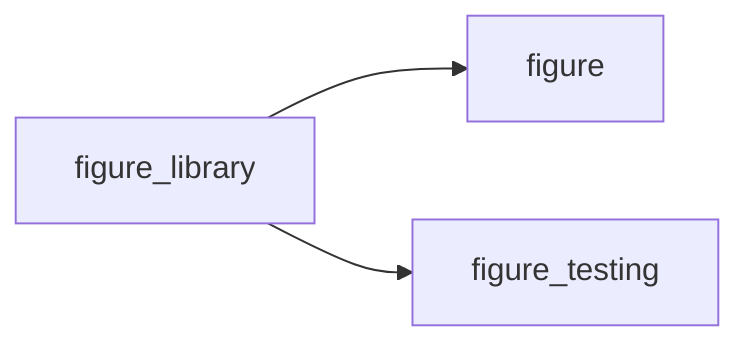

# figure_library

> FoBiS builds a library from one target and the modules it uses. `figure` alone leaves out `figure_testing`, which
 no part of the interface uses but every downstream test needs: this module uses both, so the archive and lib/mod
 hold both. It exports nothing; programs `use figure` (and `use figure_testing` in their tests).

**Source**: `src/lib/figure_library.F90`

**Dependencies**

