# figure_markdown

> figure_markdown, Markdown in the window: a text at the cursor (ig_markdown) and documents (markdown_view_object).

 The renderer is imgui_rich_md (pthom, MIT, vendored in third_party/imgui_rich_md with md4c, its parser) with FIGURE's
 glue (native/figure_markdown.cpp): it draws through Dear ImGui only, so window, headless and remote modes show the
 same pixels. Text in IBM Plex Sans (regular, bold, italic, bold italic: headings are larger), code spans and blocks
 in IBM Plex Mono, with the Lucide icons and the fallback fonts as everywhere else; tables, lists, quotes, task lists,
 GitHub's admonitions (`> [!NOTE]`), collapsible sections (`<details>`), images from PNG and JPEG files. No LaTeX, no
 image from a URL. Links are reported, never opened: the call that draws a text returns true on the frame one of its
 links is clicked, and gives its URL (polled, no callback); a link to a heading of the same text scrolls to it.

```fortran
 type(markdown_view_object)    :: help
 character(len=:), allocatable :: url
 call help%init()
 call help%load('help/solver.md')
 ... every frame, inside a window:
 if (help%draw('help', url)) call follow(url)   ! the program decides: another page, a section, a browser
```

**Source**: `src/lib/figure_markdown.F90`

**Dependencies**

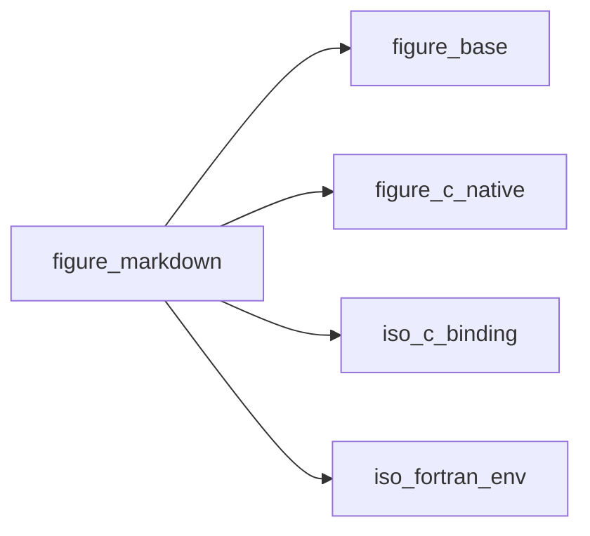

## Contents

- [markdown_view_object](#markdown-view-object)
- [fig_markdown](#fig-markdown)
- [fig_markdown_link](#fig-markdown-link)
- [fig_markdown_view_create](#fig-markdown-view-create)
- [fig_markdown_view_set_text](#fig-markdown-view-set-text)
- [fig_markdown_view_load](#fig-markdown-view-load)
- [fig_markdown_view_text](#fig-markdown-view-text)
- [fig_markdown_view_find](#fig-markdown-view-find)
- [fig_markdown_view_scroll_to](#fig-markdown-view-scroll-to)
- [fig_markdown_view_info](#fig-markdown-view-info)
- [fig_markdown_view_draw](#fig-markdown-view-draw)
- [fig_markdown_view_destroy](#fig-markdown-view-destroy)
- [view_init](#view-init)
- [view_destroy](#view-destroy)
- [view_set_text](#view-set-text)
- [view_load](#view-load)
- [view_find](#view-find)
- [view_scroll_to](#view-scroll-to)
- [ig_markdown](#ig-markdown)
- [view_is_initialized](#view-is-initialized)
- [view_text](#view-text)
- [view_draw](#view-draw)
- [view_matches](#view-matches)
- [view_current_match](#view-current-match)
- [alive](#alive)
- [clicked_link](#clicked-link)

## Derived Types

### markdown_view_object

A Markdown document: its text kept by FIGURE, drawn in a scroll area of its own with a table of contents beside it
 (from three headings) and a search (ctrl+f, or `find`). `view%init`, `view%set_text` or `view%load`, then
 `view%draw` every frame. Not to be copied (the copy would share the view); `destroy` releases it.

**Components**

| Name | Type | Attributes | Description |
|------|------|------------|-------------|
| `handle` | integer(kind=c_int) |  | Native handle (0: none). |

**Type-Bound Procedures**

| Name | Attributes | Description |
|------|------------|-------------|
| [`init`](/api/src/lib/figure_markdown#view-init) | pass(self) | Create the view. |
| [`destroy`](/api/src/lib/figure_markdown#view-destroy) | pass(self) | Release it. |
| [`is_initialized`](/api/src/lib/figure_markdown#view-is-initialized) | pass(self) | Whether it exists. |
| [`set_text`](/api/src/lib/figure_markdown#view-set-text) | pass(self) | Replace the text. |
| [`load`](/api/src/lib/figure_markdown#view-load) | pass(self) | Read the text from a file. |
| [`text`](/api/src/lib/figure_markdown#view-text) | pass(self) | The text. |
| [`draw`](/api/src/lib/figure_markdown#view-draw) | pass(self) | Draw the document as a widget. |
| [`find`](/api/src/lib/figure_markdown#view-find) | pass(self) | Search a text, or end the search. |
| [`matches`](/api/src/lib/figure_markdown#view-matches) | pass(self) | The matches of the search. |
| [`current_match`](/api/src/lib/figure_markdown#view-current-match) | pass(self) | The current match. |
| [`scroll_to`](/api/src/lib/figure_markdown#view-scroll-to) | pass(self) | Scroll to a heading. |

## Interfaces

### fig_markdown

### fig_markdown_link

### fig_markdown_view_create

### fig_markdown_view_set_text

### fig_markdown_view_load

### fig_markdown_view_text

### fig_markdown_view_find

### fig_markdown_view_scroll_to

### fig_markdown_view_info

### fig_markdown_view_draw

### fig_markdown_view_destroy

## Subroutines

### view_init

Create the view (an existing one is destroyed first), empty. With `toc` (default true) a table of contents beside
 the text once it has three headings or more (a narrow view shows it as a line above the text); with `search`
 (default true) the find bar (ctrl+f, cmd+f on macOS, or "/" while the view has the focus; enter goes to the next
 match, escape closes it). Statuses: `FIG_ERR_STATE` from a task. Data only: before `app%init*` too.

**Attributes**: recursive

```fortran
subroutine view_init(self, toc, search, stat)
```

**Arguments**

| Name | Type | Intent | Attributes | Description |
|------|------|--------|------------|-------------|
| `self` | class([markdown_view_object](/api/src/lib/figure_markdown#markdown-view-object)) | inout |  | View. |
| `toc` | logical | in | optional | A table of contents (default true). |
| `search` | logical | in | optional | A search (default true). |
| `stat` | integer(kind=int32) | out | optional | Status. |

**Call graph**

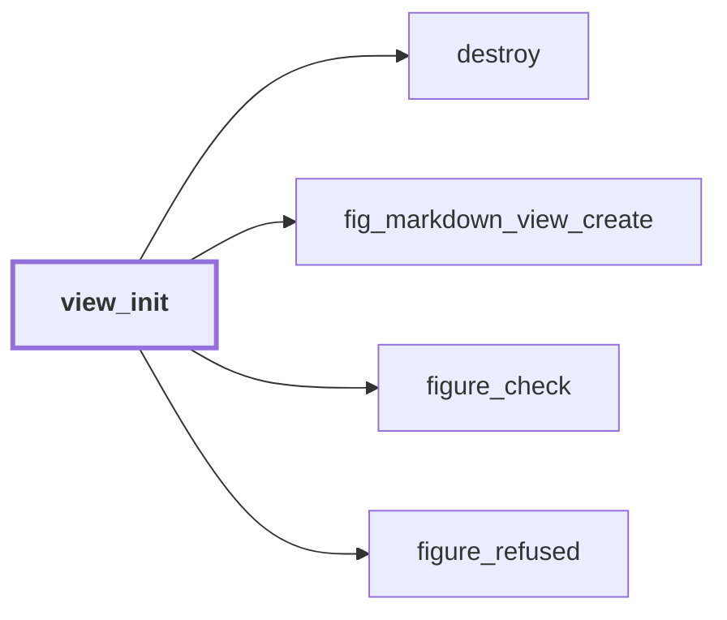

### view_destroy

Release the view (safe in any state).

**Attributes**: recursive

```fortran
subroutine view_destroy(self)
```

**Arguments**

| Name | Type | Intent | Attributes | Description |
|------|------|--------|------------|-------------|
| `self` | class([markdown_view_object](/api/src/lib/figure_markdown#markdown-view-object)) | inout |  | View. |

**Call graph**


### view_set_text

Replace the text with `text` (Markdown, UTF-8): drawn from the next `draw`, its scroll and search kept. Statuses:
 `FIG_ERR_STATE` before `init` and from a task.

**Attributes**: recursive

```fortran
subroutine view_set_text(self, text, stat)
```

**Arguments**

| Name | Type | Intent | Attributes | Description |
|------|------|--------|------------|-------------|
| `self` | class([markdown_view_object](/api/src/lib/figure_markdown#markdown-view-object)) | inout |  | View. |
| `text` | character(len=*) | in |  | Markdown. |
| `stat` | integer(kind=int32) | out | optional | Status. |

**Call graph**

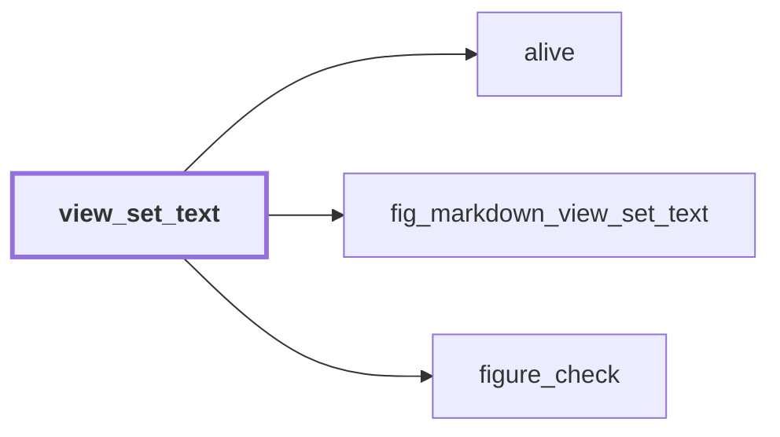

### view_load

Replace the text with the content of the file `path` (UTF-8 name and content). Its images are read from paths
 relative to the working directory, not to the file. Statuses: `FIG_ERR_ARGUMENT` for an empty name,
 `FIG_ERR_FAILED` if the file cannot be read (the text is kept); `FIG_ERR_STATE` before `init` and from a task.

**Attributes**: recursive

```fortran
subroutine view_load(self, path, stat)
```

**Arguments**

| Name | Type | Intent | Attributes | Description |
|------|------|--------|------------|-------------|
| `self` | class([markdown_view_object](/api/src/lib/figure_markdown#markdown-view-object)) | inout |  | View. |
| `path` | character(len=*) | in |  | File. |
| `stat` | integer(kind=int32) | out | optional | Status. |

**Call graph**

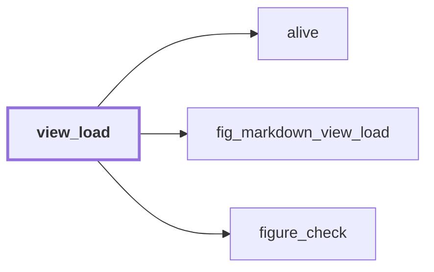

### view_find

Search `text` from the next `draw` (as the find bar does: any case, the matches highlighted, the first one below
 the top of the view made current and scrolled to); `''` ends the search and closes the bar. Statuses:
 `FIG_ERR_ARGUMENT` for a text over 255 bytes or of more than one line; `FIG_ERR_STATE` before `init` and from a
 task.

**Attributes**: recursive

```fortran
subroutine view_find(self, text, stat)
```

**Arguments**

| Name | Type | Intent | Attributes | Description |
|------|------|--------|------------|-------------|
| `self` | class([markdown_view_object](/api/src/lib/figure_markdown#markdown-view-object)) | inout |  | View. |
| `text` | character(len=*) | in |  | Text searched. |
| `stat` | integer(kind=int32) | out | optional | Status. |

**Call graph**

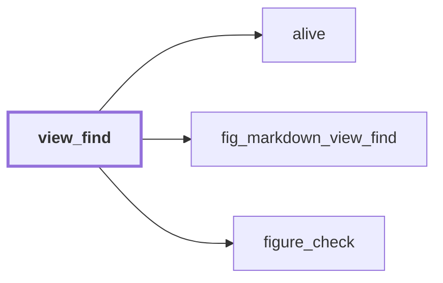

### view_scroll_to

Scroll to a heading from the next `draw` (over a few frames, as a click in the table of contents): `heading` its
 text (`'Boundary conditions'`) or its anchor after `#` (`'#boundary-conditions'`, GitHub's: lower case, blanks as
 `-`, punctuation dropped; a repeated title's second is `-1`). A heading the text does not have: nothing happens.
 Statuses: `FIG_ERR_ARGUMENT` for an empty heading; `FIG_ERR_STATE` before `init` and from a task.

**Attributes**: recursive

```fortran
subroutine view_scroll_to(self, heading, stat)
```

**Arguments**

| Name | Type | Intent | Attributes | Description |
|------|------|--------|------------|-------------|
| `self` | class([markdown_view_object](/api/src/lib/figure_markdown#markdown-view-object)) | inout |  | View. |
| `heading` | character(len=*) | in |  | Its text, or `#` and its anchor. |
| `stat` | integer(kind=int32) | out | optional | Status. |

**Call graph**

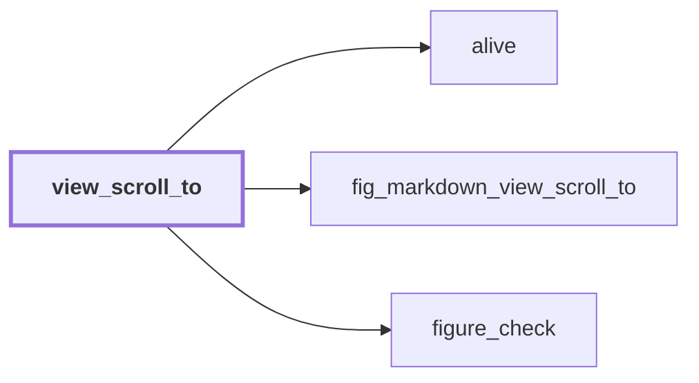

## Functions

### ig_markdown

Draw `text` (Markdown, UTF-8, lines ended by LF or CR LF) at the cursor, inside a window, as wide as the window
 and as tall as it needs (the window scrolls). True on the frame one of its links is clicked: its URL in `link`
 (`''` on the other frames); nothing is opened. A link to a heading of the same text (`[units](#units)`) scrolls
 the window there instead, and is not reported; one to a heading it does not have is (`'#units'`). The text can be
 selected with the mouse and copied (ctrl+c; a right click: Copy, Copy as Markdown, Copy Link). Statuses:
 `FIG_ERR_STATE` with no frame open and from a task; `FIG_ERR_FAILED` if the fonts cannot be loaded. The same in
 every mode.

**Attributes**: recursive

**Returns**: `logical`

```fortran
function ig_markdown(text, link, stat) result(clicked)
```

**Arguments**

| Name | Type | Intent | Attributes | Description |
|------|------|--------|------------|-------------|
| `text` | character(len=*) | in |  | Markdown. |
| `link` | character(len=:) | out | allocatable, optional | The URL of the link clicked. |
| `stat` | integer(kind=int32) | out | optional | Status. |

**Call graph**

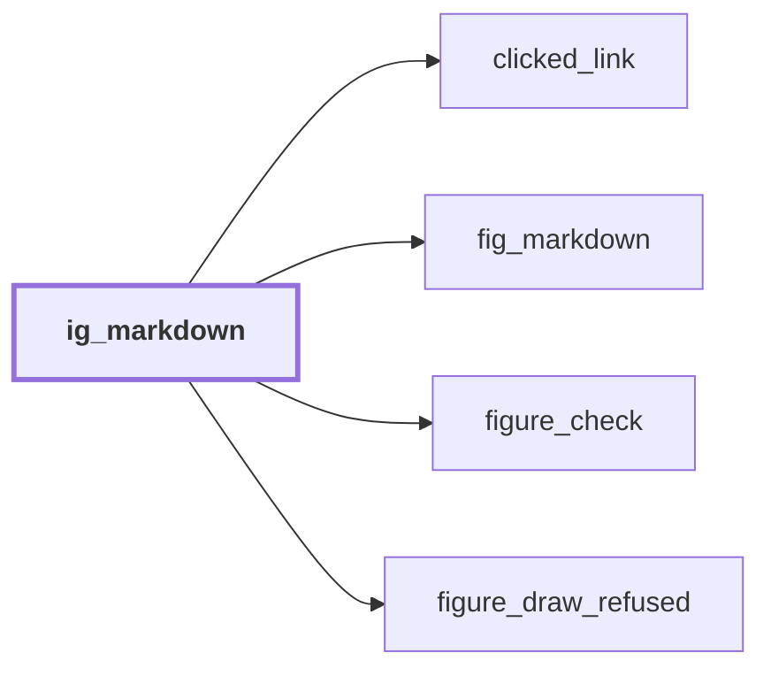

### view_is_initialized

Whether the view exists.

**Attributes**: pure

**Returns**: `logical`

```fortran
function view_is_initialized(self) result(yes)
```

**Arguments**

| Name | Type | Intent | Attributes | Description |
|------|------|--------|------------|-------------|
| `self` | class([markdown_view_object](/api/src/lib/figure_markdown#markdown-view-object)) | in |  | View. |

### view_text

The text (`''` before `init` and from a task).

**Attributes**: recursive

**Returns**: `character(len=:)`

```fortran
function view_text(self) result(t)
```

**Arguments**

| Name | Type | Intent | Attributes | Description |
|------|------|--------|------------|-------------|
| `self` | class([markdown_view_object](/api/src/lib/figure_markdown#markdown-view-object)) | in |  | View. |

**Call graph**

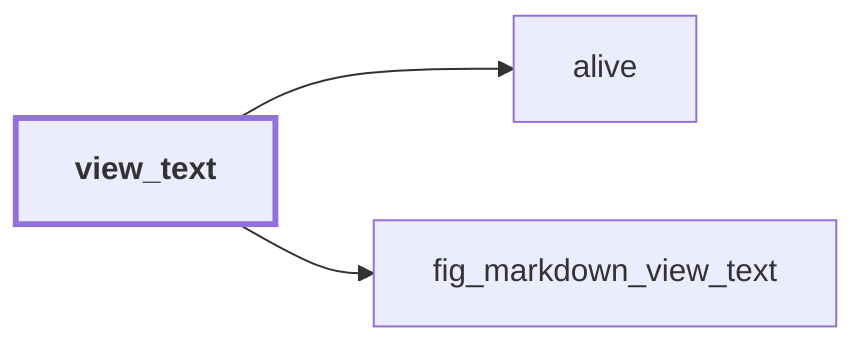

### view_draw

Draw the document as a widget at the cursor, inside a window, `width` x `height` pixels (0: the available region;
 negative: up to that distance from its edge): its text in a scroll area, the table of contents beside it, the
 find bar over it while searching. True on the frame one of its links is clicked, its URL in `link` (`''` on the
 other frames); nothing is opened. A link to one of its headings scrolls there instead (`[units](#units)`), and is
 not reported. Statuses: `FIG_ERR_ARGUMENT` for an empty id; `FIG_ERR_STATE` before `init`, with no frame open,
 from a task; `FIG_ERR_FAILED` if the fonts cannot be loaded. The same in every mode.

**Attributes**: recursive

**Returns**: `logical`

```fortran
function view_draw(self, id, link, width, height, stat) result(clicked)
```

**Arguments**

| Name | Type | Intent | Attributes | Description |
|------|------|--------|------------|-------------|
| `self` | class([markdown_view_object](/api/src/lib/figure_markdown#markdown-view-object)) | inout |  | View. |
| `id` | character(len=*) | in |  | Widget id (unique in the window). |
| `link` | character(len=:) | out | allocatable, optional | The URL of the link clicked. |
| `width` | real(kind=real64) | in | optional | Width [pixels] (default 0: the available width). |
| `height` | real(kind=real64) | in | optional | Height [pixels] (default 0: the available height). |
| `stat` | integer(kind=int32) | out | optional | Status. |

**Call graph**

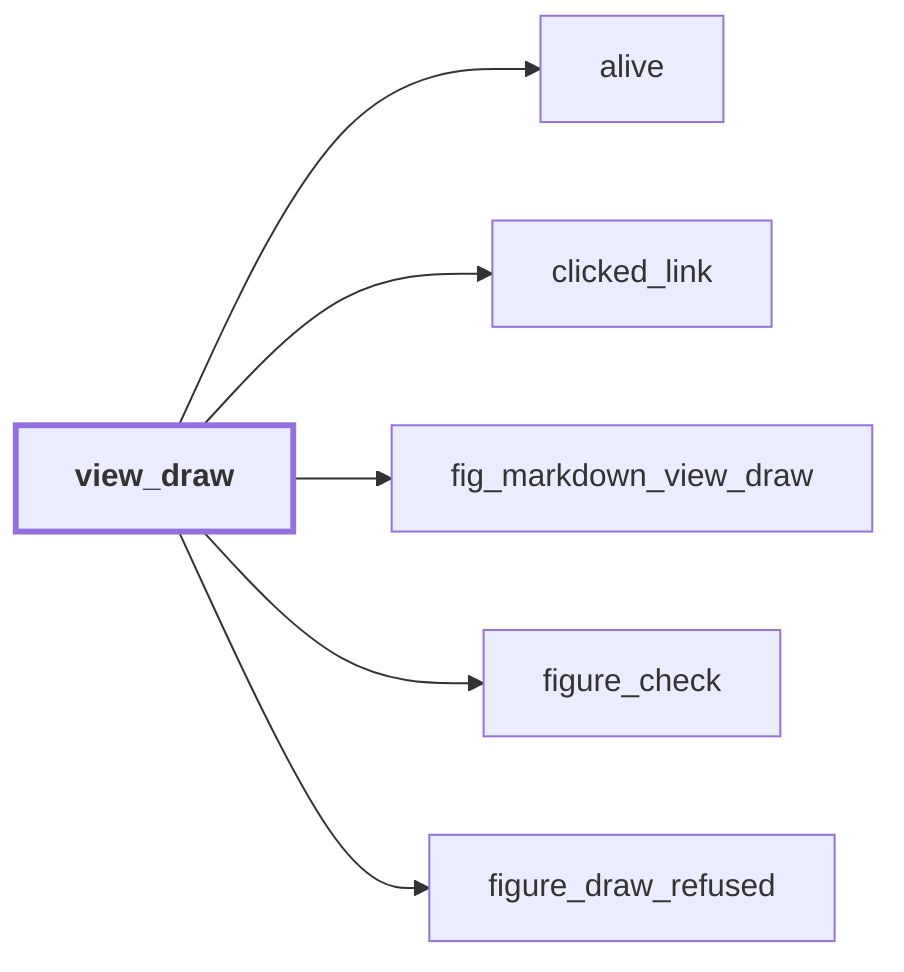

### view_matches

The matches of the search at the last `draw` (0 with no search, before `init` and from a task).

**Attributes**: recursive

**Returns**: `integer(kind=int32)`

```fortran
function view_matches(self) result(n)
```

**Arguments**

| Name | Type | Intent | Attributes | Description |
|------|------|--------|------------|-------------|
| `self` | class([markdown_view_object](/api/src/lib/figure_markdown#markdown-view-object)) | in |  | View. |

**Call graph**

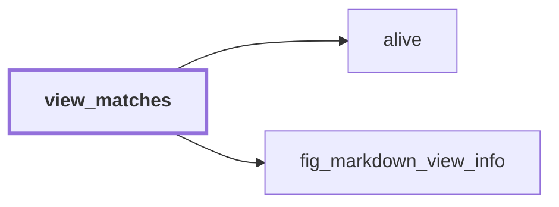

### view_current_match

The current match of the search at the last `draw`, from 1 (0 with none, before `init` and from a task).

**Attributes**: recursive

**Returns**: `integer(kind=int32)`

```fortran
function view_current_match(self) result(k)
```

**Arguments**

| Name | Type | Intent | Attributes | Description |
|------|------|--------|------------|-------------|
| `self` | class([markdown_view_object](/api/src/lib/figure_markdown#markdown-view-object)) | in |  | View. |

**Call graph**

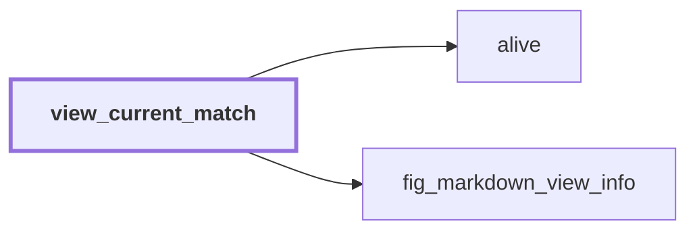

### alive

True when the view exists and the caller is on the main thread; else the refusal (`FIG_ERR_STATE`), silent for a
 query (`quiet`: its default value is the answer).

**Attributes**: recursive

**Returns**: `logical`

```fortran
function alive(self, name, stat, quiet) result(ok)
```

**Arguments**

| Name | Type | Intent | Attributes | Description |
|------|------|--------|------------|-------------|
| `self` | class([markdown_view_object](/api/src/lib/figure_markdown#markdown-view-object)) | in |  | View. |
| `name` | character(len=*) | in |  | The method. |
| `stat` | integer(kind=int32) | out | optional | Status. |
| `quiet` | logical | in | optional | A query: no failure before `init`. |

**Call graph**

```mermaid
flowchart LR
  add_mesh["add_mesh"] --> alive["alive"]
  changed["changed"] --> alive["alive"]
  clear["clear"] --> alive["alive"]
  clip["clip"] --> alive["alive"]
  draw["draw"] --> alive["alive"]
  editor_clear_marks["editor_clear_marks"] --> alive["alive"]
  editor_completing["editor_completing"] --> alive["alive"]
  editor_cursor["editor_cursor"] --> alive["alive"]
  editor_draw["editor_draw"] --> alive["alive"]
  editor_find["editor_find"] --> alive["alive"]
  editor_focus["editor_focus"] --> alive["alive"]
  editor_goto["editor_goto"] --> alive["alive"]
  editor_insert["editor_insert"] --> alive["alive"]
  editor_is_read_only["editor_is_read_only"] --> alive["alive"]
  editor_line_count["editor_line_count"] --> alive["alive"]
  editor_line_rect["editor_line_rect"] --> alive["alive"]
  editor_mark["editor_mark"] --> alive["alive"]
  editor_mark_of["editor_mark_of"] --> alive["alive"]
  editor_read_only["editor_read_only"] --> alive["alive"]
  editor_redo["editor_redo"] --> alive["alive"]
  editor_replace["editor_replace"] --> alive["alive"]
  editor_select["editor_select"] --> alive["alive"]
  editor_selection["editor_selection"] --> alive["alive"]
  editor_set_completions["editor_set_completions"] --> alive["alive"]
  editor_set_language["editor_set_language"] --> alive["alive"]
  editor_set_options["editor_set_options"] --> alive["alive"]
  editor_set_text["editor_set_text"] --> alive["alive"]
  editor_string["editor_string"] --> alive["alive"]
  editor_undo["editor_undo"] --> alive["alive"]
  fit["fit"] --> alive["alive"]
  get_camera["get_camera"] --> alive["alive"]
  gizmo["gizmo"] --> alive["alive"]
  image["image"] --> alive["alive"]
  orbit["orbit"] --> alive["alive"]
  pan["pan"] --> alive["alive"]
  projection_matrix["projection_matrix"] --> alive["alive"]
  query["query"] --> alive["alive"]
  remove["remove"] --> alive["alive"]
  render_info["render_info"] --> alive["alive"]
  set_camera["set_camera"] --> alive["alive"]
  set_mesh["set_mesh"] --> alive["alive"]
  unclip["unclip"] --> alive["alive"]
  view["view"] --> alive["alive"]
  view_cube["view_cube"] --> alive["alive"]
  view_current_match["view_current_match"] --> alive["alive"]
  view_draw["view_draw"] --> alive["alive"]
  view_find["view_find"] --> alive["alive"]
  view_load["view_load"] --> alive["alive"]
  view_matches["view_matches"] --> alive["alive"]
  view_matrix["view_matrix"] --> alive["alive"]
  view_scroll_to["view_scroll_to"] --> alive["alive"]
  view_set_text["view_set_text"] --> alive["alive"]
  view_text["view_text"] --> alive["alive"]
  zoom["zoom"] --> alive["alive"]
  alive["alive"] --> figure_fail["figure_fail"]
  alive["alive"] --> figure_refused["figure_refused"]
  classDef focus stroke-width:3px,font-weight:bold
  class alive focus
  click add_mesh href "figure_view3d.html#add-mesh" "add_mesh"
  click changed href "figure_view3d.html#changed" "changed"
  click clear href "figure_view3d.html#clear" "clear"
  click clip href "figure_view3d.html#clip" "clip"
  click draw href "figure_canvas.html#draw" "draw"
  click editor_clear_marks href "figure_editor.html#editor-clear-marks" "editor_clear_marks"
  click editor_completing href "figure_editor.html#editor-completing" "editor_completing"
  click editor_cursor href "figure_editor.html#editor-cursor" "editor_cursor"
  click editor_draw href "figure_editor.html#editor-draw" "editor_draw"
  click editor_find href "figure_editor.html#editor-find" "editor_find"
  click editor_focus href "figure_editor.html#editor-focus" "editor_focus"
  click editor_goto href "figure_editor.html#editor-goto" "editor_goto"
  click editor_insert href "figure_editor.html#editor-insert" "editor_insert"
  click editor_is_read_only href "figure_editor.html#editor-is-read-only" "editor_is_read_only"
  click editor_line_count href "figure_editor.html#editor-line-count" "editor_line_count"
  click editor_line_rect href "figure_editor.html#editor-line-rect" "editor_line_rect"
  click editor_mark href "figure_editor.html#editor-mark" "editor_mark"
  click editor_mark_of href "figure_editor.html#editor-mark-of" "editor_mark_of"
  click editor_read_only href "figure_editor.html#editor-read-only" "editor_read_only"
  click editor_redo href "figure_editor.html#editor-redo" "editor_redo"
  click editor_replace href "figure_editor.html#editor-replace" "editor_replace"
  click editor_select href "figure_editor.html#editor-select" "editor_select"
  click editor_selection href "figure_editor.html#editor-selection" "editor_selection"
  click editor_set_completions href "figure_editor.html#editor-set-completions" "editor_set_completions"
  click editor_set_language href "figure_editor.html#editor-set-language" "editor_set_language"
  click editor_set_options href "figure_editor.html#editor-set-options" "editor_set_options"
  click editor_set_text href "figure_editor.html#editor-set-text" "editor_set_text"
  click editor_string href "figure_editor.html#editor-string" "editor_string"
  click editor_undo href "figure_editor.html#editor-undo" "editor_undo"
  click fit href "figure_view3d.html#fit" "fit"
  click get_camera href "figure_view3d.html#get-camera" "get_camera"
  click gizmo href "figure_view3d.html#gizmo" "gizmo"
  click image href "figure_view3d.html#image" "image"
  click orbit href "figure_view3d.html#orbit" "orbit"
  click pan href "figure_view3d.html#pan" "pan"
  click projection_matrix href "figure_view3d.html#projection-matrix" "projection_matrix"
  click query href "figure_view3d.html#query" "query"
  click remove href "figure_view3d.html#remove" "remove"
  click render_info href "figure_view3d.html#render-info" "render_info"
  click set_camera href "figure_view3d.html#set-camera" "set_camera"
  click set_mesh href "figure_view3d.html#set-mesh" "set_mesh"
  click unclip href "figure_view3d.html#unclip" "unclip"
  click view href "figure_view3d.html#view" "view"
  click view_cube href "figure_view3d.html#view-cube" "view_cube"
  click view_current_match href "#view-current-match" "view_current_match"
  click view_draw href "#view-draw" "view_draw"
  click view_find href "#view-find" "view_find"
  click view_load href "#view-load" "view_load"
  click view_matches href "#view-matches" "view_matches"
  click view_matrix href "figure_view3d.html#view-matrix" "view_matrix"
  click view_scroll_to href "#view-scroll-to" "view_scroll_to"
  click view_set_text href "#view-set-text" "view_set_text"
  click view_text href "#view-text" "view_text"
  click zoom href "figure_view3d.html#zoom" "zoom"
  click figure_refused href "figure_base.html#figure-refused" "figure_refused"
  click figure_fail href "figure_base.html#figure-fail" "figure_fail"
```

### clicked_link

The URL of the last link clicked.

**Attributes**: recursive

**Returns**: `character(len=:)`

```fortran
function clicked_link() result(url)
```

**Call graph**

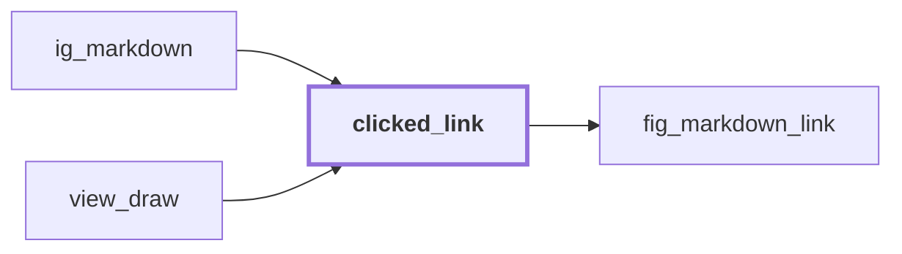
