# figure_menu

> figure_menu, menus, popups and keyboard shortcuts.

 Pairing (Dear ImGui's): each `ig_end_*` only after its `ig_begin_*` returned true. A window's own menu bar needs the
 window flag `ImGuiWindowFlags_MenuBar` in its `ig_begin`. A menu item's shortcut text is only shown: the program
 reacts to the keys with `ig_shortcut`, every frame, outside the menu (the menu is closed most of the time).

 A popup is opened once, by an event (`ig_open_popup`, not every frame), and declared every frame
 (`ig_begin_popup`/`ig_begin_popup_modal`, then `ig_end_popup` only when the begin returned true); it closes when
 the user clicks outside it (a plain popup) or when the program calls `ig_close_current_popup` inside it. Open and
 begin must use the same id in the same id scope (the same window).

**Source**: `src/lib/figure_menu.F90`

**Dependencies**

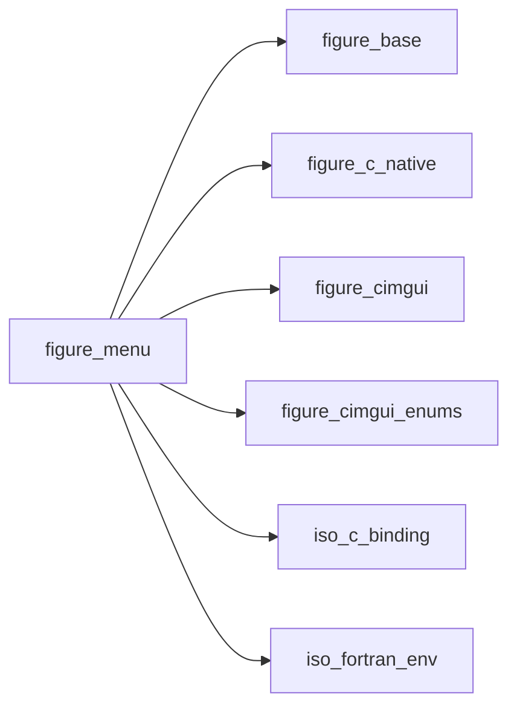

## Contents

- [ig_end_main_menu_bar](#ig-end-main-menu-bar)
- [ig_end_menu_bar](#ig-end-menu-bar)
- [ig_end_menu](#ig-end-menu)
- [ig_open_popup](#ig-open-popup)
- [ig_end_popup](#ig-end-popup)
- [ig_close_current_popup](#ig-close-current-popup)
- [ig_begin_main_menu_bar](#ig-begin-main-menu-bar)
- [ig_begin_menu_bar](#ig-begin-menu-bar)
- [ig_begin_menu](#ig-begin-menu)
- [ig_menu_item](#ig-menu-item)
- [ig_shortcut](#ig-shortcut)
- [ig_begin_popup](#ig-begin-popup)
- [ig_begin_popup_modal](#ig-begin-popup-modal)

## Subroutines

### ig_end_main_menu_bar

End the main menu bar (only after `ig_begin_main_menu_bar` returned true).

```fortran
subroutine ig_end_main_menu_bar()
```

**Call graph**

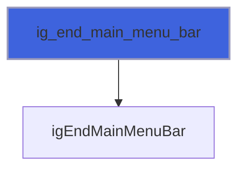

### ig_end_menu_bar

End the window's menu bar (only after `ig_begin_menu_bar` returned true).

```fortran
subroutine ig_end_menu_bar()
```

**Call graph**


### ig_end_menu

End a menu (only after `ig_begin_menu` returned true).

```fortran
subroutine ig_end_menu()
```

**Call graph**

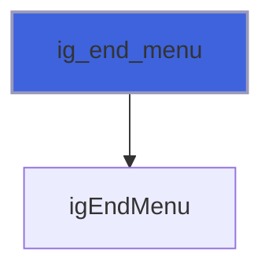

### ig_open_popup

Open the popup `id` (call once, on the event that opens it: a click, a quit request; not every frame).

```fortran
subroutine ig_open_popup(id)
```

**Arguments**

| Name | Type | Intent | Attributes | Description |
|------|------|--------|------------|-------------|
| `id` | character(len=*) | in |  | Popup id, as given to `ig_begin_popup` or `ig_begin_popup_modal`. |

**Call graph**

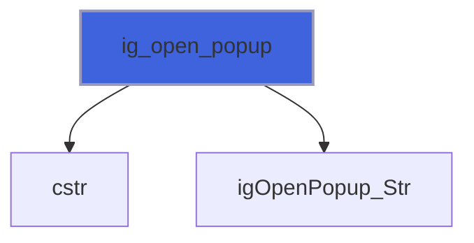

### ig_end_popup

End a popup or modal (only after its begin returned true).

```fortran
subroutine ig_end_popup()
```

**Call graph**

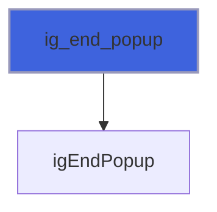

### ig_close_current_popup

Close the popup or modal being declared (call it inside, e.g. when its OK button is pressed).

```fortran
subroutine ig_close_current_popup()
```

**Call graph**

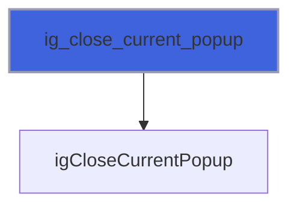

## Functions

### ig_begin_main_menu_bar

Begin the menu bar along the top of the display; when true, declare menus, then `ig_end_main_menu_bar`.

**Returns**: `logical`

```fortran
function ig_begin_main_menu_bar() result(visible)
```

**Call graph**

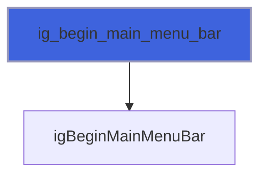

### ig_begin_menu_bar

Begin the current window's menu bar (the window needs `ImGuiWindowFlags_MenuBar`); then `ig_end_menu_bar`.

**Returns**: `logical`

```fortran
function ig_begin_menu_bar() result(visible)
```

**Call graph**

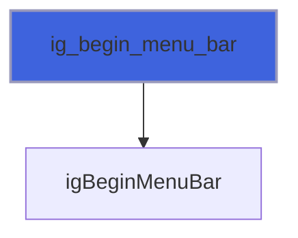

### ig_begin_menu

A menu of a menu bar (or a submenu of a menu); true while it is open: declare its items, then `ig_end_menu`.

**Returns**: `logical`

```fortran
function ig_begin_menu(label, enabled) result(open)
```

**Arguments**

| Name | Type | Intent | Attributes | Description |
|------|------|--------|------------|-------------|
| `label` | character(len=*) | in |  | Label (also its id). |
| `enabled` | logical | in | optional | The menu can be opened (default true). |

**Call graph**

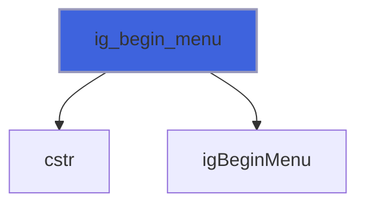

### ig_menu_item

An item of an open menu; true on the frame it is picked (the menu then closes). `shortcut` is shown on the right
 (the keys themselves are read with `ig_shortcut`); with `selected`, the item shows a check mark and a pick toggles
 it; a disabled item (`enabled=.false.`) is greyed out and cannot be picked.

**Returns**: `logical`

```fortran
function ig_menu_item(label, shortcut, selected, enabled) result(picked)
```

**Arguments**

| Name | Type | Intent | Attributes | Description |
|------|------|--------|------------|-------------|
| `label` | character(len=*) | in |  | Label (also its id). |
| `shortcut` | character(len=*) | in | optional | Shortcut text, e.g. `'Ctrl+S'`. |
| `selected` | logical | inout | optional | Check mark, toggled by a pick. |
| `enabled` | logical | in | optional | The item can be picked (default true). |

**Call graph**

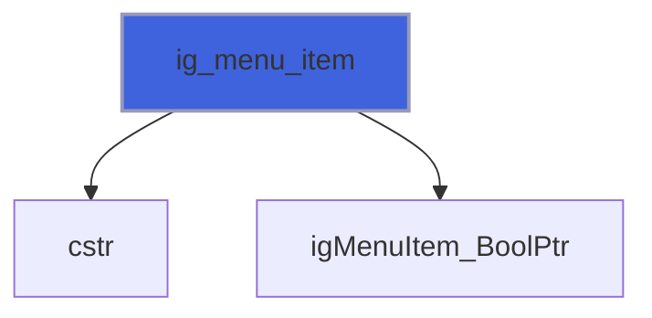

### ig_shortcut

True on the frame the key chord `keys` is pressed, e.g. `'ctrl+s'`, `'ctrl+shift+z'`, `'f5'`, `'escape'`:
 modifiers (`ctrl`, `shift`, `alt`, `super`) and one key, by the names of `test_key`, joined by `+`. Once per
 press, not repeated while held. On macOS `ctrl` is the cmd key (Dear ImGui follows the platform), so `'ctrl+s'`
 is cmd+s there. Call it every frame, outside menus. An unknown name: false, and `FIG_ERR_ARGUMENT` in `stat` (or
 `error stop` without it).

**Returns**: `logical`

```fortran
function ig_shortcut(keys, stat) result(pressed)
```

**Arguments**

| Name | Type | Intent | Attributes | Description |
|------|------|--------|------------|-------------|
| `keys` | character(len=*) | in |  | Key chord. |
| `stat` | integer(kind=int32) | out | optional | Status. |

**Call graph**

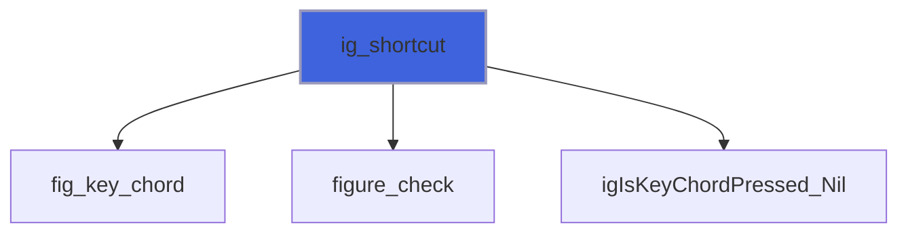

### ig_begin_popup

A popup (no title bar), declared every frame; true while open: declare its content, then `ig_end_popup`. It
 closes when the user clicks outside it.

**Returns**: `logical`

```fortran
function ig_begin_popup(id) result(open)
```

**Arguments**

| Name | Type | Intent | Attributes | Description |
|------|------|--------|------------|-------------|
| `id` | character(len=*) | in |  | Popup id. |

**Call graph**

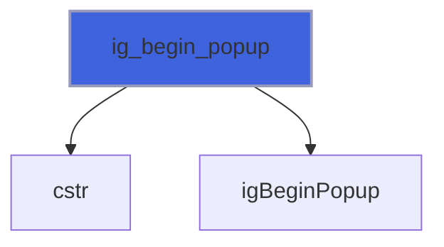

### ig_begin_popup_modal

A modal dialog titled `title` (also its id), declared every frame; true while open: the rest of the interface
 is greyed out and ignores input until it closes (`ig_close_current_popup`, inside it). With `open`, a close
 button in its title bar sets it false. Its size fits its content.

**Returns**: `logical`

```fortran
function ig_begin_popup_modal(title, open) result(shown)
```

**Arguments**

| Name | Type | Intent | Attributes | Description |
|------|------|--------|------------|-------------|
| `title` | character(len=*) | in |  | Title and id. |
| `open` | logical | inout | optional | Close button. |

**Call graph**

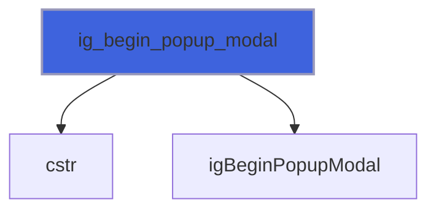
