# figure_menu

> figure_menu, menus, popups and keyboard shortcuts.

 Every drawing procedure of this module refuses a call from a task (`FIG_ERR_STATE`): see processes.md; and a call
 with no frame open, a usage error (`FIG_ERR_STATE`, `<procedure>: no frame open`). Every begin/end and push/pop
 pair registers in the scope record of the frame, which checks each end before Dear ImGui sees it: a wrong end is
 refused and reported by `app%next_frame` (`app%set_checks`; errors.md, "Pairing and frames").

 Pairing (Dear ImGui's): each `ig_end_*` only after its `ig_begin_*` returned true. A window's own menu bar needs the
 window flag `ImGuiWindowFlags_MenuBar` in its `ig_begin`. A menu item's shortcut text is only shown: the program
 reacts to the keys with `ig_shortcut`, every frame, outside the menu (the menu is closed most of the time).

 Shortcuts are routed (Dear ImGui's `Shortcut`): a chord goes to one place, by the call's scope: 'focused' (the
 default) to the focused window, 'global' wherever the focus is, 'item' to the item being edited or held; 'always'
 is not routed (Dear ImGui's `IsKeyChordPressed`): every call fires; see menus.md, "Shortcuts".

 A popup is opened once, by an event (`ig_open_popup`, not every frame), and declared every frame
 (`ig_begin_popup`/`ig_begin_popup_modal`, then `ig_end_popup` only when the begin returned true); it closes when
 the user clicks outside it (a plain popup) or when the program calls `ig_close_current_popup` inside it. Open and
 begin must use the same id in the same id scope (the same window). A context menu (`ig_begin_popup_context`) opens
 itself, on a click of the right button over an item, a window's empty space or the display's background.

**Source**: `src/lib/figure_menu.F90`

**Dependencies**

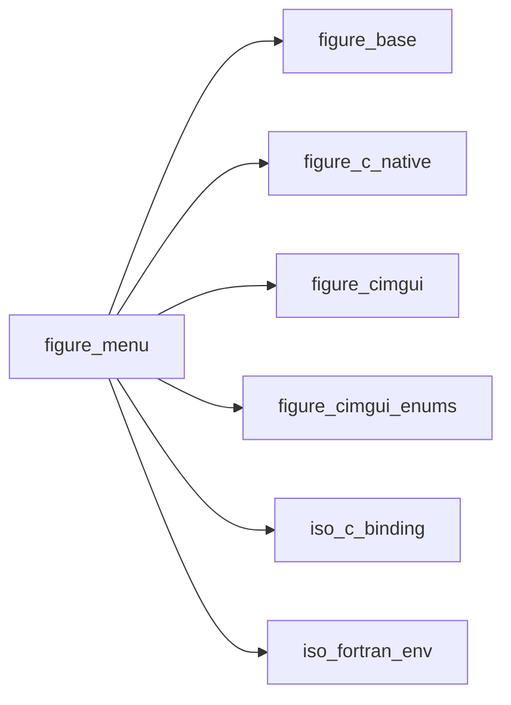

## Contents

- [ig_end_main_menu_bar](#ig-end-main-menu-bar)
- [ig_end_menu_bar](#ig-end-menu-bar)
- [ig_end_menu](#ig-end-menu)
- [ig_set_next_item_shortcut](#ig-set-next-item-shortcut)
- [ig_open_popup](#ig-open-popup)
- [ig_end_popup](#ig-end-popup)
- [ig_close_current_popup](#ig-close-current-popup)
- [ig_begin_main_menu_bar](#ig-begin-main-menu-bar)
- [ig_begin_menu_bar](#ig-begin-menu-bar)
- [ig_begin_menu](#ig-begin-menu)
- [ig_menu_item](#ig-menu-item)
- [ig_shortcut](#ig-shortcut)
- [ig_begin_popup](#ig-begin-popup)
- [ig_begin_popup_modal](#ig-begin-popup-modal)
- [ig_begin_popup_context](#ig-begin-popup-context)

## Subroutines

### ig_end_main_menu_bar

End the main menu bar (only after `ig_begin_main_menu_bar` returned true).

**Attributes**: recursive

```fortran
subroutine ig_end_main_menu_bar()
```

**Call graph**

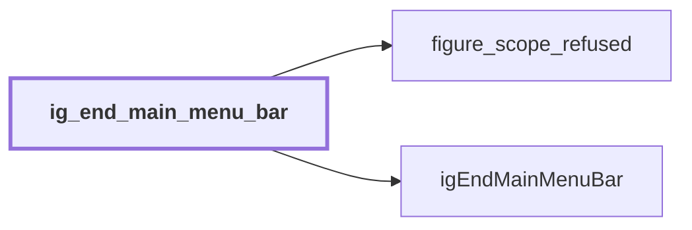

### ig_end_menu_bar

End the window's menu bar (only after `ig_begin_menu_bar` returned true).

**Attributes**: recursive

```fortran
subroutine ig_end_menu_bar()
```

**Call graph**

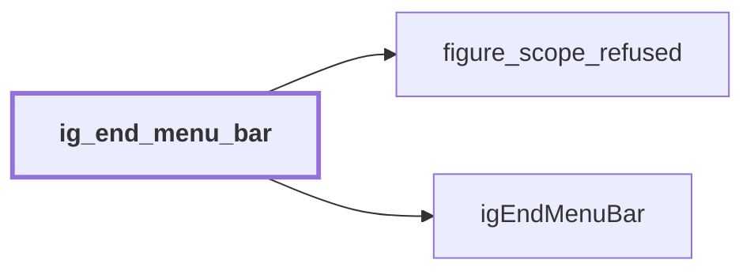

### ig_end_menu

End a menu (only after `ig_begin_menu` returned true).

**Attributes**: recursive

```fortran
subroutine ig_end_menu()
```

**Call graph**

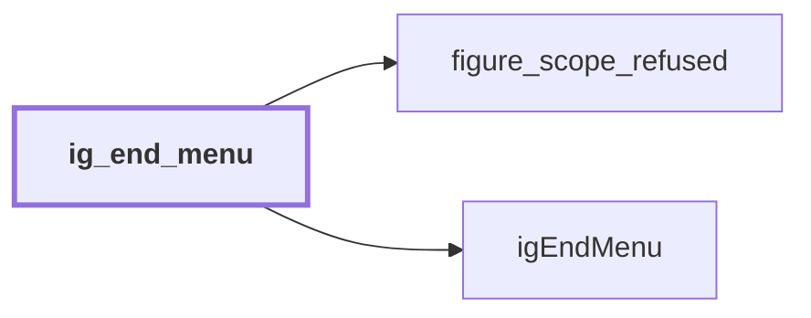

### ig_set_next_item_shortcut

The next item owns the key chord `keys` (as `ig_shortcut`'s, e.g. `'ctrl+r'`): the chord presses it (a button
 reports the press, a text field takes the keyboard), and its tooltip shows the chord. Call it just before the
 item, every frame. `scope` (Dear ImGui's `ImGuiInputFlags_Route*`): `'focused'` (default) while the item's window
 has the focus, `'global'` wherever the focus is; while a text field is edited, a focused chord of a key alone or
 with shift (other than f1-f24) is not given. An unknown key or scope (`'item'` and `'always'` included: the item
 owns the chord through a route) is refused with `FIG_ERR_ARGUMENT` in `stat` (or `error stop` without it), and
 the item has no chord; no frame open or a task: `FIG_ERR_STATE`. The same in window, headless and remote mode.

**Attributes**: recursive

```fortran
subroutine ig_set_next_item_shortcut(keys, scope, stat)
```

**Arguments**

| Name | Type | Intent | Attributes | Description |
|------|------|--------|------------|-------------|
| `keys` | character(len=*) | in |  | Key chord. |
| `scope` | character(len=*) | in | optional | 'focused' (default) or 'global'. |
| `stat` | integer(kind=int32) | out | optional | Status. |

**Call graph**

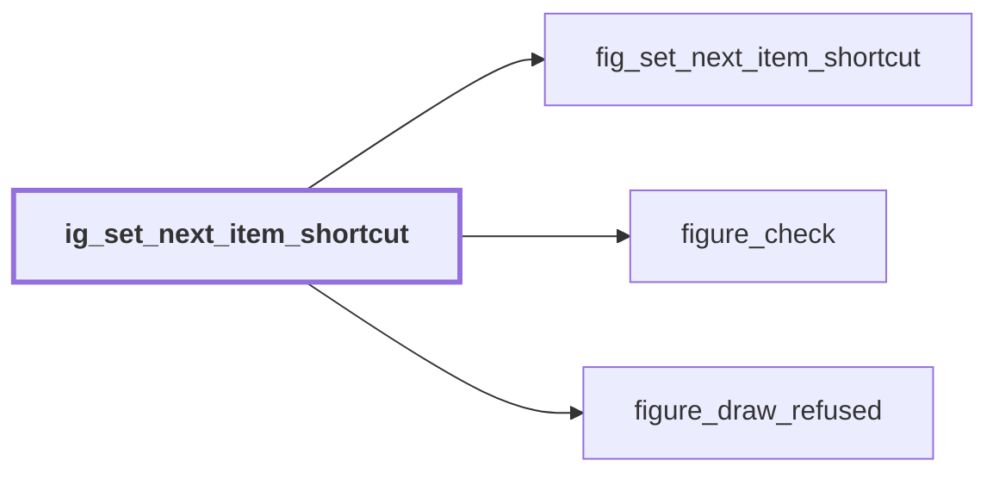

### ig_open_popup

Open the popup `id` (call once, on the event that opens it: a click, a quit request; not every frame).

**Attributes**: recursive

```fortran
subroutine ig_open_popup(id)
```

**Arguments**

| Name | Type | Intent | Attributes | Description |
|------|------|--------|------------|-------------|
| `id` | character(len=*) | in |  | Popup id, as given to `ig_begin_popup` or `ig_begin_popup_modal`. |

**Call graph**

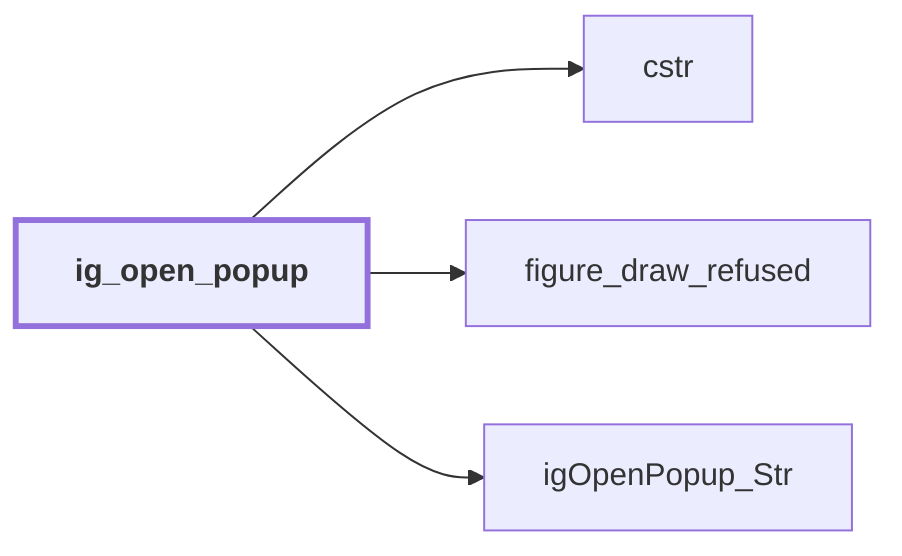

### ig_end_popup

End a popup, context menu or modal (only after its begin returned true).

**Attributes**: recursive

```fortran
subroutine ig_end_popup()
```

**Call graph**

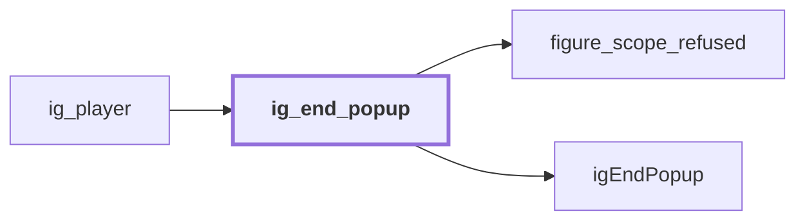

### ig_close_current_popup

Close the popup or modal being declared (call it inside, e.g. when its OK button is pressed).

**Attributes**: recursive

```fortran
subroutine ig_close_current_popup()
```

**Call graph**

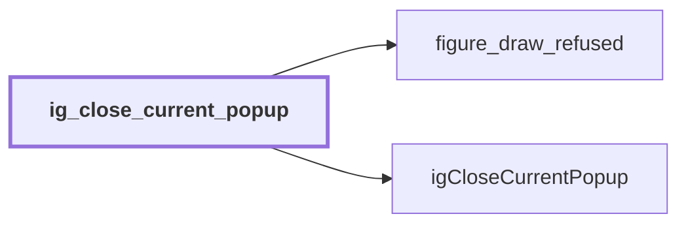

## Functions

### ig_begin_main_menu_bar

Begin the menu bar along the top of the display; when true, declare menus, then `ig_end_main_menu_bar`.

**Attributes**: recursive

**Returns**: `logical`

```fortran
function ig_begin_main_menu_bar() result(visible)
```

**Call graph**

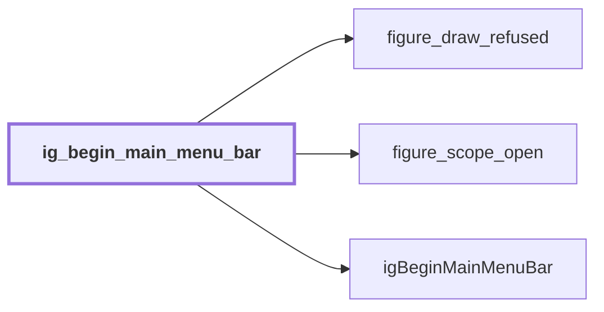

### ig_begin_menu_bar

Begin the current window's menu bar (the window needs `ImGuiWindowFlags_MenuBar`); then `ig_end_menu_bar`.

**Attributes**: recursive

**Returns**: `logical`

```fortran
function ig_begin_menu_bar() result(visible)
```

**Call graph**

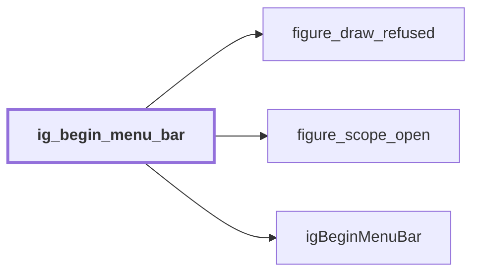

### ig_begin_menu

A menu of a menu bar (or a submenu of a menu); true while it is open: declare its items, then `ig_end_menu`.

**Attributes**: recursive

**Returns**: `logical`

```fortran
function ig_begin_menu(label, enabled) result(open)
```

**Arguments**

| Name | Type | Intent | Attributes | Description |
|------|------|--------|------------|-------------|
| `label` | character(len=*) | in |  | Label (also its id). |
| `enabled` | logical | in | optional | The menu can be opened (default true). |

**Call graph**

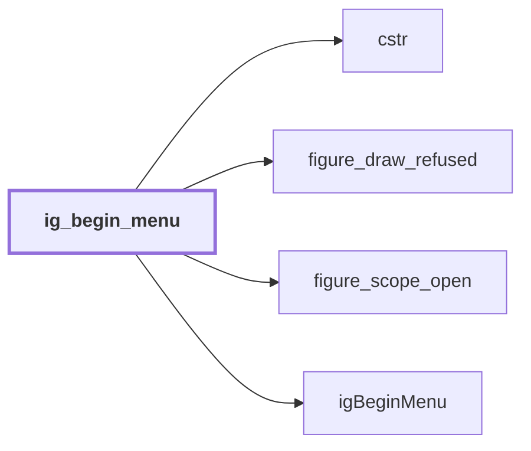

### ig_menu_item

An item of an open menu; true on the frame it is picked (the menu then closes). `shortcut` is shown on the right
 (the keys themselves are read with `ig_shortcut`); with `selected`, the item shows a check mark and a pick toggles
 it; a disabled item (`enabled=.false.`) is greyed out and cannot be picked.

**Attributes**: recursive

**Returns**: `logical`

```fortran
function ig_menu_item(label, shortcut, selected, enabled) result(picked)
```

**Arguments**

| Name | Type | Intent | Attributes | Description |
|------|------|--------|------------|-------------|
| `label` | character(len=*) | in |  | Label (also its id). |
| `shortcut` | character(len=*) | in | optional | Shortcut text, e.g. `'Ctrl+S'`. |
| `selected` | logical | inout | optional | Check mark, toggled by a pick. |
| `enabled` | logical | in | optional | The item can be picked (default true). |

**Call graph**

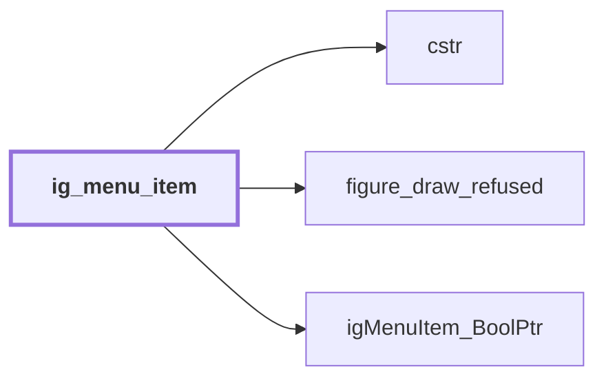

### ig_shortcut

True on the frame the key chord `keys` is pressed and routed to this call, e.g. `'ctrl+s'`, `'ctrl+shift+z'`,
 `'f5'`, `'escape'`: modifiers (`ctrl`, `shift`, `alt`, `super`) and one key, by the names of `test_key`, joined
 by `+`. On macOS `ctrl` is the cmd key (Dear ImGui follows the platform), so `'ctrl+s'` is cmd+s there. Call it
 every frame (a route is taken for the next frame), outside menus.

 `scope` (Dear ImGui's `ImGuiInputFlags_Route*`): `'focused'` (default) fires when the calling window, or a window
 inside it, has the focus; called outside every window it fires unless a focused window routes the same chord.
 While a text field is edited, a focused chord of a key alone or with shift (other than f1-f24) does not fire.
 `'global'` fires whatever window has the focus, before the focused ones. `'item'` fires while the item drawn
 just before the call is active (a text field being edited, a button held). Of two `'global'` calls of one chord
 in different windows, the first of the frame fires. `'always'` is not routed (v0.3's behaviour): every call of
 the chord fires, whatever has the focus, a text field being edited included.

 An unknown key or scope: false, and `FIG_ERR_ARGUMENT` in `stat` (or `error stop` without it); no frame open or a
 task: `FIG_ERR_STATE`. The same in window, headless (keys of `test_key`) and remote mode (the browser's keys).

**Attributes**: recursive

**Returns**: `logical`

```fortran
function ig_shortcut(keys, scope, repeat, stat) result(pressed)
```

**Arguments**

| Name | Type | Intent | Attributes | Description |
|------|------|--------|------------|-------------|
| `keys` | character(len=*) | in |  | Key chord. |
| `scope` | character(len=*) | in | optional | 'focused' (default), 'global', 'item' or 'always'. |
| `repeat` | logical | in | optional | Fire again while the chord is held (default false: once). |
| `stat` | integer(kind=int32) | out | optional | Status. |

**Call graph**

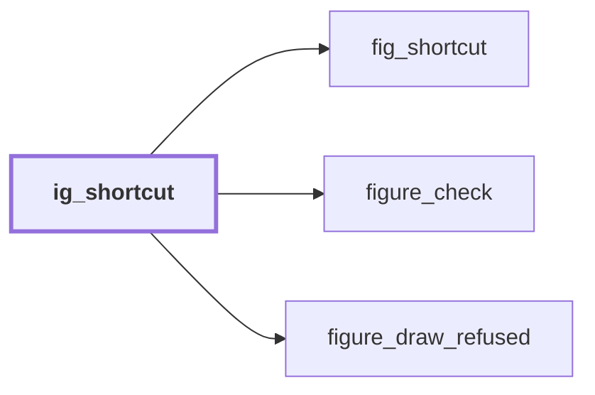

### ig_begin_popup

A popup (no title bar), declared every frame; true while open: declare its content, then `ig_end_popup`. It
 closes when the user clicks outside it.

**Attributes**: recursive

**Returns**: `logical`

```fortran
function ig_begin_popup(id) result(open)
```

**Arguments**

| Name | Type | Intent | Attributes | Description |
|------|------|--------|------------|-------------|
| `id` | character(len=*) | in |  | Popup id. |

**Call graph**

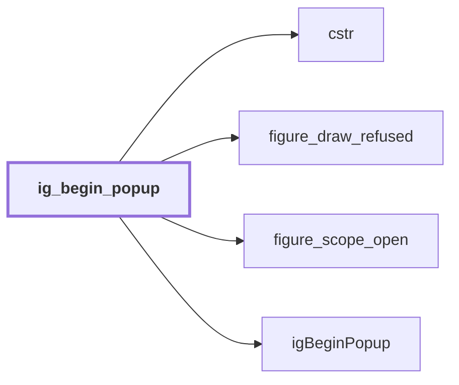

### ig_begin_popup_modal

A modal dialog titled `title` (also its id), declared every frame; true while open: the rest of the interface
 is greyed out and ignores input until it closes (`ig_close_current_popup`, inside it). With `open`, a close
 button in its title bar sets it false. Its size fits its content.

**Attributes**: recursive

**Returns**: `logical`

```fortran
function ig_begin_popup_modal(title, open) result(shown)
```

**Arguments**

| Name | Type | Intent | Attributes | Description |
|------|------|--------|------------|-------------|
| `title` | character(len=*) | in |  | Title and id. |
| `open` | logical | inout | optional | Close button. |

**Call graph**

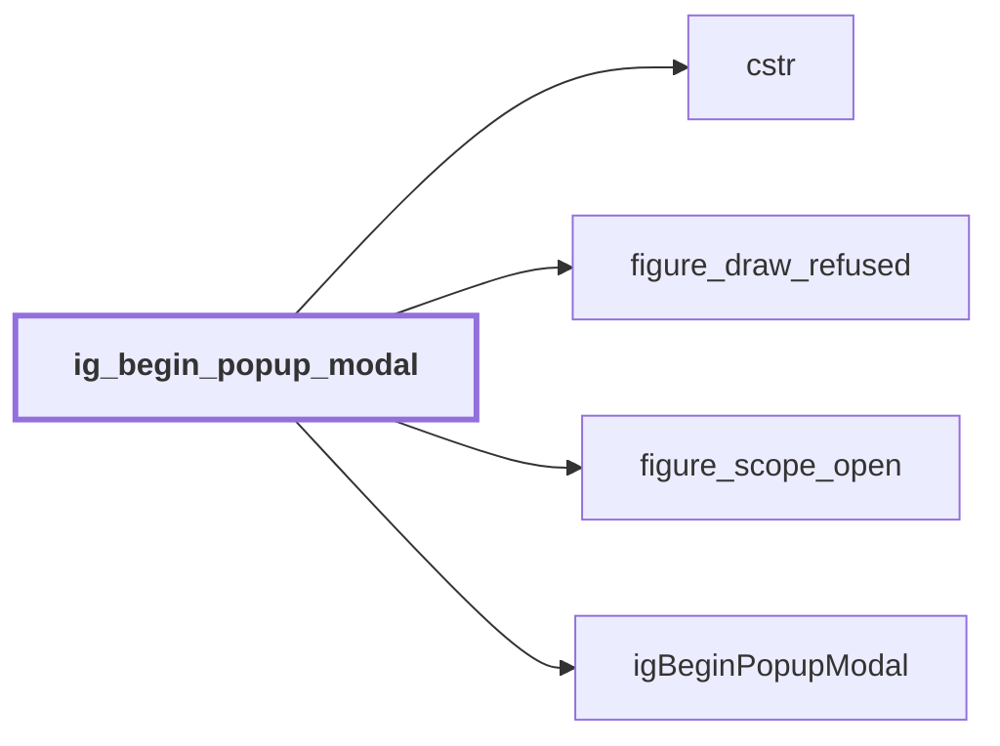

### ig_begin_popup_context

A context menu (Dear ImGui's `BeginPopupContextItem`, `BeginPopupContextWindow`, `BeginPopupContextVoid`):
 declared every frame, it opens itself when the user releases `button` over the place `on` says, and is true
 while open: declare its entries (`ig_menu_item`, any widget), then `ig_end_popup` only after true. It closes on a
 pick of an `ig_menu_item`, on `ig_close_current_popup`, or on a click outside it.

 `on`: `'item'` (default), the item drawn just before the call (a row, a node, a text: any item, interactive or
 not); `'window'`, the current window's empty space, not over its items (so items keep their own menus); `'void'`,
 the display's background, where no window is (call it outside every window). `id` names the menu in the current
 id scope: `ig_open_popup(id)` in the same window opens it too (a key, a button). An unknown `on` or `button`:
 false, `FIG_ERR_ARGUMENT` in `stat` (or `error stop` without it); no frame open or a task: false,
 `FIG_ERR_STATE`. The same in window, headless (`test_click(..., button='right')`) and remote mode.

**Attributes**: recursive

**Returns**: `logical`

```fortran
function ig_begin_popup_context(id, on, button, stat) result(open)
```

**Arguments**

| Name | Type | Intent | Attributes | Description |
|------|------|--------|------------|-------------|
| `id` | character(len=*) | in |  | Menu id. |
| `on` | character(len=*) | in | optional | 'item' (default), 'window' or 'void'. |
| `button` | character(len=*) | in | optional | Mouse button: 'right' (default), 'left' or 'middle'. |
| `stat` | integer(kind=int32) | out | optional | Status. |

**Call graph**

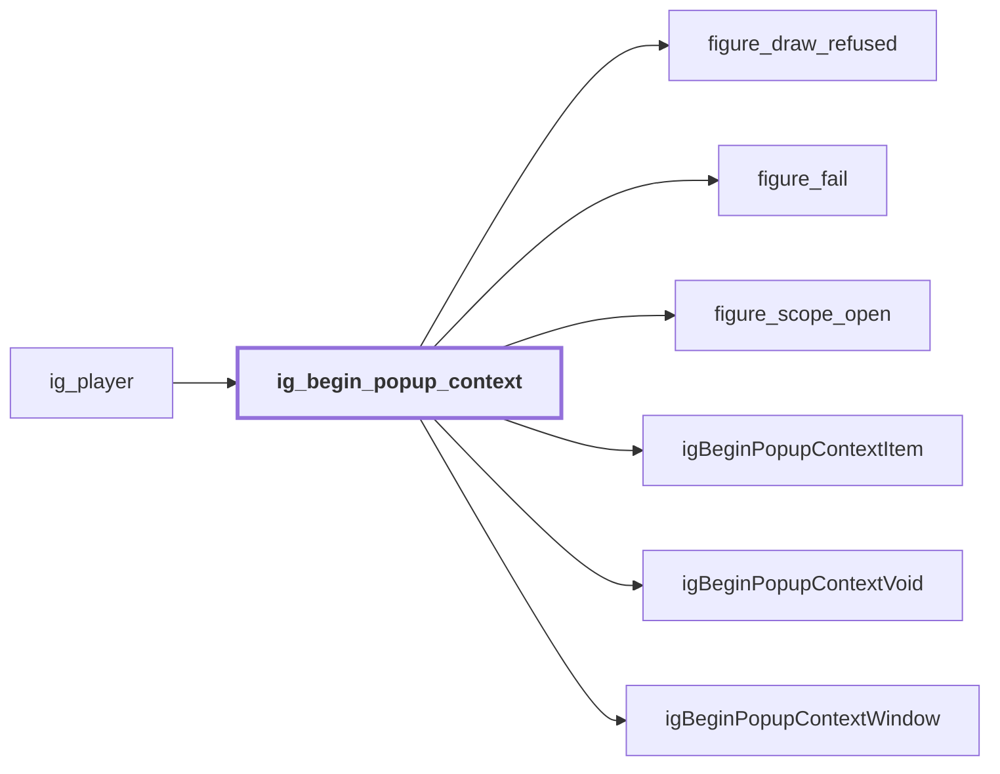
