# figure_numbers

> figure_numbers, numbers and choices: fields, drag boxes and sliders for integers and reals, scalar or vector; angles;
 ranges; radio buttons and list boxes.

 The number widgets are generic over the kind of the value, `int32`, `int64`, `real32` or `real64`, scalar or rank 1
 (a vector: one field, drag box or slider per component, side by side, sharing the bounds). Bounds and steps have the
 kind of the value; `speed` is `real64` whatever the kind. Each returns `.true.` on the frame the user changed the
 value, which it writes back in place. A `format` is a C printf format of one value of the kind's family (integer:
 `%d`, `%i`, `%u`; real: `%f`, `%e`, `%g`, `%a`), checked by `format_ok` before Dear ImGui sees it (`FIG_ERR_ARGUMENT`
 otherwise); an `int64`'s format is given as an `int32`'s (`'%d'`) and FIGURE adds the length modifier C needs.

 Every procedure refuses a call from a task or with no frame open (`FIG_ERR_STATE`, as every drawing call), and
 arguments Dear ImGui would assert on (`FIG_ERR_ARGUMENT`); `stat` is optional: absent, a failure stops with
 `error stop` and the message (usage errors: reported by the next `app%next_frame`). None opens a scope: the list
 box's begin and end are inside `ig_list_box`. widgets.md, "Numbers" and "Choices".

**Source**: `src/lib/figure_numbers.F90`

**Dependencies**

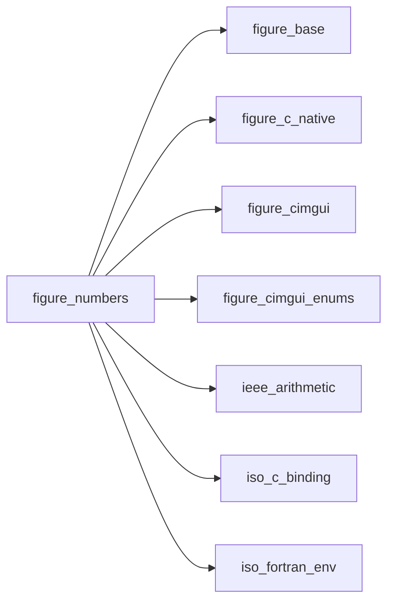

## Contents

- [number_kind](#number-kind)
- [ig_input](#ig-input)
- [ig_drag](#ig-drag)
- [ig_slider](#ig-slider)
- [ig_slider_angle](#ig-slider-angle)
- [ig_drag_range](#ig-drag-range)
- [ig_radio](#ig-radio)
- [ig_list_box](#ig-list-box)
- [ig_slider_angle_r32](#ig-slider-angle-r32)
- [ig_slider_angle_r64](#ig-slider-angle-r64)
- [ig_input_i32](#ig-input-i32)
- [ig_drag_i32](#ig-drag-i32)
- [ig_slider_i32](#ig-slider-i32)
- [ig_input_i32_v](#ig-input-i32-v)
- [ig_drag_i32_v](#ig-drag-i32-v)
- [ig_slider_i32_v](#ig-slider-i32-v)
- [ig_drag_range_i32](#ig-drag-range-i32)
- [ig_input_i64](#ig-input-i64)
- [ig_drag_i64](#ig-drag-i64)
- [ig_slider_i64](#ig-slider-i64)
- [ig_input_i64_v](#ig-input-i64-v)
- [ig_drag_i64_v](#ig-drag-i64-v)
- [ig_slider_i64_v](#ig-slider-i64-v)
- [ig_drag_range_i64](#ig-drag-range-i64)
- [ig_input_r32](#ig-input-r32)
- [ig_drag_r32](#ig-drag-r32)
- [ig_slider_r32](#ig-slider-r32)
- [ig_input_r32_v](#ig-input-r32-v)
- [ig_drag_r32_v](#ig-drag-r32-v)
- [ig_slider_r32_v](#ig-slider-r32-v)
- [ig_drag_range_r32](#ig-drag-range-r32)
- [ig_input_r64](#ig-input-r64)
- [ig_drag_r64](#ig-drag-r64)
- [ig_slider_r64](#ig-slider-r64)
- [ig_input_r64_v](#ig-input-r64-v)
- [ig_drag_r64_v](#ig-drag-r64-v)
- [ig_slider_r64_v](#ig-slider-r64-v)
- [ig_drag_range_r64](#ig-drag-range-r64)
- [input_core](#input-core)
- [drag_core](#drag-core)
- [slider_core](#slider-core)
- [range_core](#range-core)
- [angle_core](#angle-core)
- [c_format](#c-format)
- [speed_ok](#speed-ok)
- [scale_flags](#scale-flags)
- [no_components](#no-components)
- [int_range](#int-range)
- [real_range](#real-range)
- [int_text](#int-text)
- [real_text](#real-text)

## Variables

| Name | Type | Attributes | Description |
|------|------|------------|-------------|
| `K_I32` | type([number_kind](/api/src/lib/figure_numbers#number-kind)) | parameter | int32. |
| `K_I64` | type([number_kind](/api/src/lib/figure_numbers#number-kind)) | parameter | int64. |
| `K_R32` | type([number_kind](/api/src/lib/figure_numbers#number-kind)) | parameter | real32. |
| `K_R64` | type([number_kind](/api/src/lib/figure_numbers#number-kind)) | parameter | real64. |
| `HALF_I32` | integer(kind=c_int) | parameter | int32. |
| `HALF_I64` | integer(kind=c_long_long) | parameter | int64. |
| `HALF_R32` | real(kind=c_float) | parameter | real32. |
| `HALF_R64` | real(kind=c_double) | parameter | real64. |
| `CONVERSION_MAX` | integer(kind=int32) | parameter | Longest conversion of a format (Dear ImGui copies it into 32 bytes, 'll' included, and asserts beyond). |
| `PI` | real(kind=real64) | parameter | pi. |
| `FAST_I32` | integer(kind=int32) | parameter | Largest int32 step whose 10 steps fit. |
| `FAST_I64` | integer(kind=int64) | parameter | Largest int64 step whose 10 steps fit. |

## Derived Types

### number_kind

What a widget needs to know of a kind: Dear ImGui's data type, the format family, the C length modifier.

**Components**

| Name | Type | Attributes | Description |
|------|------|------------|-------------|
| `dtype` | integer(kind=c_int) |  | ImGuiDataType_*. |
| `family` | integer(kind=int32) |  | FORMAT_INTEGER or FORMAT_REAL. |
| `wide` | logical |  | 64-bit integer: 'll' before the conversion of a format. |

## Interfaces

### ig_input

A field for a number or a vector of numbers, typed: `ig_input(label, value [, step] [, format] [,
 enter_returns] [, read_only] [, stat]) → logical`. `value` `int32`, `int64`, `real32` or `real64`, scalar or
 rank 1 (one field per component). `step` (> 0, the kind of `value`) adds - and + buttons (ctrl: 10 steps).
 `format` default: `'%d'` for integers, `'%.6g'` for reals. True on the frame the user changes the value: when
 the field is left (enter, tab, a click elsewhere) after an edit, or a button is pressed; with
 `enter_returns=.true.`, only on the frame enter is pressed. `read_only=.true.`: shown, selectable, not editable.

**Module procedures**: [`ig_input_i32`](/api/src/lib/figure_numbers#ig-input-i32), [`ig_input_i64`](/api/src/lib/figure_numbers#ig-input-i64), [`ig_input_r32`](/api/src/lib/figure_numbers#ig-input-r32), [`ig_input_r64`](/api/src/lib/figure_numbers#ig-input-r64), [`ig_input_i32_v`](/api/src/lib/figure_numbers#ig-input-i32-v), [`ig_input_i64_v`](/api/src/lib/figure_numbers#ig-input-i64-v), [`ig_input_r32_v`](/api/src/lib/figure_numbers#ig-input-r32-v), [`ig_input_r64_v`](/api/src/lib/figure_numbers#ig-input-r64-v)

### ig_drag

A drag box for a number or a vector: `ig_drag(label, value [, speed] [, vmin] [, vmax] [, format] [, scale] [,
 clamp] [, stat]) → logical`. Dragged sideways, `value` changes by `speed` per pixel (default 1; shift: 10 times,
 alt: a hundredth); a double click or ctrl-click types a value. `vmin`, `vmax` (the kind of `value`) stop the
 drag; `clamp=.true.` clamps a typed value too. `scale='log'` (with `vmin` and `vmax`): equal drags multiply the
 value by equal factors. Reals are rounded to the precision `format` shows.

**Module procedures**: [`ig_drag_i32`](/api/src/lib/figure_numbers#ig-drag-i32), [`ig_drag_i64`](/api/src/lib/figure_numbers#ig-drag-i64), [`ig_drag_r32`](/api/src/lib/figure_numbers#ig-drag-r32), [`ig_drag_r64`](/api/src/lib/figure_numbers#ig-drag-r64), [`ig_drag_i32_v`](/api/src/lib/figure_numbers#ig-drag-i32-v), [`ig_drag_i64_v`](/api/src/lib/figure_numbers#ig-drag-i64-v), [`ig_drag_r32_v`](/api/src/lib/figure_numbers#ig-drag-r32-v), [`ig_drag_r64_v`](/api/src/lib/figure_numbers#ig-drag-r64-v)

### ig_slider

A slider for a number or a vector: `ig_slider(label, value, vmin, vmax [, format] [, scale] [, clamp] [, stat])
 → logical`. A click or a drag sets `value` in [vmin, vmax] (vmin > vmax: a reversed slider); ctrl-click types
 one (`clamp=.true.`: clamped too). `scale='log'`: the middle of the slider is the geometric mean of positive
 ends. `vmin`, `vmax` within half the range of the kind. Reals are rounded to the precision `format` shows.

**Module procedures**: [`ig_slider_i32`](/api/src/lib/figure_numbers#ig-slider-i32), [`ig_slider_i64`](/api/src/lib/figure_numbers#ig-slider-i64), [`ig_slider_r32`](/api/src/lib/figure_numbers#ig-slider-r32), [`ig_slider_r64`](/api/src/lib/figure_numbers#ig-slider-r64), [`ig_slider_i32_v`](/api/src/lib/figure_numbers#ig-slider-i32-v), [`ig_slider_i64_v`](/api/src/lib/figure_numbers#ig-slider-i64-v), [`ig_slider_r32_v`](/api/src/lib/figure_numbers#ig-slider-r32-v), [`ig_slider_r64_v`](/api/src/lib/figure_numbers#ig-slider-r64-v)

### ig_slider_angle

A slider for an angle kept in radians and shown in degrees: `ig_slider_angle(label, radians [, deg_min] [,
 deg_max] [, format] [, stat]) → logical` (`SliderAngle`), `real32` or `real64`; bounds in degrees (default -360
 and 360), `format` of the degrees (default `'%.0f deg'`). Edited in single precision: `radians` is written only
 on the frames it changes.

**Module procedures**: [`ig_slider_angle_r32`](/api/src/lib/figure_numbers#ig-slider-angle-r32), [`ig_slider_angle_r64`](/api/src/lib/figure_numbers#ig-slider-angle-r64)

### ig_drag_range

Two drag boxes for the ends of a range [lo, hi] and one label: `ig_drag_range(label, lo, hi [, speed] [, vmin]
 [, vmax] [, format] [, stat]) → logical` (`DragFloatRange2`, `DragIntRange2` for any kind). `lo` stays in
 [vmin, hi] and `hi` in [lo, vmax], typed values too.

**Module procedures**: [`ig_drag_range_i32`](/api/src/lib/figure_numbers#ig-drag-range-i32), [`ig_drag_range_i64`](/api/src/lib/figure_numbers#ig-drag-range-i64), [`ig_drag_range_r32`](/api/src/lib/figure_numbers#ig-drag-range-r32), [`ig_drag_range_r64`](/api/src/lib/figure_numbers#ig-drag-range-r64)

## Functions

### ig_radio

A radio button of a group sharing `current`: drawn chosen when `current == value`; a click sets `current =
 value` and returns true (on that frame; also when it was chosen already). One call per option, each with its own
 `value` (`RadioButton`).

**Attributes**: recursive

**Returns**: `logical`

```fortran
function ig_radio(label, current, value, stat) result(clicked)
```

**Arguments**

| Name | Type | Intent | Attributes | Description |
|------|------|--------|------------|-------------|
| `label` | character(len=*) | in |  | Label (also the id; '##id' hides it). |
| `current` | integer(kind=int32) | inout |  | The option chosen in the group. |
| `value` | integer(kind=int32) | in |  | This button's option. |
| `stat` | integer(kind=int32) | out | optional | Status. |

**Call graph**

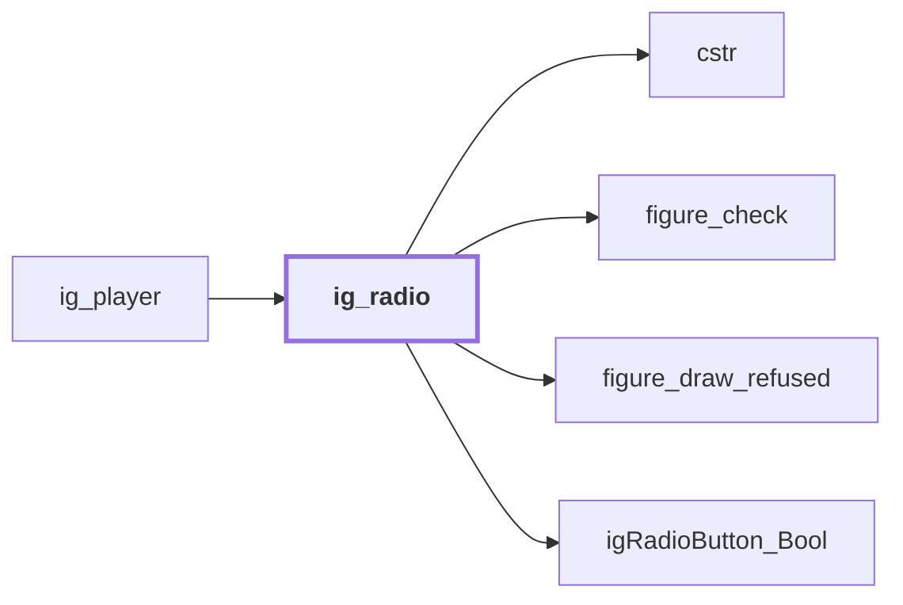

### ig_list_box

A list of `items` shown at once, in a box that scrolls; `current` is the index of the one chosen (1 to
 `size(items)`; any other value shows none chosen). True on the frame the user picks an item (`current` is then
 its index); a pick is reported as an edit by `ig_last_item`. Only the rows in view are drawn. Trailing blanks of
 the items are not shown; items may repeat a text (they are told apart by their index).

**Attributes**: recursive

**Returns**: `logical`

```fortran
function ig_list_box(label, current, items, height, stat) result(changed)
```

**Arguments**

| Name | Type | Intent | Attributes | Description |
|------|------|--------|------------|-------------|
| `label` | character(len=*) | in |  | Label (also the id; '##id' hides it). |
| `current` | integer(kind=int32) | inout |  | Index of the chosen item. |
| `items` | character(len=*) | in |  | Items. |
| `height` | real(kind=real64) | in | optional | Height [pixels]; 0 (default): up to 7 items; < 0: the height left in the window minus \|height\|. |
| `stat` | integer(kind=int32) | out | optional | Status. |

**Call graph**

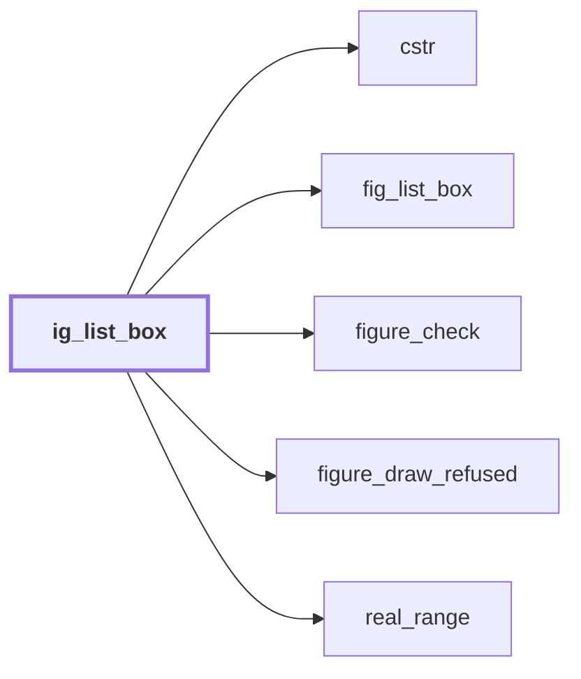

### ig_slider_angle_r32

A slider for a `real32` angle in radians, shown in degrees: see `ig_slider_angle`.

**Attributes**: recursive

**Returns**: `logical`

```fortran
function ig_slider_angle_r32(label, radians, deg_min, deg_max, format, stat) result(changed)
```

**Arguments**

| Name | Type | Intent | Attributes | Description |
|------|------|--------|------------|-------------|
| `label` | character(len=*) | in |  | Label (also the id; '##id' hides it). |
| `radians` | real(kind=real32) | inout |  | Angle [radians]. |
| `deg_min` | real(kind=real32) | in | optional | Left end [degrees] (default -360). |
| `deg_max` | real(kind=real32) | in | optional | Right end [degrees] (default 360). |
| `format` | character(len=*) | in | optional | printf format of the degrees, a real (default '%.0f deg'). |
| `stat` | integer(kind=int32) | out | optional | Status. |

**Call graph**

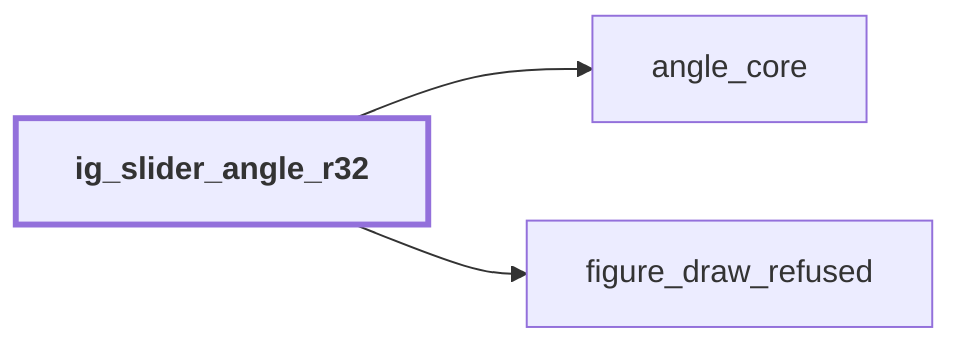

### ig_slider_angle_r64

A slider for a `real64` angle in radians, shown in degrees: see `ig_slider_angle`.

**Attributes**: recursive

**Returns**: `logical`

```fortran
function ig_slider_angle_r64(label, radians, deg_min, deg_max, format, stat) result(changed)
```

**Arguments**

| Name | Type | Intent | Attributes | Description |
|------|------|--------|------------|-------------|
| `label` | character(len=*) | in |  | Label (also the id; '##id' hides it). |
| `radians` | real(kind=real64) | inout |  | Angle [radians]. |
| `deg_min` | real(kind=real64) | in | optional | Left end [degrees] (default -360). |
| `deg_max` | real(kind=real64) | in | optional | Right end [degrees] (default 360). |
| `format` | character(len=*) | in | optional | printf format of the degrees, a real (default '%.0f deg'). |
| `stat` | integer(kind=int32) | out | optional | Status. |

**Call graph**

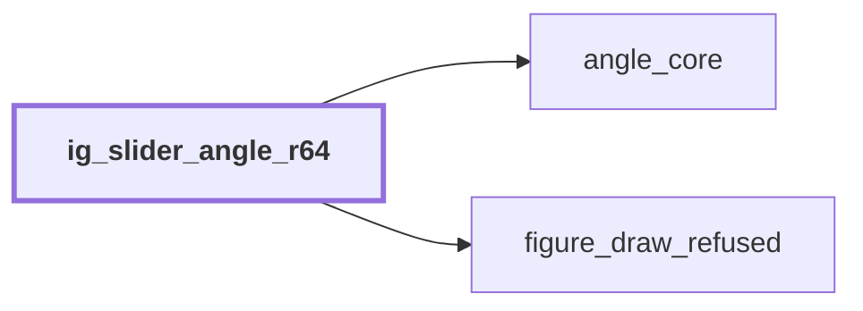

### ig_input_i32

A field for an `int32` value (`InputScalar`); true when the user changed the value: see `ig_input`.

**Attributes**: recursive

**Returns**: `logical`

```fortran
function ig_input_i32(label, value, step, format, enter_returns, read_only, stat) result(changed)
```

**Arguments**

| Name | Type | Intent | Attributes | Description |
|------|------|--------|------------|-------------|
| `label` | character(len=*) | in |  | Label (also the id; '##id' hides it). |
| `value` | integer(kind=int32) | inout |  | Value. |
| `step` | integer(kind=int32) | in | optional | Step of the - and + buttons, > 0 (default: no buttons). |
| `format` | character(len=*) | in | optional | printf format of an integer (checked; default '%d'). |
| `enter_returns` | logical | in | optional | True only on the frame enter is pressed. |
| `read_only` | logical | in | optional | Shown, not editable (default false). |
| `stat` | integer(kind=int32) | out | optional | Status. |

**Call graph**

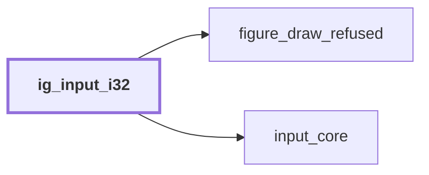

### ig_drag_i32

A drag box for an `int32` value (`DragScalar`); true when the user changed the value: see `ig_drag`.

**Attributes**: recursive

**Returns**: `logical`

```fortran
function ig_drag_i32(label, value, speed, vmin, vmax, format, scale, clamp, stat) result(changed)
```

**Arguments**

| Name | Type | Intent | Attributes | Description |
|------|------|--------|------------|-------------|
| `label` | character(len=*) | in |  | Label (also the id; '##id' hides it). |
| `value` | integer(kind=int32) | inout |  | Value. |
| `speed` | real(kind=real64) | in | optional | Change per pixel dragged [value/pixel], > 0 (default 1). |
| `vmin` | integer(kind=int32) | in | optional | Lowest value a drag reaches (default: none). |
| `vmax` | integer(kind=int32) | in | optional | Highest value a drag reaches (default: none). |
| `format` | character(len=*) | in | optional | printf format of an integer (checked). |
| `scale` | character(len=*) | in | optional | 'linear' (default) or 'log' (with vmin and vmax). |
| `clamp` | logical | in | optional | Typed values clamped too (default false). |
| `stat` | integer(kind=int32) | out | optional | Status. |

**Call graph**


### ig_slider_i32

A slider for an `int32` value (`SliderScalar`); true when the user changed the value: see `ig_slider`.

**Attributes**: recursive

**Returns**: `logical`

```fortran
function ig_slider_i32(label, value, vmin, vmax, format, scale, clamp, stat) result(changed)
```

**Arguments**

| Name | Type | Intent | Attributes | Description |
|------|------|--------|------------|-------------|
| `label` | character(len=*) | in |  | Label (also the id; '##id' hides it). |
| `value` | integer(kind=int32) | inout |  | Value. |
| `vmin` | integer(kind=int32) | in |  | Value at the left end. |
| `vmax` | integer(kind=int32) | in |  | Value at the right end. |
| `format` | character(len=*) | in | optional | printf format of an integer (checked). |
| `scale` | character(len=*) | in | optional | 'linear' (default) or 'log'. |
| `clamp` | logical | in | optional | Typed values clamped too (default false). |
| `stat` | integer(kind=int32) | out | optional | Status. |

**Call graph**

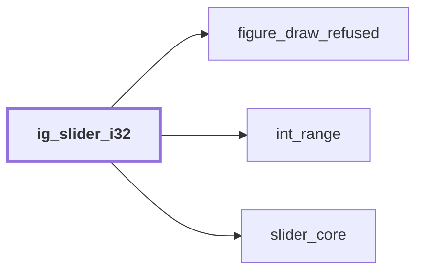

### ig_input_i32_v

A field for a vector of `int32` values, one field per component (`InputScalarN`); true when the user changed the
 value: see `ig_input`.

**Attributes**: recursive

**Returns**: `logical`

```fortran
function ig_input_i32_v(label, value, step, format, enter_returns, read_only, stat) result(changed)
```

**Arguments**

| Name | Type | Intent | Attributes | Description |
|------|------|--------|------------|-------------|
| `label` | character(len=*) | in |  | Label (also the id; '##id' hides it). |
| `value` | integer(kind=int32) | inout |  | Value. |
| `step` | integer(kind=int32) | in | optional | Step of the - and + buttons, > 0 (default: no buttons). |
| `format` | character(len=*) | in | optional | printf format of an integer (checked; default '%d'). |
| `enter_returns` | logical | in | optional | True only on the frame enter is pressed. |
| `read_only` | logical | in | optional | Shown, not editable (default false). |
| `stat` | integer(kind=int32) | out | optional | Status. |

**Call graph**


### ig_drag_i32_v

A drag box for a vector of `int32` values, one field per component (`DragScalarN`); true when the user changed the
 value: see `ig_drag`.

**Attributes**: recursive

**Returns**: `logical`

```fortran
function ig_drag_i32_v(label, value, speed, vmin, vmax, format, scale, clamp, stat) result(changed)
```

**Arguments**

| Name | Type | Intent | Attributes | Description |
|------|------|--------|------------|-------------|
| `label` | character(len=*) | in |  | Label (also the id; '##id' hides it). |
| `value` | integer(kind=int32) | inout |  | Value. |
| `speed` | real(kind=real64) | in | optional | Change per pixel dragged [value/pixel], > 0 (default 1). |
| `vmin` | integer(kind=int32) | in | optional | Lowest value a drag reaches (default: none). |
| `vmax` | integer(kind=int32) | in | optional | Highest value a drag reaches (default: none). |
| `format` | character(len=*) | in | optional | printf format of an integer (checked). |
| `scale` | character(len=*) | in | optional | 'linear' (default) or 'log' (with vmin and vmax). |
| `clamp` | logical | in | optional | Typed values clamped too (default false). |
| `stat` | integer(kind=int32) | out | optional | Status. |

**Call graph**


### ig_slider_i32_v

A slider for a vector of `int32` values, one field per component (`SliderScalarN`); true when the user changed the
 value: see `ig_slider`.

**Attributes**: recursive

**Returns**: `logical`

```fortran
function ig_slider_i32_v(label, value, vmin, vmax, format, scale, clamp, stat) result(changed)
```

**Arguments**

| Name | Type | Intent | Attributes | Description |
|------|------|--------|------------|-------------|
| `label` | character(len=*) | in |  | Label (also the id; '##id' hides it). |
| `value` | integer(kind=int32) | inout |  | Value. |
| `vmin` | integer(kind=int32) | in |  | Value at the left end. |
| `vmax` | integer(kind=int32) | in |  | Value at the right end. |
| `format` | character(len=*) | in | optional | printf format of an integer (checked). |
| `scale` | character(len=*) | in | optional | 'linear' (default) or 'log'. |
| `clamp` | logical | in | optional | Typed values clamped too (default false). |
| `stat` | integer(kind=int32) | out | optional | Status. |

**Call graph**


### ig_drag_range_i32

Two drag boxes for the ends of a range of `int32` values; true when the user changed either: see `ig_drag_range`.

**Attributes**: recursive

**Returns**: `logical`

```fortran
function ig_drag_range_i32(label, lo, hi, speed, vmin, vmax, format, stat) result(changed)
```

**Arguments**

| Name | Type | Intent | Attributes | Description |
|------|------|--------|------------|-------------|
| `label` | character(len=*) | in |  | Label (also the id; '##id' hides it). |
| `lo` | integer(kind=int32) | inout |  | Lower end of the range. |
| `hi` | integer(kind=int32) | inout |  | Upper end of the range. |
| `speed` | real(kind=real64) | in | optional | Change per pixel dragged [value/pixel], > 0 (default 1). |
| `vmin` | integer(kind=int32) | in | optional | Lowest value of `lo` (default: none). |
| `vmax` | integer(kind=int32) | in | optional | Highest value of `hi` (default: none). |
| `format` | character(len=*) | in | optional | printf format of an integer (checked). |
| `stat` | integer(kind=int32) | out | optional | Status. |

**Call graph**

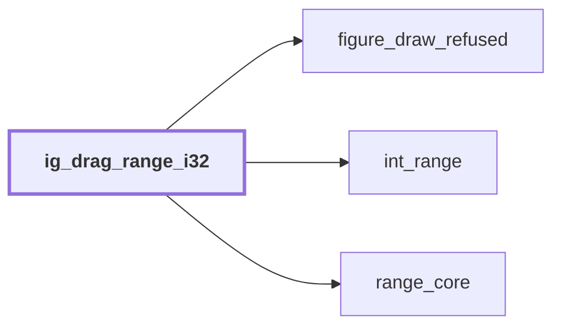

### ig_input_i64

A field for an `int64` value (`InputScalar`); true when the user changed the value: see `ig_input`.

**Attributes**: recursive

**Returns**: `logical`

```fortran
function ig_input_i64(label, value, step, format, enter_returns, read_only, stat) result(changed)
```

**Arguments**

| Name | Type | Intent | Attributes | Description |
|------|------|--------|------------|-------------|
| `label` | character(len=*) | in |  | Label (also the id; '##id' hides it). |
| `value` | integer(kind=int64) | inout |  | Value. |
| `step` | integer(kind=int64) | in | optional | Step of the - and + buttons, > 0 (default: no buttons). |
| `format` | character(len=*) | in | optional | printf format of an integer (checked; default '%d'). |
| `enter_returns` | logical | in | optional | True only on the frame enter is pressed. |
| `read_only` | logical | in | optional | Shown, not editable (default false). |
| `stat` | integer(kind=int32) | out | optional | Status. |

**Call graph**


### ig_drag_i64

A drag box for an `int64` value (`DragScalar`); true when the user changed the value: see `ig_drag`.

**Attributes**: recursive

**Returns**: `logical`

```fortran
function ig_drag_i64(label, value, speed, vmin, vmax, format, scale, clamp, stat) result(changed)
```

**Arguments**

| Name | Type | Intent | Attributes | Description |
|------|------|--------|------------|-------------|
| `label` | character(len=*) | in |  | Label (also the id; '##id' hides it). |
| `value` | integer(kind=int64) | inout |  | Value. |
| `speed` | real(kind=real64) | in | optional | Change per pixel dragged [value/pixel], > 0 (default 1). |
| `vmin` | integer(kind=int64) | in | optional | Lowest value a drag reaches (default: none). |
| `vmax` | integer(kind=int64) | in | optional | Highest value a drag reaches (default: none). |
| `format` | character(len=*) | in | optional | printf format of an integer (checked). |
| `scale` | character(len=*) | in | optional | 'linear' (default) or 'log' (with vmin and vmax). |
| `clamp` | logical | in | optional | Typed values clamped too (default false). |
| `stat` | integer(kind=int32) | out | optional | Status. |

**Call graph**

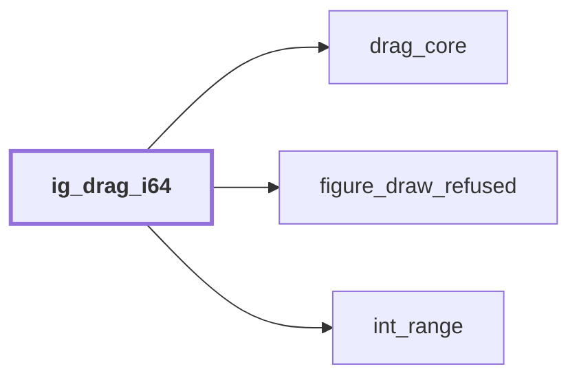

### ig_slider_i64

A slider for an `int64` value (`SliderScalar`); true when the user changed the value: see `ig_slider`.

**Attributes**: recursive

**Returns**: `logical`

```fortran
function ig_slider_i64(label, value, vmin, vmax, format, scale, clamp, stat) result(changed)
```

**Arguments**

| Name | Type | Intent | Attributes | Description |
|------|------|--------|------------|-------------|
| `label` | character(len=*) | in |  | Label (also the id; '##id' hides it). |
| `value` | integer(kind=int64) | inout |  | Value. |
| `vmin` | integer(kind=int64) | in |  | Value at the left end. |
| `vmax` | integer(kind=int64) | in |  | Value at the right end. |
| `format` | character(len=*) | in | optional | printf format of an integer (checked). |
| `scale` | character(len=*) | in | optional | 'linear' (default) or 'log'. |
| `clamp` | logical | in | optional | Typed values clamped too (default false). |
| `stat` | integer(kind=int32) | out | optional | Status. |

**Call graph**


### ig_input_i64_v

A field for a vector of `int64` values, one field per component (`InputScalarN`); true when the user changed the
 value: see `ig_input`.

**Attributes**: recursive

**Returns**: `logical`

```fortran
function ig_input_i64_v(label, value, step, format, enter_returns, read_only, stat) result(changed)
```

**Arguments**

| Name | Type | Intent | Attributes | Description |
|------|------|--------|------------|-------------|
| `label` | character(len=*) | in |  | Label (also the id; '##id' hides it). |
| `value` | integer(kind=int64) | inout |  | Value. |
| `step` | integer(kind=int64) | in | optional | Step of the - and + buttons, > 0 (default: no buttons). |
| `format` | character(len=*) | in | optional | printf format of an integer (checked; default '%d'). |
| `enter_returns` | logical | in | optional | True only on the frame enter is pressed. |
| `read_only` | logical | in | optional | Shown, not editable (default false). |
| `stat` | integer(kind=int32) | out | optional | Status. |

**Call graph**

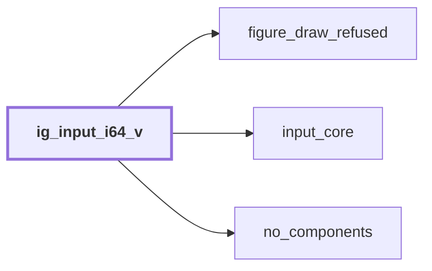

### ig_drag_i64_v

A drag box for a vector of `int64` values, one field per component (`DragScalarN`); true when the user changed the
 value: see `ig_drag`.

**Attributes**: recursive

**Returns**: `logical`

```fortran
function ig_drag_i64_v(label, value, speed, vmin, vmax, format, scale, clamp, stat) result(changed)
```

**Arguments**

| Name | Type | Intent | Attributes | Description |
|------|------|--------|------------|-------------|
| `label` | character(len=*) | in |  | Label (also the id; '##id' hides it). |
| `value` | integer(kind=int64) | inout |  | Value. |
| `speed` | real(kind=real64) | in | optional | Change per pixel dragged [value/pixel], > 0 (default 1). |
| `vmin` | integer(kind=int64) | in | optional | Lowest value a drag reaches (default: none). |
| `vmax` | integer(kind=int64) | in | optional | Highest value a drag reaches (default: none). |
| `format` | character(len=*) | in | optional | printf format of an integer (checked). |
| `scale` | character(len=*) | in | optional | 'linear' (default) or 'log' (with vmin and vmax). |
| `clamp` | logical | in | optional | Typed values clamped too (default false). |
| `stat` | integer(kind=int32) | out | optional | Status. |

**Call graph**

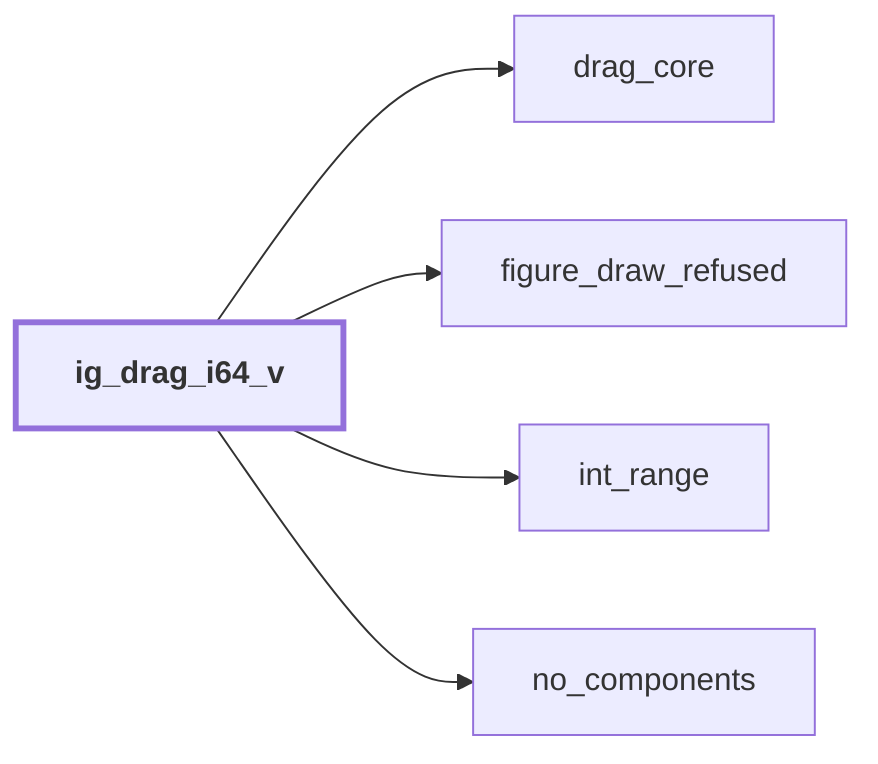

### ig_slider_i64_v

A slider for a vector of `int64` values, one field per component (`SliderScalarN`); true when the user changed the
 value: see `ig_slider`.

**Attributes**: recursive

**Returns**: `logical`

```fortran
function ig_slider_i64_v(label, value, vmin, vmax, format, scale, clamp, stat) result(changed)
```

**Arguments**

| Name | Type | Intent | Attributes | Description |
|------|------|--------|------------|-------------|
| `label` | character(len=*) | in |  | Label (also the id; '##id' hides it). |
| `value` | integer(kind=int64) | inout |  | Value. |
| `vmin` | integer(kind=int64) | in |  | Value at the left end. |
| `vmax` | integer(kind=int64) | in |  | Value at the right end. |
| `format` | character(len=*) | in | optional | printf format of an integer (checked). |
| `scale` | character(len=*) | in | optional | 'linear' (default) or 'log'. |
| `clamp` | logical | in | optional | Typed values clamped too (default false). |
| `stat` | integer(kind=int32) | out | optional | Status. |

**Call graph**

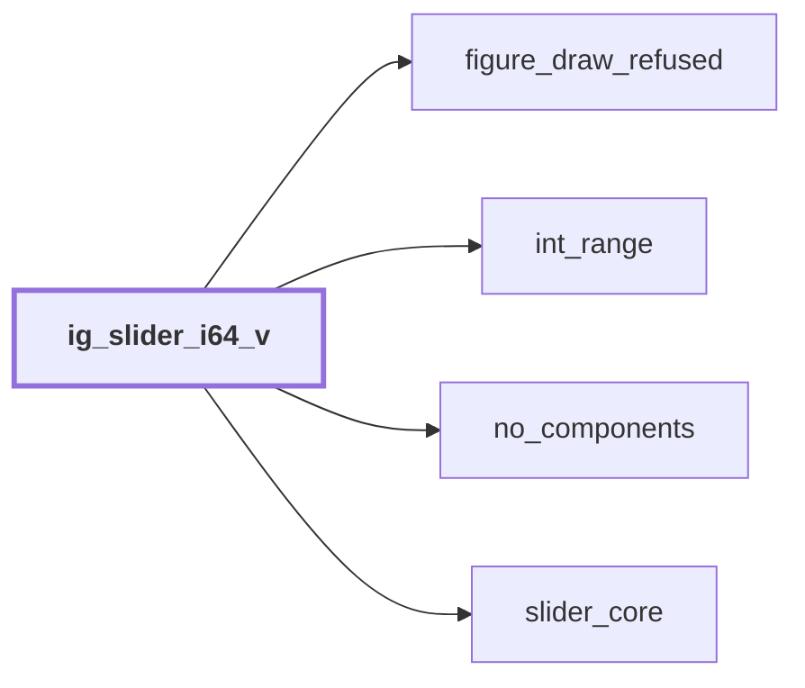

### ig_drag_range_i64

Two drag boxes for the ends of a range of `int64` values; true when the user changed either: see `ig_drag_range`.

**Attributes**: recursive

**Returns**: `logical`

```fortran
function ig_drag_range_i64(label, lo, hi, speed, vmin, vmax, format, stat) result(changed)
```

**Arguments**

| Name | Type | Intent | Attributes | Description |
|------|------|--------|------------|-------------|
| `label` | character(len=*) | in |  | Label (also the id; '##id' hides it). |
| `lo` | integer(kind=int64) | inout |  | Lower end of the range. |
| `hi` | integer(kind=int64) | inout |  | Upper end of the range. |
| `speed` | real(kind=real64) | in | optional | Change per pixel dragged [value/pixel], > 0 (default 1). |
| `vmin` | integer(kind=int64) | in | optional | Lowest value of `lo` (default: none). |
| `vmax` | integer(kind=int64) | in | optional | Highest value of `hi` (default: none). |
| `format` | character(len=*) | in | optional | printf format of an integer (checked). |
| `stat` | integer(kind=int32) | out | optional | Status. |

**Call graph**

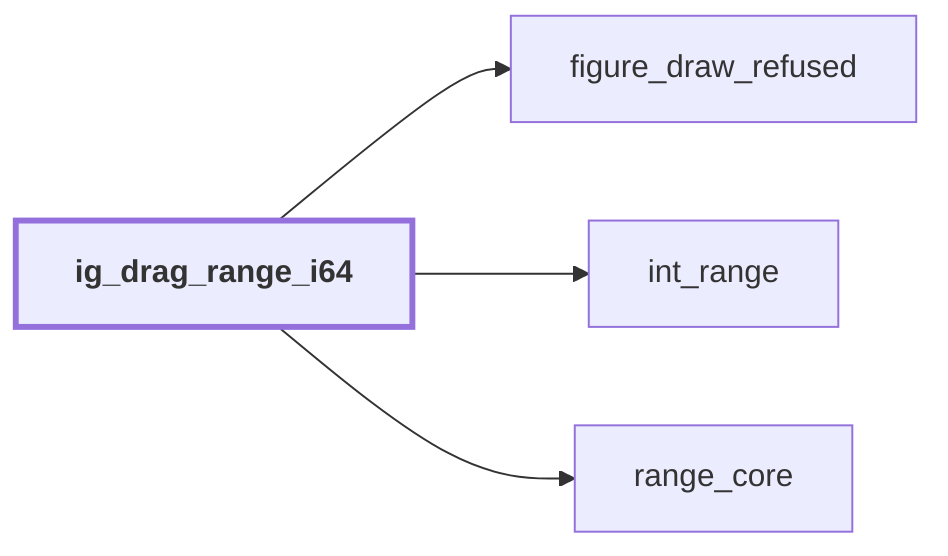

### ig_input_r32

A field for a `real32` value (`InputScalar`); true when the user changed the value: see `ig_input`.

**Attributes**: recursive

**Returns**: `logical`

```fortran
function ig_input_r32(label, value, step, format, enter_returns, read_only, stat) result(changed)
```

**Arguments**

| Name | Type | Intent | Attributes | Description |
|------|------|--------|------------|-------------|
| `label` | character(len=*) | in |  | Label (also the id; '##id' hides it). |
| `value` | real(kind=real32) | inout |  | Value. |
| `step` | real(kind=real32) | in | optional | Step of the - and + buttons, > 0 (default: no buttons). |
| `format` | character(len=*) | in | optional | printf format of a real (checked; default '%.6g'). |
| `enter_returns` | logical | in | optional | True only on the frame enter is pressed. |
| `read_only` | logical | in | optional | Shown, not editable (default false). |
| `stat` | integer(kind=int32) | out | optional | Status. |

**Call graph**

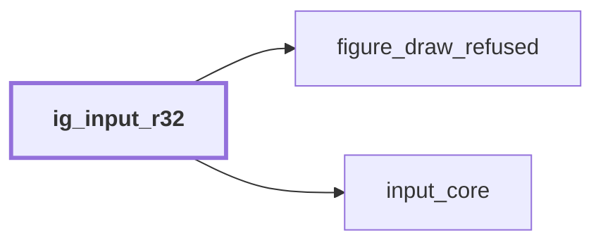

### ig_drag_r32

A drag box for a `real32` value (`DragScalar`); true when the user changed the value: see `ig_drag`.

**Attributes**: recursive

**Returns**: `logical`

```fortran
function ig_drag_r32(label, value, speed, vmin, vmax, format, scale, clamp, stat) result(changed)
```

**Arguments**

| Name | Type | Intent | Attributes | Description |
|------|------|--------|------------|-------------|
| `label` | character(len=*) | in |  | Label (also the id; '##id' hides it). |
| `value` | real(kind=real32) | inout |  | Value. |
| `speed` | real(kind=real64) | in | optional | Change per pixel dragged [value/pixel], > 0 (default 1). |
| `vmin` | real(kind=real32) | in | optional | Lowest value a drag reaches (default: none). |
| `vmax` | real(kind=real32) | in | optional | Highest value a drag reaches (default: none). |
| `format` | character(len=*) | in | optional | printf format of a real (checked). |
| `scale` | character(len=*) | in | optional | 'linear' (default) or 'log' (with vmin and vmax). |
| `clamp` | logical | in | optional | Typed values clamped too (default false). |
| `stat` | integer(kind=int32) | out | optional | Status. |

**Call graph**

```mermaid
flowchart LR
  ig_drag_r32["ig_drag_r32"] --> drag_core["drag_core"]
  ig_drag_r32["ig_drag_r32"] --> figure_draw_refused["figure_draw_refused"]
  ig_drag_r32["ig_drag_r32"] --> real_range["real_range"]
  classDef focus stroke-width:3px,font-weight:bold
  class ig_drag_r32 focus
  click figure_draw_refused href "figure_base.html#figure-draw-refused" "figure_draw_refused"
  click real_range href "#real-range" "real_range"
  click drag_core href "#drag-core" "drag_core"
```

### ig_slider_r32

A slider for a `real32` value (`SliderScalar`); true when the user changed the value: see `ig_slider`.

**Attributes**: recursive

**Returns**: `logical`

```fortran
function ig_slider_r32(label, value, vmin, vmax, format, scale, clamp, stat) result(changed)
```

**Arguments**

| Name | Type | Intent | Attributes | Description |
|------|------|--------|------------|-------------|
| `label` | character(len=*) | in |  | Label (also the id; '##id' hides it). |
| `value` | real(kind=real32) | inout |  | Value. |
| `vmin` | real(kind=real32) | in |  | Value at the left end. |
| `vmax` | real(kind=real32) | in |  | Value at the right end. |
| `format` | character(len=*) | in | optional | printf format of a real (checked). |
| `scale` | character(len=*) | in | optional | 'linear' (default) or 'log'. |
| `clamp` | logical | in | optional | Typed values clamped too (default false). |
| `stat` | integer(kind=int32) | out | optional | Status. |

**Call graph**

```mermaid
flowchart LR
  ig_slider_r32["ig_slider_r32"] --> figure_draw_refused["figure_draw_refused"]
  ig_slider_r32["ig_slider_r32"] --> real_range["real_range"]
  ig_slider_r32["ig_slider_r32"] --> slider_core["slider_core"]
  classDef focus stroke-width:3px,font-weight:bold
  class ig_slider_r32 focus
  click figure_draw_refused href "figure_base.html#figure-draw-refused" "figure_draw_refused"
  click real_range href "#real-range" "real_range"
  click slider_core href "#slider-core" "slider_core"
```

### ig_input_r32_v

A field for a vector of `real32` values, one field per component (`InputScalarN`); true when the user changed the
 value: see `ig_input`.

**Attributes**: recursive

**Returns**: `logical`

```fortran
function ig_input_r32_v(label, value, step, format, enter_returns, read_only, stat) result(changed)
```

**Arguments**

| Name | Type | Intent | Attributes | Description |
|------|------|--------|------------|-------------|
| `label` | character(len=*) | in |  | Label (also the id; '##id' hides it). |
| `value` | real(kind=real32) | inout |  | Value. |
| `step` | real(kind=real32) | in | optional | Step of the - and + buttons, > 0 (default: no buttons). |
| `format` | character(len=*) | in | optional | printf format of a real (checked; default '%.6g'). |
| `enter_returns` | logical | in | optional | True only on the frame enter is pressed. |
| `read_only` | logical | in | optional | Shown, not editable (default false). |
| `stat` | integer(kind=int32) | out | optional | Status. |

**Call graph**

```mermaid
flowchart LR
  ig_input_r32_v["ig_input_r32_v"] --> figure_draw_refused["figure_draw_refused"]
  ig_input_r32_v["ig_input_r32_v"] --> input_core["input_core"]
  ig_input_r32_v["ig_input_r32_v"] --> no_components["no_components"]
  classDef focus stroke-width:3px,font-weight:bold
  class ig_input_r32_v focus
  click figure_draw_refused href "figure_base.html#figure-draw-refused" "figure_draw_refused"
  click no_components href "#no-components" "no_components"
  click input_core href "#input-core" "input_core"
```

### ig_drag_r32_v

A drag box for a vector of `real32` values, one field per component (`DragScalarN`); true when the user changed
 the value: see `ig_drag`.

**Attributes**: recursive

**Returns**: `logical`

```fortran
function ig_drag_r32_v(label, value, speed, vmin, vmax, format, scale, clamp, stat) result(changed)
```

**Arguments**

| Name | Type | Intent | Attributes | Description |
|------|------|--------|------------|-------------|
| `label` | character(len=*) | in |  | Label (also the id; '##id' hides it). |
| `value` | real(kind=real32) | inout |  | Value. |
| `speed` | real(kind=real64) | in | optional | Change per pixel dragged [value/pixel], > 0 (default 1). |
| `vmin` | real(kind=real32) | in | optional | Lowest value a drag reaches (default: none). |
| `vmax` | real(kind=real32) | in | optional | Highest value a drag reaches (default: none). |
| `format` | character(len=*) | in | optional | printf format of a real (checked). |
| `scale` | character(len=*) | in | optional | 'linear' (default) or 'log' (with vmin and vmax). |
| `clamp` | logical | in | optional | Typed values clamped too (default false). |
| `stat` | integer(kind=int32) | out | optional | Status. |

**Call graph**

```mermaid
flowchart LR
  ig_drag_r32_v["ig_drag_r32_v"] --> drag_core["drag_core"]
  ig_drag_r32_v["ig_drag_r32_v"] --> figure_draw_refused["figure_draw_refused"]
  ig_drag_r32_v["ig_drag_r32_v"] --> no_components["no_components"]
  ig_drag_r32_v["ig_drag_r32_v"] --> real_range["real_range"]
  classDef focus stroke-width:3px,font-weight:bold
  class ig_drag_r32_v focus
  click figure_draw_refused href "figure_base.html#figure-draw-refused" "figure_draw_refused"
  click no_components href "#no-components" "no_components"
  click real_range href "#real-range" "real_range"
  click drag_core href "#drag-core" "drag_core"
```

### ig_slider_r32_v

A slider for a vector of `real32` values, one field per component (`SliderScalarN`); true when the user changed
 the value: see `ig_slider`.

**Attributes**: recursive

**Returns**: `logical`

```fortran
function ig_slider_r32_v(label, value, vmin, vmax, format, scale, clamp, stat) result(changed)
```

**Arguments**

| Name | Type | Intent | Attributes | Description |
|------|------|--------|------------|-------------|
| `label` | character(len=*) | in |  | Label (also the id; '##id' hides it). |
| `value` | real(kind=real32) | inout |  | Value. |
| `vmin` | real(kind=real32) | in |  | Value at the left end. |
| `vmax` | real(kind=real32) | in |  | Value at the right end. |
| `format` | character(len=*) | in | optional | printf format of a real (checked). |
| `scale` | character(len=*) | in | optional | 'linear' (default) or 'log'. |
| `clamp` | logical | in | optional | Typed values clamped too (default false). |
| `stat` | integer(kind=int32) | out | optional | Status. |

**Call graph**

```mermaid
flowchart LR
  ig_slider_r32_v["ig_slider_r32_v"] --> figure_draw_refused["figure_draw_refused"]
  ig_slider_r32_v["ig_slider_r32_v"] --> no_components["no_components"]
  ig_slider_r32_v["ig_slider_r32_v"] --> real_range["real_range"]
  ig_slider_r32_v["ig_slider_r32_v"] --> slider_core["slider_core"]
  classDef focus stroke-width:3px,font-weight:bold
  class ig_slider_r32_v focus
  click figure_draw_refused href "figure_base.html#figure-draw-refused" "figure_draw_refused"
  click no_components href "#no-components" "no_components"
  click real_range href "#real-range" "real_range"
  click slider_core href "#slider-core" "slider_core"
```

### ig_drag_range_r32

Two drag boxes for the ends of a range of `real32` values; true when the user changed either: see `ig_drag_range`.

**Attributes**: recursive

**Returns**: `logical`

```fortran
function ig_drag_range_r32(label, lo, hi, speed, vmin, vmax, format, stat) result(changed)
```

**Arguments**

| Name | Type | Intent | Attributes | Description |
|------|------|--------|------------|-------------|
| `label` | character(len=*) | in |  | Label (also the id; '##id' hides it). |
| `lo` | real(kind=real32) | inout |  | Lower end of the range. |
| `hi` | real(kind=real32) | inout |  | Upper end of the range. |
| `speed` | real(kind=real64) | in | optional | Change per pixel dragged [value/pixel], > 0 (default 1). |
| `vmin` | real(kind=real32) | in | optional | Lowest value of `lo` (default: none). |
| `vmax` | real(kind=real32) | in | optional | Highest value of `hi` (default: none). |
| `format` | character(len=*) | in | optional | printf format of a real (checked). |
| `stat` | integer(kind=int32) | out | optional | Status. |

**Call graph**

```mermaid
flowchart LR
  ig_drag_range_r32["ig_drag_range_r32"] --> figure_draw_refused["figure_draw_refused"]
  ig_drag_range_r32["ig_drag_range_r32"] --> range_core["range_core"]
  ig_drag_range_r32["ig_drag_range_r32"] --> real_range["real_range"]
  classDef focus stroke-width:3px,font-weight:bold
  class ig_drag_range_r32 focus
  click figure_draw_refused href "figure_base.html#figure-draw-refused" "figure_draw_refused"
  click real_range href "#real-range" "real_range"
  click range_core href "#range-core" "range_core"
```

### ig_input_r64

A field for a `real64` value (`InputScalar`); true when the user changed the value: see `ig_input`.

**Attributes**: recursive

**Returns**: `logical`

```fortran
function ig_input_r64(label, value, step, format, enter_returns, read_only, stat) result(changed)
```

**Arguments**

| Name | Type | Intent | Attributes | Description |
|------|------|--------|------------|-------------|
| `label` | character(len=*) | in |  | Label (also the id; '##id' hides it). |
| `value` | real(kind=real64) | inout |  | Value. |
| `step` | real(kind=real64) | in | optional | Step of the - and + buttons, > 0 (default: no buttons). |
| `format` | character(len=*) | in | optional | printf format of a real (checked; default '%.6g'). |
| `enter_returns` | logical | in | optional | True only on the frame enter is pressed. |
| `read_only` | logical | in | optional | Shown, not editable (default false). |
| `stat` | integer(kind=int32) | out | optional | Status. |

**Call graph**

```mermaid
flowchart LR
  ig_input_r64["ig_input_r64"] --> figure_draw_refused["figure_draw_refused"]
  ig_input_r64["ig_input_r64"] --> input_core["input_core"]
  classDef focus stroke-width:3px,font-weight:bold
  class ig_input_r64 focus
  click figure_draw_refused href "figure_base.html#figure-draw-refused" "figure_draw_refused"
  click input_core href "#input-core" "input_core"
```

### ig_drag_r64

A drag box for a `real64` value (`DragScalar`); true when the user changed the value: see `ig_drag`.

**Attributes**: recursive

**Returns**: `logical`

```fortran
function ig_drag_r64(label, value, speed, vmin, vmax, format, scale, clamp, stat) result(changed)
```

**Arguments**

| Name | Type | Intent | Attributes | Description |
|------|------|--------|------------|-------------|
| `label` | character(len=*) | in |  | Label (also the id; '##id' hides it). |
| `value` | real(kind=real64) | inout |  | Value. |
| `speed` | real(kind=real64) | in | optional | Change per pixel dragged [value/pixel], > 0 (default 1). |
| `vmin` | real(kind=real64) | in | optional | Lowest value a drag reaches (default: none). |
| `vmax` | real(kind=real64) | in | optional | Highest value a drag reaches (default: none). |
| `format` | character(len=*) | in | optional | printf format of a real (checked). |
| `scale` | character(len=*) | in | optional | 'linear' (default) or 'log' (with vmin and vmax). |
| `clamp` | logical | in | optional | Typed values clamped too (default false). |
| `stat` | integer(kind=int32) | out | optional | Status. |

**Call graph**

```mermaid
flowchart LR
  ig_drag_r64["ig_drag_r64"] --> drag_core["drag_core"]
  ig_drag_r64["ig_drag_r64"] --> figure_draw_refused["figure_draw_refused"]
  ig_drag_r64["ig_drag_r64"] --> real_range["real_range"]
  classDef focus stroke-width:3px,font-weight:bold
  class ig_drag_r64 focus
  click figure_draw_refused href "figure_base.html#figure-draw-refused" "figure_draw_refused"
  click real_range href "#real-range" "real_range"
  click drag_core href "#drag-core" "drag_core"
```

### ig_slider_r64

A slider for a `real64` value (`SliderScalar`); true when the user changed the value: see `ig_slider`.

**Attributes**: recursive

**Returns**: `logical`

```fortran
function ig_slider_r64(label, value, vmin, vmax, format, scale, clamp, stat) result(changed)
```

**Arguments**

| Name | Type | Intent | Attributes | Description |
|------|------|--------|------------|-------------|
| `label` | character(len=*) | in |  | Label (also the id; '##id' hides it). |
| `value` | real(kind=real64) | inout |  | Value. |
| `vmin` | real(kind=real64) | in |  | Value at the left end. |
| `vmax` | real(kind=real64) | in |  | Value at the right end. |
| `format` | character(len=*) | in | optional | printf format of a real (checked). |
| `scale` | character(len=*) | in | optional | 'linear' (default) or 'log'. |
| `clamp` | logical | in | optional | Typed values clamped too (default false). |
| `stat` | integer(kind=int32) | out | optional | Status. |

**Call graph**

```mermaid
flowchart LR
  ig_slider_r64["ig_slider_r64"] --> figure_draw_refused["figure_draw_refused"]
  ig_slider_r64["ig_slider_r64"] --> real_range["real_range"]
  ig_slider_r64["ig_slider_r64"] --> slider_core["slider_core"]
  classDef focus stroke-width:3px,font-weight:bold
  class ig_slider_r64 focus
  click figure_draw_refused href "figure_base.html#figure-draw-refused" "figure_draw_refused"
  click real_range href "#real-range" "real_range"
  click slider_core href "#slider-core" "slider_core"
```

### ig_input_r64_v

A field for a vector of `real64` values, one field per component (`InputScalarN`); true when the user changed the
 value: see `ig_input`.

**Attributes**: recursive

**Returns**: `logical`

```fortran
function ig_input_r64_v(label, value, step, format, enter_returns, read_only, stat) result(changed)
```

**Arguments**

| Name | Type | Intent | Attributes | Description |
|------|------|--------|------------|-------------|
| `label` | character(len=*) | in |  | Label (also the id; '##id' hides it). |
| `value` | real(kind=real64) | inout |  | Value. |
| `step` | real(kind=real64) | in | optional | Step of the - and + buttons, > 0 (default: no buttons). |
| `format` | character(len=*) | in | optional | printf format of a real (checked; default '%.6g'). |
| `enter_returns` | logical | in | optional | True only on the frame enter is pressed. |
| `read_only` | logical | in | optional | Shown, not editable (default false). |
| `stat` | integer(kind=int32) | out | optional | Status. |

**Call graph**

```mermaid
flowchart LR
  ig_input_r64_v["ig_input_r64_v"] --> figure_draw_refused["figure_draw_refused"]
  ig_input_r64_v["ig_input_r64_v"] --> input_core["input_core"]
  ig_input_r64_v["ig_input_r64_v"] --> no_components["no_components"]
  classDef focus stroke-width:3px,font-weight:bold
  class ig_input_r64_v focus
  click figure_draw_refused href "figure_base.html#figure-draw-refused" "figure_draw_refused"
  click no_components href "#no-components" "no_components"
  click input_core href "#input-core" "input_core"
```

### ig_drag_r64_v

A drag box for a vector of `real64` values, one field per component (`DragScalarN`); true when the user changed
 the value: see `ig_drag`.

**Attributes**: recursive

**Returns**: `logical`

```fortran
function ig_drag_r64_v(label, value, speed, vmin, vmax, format, scale, clamp, stat) result(changed)
```

**Arguments**

| Name | Type | Intent | Attributes | Description |
|------|------|--------|------------|-------------|
| `label` | character(len=*) | in |  | Label (also the id; '##id' hides it). |
| `value` | real(kind=real64) | inout |  | Value. |
| `speed` | real(kind=real64) | in | optional | Change per pixel dragged [value/pixel], > 0 (default 1). |
| `vmin` | real(kind=real64) | in | optional | Lowest value a drag reaches (default: none). |
| `vmax` | real(kind=real64) | in | optional | Highest value a drag reaches (default: none). |
| `format` | character(len=*) | in | optional | printf format of a real (checked). |
| `scale` | character(len=*) | in | optional | 'linear' (default) or 'log' (with vmin and vmax). |
| `clamp` | logical | in | optional | Typed values clamped too (default false). |
| `stat` | integer(kind=int32) | out | optional | Status. |

**Call graph**

```mermaid
flowchart LR
  ig_drag_r64_v["ig_drag_r64_v"] --> drag_core["drag_core"]
  ig_drag_r64_v["ig_drag_r64_v"] --> figure_draw_refused["figure_draw_refused"]
  ig_drag_r64_v["ig_drag_r64_v"] --> no_components["no_components"]
  ig_drag_r64_v["ig_drag_r64_v"] --> real_range["real_range"]
  classDef focus stroke-width:3px,font-weight:bold
  class ig_drag_r64_v focus
  click figure_draw_refused href "figure_base.html#figure-draw-refused" "figure_draw_refused"
  click no_components href "#no-components" "no_components"
  click real_range href "#real-range" "real_range"
  click drag_core href "#drag-core" "drag_core"
```

### ig_slider_r64_v

A slider for a vector of `real64` values, one field per component (`SliderScalarN`); true when the user changed
 the value: see `ig_slider`.

**Attributes**: recursive

**Returns**: `logical`

```fortran
function ig_slider_r64_v(label, value, vmin, vmax, format, scale, clamp, stat) result(changed)
```

**Arguments**

| Name | Type | Intent | Attributes | Description |
|------|------|--------|------------|-------------|
| `label` | character(len=*) | in |  | Label (also the id; '##id' hides it). |
| `value` | real(kind=real64) | inout |  | Value. |
| `vmin` | real(kind=real64) | in |  | Value at the left end. |
| `vmax` | real(kind=real64) | in |  | Value at the right end. |
| `format` | character(len=*) | in | optional | printf format of a real (checked). |
| `scale` | character(len=*) | in | optional | 'linear' (default) or 'log'. |
| `clamp` | logical | in | optional | Typed values clamped too (default false). |
| `stat` | integer(kind=int32) | out | optional | Status. |

**Call graph**

```mermaid
flowchart LR
  ig_slider_r64_v["ig_slider_r64_v"] --> figure_draw_refused["figure_draw_refused"]
  ig_slider_r64_v["ig_slider_r64_v"] --> no_components["no_components"]
  ig_slider_r64_v["ig_slider_r64_v"] --> real_range["real_range"]
  ig_slider_r64_v["ig_slider_r64_v"] --> slider_core["slider_core"]
  classDef focus stroke-width:3px,font-weight:bold
  class ig_slider_r64_v focus
  click figure_draw_refused href "figure_base.html#figure-draw-refused" "figure_draw_refused"
  click no_components href "#no-components" "no_components"
  click real_range href "#real-range" "real_range"
  click slider_core href "#slider-core" "slider_core"
```

### ig_drag_range_r64

Two drag boxes for the ends of a range of `real64` values; true when the user changed either: see `ig_drag_range`.

**Attributes**: recursive

**Returns**: `logical`

```fortran
function ig_drag_range_r64(label, lo, hi, speed, vmin, vmax, format, stat) result(changed)
```

**Arguments**

| Name | Type | Intent | Attributes | Description |
|------|------|--------|------------|-------------|
| `label` | character(len=*) | in |  | Label (also the id; '##id' hides it). |
| `lo` | real(kind=real64) | inout |  | Lower end of the range. |
| `hi` | real(kind=real64) | inout |  | Upper end of the range. |
| `speed` | real(kind=real64) | in | optional | Change per pixel dragged [value/pixel], > 0 (default 1). |
| `vmin` | real(kind=real64) | in | optional | Lowest value of `lo` (default: none). |
| `vmax` | real(kind=real64) | in | optional | Highest value of `hi` (default: none). |
| `format` | character(len=*) | in | optional | printf format of a real (checked). |
| `stat` | integer(kind=int32) | out | optional | Status. |

**Call graph**

```mermaid
flowchart LR
  ig_drag_range_r64["ig_drag_range_r64"] --> figure_draw_refused["figure_draw_refused"]
  ig_drag_range_r64["ig_drag_range_r64"] --> range_core["range_core"]
  ig_drag_range_r64["ig_drag_range_r64"] --> real_range["real_range"]
  classDef focus stroke-width:3px,font-weight:bold
  class ig_drag_range_r64 focus
  click figure_draw_refused href "figure_base.html#figure-draw-refused" "figure_draw_refused"
  click real_range href "#real-range" "real_range"
  click range_core href "#range-core" "range_core"
```

### input_core

A field of `n` values of kind `k` at `p` (`InputScalar`, or `InputScalarN` unless `scalar`), after its checks.

**Attributes**: recursive

**Returns**: `logical`

```fortran
function input_core(label, k, p, n, scalar, pstep, pfast, format, enter_returns, read_only, stat) result(changed)
```

**Arguments**

| Name | Type | Intent | Attributes | Description |
|------|------|--------|------------|-------------|
| `label` | character(len=*) | in |  | Label. |
| `k` | type([number_kind](/api/src/lib/figure_numbers#number-kind)) | in |  | Kind of the values. |
| `p` | type(c_ptr) | in |  | The values. |
| `n` | integer(kind=int32) | in |  | How many. |
| `scalar` | logical | in |  | One value: InputScalar. |
| `pstep` | type(c_ptr) | in |  | Step (null: no buttons). |
| `pfast` | type(c_ptr) | in |  | Fast step (ctrl). |
| `format` | character(len=*) | in | optional | printf format. |
| `enter_returns` | logical | in | optional | True only when enter is pressed. |
| `read_only` | logical | in | optional | Not editable. |
| `stat` | integer(kind=int32) | out | optional | Status. |

**Call graph**

```mermaid
flowchart LR
  ig_input_i32["ig_input_i32"] --> input_core["input_core"]
  ig_input_i32_v["ig_input_i32_v"] --> input_core["input_core"]
  ig_input_i64["ig_input_i64"] --> input_core["input_core"]
  ig_input_i64_v["ig_input_i64_v"] --> input_core["input_core"]
  ig_input_r32["ig_input_r32"] --> input_core["input_core"]
  ig_input_r32_v["ig_input_r32_v"] --> input_core["input_core"]
  ig_input_r64["ig_input_r64"] --> input_core["input_core"]
  ig_input_r64_v["ig_input_r64_v"] --> input_core["input_core"]
  input_core["input_core"] --> c_format["c_format"]
  input_core["input_core"] --> cstr["cstr"]
  input_core["input_core"] --> figure_check["figure_check"]
  input_core["input_core"] --> igInputScalar["igInputScalar"]
  input_core["input_core"] --> igInputScalarN["igInputScalarN"]
  classDef focus stroke-width:3px,font-weight:bold
  class input_core focus
  click ig_input_i32 href "#ig-input-i32" "ig_input_i32"
  click ig_input_i32_v href "#ig-input-i32-v" "ig_input_i32_v"
  click ig_input_i64 href "#ig-input-i64" "ig_input_i64"
  click ig_input_i64_v href "#ig-input-i64-v" "ig_input_i64_v"
  click ig_input_r32 href "#ig-input-r32" "ig_input_r32"
  click ig_input_r32_v href "#ig-input-r32-v" "ig_input_r32_v"
  click ig_input_r64 href "#ig-input-r64" "ig_input_r64"
  click ig_input_r64_v href "#ig-input-r64-v" "ig_input_r64_v"
  click c_format href "#c-format" "c_format"
  click cstr href "figure_base.html#cstr" "cstr"
  click igInputScalar href "figure_cimgui.html#iginputscalar" "igInputScalar"
  click igInputScalarN href "figure_cimgui.html#iginputscalarn" "igInputScalarN"
  click figure_check href "figure_base.html#figure-check" "figure_check"
```

### drag_core

A drag box of `n` values of kind `k` at `p` (`DragScalar`, or `DragScalarN` unless `scalar`), after its checks.

**Attributes**: recursive

**Returns**: `logical`

```fortran
function drag_core(label, k, p, n, scalar, speed, plo, phi, bounded, format, scale, clamp, stat) result(changed)
```

**Arguments**

| Name | Type | Intent | Attributes | Description |
|------|------|--------|------------|-------------|
| `label` | character(len=*) | in |  | Label. |
| `k` | type([number_kind](/api/src/lib/figure_numbers#number-kind)) | in |  | Kind of the values. |
| `p` | type(c_ptr) | in |  | The values. |
| `n` | integer(kind=int32) | in |  | How many. |
| `scalar` | logical | in |  | One value: DragScalar. |
| `speed` | real(kind=real64) | in | optional | Change per pixel. |
| `plo` | type(c_ptr) | in |  | Lower bound. |
| `phi` | type(c_ptr) | in |  | Upper bound. |
| `bounded` | logical | in |  | Both bounds given by the program. |
| `format` | character(len=*) | in | optional | printf format. |
| `scale` | character(len=*) | in | optional | 'linear' or 'log'. |
| `clamp` | logical | in | optional | Typed values clamped. |
| `stat` | integer(kind=int32) | out | optional | Status. |

**Call graph**

```mermaid
flowchart LR
  ig_drag_i32["ig_drag_i32"] --> drag_core["drag_core"]
  ig_drag_i32_v["ig_drag_i32_v"] --> drag_core["drag_core"]
  ig_drag_i64["ig_drag_i64"] --> drag_core["drag_core"]
  ig_drag_i64_v["ig_drag_i64_v"] --> drag_core["drag_core"]
  ig_drag_r32["ig_drag_r32"] --> drag_core["drag_core"]
  ig_drag_r32_v["ig_drag_r32_v"] --> drag_core["drag_core"]
  ig_drag_r64["ig_drag_r64"] --> drag_core["drag_core"]
  ig_drag_r64_v["ig_drag_r64_v"] --> drag_core["drag_core"]
  drag_core["drag_core"] --> c_format["c_format"]
  drag_core["drag_core"] --> cstr["cstr"]
  drag_core["drag_core"] --> figure_check["figure_check"]
  drag_core["drag_core"] --> figure_fail["figure_fail"]
  drag_core["drag_core"] --> igDragScalar["igDragScalar"]
  drag_core["drag_core"] --> igDragScalarN["igDragScalarN"]
  drag_core["drag_core"] --> scale_flags["scale_flags"]
  drag_core["drag_core"] --> speed_ok["speed_ok"]
  classDef focus stroke-width:3px,font-weight:bold
  class drag_core focus
  click ig_drag_i32 href "#ig-drag-i32" "ig_drag_i32"
  click ig_drag_i32_v href "#ig-drag-i32-v" "ig_drag_i32_v"
  click ig_drag_i64 href "#ig-drag-i64" "ig_drag_i64"
  click ig_drag_i64_v href "#ig-drag-i64-v" "ig_drag_i64_v"
  click ig_drag_r32 href "#ig-drag-r32" "ig_drag_r32"
  click ig_drag_r32_v href "#ig-drag-r32-v" "ig_drag_r32_v"
  click ig_drag_r64 href "#ig-drag-r64" "ig_drag_r64"
  click ig_drag_r64_v href "#ig-drag-r64-v" "ig_drag_r64_v"
  click speed_ok href "#speed-ok" "speed_ok"
  click scale_flags href "#scale-flags" "scale_flags"
  click figure_fail href "figure_base.html#figure-fail" "figure_fail"
  click c_format href "#c-format" "c_format"
  click igDragScalar href "figure_cimgui.html#igdragscalar" "igDragScalar"
  click cstr href "figure_base.html#cstr" "cstr"
  click igDragScalarN href "figure_cimgui.html#igdragscalarn" "igDragScalarN"
  click figure_check href "figure_base.html#figure-check" "figure_check"
```

### slider_core

A slider of `n` values of kind `k` at `p` (`SliderScalar`, or `SliderScalarN` unless `scalar`), after its checks.

**Attributes**: recursive

**Returns**: `logical`

```fortran
function slider_core(label, k, p, n, scalar, plo, phi, format, scale, clamp, stat) result(changed)
```

**Arguments**

| Name | Type | Intent | Attributes | Description |
|------|------|--------|------------|-------------|
| `label` | character(len=*) | in |  | Label. |
| `k` | type([number_kind](/api/src/lib/figure_numbers#number-kind)) | in |  | Kind of the values. |
| `p` | type(c_ptr) | in |  | The values. |
| `n` | integer(kind=int32) | in |  | How many. |
| `scalar` | logical | in |  | One value: SliderScalar. |
| `plo` | type(c_ptr) | in |  | Left end. |
| `phi` | type(c_ptr) | in |  | Right end. |
| `format` | character(len=*) | in | optional | printf format. |
| `scale` | character(len=*) | in | optional | 'linear' or 'log'. |
| `clamp` | logical | in | optional | Typed values clamped. |
| `stat` | integer(kind=int32) | out | optional | Status. |

**Call graph**

```mermaid
flowchart LR
  ig_slider_i32["ig_slider_i32"] --> slider_core["slider_core"]
  ig_slider_i32_v["ig_slider_i32_v"] --> slider_core["slider_core"]
  ig_slider_i64["ig_slider_i64"] --> slider_core["slider_core"]
  ig_slider_i64_v["ig_slider_i64_v"] --> slider_core["slider_core"]
  ig_slider_r32["ig_slider_r32"] --> slider_core["slider_core"]
  ig_slider_r32_v["ig_slider_r32_v"] --> slider_core["slider_core"]
  ig_slider_r64["ig_slider_r64"] --> slider_core["slider_core"]
  ig_slider_r64_v["ig_slider_r64_v"] --> slider_core["slider_core"]
  slider_core["slider_core"] --> c_format["c_format"]
  slider_core["slider_core"] --> cstr["cstr"]
  slider_core["slider_core"] --> figure_check["figure_check"]
  slider_core["slider_core"] --> igSliderScalar["igSliderScalar"]
  slider_core["slider_core"] --> igSliderScalarN["igSliderScalarN"]
  slider_core["slider_core"] --> scale_flags["scale_flags"]
  classDef focus stroke-width:3px,font-weight:bold
  class slider_core focus
  click ig_slider_i32 href "#ig-slider-i32" "ig_slider_i32"
  click ig_slider_i32_v href "#ig-slider-i32-v" "ig_slider_i32_v"
  click ig_slider_i64 href "#ig-slider-i64" "ig_slider_i64"
  click ig_slider_i64_v href "#ig-slider-i64-v" "ig_slider_i64_v"
  click ig_slider_r32 href "#ig-slider-r32" "ig_slider_r32"
  click ig_slider_r32_v href "#ig-slider-r32-v" "ig_slider_r32_v"
  click ig_slider_r64 href "#ig-slider-r64" "ig_slider_r64"
  click ig_slider_r64_v href "#ig-slider-r64-v" "ig_slider_r64_v"
  click scale_flags href "#scale-flags" "scale_flags"
  click c_format href "#c-format" "c_format"
  click igSliderScalar href "figure_cimgui.html#igsliderscalar" "igSliderScalar"
  click cstr href "figure_base.html#cstr" "cstr"
  click igSliderScalarN href "figure_cimgui.html#igsliderscalarn" "igSliderScalarN"
  click figure_check href "figure_base.html#figure-check" "figure_check"
```

### range_core

The two drag boxes of a range of kind `k` (native `fig_drag_range`), after its checks.

**Attributes**: recursive

**Returns**: `logical`

```fortran
function range_core(label, k, plo, phi, speed, pvmin, pvmax, format, stat) result(changed)
```

**Arguments**

| Name | Type | Intent | Attributes | Description |
|------|------|--------|------------|-------------|
| `label` | character(len=*) | in |  | Label. |
| `k` | type([number_kind](/api/src/lib/figure_numbers#number-kind)) | in |  | Kind of the values. |
| `plo` | type(c_ptr) | in |  | Lower end. |
| `phi` | type(c_ptr) | in |  | Upper end. |
| `speed` | real(kind=real64) | in | optional | Change per pixel. |
| `pvmin` | type(c_ptr) | in |  | Lowest value of the lower end. |
| `pvmax` | type(c_ptr) | in |  | Highest value of the upper end. |
| `format` | character(len=*) | in | optional | printf format. |
| `stat` | integer(kind=int32) | out | optional | Status. |

**Call graph**

```mermaid
flowchart LR
  ig_drag_range_i32["ig_drag_range_i32"] --> range_core["range_core"]
  ig_drag_range_i64["ig_drag_range_i64"] --> range_core["range_core"]
  ig_drag_range_r32["ig_drag_range_r32"] --> range_core["range_core"]
  ig_drag_range_r64["ig_drag_range_r64"] --> range_core["range_core"]
  range_core["range_core"] --> c_format["c_format"]
  range_core["range_core"] --> cstr["cstr"]
  range_core["range_core"] --> fig_drag_range["fig_drag_range"]
  range_core["range_core"] --> figure_check["figure_check"]
  range_core["range_core"] --> speed_ok["speed_ok"]
  classDef focus stroke-width:3px,font-weight:bold
  class range_core focus
  click ig_drag_range_i32 href "#ig-drag-range-i32" "ig_drag_range_i32"
  click ig_drag_range_i64 href "#ig-drag-range-i64" "ig_drag_range_i64"
  click ig_drag_range_r32 href "#ig-drag-range-r32" "ig_drag_range_r32"
  click ig_drag_range_r64 href "#ig-drag-range-r64" "ig_drag_range_r64"
  click speed_ok href "#speed-ok" "speed_ok"
  click c_format href "#c-format" "c_format"
  click fig_drag_range href "figure_c_native.html#fig-drag-range" "fig_drag_range"
  click cstr href "figure_base.html#cstr" "cstr"
  click figure_check href "figure_base.html#figure-check" "figure_check"
```

### angle_core

The slider of an angle (`SliderAngle`), after the checks of the angle, its ends and its format.

**Attributes**: recursive

**Returns**: `logical`

```fortran
function angle_core(label, radians, v, d, format, stat) result(changed)
```

**Arguments**

| Name | Type | Intent | Attributes | Description |
|------|------|--------|------------|-------------|
| `label` | character(len=*) | in |  | Label. |
| `radians` | real(kind=real64) | in |  | The angle as the program has it [radians]. |
| `v` | real(kind=c_float) | inout | target | Its single-precision copy [radians]. |
| `d` | real(kind=real64) | in |  | The ends [degrees]. |
| `format` | character(len=*) | in | optional | printf format of the degrees. |
| `stat` | integer(kind=int32) | out | optional | Status. |

**Call graph**

```mermaid
flowchart LR
  ig_slider_angle_r32["ig_slider_angle_r32"] --> angle_core["angle_core"]
  ig_slider_angle_r64["ig_slider_angle_r64"] --> angle_core["angle_core"]
  angle_core["angle_core"] --> cstr["cstr"]
  angle_core["angle_core"] --> figure_check["figure_check"]
  angle_core["angle_core"] --> format_refused["format_refused"]
  angle_core["angle_core"] --> igSliderAngle["igSliderAngle"]
  angle_core["angle_core"] --> real_range["real_range"]
  classDef focus stroke-width:3px,font-weight:bold
  class angle_core focus
  click ig_slider_angle_r32 href "#ig-slider-angle-r32" "ig_slider_angle_r32"
  click ig_slider_angle_r64 href "#ig-slider-angle-r64" "ig_slider_angle_r64"
  click real_range href "#real-range" "real_range"
  click format_refused href "figure_base.html#format-refused" "format_refused"
  click igSliderAngle href "figure_cimgui.html#igsliderangle" "igSliderAngle"
  click cstr href "figure_base.html#cstr" "cstr"
  click figure_check href "figure_base.html#figure-check" "figure_check"
```

### c_format

`format` checked (`format_refused`, and a conversion of at most CONVERSION_MAX characters) and turned into a C
 string, with 'll' before the conversion of a 64-bit integer; not allocated when `format` is absent.

**Attributes**: recursive

**Returns**: `logical`

```fortran
function c_format(name, k, format, fmt, stat) result(ok)
```

**Arguments**

| Name | Type | Intent | Attributes | Description |
|------|------|--------|------------|-------------|
| `name` | character(len=*) | in |  | The procedure. |
| `k` | type([number_kind](/api/src/lib/figure_numbers#number-kind)) | in |  | Kind of the value. |
| `format` | character(len=*) | in | optional | The format. |
| `fmt` | character(kind=c_char, len=:) | out | allocatable | The C format. |
| `stat` | integer(kind=int32) | out | optional | Status, on a refusal. |

**Call graph**

```mermaid
flowchart LR
  drag_core["drag_core"] --> c_format["c_format"]
  input_core["input_core"] --> c_format["c_format"]
  range_core["range_core"] --> c_format["c_format"]
  slider_core["slider_core"] --> c_format["c_format"]
  c_format["c_format"] --> figure_fail["figure_fail"]
  c_format["c_format"] --> format_refused["format_refused"]
  classDef focus stroke-width:3px,font-weight:bold
  class c_format focus
  click drag_core href "#drag-core" "drag_core"
  click input_core href "#input-core" "input_core"
  click range_core href "#range-core" "range_core"
  click slider_core href "#slider-core" "slider_core"
  click format_refused href "figure_base.html#format-refused" "format_refused"
  click figure_fail href "figure_base.html#figure-fail" "figure_fail"
```

### speed_ok

The speed of a drag, checked: above 0 and within single precision (default 1).

**Attributes**: recursive

**Returns**: `logical`

```fortran
function speed_ok(name, speed, s, stat) result(ok)
```

**Arguments**

| Name | Type | Intent | Attributes | Description |
|------|------|--------|------------|-------------|
| `name` | character(len=*) | in |  | The procedure. |
| `speed` | real(kind=real64) | in | optional | Speed [value/pixel]. |
| `s` | real(kind=c_float) | out |  | Its single-precision copy. |
| `stat` | integer(kind=int32) | out | optional | Status, on a refusal. |

**Call graph**

```mermaid
flowchart LR
  drag_core["drag_core"] --> speed_ok["speed_ok"]
  ig_player["ig_player"] --> speed_ok["speed_ok"]
  range_core["range_core"] --> speed_ok["speed_ok"]
  speed_ok["speed_ok"] --> figure_fail["figure_fail"]
  speed_ok["speed_ok"] --> real_text["real_text"]
  classDef focus stroke-width:3px,font-weight:bold
  class speed_ok focus
  click drag_core href "#drag-core" "drag_core"
  click ig_player href "figure_player.html#ig-player" "ig_player"
  click range_core href "#range-core" "range_core"
  click figure_fail href "figure_base.html#figure-fail" "figure_fail"
  click real_text href "#real-text" "real_text"
```

### scale_flags

The slider flags of `scale` and `clamp`, or false with `FIG_ERR_ARGUMENT` for an unknown scale.

**Attributes**: recursive

**Returns**: `logical`

```fortran
function scale_flags(name, scale, clamp, flags, stat) result(ok)
```

**Arguments**

| Name | Type | Intent | Attributes | Description |
|------|------|--------|------------|-------------|
| `name` | character(len=*) | in |  | The procedure. |
| `scale` | character(len=*) | in | optional | 'linear' or 'log'. |
| `clamp` | logical | in | optional | Typed values clamped. |
| `flags` | integer(kind=c_int) | out |  | ImGuiSliderFlags. |
| `stat` | integer(kind=int32) | out | optional | Status, on a refusal. |

**Call graph**

```mermaid
flowchart LR
  drag_core["drag_core"] --> scale_flags["scale_flags"]
  slider_core["slider_core"] --> scale_flags["scale_flags"]
  scale_flags["scale_flags"] --> figure_fail["figure_fail"]
  classDef focus stroke-width:3px,font-weight:bold
  class scale_flags focus
  click drag_core href "#drag-core" "drag_core"
  click slider_core href "#slider-core" "slider_core"
  click figure_fail href "figure_base.html#figure-fail" "figure_fail"
```

### no_components

True, with `FIG_ERR_ARGUMENT`, for a vector of no components.

**Attributes**: recursive

**Returns**: `logical`

```fortran
function no_components(name, n, stat) result(refused)
```

**Arguments**

| Name | Type | Intent | Attributes | Description |
|------|------|--------|------------|-------------|
| `name` | character(len=*) | in |  | The procedure. |
| `n` | integer(kind=int32) | in |  | Components. |
| `stat` | integer(kind=int32) | out | optional | Status, on a refusal. |

**Call graph**

```mermaid
flowchart LR
  ig_drag_i32_v["ig_drag_i32_v"] --> no_components["no_components"]
  ig_drag_i64_v["ig_drag_i64_v"] --> no_components["no_components"]
  ig_drag_r32_v["ig_drag_r32_v"] --> no_components["no_components"]
  ig_drag_r64_v["ig_drag_r64_v"] --> no_components["no_components"]
  ig_input_i32_v["ig_input_i32_v"] --> no_components["no_components"]
  ig_input_i64_v["ig_input_i64_v"] --> no_components["no_components"]
  ig_input_r32_v["ig_input_r32_v"] --> no_components["no_components"]
  ig_input_r64_v["ig_input_r64_v"] --> no_components["no_components"]
  ig_slider_i32_v["ig_slider_i32_v"] --> no_components["no_components"]
  ig_slider_i64_v["ig_slider_i64_v"] --> no_components["no_components"]
  ig_slider_r32_v["ig_slider_r32_v"] --> no_components["no_components"]
  ig_slider_r64_v["ig_slider_r64_v"] --> no_components["no_components"]
  no_components["no_components"] --> figure_fail["figure_fail"]
  classDef focus stroke-width:3px,font-weight:bold
  class no_components focus
  click ig_drag_i32_v href "#ig-drag-i32-v" "ig_drag_i32_v"
  click ig_drag_i64_v href "#ig-drag-i64-v" "ig_drag_i64_v"
  click ig_drag_r32_v href "#ig-drag-r32-v" "ig_drag_r32_v"
  click ig_drag_r64_v href "#ig-drag-r64-v" "ig_drag_r64_v"
  click ig_input_i32_v href "#ig-input-i32-v" "ig_input_i32_v"
  click ig_input_i64_v href "#ig-input-i64-v" "ig_input_i64_v"
  click ig_input_r32_v href "#ig-input-r32-v" "ig_input_r32_v"
  click ig_input_r64_v href "#ig-input-r64-v" "ig_input_r64_v"
  click ig_slider_i32_v href "#ig-slider-i32-v" "ig_slider_i32_v"
  click ig_slider_i64_v href "#ig-slider-i64-v" "ig_slider_i64_v"
  click ig_slider_r32_v href "#ig-slider-r32-v" "ig_slider_r32_v"
  click ig_slider_r64_v href "#ig-slider-r64-v" "ig_slider_r64_v"
  click figure_fail href "figure_base.html#figure-fail" "figure_fail"
```

### int_range

Integer bounds checked: each one given within [-half, half]; with `ordered`, `lo <= hi` when both are given.

**Attributes**: recursive

**Returns**: `logical`

```fortran
function int_range(name, lo, hi, has_lo, has_hi, half, ordered, stat, lo_name, hi_name) result(ok)
```

**Arguments**

| Name | Type | Intent | Attributes | Description |
|------|------|--------|------------|-------------|
| `name` | character(len=*) | in |  | The procedure. |
| `lo` | integer(kind=int64) | in |  | Lower bound. |
| `hi` | integer(kind=int64) | in |  | Upper bound. |
| `has_lo` | logical | in |  | `lo` given by the program. |
| `has_hi` | logical | in |  | `hi` given by the program. |
| `half` | integer(kind=int64) | in |  | Largest magnitude. |
| `ordered` | logical | in |  | lo <= hi required. |
| `stat` | integer(kind=int32) | out | optional | Status, on a refusal. |
| `lo_name` | character(len=*) | in | optional | Name of `lo` (default 'vmin'). |
| `hi_name` | character(len=*) | in | optional | Name of `hi` (default 'vmax'). |

**Call graph**

```mermaid
flowchart LR
  ig_drag_i32["ig_drag_i32"] --> int_range["int_range"]
  ig_drag_i32_v["ig_drag_i32_v"] --> int_range["int_range"]
  ig_drag_i64["ig_drag_i64"] --> int_range["int_range"]
  ig_drag_i64_v["ig_drag_i64_v"] --> int_range["int_range"]
  ig_drag_range_i32["ig_drag_range_i32"] --> int_range["int_range"]
  ig_drag_range_i64["ig_drag_range_i64"] --> int_range["int_range"]
  ig_slider_i32["ig_slider_i32"] --> int_range["int_range"]
  ig_slider_i32_v["ig_slider_i32_v"] --> int_range["int_range"]
  ig_slider_i64["ig_slider_i64"] --> int_range["int_range"]
  ig_slider_i64_v["ig_slider_i64_v"] --> int_range["int_range"]
  int_range["int_range"] --> figure_fail["figure_fail"]
  int_range["int_range"] --> int_text["int_text"]
  classDef focus stroke-width:3px,font-weight:bold
  class int_range focus
  click ig_drag_i32 href "#ig-drag-i32" "ig_drag_i32"
  click ig_drag_i32_v href "#ig-drag-i32-v" "ig_drag_i32_v"
  click ig_drag_i64 href "#ig-drag-i64" "ig_drag_i64"
  click ig_drag_i64_v href "#ig-drag-i64-v" "ig_drag_i64_v"
  click ig_drag_range_i32 href "#ig-drag-range-i32" "ig_drag_range_i32"
  click ig_drag_range_i64 href "#ig-drag-range-i64" "ig_drag_range_i64"
  click ig_slider_i32 href "#ig-slider-i32" "ig_slider_i32"
  click ig_slider_i32_v href "#ig-slider-i32-v" "ig_slider_i32_v"
  click ig_slider_i64 href "#ig-slider-i64" "ig_slider_i64"
  click ig_slider_i64_v href "#ig-slider-i64-v" "ig_slider_i64_v"
  click figure_fail href "figure_base.html#figure-fail" "figure_fail"
  click int_text href "#int-text" "int_text"
```

### real_range

Real bounds checked: each one given not NaN and within [-half, half]; with `ordered`, `lo <= hi` when both are
 given.

**Attributes**: recursive

**Returns**: `logical`

```fortran
function real_range(name, lo, hi, has_lo, has_hi, half, ordered, stat, lo_name, hi_name) result(ok)
```

**Arguments**

| Name | Type | Intent | Attributes | Description |
|------|------|--------|------------|-------------|
| `name` | character(len=*) | in |  | The procedure. |
| `lo` | real(kind=real64) | in |  | Lower bound. |
| `hi` | real(kind=real64) | in |  | Upper bound. |
| `has_lo` | logical | in |  | `lo` given by the program. |
| `has_hi` | logical | in |  | `hi` given by the program. |
| `half` | real(kind=real64) | in |  | Largest magnitude. |
| `ordered` | logical | in |  | lo <= hi required. |
| `stat` | integer(kind=int32) | out | optional | Status, on a refusal. |
| `lo_name` | character(len=*) | in | optional | Name of `lo` (default 'vmin'). |
| `hi_name` | character(len=*) | in | optional | Name of `hi` (default 'vmax'). |

**Call graph**

```mermaid
flowchart LR
  angle_core["angle_core"] --> real_range["real_range"]
  ig_drag_r32["ig_drag_r32"] --> real_range["real_range"]
  ig_drag_r32_v["ig_drag_r32_v"] --> real_range["real_range"]
  ig_drag_r64["ig_drag_r64"] --> real_range["real_range"]
  ig_drag_r64_v["ig_drag_r64_v"] --> real_range["real_range"]
  ig_drag_range_r32["ig_drag_range_r32"] --> real_range["real_range"]
  ig_drag_range_r64["ig_drag_range_r64"] --> real_range["real_range"]
  ig_list_box["ig_list_box"] --> real_range["real_range"]
  ig_slider_r32["ig_slider_r32"] --> real_range["real_range"]
  ig_slider_r32_v["ig_slider_r32_v"] --> real_range["real_range"]
  ig_slider_r64["ig_slider_r64"] --> real_range["real_range"]
  ig_slider_r64_v["ig_slider_r64_v"] --> real_range["real_range"]
  real_range["real_range"] --> figure_fail["figure_fail"]
  real_range["real_range"] --> real_ok["real_ok"]
  real_range["real_range"] --> real_text["real_text"]
  classDef focus stroke-width:3px,font-weight:bold
  class real_range focus
  click angle_core href "#angle-core" "angle_core"
  click ig_drag_r32 href "#ig-drag-r32" "ig_drag_r32"
  click ig_drag_r32_v href "#ig-drag-r32-v" "ig_drag_r32_v"
  click ig_drag_r64 href "#ig-drag-r64" "ig_drag_r64"
  click ig_drag_r64_v href "#ig-drag-r64-v" "ig_drag_r64_v"
  click ig_drag_range_r32 href "#ig-drag-range-r32" "ig_drag_range_r32"
  click ig_drag_range_r64 href "#ig-drag-range-r64" "ig_drag_range_r64"
  click ig_list_box href "#ig-list-box" "ig_list_box"
  click ig_slider_r32 href "#ig-slider-r32" "ig_slider_r32"
  click ig_slider_r32_v href "#ig-slider-r32-v" "ig_slider_r32_v"
  click ig_slider_r64 href "#ig-slider-r64" "ig_slider_r64"
  click ig_slider_r64_v href "#ig-slider-r64-v" "ig_slider_r64_v"
  click figure_fail href "figure_base.html#figure-fail" "figure_fail"
  click real_text href "#real-text" "real_text"
```

### int_text

An integer, written.

**Attributes**: pure

**Returns**: `character(len=:)`

```fortran
function int_text(i) result(text)
```

**Arguments**

| Name | Type | Intent | Attributes | Description |
|------|------|--------|------------|-------------|
| `i` | integer(kind=int64) | in |  | The integer. |

**Call graph**

```mermaid
flowchart LR
  int_range["int_range"] --> int_text["int_text"]
  classDef focus stroke-width:3px,font-weight:bold
  class int_text focus
  click int_range href "#int-range" "int_range"
```

### real_text

A real, written with 6 significant digits ('NaN' for a NaN).

**Attributes**: pure

**Returns**: `character(len=:)`

```fortran
function real_text(x) result(text)
```

**Arguments**

| Name | Type | Intent | Attributes | Description |
|------|------|--------|------------|-------------|
| `x` | real(kind=real64) | in |  | The real. |

**Call graph**

```mermaid
flowchart LR
  real_range["real_range"] --> real_text["real_text"]
  save_pref_real32["save_pref_real32"] --> real_text["real_text"]
  save_pref_real64["save_pref_real64"] --> real_text["real_text"]
  speed_ok["speed_ok"] --> real_text["real_text"]
  classDef focus stroke-width:3px,font-weight:bold
  class real_text focus
  click real_range href "#real-range" "real_range"
  click save_pref_real32 href "figure_app.html#save-pref-real32" "save_pref_real32"
  click save_pref_real64 href "figure_app.html#save-pref-real64" "save_pref_real64"
  click speed_ok href "#speed-ok" "speed_ok"
```
