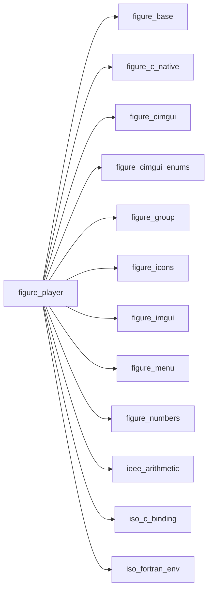
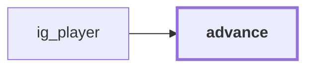
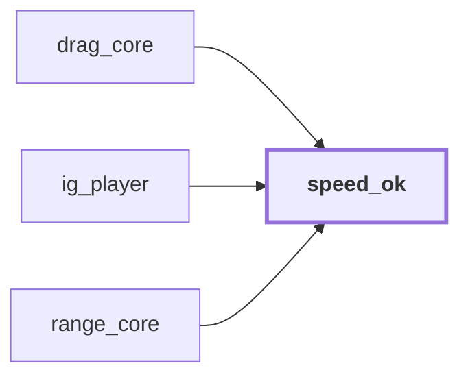
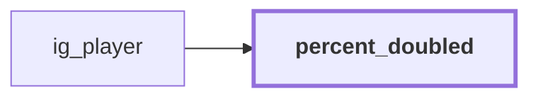

# figure_player

> figure_player, a player for snapshots: previous, play, next, a slider, a speed and a loop mode.

 A program that has saved solutions (snapshots 1 to N of a run, frames of an animation) keeps a `player_object` and
 draws it with `ig_player` every frame; the player says which snapshot to show (`%index`) and is true on the frame it
 changed it. While it plays it advances on the frame clock (Dear ImGui's time, which headless frames advance by 1/60 s
 each) and asks for frames, so lazy redraw does not stop it. The player is made of the public widgets of FIGURE
 (buttons, a slider, a context menu with a number field and radio buttons, inside a group and an id scope), so the
 scope record of the frame sees it balanced. widgets.md, "Players".

**Source**: `src/lib/figure_player.F90`

**Dependencies**



## Contents

- [player_object](#player-object)
- [advance](#advance)
- [ig_player](#ig-player)
- [speed_ok](#speed-ok)
- [percent_doubled](#percent-doubled)

## Variables

| Name | Type | Attributes | Description |
|------|------|------------|-------------|
| `MODES` | character(len=6) | parameter | The loop modes, in the menu's order. |

## Derived Types

### player_object

The state of a player of `count` snapshots, drawn by `ig_player`: a plain value the program keeps (one per
 player) and may set at any time, as the player does when the user acts on it. `index` is the snapshot shown, 1 to
 `count`; `playing` true while it advances by itself, `speed` snapshots per second; `mode` what it does at the
 last snapshot: `'once'` stops there, `'loop'` goes on from the first, `'bounce'` turns back (and again at the
 first). Usable before `init*` and from a task (it draws nothing).

**Components**

| Name | Type | Attributes | Description |
|------|------|------------|-------------|
| `index` | integer(kind=int32) |  | The snapshot shown, 1 to `count`. |
| `count` | integer(kind=int32) |  | Snapshots, >= 1. |
| `playing` | logical |  | Advancing by itself. |
| `speed` | real(kind=real64) |  | Snapshots per second while playing, > 0 [1/s]. |
| `mode` | character(len=6) |  | 'once', 'loop' or 'bounce'. |
| `direction` | integer(kind=int32) |  | Bounce: +1 forwards, -1 backwards. |
| `phase` | real(kind=real64) |  | Snapshots due and not yet stepped (a fraction of one). |
| `t_last` | real(kind=real64) |  | Frame clock at the last frame drawn [s]. |
| `frame_last` | integer(kind=int32) |  | Dear ImGui's frame number at the last frame drawn. |
| `was_playing` | logical |  | `playing` at the end of the last frame drawn. |

## Subroutines

### advance

Step the snapshots due (the whole part of `phase`), as the mode says; `once` stops playing at the last.

**Attributes**: pure

```fortran
subroutine advance(player)
```

**Arguments**

| Name | Type | Intent | Attributes | Description |
|------|------|--------|------------|-------------|
| `player` | type([player_object](/api/src/lib/figure_player#player-object)) | inout |  | The player. |

**Call graph**



## Functions

### ig_player

A player for `player%count` snapshots, on one line: previous, play/pause, next, and a slider over the snapshots
 that shows `labels(player%index)` (default: `index / count`). True on the frame the player changed
 `player%index`: a button, the slider, or the time while it plays; the program then shows that snapshot.
 Previous and next step one snapshot and stop the playing (in mode `'loop'` they wrap around, in the others they
 stop at the ends); a drag of the slider stops it too; play at the last snapshot in mode `'once'` starts again from
 the first. A right click on the player opens its menu: the speed (snapshots per second, typed; a value <= 0 is
 not taken) and the mode (`'once'`, `'loop'`, `'bounce'`).

 Time: while `player%playing`, `player%speed` snapshots per second of the frame clock (Dear ImGui's time: the
 display's frame times in a window, 1/60 s per frame headless, the time between frames in remote mode); a frame
 that takes longer steps more snapshots at once. The clock runs on the frames the player is drawn: hidden (a closed
 tab), it pauses. While playing, it asks for 1 more frame on each frame (`app%request_frames`), so a lazy loop
 keeps drawing. Its width is the current item width (`ig_set_next_item_width` before it, or
 `ig_push_item_width`); it is a group: `ig_last_item` and `ig_item_rect` after it report the whole player. An
 `index` outside 1 to `count` is moved to the nearest end (and true is returned).

 Refused, nothing drawn, false and `FIG_ERR_ARGUMENT` in `stat` (or `error stop` without it): `count` < 1, `speed`
 <= 0 or not finite, an unknown `mode`, `labels` not of `count` entries. No frame open or a task: false,
 `FIG_ERR_STATE`. The same in window, headless and remote mode.

**Attributes**: recursive

**Returns**: `logical`

```fortran
function ig_player(id, player, labels, stat) result(changed)
```

**Arguments**

| Name | Type | Intent | Attributes | Description |
|------|------|--------|------------|-------------|
| `id` | character(len=*) | in |  | Its id, unique in the current id scope. |
| `player` | type([player_object](/api/src/lib/figure_player#player-object)) | inout |  | The player's state. |
| `labels` | character(len=*) | in | optional | One label per snapshot (a time, a file name). |
| `stat` | integer(kind=int32) | out | optional | Status. |

**Call graph**



```mermaid
flowchart LR
  ig_player["ig_player"] --> advance["advance"]
  ig_player["ig_player"] --> cstr["cstr"]
  ig_player["ig_player"] --> fig_request_frames["fig_request_frames"]
  ig_player["ig_player"] --> figure_check["figure_check"]
  ig_player["ig_player"] --> figure_draw_refused["figure_draw_refused"]
  ig_player["ig_player"] --> figure_fail["figure_fail"]
  ig_player["ig_player"] --> igCalcItemWidth["igCalcItemWidth"]
  ig_player["ig_player"] --> igGetCursorPosX["igGetCursorPosX"]
  ig_player["ig_player"] --> igGetFrameCount["igGetFrameCount"]
  ig_player["ig_player"] --> igGetFrameHeight["igGetFrameHeight"]
  ig_player["ig_player"] --> igGetTime["igGetTime"]
  ig_player["ig_player"] --> igSliderInt["igSliderInt"]
  ig_player["ig_player"] --> ig_begin_group["ig_begin_group"]
  ig_player["ig_player"] --> ig_begin_popup_context["ig_begin_popup_context"]
  ig_player["ig_player"] --> ig_button["ig_button"]
  ig_player["ig_player"] --> ig_em["ig_em"]
  ig_player["ig_player"] --> ig_end_group["ig_end_group"]
  ig_player["ig_player"] --> ig_end_popup["ig_end_popup"]
  ig_player["ig_player"] --> ig_input["ig_input"]
  ig_player["ig_player"] --> ig_pop_id["ig_pop_id"]
  ig_player["ig_player"] --> ig_push_id["ig_push_id"]
  ig_player["ig_player"] --> ig_radio["ig_radio"]
  ig_player["ig_player"] --> ig_same_line["ig_same_line"]
  ig_player["ig_player"] --> ig_set_next_item_width["ig_set_next_item_width"]
  ig_player["ig_player"] --> ig_text_disabled["ig_text_disabled"]
  ig_player["ig_player"] --> percent_doubled["percent_doubled"]
  ig_player["ig_player"] --> speed_ok["speed_ok"]
  classDef focus stroke-width:3px,font-weight:bold
  class ig_player focus
  click figure_draw_refused href "figure_base.html#figure-draw-refused" "figure_draw_refused"
  click figure_fail href "figure_base.html#figure-fail" "figure_fail"
  click speed_ok href "#speed-ok" "speed_ok"
  click figure_check href "figure_base.html#figure-check" "figure_check"
  click igGetFrameCount href "figure_cimgui.html#iggetframecount" "igGetFrameCount"
  click igGetTime href "figure_cimgui.html#iggettime" "igGetTime"
  click advance href "#advance" "advance"
  click ig_push_id href "figure_group.html#ig-push-id" "ig_push_id"
  click igCalcItemWidth href "figure_cimgui.html#igcalcitemwidth" "igCalcItemWidth"
  click igGetFrameHeight href "figure_cimgui.html#iggetframeheight" "igGetFrameHeight"
  click igGetCursorPosX href "figure_cimgui.html#iggetcursorposx" "igGetCursorPosX"
  click ig_begin_group href "figure_group.html#ig-begin-group" "ig_begin_group"
  click ig_button href "figure_imgui.html#ig-button" "ig_button"
  click ig_same_line href "figure_imgui.html#ig-same-line" "ig_same_line"
  click percent_doubled href "#percent-doubled" "percent_doubled"
  click ig_set_next_item_width href "figure_imgui.html#ig-set-next-item-width" "ig_set_next_item_width"
  click igSliderInt href "figure_cimgui.html#igsliderint" "igSliderInt"
  click cstr href "figure_base.html#cstr" "cstr"
  click ig_end_group href "figure_group.html#ig-end-group" "ig_end_group"
  click ig_begin_popup_context href "figure_menu.html#ig-begin-popup-context" "ig_begin_popup_context"
  click ig_text_disabled href "figure_imgui.html#ig-text-disabled" "ig_text_disabled"
  click ig_em href "figure_imgui.html#ig-em" "ig_em"
  click ig_input href "figure_numbers.html#ig-input" "ig_input"
  click ig_radio href "figure_numbers.html#ig-radio" "ig_radio"
  click ig_end_popup href "figure_menu.html#ig-end-popup" "ig_end_popup"
  click ig_pop_id href "figure_group.html#ig-pop-id" "ig_pop_id"
  click fig_request_frames href "figure_c_native.html#fig-request-frames" "fig_request_frames"
```

### speed_ok

A speed is finite and above 0 (NaN never compared: no invalid-operation trap in debug builds).

**Attributes**: elemental

**Returns**: `logical`

```fortran
function speed_ok(speed) result(ok)
```

**Arguments**

| Name | Type | Intent | Attributes | Description |
|------|------|--------|------------|-------------|
| `speed` | real(kind=real64) | in |  | Snapshots per second [1/s]. |

**Call graph**



### percent_doubled

`s` with each `%` doubled: a label shown through a printf format as it is.

**Attributes**: pure

**Returns**: `character(len=:)`

```fortran
function percent_doubled(s) result(r)
```

**Arguments**

| Name | Type | Intent | Attributes | Description |
|------|------|--------|------------|-------------|
| `s` | character(len=*) | in |  | Text. |

**Call graph**


