# figure_process

> figure_process, programs started from the program (process_object) and a view of their output (log_view_object).

 A process runs in one of two modes.

 - **Captured** (the default): its standard output, and its standard error with `merge_stderr` (the default), are
   piped to the program. A native reader thread drains the pipe as the child writes and wakes the frame loop, so a
   child printing megabytes never blocks while the program is busy or its loop sleeps. `p%poll(lines)` gives the
   complete lines since the last poll. The child is killed when the object ends, at `app%destroy`, and when the
   program exits.
 - **Detached** (`detached=.true.`, with `log_file`): its output goes to the file, and the child survives the
   program. `p%poll(lines)` follows the file.

 The arguments are passed as an array, without a shell: `['sh', '-c', 'a | b']` when a pipeline is wanted.

**Source**: `src/lib/figure_process.F90`

**Dependencies**

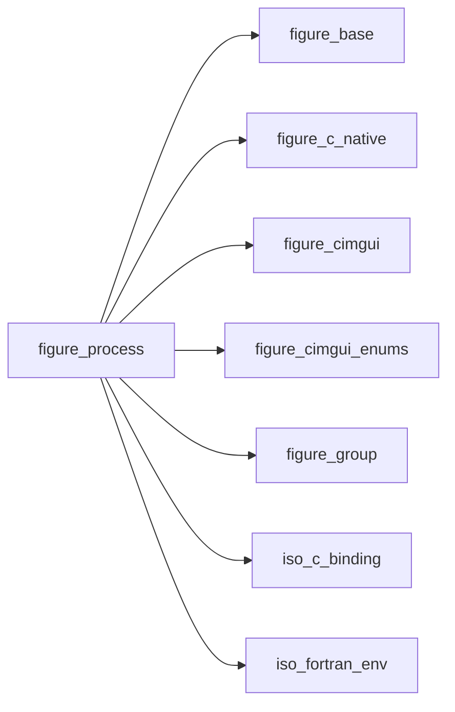

## Contents

- [process_object](#process-object)
- [log_line_object](#log-line-object)
- [log_view_object](#log-view-object)
- [process_start](#process-start)
- [process_poll](#process-poll)
- [process_kill](#process-kill)
- [process_final](#process-final)
- [pack_strings](#pack-strings)
- [split_lines](#split-lines)
- [add_line](#add-line)
- [add_lines](#add-lines)
- [log_clear](#log-clear)
- [log_set_cap](#log-set-cap)
- [log_in_view](#log-in-view)
- [log_draw](#log-draw)
- [process_running](#process-running)
- [process_exit_code](#process-exit-code)
- [process_killed](#process-killed)
- [process_pid](#process-pid)
- [log_count](#log-count)
- [log_line](#log-line)
- [log_following](#log-following)
- [log_copy](#log-copy)

## Derived Types

### process_object

A program started from the program: `p%start(args)`, then `p%poll(lines)` every frame while `p%running()`.
 Not to be copied: the copy would own the same child.

#### Components

| Name | Type | Attributes | Description |
|------|------|------------|-------------|
| `id` | integer(kind=c_int) |  | Native handle (0: none). |

#### Type-Bound Procedures

| Name | Attributes | Description |
|------|------------|-------------|
| `start` | pass(self) | Start a program. |
| `poll` | pass(self) | The complete lines since the last poll. |
| `running` | pass(self) | It runs (or output is still to be read). |
| `exit_code` | pass(self) | Its exit code (captured, ended). |
| `killed` | pass(self) | It ended after `kill`. |
| `pid` | pass(self) | Its process id. |
| `kill` | pass(self) | Ask it to end. |

### log_line_object

One line of a log view.

#### Components

| Name | Type | Attributes | Description |
|------|------|------------|-------------|
| `text` | character(len=:) | allocatable | The line. |

### log_view_object

Lines of text kept in a ring buffer (`set_cap`, default 10000 lines: the oldest go first) and drawn in a region
 of their own, only those in view. The view follows the end while it is scrolled to the bottom; a click chooses a
 line, shift+click extends the choice, ctrl+c (cmd+c on macOS) or the right-click menu copies it.

#### Components

| Name | Type | Attributes | Description |
|------|------|------------|-------------|
| `ring` | type([log_line_object](/api/src/lib/figure_process#log-line-object)) | allocatable | The lines, from position `head`. |
| `cap` | integer(kind=int32) |  | Lines kept at most. |
| `head` | integer(kind=int32) |  | Position of the oldest line in `ring`. |
| `n` | integer(kind=int32) |  | Lines kept. |
| `total` | integer(kind=int64) |  | Lines ever added (the newest's number). |
| `sel` | integer(kind=int64) |  | First and last chosen line (numbers; 0: none). |
| `follow` | logical |  | The view follows the end. |
| `view` | integer(kind=int32) |  | Kept lines in view on the last draw. |

#### Type-Bound Procedures

| Name | Attributes | Description |
|------|------------|-------------|
| `add_lines` | pass(self) |  |
| `add_line` | pass(self) |  |
| `add` |  | Add one line or several. |
| `clear` | pass(self) | Remove every line. |
| `set_cap` | pass(self) | The number of lines kept. |
| `count` | pass(self) | Lines kept. |
| `line` | pass(self) | A kept line. |
| `draw` | pass(self) | Draw the view. |
| `following` | pass(self) | The view follows the end. |
| `in_view` | pass(self) | The lines in view on the last draw. |
| `copy` | pass(self) | The chosen lines, joined by newlines. |

## Subroutines

### process_start

Start the program `args(1)` with the arguments `args(2:)` (each trimmed of trailing blanks; no shell). `cwd`: its
 working directory (default: the program's). `env`: `NAME=value` entries added to (or replacing in) the program's
 environment. `merge_stderr` (default true): standard error goes with standard output (false: captured, it goes
 to the program's own standard error; detached, it is discarded). `detached` (default false) needs `log_file`,
 which is created or truncated. Statuses: `FIG_ERR_STATE` while this object's previous process still runs,
 `FIG_ERR_ARGUMENT` for an empty `args`, an entry of `env` without `=`, `detached` without `log_file` (or
 `log_file` without `detached`), `FIG_ERR_FAILED` when the program cannot be started (not found, not executable)
 or the log file cannot be written. The same in every mode (in remote mode the program runs on the server).

```fortran
subroutine process_start(self, args, cwd, env, merge_stderr, detached, log_file, stat)
```

**Arguments**

| Name | Type | Intent | Attributes | Description |
|------|------|--------|------------|-------------|
| `self` | class([process_object](/api/src/lib/figure_process#process-object)) | inout |  | Process. |
| `args` | character(len=*) | in |  | Program and arguments. |
| `cwd` | character(len=*) | in | optional | Working directory. |
| `env` | character(len=*) | in | optional | `NAME=value` entries. |
| `merge_stderr` | logical | in | optional | Standard error with the output (default true). |
| `detached` | logical | in | optional | Detached (default false). |
| `log_file` | character(len=*) | in | optional | Detached: the file of its output. |
| `stat` | integer(kind=int32) | out | optional | Status. |

**Call graph**

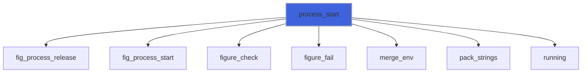

### process_poll

The complete lines printed since the last poll, oldest first, without their newline (a carriage return is
 dropped); a last line without a newline is kept until it is completed, or given once the process has ended.
 `lines` has no element when there is nothing new; its length is the longest line's (shorter ones are padded with
 blanks: `trim` them). Detached: the lines appended to `log_file`. Status: `FIG_ERR_STATE` before `start`.

```fortran
subroutine process_poll(self, lines, stat)
```

**Arguments**

| Name | Type | Intent | Attributes | Description |
|------|------|--------|------------|-------------|
| `self` | class([process_object](/api/src/lib/figure_process#process-object)) | inout |  | Process. |
| `lines` | character(len=:) | out | allocatable | The new lines. |
| `stat` | integer(kind=int32) | out | optional | Status. |

**Call graph**

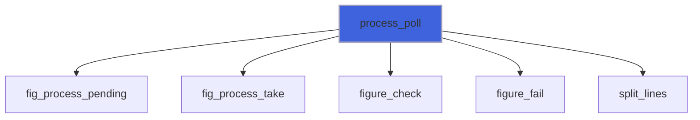

### process_kill

Ask the process to end: SIGTERM on POSIX (with `force`, SIGKILL); on Windows a close request to its windows or
 console (a console program may ignore it: use `force`, TerminateProcess). Only the started program is stopped,
 not the programs it started itself. An ended process: nothing happens. `FIG_ERR_STATE` before `start`,
 `FIG_ERR_FAILED` when the system refuses.

```fortran
subroutine process_kill(self, force, stat)
```

**Arguments**

| Name | Type | Intent | Attributes | Description |
|------|------|--------|------------|-------------|
| `self` | class([process_object](/api/src/lib/figure_process#process-object)) | inout |  | Process. |
| `force` | logical | in | optional | At once (default false). |
| `stat` | integer(kind=int32) | out | optional | Status. |

**Call graph**

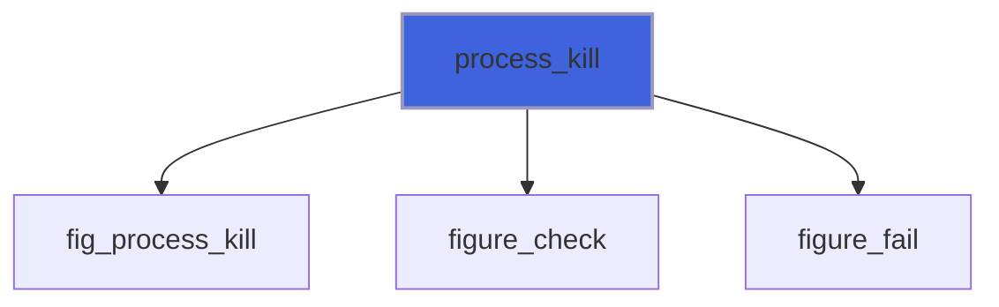

### process_final

The object ends: a captured process still running is killed; a detached one goes on.

```fortran
subroutine process_final(self)
```

**Arguments**

| Name | Type | Intent | Attributes | Description |
|------|------|--------|------------|-------------|
| `self` | type([process_object](/api/src/lib/figure_process#process-object)) | inout |  | Process. |

**Call graph**

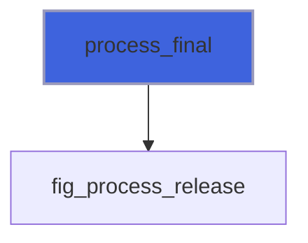

### pack_strings

The strings of `s`, trimmed, one after the other, and their lengths.

**Attributes**: pure

```fortran
subroutine pack_strings(s, packed, lens)
```

**Arguments**

| Name | Type | Intent | Attributes | Description |
|------|------|--------|------------|-------------|
| `s` | character(len=*) | in |  | Strings. |
| `packed` | character(kind=c_char, len=:) | out | allocatable | Packed. |
| `lens` | integer(kind=c_int) | out | allocatable | Lengths [bytes]. |

**Call graph**

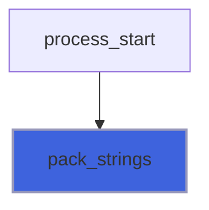

### split_lines

`buf` cut at each LF (carriage returns dropped); a last piece without LF is a line too.

**Attributes**: pure

```fortran
subroutine split_lines(buf, lines)
```

**Arguments**

| Name | Type | Intent | Attributes | Description |
|------|------|--------|------------|-------------|
| `buf` | character(len=*) | in |  | Bytes. |
| `lines` | character(len=:) | out | allocatable | Lines. |

**Call graph**

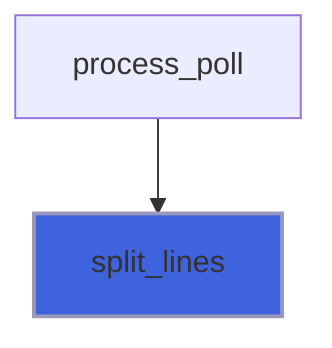

### add_line

Add a line (trailing blanks removed); with the buffer full, the oldest line goes.

```fortran
subroutine add_line(self, line)
```

**Arguments**

| Name | Type | Intent | Attributes | Description |
|------|------|--------|------------|-------------|
| `self` | class([log_view_object](/api/src/lib/figure_process#log-view-object)) | inout |  | Log. |
| `line` | character(len=*) | in |  | Line. |

**Call graph**

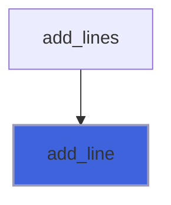

### add_lines

Add lines, oldest first (as `p%poll` gives them).

```fortran
subroutine add_lines(self, lines)
```

**Arguments**

| Name | Type | Intent | Attributes | Description |
|------|------|--------|------------|-------------|
| `self` | class([log_view_object](/api/src/lib/figure_process#log-view-object)) | inout |  | Log. |
| `lines` | character(len=*) | in |  | Lines. |

**Call graph**

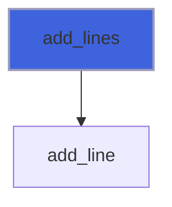

### log_clear

Remove every line (and the choice); the cap stays.

```fortran
subroutine log_clear(self)
```

**Arguments**

| Name | Type | Intent | Attributes | Description |
|------|------|--------|------------|-------------|
| `self` | class([log_view_object](/api/src/lib/figure_process#log-view-object)) | inout |  | Log. |

### log_set_cap

Keep at most `cap` lines (at least 1): the newest stay. Status: `FIG_ERR_ARGUMENT` for `cap` < 1.

```fortran
subroutine log_set_cap(self, cap, stat)
```

**Arguments**

| Name | Type | Intent | Attributes | Description |
|------|------|--------|------------|-------------|
| `self` | class([log_view_object](/api/src/lib/figure_process#log-view-object)) | inout |  | Log. |
| `cap` | integer(kind=int32) | in |  | Lines kept at most. |
| `stat` | integer(kind=int32) | out | optional | Status. |

**Call graph**

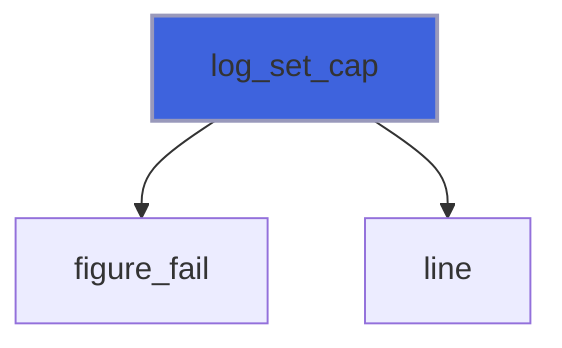

### log_in_view

The kept lines drawn on the last `draw` (`last` < `first` when none).

**Attributes**: pure

```fortran
subroutine log_in_view(self, first, last)
```

**Arguments**

| Name | Type | Intent | Attributes | Description |
|------|------|--------|------------|-------------|
| `self` | class([log_view_object](/api/src/lib/figure_process#log-view-object)) | in |  | Log. |
| `first` | integer(kind=int32) | out |  | First line in view. |
| `last` | integer(kind=int32) | out |  | Last line in view. |

### log_draw

Draw the lines in a region of their own (`id`, not shown) as wide as the space left and `height` [pixels] high
 (absent or 0: the rest of the window; negative: leave that much below). Only the lines in view are drawn. The
 view follows the end while it is scrolled to the bottom; scrolled up, it stays where it is.

**Attributes**: recursive

```fortran
subroutine log_draw(self, id, height)
```

**Arguments**

| Name | Type | Intent | Attributes | Description |
|------|------|--------|------------|-------------|
| `self` | class([log_view_object](/api/src/lib/figure_process#log-view-object)) | inout |  | Log. |
| `id` | character(len=*) | in |  | Id of the region. |
| `height` | real(kind=real64) | in | optional | Height [pixels]. |

**Call graph**

```mermaid
flowchart TD
  log_draw["log_draw"] --> begin["begin"]
  log_draw["log_draw"] --> clipboard["clipboard"]
  log_draw["log_draw"] --> copy["copy"]
  log_draw["log_draw"] --> cstr["cstr"]
  log_draw["log_draw"] --> figure_refused["figure_refused"]
  log_draw["log_draw"] --> igBeginChild_Str["igBeginChild_Str"]
  log_draw["log_draw"] --> igBeginPopupContextWindow["igBeginPopupContextWindow"]
  log_draw["log_draw"] --> igEndChild["igEndChild"]
  log_draw["log_draw"] --> igEndPopup["igEndPopup"]
  log_draw["log_draw"] --> igGetCursorPosX["igGetCursorPosX"]
  log_draw["log_draw"] --> igGetScrollMaxY["igGetScrollMaxY"]
  log_draw["log_draw"] --> igGetScrollY["igGetScrollY"]
  log_draw["log_draw"] --> igGetTextLineHeightWithSpacing["igGetTextLineHeightWithSpacing"]
  log_draw["log_draw"] --> igIsKeyChordPressed_Nil["igIsKeyChordPressed_Nil"]
  log_draw["log_draw"] --> igIsKeyDown_Nil["igIsKeyDown_Nil"]
  log_draw["log_draw"] --> igIsWindowFocused["igIsWindowFocused"]
  log_draw["log_draw"] --> igMenuItem_Bool["igMenuItem_Bool"]
  log_draw["log_draw"] --> igPopID["igPopID"]
  log_draw["log_draw"] --> igPushID_Int["igPushID_Int"]
  log_draw["log_draw"] --> igSameLine["igSameLine"]
  log_draw["log_draw"] --> igSelectable_Bool["igSelectable_Bool"]
  log_draw["log_draw"] --> igSetScrollHereY["igSetScrollHereY"]
  log_draw["log_draw"] --> igTextUnformatted["igTextUnformatted"]
  log_draw["log_draw"] --> line["line"]
  log_draw["log_draw"] --> step["step"]
  style log_draw fill:#3e63dd,stroke:#99b,stroke-width:2px
```

## Functions

### process_running

True while the process runs; a captured one counts as running until its output has all been read by FIGURE
 (then a last `poll` gives the rest). False before `start`.

**Returns**: `logical`

```fortran
function process_running(self) result(running)
```

**Arguments**

| Name | Type | Intent | Attributes | Description |
|------|------|--------|------------|-------------|
| `self` | class([process_object](/api/src/lib/figure_process#process-object)) | in |  | Process. |

**Call graph**

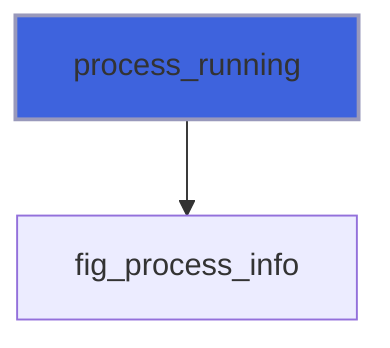

### process_exit_code

The exit code of a captured process that has ended (after a kill: the negative signal number on POSIX, 1 on
 Windows). `FIG_ERR_STATE` (and -1) before `start`, while it runs, and for a detached process (its exit code is
 not known: the program's own log tells how it ended).

**Returns**: `integer(kind=int32)`

```fortran
function process_exit_code(self, stat) result(code)
```

**Arguments**

| Name | Type | Intent | Attributes | Description |
|------|------|--------|------------|-------------|
| `self` | class([process_object](/api/src/lib/figure_process#process-object)) | in |  | Process. |
| `stat` | integer(kind=int32) | out | optional | Status. |

**Call graph**

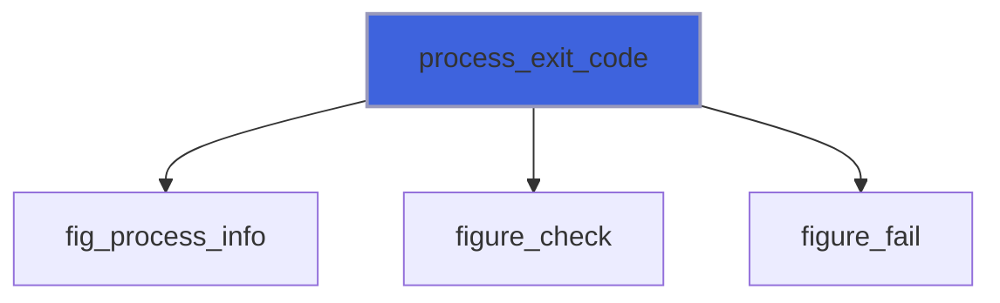

### process_killed

True when the process ended after `kill` (false before `start`, while it runs, or when it ended by itself
 before the kill).

**Returns**: `logical`

```fortran
function process_killed(self) result(killed)
```

**Arguments**

| Name | Type | Intent | Attributes | Description |
|------|------|--------|------------|-------------|
| `self` | class([process_object](/api/src/lib/figure_process#process-object)) | in |  | Process. |

**Call graph**

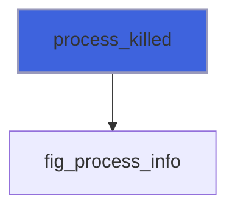

### process_pid

The process id given by the system (0 before `start`).

**Returns**: `integer(kind=int64)`

```fortran
function process_pid(self) result(pid)
```

**Arguments**

| Name | Type | Intent | Attributes | Description |
|------|------|--------|------------|-------------|
| `self` | class([process_object](/api/src/lib/figure_process#process-object)) | in |  | Process. |

**Call graph**

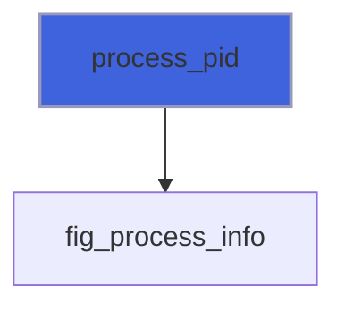

### log_count

The number of lines kept.

**Attributes**: pure

**Returns**: `integer(kind=int32)`

```fortran
function log_count(self) result(n)
```

**Arguments**

| Name | Type | Intent | Attributes | Description |
|------|------|--------|------------|-------------|
| `self` | class([log_view_object](/api/src/lib/figure_process#log-view-object)) | in |  | Log. |

### log_line

Kept line `i`, from 1 (the oldest kept) to `count()`; '' out of range.

**Attributes**: pure

**Returns**: `character(len=:)`

```fortran
function log_line(self, i) result(text)
```

**Arguments**

| Name | Type | Intent | Attributes | Description |
|------|------|--------|------------|-------------|
| `self` | class([log_view_object](/api/src/lib/figure_process#log-view-object)) | in |  | Log. |
| `i` | integer(kind=int32) | in |  | Line. |

### log_following

True while the view follows the end (it was scrolled to the bottom on the last draw): new lines scroll it.

**Attributes**: pure

**Returns**: `logical`

```fortran
function log_following(self) result(follow)
```

**Arguments**

| Name | Type | Intent | Attributes | Description |
|------|------|--------|------------|-------------|
| `self` | class([log_view_object](/api/src/lib/figure_process#log-view-object)) | in |  | Log. |

### log_copy

The chosen lines (with `all`, every kept line), joined by newlines; '' when none is chosen.

**Returns**: `character(len=:)`

```fortran
function log_copy(self, all) result(text)
```

**Arguments**

| Name | Type | Intent | Attributes | Description |
|------|------|--------|------------|-------------|
| `self` | class([log_view_object](/api/src/lib/figure_process#log-view-object)) | in |  | Log. |
| `all` | logical | in | optional | Every line. |

**Call graph**

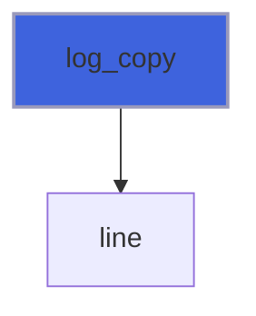
