# figure_style

> figure_style, every colour and variable of the Dear ImGui and ImPlot styles, by name.

 Every drawing procedure of this module refuses a call from a task (`FIG_ERR_STATE`): see processes.md. The scoped
 changes (`*_push_*`/`*_pop_*`, fonts) also need a frame open, and register in the scope record of the frame: a
 pop without its push is a usage error (`app%set_checks`; errors.md, "Pairing and frames"). Reading and setting
 the style (`*_get_*`, `*_set_*`) work outside a frame.

 The style is global: a change applies to everything drawn afterwards, until it is changed again (or a new style is
 chosen with `app%set_style`, which resets every colour and variable). Names are the libraries' own:

 - colours: Dear ImGui's `ImGuiCol_*` without the prefix (`Text`, `WindowBg`, `Button`, `SliderGrab`, ...), ImPlot's
   `ImPlotCol_*` without the prefix (`PlotBg`, `AxisGrid`, `LegendBg`, ...);
 - variables: the fields of `ImGuiStyle` (`WindowRounding`, `FramePadding`, `ItemSpacing`, ...) and of `ImPlotStyle`
   (`PlotBorderSize`, `PlotPadding`, `MajorGridSize`, ...), each a number, a pair of numbers, a logical or an integer.
   Line weights and marker sizes are per item in ImPlot 1.2: `ip_spec`.

 Colours are given as `'#rrggbb'` or `'#rrggbbaa'`, or as `[r, g, b]` / `[r, g, b, a]` in [0, 1]. Variables in
 pixels hold the values Dear ImGui uses, already multiplied by the display's content scale (`app%content_scale()`).

**Source**: `src/lib/figure_style.F90`

**Dependencies**

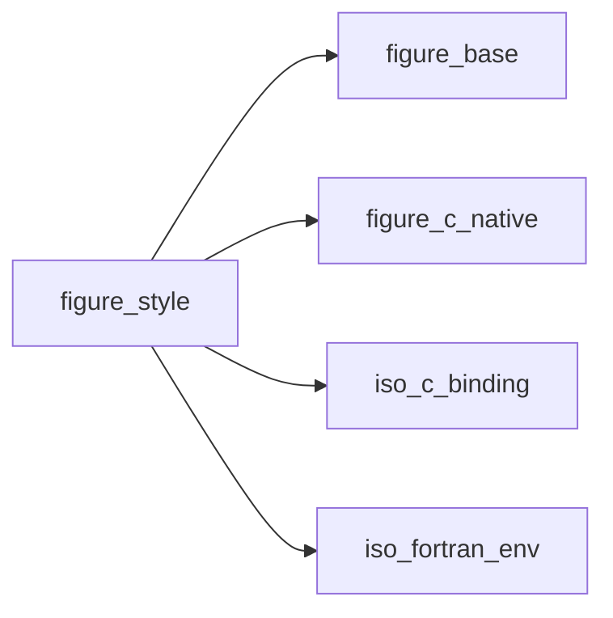

## Contents

- [ig_set_style_color](#ig-set-style-color)
- [ip_set_style_color](#ip-set-style-color)
- [ig_set_style_var](#ig-set-style-var)
- [ip_set_style_var](#ip-set-style-var)
- [ig_push_style_color](#ig-push-style-color)
- [ip_push_style_color](#ip-push-style-color)
- [ig_push_style_var](#ig-push-style-var)
- [ip_push_style_var](#ip-push-style-var)
- [push_color](#push-color)
- [push_color_hex](#push-color-hex)
- [push_var](#push-var)
- [pop](#pop)
- [ig_push_style_color_hex](#ig-push-style-color-hex)
- [ig_push_style_color_rgba](#ig-push-style-color-rgba)
- [ig_pop_style_color](#ig-pop-style-color)
- [ig_push_style_var_r64](#ig-push-style-var-r64)
- [ig_push_style_var_vec2](#ig-push-style-var-vec2)
- [ig_push_style_var_logical](#ig-push-style-var-logical)
- [ig_push_style_var_i32](#ig-push-style-var-i32)
- [ig_pop_style_var](#ig-pop-style-var)
- [ip_push_style_color_hex](#ip-push-style-color-hex)
- [ip_push_style_color_rgba](#ip-push-style-color-rgba)
- [ip_pop_style_color](#ip-pop-style-color)
- [ip_push_style_var_r64](#ip-push-style-var-r64)
- [ip_push_style_var_vec2](#ip-push-style-var-vec2)
- [ip_push_style_var_logical](#ip-push-style-var-logical)
- [ip_pop_style_var](#ip-pop-style-var)
- [ig_show_style_editor](#ig-show-style-editor)
- [ig_push_font](#ig-push-font)
- [ig_pop_font](#ig-pop-font)
- [hex_color](#hex-color)
- [set_color](#set-color)
- [set_color_hex](#set-color-hex)
- [get_color](#get-color)
- [ig_set_style_color_hex](#ig-set-style-color-hex)
- [ig_set_style_color_rgba](#ig-set-style-color-rgba)
- [ig_get_style_color](#ig-get-style-color)
- [ip_set_style_color_hex](#ip-set-style-color-hex)
- [ip_set_style_color_rgba](#ip-set-style-color-rgba)
- [ip_get_style_color](#ip-get-style-color)
- [set_var](#set-var)
- [get_var](#get-var)
- [ig_set_style_var_r64](#ig-set-style-var-r64)
- [ig_set_style_var_vec2](#ig-set-style-var-vec2)
- [ig_set_style_var_logical](#ig-set-style-var-logical)
- [ig_set_style_var_i32](#ig-set-style-var-i32)
- [ig_get_style_var](#ig-get-style-var)
- [ip_set_style_var_r64](#ip-set-style-var-r64)
- [ip_set_style_var_vec2](#ip-set-style-var-vec2)
- [ip_set_style_var_logical](#ip-set-style-var-logical)
- [ip_get_style_var](#ip-get-style-var)

## Variables

| Name | Type | Attributes | Description |
|------|------|------------|-------------|
| `LIB_IMGUI` | integer(kind=c_int) | parameter | Dear ImGui. |
| `LIB_IMPLOT` | integer(kind=c_int) | parameter | ImPlot. |

## Interfaces

### ig_set_style_color

Set a Dear ImGui colour, by hex string or by components.

**Module procedures**: [`ig_set_style_color_hex`](/api/src/lib/figure_style#ig-set-style-color-hex), [`ig_set_style_color_rgba`](/api/src/lib/figure_style#ig-set-style-color-rgba)

### ip_set_style_color

Set an ImPlot colour, by hex string or by components.

**Module procedures**: [`ip_set_style_color_hex`](/api/src/lib/figure_style#ip-set-style-color-hex), [`ip_set_style_color_rgba`](/api/src/lib/figure_style#ip-set-style-color-rgba)

### ig_set_style_var

Set a Dear ImGui style variable: a number, a pair, a logical or an integer.

**Module procedures**: [`ig_set_style_var_r64`](/api/src/lib/figure_style#ig-set-style-var-r64), [`ig_set_style_var_vec2`](/api/src/lib/figure_style#ig-set-style-var-vec2), [`ig_set_style_var_logical`](/api/src/lib/figure_style#ig-set-style-var-logical), [`ig_set_style_var_i32`](/api/src/lib/figure_style#ig-set-style-var-i32)

### ip_set_style_var

Set an ImPlot style variable: a number, a pair or a logical.

**Module procedures**: [`ip_set_style_var_r64`](/api/src/lib/figure_style#ip-set-style-var-r64), [`ip_set_style_var_vec2`](/api/src/lib/figure_style#ip-set-style-var-vec2), [`ip_set_style_var_logical`](/api/src/lib/figure_style#ip-set-style-var-logical)

### ig_push_style_color

Change a Dear ImGui colour until `ig_pop_style_color`, by hex string or by components.

**Module procedures**: [`ig_push_style_color_hex`](/api/src/lib/figure_style#ig-push-style-color-hex), [`ig_push_style_color_rgba`](/api/src/lib/figure_style#ig-push-style-color-rgba)

### ip_push_style_color

Change an ImPlot colour until `ip_pop_style_color`, by hex string or by components.

**Module procedures**: [`ip_push_style_color_hex`](/api/src/lib/figure_style#ip-push-style-color-hex), [`ip_push_style_color_rgba`](/api/src/lib/figure_style#ip-push-style-color-rgba)

### ig_push_style_var

Change a Dear ImGui style variable until `ig_pop_style_var`: a number, a pair, a logical or an integer.

**Module procedures**: [`ig_push_style_var_r64`](/api/src/lib/figure_style#ig-push-style-var-r64), [`ig_push_style_var_vec2`](/api/src/lib/figure_style#ig-push-style-var-vec2), [`ig_push_style_var_logical`](/api/src/lib/figure_style#ig-push-style-var-logical), [`ig_push_style_var_i32`](/api/src/lib/figure_style#ig-push-style-var-i32)

### ip_push_style_var

Change an ImPlot style variable until `ip_pop_style_var`: a number, a pair or a logical.

**Module procedures**: [`ip_push_style_var_r64`](/api/src/lib/figure_style#ip-push-style-var-r64), [`ip_push_style_var_vec2`](/api/src/lib/figure_style#ip-push-style-var-vec2), [`ip_push_style_var_logical`](/api/src/lib/figure_style#ip-push-style-var-logical)

## Subroutines

### push_color

Push a colour given as components (3 or 4).

```fortran
subroutine push_color(lib, who, name, rgba, stat)
```

**Arguments**

| Name | Type | Intent | Attributes | Description |
|------|------|--------|------------|-------------|
| `lib` | integer(kind=c_int) | in |  | Library. |
| `who` | character(len=*) | in |  | Caller, for messages. |
| `name` | character(len=*) | in |  | Colour name. |
| `rgba` | real(kind=real64) | in |  | Components. |
| `stat` | integer(kind=int32) | out | optional | Status. |

**Call graph**

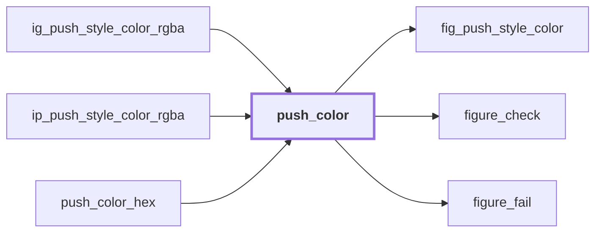

### push_color_hex

Push a colour given as a hex string.

```fortran
subroutine push_color_hex(lib, who, name, color, stat)
```

**Arguments**

| Name | Type | Intent | Attributes | Description |
|------|------|--------|------------|-------------|
| `lib` | integer(kind=c_int) | in |  | Library. |
| `who` | character(len=*) | in |  | Caller, for messages. |
| `name` | character(len=*) | in |  | Colour name. |
| `color` | character(len=*) | in |  | `'#rrggbb'` or `'#rrggbbaa'`. |
| `stat` | integer(kind=int32) | out | optional | Status. |

**Call graph**

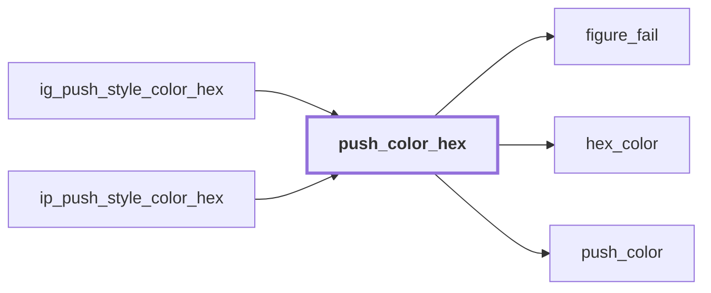

### push_var

Push a style variable of `n` values.

```fortran
subroutine push_var(lib, name, values, n, stat)
```

**Arguments**

| Name | Type | Intent | Attributes | Description |
|------|------|--------|------------|-------------|
| `lib` | integer(kind=c_int) | in |  | Library. |
| `name` | character(len=*) | in |  | Variable name. |
| `values` | real(kind=real64) | in |  | Values. |
| `n` | integer(kind=c_int) | in |  | How many. |
| `stat` | integer(kind=int32) | out | optional | Status. |

**Call graph**

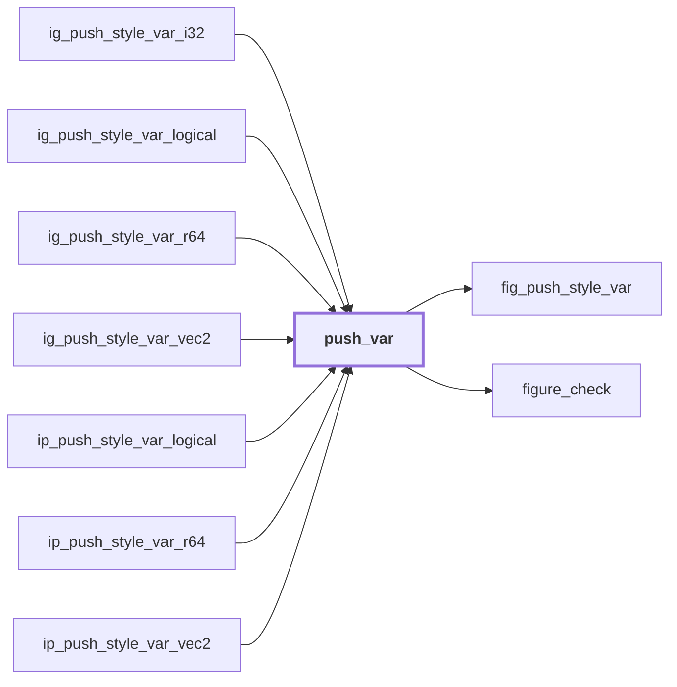

### pop

Undo the `n` newest pushes (default 1) of colours (vars = 0) or variables (vars = 1).

```fortran
subroutine pop(vars, n, stat)
```

**Arguments**

| Name | Type | Intent | Attributes | Description |
|------|------|--------|------------|-------------|
| `vars` | integer(kind=c_int) | in |  | 0: colours, 1: variables. |
| `n` | integer(kind=int32) | in | optional | How many (default 1). |
| `stat` | integer(kind=int32) | out | optional | Status: `FIG_ERR_STATE` for more pops than pushes. |

**Call graph**

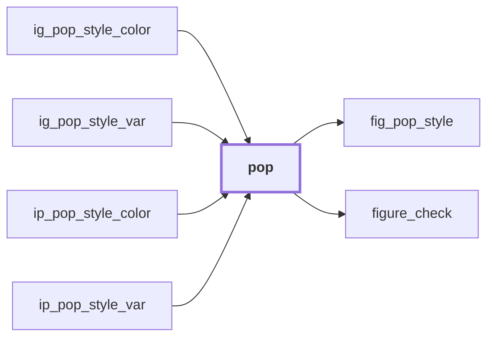

### ig_push_style_color_hex

Change the Dear ImGui colour `name` (`'#rrggbb'` or `'#rrggbbaa'`) until `ig_pop_style_color`.

**Attributes**: recursive

```fortran
subroutine ig_push_style_color_hex(name, color, stat)
```

**Arguments**

| Name | Type | Intent | Attributes | Description |
|------|------|--------|------------|-------------|
| `name` | character(len=*) | in |  | Colour name (`ImGuiCol_*` without the prefix). |
| `color` | character(len=*) | in |  | Hex colour. |
| `stat` | integer(kind=int32) | out | optional | Status. |

**Call graph**


### ig_push_style_color_rgba

Change the Dear ImGui colour `name` (`[r, g, b(, a)]` in [0, 1]) until `ig_pop_style_color`.

**Attributes**: recursive

```fortran
subroutine ig_push_style_color_rgba(name, rgba, stat)
```

**Arguments**

| Name | Type | Intent | Attributes | Description |
|------|------|--------|------------|-------------|
| `name` | character(len=*) | in |  | Colour name. |
| `rgba` | real(kind=real64) | in |  | Components. |
| `stat` | integer(kind=int32) | out | optional | Status. |

**Call graph**

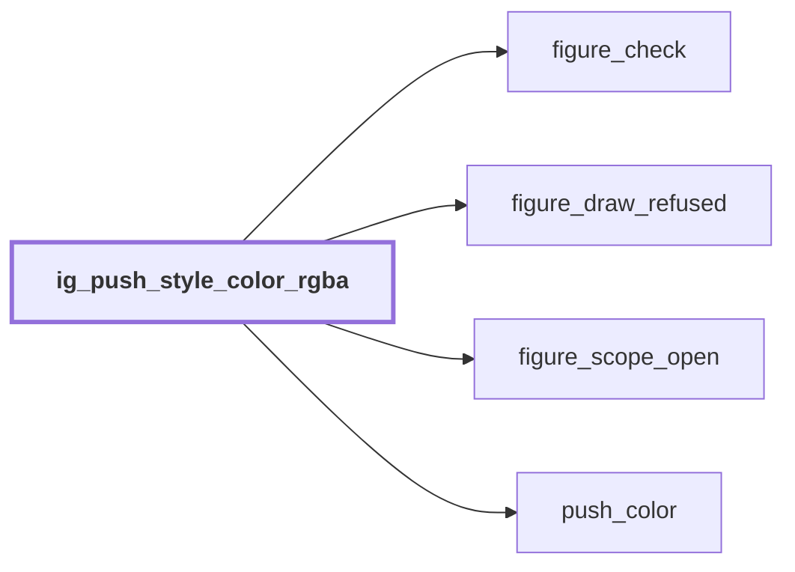

### ig_pop_style_color

Undo the `n` newest colour pushes (default 1); colours pushed by `ig_push_style_color` and `ip_push_style_color`
 share one stack.

**Attributes**: recursive

```fortran
subroutine ig_pop_style_color(n, stat)
```

**Arguments**

| Name | Type | Intent | Attributes | Description |
|------|------|--------|------------|-------------|
| `n` | integer(kind=int32) | in | optional | How many. |
| `stat` | integer(kind=int32) | out | optional |  |

**Call graph**

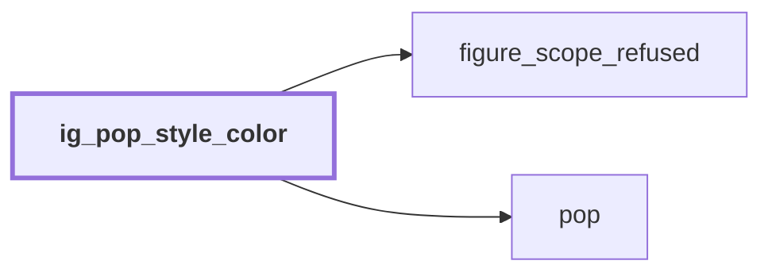

### ig_push_style_var_r64

Change a Dear ImGui style variable holding one number until `ig_pop_style_var`.

**Attributes**: recursive

```fortran
subroutine ig_push_style_var_r64(name, value, stat)
```

**Arguments**

| Name | Type | Intent | Attributes | Description |
|------|------|--------|------------|-------------|
| `name` | character(len=*) | in |  | Variable name (a field of `ImGuiStyle`). |
| `value` | real(kind=real64) | in |  | Value. |
| `stat` | integer(kind=int32) | out | optional | Status. |

**Call graph**

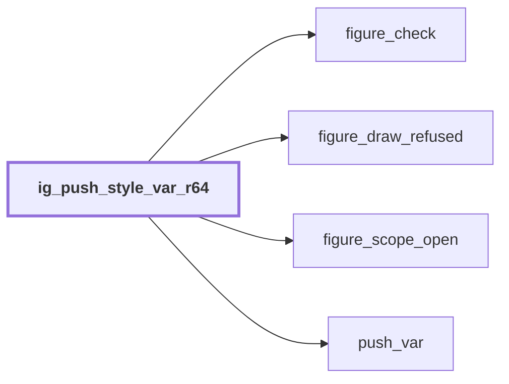

### ig_push_style_var_vec2

Change a Dear ImGui style variable holding a pair until `ig_pop_style_var`.

**Attributes**: recursive

```fortran
subroutine ig_push_style_var_vec2(name, value, stat)
```

**Arguments**

| Name | Type | Intent | Attributes | Description |
|------|------|--------|------------|-------------|
| `name` | character(len=*) | in |  | Variable name (a field of `ImGuiStyle`). |
| `value` | real(kind=real64) | in |  | Values (x, y). |
| `stat` | integer(kind=int32) | out | optional | Status. |

**Call graph**

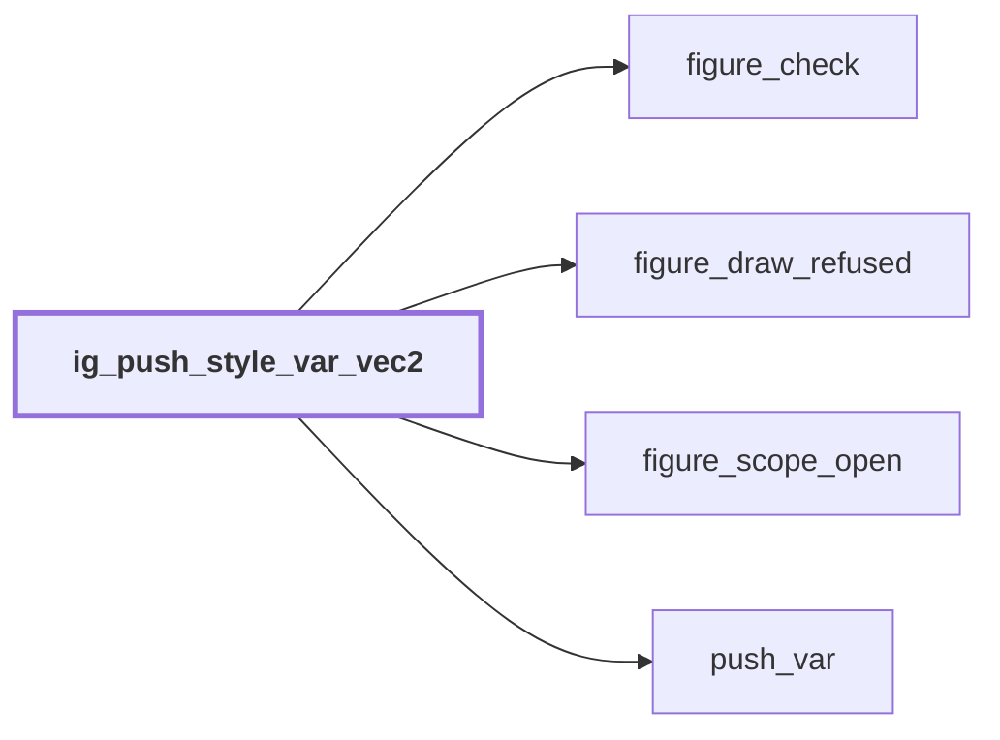

### ig_push_style_var_logical

Change a Dear ImGui style variable holding a logical until `ig_pop_style_var`.

**Attributes**: recursive

```fortran
subroutine ig_push_style_var_logical(name, value, stat)
```

**Arguments**

| Name | Type | Intent | Attributes | Description |
|------|------|--------|------------|-------------|
| `name` | character(len=*) | in |  | Variable name (a field of `ImGuiStyle`). |
| `value` | logical | in |  | Value. |
| `stat` | integer(kind=int32) | out | optional | Status. |

**Call graph**


### ig_push_style_var_i32

Change a Dear ImGui style variable holding an enumeration until `ig_pop_style_var`.

**Attributes**: recursive

```fortran
subroutine ig_push_style_var_i32(name, value, stat)
```

**Arguments**

| Name | Type | Intent | Attributes | Description |
|------|------|--------|------------|-------------|
| `name` | character(len=*) | in |  | Variable name (a field of `ImGuiStyle`). |
| `value` | integer(kind=int32) | in |  | Value. |
| `stat` | integer(kind=int32) | out | optional | Status. |

**Call graph**

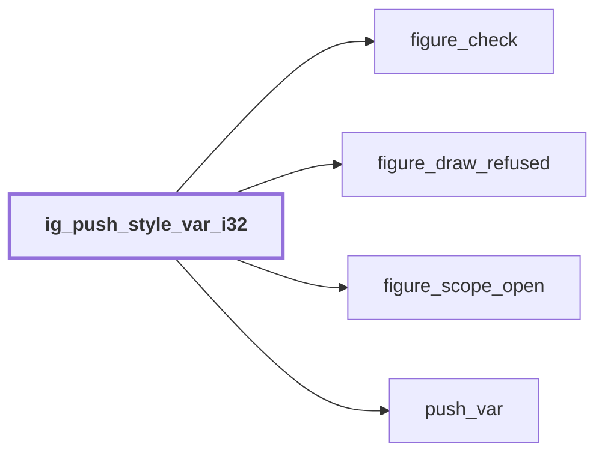

### ig_pop_style_var

Undo the `n` newest variable pushes (default 1); variables pushed by `ig_push_style_var` and
 `ip_push_style_var` share one stack.

**Attributes**: recursive

```fortran
subroutine ig_pop_style_var(n, stat)
```

**Arguments**

| Name | Type | Intent | Attributes | Description |
|------|------|--------|------------|-------------|
| `n` | integer(kind=int32) | in | optional | How many. |
| `stat` | integer(kind=int32) | out | optional |  |

**Call graph**


### ip_push_style_color_hex

Change the ImPlot colour `name` (`'#rrggbb'` or `'#rrggbbaa'`) until `ip_pop_style_color`.

**Attributes**: recursive

```fortran
subroutine ip_push_style_color_hex(name, color, stat)
```

**Arguments**

| Name | Type | Intent | Attributes | Description |
|------|------|--------|------------|-------------|
| `name` | character(len=*) | in |  | Colour name (`ImPlotCol_*` without the prefix). |
| `color` | character(len=*) | in |  | Hex colour. |
| `stat` | integer(kind=int32) | out | optional | Status. |

**Call graph**

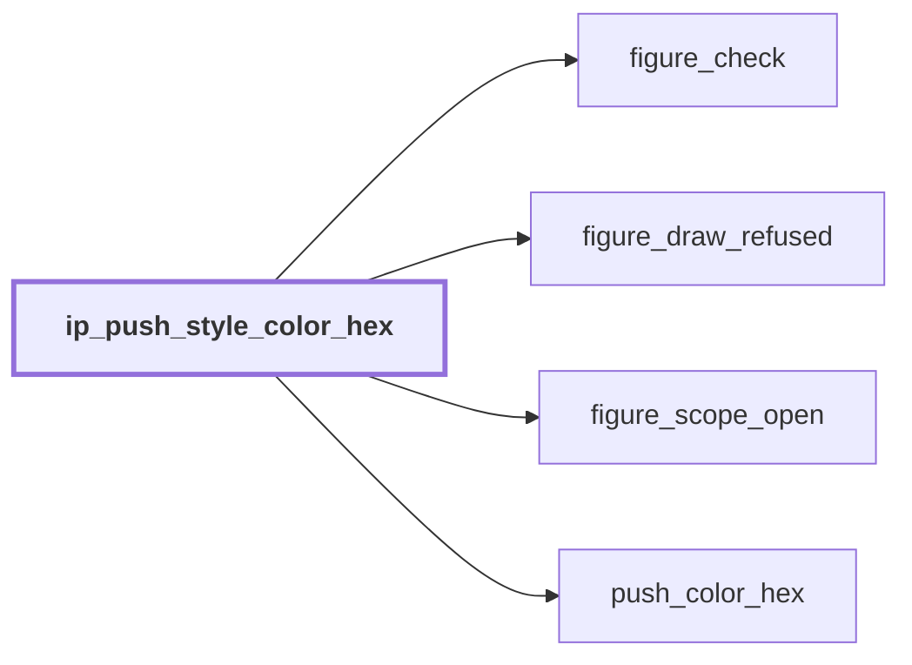

### ip_push_style_color_rgba

Change the ImPlot colour `name` (`[r, g, b(, a)]` in [0, 1]) until `ip_pop_style_color`.

**Attributes**: recursive

```fortran
subroutine ip_push_style_color_rgba(name, rgba, stat)
```

**Arguments**

| Name | Type | Intent | Attributes | Description |
|------|------|--------|------------|-------------|
| `name` | character(len=*) | in |  | Colour name. |
| `rgba` | real(kind=real64) | in |  | Components. |
| `stat` | integer(kind=int32) | out | optional | Status. |

**Call graph**


### ip_pop_style_color

Undo the `n` newest colour pushes (default 1): the same stack as `ig_pop_style_color`.

**Attributes**: recursive

```fortran
subroutine ip_pop_style_color(n, stat)
```

**Arguments**

| Name | Type | Intent | Attributes | Description |
|------|------|--------|------------|-------------|
| `n` | integer(kind=int32) | in | optional | How many. |
| `stat` | integer(kind=int32) | out | optional |  |

**Call graph**


### ip_push_style_var_r64

Change an ImPlot style variable holding one number until `ip_pop_style_var`.

**Attributes**: recursive

```fortran
subroutine ip_push_style_var_r64(name, value, stat)
```

**Arguments**

| Name | Type | Intent | Attributes | Description |
|------|------|--------|------------|-------------|
| `name` | character(len=*) | in |  | Variable name (a field of `ImPlotStyle`). |
| `value` | real(kind=real64) | in |  | Value. |
| `stat` | integer(kind=int32) | out | optional | Status. |

**Call graph**


### ip_push_style_var_vec2

Change an ImPlot style variable holding a pair until `ip_pop_style_var`.

**Attributes**: recursive

```fortran
subroutine ip_push_style_var_vec2(name, value, stat)
```

**Arguments**

| Name | Type | Intent | Attributes | Description |
|------|------|--------|------------|-------------|
| `name` | character(len=*) | in |  | Variable name (a field of `ImPlotStyle`). |
| `value` | real(kind=real64) | in |  | Values (x, y). |
| `stat` | integer(kind=int32) | out | optional | Status. |

**Call graph**


### ip_push_style_var_logical

Change an ImPlot style variable holding a logical until `ip_pop_style_var`.

**Attributes**: recursive

```fortran
subroutine ip_push_style_var_logical(name, value, stat)
```

**Arguments**

| Name | Type | Intent | Attributes | Description |
|------|------|--------|------------|-------------|
| `name` | character(len=*) | in |  | Variable name (a field of `ImPlotStyle`). |
| `value` | logical | in |  | Value. |
| `stat` | integer(kind=int32) | out | optional | Status. |

**Call graph**

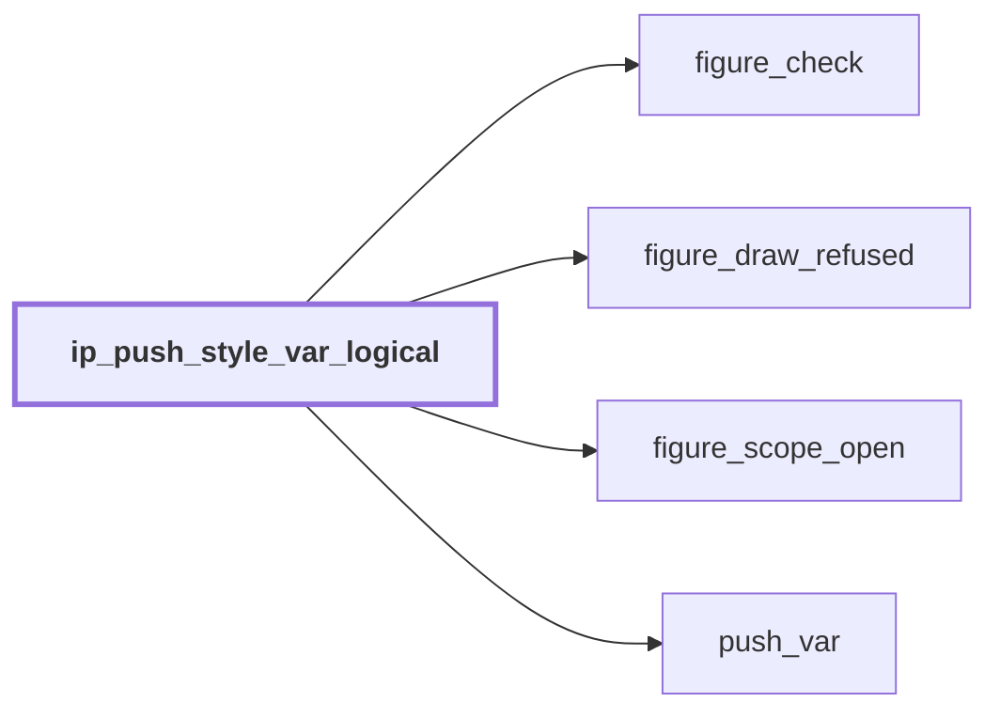

### ip_pop_style_var

Undo the `n` newest variable pushes (default 1): the same stack as `ig_pop_style_var`.

**Attributes**: recursive

```fortran
subroutine ip_pop_style_var(n, stat)
```

**Arguments**

| Name | Type | Intent | Attributes | Description |
|------|------|--------|------------|-------------|
| `n` | integer(kind=int32) | in | optional | How many. |
| `stat` | integer(kind=int32) | out | optional |  |

**Call graph**

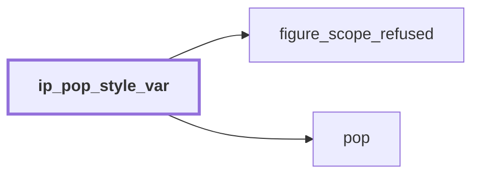

### ig_show_style_editor

Dear ImGui's and ImPlot's style editors, in a window titled "Style editor": every colour and size, live; with
 `open`, the window has a close button that sets it false. Keep a look with `app%save_style`.

**Attributes**: recursive

```fortran
subroutine ig_show_style_editor(open, stat)
```

**Arguments**

| Name | Type | Intent | Attributes | Description |
|------|------|--------|------------|-------------|
| `open` | logical | inout | optional | Window open. |
| `stat` | integer(kind=int32) | out | optional | Status: `FIG_ERR_STATE` outside a frame. |

**Call graph**

```mermaid
flowchart LR
  ig_show_style_editor["ig_show_style_editor"] --> fig_show_style_editor["fig_show_style_editor"]
  ig_show_style_editor["ig_show_style_editor"] --> figure_check["figure_check"]
  ig_show_style_editor["ig_show_style_editor"] --> figure_draw_refused["figure_draw_refused"]
  classDef focus stroke-width:3px,font-weight:bold
  class ig_show_style_editor focus
  click figure_draw_refused href "figure_base.html#figure-draw-refused" "figure_draw_refused"
  click figure_check href "figure_base.html#figure-check" "figure_check"
  click fig_show_style_editor href "figure_c_native.html#fig-show-style-editor" "fig_show_style_editor"
```

### ig_push_font

Switch the font and/or its size for the widgets that follow, until `ig_pop_font`: `font` as `app%set_font`
 (`''` keeps the current one), `size` in logical pixels (absent: keep). Pair every push with a pop.

**Attributes**: recursive

```fortran
subroutine ig_push_font(font, size, stat)
```

**Arguments**

| Name | Type | Intent | Attributes | Description |
|------|------|--------|------------|-------------|
| `font` | character(len=*) | in |  | Font (`'plex-sans'`, `'plex-mono'`, `'proggy'`, a file), or `''`. |
| `size` | real(kind=real64) | in | optional | Size [logical pixels], in (0, 200]. |
| `stat` | integer(kind=int32) | out | optional | Status. |

**Call graph**

```mermaid
flowchart LR
  ig_push_font["ig_push_font"] --> fig_push_font["fig_push_font"]
  ig_push_font["ig_push_font"] --> figure_check["figure_check"]
  ig_push_font["ig_push_font"] --> figure_draw_refused["figure_draw_refused"]
  ig_push_font["ig_push_font"] --> figure_fail["figure_fail"]
  ig_push_font["ig_push_font"] --> figure_scope_open["figure_scope_open"]
  classDef focus stroke-width:3px,font-weight:bold
  class ig_push_font focus
  click figure_draw_refused href "figure_base.html#figure-draw-refused" "figure_draw_refused"
  click figure_fail href "figure_base.html#figure-fail" "figure_fail"
  click fig_push_font href "figure_c_native.html#fig-push-font" "fig_push_font"
  click figure_scope_open href "figure_base.html#figure-scope-open" "figure_scope_open"
  click figure_check href "figure_base.html#figure-check" "figure_check"
```

### ig_pop_font

Back to the font before the last `ig_push_font`.

**Attributes**: recursive

```fortran
subroutine ig_pop_font(stat)
```

**Arguments**

| Name | Type | Intent | Attributes | Description |
|------|------|--------|------------|-------------|
| `stat` | integer(kind=int32) | out | optional | Status. |

**Call graph**

```mermaid
flowchart LR
  ig_pop_font["ig_pop_font"] --> fig_pop_font["fig_pop_font"]
  ig_pop_font["ig_pop_font"] --> figure_check["figure_check"]
  ig_pop_font["ig_pop_font"] --> figure_scope_refused["figure_scope_refused"]
  classDef focus stroke-width:3px,font-weight:bold
  class ig_pop_font focus
  click figure_scope_refused href "figure_base.html#figure-scope-refused" "figure_scope_refused"
  click figure_check href "figure_base.html#figure-check" "figure_check"
  click fig_pop_font href "figure_c_native.html#fig-pop-font" "fig_pop_font"
```

### hex_color

Parse `'#rrggbb'` or `'#rrggbbaa'` (the `#` optional, either case) into components in [0, 1].

**Attributes**: pure

```fortran
subroutine hex_color(text, rgba, ok)
```

**Arguments**

| Name | Type | Intent | Attributes | Description |
|------|------|--------|------------|-------------|
| `text` | character(len=*) | in |  | Hex colour. |
| `rgba` | real(kind=real64) | out |  | Components; alpha 1 when not given. |
| `ok` | logical | out |  | The text is a valid colour. |

**Call graph**

```mermaid
flowchart LR
  push_color_hex["push_color_hex"] --> hex_color["hex_color"]
  set_color_hex["set_color_hex"] --> hex_color["hex_color"]
  hex_color["hex_color"] --> digit["digit"]
  classDef focus stroke-width:3px,font-weight:bold
  class hex_color focus
  click push_color_hex href "#push-color-hex" "push_color_hex"
  click set_color_hex href "#set-color-hex" "set_color_hex"
```

### set_color

Write a colour given as components (3 or 4).

```fortran
subroutine set_color(lib, who, name, rgba, stat)
```

**Arguments**

| Name | Type | Intent | Attributes | Description |
|------|------|--------|------------|-------------|
| `lib` | integer(kind=c_int) | in |  | Library. |
| `who` | character(len=*) | in |  | Caller, for messages. |
| `name` | character(len=*) | in |  | Colour name. |
| `rgba` | real(kind=real64) | in |  | Components. |
| `stat` | integer(kind=int32) | out | optional | Status. |

**Call graph**

```mermaid
flowchart LR
  ig_set_style_color_rgba["ig_set_style_color_rgba"] --> set_color["set_color"]
  ip_set_style_color_rgba["ip_set_style_color_rgba"] --> set_color["set_color"]
  set_color_hex["set_color_hex"] --> set_color["set_color"]
  set_color["set_color"] --> fig_style_color["fig_style_color"]
  set_color["set_color"] --> figure_check["figure_check"]
  set_color["set_color"] --> figure_fail["figure_fail"]
  classDef focus stroke-width:3px,font-weight:bold
  class set_color focus
  click ig_set_style_color_rgba href "#ig-set-style-color-rgba" "ig_set_style_color_rgba"
  click ip_set_style_color_rgba href "#ip-set-style-color-rgba" "ip_set_style_color_rgba"
  click set_color_hex href "#set-color-hex" "set_color_hex"
  click figure_fail href "figure_base.html#figure-fail" "figure_fail"
  click figure_check href "figure_base.html#figure-check" "figure_check"
  click fig_style_color href "figure_c_native.html#fig-style-color" "fig_style_color"
```

### set_color_hex

Write a colour given as a hex string.

```fortran
subroutine set_color_hex(lib, who, name, color, stat)
```

**Arguments**

| Name | Type | Intent | Attributes | Description |
|------|------|--------|------------|-------------|
| `lib` | integer(kind=c_int) | in |  | Library. |
| `who` | character(len=*) | in |  | Caller, for messages. |
| `name` | character(len=*) | in |  | Colour name. |
| `color` | character(len=*) | in |  | `'#rrggbb'` or `'#rrggbbaa'`. |
| `stat` | integer(kind=int32) | out | optional | Status. |

**Call graph**

```mermaid
flowchart LR
  ig_set_style_color_hex["ig_set_style_color_hex"] --> set_color_hex["set_color_hex"]
  ip_set_style_color_hex["ip_set_style_color_hex"] --> set_color_hex["set_color_hex"]
  set_color_hex["set_color_hex"] --> figure_fail["figure_fail"]
  set_color_hex["set_color_hex"] --> hex_color["hex_color"]
  set_color_hex["set_color_hex"] --> set_color["set_color"]
  classDef focus stroke-width:3px,font-weight:bold
  class set_color_hex focus
  click ig_set_style_color_hex href "#ig-set-style-color-hex" "ig_set_style_color_hex"
  click ip_set_style_color_hex href "#ip-set-style-color-hex" "ip_set_style_color_hex"
  click hex_color href "#hex-color" "hex_color"
  click figure_fail href "figure_base.html#figure-fail" "figure_fail"
  click set_color href "#set-color" "set_color"
```

### get_color

Read a colour.

```fortran
subroutine get_color(lib, name, rgba, stat)
```

**Arguments**

| Name | Type | Intent | Attributes | Description |
|------|------|--------|------------|-------------|
| `lib` | integer(kind=c_int) | in |  | Library. |
| `name` | character(len=*) | in |  | Colour name. |
| `rgba` | real(kind=real64) | out |  | Components in [0, 1]. |
| `stat` | integer(kind=int32) | out | optional | Status. |

**Call graph**

```mermaid
flowchart LR
  ig_get_style_color["ig_get_style_color"] --> get_color["get_color"]
  ip_get_style_color["ip_get_style_color"] --> get_color["get_color"]
  get_color["get_color"] --> fig_style_color["fig_style_color"]
  get_color["get_color"] --> figure_check["figure_check"]
  classDef focus stroke-width:3px,font-weight:bold
  class get_color focus
  click ig_get_style_color href "#ig-get-style-color" "ig_get_style_color"
  click ip_get_style_color href "#ip-get-style-color" "ip_get_style_color"
  click figure_check href "figure_base.html#figure-check" "figure_check"
  click fig_style_color href "figure_c_native.html#fig-style-color" "fig_style_color"
```

### ig_set_style_color_hex

Set the Dear ImGui colour `name` (`Text`, `WindowBg`, `Button`, ...) from `'#rrggbb'` or `'#rrggbbaa'`.

**Attributes**: recursive

```fortran
subroutine ig_set_style_color_hex(name, color, stat)
```

**Arguments**

| Name | Type | Intent | Attributes | Description |
|------|------|--------|------------|-------------|
| `name` | character(len=*) | in |  | Colour name (`ImGuiCol_*` without the prefix). |
| `color` | character(len=*) | in |  | Hex colour. |
| `stat` | integer(kind=int32) | out | optional |  |

**Call graph**

```mermaid
flowchart LR
  ig_set_style_color_hex["ig_set_style_color_hex"] --> figure_refused["figure_refused"]
  ig_set_style_color_hex["ig_set_style_color_hex"] --> set_color_hex["set_color_hex"]
  classDef focus stroke-width:3px,font-weight:bold
  class ig_set_style_color_hex focus
  click figure_refused href "figure_base.html#figure-refused" "figure_refused"
  click set_color_hex href "#set-color-hex" "set_color_hex"
```

### ig_set_style_color_rgba

Set the Dear ImGui colour `name` from `[r, g, b]` or `[r, g, b, a]` in [0, 1].

**Attributes**: recursive

```fortran
subroutine ig_set_style_color_rgba(name, rgba, stat)
```

**Arguments**

| Name | Type | Intent | Attributes | Description |
|------|------|--------|------------|-------------|
| `name` | character(len=*) | in |  | Colour name (`ImGuiCol_*` without the prefix). |
| `rgba` | real(kind=real64) | in |  | Components. |
| `stat` | integer(kind=int32) | out | optional |  |

**Call graph**

```mermaid
flowchart LR
  ig_set_style_color_rgba["ig_set_style_color_rgba"] --> figure_refused["figure_refused"]
  ig_set_style_color_rgba["ig_set_style_color_rgba"] --> set_color["set_color"]
  classDef focus stroke-width:3px,font-weight:bold
  class ig_set_style_color_rgba focus
  click figure_refused href "figure_base.html#figure-refused" "figure_refused"
  click set_color href "#set-color" "set_color"
```

### ig_get_style_color

The Dear ImGui colour `name`, as `[r, g, b, a]` in [0, 1].

**Attributes**: recursive

```fortran
subroutine ig_get_style_color(name, rgba, stat)
```

**Arguments**

| Name | Type | Intent | Attributes | Description |
|------|------|--------|------------|-------------|
| `name` | character(len=*) | in |  | Colour name. |
| `rgba` | real(kind=real64) | out |  | Components. |
| `stat` | integer(kind=int32) | out | optional |  |

**Call graph**

```mermaid
flowchart LR
  ig_get_style_color["ig_get_style_color"] --> figure_refused["figure_refused"]
  ig_get_style_color["ig_get_style_color"] --> get_color["get_color"]
  classDef focus stroke-width:3px,font-weight:bold
  class ig_get_style_color focus
  click figure_refused href "figure_base.html#figure-refused" "figure_refused"
  click get_color href "#get-color" "get_color"
```

### ip_set_style_color_hex

Set the ImPlot colour `name` (`PlotBg`, `AxisGrid`, `LegendBg`, ...) from `'#rrggbb'` or `'#rrggbbaa'`.

**Attributes**: recursive

```fortran
subroutine ip_set_style_color_hex(name, color, stat)
```

**Arguments**

| Name | Type | Intent | Attributes | Description |
|------|------|--------|------------|-------------|
| `name` | character(len=*) | in |  | Colour name (`ImPlotCol_*` without the prefix). |
| `color` | character(len=*) | in |  | Hex colour. |
| `stat` | integer(kind=int32) | out | optional |  |

**Call graph**

```mermaid
flowchart LR
  ip_set_style_color_hex["ip_set_style_color_hex"] --> figure_refused["figure_refused"]
  ip_set_style_color_hex["ip_set_style_color_hex"] --> set_color_hex["set_color_hex"]
  classDef focus stroke-width:3px,font-weight:bold
  class ip_set_style_color_hex focus
  click figure_refused href "figure_base.html#figure-refused" "figure_refused"
  click set_color_hex href "#set-color-hex" "set_color_hex"
```

### ip_set_style_color_rgba

Set the ImPlot colour `name` from `[r, g, b]` or `[r, g, b, a]` in [0, 1].

**Attributes**: recursive

```fortran
subroutine ip_set_style_color_rgba(name, rgba, stat)
```

**Arguments**

| Name | Type | Intent | Attributes | Description |
|------|------|--------|------------|-------------|
| `name` | character(len=*) | in |  | Colour name (`ImPlotCol_*` without the prefix). |
| `rgba` | real(kind=real64) | in |  | Components. |
| `stat` | integer(kind=int32) | out | optional |  |

**Call graph**

```mermaid
flowchart LR
  ip_set_style_color_rgba["ip_set_style_color_rgba"] --> figure_refused["figure_refused"]
  ip_set_style_color_rgba["ip_set_style_color_rgba"] --> set_color["set_color"]
  classDef focus stroke-width:3px,font-weight:bold
  class ip_set_style_color_rgba focus
  click figure_refused href "figure_base.html#figure-refused" "figure_refused"
  click set_color href "#set-color" "set_color"
```

### ip_get_style_color

The ImPlot colour `name`, as `[r, g, b, a]` in [0, 1]; ImPlot's automatic colours (derived from Dear ImGui's)
 are returned as ImPlot draws them.

**Attributes**: recursive

```fortran
subroutine ip_get_style_color(name, rgba, stat)
```

**Arguments**

| Name | Type | Intent | Attributes | Description |
|------|------|--------|------------|-------------|
| `name` | character(len=*) | in |  | Colour name. |
| `rgba` | real(kind=real64) | out |  | Components. |
| `stat` | integer(kind=int32) | out | optional |  |

**Call graph**

```mermaid
flowchart LR
  ip_get_style_color["ip_get_style_color"] --> figure_refused["figure_refused"]
  ip_get_style_color["ip_get_style_color"] --> get_color["get_color"]
  classDef focus stroke-width:3px,font-weight:bold
  class ip_get_style_color focus
  click figure_refused href "figure_base.html#figure-refused" "figure_refused"
  click get_color href "#get-color" "get_color"
```

### set_var

Write a style variable of `n` values.

```fortran
subroutine set_var(lib, name, values, n, stat)
```

**Arguments**

| Name | Type | Intent | Attributes | Description |
|------|------|--------|------------|-------------|
| `lib` | integer(kind=c_int) | in |  | Library. |
| `name` | character(len=*) | in |  | Variable name. |
| `values` | real(kind=real64) | in |  | Values. |
| `n` | integer(kind=c_int) | in |  | How many. |
| `stat` | integer(kind=int32) | out | optional | Status. |

**Call graph**

```mermaid
flowchart LR
  ig_set_style_var_i32["ig_set_style_var_i32"] --> set_var["set_var"]
  ig_set_style_var_logical["ig_set_style_var_logical"] --> set_var["set_var"]
  ig_set_style_var_r64["ig_set_style_var_r64"] --> set_var["set_var"]
  ig_set_style_var_vec2["ig_set_style_var_vec2"] --> set_var["set_var"]
  ip_set_style_var_logical["ip_set_style_var_logical"] --> set_var["set_var"]
  ip_set_style_var_r64["ip_set_style_var_r64"] --> set_var["set_var"]
  ip_set_style_var_vec2["ip_set_style_var_vec2"] --> set_var["set_var"]
  set_var["set_var"] --> fig_style_var["fig_style_var"]
  set_var["set_var"] --> figure_check["figure_check"]
  classDef focus stroke-width:3px,font-weight:bold
  class set_var focus
  click ig_set_style_var_i32 href "#ig-set-style-var-i32" "ig_set_style_var_i32"
  click ig_set_style_var_logical href "#ig-set-style-var-logical" "ig_set_style_var_logical"
  click ig_set_style_var_r64 href "#ig-set-style-var-r64" "ig_set_style_var_r64"
  click ig_set_style_var_vec2 href "#ig-set-style-var-vec2" "ig_set_style_var_vec2"
  click ip_set_style_var_logical href "#ip-set-style-var-logical" "ip_set_style_var_logical"
  click ip_set_style_var_r64 href "#ip-set-style-var-r64" "ip_set_style_var_r64"
  click ip_set_style_var_vec2 href "#ip-set-style-var-vec2" "ip_set_style_var_vec2"
  click figure_check href "figure_base.html#figure-check" "figure_check"
  click fig_style_var href "figure_c_native.html#fig-style-var" "fig_style_var"
```

### get_var

Read a style variable.

```fortran
subroutine get_var(lib, name, values, n, stat)
```

**Arguments**

| Name | Type | Intent | Attributes | Description |
|------|------|--------|------------|-------------|
| `lib` | integer(kind=c_int) | in |  | Library. |
| `name` | character(len=*) | in |  | Variable name. |
| `values` | real(kind=real64) | out |  | Values (the second is 0 for a single value). |
| `n` | integer(kind=int32) | out |  | How many values the variable has: 1 or 2. |
| `stat` | integer(kind=int32) | out | optional | Status. |

**Call graph**

```mermaid
flowchart LR
  ig_get_style_var["ig_get_style_var"] --> get_var["get_var"]
  ip_get_style_var["ip_get_style_var"] --> get_var["get_var"]
  get_var["get_var"] --> fig_style_var["fig_style_var"]
  get_var["get_var"] --> figure_check["figure_check"]
  classDef focus stroke-width:3px,font-weight:bold
  class get_var focus
  click ig_get_style_var href "#ig-get-style-var" "ig_get_style_var"
  click ip_get_style_var href "#ip-get-style-var" "ip_get_style_var"
  click figure_check href "figure_base.html#figure-check" "figure_check"
  click fig_style_var href "figure_c_native.html#fig-style-var" "fig_style_var"
```

### ig_set_style_var_r64

Set a Dear ImGui style variable holding one number (`WindowRounding`, `Alpha`, `IndentSpacing`, ...).

**Attributes**: recursive

```fortran
subroutine ig_set_style_var_r64(name, value, stat)
```

**Arguments**

| Name | Type | Intent | Attributes | Description |
|------|------|--------|------------|-------------|
| `name` | character(len=*) | in |  | Variable name (a field of `ImGuiStyle`). |
| `value` | real(kind=real64) | in |  | Value. |
| `stat` | integer(kind=int32) | out | optional |  |

**Call graph**

```mermaid
flowchart LR
  ig_set_style_var_r64["ig_set_style_var_r64"] --> figure_refused["figure_refused"]
  ig_set_style_var_r64["ig_set_style_var_r64"] --> set_var["set_var"]
  classDef focus stroke-width:3px,font-weight:bold
  class ig_set_style_var_r64 focus
  click figure_refused href "figure_base.html#figure-refused" "figure_refused"
  click set_var href "#set-var" "set_var"
```

### ig_set_style_var_vec2

Set a Dear ImGui style variable holding a pair (`WindowPadding`, `FramePadding`, `ItemSpacing`, ...).

**Attributes**: recursive

```fortran
subroutine ig_set_style_var_vec2(name, value, stat)
```

**Arguments**

| Name | Type | Intent | Attributes | Description |
|------|------|--------|------------|-------------|
| `name` | character(len=*) | in |  | Variable name (a field of `ImGuiStyle`). |
| `value` | real(kind=real64) | in |  | Values (x, y). |
| `stat` | integer(kind=int32) | out | optional |  |

**Call graph**

```mermaid
flowchart LR
  ig_set_style_var_vec2["ig_set_style_var_vec2"] --> figure_refused["figure_refused"]
  ig_set_style_var_vec2["ig_set_style_var_vec2"] --> set_var["set_var"]
  classDef focus stroke-width:3px,font-weight:bold
  class ig_set_style_var_vec2 focus
  click figure_refused href "figure_base.html#figure-refused" "figure_refused"
  click set_var href "#set-var" "set_var"
```

### ig_set_style_var_logical

Set a Dear ImGui style variable holding a logical (`AntiAliasedLines`, ...).

**Attributes**: recursive

```fortran
subroutine ig_set_style_var_logical(name, value, stat)
```

**Arguments**

| Name | Type | Intent | Attributes | Description |
|------|------|--------|------------|-------------|
| `name` | character(len=*) | in |  | Variable name (a field of `ImGuiStyle`). |
| `value` | logical | in |  | Value. |
| `stat` | integer(kind=int32) | out | optional |  |

**Call graph**

```mermaid
flowchart LR
  ig_set_style_var_logical["ig_set_style_var_logical"] --> figure_refused["figure_refused"]
  ig_set_style_var_logical["ig_set_style_var_logical"] --> set_var["set_var"]
  classDef focus stroke-width:3px,font-weight:bold
  class ig_set_style_var_logical focus
  click figure_refused href "figure_base.html#figure-refused" "figure_refused"
  click set_var href "#set-var" "set_var"
```

### ig_set_style_var_i32

Set a Dear ImGui style variable holding an enumeration (`WindowMenuButtonPosition`, ...).

**Attributes**: recursive

```fortran
subroutine ig_set_style_var_i32(name, value, stat)
```

**Arguments**

| Name | Type | Intent | Attributes | Description |
|------|------|--------|------------|-------------|
| `name` | character(len=*) | in |  | Variable name (a field of `ImGuiStyle`). |
| `value` | integer(kind=int32) | in |  | Value. |
| `stat` | integer(kind=int32) | out | optional |  |

**Call graph**

```mermaid
flowchart LR
  ig_set_style_var_i32["ig_set_style_var_i32"] --> figure_refused["figure_refused"]
  ig_set_style_var_i32["ig_set_style_var_i32"] --> set_var["set_var"]
  classDef focus stroke-width:3px,font-weight:bold
  class ig_set_style_var_i32 focus
  click figure_refused href "figure_base.html#figure-refused" "figure_refused"
  click set_var href "#set-var" "set_var"
```

### ig_get_style_var

A Dear ImGui style variable: its value(s) and how many it has (1, or 2 for a pair); a logical reads 0 or 1.

**Attributes**: recursive

```fortran
subroutine ig_get_style_var(name, values, n, stat)
```

**Arguments**

| Name | Type | Intent | Attributes | Description |
|------|------|--------|------------|-------------|
| `name` | character(len=*) | in |  | Variable name. |
| `values` | real(kind=real64) | out |  | Values. |
| `n` | integer(kind=int32) | out |  | 1 or 2. |
| `stat` | integer(kind=int32) | out | optional |  |

**Call graph**

```mermaid
flowchart LR
  ig_get_style_var["ig_get_style_var"] --> figure_refused["figure_refused"]
  ig_get_style_var["ig_get_style_var"] --> get_var["get_var"]
  classDef focus stroke-width:3px,font-weight:bold
  class ig_get_style_var focus
  click figure_refused href "figure_base.html#figure-refused" "figure_refused"
  click get_var href "#get-var" "get_var"
```

### ip_set_style_var_r64

Set an ImPlot style variable holding one number (`PlotBorderSize`, `MinorAlpha`, ...).

**Attributes**: recursive

```fortran
subroutine ip_set_style_var_r64(name, value, stat)
```

**Arguments**

| Name | Type | Intent | Attributes | Description |
|------|------|--------|------------|-------------|
| `name` | character(len=*) | in |  | Variable name (a field of `ImPlotStyle`). |
| `value` | real(kind=real64) | in |  | Value. |
| `stat` | integer(kind=int32) | out | optional |  |

**Call graph**

```mermaid
flowchart LR
  ip_set_style_var_r64["ip_set_style_var_r64"] --> figure_refused["figure_refused"]
  ip_set_style_var_r64["ip_set_style_var_r64"] --> set_var["set_var"]
  classDef focus stroke-width:3px,font-weight:bold
  class ip_set_style_var_r64 focus
  click figure_refused href "figure_base.html#figure-refused" "figure_refused"
  click set_var href "#set-var" "set_var"
```

### ip_set_style_var_vec2

Set an ImPlot style variable holding a pair (`PlotPadding`, `MajorGridSize`, `LegendPadding`, ...).

**Attributes**: recursive

```fortran
subroutine ip_set_style_var_vec2(name, value, stat)
```

**Arguments**

| Name | Type | Intent | Attributes | Description |
|------|------|--------|------------|-------------|
| `name` | character(len=*) | in |  | Variable name (a field of `ImPlotStyle`). |
| `value` | real(kind=real64) | in |  | Values (x, y). |
| `stat` | integer(kind=int32) | out | optional |  |

**Call graph**

```mermaid
flowchart LR
  ip_set_style_var_vec2["ip_set_style_var_vec2"] --> figure_refused["figure_refused"]
  ip_set_style_var_vec2["ip_set_style_var_vec2"] --> set_var["set_var"]
  classDef focus stroke-width:3px,font-weight:bold
  class ip_set_style_var_vec2 focus
  click figure_refused href "figure_base.html#figure-refused" "figure_refused"
  click set_var href "#set-var" "set_var"
```

### ip_set_style_var_logical

Set an ImPlot style variable holding a logical (`UseLocalTime`, `UseISO8601`, `Use24HourClock`).

**Attributes**: recursive

```fortran
subroutine ip_set_style_var_logical(name, value, stat)
```

**Arguments**

| Name | Type | Intent | Attributes | Description |
|------|------|--------|------------|-------------|
| `name` | character(len=*) | in |  | Variable name (a field of `ImPlotStyle`). |
| `value` | logical | in |  | Value. |
| `stat` | integer(kind=int32) | out | optional |  |

**Call graph**

```mermaid
flowchart LR
  ip_set_style_var_logical["ip_set_style_var_logical"] --> figure_refused["figure_refused"]
  ip_set_style_var_logical["ip_set_style_var_logical"] --> set_var["set_var"]
  classDef focus stroke-width:3px,font-weight:bold
  class ip_set_style_var_logical focus
  click figure_refused href "figure_base.html#figure-refused" "figure_refused"
  click set_var href "#set-var" "set_var"
```

### ip_get_style_var

An ImPlot style variable: its value(s) and how many it has (1, or 2 for a pair); a logical reads 0 or 1.

**Attributes**: recursive

```fortran
subroutine ip_get_style_var(name, values, n, stat)
```

**Arguments**

| Name | Type | Intent | Attributes | Description |
|------|------|--------|------------|-------------|
| `name` | character(len=*) | in |  | Variable name. |
| `values` | real(kind=real64) | out |  | Values. |
| `n` | integer(kind=int32) | out |  | 1 or 2. |
| `stat` | integer(kind=int32) | out | optional |  |

**Call graph**

```mermaid
flowchart LR
  ip_get_style_var["ip_get_style_var"] --> figure_refused["figure_refused"]
  ip_get_style_var["ip_get_style_var"] --> get_var["get_var"]
  classDef focus stroke-width:3px,font-weight:bold
  class ip_get_style_var focus
  click figure_refused href "figure_base.html#figure-refused" "figure_refused"
  click get_var href "#get-var" "get_var"
```
