# figure_task

> figure_task, background tasks: Fortran procedures run on a worker thread, with progress and cooperative cancel.

 A task runs `work(h, data)` on a thread of its own while the frame loop goes on: `t%start(work, data)`, then every
 frame `t%progress(fraction, message)` and `t%done()`; once done, `t%result(data)`. Inside `work`, `h%report` posts
 progress (and wakes the frame loop), `h%cancelled()` tells whether the program asked it to stop, `h%fail` reports a
 failure.

 **The threading rule:** a task computes and reads its own files; it never calls FIGURE's drawing procedures, since
 Dear ImGui is single-threaded. FIGURE's drawing entry points (`app%next_frame`, `ig_begin`/`ig_end`, the child
 regions, side bars, menu bars, popups, tab bars, tables, trees and headers, plots and subplots, dock spaces,
 textures, `log%draw`) refuse such a call from a worker: they return at once, the task's status becomes
 `FIG_ERR_STATE` (given by `t%result`) and the task is asked to stop.

**Source**: `src/lib/figure_task.F90`

**Dependencies**

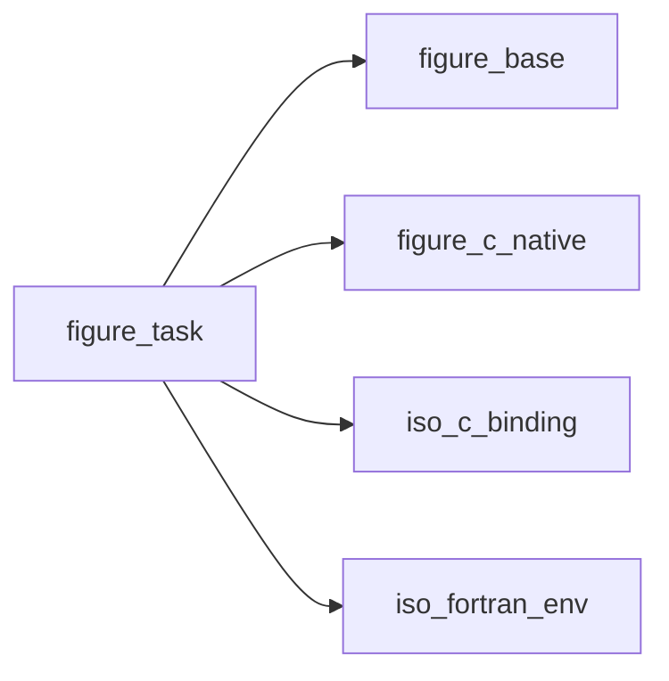

## Contents

- [task_handle_object](#task-handle-object)
- [task_record](#task-record)
- [task_object](#task-object)
- [task_trampoline](#task-trampoline)
- [handle_report](#handle-report)
- [handle_fail](#handle-fail)
- [task_start](#task-start)
- [task_progress](#task-progress)
- [task_cancel](#task-cancel)
- [task_result](#task-result)
- [release](#release)
- [task_final](#task-final)
- [handle_cancelled](#handle-cancelled)
- [task_running](#task-running)
- [task_done](#task-done)

## Derived Types

### task_handle_object

What a running task knows of itself: given to its `work` procedure.

#### Components

| Name | Type | Attributes | Description |
|------|------|------------|-------------|
| `id` | integer(kind=c_int) |  | Native handle. |

#### Type-Bound Procedures

| Name | Attributes | Description |
|------|------------|-------------|
| `report` | pass(self) | Post progress. |
| `cancelled` | pass(self) | The program asked the task to stop. |
| `fail` | pass(self) | Report a failure. |

### task_record

What the worker thread reaches: the procedure, the data, the handle (at a fixed address while it runs).

#### Components

| Name | Type | Attributes | Description |
|------|------|------------|-------------|
| `work` | procedure(task_work) | pointer, nopass | The work. |
| `data` | class(*) | allocatable | Its data. |
| `handle` | type([task_handle_object](/api/src/lib/figure_task#task-handle-object)) |  | Its handle. |

### task_object

A procedure of the program run on a worker thread. Not to be copied. An object that ends while its task runs
 asks the task to stop and waits for it (until its next safe point).

#### Components

| Name | Type | Attributes | Description |
|------|------|------------|-------------|
| `rec` | type([task_record](/api/src/lib/figure_task#task-record)) | pointer | The running task's record. |
| `id` | integer(kind=c_int) |  | Native handle (0: none). |

#### Type-Bound Procedures

| Name | Attributes | Description |
|------|------------|-------------|
| `start` | pass(self) | Start a task. |
| `running` | pass(self) | It runs. |
| `done` | pass(self) | It has ended (its result is waiting). |
| `progress` | pass(self) | Its last progress and message. |
| `cancel` | pass(self) | Ask it to stop. |
| `result` | pass(self) | Its data, once done. |

## Subroutines

### task_trampoline

The worker thread's entry: the task's work on its data.

**Attributes**: recursive

```fortran
subroutine task_trampoline(arg)
```

**Arguments**

| Name | Type | Intent | Attributes | Description |
|------|------|--------|------------|-------------|
| `arg` | type(c_ptr) |  | value | The task's record. |

### handle_report

Post the progress, `fraction` of the work done in [0, 1] (clamped), and a message (absent: the previous one
 stays); the frame loop is woken to show it. Cheap: call it as often as useful, a few times a second is plenty.

**Attributes**: recursive

```fortran
subroutine handle_report(self, fraction, message)
```

**Arguments**

| Name | Type | Intent | Attributes | Description |
|------|------|--------|------------|-------------|
| `self` | class([task_handle_object](/api/src/lib/figure_task#task-handle-object)) | in |  | Handle. |
| `fraction` | real(kind=real64) | in |  | Done, in [0, 1]. |
| `message` | character(len=*) | in | optional | What is being done. |

**Call graph**

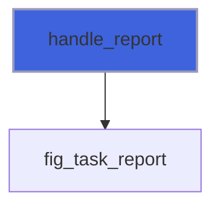

### handle_fail

Report a failure (a file that cannot be read): `t%result` gives `FIG_ERR_FAILED` and `message`. The task should
 then return; the first failure is kept.

**Attributes**: recursive

```fortran
subroutine handle_fail(self, message)
```

**Arguments**

| Name | Type | Intent | Attributes | Description |
|------|------|--------|------------|-------------|
| `self` | class([task_handle_object](/api/src/lib/figure_task#task-handle-object)) | in |  | Handle. |
| `message` | character(len=*) | in |  | What failed. |

**Call graph**

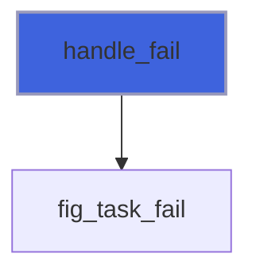

### task_start

Run `work(h, data)` on a worker thread. `data` (any type: a file name, an extended type with the arrays to
 fill) is copied into the task, which works on its copy; `t%result` gives it back without a copy. Statuses:
 `FIG_ERR_STATE` while this object's task runs (a finished one whose result was not taken is discarded) or when
 called from a task, `FIG_ERR_FAILED` when no thread can be created. The same in every mode.

```fortran
subroutine task_start(self, work, data, stat)
```

**Arguments**

| Name | Type | Intent | Attributes | Description |
|------|------|--------|------------|-------------|
| `self` | class([task_object](/api/src/lib/figure_task#task-object)) | inout |  | Task. |
| `work` | procedure(task_work) |  |  | The work. |
| `data` | class(*) | in |  | Its data. |
| `stat` | integer(kind=int32) | out | optional | Status. |

**Call graph**

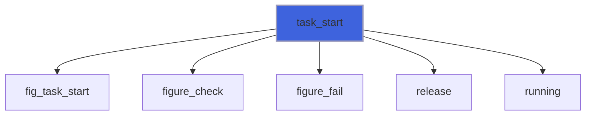

### task_progress

The last progress the task reported: `fraction` in [0, 1] (-1 before its first report or before `start`) and
 its message ('' if none).

```fortran
subroutine task_progress(self, fraction, message)
```

**Arguments**

| Name | Type | Intent | Attributes | Description |
|------|------|--------|------------|-------------|
| `self` | class([task_object](/api/src/lib/figure_task#task-object)) | in |  | Task. |
| `fraction` | real(kind=real64) | out |  | Done, in [0, 1]. |
| `message` | character(len=:) | out | allocatable, optional | What is being done. |

**Call graph**

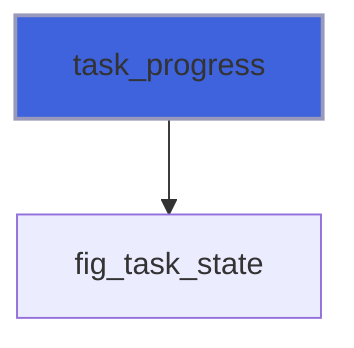

### task_cancel

Ask the task to stop: it does at its next safe point (`h%cancelled()`); nothing is stopped mid-write.
 `t%done()` tells when it has. `FIG_ERR_STATE` before `start`.

```fortran
subroutine task_cancel(self, stat)
```

**Arguments**

| Name | Type | Intent | Attributes | Description |
|------|------|--------|------------|-------------|
| `self` | class([task_object](/api/src/lib/figure_task#task-object)) | inout |  | Task. |
| `stat` | integer(kind=int32) | out | optional | Status. |

**Call graph**

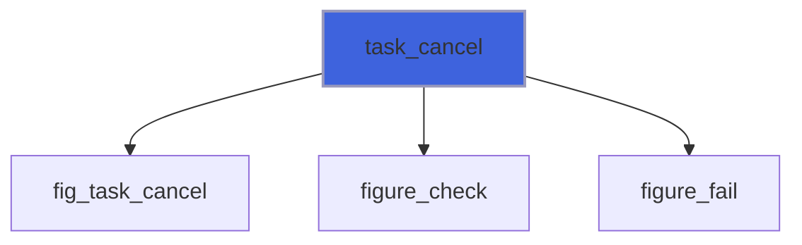

### task_result

The task's data once it has ended, moved out (no copy); the object is then free for another `start`. Statuses:
 `FIG_ERR_STATE` before `start` or while it runs (`data` not allocated), and for a task that called a drawing
 procedure; `FIG_ERR_FAILED` for a task that reported a failure (`h%fail`): `data` is given as the task left it,
 and `figure_last_error()` gives the message. A cancelled task is not a failure.

```fortran
subroutine task_result(self, data, stat)
```

**Arguments**

| Name | Type | Intent | Attributes | Description |
|------|------|--------|------------|-------------|
| `self` | class([task_object](/api/src/lib/figure_task#task-object)) | inout |  | Task. |
| `data` | class(*) | out | allocatable | Its data. |
| `stat` | integer(kind=int32) | out | optional | Status. |

**Call graph**

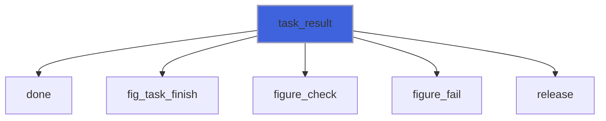

### release

Forget the task: a running one is asked to stop and waited for.

```fortran
subroutine release(self)
```

**Arguments**

| Name | Type | Intent | Attributes | Description |
|------|------|--------|------------|-------------|
| `self` | class([task_object](/api/src/lib/figure_task#task-object)) | inout |  | Task. |

**Call graph**

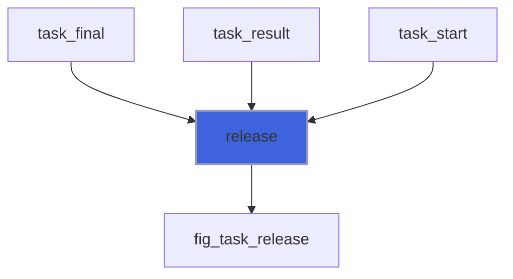

### task_final

The object ends: its task, if running, is asked to stop and waited for.

```fortran
subroutine task_final(self)
```

**Arguments**

| Name | Type | Intent | Attributes | Description |
|------|------|--------|------------|-------------|
| `self` | type([task_object](/api/src/lib/figure_task#task-object)) | inout |  | Task. |

**Call graph**

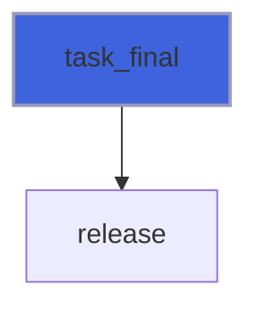

## Functions

### handle_cancelled

True once the program asked the task to stop (`t%cancel`, the object's end, a refused drawing call): return
 from `work` at this safe point, leaving `data` consistent.

**Attributes**: recursive

**Returns**: `logical`

```fortran
function handle_cancelled(self) result(cancelled)
```

**Arguments**

| Name | Type | Intent | Attributes | Description |
|------|------|--------|------------|-------------|
| `self` | class([task_handle_object](/api/src/lib/figure_task#task-handle-object)) | in |  | Handle. |

**Call graph**

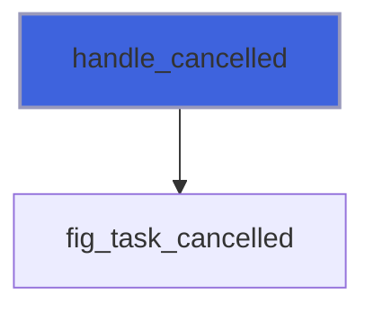

### task_running

True while the task runs (false before `start`, once it has ended, after `result`).

**Returns**: `logical`

```fortran
function task_running(self) result(running)
```

**Arguments**

| Name | Type | Intent | Attributes | Description |
|------|------|--------|------------|-------------|
| `self` | class([task_object](/api/src/lib/figure_task#task-object)) | in |  | Task. |

**Call graph**

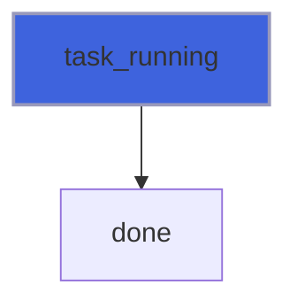

### task_done

True once the task has ended (finished, cancelled or failed) and its result waits for `t%result`; false before
 `start`, while it runs, and after `result`.

**Returns**: `logical`

```fortran
function task_done(self) result(done)
```

**Arguments**

| Name | Type | Intent | Attributes | Description |
|------|------|--------|------------|-------------|
| `self` | class([task_object](/api/src/lib/figure_task#task-object)) | in |  | Task. |

**Call graph**

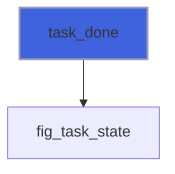
