# figure_testing

> figure_testing, synthetic input for testing interfaces without a display (or with one).

 Input is queued and applied while the program draws its next frames, as real input would be: a test queues a
 click, draws a few frames (`app%next_frame()` and the program's own UI code), then checks the program's variables.
 Everything queued reaches Dear ImGui at the next frame, up to a frame boundary (`test_next_frame`); Dear ImGui
 then applies one change of each kind per frame (input trickling), so a move, a press and a release queued at once
 become a click over the next frames.

```fortran
 call test_click(x, y)           ! the centre of the button, e.g. from ig_item_rect in an earlier frame
 do frame = 1, 4
    if (.not. app%next_frame()) exit
    call draw_panel(panel)       ! the UI under test
 enddo
 ! now check what the click did to the program's variables
```

 Coordinates are display pixels, as `ig_item_rect` and `test_window_rect` give them. Works in every mode; with
 `app%init_headless` no window, display or GPU is needed, so tests run in CI as is.

**Source**: `src/lib/figure_testing.F90`

**Dependencies**

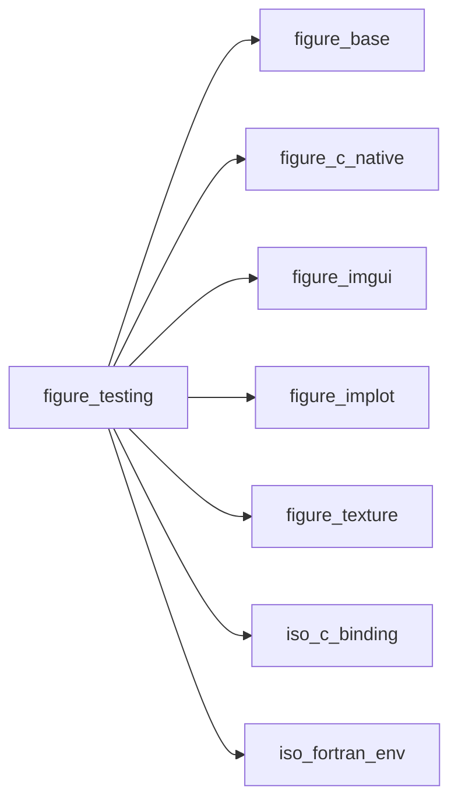

## Contents

- [test_drawn_extent](#test-drawn-extent)
- [test_next_frame](#test-next-frame)
- [test_plot_tick](#test-plot-tick)
- [test_quit](#test-quit)
- [test_system_theme](#test-system-theme)
- [test_frame_rect](#test-frame-rect)
- [test_frame_state](#test-frame-state)
- [test_notification_rect](#test-notification-rect)
- [test_drawn_extent_name](#test-drawn-extent-name)
- [test_drawn_extent_rgba](#test-drawn-extent-rgba)
- [test_file_browser](#test-file-browser)
- [test_file_browser_rect](#test-file-browser-rect)
- [test_settings_file](#test-settings-file)
- [browser_list](#browser-list)
- [test_mouse_move](#test-mouse-move)
- [test_mouse_button](#test-mouse-button)
- [test_click](#test-click)
- [test_drag](#test-drag)
- [test_wheel](#test-wheel)
- [test_key](#test-key)
- [test_type](#test-type)
- [test_drop](#test-drop)
- [test_window_rect](#test-window-rect)
- [test_glyph](#test-glyph)
- [test_popup_rect](#test-popup-rect)
- [test_field_pixel](#test-field-pixel)
- [test_item_center](#test-item-center)
- [test_record_items](#test-record-items)
- [test_item_click](#test-item-click)
- [test_item_type_text](#test-item-type-text)
- [test_menu_click](#test-menu-click)
- [test_capture](#test-capture)
- [read_picture](#read-picture)
- [write_picture](#write-picture)
- [remove_file](#remove-file)
- [item_check](#item-check)
- [items_list](#items-list)
- [test_frame_hit](#test-frame-hit)
- [browser_text](#browser-text)
- [test_opened_url](#test-opened-url)
- [test_plot_copies](#test-plot-copies)
- [test_plot_stride](#test-plot-stride)
- [test_field_uploads](#test-field-uploads)
- [test_field_textures](#test-field-textures)
- [test_field_time](#test-field-time)
- [test_item_exists](#test-item-exists)
- [test_item_rect](#test-item-rect)
- [test_item_checked](#test-item-checked)
- [test_item_value](#test-item-value)
- [test_run](#test-run)
- [test_id_conflicts](#test-id-conflicts)
- [test_unnamed_items](#test-unnamed-items)
- [test_compare_image](#test-compare-image)
- [ubyte](#ubyte)
- [sbyte](#sbyte)
- [itoa](#itoa)
- [ltoa](#ltoa)
- [item_query](#item-query)
- [button_index](#button-index)

## Variables

| Name | Type | Attributes | Description |
|------|------|------------|-------------|
| `ITEM_CHECKABLE` | integer(kind=c_int) | parameter | A checkbox, a menu item, a selectable in a menu. |
| `ITEM_CHECKED` | integer(kind=c_int) | parameter | Checked. |

## Interfaces

### test_drawn_extent

The extent [pixels] of what was drawn so far in the current window in a colour: Dear ImGui's style colour by its
 name, or an RGBA colour (an item's `ip_spec` colour).

**Module procedures**: [`test_drawn_extent_name`](/api/src/lib/figure_testing#test-drawn-extent-name), [`test_drawn_extent_rgba`](/api/src/lib/figure_testing#test-drawn-extent-rgba)

## Subroutines

### test_next_frame

A frame boundary in the queued input: what is queued after it reaches Dear ImGui one frame later than what is
 queued before it. For sequences that must not share a frame (a drag: press, move, release).

```fortran
subroutine test_next_frame(stat)
```

**Arguments**

| Name | Type | Intent | Attributes | Description |
|------|------|--------|------------|-------------|
| `stat` | integer(kind=int32) | out | optional | Status. |

**Call graph**

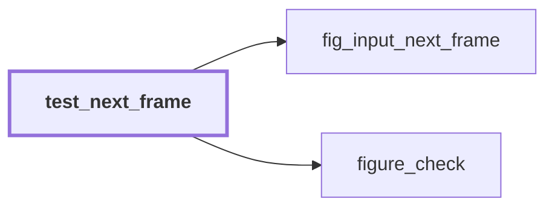

### test_plot_tick

The label of tick `index` (from 1) on `axis` of the plot being declared, and the number of ticks: call it between
 `ip_begin_plot` and `ip_end_plot`, after the setup (`ip_setup_axes`, `ip_setup_axis`) and an item (it ends the
 setup). `axis` is `'x1'`, `'x2'`, `'x3'`, `'y1'`, `'y2'` or `'y3'` (`'x'` and `'y'`: x1 and y1). `label` is ''
 for an index out of range.

```fortran
subroutine test_plot_tick(axis, index, label, count, stat)
```

**Arguments**

| Name | Type | Intent | Attributes | Description |
|------|------|--------|------------|-------------|
| `axis` | character(len=*) | in |  | `'x1'`..`'x3'`, `'y1'`..`'y3'`, `'x'`, `'y'`. |
| `index` | integer(kind=int32) | in |  | Tick, from 1. |
| `label` | character(len=:) | out | allocatable | Its label. |
| `count` | integer(kind=int32) | out | optional | Ticks on the axis. |
| `stat` | integer(kind=int32) | out | optional | axis not set up, `FIG_ERR_ARGUMENT` for an unknown axis. |

**Call graph**

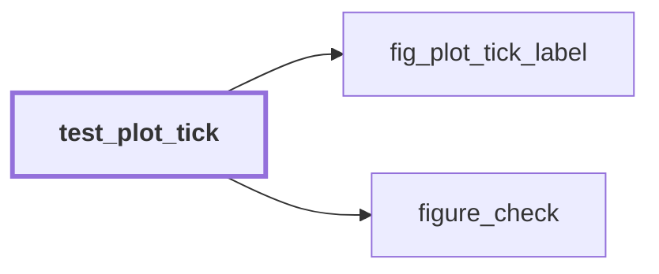

### test_quit

A quit request, as the window's close button makes it: `next_frame` returns `.false.`, or, after
 `app%set_confirm_quit(.true.)`, `app%quit_requested()` returns `.true.`.

```fortran
subroutine test_quit(stat)
```

**Arguments**

| Name | Type | Intent | Attributes | Description |
|------|------|--------|------------|-------------|
| `stat` | integer(kind=int32) | out | optional |  |

**Call graph**

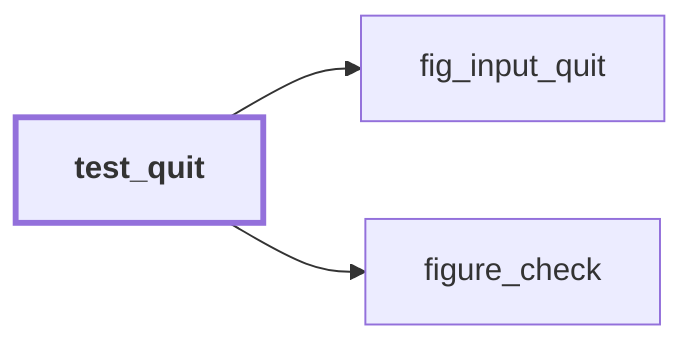

### test_system_theme

The system's light or dark setting changes, as SDL's theme-changed event reports it, at the next frame:
 `palette='auto'` (`app%set_style`) is chosen again. `theme` is `'light'`, `'dark'`, or `'system'` (the real
 setting again, read from SDL in window mode; unknown, so dark, in headless and remote modes). Works in every mode.

```fortran
subroutine test_system_theme(theme, stat)
```

**Arguments**

| Name | Type | Intent | Attributes | Description |
|------|------|--------|------------|-------------|
| `theme` | character(len=*) | in |  | `'light'`, `'dark'` or `'system'`. |
| `stat` | integer(kind=int32) | out | optional | before `init*`. |

**Call graph**

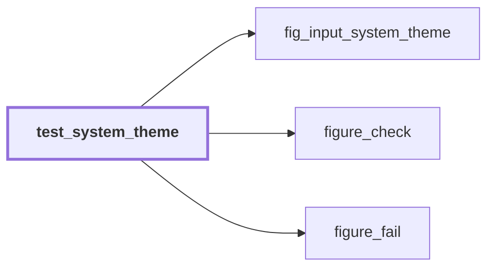

### test_frame_rect

A part of the title bar of `decorations='figure'` in the last frame: `'bar'`, `'icon'`, `'menus'` (the program's
 main menu bar inside it), `'title'`, `'minimize'`, `'maximize'`, `'close'`; `found` is false when not drawn.

```fortran
subroutine test_frame_rect(part, x0, y0, x1, y1, found, stat)
```

**Arguments**

| Name | Type | Intent | Attributes | Description |
|------|------|--------|------------|-------------|
| `part` | character(len=*) | in |  | Part. |
| `x0` | real(kind=real64) | out |  | Left [pixels]. |
| `y0` | real(kind=real64) | out |  | Top [pixels]. |
| `x1` | real(kind=real64) | out |  | Right [pixels]. |
| `y1` | real(kind=real64) | out |  | Bottom [pixels]. |
| `found` | logical | out | optional | Drawn in the last frame. |
| `stat` | integer(kind=int32) | out | optional | Status: `FIG_ERR_ARGUMENT` for an unknown part. |

**Call graph**

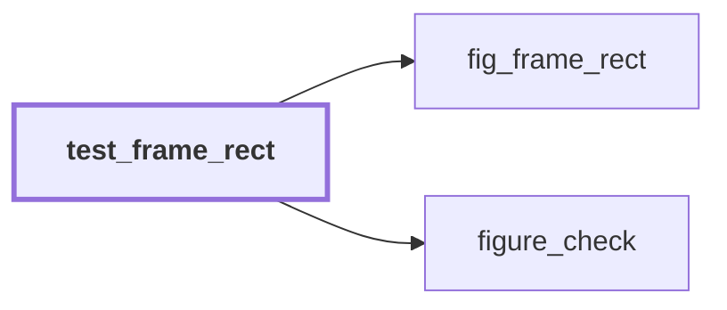

### test_frame_state

The window minimized, maximized: the system's in window mode; in headless mode, as the buttons of
 `decorations='figure'` recorded them.

```fortran
subroutine test_frame_state(minimized, maximized, stat)
```

**Arguments**

| Name | Type | Intent | Attributes | Description |
|------|------|--------|------------|-------------|
| `minimized` | logical | out |  | Minimized. |
| `maximized` | logical | out |  | Maximized. |
| `stat` | integer(kind=int32) | out | optional | Status: `FIG_ERR_STATE` before `init*`. |

**Call graph**

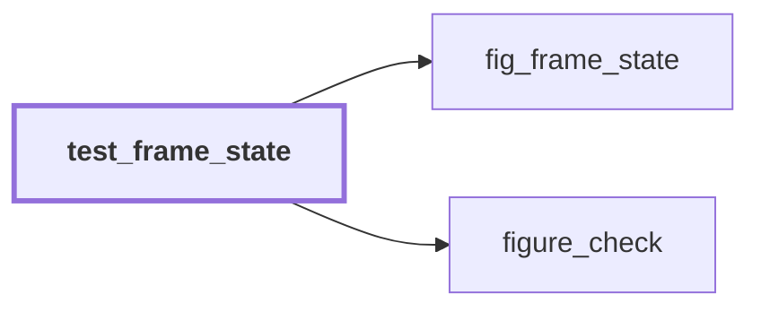

### test_notification_rect

The rectangle [pixels] of a notification shown in the last frame (`app%notify`): `index` 1 is the newest, at the
 bottom, 2 the one above it, ...; `found` is false past the last shown. `alpha`: the largest alpha of the
 vertices it was drawn with (the draw data), in [0, 1]: 1 while it is shown in full, falling to 0 as it fades
 out in the last half second of its time; 0 past the last shown.

```fortran
subroutine test_notification_rect(index, xmin, ymin, xmax, ymax, found, alpha)
```

**Arguments**

| Name | Type | Intent | Attributes | Description |
|------|------|--------|------------|-------------|
| `index` | integer(kind=int32) | in |  | 1: the newest shown. |
| `xmin` | real(kind=real64) | out |  | Left. |
| `ymin` | real(kind=real64) | out |  | Top. |
| `xmax` | real(kind=real64) | out |  | Right. |
| `ymax` | real(kind=real64) | out |  | Bottom. |
| `found` | logical | out | optional | It was shown. |
| `alpha` | real(kind=real64) | out | optional | Largest alpha drawn, in [0, 1]. |

**Call graph**

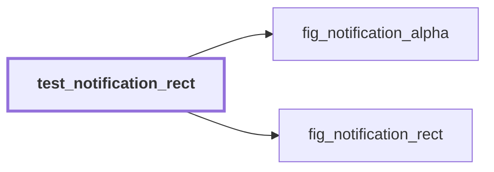

### test_drawn_extent_name

The extent [pixels] of what was drawn so far in the current window in Dear ImGui's style colour `color`, by
 its name (`'PlotHistogram'`: the fill of a progress bar): call it inside the window, after the widget.

```fortran
subroutine test_drawn_extent_name(color, xmin, ymin, xmax, ymax, found, stat)
```

**Arguments**

| Name | Type | Intent | Attributes | Description |
|------|------|--------|------------|-------------|
| `color` | character(len=*) | in |  | Dear ImGui's colour name. |
| `xmin` | real(kind=real64) | out |  | Left. |
| `ymin` | real(kind=real64) | out |  | Top. |
| `xmax` | real(kind=real64) | out |  | Right. |
| `ymax` | real(kind=real64) | out |  | Bottom. |
| `found` | logical | out | optional | Something was drawn in it. |
| `stat` | integer(kind=int32) | out | optional | `FIG_ERR_STATE` outside a window. |

**Call graph**

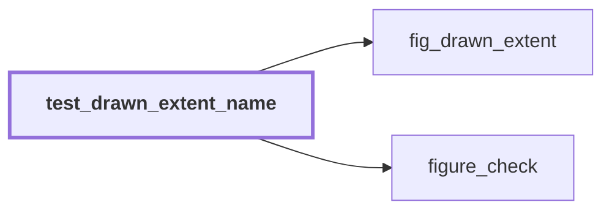

### test_drawn_extent_rgba

The extent [pixels] of what was drawn so far in the current window in the RGBA colour `color` (as an item drawn
 with `ip_spec(line_color=color)`): call it inside the window, after the item (after `ip_end_plot` for what a plot
 draws at its end: annotations). Antialiased edges are drawn in other colours: the extent is that of the lines' cores.
 With `layer` `'foreground'` or `'background'`, what was drawn so far on that layer of the window's viewport (the
 `ig_draw_*` primitives' layers; `'window'`, the default, and `'plot'` are the window's own draw list).
 `vertices`: how many vertices have the colour (a filled shape has fewer than its outline: one per corner).

```fortran
subroutine test_drawn_extent_rgba(color, xmin, ymin, xmax, ymax, found, stat, layer, vertices)
```

**Arguments**

| Name | Type | Intent | Attributes | Description |
|------|------|--------|------------|-------------|
| `color` | real(kind=real64) | in |  | Colour, RGBA in [0, 1]. |
| `xmin` | real(kind=real64) | out |  | Left. |
| `ymin` | real(kind=real64) | out |  | Top. |
| `xmax` | real(kind=real64) | out |  | Right. |
| `ymax` | real(kind=real64) | out |  | Bottom. |
| `found` | logical | out | optional | Something was drawn in it. |
| `stat` | integer(kind=int32) | out | optional | Status: `FIG_ERR_STATE` outside a window. |
| `layer` | character(len=*) | in | optional | `'window'` (default), `'plot'`, `'foreground'`, `'background'`. |
| `vertices` | integer(kind=int32) | out | optional | Vertices drawn in the colour. |

**Call graph**

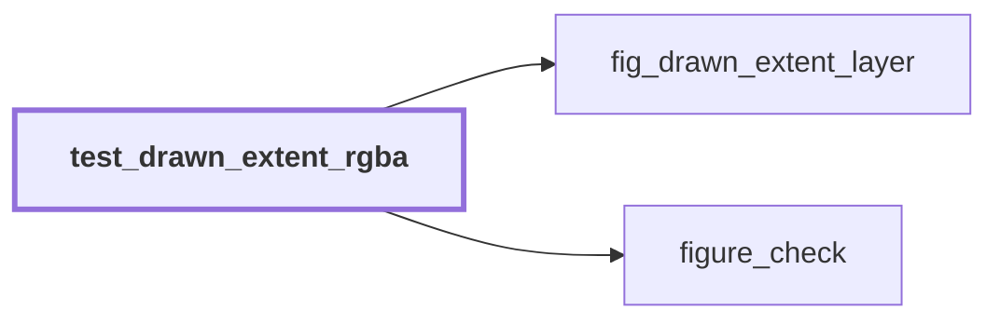

### test_file_browser

The file browser in front (`app%open_file_browser`, `app%save_file_browser`), as it stands after the last frame:
 `shown` false without one (then the texts are '' and the lists empty, but `recent`). `folder`: the folder listed
 (absolute); `entries`: the entries shown, in the order shown, folders ending in `/` (blank-padded to the longest);
 `error`: the error shown ('' none); `asking`: a save over an existing file is being asked; `path_field`,
 `name_field`: the texts of the path and name fields; `recent`: the recent folders, newest first (also without a
 browser). Texts are UTF-8.

```fortran
subroutine test_file_browser(shown, folder, entries, error, asking, path_field, name_field, recent)
```

**Arguments**

| Name | Type | Intent | Attributes | Description |
|------|------|--------|------------|-------------|
| `shown` | logical | out |  | A browser is open. |
| `folder` | character(len=:) | out | allocatable, optional | Folder listed. |
| `entries` | character(len=:) | out | allocatable, optional | Entries shown. |
| `error` | character(len=:) | out | allocatable, optional | Error shown. |
| `asking` | logical | out | optional | Replacing a file is asked. |
| `path_field` | character(len=:) | out | allocatable, optional | Path field. |
| `name_field` | character(len=:) | out | allocatable, optional | Name field. |
| `recent` | character(len=:) | out | allocatable, optional | Recent folders. |

**Call graph**

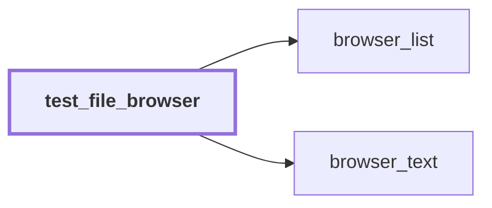

### test_file_browser_rect

The rectangle [pixels] of a part of the file browser in front, as drawn in the last frame: `'entry:NAME'` (an
 entry's row, by its name; rows out of view are not drawn), `'parent'`, `'refresh'`, `'path'`, `'new folder'`,
 `'new folder name'`, `'create'`, `'sort:name'`, `'sort:size'`, `'sort:modified'` (the columns' headers),
 `'place:home'`, `'place:cwd'`, `'place:root:N'`, `'place:recent:N'`, `'name'`, `'filter'` and, while its list is
 open, `'filter:N'`, `'hidden'`, `'cancel'`, `'ok'` (Open, Save or Choose), and, while a replace is asked,
 `'replace'` and `'keep'`. `found` is false for a part not drawn.

```fortran
subroutine test_file_browser_rect(part, xmin, ymin, xmax, ymax, found)
```

**Arguments**

| Name | Type | Intent | Attributes | Description |
|------|------|--------|------------|-------------|
| `part` | character(len=*) | in |  | Part. |
| `xmin` | real(kind=real64) | out |  | Left. |
| `ymin` | real(kind=real64) | out |  | Top. |
| `xmax` | real(kind=real64) | out |  | Right. |
| `ymax` | real(kind=real64) | out |  | Bottom. |
| `found` | logical | out | optional | It was drawn. |

**Call graph**

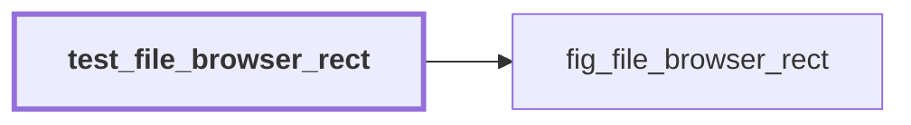

### test_settings_file

The settings file that keeps the file browser's recent folders, instead of FIGURE's own, until the program ends:
 read when a browser opens, written when one is answered. `''`: none, the recent folders are kept in memory only
 (the default in headless mode). Before or after `init*`.

```fortran
subroutine test_settings_file(path, stat)
```

**Arguments**

| Name | Type | Intent | Attributes | Description |
|------|------|--------|------------|-------------|
| `path` | character(len=*) | in |  | File. |
| `stat` | integer(kind=int32) | out | optional | Status. |

**Call graph**

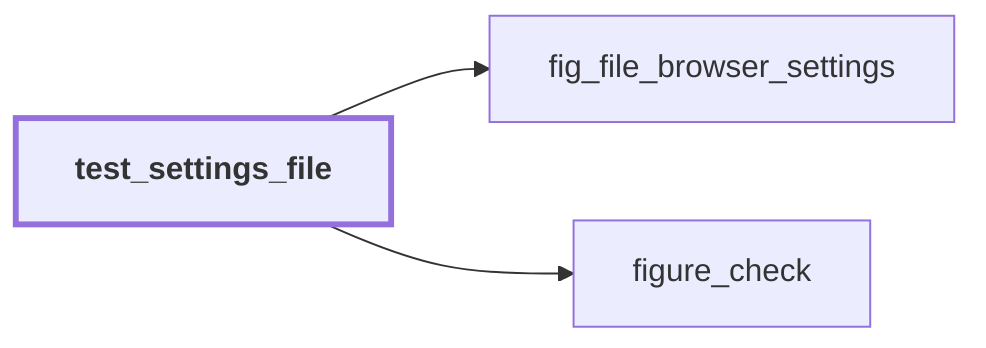

### browser_list

A list of the browser in front (fig_file_browser_get), blank-padded to the longest.

```fortran
subroutine browser_list(what, list)
```

**Arguments**

| Name | Type | Intent | Attributes | Description |
|------|------|--------|------------|-------------|
| `what` | integer(kind=c_int) | in |  | Query. |
| `list` | character(len=:) | out | allocatable | Texts. |

**Call graph**

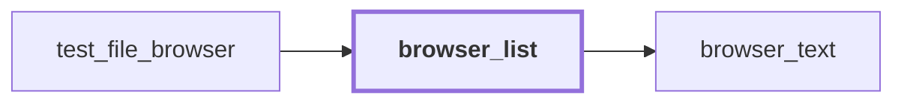

### test_mouse_move

Queue a move of the mouse to (x, y).

```fortran
subroutine test_mouse_move(x, y, stat)
```

**Arguments**

| Name | Type | Intent | Attributes | Description |
|------|------|--------|------------|-------------|
| `x` | real(kind=real64) | in |  | Abscissa [pixels]. |
| `y` | real(kind=real64) | in |  | Ordinate [pixels]. |
| `stat` | integer(kind=int32) | out | optional |  |

**Call graph**

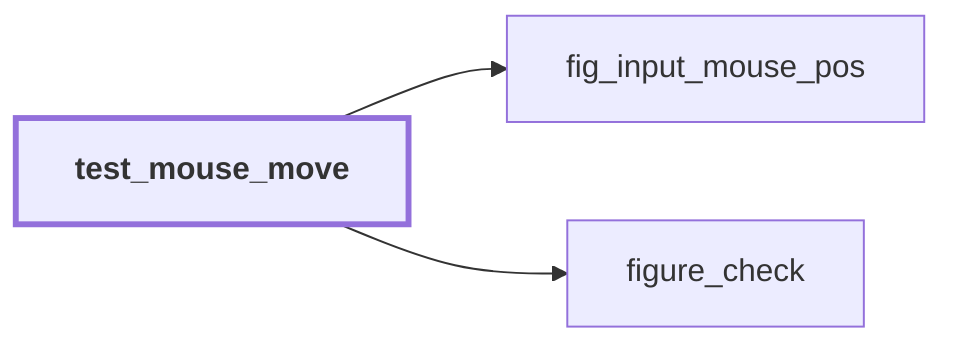

### test_mouse_button

Queue a press (`down=.true.`) or a release of a mouse button.

```fortran
subroutine test_mouse_button(down, button, stat)
```

**Arguments**

| Name | Type | Intent | Attributes | Description |
|------|------|--------|------------|-------------|
| `down` | logical | in |  | Pressed. |
| `button` | character(len=*) | in | optional | `'left'` (default), `'right'` or `'middle'`. |
| `stat` | integer(kind=int32) | out | optional | Status: `FIG_ERR_ARGUMENT` for an unknown button. |

**Call graph**

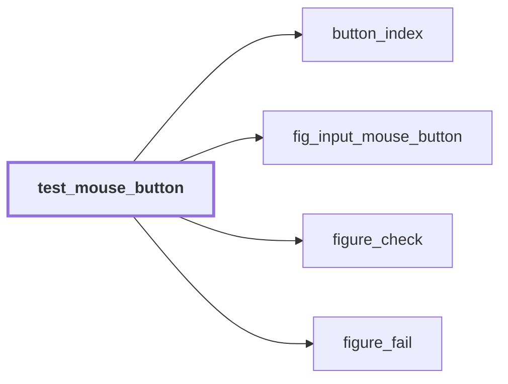

### test_click

Queue a click at (x, y): a move, a frame with the pointer resting there (as a user's hand does: Dear ImGui's
 tabs take a press only once hovered), a press and a release, applied over the next four frames.

```fortran
subroutine test_click(x, y, button, stat)
```

**Arguments**

| Name | Type | Intent | Attributes | Description |
|------|------|--------|------------|-------------|
| `x` | real(kind=real64) | in |  | Abscissa [pixels]. |
| `y` | real(kind=real64) | in |  | Ordinate [pixels]. |
| `button` | character(len=*) | in | optional | `'left'` (default), `'right'` or `'middle'`. |
| `stat` | integer(kind=int32) | out | optional | Status. |

**Call graph**

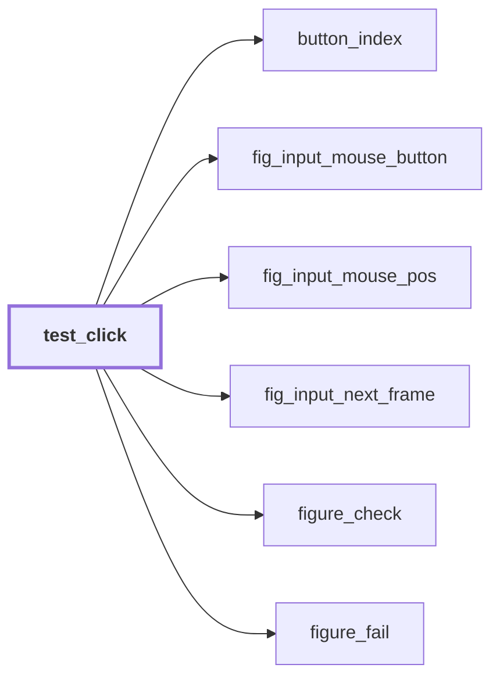

### test_drag

Queue a drag with the left button from (x0, y0) to (x1, y1): a slider grab moved, a window dragged by its title.

```fortran
subroutine test_drag(x0, y0, x1, y1, stat)
```

**Arguments**

| Name | Type | Intent | Attributes | Description |
|------|------|--------|------------|-------------|
| `x0` | real(kind=real64) | in |  | Start abscissa [pixels]. |
| `y0` | real(kind=real64) | in |  | Start ordinate [pixels]. |
| `x1` | real(kind=real64) | in |  | End abscissa [pixels]. |
| `y1` | real(kind=real64) | in |  | End ordinate [pixels]. |
| `stat` | integer(kind=int32) | out | optional | Status. |

**Call graph**

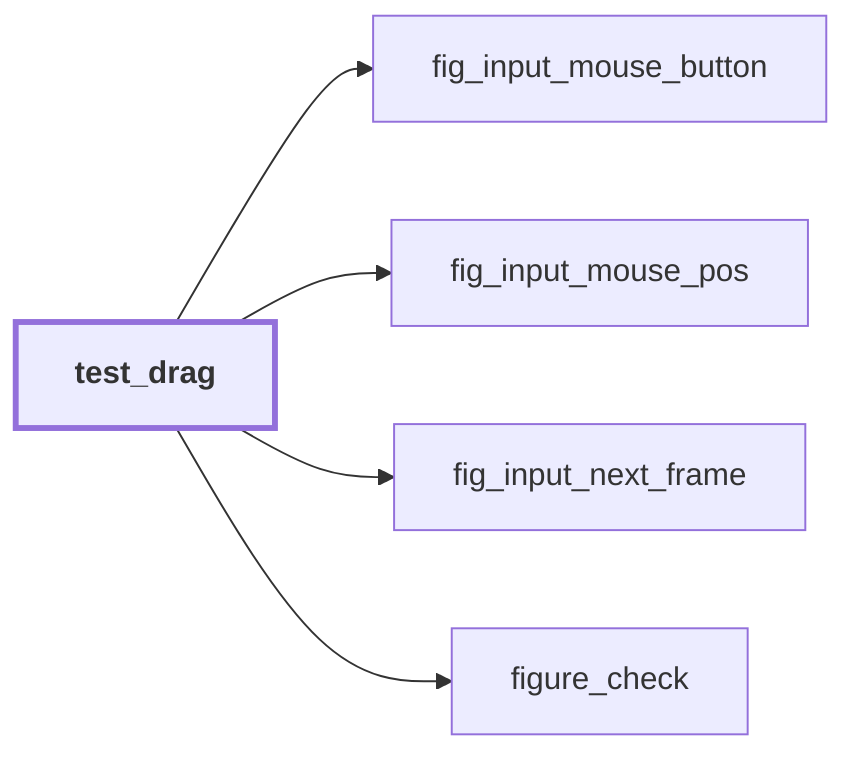

### test_wheel

Queue a turn of the wheel: `dy` positive away from the user (zoom in, in a plot), `dx` horizontal.

```fortran
subroutine test_wheel(dy, dx, stat)
```

**Arguments**

| Name | Type | Intent | Attributes | Description |
|------|------|--------|------------|-------------|
| `dy` | real(kind=real64) | in |  | Vertical steps. |
| `dx` | real(kind=real64) | in | optional | Horizontal steps (default 0). |
| `stat` | integer(kind=int32) | out | optional | Status. |

**Call graph**

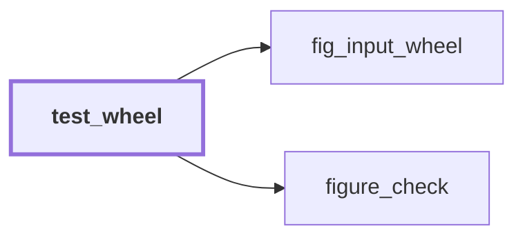

### test_key

Queue a key: pressed and released, or only pressed (`down=.true.`) or released (`down=.false.`). Names: `a`-`z`,
 `0`-`9`, `enter`, `tab`, `backspace`, `delete`, `escape`, `space`, `left`, `right`, `up`, `down`, `home`, `end`,
 `pageup`, `pagedown`, `f1`-`f12`, and the modifiers `ctrl`, `shift`, `alt`, `super` (hold one with `down`).
 `shortcut` is the platform's shortcut key, the one `ig_shortcut('ctrl+...')` and select-all mean: cmd on macOS,
 ctrl elsewhere (`ctrl` itself is the physical ctrl key, which macOS does not use for shortcuts).

```fortran
subroutine test_key(name, down, stat)
```

**Arguments**

| Name | Type | Intent | Attributes | Description |
|------|------|--------|------------|-------------|
| `name` | character(len=*) | in |  | Key name. |
| `down` | logical | in | optional | Only press (true) or only release (false). |
| `stat` | integer(kind=int32) | out | optional |  |

**Call graph**

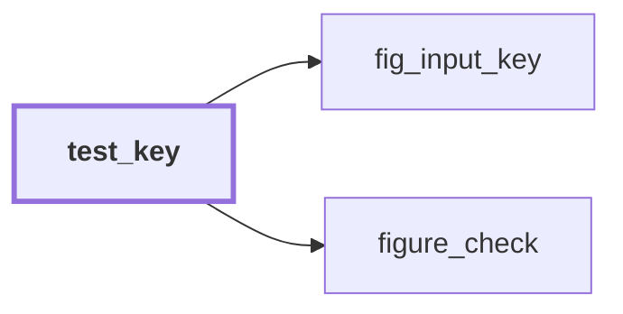

### test_type

Queue typed characters (UTF-8), into the focused input field.

```fortran
subroutine test_type(text, stat)
```

**Arguments**

| Name | Type | Intent | Attributes | Description |
|------|------|--------|------------|-------------|
| `text` | character(len=*) | in |  | Characters. |
| `stat` | integer(kind=int32) | out | optional | Status. |

**Call graph**

```mermaid
flowchart LR
  test_type["test_type"] --> fig_input_text["fig_input_text"]
  test_type["test_type"] --> figure_check["figure_check"]
  classDef focus stroke-width:3px,font-weight:bold
  class test_type focus
  click figure_check href "figure_base.html#figure-check" "figure_check"
  click fig_input_text href "figure_c_native.html#fig-input-text" "fig_input_text"
```

### test_drop

Queue a drop of `paths` (each trimmed of trailing blanks) at (x, y), as dropping files from a file manager makes
 it: `app%dropped` reports them together on the next frame, and only on that one. Works in every mode.

```fortran
subroutine test_drop(paths, x, y, stat)
```

**Arguments**

| Name | Type | Intent | Attributes | Description |
|------|------|--------|------------|-------------|
| `paths` | character(len=*) | in |  | Files or folders. |
| `x` | real(kind=real64) | in |  | Abscissa [pixels]. |
| `y` | real(kind=real64) | in |  | Ordinate [pixels]. |
| `stat` | integer(kind=int32) | out | optional | `FIG_ERR_STATE` before `init*`. |

**Call graph**

```mermaid
flowchart LR
  test_drop["test_drop"] --> fig_input_drop["fig_input_drop"]
  test_drop["test_drop"] --> figure_check["figure_check"]
  test_drop["test_drop"] --> figure_fail["figure_fail"]
  classDef focus stroke-width:3px,font-weight:bold
  class test_drop focus
  click figure_fail href "figure_base.html#figure-fail" "figure_fail"
  click figure_check href "figure_base.html#figure-check" "figure_check"
  click fig_input_drop href "figure_c_native.html#fig-input-drop" "fig_input_drop"
```

### test_window_rect

The rectangle of the window `name` (as passed to `ig_begin`) as drawn in the last frame [pixels].

```fortran
subroutine test_window_rect(name, xmin, ymin, xmax, ymax, found, stat)
```

**Arguments**

| Name | Type | Intent | Attributes | Description |
|------|------|--------|------------|-------------|
| `name` | character(len=*) | in |  | Window name. |
| `xmin` | real(kind=real64) | out |  | Left. |
| `ymin` | real(kind=real64) | out |  | Top. |
| `xmax` | real(kind=real64) | out |  | Right. |
| `ymax` | real(kind=real64) | out |  | Bottom. |
| `found` | logical | out | optional | The window exists (else the rectangle is zero). |
| `stat` | integer(kind=int32) | out | optional | Status. |

**Call graph**

```mermaid
flowchart LR
  test_window_rect["test_window_rect"] --> fig_window_rect["fig_window_rect"]
  test_window_rect["test_window_rect"] --> figure_check["figure_check"]
  classDef focus stroke-width:3px,font-weight:bold
  class test_window_rect focus
  click figure_check href "figure_base.html#figure-check" "figure_check"
  click fig_window_rect href "figure_c_native.html#fig-window-rect" "fig_window_rect"
```

### test_glyph

One glyph of a text font at the current font size, as Dear ImGui draws it: `source`, the name of the font that
 gives it (`'IBM Plex Sans'`, `'IBM Plex Mono'`, `'Lucide'`, `'Noto Sans Math'`, a file's name; `''` when none
 has it and the missing-glyph box is drawn), the pixels of its bitmap that are not empty (0 for a space), its
 advance and height, and a checksum of its bitmap (equal for an equal bitmap). `font` is a name of `set_font`
 (`'plex-sans'`, `'plex-mono'`, `'proggy'`) or a file. In a frame; the glyph is rasterized if it was not yet.

```fortran
subroutine test_glyph(text, font, source, pixels, width, height, checksum, stat)
```

**Arguments**

| Name | Type | Intent | Attributes | Description |
|------|------|--------|------------|-------------|
| `text` | character(len=*) | in |  | One character, UTF-8. |
| `font` | character(len=*) | in |  | Font name or file. |
| `source` | character(len=:) | out | allocatable | The font that gives it; '' when none. |
| `pixels` | integer(kind=int64) | out |  | Pixels of its bitmap that are not empty. |
| `width` | real(kind=real64) | out | optional | Advance [pixels]. |
| `height` | real(kind=real64) | out | optional | Height of the bitmap [pixels]. |
| `checksum` | integer(kind=int64) | out | optional | Checksum of the bitmap. |
| `stat` | integer(kind=int32) | out | optional | `FIG_ERR_ARGUMENT` for not one character or not a font, `FIG_ERR_FAILED` for a file that cannot be read. |

**Call graph**

```mermaid
flowchart LR
  test_glyph["test_glyph"] --> fig_test_glyph["fig_test_glyph"]
  test_glyph["test_glyph"] --> figure_check["figure_check"]
  classDef focus stroke-width:3px,font-weight:bold
  class test_glyph focus
  click figure_check href "figure_base.html#figure-check" "figure_check"
  click fig_test_glyph href "figure_c_native.html#fig-test-glyph" "fig_test_glyph"
```

### test_popup_rect

The rectangle of the innermost open popup (a menu, a combo's list, `ig_color_edit`'s picker) as drawn in the last
 frame [pixels]; zero, with `found` false, when no popup is open.

```fortran
subroutine test_popup_rect(xmin, ymin, xmax, ymax, found, stat)
```

**Arguments**

| Name | Type | Intent | Attributes | Description |
|------|------|--------|------------|-------------|
| `xmin` | real(kind=real64) | out |  | Left. |
| `ymin` | real(kind=real64) | out |  | Top. |
| `xmax` | real(kind=real64) | out |  | Right. |
| `ymax` | real(kind=real64) | out |  | Bottom. |
| `found` | logical | out | optional | A popup is open. |
| `stat` | integer(kind=int32) | out | optional | Status: `FIG_ERR_STATE` before `init*`. |

**Call graph**

```mermaid
flowchart LR
  test_popup_rect["test_popup_rect"] --> fig_popup_rect["fig_popup_rect"]
  test_popup_rect["test_popup_rect"] --> figure_check["figure_check"]
  classDef focus stroke-width:3px,font-weight:bold
  class test_popup_rect focus
  click figure_check href "figure_base.html#figure-check" "figure_check"
  click fig_popup_rect href "figure_c_native.html#fig-popup-rect" "fig_popup_rect"
```

### test_field_pixel

The colour `ip_field_image` gave the value (i, j) of the field `label` in its last colouring, RGBA in [0, 1] (in
 steps of 1/255). Status `FIG_ERR_ARGUMENT` for a label not drawn in the last 10 s or (i, j) outside the field.

```fortran
subroutine test_field_pixel(label, i, j, rgba, stat)
```

**Arguments**

| Name | Type | Intent | Attributes | Description |
|------|------|--------|------------|-------------|
| `label` | character(len=*) | in |  | The field's label. |
| `i` | integer(kind=int32) | in |  | Index along x. |
| `j` | integer(kind=int32) | in |  | Index along y. |
| `rgba` | real(kind=real64) | out |  | Colour, RGBA in [0, 1]. |
| `stat` | integer(kind=int32) | out | optional | Status. |

**Call graph**

```mermaid
flowchart LR
  test_field_pixel["test_field_pixel"] --> fig_field_pixel["fig_field_pixel"]
  test_field_pixel["test_field_pixel"] --> figure_check["figure_check"]
  classDef focus stroke-width:3px,font-weight:bold
  class test_field_pixel focus
  click figure_check href "figure_base.html#figure-check" "figure_check"
  click fig_field_pixel href "figure_c_native.html#fig-field-pixel" "fig_field_pixel"
```

### test_item_center

The centre of the last item drawn (call it right after the widget): where `test_click` should aim.

```fortran
subroutine test_item_center(x, y)
```

**Arguments**

| Name | Type | Intent | Attributes | Description |
|------|------|--------|------------|-------------|
| `x` | real(kind=real64) | out |  | Abscissa [pixels]. |
| `y` | real(kind=real64) | out |  | Ordinate [pixels]. |

**Call graph**

```mermaid
flowchart LR
  test_item_center["test_item_center"] --> ig_item_rect["ig_item_rect"]
  classDef focus stroke-width:3px,font-weight:bold
  class test_item_center focus
  click ig_item_rect href "figure_imgui.html#ig-item-rect" "ig_item_rect"
```

### test_record_items

Record the items of each frame, for the procedures that find an item by its path, from the next frame on (or
 stop). On by default in every mode, from the first frame; called before `app%init*`, its choice holds from the
 first frame. Recording costs a little per item and frame (testing.md, "Finding items by path"); stopping it gives
 that back.

```fortran
subroutine test_record_items(on, stat)
```

**Arguments**

| Name | Type | Intent | Attributes | Description |
|------|------|--------|------------|-------------|
| `on` | logical | in |  | Record. |
| `stat` | integer(kind=int32) | out | optional | Status. |

**Call graph**

```mermaid
flowchart LR
  test_record_items["test_record_items"] --> fig_items_record["fig_items_record"]
  test_record_items["test_record_items"] --> figure_check["figure_check"]
  classDef focus stroke-width:3px,font-weight:bold
  class test_record_items focus
  click figure_check href "figure_base.html#figure-check" "figure_check"
  click fig_items_record href "figure_c_native.html#fig-items-record" "fig_items_record"
```

### test_item_click

Queue a click on the item `path` names in the last frame, at the centre of its visible part, as `test_click` does.

```fortran
subroutine test_item_click(path, button, stat)
```

**Arguments**

| Name | Type | Intent | Attributes | Description |
|------|------|--------|------------|-------------|
| `path` | character(len=*) | in |  | Path. |
| `button` | character(len=*) | in | optional | `'left'` (default), `'right'` or `'middle'`. |
| `stat` | integer(kind=int32) | out | optional | the nearest match), several, a malformed path or an unknown button; `FIG_ERR_STATE` for an item disabled or not visible. |

**Call graph**

```mermaid
flowchart LR
  test_item_click["test_item_click"] --> button_index["button_index"]
  test_item_click["test_item_click"] --> fig_item_click["fig_item_click"]
  test_item_click["test_item_click"] --> figure_check["figure_check"]
  test_item_click["test_item_click"] --> figure_fail["figure_fail"]
  classDef focus stroke-width:3px,font-weight:bold
  class test_item_click focus
  click button_index href "#button-index" "button_index"
  click figure_fail href "figure_base.html#figure-fail" "figure_fail"
  click figure_check href "figure_base.html#figure-check" "figure_check"
  click fig_item_click href "figure_c_native.html#fig-item-click" "fig_item_click"
```

### test_item_type_text

Queue typing `text` into the field `path` names: a click on it with the shortcut key held (a slider or a drag takes
 typed text then, a text field is focused), all its text selected, `text` typed, Enter.

```fortran
subroutine test_item_type_text(path, text, stat)
```

**Arguments**

| Name | Type | Intent | Attributes | Description |
|------|------|--------|------------|-------------|
| `path` | character(len=*) | in |  | Path. |
| `text` | character(len=*) | in |  | Text (UTF-8). |
| `stat` | integer(kind=int32) | out | optional | item that takes no typed text. |

**Call graph**

```mermaid
flowchart LR
  test_item_type_text["test_item_type_text"] --> fig_item_type["fig_item_type"]
  test_item_type_text["test_item_type_text"] --> figure_check["figure_check"]
  classDef focus stroke-width:3px,font-weight:bold
  class test_item_type_text focus
  click figure_check href "figure_base.html#figure-check" "figure_check"
  click fig_item_type href "figure_c_native.html#fig-item-type" "fig_item_type"
```

### test_menu_click

Queue a click through a menu path: `'File/Recent/notes.txt'` (or `'//Window/File/...'`) clicks the first menu now
 and each following level once its menu has appeared, over the next frames; a menu already open is pointed at,
 not clicked again. A level that does not appear within 20 frames ends the queued input: `test_run` reports it.

```fortran
subroutine test_menu_click(path, stat)
```

**Arguments**

| Name | Type | Intent | Attributes | Description |
|------|------|--------|------------|-------------|
| `path` | character(len=*) | in |  | Path. |
| `stat` | integer(kind=int32) | out | optional |  |

**Call graph**

```mermaid
flowchart LR
  test_menu_click["test_menu_click"] --> fig_menu_click["fig_menu_click"]
  test_menu_click["test_menu_click"] --> figure_check["figure_check"]
  classDef focus stroke-width:3px,font-weight:bold
  class test_menu_click focus
  click figure_check href "figure_base.html#figure-check" "figure_check"
  click fig_menu_click href "figure_c_native.html#fig-menu-click" "fig_menu_click"
```

### test_capture

The whole frame as a PNG file `path`, written when the current frame is rendered (at the next `app%next_frame`):
 in headless and remote modes drawn by FIGURE's CPU renderer, the same pixels on every machine (capture.md); in a
 window, read back from the GPU. A file `path` of an earlier run is removed at once, so a capture that cannot be
 written (its reason on standard error) leaves no picture to compare. Then `test_compare_image(path, golden)`.

```fortran
subroutine test_capture(path, stat)
```

**Arguments**

| Name | Type | Intent | Attributes | Description |
|------|------|--------|------------|-------------|
| `path` | character(len=*) | in |  | PNG file. |
| `stat` | integer(kind=int32) | out | optional | for an empty name. |

**Call graph**

```mermaid
flowchart LR
  test_capture["test_capture"] --> fig_test_capture["fig_test_capture"]
  test_capture["test_capture"] --> figure_check["figure_check"]
  classDef focus stroke-width:3px,font-weight:bold
  class test_capture focus
  click figure_check href "figure_base.html#figure-check" "figure_check"
  click fig_test_capture href "figure_c_native.html#fig-test-capture" "fig_test_capture"
```

### read_picture

fig_read_image for test_compare_image: its message under that name.

```fortran
subroutine read_picture(path, rgba, stat)
```

**Arguments**

| Name | Type | Intent | Attributes | Description |
|------|------|--------|------------|-------------|
| `path` | character(len=*) | in |  | File. |
| `rgba` | integer(kind=int8) | out | allocatable | Pixels. |
| `stat` | integer(kind=int32) | out |  | Status. |

**Call graph**

```mermaid
flowchart LR
  test_compare_image["test_compare_image"] --> read_picture["read_picture"]
  read_picture["read_picture"] --> fig_read_image["fig_read_image"]
  read_picture["read_picture"] --> fig_set_last_error["fig_set_last_error"]
  read_picture["read_picture"] --> figure_last_error["figure_last_error"]
  classDef focus stroke-width:3px,font-weight:bold
  class read_picture focus
  click test_compare_image href "#test-compare-image" "test_compare_image"
  click fig_read_image href "figure_texture.html#fig-read-image" "fig_read_image"
  click figure_last_error href "figure_base.html#figure-last-error" "figure_last_error"
  click fig_set_last_error href "figure_c_native.html#fig-set-last-error" "fig_set_last_error"
```

### write_picture

A PNG of pixels(channels, width, height), rows from the top (FIGURE's encoder).

```fortran
subroutine write_picture(path, pixels, stat)
```

**Arguments**

| Name | Type | Intent | Attributes | Description |
|------|------|--------|------------|-------------|
| `path` | character(len=*) | in |  | File. |
| `pixels` | integer(kind=int8) | in | target, contiguous | Pixels. |
| `stat` | integer(kind=int32) | out |  | Status. |

**Call graph**

```mermaid
flowchart LR
  test_compare_image["test_compare_image"] --> write_picture["write_picture"]
  write_picture["write_picture"] --> fig_image_write["fig_image_write"]
  write_picture["write_picture"] --> fig_set_last_error["fig_set_last_error"]
  write_picture["write_picture"] --> figure_last_error["figure_last_error"]
  classDef focus stroke-width:3px,font-weight:bold
  class write_picture focus
  click test_compare_image href "#test-compare-image" "test_compare_image"
  click fig_image_write href "figure_c_native.html#fig-image-write" "fig_image_write"
  click figure_last_error href "figure_base.html#figure-last-error" "figure_last_error"
  click fig_set_last_error href "figure_c_native.html#fig-set-last-error" "fig_set_last_error"
```

### remove_file

Remove the file `path` if it exists.

```fortran
subroutine remove_file(path)
```

**Arguments**

| Name | Type | Intent | Attributes | Description |
|------|------|--------|------------|-------------|
| `path` | character(len=*) | in |  | File. |

**Call graph**

```mermaid
flowchart LR
  test_compare_image["test_compare_image"] --> remove_file["remove_file"]
  classDef focus stroke-width:3px,font-weight:bold
  class remove_file focus
  click test_compare_image href "#test-compare-image" "test_compare_image"
```

### item_check

A failure of fig_item_find reported under the caller's name.

```fortran
subroutine item_check(status, who, stat)
```

**Arguments**

| Name | Type | Intent | Attributes | Description |
|------|------|--------|------------|-------------|
| `status` | integer(kind=c_int) | in |  | Native status. |
| `who` | character(len=*) | in |  | Caller. |
| `stat` | integer(kind=int32) | out | optional | Status. |

**Call graph**

```mermaid
flowchart LR
  test_item_checked["test_item_checked"] --> item_check["item_check"]
  test_item_exists["test_item_exists"] --> item_check["item_check"]
  test_item_rect["test_item_rect"] --> item_check["item_check"]
  item_check["item_check"] --> figure_fail["figure_fail"]
  item_check["item_check"] --> figure_last_error["figure_last_error"]
  classDef focus stroke-width:3px,font-weight:bold
  class item_check focus
  click test_item_checked href "#test-item-checked" "test_item_checked"
  click test_item_exists href "#test-item-exists" "test_item_exists"
  click test_item_rect href "#test-item-rect" "test_item_rect"
  click figure_fail href "figure_base.html#figure-fail" "figure_fail"
  click figure_last_error href "figure_base.html#figure-last-error" "figure_last_error"
```

### items_list

A list of fig_items_list, blank-padded to the longest.

```fortran
subroutine items_list(what, count, list)
```

**Arguments**

| Name | Type | Intent | Attributes | Description |
|------|------|--------|------------|-------------|
| `what` | integer(kind=c_int) | in |  | 1 conflicts, 2 unnamed. |
| `count` | integer(kind=int32) | out |  | How many. |
| `list` | character(len=:) | out | allocatable, optional | Paths. |

**Call graph**

```mermaid
flowchart LR
  test_id_conflicts["test_id_conflicts"] --> items_list["items_list"]
  test_unnamed_items["test_unnamed_items"] --> items_list["items_list"]
  items_list["items_list"] --> fig_items_list["fig_items_list"]
  items_list["items_list"] --> figure_check["figure_check"]
  classDef focus stroke-width:3px,font-weight:bold
  class items_list focus
  click test_id_conflicts href "#test-id-conflicts" "test_id_conflicts"
  click test_unnamed_items href "#test-unnamed-items" "test_unnamed_items"
  click figure_check href "figure_base.html#figure-check" "figure_check"
  click fig_items_list href "figure_c_native.html#fig-items-list" "fig_items_list"
```

## Functions

### test_frame_hit

What the window's frame (`decorations='figure'`) does with the point (x, y), as its hit test answers the system,
 from the last frame drawn: `'client'` (the program's: the buttons, the menus, everything below the bar),
 `'drag'` (the bar's empty space, the icon, the title), or a resize edge or corner, `'resize-top-left'`,
 `'resize-top'`, `'resize-top-right'`, `'resize-right'`, `'resize-bottom-right'`, `'resize-bottom'`,
 `'resize-bottom-left'`, `'resize-left'` (none when maximized). `'client'` everywhere without the frame.

**Returns**: `character(len=:)`

```fortran
function test_frame_hit(x, y) result(hit)
```

**Arguments**

| Name | Type | Intent | Attributes | Description |
|------|------|--------|------------|-------------|
| `x` | real(kind=real64) | in |  | Abscissa [pixels]. |
| `y` | real(kind=real64) | in |  | Ordinate [pixels]. |

**Call graph**

```mermaid
flowchart LR
  test_frame_hit["test_frame_hit"] --> fig_frame_hit["fig_frame_hit"]
  test_frame_hit["test_frame_hit"] --> figure_check["figure_check"]
  classDef focus stroke-width:3px,font-weight:bold
  class test_frame_hit focus
  click figure_check href "figure_base.html#figure-check" "figure_check"
  click fig_frame_hit href "figure_c_native.html#fig-frame-hit" "fig_frame_hit"
```

### browser_text

A text of the browser in front (fig_file_browser_get).

**Returns**: `character(len=:)`

```fortran
function browser_text(what, index, count) result(text)
```

**Arguments**

| Name | Type | Intent | Attributes | Description |
|------|------|--------|------------|-------------|
| `what` | integer(kind=c_int) | in |  | Query. |
| `index` | integer(kind=c_int) | in |  | Index, from 1. |
| `count` | integer(kind=c_int) | out |  | The list's length (0: no browser). |

**Call graph**

```mermaid
flowchart LR
  browser_list["browser_list"] --> browser_text["browser_text"]
  test_file_browser["test_file_browser"] --> browser_text["browser_text"]
  browser_text["browser_text"] --> fig_file_browser_get["fig_file_browser_get"]
  classDef focus stroke-width:3px,font-weight:bold
  class browser_text focus
  click browser_list href "#browser-list" "browser_list"
  click test_file_browser href "#test-file-browser" "test_file_browser"
  click fig_file_browser_get href "figure_c_native.html#fig-file-browser-get" "fig_file_browser_get"
```

### test_opened_url

The URL the last click on a link (`ig_text_link_url`) asked to open, in any mode: headless mode opens nothing, so
 a test reads here what a window would have opened; `''` before any such click (and after each `init*`).

**Returns**: `character(len=:)`

```fortran
function test_opened_url() result(url)
```

**Call graph**

```mermaid
flowchart LR
  test_opened_url["test_opened_url"] --> fig_opened_url["fig_opened_url"]
  classDef focus stroke-width:3px,font-weight:bold
  class test_opened_url focus
  click fig_opened_url href "figure_c_native.html#fig-opened-url" "fig_opened_url"
```

### test_plot_copies

How many arrays the plot items copied since the program started, because ImPlot could not read them in place: an
 array whose stride differs from the ordinates' (or is negative), and integer abscissae (converted). A test reads
 it before and after an item to check that the item read its data in place (plots.md, "Data in place").

**Returns**: `integer(kind=int64)`

```fortran
function test_plot_copies() result(copies)
```

### test_plot_stride

The byte stride the last plot item (`ip_line`, `ip_scatter`, `ip_bars`, `ip_shaded`, `ip_error_bars`) gave ImPlot
 for its arrays: the element size for contiguous data, larger for data read in place from a strided section; 0
 before any item. What the item received depends on the compiler: some copy a strided actual argument into a
 contiguous temporary before the call (plots.md, "Data in place").

**Returns**: `integer(kind=int64)`

```fortran
function test_plot_stride() result(bytes)
```

### test_field_uploads

How many times `ip_field_image` coloured a field and uploaded it since the program started: a test reads it
 before and after frames to check that a field is not coloured again when nothing changed (plots.md, "Fields").

**Returns**: `integer(kind=int64)`

```fortran
function test_field_uploads() result(uploads)
```

**Call graph**

```mermaid
flowchart LR
  test_field_uploads["test_field_uploads"] --> fig_field_uploads["fig_field_uploads"]
  classDef focus stroke-width:3px,font-weight:bold
  class test_field_uploads focus
  click fig_field_uploads href "figure_c_native.html#fig-field-uploads" "fig_field_uploads"
```

### test_field_textures

How many field textures `ip_field_image` keeps: one per field drawn in the last 10 s (plots.md, "Fields").

**Returns**: `integer(kind=int32)`

```fortran
function test_field_textures() result(count)
```

**Call graph**

```mermaid
flowchart LR
  test_field_textures["test_field_textures"] --> fig_field_count["fig_field_count"]
  classDef focus stroke-width:3px,font-weight:bold
  class test_field_textures focus
  click fig_field_count href "figure_c_native.html#fig-field-count" "fig_field_count"
```

### test_field_time

The time the last colouring of `ip_field_image` took, range, colours and upload [ms] (plots.md, "Fields").

**Returns**: `real(kind=real64)`

```fortran
function test_field_time() result(ms)
```

**Call graph**

```mermaid
flowchart LR
  test_field_time["test_field_time"] --> fig_field_time["fig_field_time"]
  classDef focus stroke-width:3px,font-weight:bold
  class test_field_time focus
  click fig_field_time href "figure_c_native.html#fig-field-time" "fig_field_time"
```

### test_item_exists

True when `path` names an item, or a window, in the last frame drawn (several items: true too). Paths:
 `Window/Label`, `//Window/Label` (the window by its full name), a label's `##id`, `*` for any one level, `$$n` for
 an integer id (testing.md, "Finding items by path"). Trailing blanks are not part of the path.

**Returns**: `logical`

```fortran
function test_item_exists(path, stat) result(exists)
```

**Arguments**

| Name | Type | Intent | Attributes | Description |
|------|------|--------|------------|-------------|
| `path` | character(len=*) | in |  | Path. |
| `stat` | integer(kind=int32) | out | optional | Status: `FIG_ERR_ARGUMENT` for a malformed path. |

**Call graph**

```mermaid
flowchart LR
  test_item_exists["test_item_exists"] --> item_check["item_check"]
  test_item_exists["test_item_exists"] --> item_query["item_query"]
  classDef focus stroke-width:3px,font-weight:bold
  class test_item_exists focus
  click item_query href "#item-query" "item_query"
  click item_check href "#item-check" "item_check"
```

### test_item_rect

The rectangle of the item `path` names, as drawn in the last frame [pixels]: its top-left corner and its size
 (zero when not found). False when no item matches.

**Returns**: `logical`

```fortran
function test_item_rect(path, x, y, w, h, stat) result(found)
```

**Arguments**

| Name | Type | Intent | Attributes | Description |
|------|------|--------|------------|-------------|
| `path` | character(len=*) | in |  | Path. |
| `x` | real(kind=real64) | out |  | Left. |
| `y` | real(kind=real64) | out |  | Top. |
| `w` | real(kind=real64) | out |  | Width. |
| `h` | real(kind=real64) | out |  | Height. |
| `stat` | integer(kind=int32) | out | optional | items. |

**Call graph**

```mermaid
flowchart LR
  test_item_rect["test_item_rect"] --> figure_fail["figure_fail"]
  test_item_rect["test_item_rect"] --> figure_last_error["figure_last_error"]
  test_item_rect["test_item_rect"] --> item_check["item_check"]
  test_item_rect["test_item_rect"] --> item_query["item_query"]
  classDef focus stroke-width:3px,font-weight:bold
  class test_item_rect focus
  click item_check href "#item-check" "item_check"
  click item_query href "#item-query" "item_query"
  click figure_fail href "figure_base.html#figure-fail" "figure_fail"
  click figure_last_error href "figure_base.html#figure-last-error" "figure_last_error"
```

### test_item_checked

True when the item `path` names was checked in the last frame: a checkbox, a menu item with a check mark, a
 selectable in a menu.

**Returns**: `logical`

```fortran
function test_item_checked(path, stat) result(checked)
```

**Arguments**

| Name | Type | Intent | Attributes | Description |
|------|------|--------|------------|-------------|
| `path` | character(len=*) | in |  | Path. |
| `stat` | integer(kind=int32) | out | optional | named), several, a malformed path, an item not checkable. |

**Call graph**

```mermaid
flowchart LR
  test_item_checked["test_item_checked"] --> figure_fail["figure_fail"]
  test_item_checked["test_item_checked"] --> item_check["item_check"]
  test_item_checked["test_item_checked"] --> item_query["item_query"]
  classDef focus stroke-width:3px,font-weight:bold
  class test_item_checked focus
  click item_query href "#item-query" "item_query"
  click item_check href "#item-check" "item_check"
  click figure_fail href "figure_base.html#figure-fail" "figure_fail"
```

### test_item_value

True when the item `path` names showed `text` as its value in the last frame: the text drawn inside its rectangle,
 its label taken out (a field's text, a slider's number, a combo's choice), blanks collapsed. `shown` gives it.

**Returns**: `logical`

```fortran
function test_item_value(path, text, shown, stat) result(equal)
```

**Arguments**

| Name | Type | Intent | Attributes | Description |
|------|------|--------|------------|-------------|
| `path` | character(len=*) | in |  | Path. |
| `text` | character(len=*) | in |  | The value expected (UTF-8). |
| `shown` | character(len=:) | out | allocatable, optional | The value shown. |
| `stat` | integer(kind=int32) | out | optional | nearest match named), several, a malformed path. |

**Call graph**

```mermaid
flowchart LR
  test_item_value["test_item_value"] --> fig_item_value["fig_item_value"]
  test_item_value["test_item_value"] --> figure_check["figure_check"]
  classDef focus stroke-width:3px,font-weight:bold
  class test_item_value focus
  click figure_check href "figure_base.html#figure-check" "figure_check"
  click fig_item_value href "figure_c_native.html#fig-item-value" "fig_item_value"
```

### test_run

The frame driver of a test: true while the interface is not idle, so the program draws one more frame; false once
 no input is queued (nor in Dear ImGui's queue), no action waits and no frame is asked for (the frames an event
 gives, `app%request_frames`). Call it once per frame: `do while (test_run(60))`, a frame, `enddo`. After
 `max_frames` frames of one run: false, and a failure.

**Returns**: `logical`

```fortran
function test_run(max_frames, stat) result(more)
```

**Arguments**

| Name | Type | Intent | Attributes | Description |
|------|------|--------|------------|-------------|
| `max_frames` | integer(kind=int32) | in |  | Frames allowed. |
| `stat` | integer(kind=int32) | out | optional | `test_menu_click` level that never appeared; `FIG_ERR_ARGUMENT` for `max_frames` < 1. |

**Call graph**

```mermaid
flowchart LR
  test_run["test_run"] --> fig_test_run["fig_test_run"]
  test_run["test_run"] --> figure_check["figure_check"]
  classDef focus stroke-width:3px,font-weight:bold
  class test_run focus
  click figure_check href "figure_base.html#figure-check" "figure_check"
  click fig_test_run href "figure_c_native.html#fig-test-run" "fig_test_run"
```

### test_id_conflicts

How many ids were shared by items with different rectangles in the last frame (Dear ImGui reports an id conflict
 only under the mouse): `list`, their paths.

**Returns**: `integer(kind=int32)`

```fortran
function test_id_conflicts(list) result(count)
```

**Arguments**

| Name | Type | Intent | Attributes | Description |
|------|------|--------|------------|-------------|
| `list` | character(len=:) | out | allocatable, optional | Paths. |

**Call graph**

```mermaid
flowchart LR
  test_id_conflicts["test_id_conflicts"] --> items_list["items_list"]
  classDef focus stroke-width:3px,font-weight:bold
  class test_id_conflicts focus
  click items_list href "#items-list" "items_list"
```

### test_unnamed_items

How many interactive items had no name in the last frame: an empty visible label (`'##save'`) or icons only, and
 no tooltip (an icon-only button without `ig_tooltip`): `list`, their paths.

**Returns**: `integer(kind=int32)`

```fortran
function test_unnamed_items(list) result(count)
```

**Arguments**

| Name | Type | Intent | Attributes | Description |
|------|------|--------|------------|-------------|
| `list` | character(len=:) | out | allocatable, optional | Paths. |

**Call graph**

```mermaid
flowchart LR
  test_unnamed_items["test_unnamed_items"] --> items_list["items_list"]
  classDef focus stroke-width:3px,font-weight:bold
  class test_unnamed_items focus
  click items_list href "#items-list" "items_list"
```

### test_compare_image

Whether the picture `path` (a `test_capture`, a `save_image`) matches the reference `golden`: the same size, and
 at most `max_failed` pixels (default 0) with a channel (R, G, B or A) that differs by more than `threshold`
 (default 2, on 0-255: what the CPU renderer may differ by across platforms, capture.md), the pixels whose
 centre lies in a rectangle of `masks` left out (a clock, an animation: what is not deterministic).

 On a mismatch it writes `<stem>.new.png` (the picture) and `<stem>.diff.png` beside the golden, `<stem>` the
 golden's name without `.png`: in the diff the pixels that fail are red, those that differ within `threshold`
 dark red, the masked ones blue and the others the golden's, faded; `figure_last_error` says how many failed, by
 how much at most and where. On a match it removes such files left by an earlier run. Pixels are counted from the
 picture's top-left corner, as `ig_item_rect` gives them (logical pixels are picture pixels at a content scale of
 1, as headless mode's).

**Returns**: `logical`

```fortran
function test_compare_image(path, golden, threshold, max_failed, masks, failed, stat) result(equal)
```

**Arguments**

| Name | Type | Intent | Attributes | Description |
|------|------|--------|------------|-------------|
| `path` | character(len=*) | in |  | The picture (PNG or JPEG). |
| `golden` | character(len=*) | in |  | The reference (PNG). |
| `threshold` | integer(kind=int32) | in | optional | Largest difference of a channel that passes [0-255]. |
| `max_failed` | integer(kind=int32) | in | optional | Pixels allowed to fail. |
| `masks` | real(kind=real64) | in | optional | Rectangles left out, masks(:, k) = xmin, ymin, xmax, ymax [pixels]. |
| `failed` | integer(kind=int64) | out | optional | Pixels that failed (-1: the sizes differ). |
| `stat` | integer(kind=int32) | out | optional | written, `FIG_ERR_ARGUMENT` for a file that is not an image, a `threshold` outside 0-255, a negative `max_failed`, `masks` not of 4 rows or a rectangle whose maximum is below its minimum. |

**Call graph**

```mermaid
flowchart LR
  test_compare_image["test_compare_image"] --> fig_set_last_error["fig_set_last_error"]
  test_compare_image["test_compare_image"] --> figure_fail["figure_fail"]
  test_compare_image["test_compare_image"] --> figure_last_error["figure_last_error"]
  test_compare_image["test_compare_image"] --> itoa["itoa"]
  test_compare_image["test_compare_image"] --> ltoa["ltoa"]
  test_compare_image["test_compare_image"] --> read_picture["read_picture"]
  test_compare_image["test_compare_image"] --> remove_file["remove_file"]
  test_compare_image["test_compare_image"] --> sbyte["sbyte"]
  test_compare_image["test_compare_image"] --> ubyte["ubyte"]
  test_compare_image["test_compare_image"] --> write_picture["write_picture"]
  classDef focus stroke-width:3px,font-weight:bold
  class test_compare_image focus
  click figure_fail href "figure_base.html#figure-fail" "figure_fail"
  click itoa href "#itoa" "itoa"
  click read_picture href "#read-picture" "read_picture"
  click figure_last_error href "figure_base.html#figure-last-error" "figure_last_error"
  click write_picture href "#write-picture" "write_picture"
  click remove_file href "#remove-file" "remove_file"
  click fig_set_last_error href "figure_c_native.html#fig-set-last-error" "fig_set_last_error"
  click ubyte href "#ubyte" "ubyte"
  click sbyte href "#sbyte" "sbyte"
  click ltoa href "#ltoa" "ltoa"
```

### ubyte

The value 0-255 of a byte.

**Attributes**: elemental

**Returns**: `integer(kind=int32)`

```fortran
function ubyte(b) result(v)
```

**Arguments**

| Name | Type | Intent | Attributes | Description |
|------|------|--------|------------|-------------|
| `b` | integer(kind=int8) | in |  | Byte. |

**Call graph**

```mermaid
flowchart LR
  test_compare_image["test_compare_image"] --> ubyte["ubyte"]
  classDef focus stroke-width:3px,font-weight:bold
  class ubyte focus
  click test_compare_image href "#test-compare-image" "test_compare_image"
```

### sbyte

The byte of a value 0-255.

**Attributes**: elemental

**Returns**: `integer(kind=int8)`

```fortran
function sbyte(v) result(b)
```

**Arguments**

| Name | Type | Intent | Attributes | Description |
|------|------|--------|------------|-------------|
| `v` | integer(kind=int32) | in |  | Value. |

**Call graph**

```mermaid
flowchart LR
  test_compare_image["test_compare_image"] --> sbyte["sbyte"]
  classDef focus stroke-width:3px,font-weight:bold
  class sbyte focus
  click test_compare_image href "#test-compare-image" "test_compare_image"
```

### itoa

An integer, written.

**Attributes**: pure

**Returns**: `character(len=:)`

```fortran
function itoa(i) result(text)
```

**Arguments**

| Name | Type | Intent | Attributes | Description |
|------|------|--------|------------|-------------|
| `i` | integer(kind=int32) | in |  | Integer. |

**Call graph**

```mermaid
flowchart LR
  test_compare_image["test_compare_image"] --> itoa["itoa"]
  classDef focus stroke-width:3px,font-weight:bold
  class itoa focus
  click test_compare_image href "#test-compare-image" "test_compare_image"
```

### ltoa

A 64-bit integer, written.

**Attributes**: pure

**Returns**: `character(len=:)`

```fortran
function ltoa(i) result(text)
```

**Arguments**

| Name | Type | Intent | Attributes | Description |
|------|------|--------|------------|-------------|
| `i` | integer(kind=int64) | in |  | Integer. |

**Call graph**

```mermaid
flowchart LR
  test_compare_image["test_compare_image"] --> ltoa["ltoa"]
  classDef focus stroke-width:3px,font-weight:bold
  class ltoa focus
  click test_compare_image href "#test-compare-image" "test_compare_image"
```

### item_query

fig_item_find of a path (trailing blanks dropped).

**Returns**: `integer(kind=c_int)`

```fortran
function item_query(path, must, found, rect, state, full) result(status)
```

**Arguments**

| Name | Type | Intent | Attributes | Description |
|------|------|--------|------------|-------------|
| `path` | character(len=*) | in |  | Path. |
| `must` | integer(kind=c_int) | in |  | 1: no item is a failure. |
| `found` | integer(kind=c_int) | out |  | 1: found. |
| `rect` | real(kind=c_float) | out |  | Rectangle and the point to click. |
| `state` | integer(kind=c_int) | out |  | State bits. |
| `full` | character(len=:) | out | allocatable | Its full path. |

**Call graph**

```mermaid
flowchart LR
  test_item_checked["test_item_checked"] --> item_query["item_query"]
  test_item_exists["test_item_exists"] --> item_query["item_query"]
  test_item_rect["test_item_rect"] --> item_query["item_query"]
  item_query["item_query"] --> fig_item_find["fig_item_find"]
  classDef focus stroke-width:3px,font-weight:bold
  class item_query focus
  click test_item_checked href "#test-item-checked" "test_item_checked"
  click test_item_exists href "#test-item-exists" "test_item_exists"
  click test_item_rect href "#test-item-rect" "test_item_rect"
  click fig_item_find href "figure_c_native.html#fig-item-find" "fig_item_find"
```

### button_index

ImGuiMouseButton of a name (absent: left).

**Returns**: `logical`

```fortran
function button_index(button, b) result(ok)
```

**Arguments**

| Name | Type | Intent | Attributes | Description |
|------|------|--------|------------|-------------|
| `button` | character(len=*) | in | optional | Button name. |
| `b` | integer(kind=c_int) | out |  | Index. |

**Call graph**

```mermaid
flowchart LR
  test_click["test_click"] --> button_index["button_index"]
  test_item_click["test_item_click"] --> button_index["button_index"]
  test_mouse_button["test_mouse_button"] --> button_index["button_index"]
  classDef focus stroke-width:3px,font-weight:bold
  class button_index focus
  click test_click href "#test-click" "test_click"
  click test_item_click href "#test-item-click" "test_item_click"
  click test_mouse_button href "#test-mouse-button" "test_mouse_button"
```
