# figure_testing

> figure_testing, synthetic input for testing interfaces without a display (or with one).

 Input is queued and applied while the program draws its next frames, as real input would be: a test queues a
 click, draws a few frames (`app%next_frame()` and the program's own UI code), then checks the program's variables.
 Everything queued reaches Dear ImGui at the next frame, up to a frame boundary (`test_next_frame`); Dear ImGui
 then applies one change of each kind per frame (input trickling), so a move, a press and a release queued at once
 become a click over the next frames.

```fortran
 call test_click(x, y)           ! the centre of the button, e.g. from ig_item_rect in an earlier frame
 do frame = 1, 4
    if (.not. app%next_frame()) exit
    call draw_panel(panel)       ! the UI under test
 enddo
 ! now check what the click did to the program's variables
```

 Coordinates are display pixels, as `ig_item_rect` and `test_window_rect` give them. Works in every mode; with
 `app%init_headless` no window, display or GPU is needed, so tests run in CI as is.

**Source**: `src/lib/figure_testing.F90`

**Dependencies**

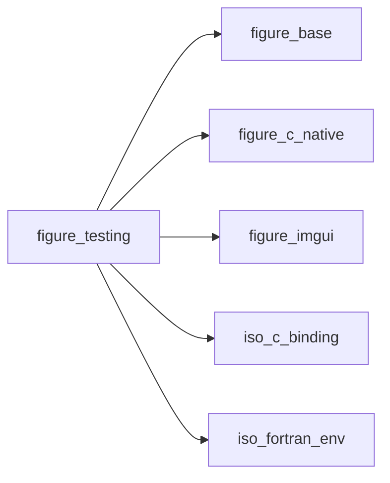

## Contents

- [test_drawn_extent](#test-drawn-extent)
- [test_next_frame](#test-next-frame)
- [test_plot_tick](#test-plot-tick)
- [test_quit](#test-quit)
- [test_system_theme](#test-system-theme)
- [test_frame_rect](#test-frame-rect)
- [test_frame_state](#test-frame-state)
- [test_notification_rect](#test-notification-rect)
- [test_drawn_extent_name](#test-drawn-extent-name)
- [test_drawn_extent_rgba](#test-drawn-extent-rgba)
- [test_file_browser](#test-file-browser)
- [test_file_browser_rect](#test-file-browser-rect)
- [test_settings_file](#test-settings-file)
- [browser_list](#browser-list)
- [test_mouse_move](#test-mouse-move)
- [test_mouse_button](#test-mouse-button)
- [test_click](#test-click)
- [test_drag](#test-drag)
- [test_wheel](#test-wheel)
- [test_key](#test-key)
- [test_type](#test-type)
- [test_drop](#test-drop)
- [test_window_rect](#test-window-rect)
- [test_popup_rect](#test-popup-rect)
- [test_item_center](#test-item-center)
- [test_frame_hit](#test-frame-hit)
- [browser_text](#browser-text)
- [button_index](#button-index)

## Interfaces

### test_drawn_extent

The extent [pixels] of what was drawn so far in the current window in a colour: Dear ImGui's style colour by its
 name, or an RGBA colour (an item's `ip_spec` colour).

**Module procedures**: [`test_drawn_extent_name`](/api/src/lib/figure_testing#test-drawn-extent-name), [`test_drawn_extent_rgba`](/api/src/lib/figure_testing#test-drawn-extent-rgba)

## Subroutines

### test_next_frame

A frame boundary in the queued input: what is queued after it reaches Dear ImGui one frame later than what is
 queued before it. For sequences that must not share a frame (a drag: press, move, release).

```fortran
subroutine test_next_frame(stat)
```

**Arguments**

| Name | Type | Intent | Attributes | Description |
|------|------|--------|------------|-------------|
| `stat` | integer(kind=int32) | out | optional | Status. |

**Call graph**

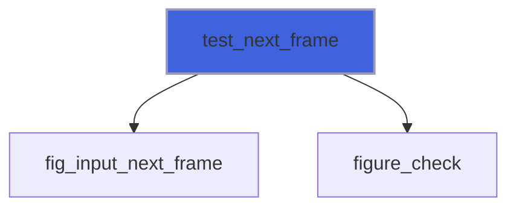

### test_plot_tick

The label of tick `index` (from 1) on `axis` (`'x'` or `'y'`) of the plot being declared, and the number of ticks:
 call it between `ip_begin_plot` and `ip_end_plot`, after the setup (`ip_setup_axes`) and an item. `label` is ''
 for an index out of range.

```fortran
subroutine test_plot_tick(axis, index, label, count, stat)
```

**Arguments**

| Name | Type | Intent | Attributes | Description |
|------|------|--------|------------|-------------|
| `axis` | character(len=*) | in |  | `'x'` or `'y'`. |
| `index` | integer(kind=int32) | in |  | Tick, from 1. |
| `label` | character(len=:) | out | allocatable | Its label. |
| `count` | integer(kind=int32) | out | optional | Ticks on the axis. |
| `stat` | integer(kind=int32) | out | optional | Status: `FIG_ERR_STATE` outside a plot. |

**Call graph**

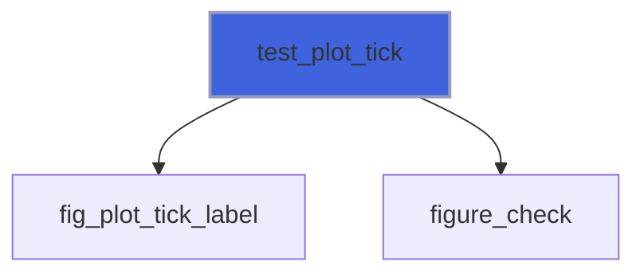

### test_quit

A quit request, as the window's close button makes it: `next_frame` returns `.false.`, or, after
 `app%set_confirm_quit(.true.)`, `app%quit_requested()` returns `.true.`.

```fortran
subroutine test_quit(stat)
```

**Arguments**

| Name | Type | Intent | Attributes | Description |
|------|------|--------|------------|-------------|
| `stat` | integer(kind=int32) | out | optional |  |

**Call graph**

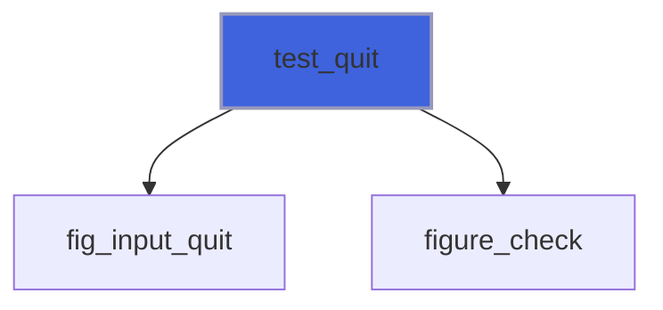

### test_system_theme

The system's light or dark setting changes, as SDL's theme-changed event reports it, at the next frame:
 `palette='auto'` (`app%set_style`) is chosen again. `theme` is `'light'`, `'dark'`, or `'system'` (the real
 setting again, read from SDL in window mode; unknown, so dark, in headless and remote modes). Works in every mode.

```fortran
subroutine test_system_theme(theme, stat)
```

**Arguments**

| Name | Type | Intent | Attributes | Description |
|------|------|--------|------------|-------------|
| `theme` | character(len=*) | in |  | `'light'`, `'dark'` or `'system'`. |
| `stat` | integer(kind=int32) | out | optional | before `init*`. |

**Call graph**

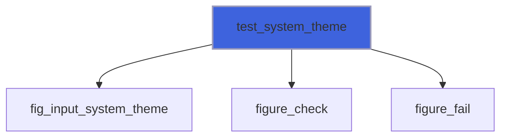

### test_frame_rect

A part of the title bar of `decorations='figure'` in the last frame: `'bar'`, `'icon'`, `'menus'` (the program's
 main menu bar inside it), `'title'`, `'minimize'`, `'maximize'`, `'close'`; `found` is false when not drawn.

```fortran
subroutine test_frame_rect(part, x0, y0, x1, y1, found, stat)
```

**Arguments**

| Name | Type | Intent | Attributes | Description |
|------|------|--------|------------|-------------|
| `part` | character(len=*) | in |  | Part. |
| `x0` | real(kind=real64) | out |  | Left [pixels]. |
| `y0` | real(kind=real64) | out |  | Top [pixels]. |
| `x1` | real(kind=real64) | out |  | Right [pixels]. |
| `y1` | real(kind=real64) | out |  | Bottom [pixels]. |
| `found` | logical | out | optional | Drawn in the last frame. |
| `stat` | integer(kind=int32) | out | optional | Status: `FIG_ERR_ARGUMENT` for an unknown part. |

**Call graph**

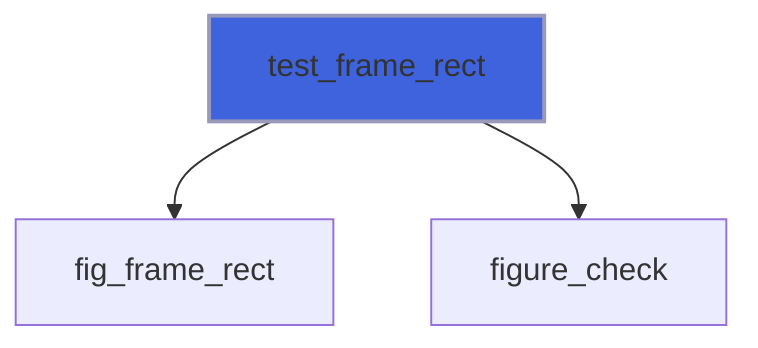

### test_frame_state

The window minimized, maximized: the system's in window mode; in headless mode, as the buttons of
 `decorations='figure'` recorded them.

```fortran
subroutine test_frame_state(minimized, maximized, stat)
```

**Arguments**

| Name | Type | Intent | Attributes | Description |
|------|------|--------|------------|-------------|
| `minimized` | logical | out |  | Minimized. |
| `maximized` | logical | out |  | Maximized. |
| `stat` | integer(kind=int32) | out | optional | Status: `FIG_ERR_STATE` before `init*`. |

**Call graph**

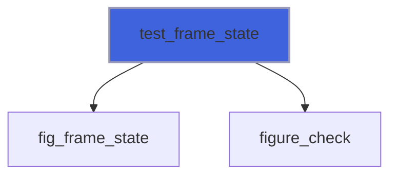

### test_notification_rect

The rectangle [pixels] of a notification shown in the last frame (`app%notify`): `index` 1 is the newest, at the
 bottom, 2 the one above it, ...; `found` is false past the last shown.

```fortran
subroutine test_notification_rect(index, xmin, ymin, xmax, ymax, found)
```

**Arguments**

| Name | Type | Intent | Attributes | Description |
|------|------|--------|------------|-------------|
| `index` | integer(kind=int32) | in |  | 1: the newest shown. |
| `xmin` | real(kind=real64) | out |  | Left. |
| `ymin` | real(kind=real64) | out |  | Top. |
| `xmax` | real(kind=real64) | out |  | Right. |
| `ymax` | real(kind=real64) | out |  | Bottom. |
| `found` | logical | out | optional | It was shown. |

**Call graph**

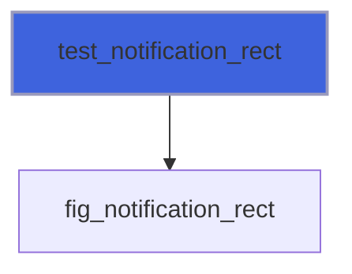

### test_drawn_extent_name

The extent [pixels] of what was drawn so far in the current window in Dear ImGui's style colour `color`, by
 its name (`'PlotHistogram'`: the fill of a progress bar): call it inside the window, after the widget.

```fortran
subroutine test_drawn_extent_name(color, xmin, ymin, xmax, ymax, found, stat)
```

**Arguments**

| Name | Type | Intent | Attributes | Description |
|------|------|--------|------------|-------------|
| `color` | character(len=*) | in |  | Dear ImGui's colour name. |
| `xmin` | real(kind=real64) | out |  | Left. |
| `ymin` | real(kind=real64) | out |  | Top. |
| `xmax` | real(kind=real64) | out |  | Right. |
| `ymax` | real(kind=real64) | out |  | Bottom. |
| `found` | logical | out | optional | Something was drawn in it. |
| `stat` | integer(kind=int32) | out | optional | `FIG_ERR_STATE` outside a window. |

**Call graph**

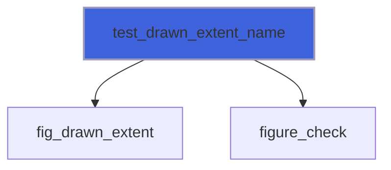

### test_drawn_extent_rgba

The extent [pixels] of what was drawn so far in the current window in the RGBA colour `color` (as an item drawn
 with `ip_spec(line_color=color)`): call it inside the window, after the item (after `ip_end_plot` for what a plot
 draws at its end: annotations). Antialiased edges are drawn in other colours: the extent is that of the lines' cores.

```fortran
subroutine test_drawn_extent_rgba(color, xmin, ymin, xmax, ymax, found, stat)
```

**Arguments**

| Name | Type | Intent | Attributes | Description |
|------|------|--------|------------|-------------|
| `color` | real(kind=real64) | in |  | Colour, RGBA in [0, 1]. |
| `xmin` | real(kind=real64) | out |  | Left. |
| `ymin` | real(kind=real64) | out |  | Top. |
| `xmax` | real(kind=real64) | out |  | Right. |
| `ymax` | real(kind=real64) | out |  | Bottom. |
| `found` | logical | out | optional | Something was drawn in it. |
| `stat` | integer(kind=int32) | out | optional | Status: `FIG_ERR_STATE` outside a window. |

**Call graph**

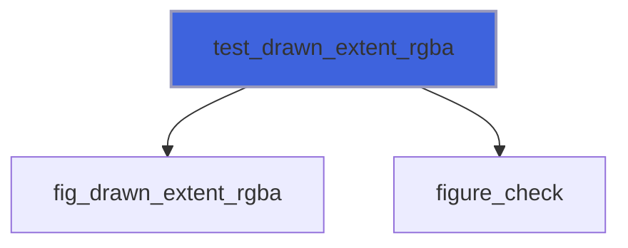

### test_file_browser

The file browser in front (`app%open_file_browser`, `app%save_file_browser`), as it stands after the last frame:
 `shown` false without one (then the texts are '' and the lists empty, but `recent`). `folder`: the folder listed
 (absolute); `entries`: the entries shown, in the order shown, folders ending in `/` (blank-padded to the longest);
 `error`: the error shown ('' none); `asking`: a save over an existing file is being asked; `path_field`,
 `name_field`: the texts of the path and name fields; `recent`: the recent folders, newest first (also without a
 browser). Texts are UTF-8.

```fortran
subroutine test_file_browser(shown, folder, entries, error, asking, path_field, name_field, recent)
```

**Arguments**

| Name | Type | Intent | Attributes | Description |
|------|------|--------|------------|-------------|
| `shown` | logical | out |  | A browser is open. |
| `folder` | character(len=:) | out | allocatable, optional | Folder listed. |
| `entries` | character(len=:) | out | allocatable, optional | Entries shown. |
| `error` | character(len=:) | out | allocatable, optional | Error shown. |
| `asking` | logical | out | optional | Replacing a file is asked. |
| `path_field` | character(len=:) | out | allocatable, optional | Path field. |
| `name_field` | character(len=:) | out | allocatable, optional | Name field. |
| `recent` | character(len=:) | out | allocatable, optional | Recent folders. |

**Call graph**

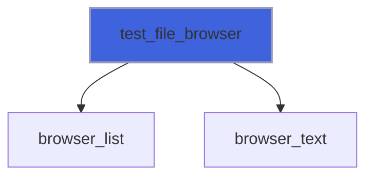

### test_file_browser_rect

The rectangle [pixels] of a part of the file browser in front, as drawn in the last frame: `'entry:NAME'` (an
 entry's row, by its name; rows out of view are not drawn), `'parent'`, `'refresh'`, `'path'`, `'new folder'`,
 `'new folder name'`, `'create'`, `'sort:name'`, `'sort:size'`, `'sort:modified'` (the columns' headers),
 `'place:home'`, `'place:cwd'`, `'place:root:N'`, `'place:recent:N'`, `'name'`, `'filter'` and, while its list is
 open, `'filter:N'`, `'hidden'`, `'cancel'`, `'ok'` (Open, Save or Choose), and, while a replace is asked,
 `'replace'` and `'keep'`. `found` is false for a part not drawn.

```fortran
subroutine test_file_browser_rect(part, xmin, ymin, xmax, ymax, found)
```

**Arguments**

| Name | Type | Intent | Attributes | Description |
|------|------|--------|------------|-------------|
| `part` | character(len=*) | in |  | Part. |
| `xmin` | real(kind=real64) | out |  | Left. |
| `ymin` | real(kind=real64) | out |  | Top. |
| `xmax` | real(kind=real64) | out |  | Right. |
| `ymax` | real(kind=real64) | out |  | Bottom. |
| `found` | logical | out | optional | It was drawn. |

**Call graph**

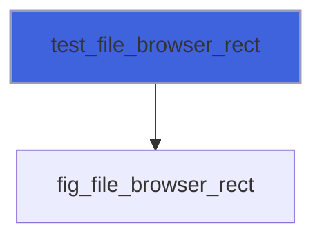

### test_settings_file

The settings file that keeps the file browser's recent folders, instead of FIGURE's own, until the program ends:
 read when a browser opens, written when one is answered. `''`: none, the recent folders are kept in memory only
 (the default in headless mode). Before or after `init*`.

```fortran
subroutine test_settings_file(path, stat)
```

**Arguments**

| Name | Type | Intent | Attributes | Description |
|------|------|--------|------------|-------------|
| `path` | character(len=*) | in |  | File. |
| `stat` | integer(kind=int32) | out | optional | Status. |

**Call graph**

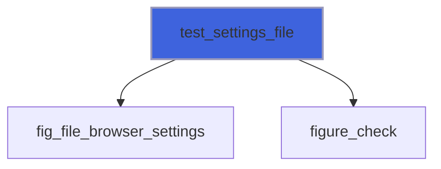

### browser_list

A list of the browser in front (fig_file_browser_get), blank-padded to the longest.

```fortran
subroutine browser_list(what, list)
```

**Arguments**

| Name | Type | Intent | Attributes | Description |
|------|------|--------|------------|-------------|
| `what` | integer(kind=c_int) | in |  | Query. |
| `list` | character(len=:) | out | allocatable | Texts. |

**Call graph**

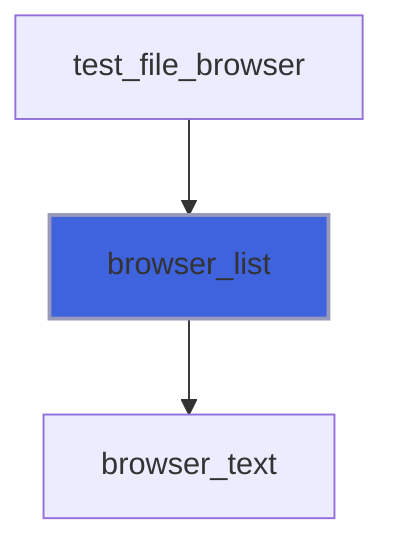

### test_mouse_move

Queue a move of the mouse to (x, y).

```fortran
subroutine test_mouse_move(x, y, stat)
```

**Arguments**

| Name | Type | Intent | Attributes | Description |
|------|------|--------|------------|-------------|
| `x` | real(kind=real64) | in |  | Abscissa [pixels]. |
| `y` | real(kind=real64) | in |  | Ordinate [pixels]. |
| `stat` | integer(kind=int32) | out | optional |  |

**Call graph**

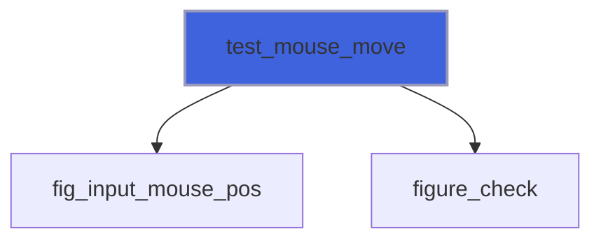

### test_mouse_button

Queue a press (`down=.true.`) or a release of a mouse button.

```fortran
subroutine test_mouse_button(down, button, stat)
```

**Arguments**

| Name | Type | Intent | Attributes | Description |
|------|------|--------|------------|-------------|
| `down` | logical | in |  | Pressed. |
| `button` | character(len=*) | in | optional | `'left'` (default), `'right'` or `'middle'`. |
| `stat` | integer(kind=int32) | out | optional | Status: `FIG_ERR_ARGUMENT` for an unknown button. |

**Call graph**

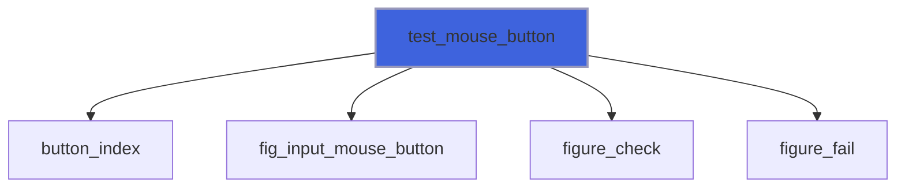

### test_click

Queue a click at (x, y): a move, a frame with the pointer resting there (as a user's hand does: Dear ImGui's
 tabs take a press only once hovered), a press and a release, applied over the next four frames.

```fortran
subroutine test_click(x, y, button, stat)
```

**Arguments**

| Name | Type | Intent | Attributes | Description |
|------|------|--------|------------|-------------|
| `x` | real(kind=real64) | in |  | Abscissa [pixels]. |
| `y` | real(kind=real64) | in |  | Ordinate [pixels]. |
| `button` | character(len=*) | in | optional | `'left'` (default), `'right'` or `'middle'`. |
| `stat` | integer(kind=int32) | out | optional | Status. |

**Call graph**

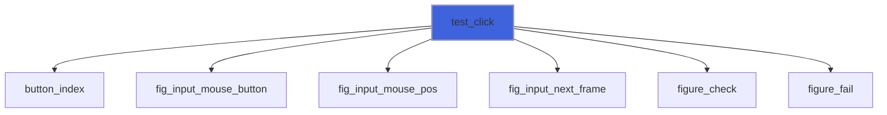

### test_drag

Queue a drag with the left button from (x0, y0) to (x1, y1): a slider grab moved, a window dragged by its title.

```fortran
subroutine test_drag(x0, y0, x1, y1, stat)
```

**Arguments**

| Name | Type | Intent | Attributes | Description |
|------|------|--------|------------|-------------|
| `x0` | real(kind=real64) | in |  | Start abscissa [pixels]. |
| `y0` | real(kind=real64) | in |  | Start ordinate [pixels]. |
| `x1` | real(kind=real64) | in |  | End abscissa [pixels]. |
| `y1` | real(kind=real64) | in |  | End ordinate [pixels]. |
| `stat` | integer(kind=int32) | out | optional | Status. |

**Call graph**

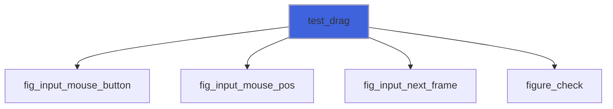

### test_wheel

Queue a turn of the wheel: `dy` positive away from the user (zoom in, in a plot), `dx` horizontal.

```fortran
subroutine test_wheel(dy, dx, stat)
```

**Arguments**

| Name | Type | Intent | Attributes | Description |
|------|------|--------|------------|-------------|
| `dy` | real(kind=real64) | in |  | Vertical steps. |
| `dx` | real(kind=real64) | in | optional | Horizontal steps (default 0). |
| `stat` | integer(kind=int32) | out | optional | Status. |

**Call graph**

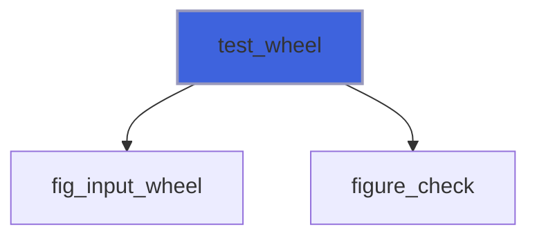

### test_key

Queue a key: pressed and released, or only pressed (`down=.true.`) or released (`down=.false.`). Names: `a`-`z`,
 `0`-`9`, `enter`, `tab`, `backspace`, `delete`, `escape`, `space`, `left`, `right`, `up`, `down`, `home`, `end`,
 `pageup`, `pagedown`, `f1`-`f12`, and the modifiers `ctrl`, `shift`, `alt`, `super` (hold one with `down`).
 `shortcut` is the platform's shortcut key, the one `ig_shortcut('ctrl+...')` and select-all mean: cmd on macOS,
 ctrl elsewhere (`ctrl` itself is the physical ctrl key, which macOS does not use for shortcuts).

```fortran
subroutine test_key(name, down, stat)
```

**Arguments**

| Name | Type | Intent | Attributes | Description |
|------|------|--------|------------|-------------|
| `name` | character(len=*) | in |  | Key name. |
| `down` | logical | in | optional | Only press (true) or only release (false). |
| `stat` | integer(kind=int32) | out | optional |  |

**Call graph**

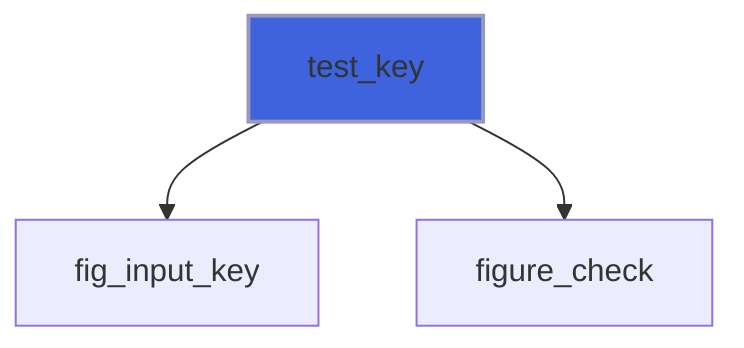

### test_type

Queue typed characters (UTF-8), into the focused input field.

```fortran
subroutine test_type(text, stat)
```

**Arguments**

| Name | Type | Intent | Attributes | Description |
|------|------|--------|------------|-------------|
| `text` | character(len=*) | in |  | Characters. |
| `stat` | integer(kind=int32) | out | optional | Status. |

**Call graph**

```mermaid
flowchart TD
  test_type["test_type"] --> fig_input_text["fig_input_text"]
  test_type["test_type"] --> figure_check["figure_check"]
  style test_type fill:#3e63dd,stroke:#99b,stroke-width:2px
```

### test_drop

Queue a drop of `paths` (each trimmed of trailing blanks) at (x, y), as dropping files from a file manager makes
 it: `app%dropped` reports them together on the next frame, and only on that one. Works in every mode.

```fortran
subroutine test_drop(paths, x, y, stat)
```

**Arguments**

| Name | Type | Intent | Attributes | Description |
|------|------|--------|------------|-------------|
| `paths` | character(len=*) | in |  | Files or folders. |
| `x` | real(kind=real64) | in |  | Abscissa [pixels]. |
| `y` | real(kind=real64) | in |  | Ordinate [pixels]. |
| `stat` | integer(kind=int32) | out | optional | `FIG_ERR_STATE` before `init*`. |

**Call graph**

```mermaid
flowchart TD
  test_drop["test_drop"] --> fig_input_drop["fig_input_drop"]
  test_drop["test_drop"] --> figure_check["figure_check"]
  test_drop["test_drop"] --> figure_fail["figure_fail"]
  style test_drop fill:#3e63dd,stroke:#99b,stroke-width:2px
```

### test_window_rect

The rectangle of the window `name` (as passed to `ig_begin`) as drawn in the last frame [pixels].

```fortran
subroutine test_window_rect(name, xmin, ymin, xmax, ymax, found, stat)
```

**Arguments**

| Name | Type | Intent | Attributes | Description |
|------|------|--------|------------|-------------|
| `name` | character(len=*) | in |  | Window name. |
| `xmin` | real(kind=real64) | out |  | Left. |
| `ymin` | real(kind=real64) | out |  | Top. |
| `xmax` | real(kind=real64) | out |  | Right. |
| `ymax` | real(kind=real64) | out |  | Bottom. |
| `found` | logical | out | optional | The window exists (else the rectangle is zero). |
| `stat` | integer(kind=int32) | out | optional | Status. |

**Call graph**

```mermaid
flowchart TD
  test_window_rect["test_window_rect"] --> fig_window_rect["fig_window_rect"]
  test_window_rect["test_window_rect"] --> figure_check["figure_check"]
  style test_window_rect fill:#3e63dd,stroke:#99b,stroke-width:2px
```

### test_popup_rect

The rectangle of the innermost open popup (a menu, a combo's list, `ig_color_edit`'s picker) as drawn in the last
 frame [pixels]; zero, with `found` false, when no popup is open.

```fortran
subroutine test_popup_rect(xmin, ymin, xmax, ymax, found, stat)
```

**Arguments**

| Name | Type | Intent | Attributes | Description |
|------|------|--------|------------|-------------|
| `xmin` | real(kind=real64) | out |  | Left. |
| `ymin` | real(kind=real64) | out |  | Top. |
| `xmax` | real(kind=real64) | out |  | Right. |
| `ymax` | real(kind=real64) | out |  | Bottom. |
| `found` | logical | out | optional | A popup is open. |
| `stat` | integer(kind=int32) | out | optional | Status: `FIG_ERR_STATE` before `init*`. |

**Call graph**

```mermaid
flowchart TD
  test_popup_rect["test_popup_rect"] --> fig_popup_rect["fig_popup_rect"]
  test_popup_rect["test_popup_rect"] --> figure_check["figure_check"]
  style test_popup_rect fill:#3e63dd,stroke:#99b,stroke-width:2px
```

### test_item_center

The centre of the last item drawn (call it right after the widget): where `test_click` should aim.

```fortran
subroutine test_item_center(x, y)
```

**Arguments**

| Name | Type | Intent | Attributes | Description |
|------|------|--------|------------|-------------|
| `x` | real(kind=real64) | out |  | Abscissa [pixels]. |
| `y` | real(kind=real64) | out |  | Ordinate [pixels]. |

**Call graph**

```mermaid
flowchart TD
  test_item_center["test_item_center"] --> ig_item_rect["ig_item_rect"]
  style test_item_center fill:#3e63dd,stroke:#99b,stroke-width:2px
```

## Functions

### test_frame_hit

What the window's frame (`decorations='figure'`) does with the point (x, y), as its hit test answers the system,
 from the last frame drawn: `'client'` (the program's: the buttons, the menus, everything below the bar),
 `'drag'` (the bar's empty space, the icon, the title), or a resize edge or corner, `'resize-top-left'`,
 `'resize-top'`, `'resize-top-right'`, `'resize-right'`, `'resize-bottom-right'`, `'resize-bottom'`,
 `'resize-bottom-left'`, `'resize-left'` (none when maximized). `'client'` everywhere without the frame.

**Returns**: `character(len=:)`

```fortran
function test_frame_hit(x, y) result(hit)
```

**Arguments**

| Name | Type | Intent | Attributes | Description |
|------|------|--------|------------|-------------|
| `x` | real(kind=real64) | in |  | Abscissa [pixels]. |
| `y` | real(kind=real64) | in |  | Ordinate [pixels]. |

**Call graph**

```mermaid
flowchart TD
  test_frame_hit["test_frame_hit"] --> fig_frame_hit["fig_frame_hit"]
  test_frame_hit["test_frame_hit"] --> figure_check["figure_check"]
  style test_frame_hit fill:#3e63dd,stroke:#99b,stroke-width:2px
```

### browser_text

A text of the browser in front (fig_file_browser_get).

**Returns**: `character(len=:)`

```fortran
function browser_text(what, index, count) result(text)
```

**Arguments**

| Name | Type | Intent | Attributes | Description |
|------|------|--------|------------|-------------|
| `what` | integer(kind=c_int) | in |  | Query. |
| `index` | integer(kind=c_int) | in |  | Index, from 1. |
| `count` | integer(kind=c_int) | out |  | The list's length (0: no browser). |

**Call graph**

```mermaid
flowchart TD
  browser_list["browser_list"] --> browser_text["browser_text"]
  test_file_browser["test_file_browser"] --> browser_text["browser_text"]
  browser_text["browser_text"] --> fig_file_browser_get["fig_file_browser_get"]
  style browser_text fill:#3e63dd,stroke:#99b,stroke-width:2px
```

### button_index

ImGuiMouseButton of a name (absent: left).

**Returns**: `logical`

```fortran
function button_index(button, b) result(ok)
```

**Arguments**

| Name | Type | Intent | Attributes | Description |
|------|------|--------|------------|-------------|
| `button` | character(len=*) | in | optional | Button name. |
| `b` | integer(kind=c_int) | out |  | Index. |

**Call graph**

```mermaid
flowchart TD
  test_click["test_click"] --> button_index["button_index"]
  test_mouse_button["test_mouse_button"] --> button_index["button_index"]
  style button_index fill:#3e63dd,stroke:#99b,stroke-width:2px
```
