# figure_testing

> figure_testing, synthetic input for testing interfaces without a display (or with one).

 Input is queued and applied while the program draws its next frames, as real input would be: a test queues a
 click, draws a few frames (`app%next_frame()` and the program's own UI code), then checks the program's variables.
 Everything queued reaches Dear ImGui at the next frame, up to a frame boundary (`test_next_frame`); Dear ImGui
 then applies one change of each kind per frame (input trickling), so a move, a press and a release queued at once
 become a click over the next frames.

```fortran
 call test_click(x, y)           ! the centre of the button, e.g. from ig_item_rect in an earlier frame
 do frame = 1, 4
    if (.not. app%next_frame()) exit
    call draw_panel(panel)       ! the UI under test
 enddo
 ! now check what the click did to the program's variables
```

 Coordinates are display pixels, as `ig_item_rect` and `test_window_rect` give them. Works in every mode; with
 `app%init_headless` no window, display or GPU is needed, so tests run in CI as is.

**Source**: `src/lib/figure_testing.F90`

**Dependencies**

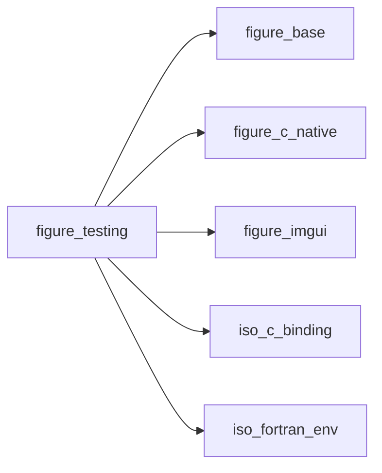

## Contents

- [test_next_frame](#test-next-frame)
- [test_mouse_move](#test-mouse-move)
- [test_mouse_button](#test-mouse-button)
- [test_click](#test-click)
- [test_drag](#test-drag)
- [test_wheel](#test-wheel)
- [test_key](#test-key)
- [test_type](#test-type)
- [test_window_rect](#test-window-rect)
- [test_item_center](#test-item-center)
- [button_index](#button-index)

## Subroutines

### test_next_frame

A frame boundary in the queued input: what is queued after it reaches Dear ImGui one frame later than what is
 queued before it. For sequences that must not share a frame (a drag: press, move, release).

```fortran
subroutine test_next_frame(stat)
```

**Arguments**

| Name | Type | Intent | Attributes | Description |
|------|------|--------|------------|-------------|
| `stat` | integer(kind=int32) | out | optional | Status. |

**Call graph**

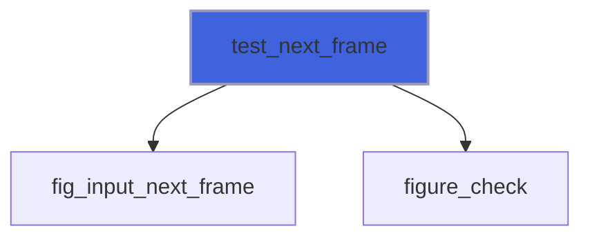

### test_mouse_move

Queue a move of the mouse to (x, y).

```fortran
subroutine test_mouse_move(x, y, stat)
```

**Arguments**

| Name | Type | Intent | Attributes | Description |
|------|------|--------|------------|-------------|
| `x` | real(kind=real64) | in |  | Abscissa [pixels]. |
| `y` | real(kind=real64) | in |  | Ordinate [pixels]. |
| `stat` | integer(kind=int32) | out | optional |  |

**Call graph**

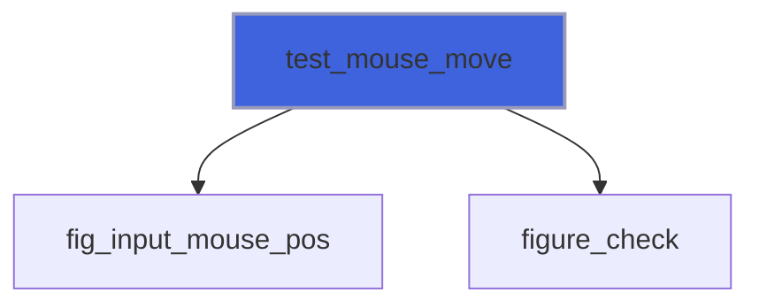

### test_mouse_button

Queue a press (`down=.true.`) or a release of a mouse button.

```fortran
subroutine test_mouse_button(down, button, stat)
```

**Arguments**

| Name | Type | Intent | Attributes | Description |
|------|------|--------|------------|-------------|
| `down` | logical | in |  | Pressed. |
| `button` | character(len=*) | in | optional | `'left'` (default), `'right'` or `'middle'`. |
| `stat` | integer(kind=int32) | out | optional | Status: `FIG_ERR_ARGUMENT` for an unknown button. |

**Call graph**

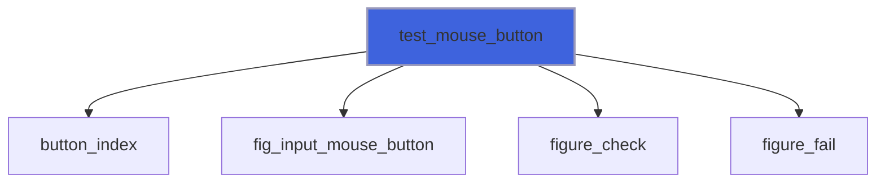

### test_click

Queue a click at (x, y): a move, a frame with the pointer resting there (as a user's hand does: Dear ImGui's
 tabs take a press only once hovered), a press and a release, applied over the next four frames.

```fortran
subroutine test_click(x, y, button, stat)
```

**Arguments**

| Name | Type | Intent | Attributes | Description |
|------|------|--------|------------|-------------|
| `x` | real(kind=real64) | in |  | Abscissa [pixels]. |
| `y` | real(kind=real64) | in |  | Ordinate [pixels]. |
| `button` | character(len=*) | in | optional | `'left'` (default), `'right'` or `'middle'`. |
| `stat` | integer(kind=int32) | out | optional | Status. |

**Call graph**

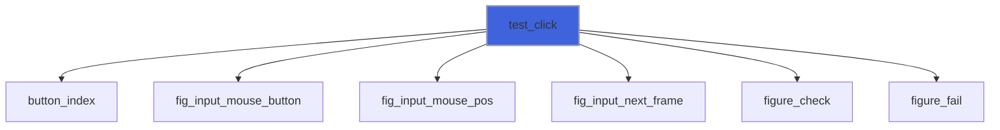

### test_drag

Queue a drag with the left button from (x0, y0) to (x1, y1): a slider grab moved, a window dragged by its title.

```fortran
subroutine test_drag(x0, y0, x1, y1, stat)
```

**Arguments**

| Name | Type | Intent | Attributes | Description |
|------|------|--------|------------|-------------|
| `x0` | real(kind=real64) | in |  | Start abscissa [pixels]. |
| `y0` | real(kind=real64) | in |  | Start ordinate [pixels]. |
| `x1` | real(kind=real64) | in |  | End abscissa [pixels]. |
| `y1` | real(kind=real64) | in |  | End ordinate [pixels]. |
| `stat` | integer(kind=int32) | out | optional | Status. |

**Call graph**

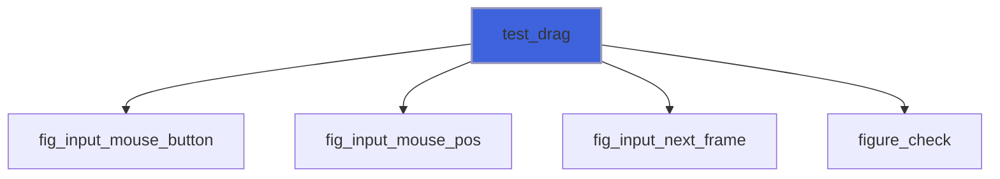

### test_wheel

Queue a turn of the wheel: `dy` positive away from the user (zoom in, in a plot), `dx` horizontal.

```fortran
subroutine test_wheel(dy, dx, stat)
```

**Arguments**

| Name | Type | Intent | Attributes | Description |
|------|------|--------|------------|-------------|
| `dy` | real(kind=real64) | in |  | Vertical steps. |
| `dx` | real(kind=real64) | in | optional | Horizontal steps (default 0). |
| `stat` | integer(kind=int32) | out | optional | Status. |

**Call graph**

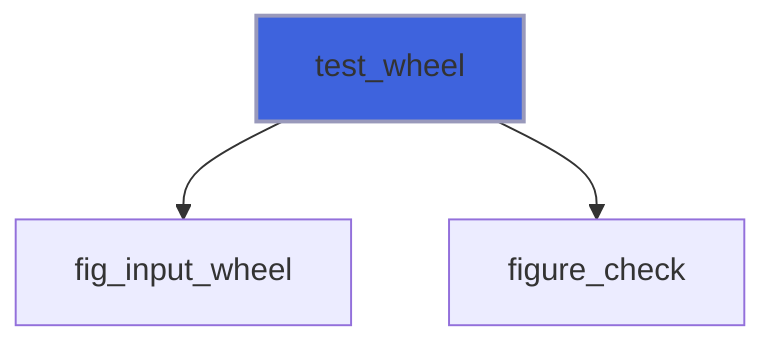

### test_key

Queue a key: pressed and released, or only pressed (`down=.true.`) or released (`down=.false.`). Names: `a`-`z`,
 `0`-`9`, `enter`, `tab`, `backspace`, `delete`, `escape`, `space`, `left`, `right`, `up`, `down`, `home`, `end`,
 `pageup`, `pagedown`, `f1`-`f12`, and the modifiers `ctrl`, `shift`, `alt`, `super` (hold one with `down`).

```fortran
subroutine test_key(name, down, stat)
```

**Arguments**

| Name | Type | Intent | Attributes | Description |
|------|------|--------|------------|-------------|
| `name` | character(len=*) | in |  | Key name. |
| `down` | logical | in | optional | Only press (true) or only release (false). |
| `stat` | integer(kind=int32) | out | optional |  |

**Call graph**

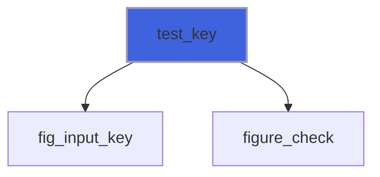

### test_type

Queue typed characters (UTF-8), into the focused input field.

```fortran
subroutine test_type(text, stat)
```

**Arguments**

| Name | Type | Intent | Attributes | Description |
|------|------|--------|------------|-------------|
| `text` | character(len=*) | in |  | Characters. |
| `stat` | integer(kind=int32) | out | optional | Status. |

**Call graph**

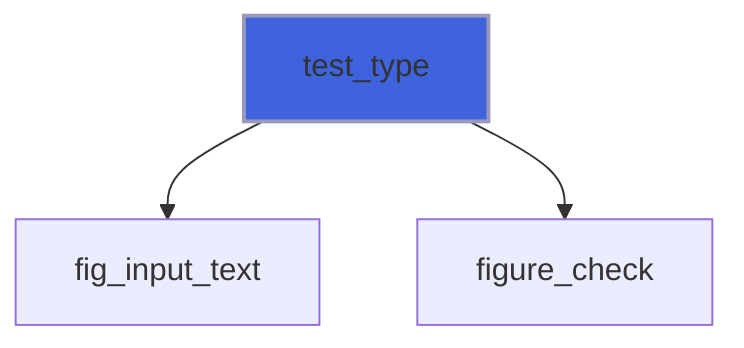

### test_window_rect

The rectangle of the window `name` (as passed to `ig_begin`) as drawn in the last frame [pixels].

```fortran
subroutine test_window_rect(name, xmin, ymin, xmax, ymax, found, stat)
```

**Arguments**

| Name | Type | Intent | Attributes | Description |
|------|------|--------|------------|-------------|
| `name` | character(len=*) | in |  | Window name. |
| `xmin` | real(kind=real64) | out |  | Left. |
| `ymin` | real(kind=real64) | out |  | Top. |
| `xmax` | real(kind=real64) | out |  | Right. |
| `ymax` | real(kind=real64) | out |  | Bottom. |
| `found` | logical | out | optional | The window exists (else the rectangle is zero). |
| `stat` | integer(kind=int32) | out | optional | Status. |

**Call graph**

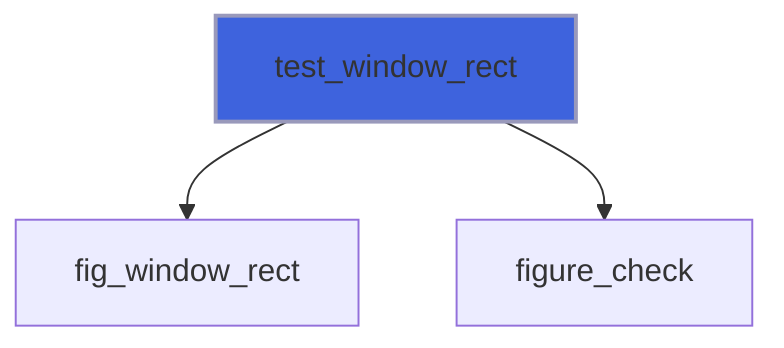

### test_item_center

The centre of the last item drawn (call it right after the widget): where `test_click` should aim.

```fortran
subroutine test_item_center(x, y)
```

**Arguments**

| Name | Type | Intent | Attributes | Description |
|------|------|--------|------------|-------------|
| `x` | real(kind=real64) | out |  | Abscissa [pixels]. |
| `y` | real(kind=real64) | out |  | Ordinate [pixels]. |

**Call graph**

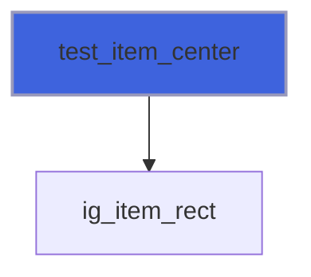

## Functions

### button_index

ImGuiMouseButton of a name (absent: left).

**Returns**: `logical`

```fortran
function button_index(button, b) result(ok)
```

**Arguments**

| Name | Type | Intent | Attributes | Description |
|------|------|--------|------------|-------------|
| `button` | character(len=*) | in | optional | Button name. |
| `b` | integer(kind=c_int) | out |  | Index. |

**Call graph**

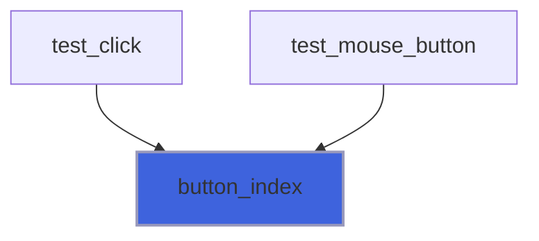
