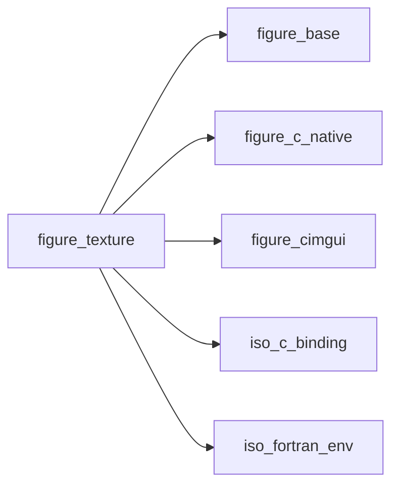
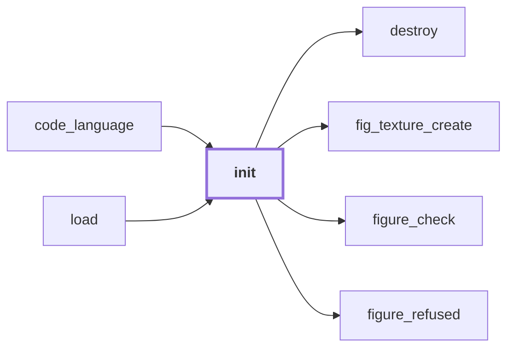
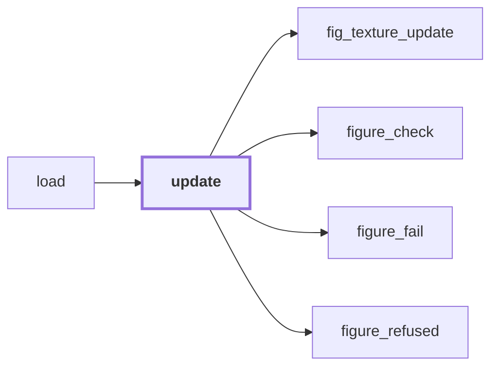
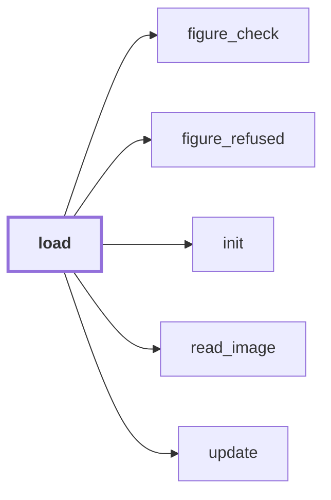
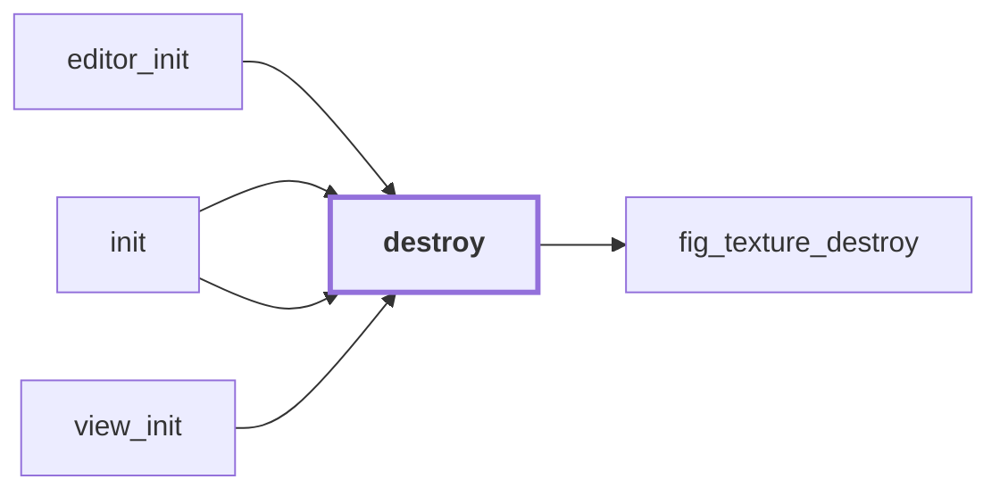
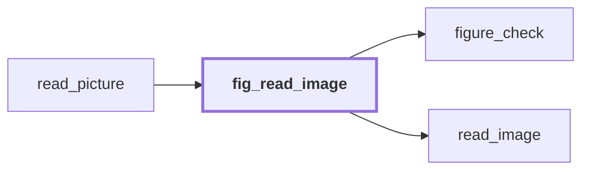
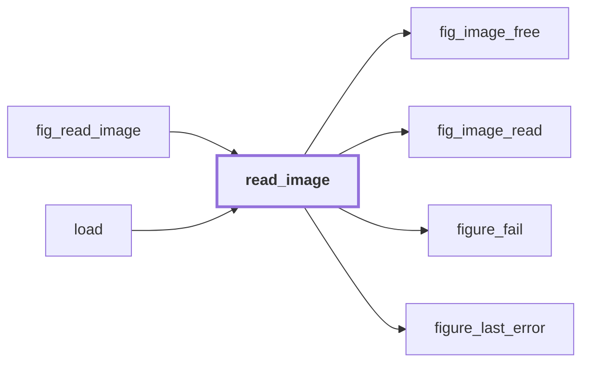
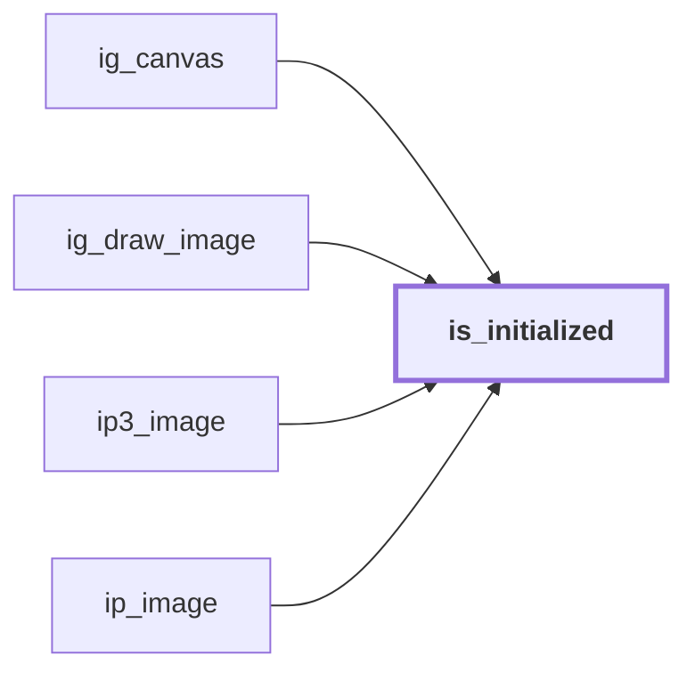
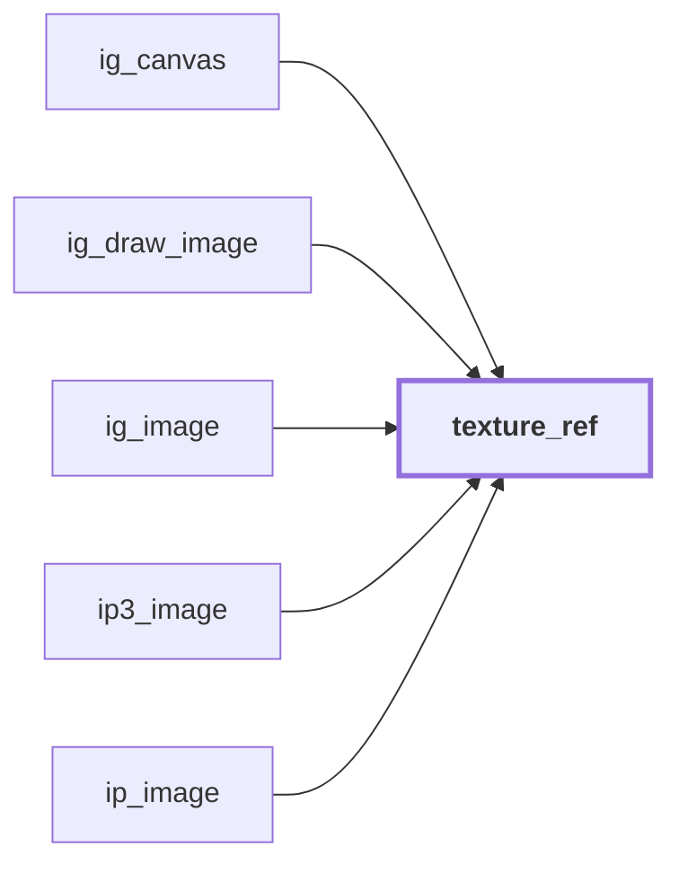

# figure_texture

> figure_texture, RGBA images on the GPU, drawn by `ig_image` and `ip_image`, and PNG or JPEG files read into pixels.

 A texture is the one retained resource of FIGURE: the image lives on the GPU between frames, so the program uploads
 pixels only when they change, not every frame.

```fortran
 type(texture_object) :: tex
 integer(int8)        :: rgba(4, 640, 480)    ! rgba(:, i, j): pixel (i, j), channels R, G, B, A
 call tex%init(640, 480)
 call tex%update(rgba)                       ! one upload, straight from the array: no copy
 ... call ig_image(tex) or ip_image('field', tex, xmin, xmax, ymin, ymax) every frame
 call tex%destroy()
```

 Pixels are `integer(int8)` bytes: values 128-255 are stored as their two's-complement bit pattern (-128..-1), so
 `int(v - merge(256, 0, v > 127), int8)` converts a 0-255 integer `v`. `rgba(:, i, j)` is the pixel in column `i` and
 row `j`: in Fortran's column-major order that is exactly OpenGL's layout (channels, then a row, then the next row),
 so the array is uploaded in place.

 `fig_read_image(path, rgba)` reads a PNG or a JPEG file into such an array (allocated to `rgba(4, width, height)`,
 row 1 the file's top row); it draws nothing, so a task may call it. `tex%load(path)` reads a file into a texture.

**Source**: `src/lib/figure_texture.F90`

**Dependencies**



## Contents

- [texture_object](#texture-object)
- [init](#init)
- [update](#update)
- [load](#load)
- [destroy](#destroy)
- [fig_read_image](#fig-read-image)
- [read_image](#read-image)
- [width](#width)
- [height](#height)
- [is_initialized](#is-initialized)
- [texture_ref](#texture-ref)

## Derived Types

### texture_object

An RGBA texture, 8 bits per channel.

 No finaliser: an intrinsic assignment or a function result would finalise a copy and destroy the texture the
 original still uses. Call `destroy` (or let `app%destroy` release the textures left).

**Components**

| Name | Type | Attributes | Description |
|------|------|------------|-------------|
| `id` | integer(kind=c_long_long) |  | ImTextureID; 0: no texture. |
| `nx` | integer(kind=int32) |  | Width [pixels]. |
| `ny` | integer(kind=int32) |  | Height [pixels]. |

**Type-Bound Procedures**

| Name | Attributes | Description |
|------|------------|-------------|
| [`init`](/api/src/lib/figure_texture#init) | pass(self) | Create the texture. |
| [`update`](/api/src/lib/figure_texture#update) | pass(self) | Upload all its pixels. |
| [`load`](/api/src/lib/figure_texture#load) | pass(self) | Create it from a PNG or JPEG file. |
| [`destroy`](/api/src/lib/figure_texture#destroy) | pass(self) | Release it. |
| [`width`](/api/src/lib/figure_texture#width) | pass(self) | Width [pixels]. |
| [`height`](/api/src/lib/figure_texture#height) | pass(self) | Height [pixels]. |
| [`is_initialized`](/api/src/lib/figure_texture#is-initialized) | pass(self) | Whether it exists. |

## Subroutines

### init

Create a `width` x `height` texture (contents undefined until `update`); an existing one is destroyed first.

**Attributes**: recursive

```fortran
subroutine init(self, width, height, smooth, stat)
```

**Arguments**

| Name | Type | Intent | Attributes | Description |
|------|------|--------|------------|-------------|
| `self` | class([texture_object](/api/src/lib/figure_texture#texture-object)) | inout |  | Texture. |
| `width` | integer(kind=int32) | in |  | Width [pixels]. |
| `height` | integer(kind=int32) | in |  | Height [pixels]. |
| `smooth` | logical | in | optional | Linear filtering when scaled (default: nearest, sharp pixels). |
| `stat` | integer(kind=int32) | out | optional | Status. |

**Call graph**



### update

Upload all the pixels, `rgba(4, width, height)`, in place (no copy); the array may change after the call.

**Attributes**: recursive

```fortran
subroutine update(self, rgba, stat)
```

**Arguments**

| Name | Type | Intent | Attributes | Description |
|------|------|--------|------------|-------------|
| `self` | class([texture_object](/api/src/lib/figure_texture#texture-object)) | in |  | Texture. |
| `rgba` | integer(kind=int8) | in | contiguous, target | Pixels: rgba(:, i, j) = R, G, B, A of (i, j). |
| `stat` | integer(kind=int32) | out | optional | Status. |

**Call graph**



### load

Create the texture from a PNG or JPEG file, its size the image's, and upload the pixels (`fig_read_image`, then
 `init` and `update`); an existing texture is replaced. On a failure to read the file the texture is left as it
 was. Main thread only, as `init`.

**Attributes**: recursive

```fortran
subroutine load(self, path, smooth, stat)
```

**Arguments**

| Name | Type | Intent | Attributes | Description |
|------|------|--------|------------|-------------|
| `self` | class([texture_object](/api/src/lib/figure_texture#texture-object)) | inout |  | Texture. |
| `path` | character(len=*) | in |  | File name (UTF-8). |
| `smooth` | logical | in | optional | Linear filtering when scaled (default: nearest). |
| `stat` | integer(kind=int32) | out | optional | Status: as `fig_read_image`, then as `init`. |

**Call graph**



### destroy

Release the texture (safe in any state).

```fortran
subroutine destroy(self)
```

**Arguments**

| Name | Type | Intent | Attributes | Description |
|------|------|--------|------------|-------------|
| `self` | class([texture_object](/api/src/lib/figure_texture#texture-object)) | inout |  | Texture. |

**Call graph**



### fig_read_image

Read a PNG or JPEG file into RGBA pixels: `rgba` is allocated to `rgba(4, width, height)`, `rgba(:, i, j)` the
 red, green, blue and alpha bytes of the pixel in column `i` (left to right) and row `j` (**top to bottom**, the
 file's order), the layout `tex%update` takes. A grey image gives R = G = B; an image without alpha gives A = 255
 (-1_int8). Draws nothing: a task may call it. On a failure `rgba` is left unallocated.

**Attributes**: recursive

```fortran
subroutine fig_read_image(path, rgba, stat)
```

**Arguments**

| Name | Type | Intent | Attributes | Description |
|------|------|--------|------------|-------------|
| `path` | character(len=*) | in |  | File name (UTF-8). |
| `rgba` | integer(kind=int8) | out | allocatable | Pixels: rgba(:, i, j) = R, G, B, A of (i, j). |
| `stat` | integer(kind=int32) | out | optional | read, `FIG_ERR_ARGUMENT` if it is not a PNG or a JPEG, or cannot be decoded. |

**Call graph**



### read_image

`fig_read_image` for the procedure `name`, which starts the message of a failure.

**Attributes**: recursive

```fortran
subroutine read_image(name, path, rgba, stat)
```

**Arguments**

| Name | Type | Intent | Attributes | Description |
|------|------|--------|------------|-------------|
| `name` | character(len=*) | in |  | The public procedure. |
| `path` | character(len=*) | in |  | File name (UTF-8). |
| `rgba` | integer(kind=int8) | out | allocatable | Pixels. |
| `stat` | integer(kind=int32) | out |  | Status. |

**Call graph**



## Functions

### width

Width [pixels] (0 when not initialized).

**Attributes**: pure

**Returns**: `integer(kind=int32)`

```fortran
function width(self) result(w)
```

**Arguments**

| Name | Type | Intent | Attributes | Description |
|------|------|--------|------------|-------------|
| `self` | class([texture_object](/api/src/lib/figure_texture#texture-object)) | in |  | Texture. |

**Call graph**


### height

Height [pixels] (0 when not initialized).

**Attributes**: pure

**Returns**: `integer(kind=int32)`

```fortran
function height(self) result(h)
```

**Arguments**

| Name | Type | Intent | Attributes | Description |
|------|------|--------|------------|-------------|
| `self` | class([texture_object](/api/src/lib/figure_texture#texture-object)) | in |  | Texture. |

**Call graph**


### is_initialized

Whether the texture exists.

**Attributes**: pure

**Returns**: `logical`

```fortran
function is_initialized(self) result(yes)
```

**Arguments**

| Name | Type | Intent | Attributes | Description |
|------|------|--------|------------|-------------|
| `self` | class([texture_object](/api/src/lib/figure_texture#texture-object)) | in |  | Texture. |

**Call graph**



### texture_ref

The `ImTextureRef` of a texture, for the figure_* modules that draw it (not exported by `figure`).

**Attributes**: pure

**Returns**: type([im_texture_ref](/api/src/lib/figure_cimgui#im-texture-ref))

```fortran
function texture_ref(tex) result(ref)
```

**Arguments**

| Name | Type | Intent | Attributes | Description |
|------|------|--------|------------|-------------|
| `tex` | type([texture_object](/api/src/lib/figure_texture#texture-object)) | in |  | Texture. |

**Call graph**


