# figure_view3d

> figure_view3d, a 3-D view of meshes (view3d_object), drawn by FIGURE's software rasterizer in every mode.

 A view holds meshes (triangles, quads, structured surfaces, lines), each optionally coloured by a scalar per vertex
 or per cell through a colormap (`ip_colormap`'s names), a camera (orbit, pan, zoom, fit, six standard views) and
 clipping planes; `v%draw(id, width, height)` draws it as a widget inside any window. The image is rendered on the
 CPU (native/figure_view3d.cpp) into a texture, so window, remote and headless modes show the same pixels; it is
 rendered again only when something changed.

```fortran
 type(view3d_object)       :: v
 real(real64), target      :: xyz(3, 40, 20), p(40, 20)
 integer(int32)            :: wing
 call v%init()
 wing = v%surface(xyz, scalar=p, colormap='cool-warm')   ! the arrays are read in place, at every render
 ... every frame, inside a window:
 call v%draw('view', 0.0_real64, 0.0_real64)               ! the available region
 if (v%clicked(mesh, element)) ...                        ! the element clicked
```

 **Data in place.** The view keeps the addresses of the program's arrays (coordinates, connectivity, scalars): they
 must have the `target` (or `pointer`) attribute, be contiguous, and stay allocated while the mesh exists. After
 changing their values, call `v%changed(mesh)`: the normals, the scalar's range and the connectivity's checks are
 derived again and the view is rendered at the next draw.

**Source**: `src/lib/figure_view3d.F90`

**Dependencies**

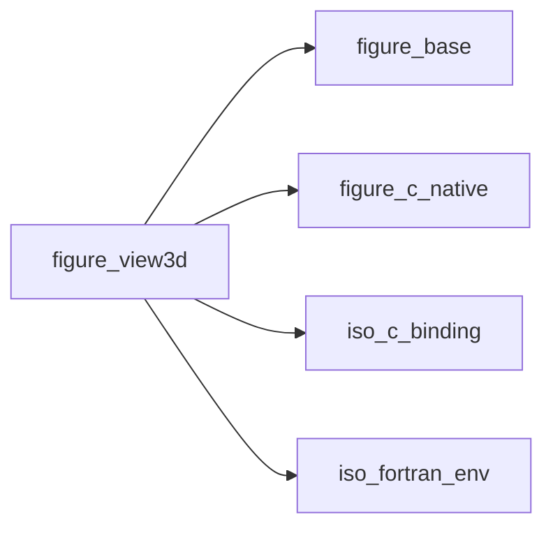

## Contents

- [view3d_object](#view3d-object)
- [fig_view3d_create](#fig-view3d-create)
- [fig_view3d_mesh](#fig-view3d-mesh)
- [fig_view3d_scalar](#fig-view3d-scalar)
- [fig_view3d_style](#fig-view3d-style)
- [fig_view3d_remove](#fig-view3d-remove)
- [fig_view3d_changed](#fig-view3d-changed)
- [fig_view3d_camera](#fig-view3d-camera)
- [fig_view3d_fit](#fig-view3d-fit)
- [fig_view3d_standard](#fig-view3d-standard)
- [fig_view3d_move](#fig-view3d-move)
- [fig_view3d_clip](#fig-view3d-clip)
- [fig_view3d_unclip](#fig-view3d-unclip)
- [fig_view3d_draw](#fig-view3d-draw)
- [fig_view3d_pick](#fig-view3d-pick)
- [fig_view3d_image](#fig-view3d-image)
- [fig_view3d_info](#fig-view3d-info)
- [fig_view3d_destroy](#fig-view3d-destroy)
- [init](#init)
- [destroy](#destroy)
- [set_mesh](#set-mesh)
- [remove](#remove)
- [clear](#clear)
- [changed](#changed)
- [set_camera](#set-camera)
- [get_camera](#get-camera)
- [fit](#fit)
- [view](#view)
- [orbit](#orbit)
- [pan](#pan)
- [zoom](#zoom)
- [clip](#clip)
- [unclip](#unclip)
- [draw](#draw)
- [image](#image)
- [render_info](#render-info)
- [style_new](#style-new)
- [is_initialized](#is-initialized)
- [triangles](#triangles)
- [quads](#quads)
- [surface](#surface)
- [lines](#lines)
- [pick](#pick)
- [hovered](#hovered)
- [clicked](#clicked)
- [alive](#alive)
- [points_ok](#points-ok)
- [connectivity_ok](#connectivity-ok)
- [add_mesh](#add-mesh)
- [scalar_set](#scalar-set)
- [flag](#flag)
- [query](#query)

## Variables

| Name | Type | Attributes | Description |
|------|------|------------|-------------|
| `K_TRIANGLES` | integer(kind=c_int) | parameter | Mesh kinds of the native layer. |
| `K_QUADS` | integer(kind=c_int) | parameter | Quads. |
| `K_SURFACE` | integer(kind=c_int) | parameter | Structured surface. |
| `K_LINES` | integer(kind=c_int) | parameter | Lines. |

## Derived Types

### view3d_object

A 3-D view: `v%init`, meshes added, then `v%draw` every frame. Not to be copied (the copy would share the view).

#### Components

| Name | Type | Attributes | Description |
|------|------|------------|-------------|
| `handle` | integer(kind=c_int) |  | Native handle (0: none). |

#### Type-Bound Procedures

| Name | Attributes | Description |
|------|------------|-------------|
| `init` | pass(self) | Create the view. |
| `destroy` | pass(self) | Release it. |
| `is_initialized` | pass(self) | Whether it exists. |
| `triangles` | pass(self) | Add a triangle mesh. |
| `quads` | pass(self) | Add a quad mesh. |
| `surface` | pass(self) | Add a structured surface. |
| `lines` | pass(self) | Add lines. |
| `set_mesh` | pass(self) | Change a mesh's scalar or style. |
| `remove` | pass(self) | Remove a mesh. |
| `clear` | pass(self) | Remove every mesh. |
| `changed` | pass(self) | The data of a mesh changed in place. |
| `set_camera` | pass(self) | Set the camera. |
| `get_camera` | pass(self) | Read the camera. |
| `fit` | pass(self) | Fit the meshes in the view. |
| `view` | pass(self) | One of the six standard views. |
| `orbit` | pass(self) | Turn the camera around its target. |
| `pan` | pass(self) | Move the camera and its target across the screen. |
| `zoom` | pass(self) | Move the camera toward its target. |
| `clip` | pass(self) | Add a clipping plane. |
| `unclip` | pass(self) | Remove the clipping planes. |
| `draw` | pass(self) | Draw the view as a widget. |
| `pick` | pass(self) | The element under a pixel. |
| `hovered` | pass(self) | The element under the mouse. |
| `clicked` | pass(self) | The element clicked. |
| `image` | pass(self) | The pixels of the last render. |
| `render_info` | pass(self) | Renders so far, the last one's time and size. |

## Interfaces

### fig_view3d_create

### fig_view3d_mesh

### fig_view3d_scalar

### fig_view3d_style

### fig_view3d_remove

### fig_view3d_changed

### fig_view3d_camera

### fig_view3d_fit

### fig_view3d_standard

### fig_view3d_move

### fig_view3d_clip

### fig_view3d_unclip

### fig_view3d_draw

### fig_view3d_pick

### fig_view3d_image

### fig_view3d_info

### fig_view3d_destroy

## Subroutines

### init

Create the view (an existing one is destroyed first). After `app%init*`. Statuses: `FIG_ERR_ARGUMENT` for
 `threads` outside [1, 4]; `FIG_ERR_STATE` from a task. The same in every mode.

**Attributes**: recursive

```fortran
subroutine init(self, threads, fast_moves, lighting, background, stat)
```

**Arguments**

| Name | Type | Intent | Attributes | Description |
|------|------|--------|------------|-------------|
| `self` | class([view3d_object](/api/src/lib/figure_view3d#view3d-object)) | inout |  | View. |
| `threads` | integer(kind=int32) | in | optional | Threads rendering bands of rows, in [1, 4] (default 1). |
| `fast_moves` | logical | in | optional | Half resolution while the user moves the camera |
| `lighting` | logical | in | optional | Shade by a light at the eye (default true); off: the |
| `background` | real(kind=real64) | in | target, optional | Background `[r, g, b]` in [0, 1] (default: |
| `stat` | integer(kind=int32) | out | optional | Status. |

**Call graph**

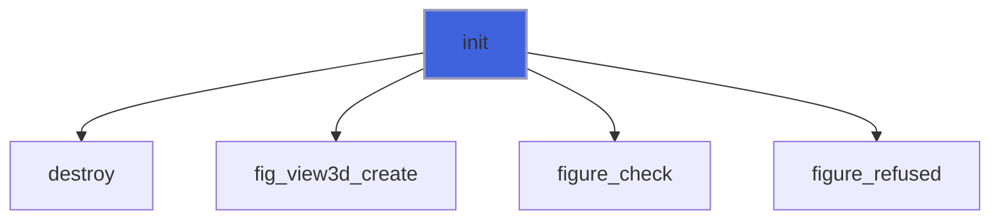

### destroy

Release the view and its textures (safe in any state; the program's arrays are not touched).

```fortran
subroutine destroy(self)
```

**Arguments**

| Name | Type | Intent | Attributes | Description |
|------|------|--------|------------|-------------|
| `self` | class([view3d_object](/api/src/lib/figure_view3d#view3d-object)) | inout |  | View. |

**Call graph**

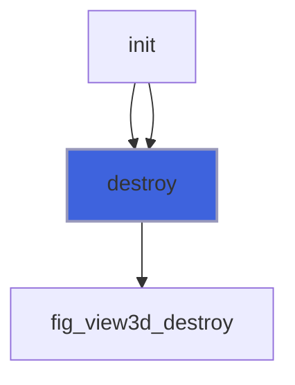

### set_mesh

Change a mesh: its scalar (per vertex, per cell, or none), colormap, range (`vmin`, `vmax` together, or
 `auto_range`: the data's), colour, edges and their colour, shading, visibility. Arguments absent: unchanged. For
 a structured surface, pass its scalar as a contiguous array of `ni*nj` (or `(ni-1)*(nj-1)`) values. Statuses:
 `FIG_ERR_ARGUMENT` for an unknown mesh, a colormap name or a scalar size, `vmax <= vmin` or one of them alone.

**Attributes**: recursive

```fortran
subroutine set_mesh(self, mesh, scalar, cell_scalar, no_scalar, colormap, vmin, vmax, auto_range, color, edges, edge_color, flat, visible, stat)
```

**Arguments**

| Name | Type | Intent | Attributes | Description |
|------|------|--------|------------|-------------|
| `self` | class([view3d_object](/api/src/lib/figure_view3d#view3d-object)) | in |  | View. |
| `mesh` | integer(kind=int32) | in |  | Mesh id. |
| `scalar` | real(kind=real64) | in | target, optional | A value per vertex (node). |
| `cell_scalar` | real(kind=real64) | in | target, optional | A value per cell. |
| `no_scalar` | logical | in | optional | True: no scalar (the mesh's colour). |
| `colormap` | character(len=*) | in | optional | Colormap name. |
| `vmin` | real(kind=real64) | in | optional | The scalar mapped to the map's start. |
| `vmax` | real(kind=real64) | in | optional | ... to its end. |
| `auto_range` | logical | in | optional | True: the data's range (the default). |
| `color` | real(kind=real64) | in | target, optional | Colour `[r, g, b]` in [0, 1]. |
| `edges` | logical | in | optional | Draw the edges. |
| `edge_color` | real(kind=real64) | in | target, optional | Edges' colour (default near black). |
| `flat` | logical | in | optional | Flat shading. |
| `visible` | logical | in | optional | Drawn (default true). |
| `stat` | integer(kind=int32) | out | optional | Status. |

**Call graph**

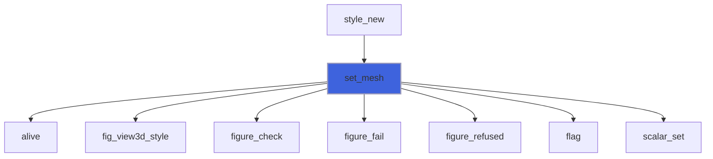

### remove

Remove a mesh (the program's arrays are not touched). Status: `FIG_ERR_ARGUMENT` for an unknown mesh.

**Attributes**: recursive

```fortran
subroutine remove(self, mesh, stat)
```

**Arguments**

| Name | Type | Intent | Attributes | Description |
|------|------|--------|------------|-------------|
| `self` | class([view3d_object](/api/src/lib/figure_view3d#view3d-object)) | in |  | View. |
| `mesh` | integer(kind=int32) | in |  | Mesh id. |
| `stat` | integer(kind=int32) | out | optional | Status. |

**Call graph**

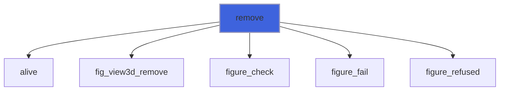

### clear

Remove every mesh.

**Attributes**: recursive

```fortran
subroutine clear(self, stat)
```

**Arguments**

| Name | Type | Intent | Attributes | Description |
|------|------|--------|------------|-------------|
| `self` | class([view3d_object](/api/src/lib/figure_view3d#view3d-object)) | in |  | View. |
| `stat` | integer(kind=int32) | out | optional | Status. |

**Call graph**


### changed

The data of `mesh` (absent: of every mesh) changed in place: its normals, range and connectivity checks are
 derived again, and the view is rendered at the next draw. Status: `FIG_ERR_ARGUMENT` for an unknown mesh or a
 connectivity index now out of range.

**Attributes**: recursive

```fortran
subroutine changed(self, mesh, stat)
```

**Arguments**

| Name | Type | Intent | Attributes | Description |
|------|------|--------|------------|-------------|
| `self` | class([view3d_object](/api/src/lib/figure_view3d#view3d-object)) | in |  | View. |
| `mesh` | integer(kind=int32) | in | optional | Mesh id. |
| `stat` | integer(kind=int32) | out | optional | Status. |

**Call graph**

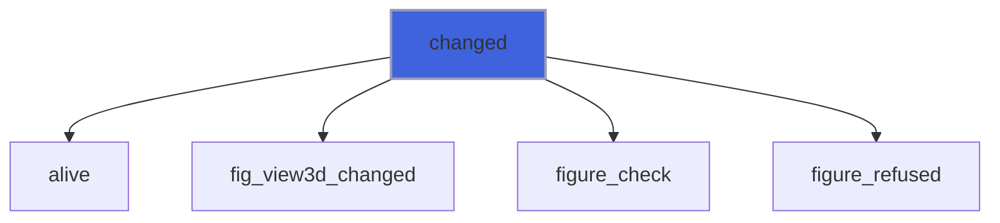

### set_camera

Set the camera: it looks at `target` from `distance` away, from the direction given by `azimuth` (around z, from
 +x toward +y) and `elevation` (above the x-y plane, in [-90, 90]), with a vertical field of view `fov`; z is up.
 Absent arguments are unchanged (a camera never set is first fitted to the meshes). Statuses: `FIG_ERR_ARGUMENT`
 for `distance <= 0`, `fov` outside (0, 180) or `elevation` outside [-90, 90].

**Attributes**: recursive

```fortran
subroutine set_camera(self, target, distance, azimuth, elevation, fov, stat)
```

**Arguments**

| Name | Type | Intent | Attributes | Description |
|------|------|--------|------------|-------------|
| `self` | class([view3d_object](/api/src/lib/figure_view3d#view3d-object)) | in |  | View. |
| `target` | real(kind=real64) | in | optional | The point looked at [world units]. |
| `distance` | real(kind=real64) | in | optional | From the target [world units]. |
| `azimuth` | real(kind=real64) | in | optional | [degrees]. |
| `elevation` | real(kind=real64) | in | optional | [degrees]. |
| `fov` | real(kind=real64) | in | optional | Vertical field of view [degrees] (default 30). |
| `stat` | integer(kind=int32) | out | optional | Status. |

**Call graph**

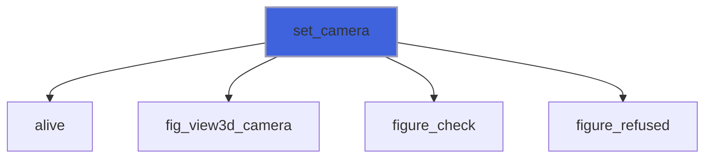

### get_camera

Read the camera (as `set_camera` describes it; a camera never set is first fitted to the meshes).

**Attributes**: recursive

```fortran
subroutine get_camera(self, target, distance, azimuth, elevation, fov, stat)
```

**Arguments**

| Name | Type | Intent | Attributes | Description |
|------|------|--------|------------|-------------|
| `self` | class([view3d_object](/api/src/lib/figure_view3d#view3d-object)) | in |  | View. |
| `target` | real(kind=real64) | out | optional | The point looked at. |
| `distance` | real(kind=real64) | out | optional | From the target. |
| `azimuth` | real(kind=real64) | out | optional | [degrees], in [-180, 180]. |
| `elevation` | real(kind=real64) | out | optional | [degrees]. |
| `fov` | real(kind=real64) | out | optional | [degrees]. |
| `stat` | integer(kind=int32) | out | optional | Status. |

**Call graph**


### fit

Aim at the centre of the visible meshes' bounding box, from the distance at which their bounding sphere fills the
 view (the direction is kept). Also on a double click in the view.

**Attributes**: recursive

```fortran
subroutine fit(self, stat)
```

**Arguments**

| Name | Type | Intent | Attributes | Description |
|------|------|--------|------------|-------------|
| `self` | class([view3d_object](/api/src/lib/figure_view3d#view3d-object)) | in |  | View. |
| `stat` | integer(kind=int32) | out | optional | Status. |

**Call graph**

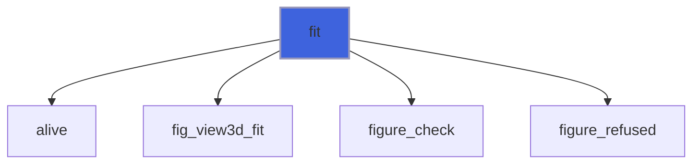

### view

A standard view, fitted: `'+x'` puts the eye on the +x side looking toward -x (z up), likewise `'-x'`, `'+y'`,
 `'-y'`; `'+z'` looks down with x right and y up, `'-z'` looks up with x right. Status: `FIG_ERR_ARGUMENT` for
 another name.

**Attributes**: recursive

```fortran
subroutine view(self, name, stat)
```

**Arguments**

| Name | Type | Intent | Attributes | Description |
|------|------|--------|------------|-------------|
| `self` | class([view3d_object](/api/src/lib/figure_view3d#view3d-object)) | in |  | View. |
| `name` | character(len=*) | in |  | `'+x'`, `'-x'`, `'+y'`, `'-y'`, `'+z'` or `'-z'`. |
| `stat` | integer(kind=int32) | out | optional | Status. |

**Call graph**

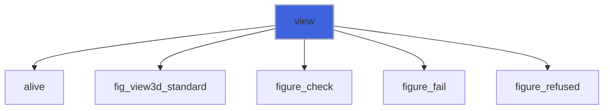

### orbit

Turn the camera around its target by `azimuth` and `elevation` [degrees] (the elevation is kept in [-90, 90]); as
 a drag with the left button in the view.

**Attributes**: recursive

```fortran
subroutine orbit(self, azimuth, elevation, stat)
```

**Arguments**

| Name | Type | Intent | Attributes | Description |
|------|------|--------|------------|-------------|
| `self` | class([view3d_object](/api/src/lib/figure_view3d#view3d-object)) | in |  | View. |
| `azimuth` | real(kind=real64) | in |  | Change of azimuth [degrees]. |
| `elevation` | real(kind=real64) | in | optional | Change of elevation [degrees] (default 0). |
| `stat` | integer(kind=int32) | out | optional | Status. |

**Call graph**


### pan

Move the camera and its target along the screen's right and up directions [world units]; as a drag with the
 right or middle button (or shift and the left one) in the view.

**Attributes**: recursive

```fortran
subroutine pan(self, right, up, stat)
```

**Arguments**

| Name | Type | Intent | Attributes | Description |
|------|------|--------|------------|-------------|
| `self` | class([view3d_object](/api/src/lib/figure_view3d#view3d-object)) | in |  | View. |
| `right` | real(kind=real64) | in |  | Along the screen's right [world units]. |
| `up` | real(kind=real64) | in |  | Along the screen's up [world units]. |
| `stat` | integer(kind=int32) | out | optional | Status. |

**Call graph**

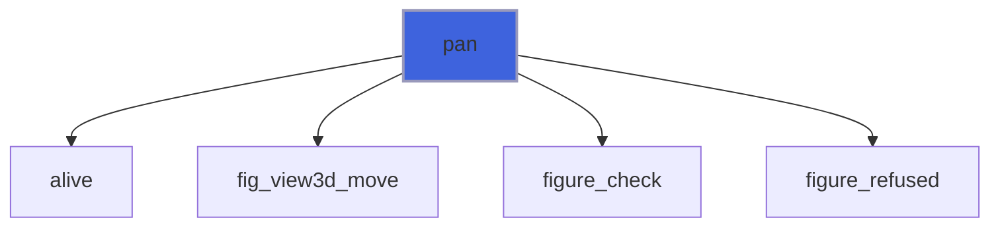

### zoom

Divide the camera's distance by `factor` (> 1 closer); the wheel in the view zooms by 1.1 per step. Status:
 `FIG_ERR_ARGUMENT` for `factor <= 0`.

**Attributes**: recursive

```fortran
subroutine zoom(self, factor, stat)
```

**Arguments**

| Name | Type | Intent | Attributes | Description |
|------|------|--------|------------|-------------|
| `self` | class([view3d_object](/api/src/lib/figure_view3d#view3d-object)) | in |  | View. |
| `factor` | real(kind=real64) | in |  | Zoom factor. |
| `stat` | integer(kind=int32) | out | optional | Status. |

**Call graph**

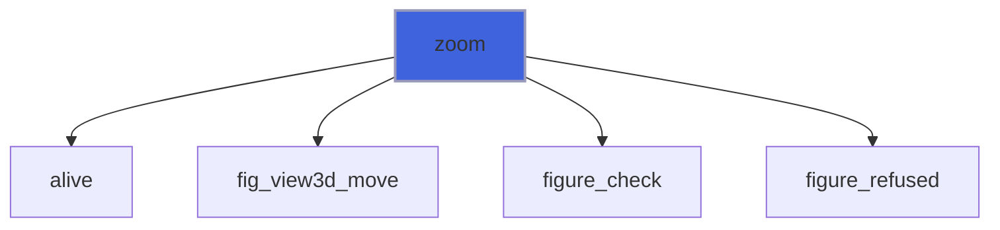

### clip

Add a clipping plane through `point`: what lies where `(x - point) . normal >= 0` is kept, the rest is cut away
 (surfaces cut exactly per pixel, lines per segment). At most 6 planes. Status: `FIG_ERR_ARGUMENT` for a seventh
 plane or a zero normal.

**Attributes**: recursive

```fortran
subroutine clip(self, normal, point, stat)
```

**Arguments**

| Name | Type | Intent | Attributes | Description |
|------|------|--------|------------|-------------|
| `self` | class([view3d_object](/api/src/lib/figure_view3d#view3d-object)) | in |  | View. |
| `normal` | real(kind=real64) | in |  | Towards the part kept. |
| `point` | real(kind=real64) | in |  | A point of the plane [world units]. |
| `stat` | integer(kind=int32) | out | optional | Status. |

**Call graph**


### unclip

Remove every clipping plane.

**Attributes**: recursive

```fortran
subroutine unclip(self, stat)
```

**Arguments**

| Name | Type | Intent | Attributes | Description |
|------|------|--------|------------|-------------|
| `self` | class([view3d_object](/api/src/lib/figure_view3d#view3d-object)) | in |  | View. |
| `stat` | integer(kind=int32) | out | optional | Status. |

**Call graph**


### draw

Draw the view as a widget at the cursor, inside a window: `width` x `height` pixels (0: the available region;
 negative: up to that distance from its edge). It is rendered only when something changed since the last draw.
 The mouse in the view: left drag orbits, right or middle drag (or shift and left) pans, the wheel zooms, a double
 click fits. While the user moves the camera, the view is rendered at half resolution (unless `init`'s
 `fast_moves=.false.`), until the button is released or a frame has no wheel step. Modes: the same pixels in every
 mode; in remote mode each render is sent to the browser as a texture: JPEG while the camera moves, exact once it
 is still (`init_remote`'s `lossy`). Statuses: `FIG_ERR_STATE` before `init` and from a task.

**Attributes**: recursive

```fortran
subroutine draw(self, id, width, height, stat)
```

**Arguments**

| Name | Type | Intent | Attributes | Description |
|------|------|--------|------------|-------------|
| `self` | class([view3d_object](/api/src/lib/figure_view3d#view3d-object)) | in |  | View. |
| `id` | character(len=*) | in |  | Widget id (unique in the window). |
| `width` | real(kind=real64) | in | optional | Width [pixels] (default 0: the available width). |
| `height` | real(kind=real64) | in | optional | Height [pixels] (default 0: the available height). |
| `stat` | integer(kind=int32) | out | optional | Status. |

**Call graph**


### image

The pixels of the last render, `rgba(4, width, height)` (as `texture_object%update` takes them; half the view's
 size if it was rendered while moving), unallocated before the first render.

**Attributes**: recursive

```fortran
subroutine image(self, rgba, stat)
```

**Arguments**

| Name | Type | Intent | Attributes | Description |
|------|------|--------|------------|-------------|
| `self` | class([view3d_object](/api/src/lib/figure_view3d#view3d-object)) | in |  | View. |
| `rgba` | integer(kind=int8) | out | allocatable, target | Pixels. |
| `stat` | integer(kind=int32) | out | optional | Status. |

**Call graph**

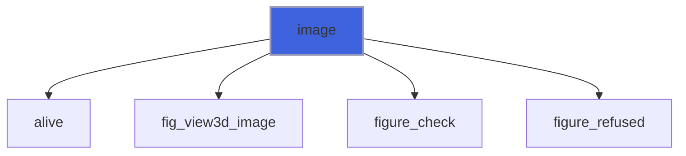

### render_info

The renders so far, the last one's time [ms] and size [pixels], and whether it was at half resolution.

**Attributes**: recursive

```fortran
subroutine render_info(self, count, milliseconds, width, height, half, stat)
```

**Arguments**

| Name | Type | Intent | Attributes | Description |
|------|------|--------|------------|-------------|
| `self` | class([view3d_object](/api/src/lib/figure_view3d#view3d-object)) | in |  | View. |
| `count` | integer(kind=int32) | out | optional | Renders since `init`. |
| `milliseconds` | real(kind=real64) | out | optional | The last render's time [ms]. |
| `width` | integer(kind=int32) | out | optional | Its width [pixels]. |
| `height` | integer(kind=int32) | out | optional | Its height [pixels]. |
| `half` | logical | out | optional | At half resolution (the camera was moving). |
| `stat` | integer(kind=int32) | out | optional | Status. |

**Call graph**


### style_new

The scalars and style given at a mesh's creation; the mesh is removed again on a failure.

```fortran
subroutine style_new(self, mesh, scalar, cell_scalar, colormap, color, edges, flat, stat)
```

**Arguments**

| Name | Type | Intent | Attributes | Description |
|------|------|--------|------------|-------------|
| `self` | class([view3d_object](/api/src/lib/figure_view3d#view3d-object)) | in |  | View. |
| `mesh` | integer(kind=int32) | inout |  | Mesh id (0 after a failure). |
| `scalar` | real(kind=real64) | in | target, optional | A value per vertex. |
| `cell_scalar` | real(kind=real64) | in | target, optional | A value per cell. |
| `colormap` | character(len=*) | in | optional | Colormap. |
| `color` | real(kind=real64) | in | optional | Colour. |
| `edges` | logical | in | optional | Edges. |
| `flat` | logical | in | optional | Flat shading. |
| `stat` | integer(kind=int32) | out | optional | Status. |

**Call graph**

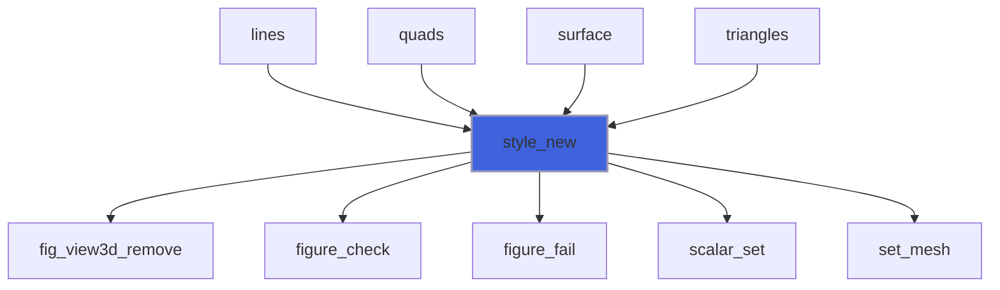

## Functions

### is_initialized

Whether the view exists.

**Attributes**: pure

**Returns**: `logical`

```fortran
function is_initialized(self) result(yes)
```

**Arguments**

| Name | Type | Intent | Attributes | Description |
|------|------|--------|------------|-------------|
| `self` | class([view3d_object](/api/src/lib/figure_view3d#view3d-object)) | in |  | View. |

**Call graph**

```mermaid
flowchart TD
  ip_image["ip_image"] --> is_initialized["is_initialized"]
  style is_initialized fill:#3e63dd,stroke:#99b,stroke-width:2px
```

### triangles

Add a mesh of triangles: vertex `k` at `xyz(:, k)`, triangle `t` joining the vertices `tri(:, t)` (from 1).
 Returns the mesh's id (from 1; 0 on a failure). The arrays are kept by address (see the module's notes on data in
 place). Statuses: `FIG_ERR_ARGUMENT` for a non-contiguous array, an index outside [1, size(xyz, 2)] or a scalar
 of the wrong size; `FIG_ERR_STATE` before `init` and from a task.

**Attributes**: recursive

**Returns**: `integer(kind=int32)`

```fortran
function triangles(self, xyz, tri, scalar, cell_scalar, colormap, color, edges, flat, stat) result(mesh)
```

**Arguments**

| Name | Type | Intent | Attributes | Description |
|------|------|--------|------------|-------------|
| `self` | class([view3d_object](/api/src/lib/figure_view3d#view3d-object)) | in |  | View. |
| `xyz` | real(kind=real64) | in | target | Vertices, `xyz(3, nv)`. |
| `tri` | integer(kind=int32) | in | target | Triangles, `tri(3, nt)`. |
| `scalar` | real(kind=real64) | in | target, optional | A value per vertex, by the colormap. |
| `cell_scalar` | real(kind=real64) | in | target, optional | A value per triangle (one colour each). |
| `colormap` | character(len=*) | in | optional | Colormap name (default `'cividis'`). |
| `color` | real(kind=real64) | in | optional | Colour without a scalar `[r, g, b]`. |
| `edges` | logical | in | optional | Draw the triangles' edges (default false). |
| `flat` | logical | in | optional | Flat shading (default false: smooth). |
| `stat` | integer(kind=int32) | out | optional | Status. |

**Call graph**

```mermaid
flowchart TD
  triangles["triangles"] --> add_mesh["add_mesh"]
  triangles["triangles"] --> connectivity_ok["connectivity_ok"]
  triangles["triangles"] --> figure_refused["figure_refused"]
  triangles["triangles"] --> style_new["style_new"]
  style triangles fill:#3e63dd,stroke:#99b,stroke-width:2px
```

### quads

Add a mesh of quadrilaterals `quad(4, nq)` (vertices from 1, in order around each), each drawn as two triangles;
 as `triangles` otherwise. A picked element is a quad.

**Attributes**: recursive

**Returns**: `integer(kind=int32)`

```fortran
function quads(self, xyz, quad, scalar, cell_scalar, colormap, color, edges, flat, stat) result(mesh)
```

**Arguments**

| Name | Type | Intent | Attributes | Description |
|------|------|--------|------------|-------------|
| `self` | class([view3d_object](/api/src/lib/figure_view3d#view3d-object)) | in |  | View. |
| `xyz` | real(kind=real64) | in | target | Vertices, `xyz(3, nv)`. |
| `quad` | integer(kind=int32) | in | target | Quads, `quad(4, nq)`. |
| `scalar` | real(kind=real64) | in | target, optional | A value per vertex. |
| `cell_scalar` | real(kind=real64) | in | target, optional | A value per quad. |
| `colormap` | character(len=*) | in | optional | Colormap name (default `'cividis'`). |
| `color` | real(kind=real64) | in | optional | Colour without a scalar `[r, g, b]`. |
| `edges` | logical | in | optional | Draw the quads' edges (default false). |
| `flat` | logical | in | optional | Flat shading (default false). |
| `stat` | integer(kind=int32) | out | optional | Status. |

**Call graph**

```mermaid
flowchart TD
  quads["quads"] --> add_mesh["add_mesh"]
  quads["quads"] --> connectivity_ok["connectivity_ok"]
  quads["quads"] --> figure_refused["figure_refused"]
  quads["quads"] --> style_new["style_new"]
  style quads fill:#3e63dd,stroke:#99b,stroke-width:2px
```

### surface

Add a structured surface: node `(i, j)` at `xyz(:, i, j)`, cells between neighbouring nodes (a grid's face, a
 body's patch). `scalar(ni, nj)` per node, or `cell_scalar(ni-1, nj-1)` per cell; `edges` draws the grid lines. A
 picked element is the cell `i + (j - 1) * (ni - 1)`. As `triangles` otherwise.

**Attributes**: recursive

**Returns**: `integer(kind=int32)`

```fortran
function surface(self, xyz, scalar, cell_scalar, colormap, color, edges, flat, stat) result(mesh)
```

**Arguments**

| Name | Type | Intent | Attributes | Description |
|------|------|--------|------------|-------------|
| `self` | class([view3d_object](/api/src/lib/figure_view3d#view3d-object)) | in |  | View. |
| `xyz` | real(kind=real64) | in | target | Nodes, `xyz(3, ni, nj)`. |
| `scalar` | real(kind=real64) | in | target, optional | A value per node, `(ni, nj)`. |
| `cell_scalar` | real(kind=real64) | in | target, optional | A value per cell, `(ni-1, nj-1)`. |
| `colormap` | character(len=*) | in | optional | Colormap name (default `'cividis'`). |
| `color` | real(kind=real64) | in | optional | Colour without a scalar. |
| `edges` | logical | in | optional | Draw the grid lines (default false). |
| `flat` | logical | in | optional | Flat shading (default false). |
| `stat` | integer(kind=int32) | out | optional | Status. |

**Call graph**

```mermaid
flowchart TD
  surface["surface"] --> add_mesh["add_mesh"]
  surface["surface"] --> figure_fail["figure_fail"]
  surface["surface"] --> figure_refused["figure_refused"]
  surface["surface"] --> scalar_set["scalar_set"]
  surface["surface"] --> style_new["style_new"]
  style surface fill:#3e63dd,stroke:#99b,stroke-width:2px
```

### lines

Add lines, one pixel wide: the segments `seg(2, ns)` (vertices from 1), or without `seg` the polyline through the
 points in order. Coloured by `scalar` per point, `cell_scalar` per segment, or `color` (default light grey).
 Lines are not picked and do not hide what is behind them. As `triangles` otherwise.

**Attributes**: recursive

**Returns**: `integer(kind=int32)`

```fortran
function lines(self, xyz, seg, scalar, cell_scalar, colormap, color, stat) result(mesh)
```

**Arguments**

| Name | Type | Intent | Attributes | Description |
|------|------|--------|------------|-------------|
| `self` | class([view3d_object](/api/src/lib/figure_view3d#view3d-object)) | in |  | View. |
| `xyz` | real(kind=real64) | in | target | Points, `xyz(3, np)`. |
| `seg` | integer(kind=int32) | in | target, optional | Segments, `seg(2, ns)`. |
| `scalar` | real(kind=real64) | in | target, optional | A value per point. |
| `cell_scalar` | real(kind=real64) | in | target, optional | A value per segment. |
| `colormap` | character(len=*) | in | optional | Colormap name (default `'cividis'`). |
| `color` | real(kind=real64) | in | optional | Colour without a scalar `[r, g, b]`. |
| `stat` | integer(kind=int32) | out | optional | Status. |

**Call graph**

```mermaid
flowchart TD
  lines["lines"] --> add_mesh["add_mesh"]
  lines["lines"] --> connectivity_ok["connectivity_ok"]
  lines["lines"] --> figure_refused["figure_refused"]
  lines["lines"] --> points_ok["points_ok"]
  lines["lines"] --> style_new["style_new"]
  style lines fill:#3e63dd,stroke:#99b,stroke-width:2px
```

### pick

The element under the pixel `(x, y)` of the view (from its top-left corner) in the last render: true if a
 surface is there, with its mesh id, its element (triangle, quad or cell, from 1) and the point hit [world units].

**Attributes**: recursive

**Returns**: `logical`

```fortran
function pick(self, x, y, mesh, element, point, stat) result(hit)
```

**Arguments**

| Name | Type | Intent | Attributes | Description |
|------|------|--------|------------|-------------|
| `self` | class([view3d_object](/api/src/lib/figure_view3d#view3d-object)) | in |  | View. |
| `x` | real(kind=real64) | in |  | Abscissa from the view's left [pixels]. |
| `y` | real(kind=real64) | in |  | Ordinate from the view's top [pixels]. |
| `mesh` | integer(kind=int32) | out |  | Mesh id (0: none). |
| `element` | integer(kind=int64) | out |  | Element (0: none). |
| `point` | real(kind=real64) | out | optional | The point hit. |
| `stat` | integer(kind=int32) | out | optional | Status. |

**Call graph**

```mermaid
flowchart TD
  pick["pick"] --> query["query"]
  style pick fill:#3e63dd,stroke:#99b,stroke-width:2px
```

### hovered

The element under the mouse in the last `draw` (false when the mouse is not over a surface of the view).

**Attributes**: recursive

**Returns**: `logical`

```fortran
function hovered(self, mesh, element, point, stat) result(hit)
```

**Arguments**

| Name | Type | Intent | Attributes | Description |
|------|------|--------|------------|-------------|
| `self` | class([view3d_object](/api/src/lib/figure_view3d#view3d-object)) | in |  | View. |
| `mesh` | integer(kind=int32) | out |  | Mesh id (0: none). |
| `element` | integer(kind=int64) | out |  | Element (0: none). |
| `point` | real(kind=real64) | out | optional | The point under the mouse. |
| `stat` | integer(kind=int32) | out | optional | Status. |

**Call graph**

```mermaid
flowchart TD
  hovered["hovered"] --> query["query"]
  style hovered fill:#3e63dd,stroke:#99b,stroke-width:2px
```

### clicked

The element clicked (left button pressed and released without dragging) in the last `draw`: true in that frame.

**Attributes**: recursive

**Returns**: `logical`

```fortran
function clicked(self, mesh, element, point, stat) result(hit)
```

**Arguments**

| Name | Type | Intent | Attributes | Description |
|------|------|--------|------------|-------------|
| `self` | class([view3d_object](/api/src/lib/figure_view3d#view3d-object)) | in |  | View. |
| `mesh` | integer(kind=int32) | out |  | Mesh id (0: none). |
| `element` | integer(kind=int64) | out |  | Element (0: none). |
| `point` | real(kind=real64) | out | optional | The point clicked. |
| `stat` | integer(kind=int32) | out | optional | Status. |

**Call graph**

```mermaid
flowchart TD
  clicked["clicked"] --> query["query"]
  style clicked fill:#3e63dd,stroke:#99b,stroke-width:2px
```

### alive

The view exists; else `FIG_ERR_STATE`.

**Returns**: `logical`

```fortran
function alive(self, name, stat) result(ok)
```

**Arguments**

| Name | Type | Intent | Attributes | Description |
|------|------|--------|------------|-------------|
| `self` | class([view3d_object](/api/src/lib/figure_view3d#view3d-object)) | in |  | View. |
| `name` | character(len=*) | in |  | Procedure. |
| `stat` | integer(kind=int32) | out | optional | Status. |

**Call graph**

```mermaid
flowchart TD
  add_mesh["add_mesh"] --> alive["alive"]
  changed["changed"] --> alive["alive"]
  clear["clear"] --> alive["alive"]
  clip["clip"] --> alive["alive"]
  draw["draw"] --> alive["alive"]
  fit["fit"] --> alive["alive"]
  get_camera["get_camera"] --> alive["alive"]
  image["image"] --> alive["alive"]
  orbit["orbit"] --> alive["alive"]
  pan["pan"] --> alive["alive"]
  query["query"] --> alive["alive"]
  remove["remove"] --> alive["alive"]
  render_info["render_info"] --> alive["alive"]
  set_camera["set_camera"] --> alive["alive"]
  set_mesh["set_mesh"] --> alive["alive"]
  unclip["unclip"] --> alive["alive"]
  view["view"] --> alive["alive"]
  zoom["zoom"] --> alive["alive"]
  alive["alive"] --> figure_fail["figure_fail"]
  style alive fill:#3e63dd,stroke:#99b,stroke-width:2px
```

### points_ok

`xyz(3, n)`, n >= 1, contiguous.

**Returns**: `logical`

```fortran
function points_ok(name, xyz, stat) result(ok)
```

**Arguments**

| Name | Type | Intent | Attributes | Description |
|------|------|--------|------------|-------------|
| `name` | character(len=*) | in |  | Procedure. |
| `xyz` | real(kind=real64) | in |  | Points. |
| `stat` | integer(kind=int32) | out | optional | Status. |

**Call graph**

```mermaid
flowchart TD
  connectivity_ok["connectivity_ok"] --> points_ok["points_ok"]
  lines["lines"] --> points_ok["points_ok"]
  points_ok["points_ok"] --> figure_fail["figure_fail"]
  style points_ok fill:#3e63dd,stroke:#99b,stroke-width:2px
```

### connectivity_ok

`xyz(3, n)` and `conn(per, m)`, m >= 1, both contiguous (the indices are checked by the native layer).

**Returns**: `logical`

```fortran
function connectivity_ok(name, xyz, conn, per, stat) result(ok)
```

**Arguments**

| Name | Type | Intent | Attributes | Description |
|------|------|--------|------------|-------------|
| `name` | character(len=*) | in |  | Procedure. |
| `xyz` | real(kind=real64) | in |  | Points. |
| `conn` | integer(kind=int32) | in |  | Connectivity. |
| `per` | integer | in |  | Vertices per cell. |
| `stat` | integer(kind=int32) | out | optional | Status. |

**Call graph**

```mermaid
flowchart TD
  lines["lines"] --> connectivity_ok["connectivity_ok"]
  quads["quads"] --> connectivity_ok["connectivity_ok"]
  triangles["triangles"] --> connectivity_ok["connectivity_ok"]
  connectivity_ok["connectivity_ok"] --> figure_fail["figure_fail"]
  connectivity_ok["connectivity_ok"] --> points_ok["points_ok"]
  style connectivity_ok fill:#3e63dd,stroke:#99b,stroke-width:2px
```

### add_mesh

A mesh added by the native layer; 0 on a failure.

**Returns**: `integer(kind=int32)`

```fortran
function add_mesh(self, kind, xyz, nv, conn, ncell, ni, nj, stat) result(mesh)
```

**Arguments**

| Name | Type | Intent | Attributes | Description |
|------|------|--------|------------|-------------|
| `self` | class([view3d_object](/api/src/lib/figure_view3d#view3d-object)) | in |  | View. |
| `kind` | integer(kind=c_int) | in |  | Kind. |
| `xyz` | type(c_ptr) | in |  | Coordinates. |
| `nv` | integer(kind=int64) | in |  | Vertices. |
| `conn` | type(c_ptr) | in |  | Connectivity (or null). |
| `ncell` | integer(kind=int64) | in |  | Cells. |
| `ni` | integer | in |  | Surface's nodes. |
| `nj` | integer | in |  | Surface's nodes. |
| `stat` | integer(kind=int32) | out | optional | Status. |

**Call graph**

```mermaid
flowchart TD
  lines["lines"] --> add_mesh["add_mesh"]
  quads["quads"] --> add_mesh["add_mesh"]
  surface["surface"] --> add_mesh["add_mesh"]
  triangles["triangles"] --> add_mesh["add_mesh"]
  add_mesh["add_mesh"] --> alive["alive"]
  add_mesh["add_mesh"] --> fig_view3d_mesh["fig_view3d_mesh"]
  add_mesh["add_mesh"] --> figure_check["figure_check"]
  style add_mesh fill:#3e63dd,stroke:#99b,stroke-width:2px
```

### scalar_set

The native scalar of a mesh set (values null: removed); false on a failure.

**Returns**: `logical`

```fortran
function scalar_set(self, mesh, values, n, on_cells, stat) result(ok)
```

**Arguments**

| Name | Type | Intent | Attributes | Description |
|------|------|--------|------------|-------------|
| `self` | class([view3d_object](/api/src/lib/figure_view3d#view3d-object)) | in |  | View. |
| `mesh` | integer(kind=int32) | in |  | Mesh id. |
| `values` | type(c_ptr) | in |  | The values. |
| `n` | integer(kind=int64) | in |  | Their number. |
| `on_cells` | logical | in |  | Per cell. |
| `stat` | integer(kind=int32) | out | optional | Status. |

**Call graph**

```mermaid
flowchart TD
  set_mesh["set_mesh"] --> scalar_set["scalar_set"]
  style_new["style_new"] --> scalar_set["scalar_set"]
  surface["surface"] --> scalar_set["scalar_set"]
  scalar_set["scalar_set"] --> fig_view3d_scalar["fig_view3d_scalar"]
  scalar_set["scalar_set"] --> figure_check["figure_check"]
  style scalar_set fill:#3e63dd,stroke:#99b,stroke-width:2px
```

### flag

-1 for absent, else 0 or 1.

**Returns**: `integer(kind=c_int)`

```fortran
function flag(value) result(f)
```

**Arguments**

| Name | Type | Intent | Attributes | Description |
|------|------|--------|------------|-------------|
| `value` | logical | in | optional | Value. |

**Call graph**

```mermaid
flowchart TD
  set_mesh["set_mesh"] --> flag["flag"]
  style flag fill:#3e63dd,stroke:#99b,stroke-width:2px
```

### query

pick (0), hovered (1), clicked (2).

**Attributes**: recursive

**Returns**: `logical`

```fortran
function query(self, name, what, x, y, mesh, element, point, stat) result(hit)
```

**Arguments**

| Name | Type | Intent | Attributes | Description |
|------|------|--------|------------|-------------|
| `self` | class([view3d_object](/api/src/lib/figure_view3d#view3d-object)) | in |  | View. |
| `name` | character(len=*) | in |  | Procedure. |
| `what` | integer(kind=c_int) | in |  | Which. |
| `x` | real(kind=real64) | in |  | Pixel. |
| `y` | real(kind=real64) | in |  | Pixel. |
| `mesh` | integer(kind=int32) | out |  | Mesh id. |
| `element` | integer(kind=int64) | out |  | Element. |
| `point` | real(kind=real64) | out | optional | Point. |
| `stat` | integer(kind=int32) | out | optional | Status. |

**Call graph**

```mermaid
flowchart TD
  clicked["clicked"] --> query["query"]
  hovered["hovered"] --> query["query"]
  pick["pick"] --> query["query"]
  query["query"] --> alive["alive"]
  query["query"] --> fig_view3d_pick["fig_view3d_pick"]
  query["query"] --> figure_check["figure_check"]
  query["query"] --> figure_refused["figure_refused"]
  style query fill:#3e63dd,stroke:#99b,stroke-width:2px
```
