# figure_view3d

> figure_view3d, a 3-D view of meshes (view3d_object), drawn by FIGURE's software rasterizer in every mode.

 A view holds meshes (triangles, quads, structured surfaces, lines), each optionally coloured by a scalar per vertex
 or per cell through a colormap (`ip_colormap`'s names), a camera (orbit, pan, zoom, fit, six standard views) and
 clipping planes; `v%draw(id, width, height)` draws it as a widget inside any window. The image is rendered on the
 CPU (native/figure_view3d.cpp) into a texture, so window, remote and headless modes show the same pixels; it is
 rendered again only when something changed.

```fortran
 type(view3d_object)       :: v
 real(real64), target      :: xyz(3, 40, 20), p(40, 20)
 integer(int32)            :: wing
 call v%init()
 wing = v%surface(xyz, scalar=p, colormap='cool-warm')   ! the arrays are read in place, at every render
 ... every frame, inside a window:
 call v%draw('view', 0.0_real64, 0.0_real64)               ! the available region
 if (v%clicked(mesh, element)) ...                        ! the element clicked
```

 **Data in place.** The view keeps the addresses of the program's arrays (coordinates, connectivity, scalars): they
 must have the `target` (or `pointer`) attribute, be contiguous, and stay allocated while the mesh exists. After
 changing their values, call `v%changed(mesh)`: the normals, the scalar's range and the connectivity's checks are
 derived again and the view is rendered at the next draw.

**Source**: `src/lib/figure_view3d.F90`

**Dependencies**

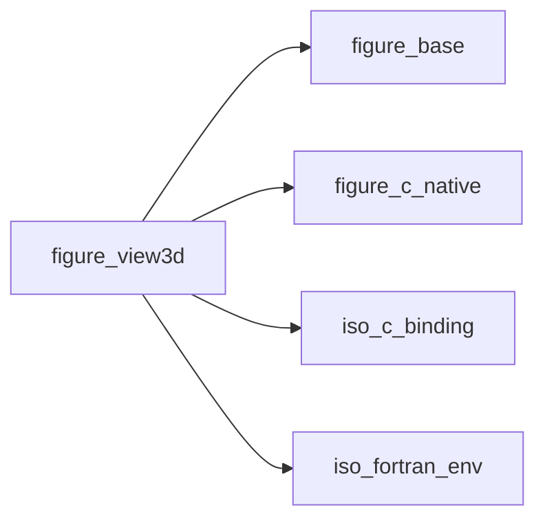

## Contents

- [view3d_object](#view3d-object)
- [fig_view3d_create](#fig-view3d-create)
- [fig_view3d_mesh](#fig-view3d-mesh)
- [fig_view3d_scalar](#fig-view3d-scalar)
- [fig_view3d_style](#fig-view3d-style)
- [fig_view3d_remove](#fig-view3d-remove)
- [fig_view3d_changed](#fig-view3d-changed)
- [fig_view3d_camera](#fig-view3d-camera)
- [fig_view3d_fit](#fig-view3d-fit)
- [fig_view3d_standard](#fig-view3d-standard)
- [fig_view3d_move](#fig-view3d-move)
- [fig_view3d_clip](#fig-view3d-clip)
- [fig_view3d_unclip](#fig-view3d-unclip)
- [fig_view3d_draw](#fig-view3d-draw)
- [fig_view3d_pick](#fig-view3d-pick)
- [fig_view3d_image](#fig-view3d-image)
- [fig_view3d_matrices](#fig-view3d-matrices)
- [fig_view3d_cube](#fig-view3d-cube)
- [fig_view3d_gizmo](#fig-view3d-gizmo)
- [fig_view3d_info](#fig-view3d-info)
- [fig_view3d_cache](#fig-view3d-cache)
- [fig_view3d_destroy](#fig-view3d-destroy)
- [init](#init)
- [destroy](#destroy)
- [set_mesh](#set-mesh)
- [remove](#remove)
- [clear](#clear)
- [changed](#changed)
- [set_camera](#set-camera)
- [get_camera](#get-camera)
- [fit](#fit)
- [view](#view)
- [orbit](#orbit)
- [pan](#pan)
- [zoom](#zoom)
- [clip](#clip)
- [unclip](#unclip)
- [draw](#draw)
- [image](#image)
- [render_info](#render-info)
- [view_cube](#view-cube)
- [view_matrix](#view-matrix)
- [projection_matrix](#projection-matrix)
- [style_new](#style-new)
- [is_initialized](#is-initialized)
- [triangles](#triangles)
- [quads](#quads)
- [surface](#surface)
- [lines](#lines)
- [pick](#pick)
- [hovered](#hovered)
- [clicked](#clicked)
- [gizmo](#gizmo)
- [alive](#alive)
- [points_ok](#points-ok)
- [connectivity_ok](#connectivity-ok)
- [add_mesh](#add-mesh)
- [scalar_set](#scalar-set)
- [flag](#flag)
- [query](#query)

## Variables

| Name | Type | Attributes | Description |
|------|------|------------|-------------|
| `K_TRIANGLES` | integer(kind=c_int) | parameter | Mesh kinds of the native layer. |
| `K_QUADS` | integer(kind=c_int) | parameter | Quads. |
| `K_SURFACE` | integer(kind=c_int) | parameter | Structured surface. |
| `K_LINES` | integer(kind=c_int) | parameter | Lines. |

## Derived Types

### view3d_object

A 3-D view: `v%init`, meshes added, then `v%draw` every frame. Not to be copied (the copy would share the view).

**Components**

| Name | Type | Attributes | Description |
|------|------|------------|-------------|
| `handle` | integer(kind=c_int) |  | Native handle (0: none). |

**Type-Bound Procedures**

| Name | Attributes | Description |
|------|------------|-------------|
| [`init`](/api/src/lib/figure_view3d#init) | pass(self) | Create the view. |
| [`destroy`](/api/src/lib/figure_view3d#destroy) | pass(self) | Release it. |
| [`is_initialized`](/api/src/lib/figure_view3d#is-initialized) | pass(self) | Whether it exists. |
| [`triangles`](/api/src/lib/figure_view3d#triangles) | pass(self) | Add a triangle mesh. |
| [`quads`](/api/src/lib/figure_view3d#quads) | pass(self) | Add a quad mesh. |
| [`surface`](/api/src/lib/figure_view3d#surface) | pass(self) | Add a structured surface. |
| [`lines`](/api/src/lib/figure_view3d#lines) | pass(self) | Add lines. |
| [`set_mesh`](/api/src/lib/figure_view3d#set-mesh) | pass(self) | Change a mesh's scalar or style. |
| [`remove`](/api/src/lib/figure_view3d#remove) | pass(self) | Remove a mesh. |
| [`clear`](/api/src/lib/figure_view3d#clear) | pass(self) | Remove every mesh. |
| [`changed`](/api/src/lib/figure_view3d#changed) | pass(self) | The data of a mesh changed in place. |
| [`set_camera`](/api/src/lib/figure_view3d#set-camera) | pass(self) | Set the camera. |
| [`get_camera`](/api/src/lib/figure_view3d#get-camera) | pass(self) | Read the camera. |
| [`fit`](/api/src/lib/figure_view3d#fit) | pass(self) | Fit the meshes in the view. |
| [`view`](/api/src/lib/figure_view3d#view) | pass(self) | One of the six standard views. |
| [`orbit`](/api/src/lib/figure_view3d#orbit) | pass(self) | Turn the camera around its target. |
| [`pan`](/api/src/lib/figure_view3d#pan) | pass(self) | Move the camera and its target across the screen. |
| [`zoom`](/api/src/lib/figure_view3d#zoom) | pass(self) | Move the camera toward its target. |
| [`clip`](/api/src/lib/figure_view3d#clip) | pass(self) | Add a clipping plane. |
| [`unclip`](/api/src/lib/figure_view3d#unclip) | pass(self) | Remove the clipping planes. |
| [`draw`](/api/src/lib/figure_view3d#draw) | pass(self) | Draw the view as a widget. |
| [`pick`](/api/src/lib/figure_view3d#pick) | pass(self) | The element under a pixel. |
| [`hovered`](/api/src/lib/figure_view3d#hovered) | pass(self) | The element under the mouse. |
| [`clicked`](/api/src/lib/figure_view3d#clicked) | pass(self) | The element clicked. |
| [`image`](/api/src/lib/figure_view3d#image) | pass(self) | The pixels of the last render. |
| [`render_info`](/api/src/lib/figure_view3d#render-info) | pass(self) | Renders so far, the last one's time and size. |
| [`view_cube`](/api/src/lib/figure_view3d#view-cube) | pass(self) | A view cube over the view, turning the camera. |
| [`gizmo`](/api/src/lib/figure_view3d#gizmo) | pass(self) | A gizmo moving a matrix, over the view. |
| [`view_matrix`](/api/src/lib/figure_view3d#view-matrix) | pass(self) | The camera's view matrix. |
| [`projection_matrix`](/api/src/lib/figure_view3d#projection-matrix) | pass(self) | The camera's projection matrix. |

## Interfaces

### fig_view3d_create

### fig_view3d_mesh

### fig_view3d_scalar

### fig_view3d_style

### fig_view3d_remove

### fig_view3d_changed

### fig_view3d_camera

### fig_view3d_fit

### fig_view3d_standard

### fig_view3d_move

### fig_view3d_clip

### fig_view3d_unclip

### fig_view3d_draw

### fig_view3d_pick

### fig_view3d_image

### fig_view3d_matrices

### fig_view3d_cube

### fig_view3d_gizmo

### fig_view3d_info

### fig_view3d_cache

### fig_view3d_destroy

## Subroutines

### init

Create the view (an existing one is destroyed first). After `app%init*`. Statuses: `FIG_ERR_ARGUMENT` for
 `threads` outside [1, 16]; `FIG_ERR_STATE` from a task. The same in every mode.

**Attributes**: recursive

```fortran
subroutine init(self, threads, fast_moves, lighting, background, stat)
```

**Arguments**

| Name | Type | Intent | Attributes | Description |
|------|------|--------|------------|-------------|
| `self` | class([view3d_object](/api/src/lib/figure_view3d#view3d-object)) | inout |  | View. |
| `threads` | integer(kind=int32) | in | optional | Threads rendering blocks of rows, in [1, 16] (default 1). |
| `fast_moves` | logical | in | optional | Half resolution while the user moves the camera (default true). |
| `lighting` | logical | in | optional | Shade by a light at the eye (default true); off: the colours as given. |
| `background` | real(kind=real64) | in | target, optional | Background `[r, g, b]` in [0, 1] (default: the style's window background). |
| `stat` | integer(kind=int32) | out | optional | Status. |

**Call graph**

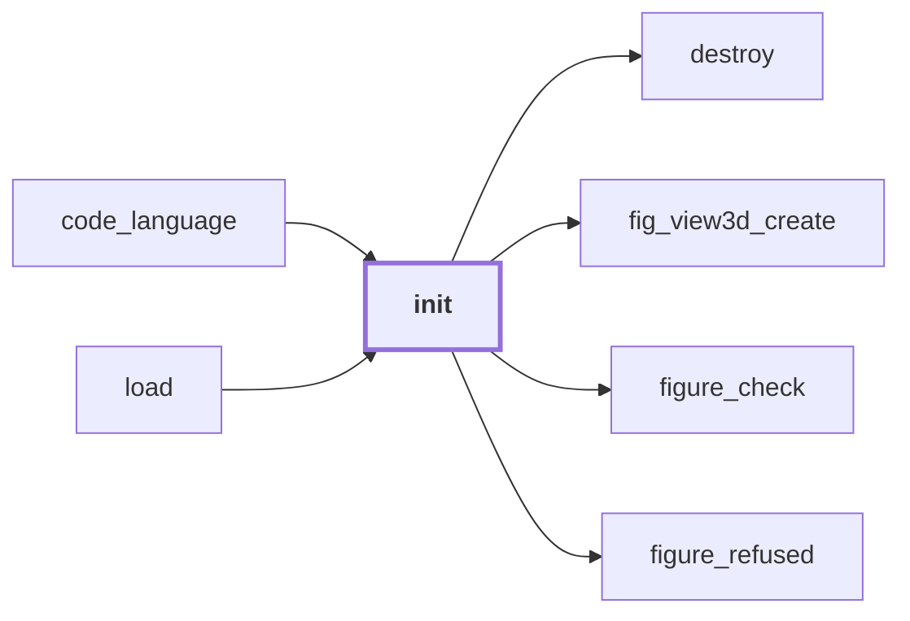

### destroy

Release the view and its textures (safe in any state; the program's arrays are not touched).

```fortran
subroutine destroy(self)
```

**Arguments**

| Name | Type | Intent | Attributes | Description |
|------|------|--------|------------|-------------|
| `self` | class([view3d_object](/api/src/lib/figure_view3d#view3d-object)) | inout |  | View. |

**Call graph**

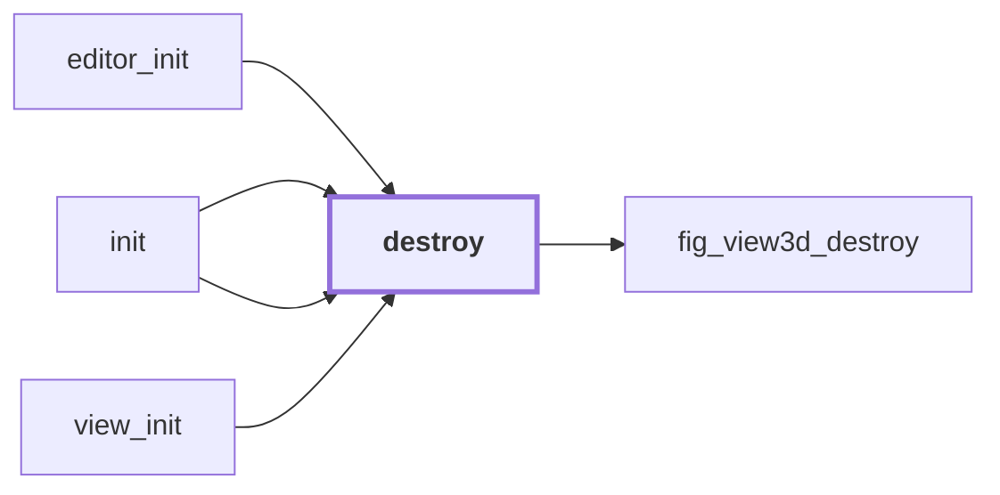

### set_mesh

Change a mesh: its scalar (per vertex, per cell, or none), colormap, range (`vmin`, `vmax` together, or
 `auto_range`: the data's), colour, edges and their colour, shading, visibility. Arguments absent: unchanged. For
 a structured surface, pass its scalar as a contiguous array of `ni*nj` (or `(ni-1)*(nj-1)`) values. Statuses:
 `FIG_ERR_ARGUMENT` for an unknown mesh, a colormap name or a scalar size, `vmax <= vmin` or one of them alone.

**Attributes**: recursive

```fortran
subroutine set_mesh(self, mesh, scalar, cell_scalar, no_scalar, colormap, vmin, vmax, auto_range, color, edges, edge_color, flat, visible, stat)
```

**Arguments**

| Name | Type | Intent | Attributes | Description |
|------|------|--------|------------|-------------|
| `self` | class([view3d_object](/api/src/lib/figure_view3d#view3d-object)) | in |  | View. |
| `mesh` | integer(kind=int32) | in |  | Mesh id. |
| `scalar` | real(kind=real64) | in | target, optional | A value per vertex (node). |
| `cell_scalar` | real(kind=real64) | in | target, optional | A value per cell. |
| `no_scalar` | logical | in | optional | True: no scalar (the mesh's colour). |
| `colormap` | character(len=*) | in | optional | Colormap name. |
| `vmin` | real(kind=real64) | in | optional | The scalar mapped to the map's start. |
| `vmax` | real(kind=real64) | in | optional | ... to its end. |
| `auto_range` | logical | in | optional | True: the data's range (the default). |
| `color` | real(kind=real64) | in | target, optional | Colour `[r, g, b]` in [0, 1]. |
| `edges` | logical | in | optional | Draw the edges. |
| `edge_color` | real(kind=real64) | in | target, optional | Edges' colour (default near black). |
| `flat` | logical | in | optional | Flat shading. |
| `visible` | logical | in | optional | Drawn (default true). |
| `stat` | integer(kind=int32) | out | optional | Status. |

**Call graph**

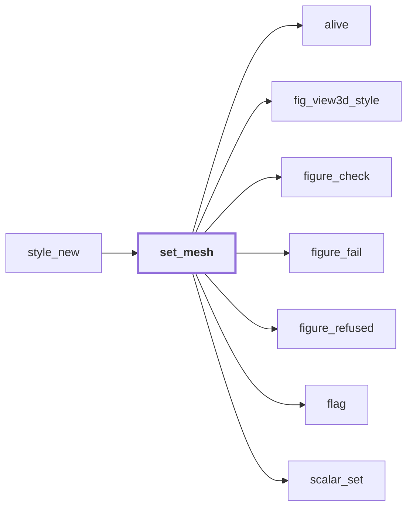

### remove

Remove a mesh (the program's arrays are not touched). Status: `FIG_ERR_ARGUMENT` for an unknown mesh.

**Attributes**: recursive

```fortran
subroutine remove(self, mesh, stat)
```

**Arguments**

| Name | Type | Intent | Attributes | Description |
|------|------|--------|------------|-------------|
| `self` | class([view3d_object](/api/src/lib/figure_view3d#view3d-object)) | in |  | View. |
| `mesh` | integer(kind=int32) | in |  | Mesh id. |
| `stat` | integer(kind=int32) | out | optional | Status. |

**Call graph**

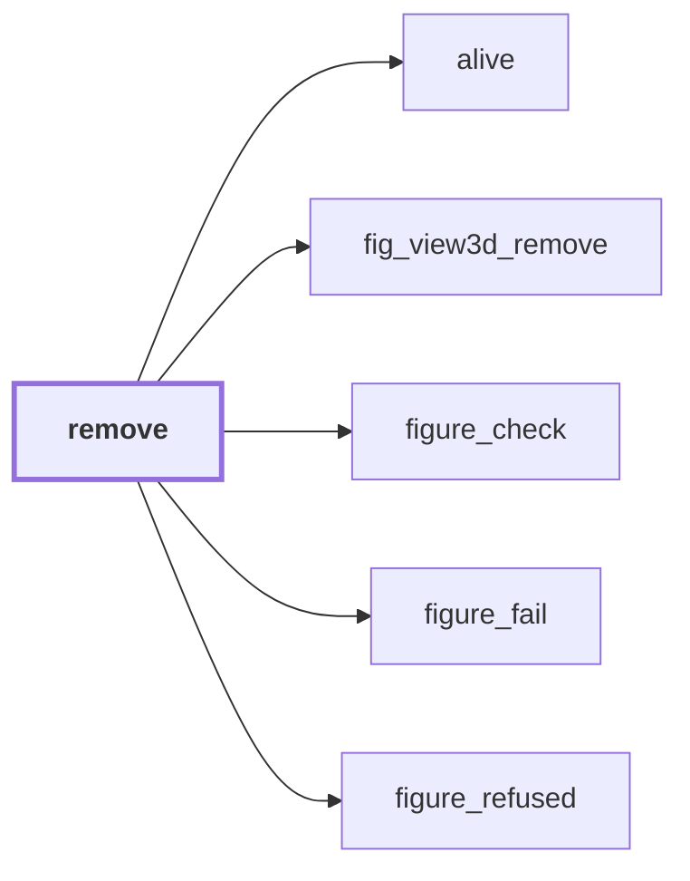

### clear

Remove every mesh.

**Attributes**: recursive

```fortran
subroutine clear(self, stat)
```

**Arguments**

| Name | Type | Intent | Attributes | Description |
|------|------|--------|------------|-------------|
| `self` | class([view3d_object](/api/src/lib/figure_view3d#view3d-object)) | in |  | View. |
| `stat` | integer(kind=int32) | out | optional | Status. |

**Call graph**

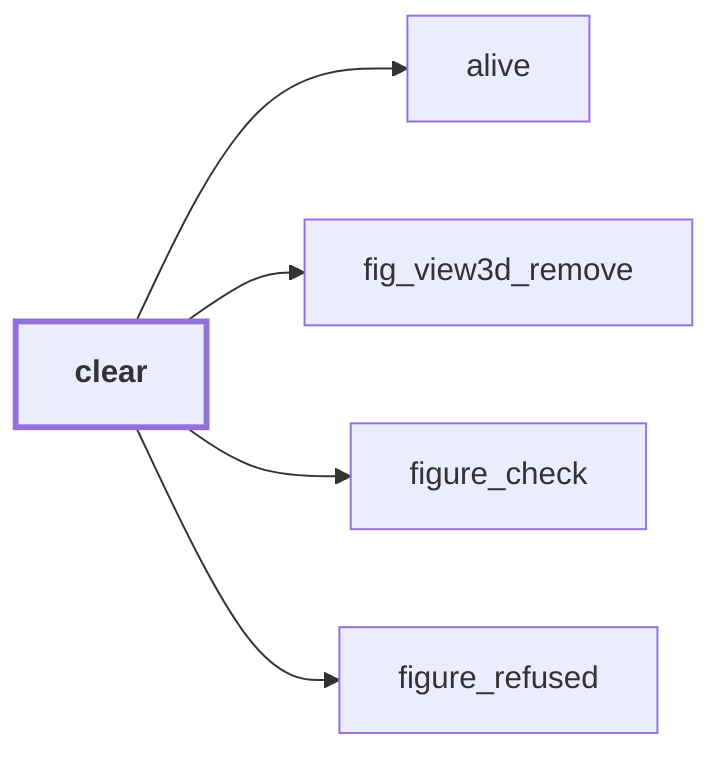

### changed

The data of `mesh` (absent: of every mesh) changed in place: its normals, range and connectivity checks are
 derived again, and the view is rendered at the next draw. Status: `FIG_ERR_ARGUMENT` for an unknown mesh or a
 connectivity index now out of range.

**Attributes**: recursive

```fortran
subroutine changed(self, mesh, stat)
```

**Arguments**

| Name | Type | Intent | Attributes | Description |
|------|------|--------|------------|-------------|
| `self` | class([view3d_object](/api/src/lib/figure_view3d#view3d-object)) | in |  | View. |
| `mesh` | integer(kind=int32) | in | optional | Mesh id. |
| `stat` | integer(kind=int32) | out | optional | Status. |

**Call graph**

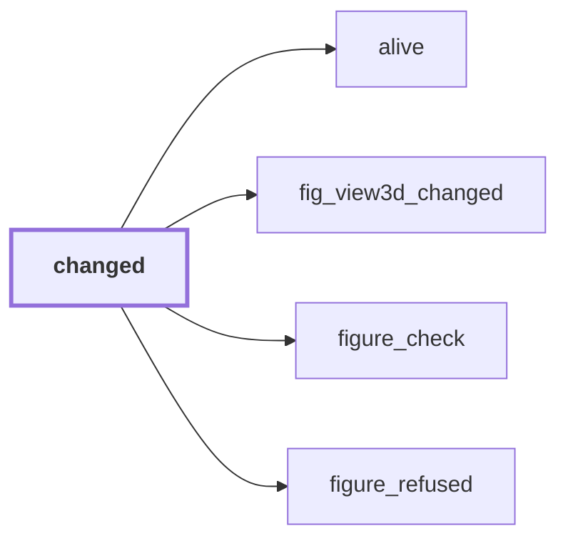

### set_camera

Set the camera: it looks at `target` from `distance` away, from the direction given by `azimuth` (around z, from
 +x toward +y) and `elevation` (above the x-y plane, in [-90, 90]), with a vertical field of view `fov`; z is up.
 Absent arguments are unchanged (a camera never set is first fitted to the meshes). Statuses: `FIG_ERR_ARGUMENT`
 for `distance <= 0`, `fov` outside (0, 180) or `elevation` outside [-90, 90].

**Attributes**: recursive

```fortran
subroutine set_camera(self, target, distance, azimuth, elevation, fov, stat)
```

**Arguments**

| Name | Type | Intent | Attributes | Description |
|------|------|--------|------------|-------------|
| `self` | class([view3d_object](/api/src/lib/figure_view3d#view3d-object)) | in |  | View. |
| `target` | real(kind=real64) | in | optional | The point looked at [world units]. |
| `distance` | real(kind=real64) | in | optional | From the target [world units]. |
| `azimuth` | real(kind=real64) | in | optional | [degrees]. |
| `elevation` | real(kind=real64) | in | optional | [degrees]. |
| `fov` | real(kind=real64) | in | optional | Vertical field of view [degrees] (default 30). |
| `stat` | integer(kind=int32) | out | optional | Status. |

**Call graph**

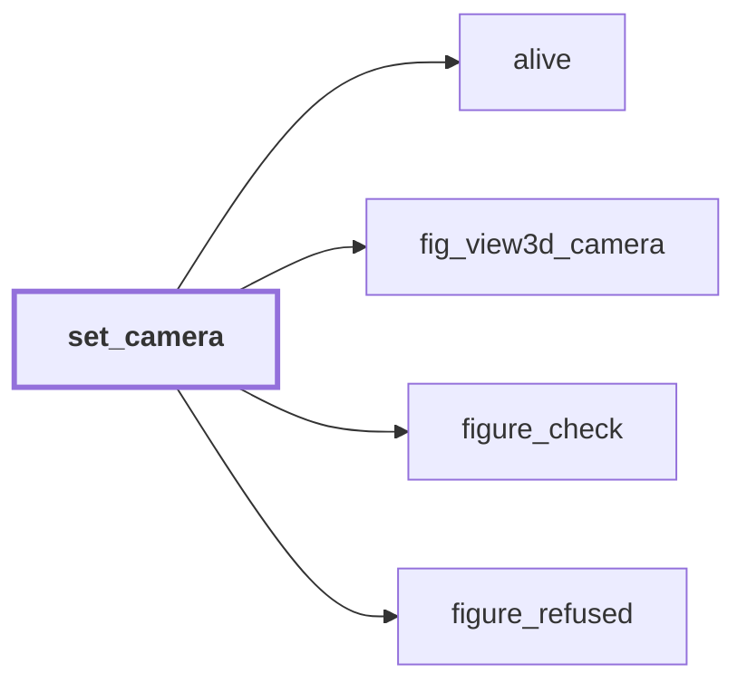

### get_camera

Read the camera (as `set_camera` describes it; a camera never set is first fitted to the meshes).

**Attributes**: recursive

```fortran
subroutine get_camera(self, target, distance, azimuth, elevation, fov, stat)
```

**Arguments**

| Name | Type | Intent | Attributes | Description |
|------|------|--------|------------|-------------|
| `self` | class([view3d_object](/api/src/lib/figure_view3d#view3d-object)) | in |  | View. |
| `target` | real(kind=real64) | out | optional | The point looked at. |
| `distance` | real(kind=real64) | out | optional | From the target. |
| `azimuth` | real(kind=real64) | out | optional | [degrees], in [-180, 180]. |
| `elevation` | real(kind=real64) | out | optional | [degrees]. |
| `fov` | real(kind=real64) | out | optional | [degrees]. |
| `stat` | integer(kind=int32) | out | optional | Status. |

**Call graph**

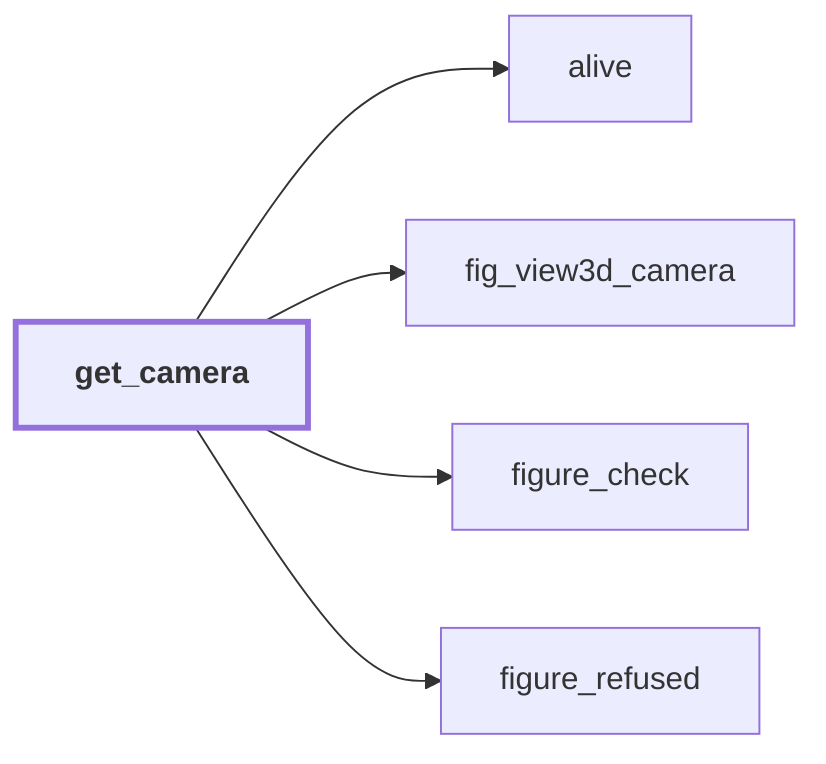

### fit

Aim at the centre of the visible meshes' bounding box, from the distance at which their bounding sphere fills the
 view (the direction is kept). Also on a double click in the view.

**Attributes**: recursive

```fortran
subroutine fit(self, stat)
```

**Arguments**

| Name | Type | Intent | Attributes | Description |
|------|------|--------|------------|-------------|
| `self` | class([view3d_object](/api/src/lib/figure_view3d#view3d-object)) | in |  | View. |
| `stat` | integer(kind=int32) | out | optional | Status. |

**Call graph**

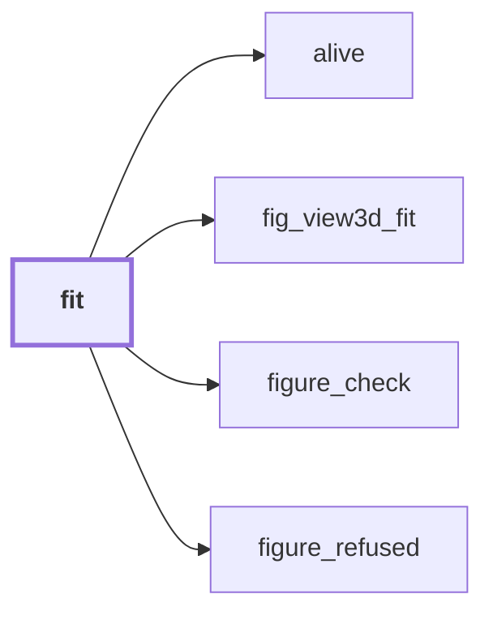

### view

A standard view, fitted: `'+x'` puts the eye on the +x side looking toward -x (z up), likewise `'-x'`, `'+y'`,
 `'-y'`; `'+z'` looks down with x right and y up, `'-z'` looks up with x right. Status: `FIG_ERR_ARGUMENT` for
 another name.

**Attributes**: recursive

```fortran
subroutine view(self, name, stat)
```

**Arguments**

| Name | Type | Intent | Attributes | Description |
|------|------|--------|------------|-------------|
| `self` | class([view3d_object](/api/src/lib/figure_view3d#view3d-object)) | in |  | View. |
| `name` | character(len=*) | in |  | `'+x'`, `'-x'`, `'+y'`, `'-y'`, `'+z'` or `'-z'`. |
| `stat` | integer(kind=int32) | out | optional | Status. |

**Call graph**

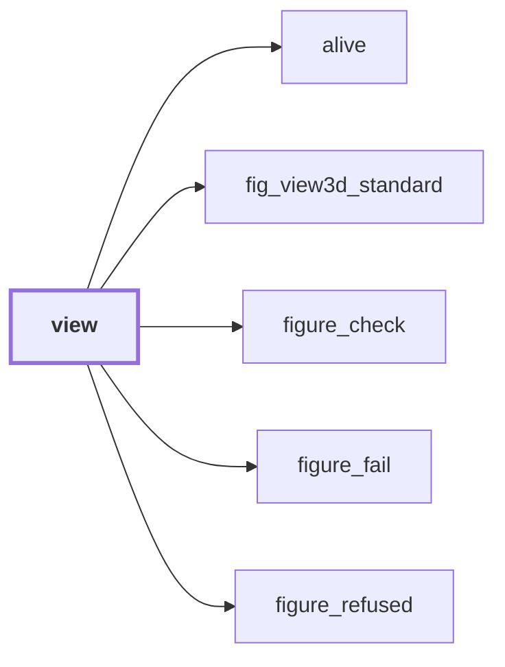

### orbit

Turn the camera around its target by `azimuth` and `elevation` [degrees] (the elevation is kept in [-90, 90]); as
 a drag with the left button in the view.

**Attributes**: recursive

```fortran
subroutine orbit(self, azimuth, elevation, stat)
```

**Arguments**

| Name | Type | Intent | Attributes | Description |
|------|------|--------|------------|-------------|
| `self` | class([view3d_object](/api/src/lib/figure_view3d#view3d-object)) | in |  | View. |
| `azimuth` | real(kind=real64) | in |  | Change of azimuth [degrees]. |
| `elevation` | real(kind=real64) | in | optional | Change of elevation [degrees] (default 0). |
| `stat` | integer(kind=int32) | out | optional | Status. |

**Call graph**

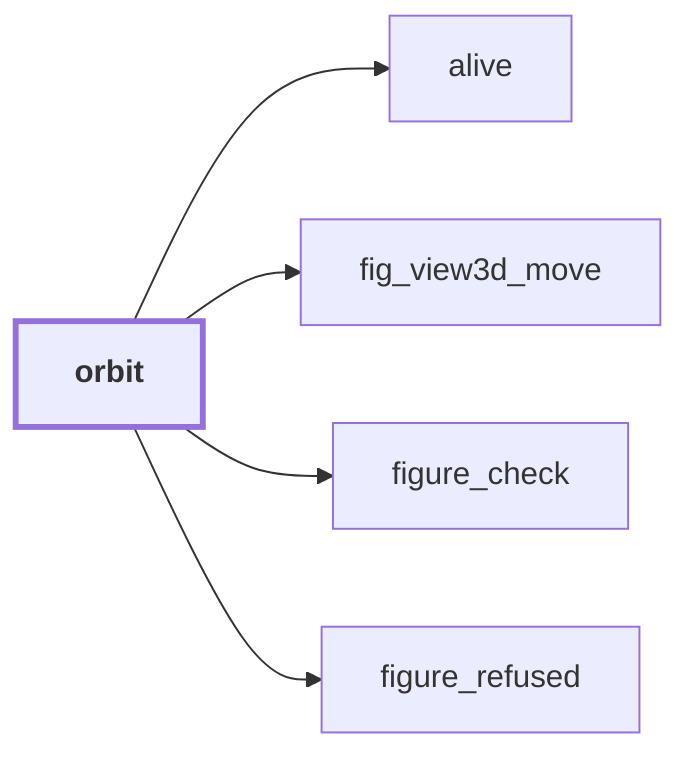

### pan

Move the camera and its target along the screen's right and up directions [world units]; as a drag with the
 right or middle button (or shift and the left one) in the view.

**Attributes**: recursive

```fortran
subroutine pan(self, right, up, stat)
```

**Arguments**

| Name | Type | Intent | Attributes | Description |
|------|------|--------|------------|-------------|
| `self` | class([view3d_object](/api/src/lib/figure_view3d#view3d-object)) | in |  | View. |
| `right` | real(kind=real64) | in |  | Along the screen's right [world units]. |
| `up` | real(kind=real64) | in |  | Along the screen's up [world units]. |
| `stat` | integer(kind=int32) | out | optional | Status. |

**Call graph**

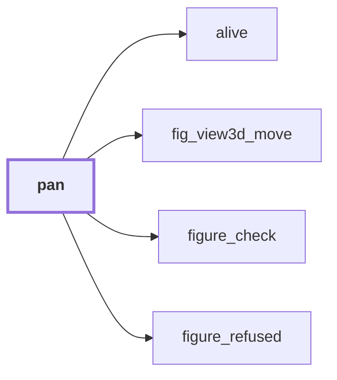

### zoom

Divide the camera's distance by `factor` (> 1 closer); the wheel in the view zooms by 1.1 per step. Status:
 `FIG_ERR_ARGUMENT` for `factor <= 0`.

**Attributes**: recursive

```fortran
subroutine zoom(self, factor, stat)
```

**Arguments**

| Name | Type | Intent | Attributes | Description |
|------|------|--------|------------|-------------|
| `self` | class([view3d_object](/api/src/lib/figure_view3d#view3d-object)) | in |  | View. |
| `factor` | real(kind=real64) | in |  | Zoom factor. |
| `stat` | integer(kind=int32) | out | optional | Status. |

**Call graph**

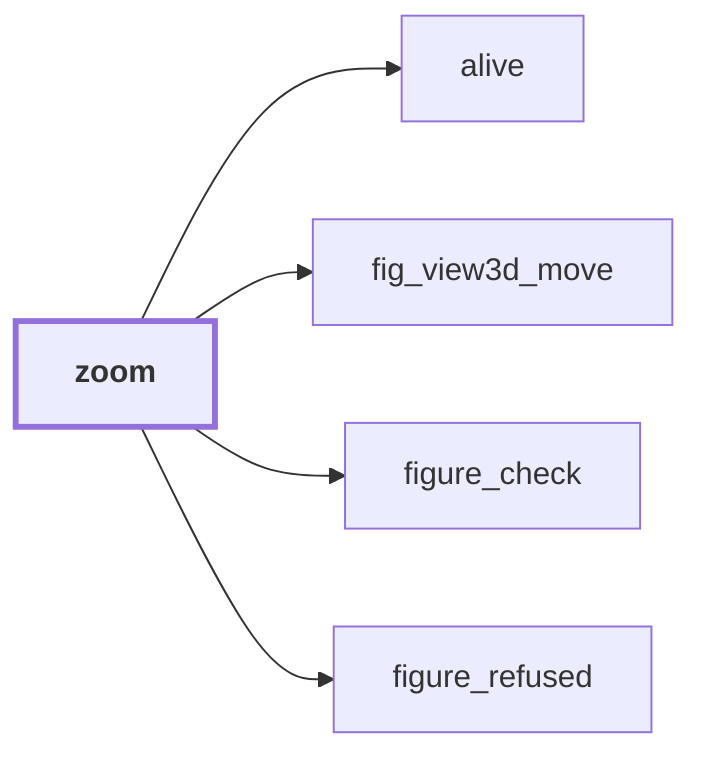

### clip

Add a clipping plane through `point`: what lies where `(x - point) . normal >= 0` is kept, the rest is cut away
 (surfaces cut exactly per pixel, lines per segment). At most 6 planes. Status: `FIG_ERR_ARGUMENT` for a seventh
 plane or a zero normal.

**Attributes**: recursive

```fortran
subroutine clip(self, normal, point, stat)
```

**Arguments**

| Name | Type | Intent | Attributes | Description |
|------|------|--------|------------|-------------|
| `self` | class([view3d_object](/api/src/lib/figure_view3d#view3d-object)) | in |  | View. |
| `normal` | real(kind=real64) | in |  | Towards the part kept. |
| `point` | real(kind=real64) | in |  | A point of the plane [world units]. |
| `stat` | integer(kind=int32) | out | optional | Status. |

**Call graph**

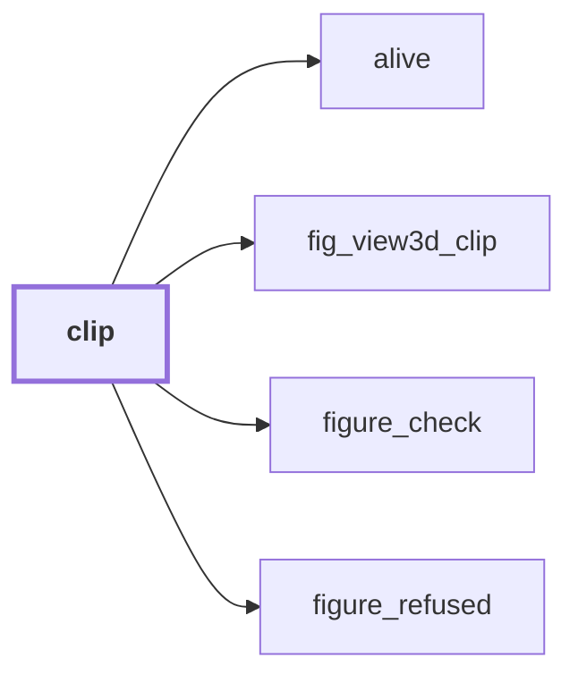

### unclip

Remove every clipping plane.

**Attributes**: recursive

```fortran
subroutine unclip(self, stat)
```

**Arguments**

| Name | Type | Intent | Attributes | Description |
|------|------|--------|------------|-------------|
| `self` | class([view3d_object](/api/src/lib/figure_view3d#view3d-object)) | in |  | View. |
| `stat` | integer(kind=int32) | out | optional | Status. |

**Call graph**

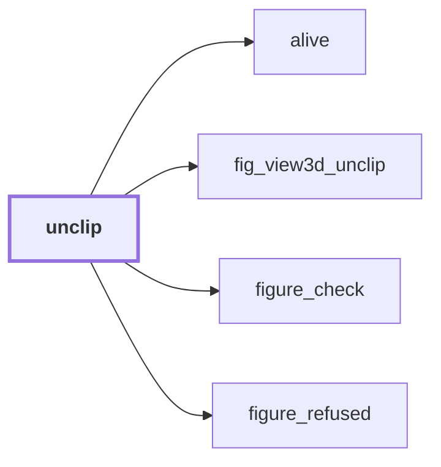

### draw

Draw the view as a widget at the cursor, inside a window: `width` x `height` pixels (0: the available region;
 negative: up to that distance from its edge). It is rendered only when something changed since the last draw.
 The mouse in the view: left drag orbits, right or middle drag (or shift and left) pans, the wheel zooms, a double
 click fits. While the user moves the camera, the view is rendered at half resolution (unless `init`'s
 `fast_moves=.false.`), until the button is released or a frame has no wheel step. Modes: the same pixels in every
 mode; in remote mode each render is sent to the browser as a texture: JPEG while the camera moves, exact once it
 is still (`init_remote`'s `lossy`). Statuses: `FIG_ERR_STATE` before `init` and from a task.

**Attributes**: recursive

```fortran
subroutine draw(self, id, width, height, stat)
```

**Arguments**

| Name | Type | Intent | Attributes | Description |
|------|------|--------|------------|-------------|
| `self` | class([view3d_object](/api/src/lib/figure_view3d#view3d-object)) | in |  | View. |
| `id` | character(len=*) | in |  | Widget id (unique in the window). |
| `width` | real(kind=real64) | in | optional | Width [pixels] (default 0: the available width). |
| `height` | real(kind=real64) | in | optional | Height [pixels] (default 0: the available height). |
| `stat` | integer(kind=int32) | out | optional | Status. |

**Call graph**

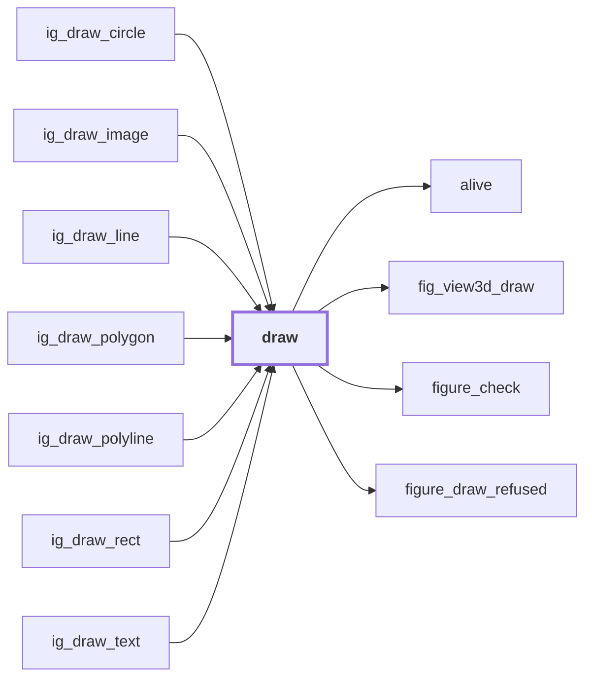

### image

The pixels of the last render, `rgba(4, width, height)` (as `texture_object%update` takes them; half the view's
 size if it was rendered while moving), unallocated before the first render.

**Attributes**: recursive

```fortran
subroutine image(self, rgba, stat)
```

**Arguments**

| Name | Type | Intent | Attributes | Description |
|------|------|--------|------------|-------------|
| `self` | class([view3d_object](/api/src/lib/figure_view3d#view3d-object)) | in |  | View. |
| `rgba` | integer(kind=int8) | out | allocatable, target | Pixels. |
| `stat` | integer(kind=int32) | out | optional | Status. |

**Call graph**

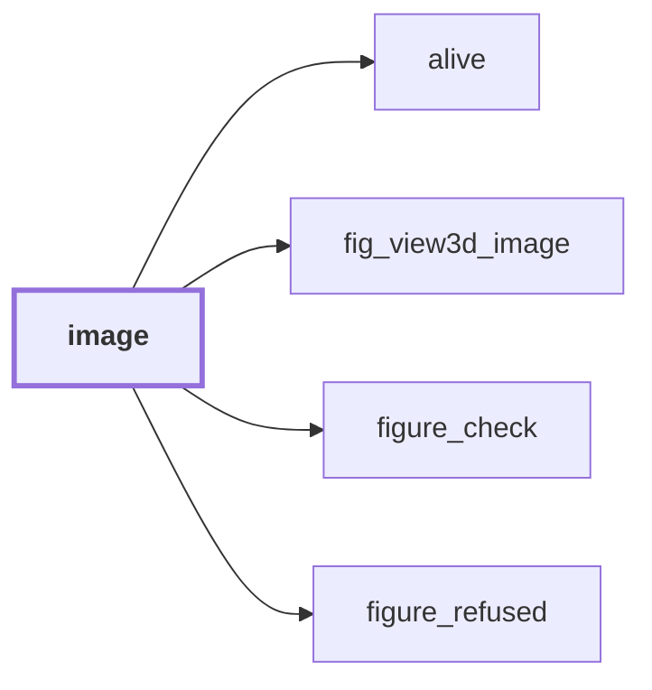

### render_info

The renders so far, the last one's time [ms] and size [pixels], whether it was at half resolution, and the bytes
 the per-render caches hold (64 a vertex, and the bands' triangle lists; freed after 30 draws without a render).

**Attributes**: recursive

```fortran
subroutine render_info(self, count, milliseconds, width, height, half, cache_bytes, stat)
```

**Arguments**

| Name | Type | Intent | Attributes | Description |
|------|------|--------|------------|-------------|
| `self` | class([view3d_object](/api/src/lib/figure_view3d#view3d-object)) | in |  | View. |
| `count` | integer(kind=int32) | out | optional | Renders since `init`. |
| `milliseconds` | real(kind=real64) | out | optional | The last render's time [ms]. |
| `width` | integer(kind=int32) | out | optional | Its width [pixels]. |
| `height` | integer(kind=int32) | out | optional | Its height [pixels]. |
| `half` | logical | out | optional | At half resolution (the camera was moving). |
| `cache_bytes` | integer(kind=int64) | out | optional | The per-render caches' bytes. |
| `stat` | integer(kind=int32) | out | optional | Status. |

**Call graph**

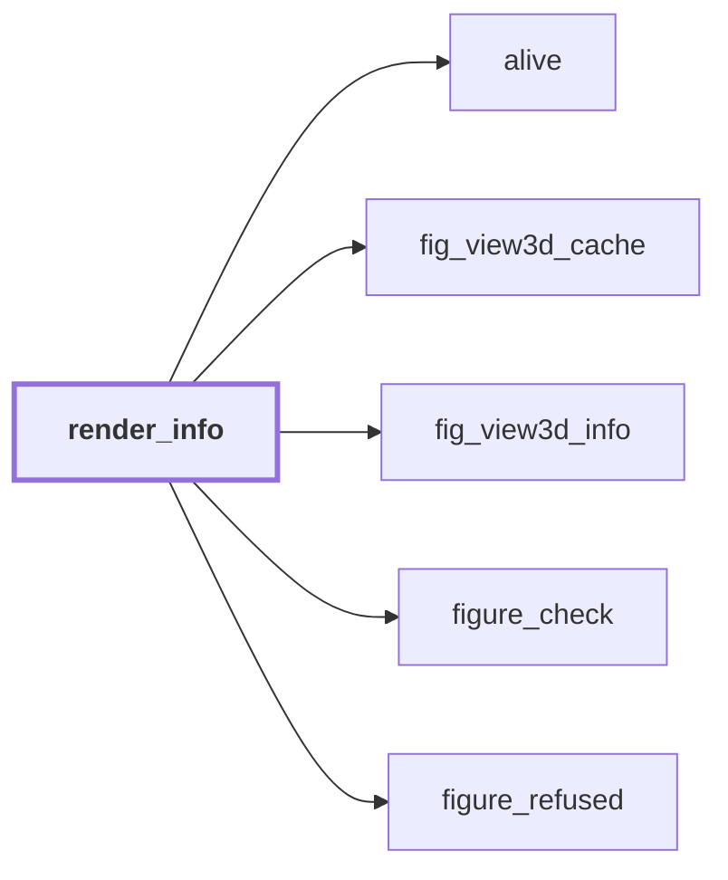

### view_cube

A view cube (ImGuizmo's `ViewManipulate`) in a corner of the view, drawn over its image: call it after `draw`,
 in the same window and frame. A click on a face turns the camera to look at it (the eye on that side), a click on
 an edge or a corner between the faces it touches, over 40 frames; a drag on the cube orbits the camera. The
 camera's target and distance are kept. The faces take the gizmos' axis colours: red the two of x, green of y,
 blue of z. While the pointer is over the cube, the view does not take the mouse. Polled: the camera changes, as
 `get_camera` reads. Statuses: `FIG_ERR_STATE` if the view was not drawn in this frame and window, outside a
 frame and from a task; `FIG_ERR_ARGUMENT` for a size not above 0 or an unknown corner. The same in every mode.

**Attributes**: recursive

```fortran
subroutine view_cube(self, size, corner, stat)
```

**Arguments**

| Name | Type | Intent | Attributes | Description |
|------|------|--------|------------|-------------|
| `self` | class([view3d_object](/api/src/lib/figure_view3d#view3d-object)) | in |  | View. |
| `size` | real(kind=real64) | in | optional | Side [pixels] (default 96; at most the view's). |
| `corner` | character(len=*) | in | optional | `'top-right'` (default), `'top-left'`, `'bottom-right'`, `'bottom-left'`. |
| `stat` | integer(kind=int32) | out | optional | Status. |

**Call graph**

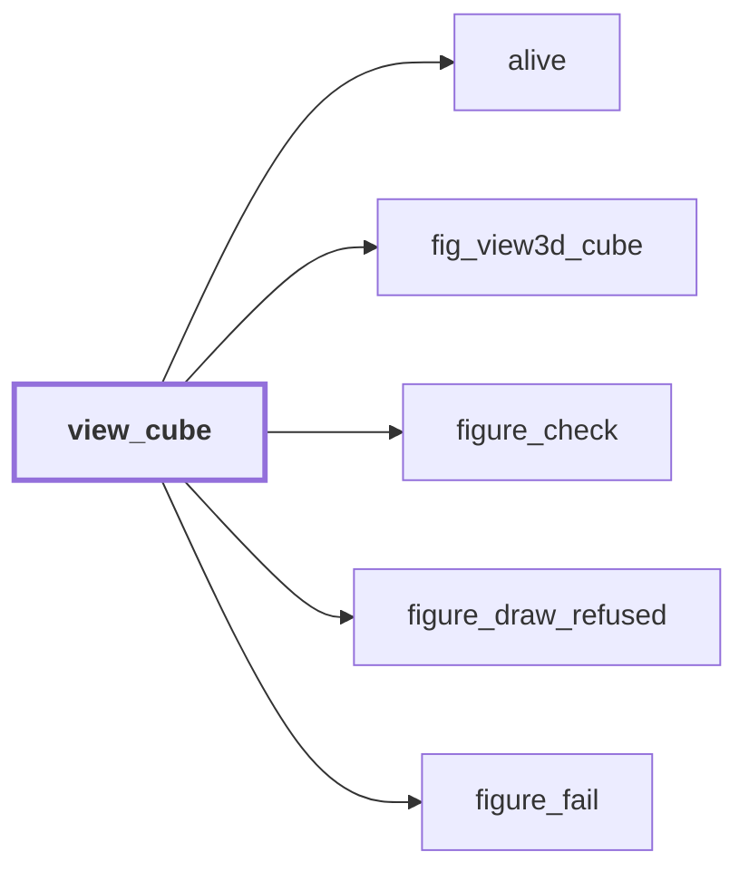

### view_matrix

The camera's view matrix: world to eye coordinates, column-major 4x4 with column vectors (OpenGL's convention,
 and ImGuizmo's): `m(1:3, 1:3)` the rotation, whose rows are the screen's right, up and the direction from the
 target to the eye, `m(1:3, 4)` the translation; the eye looks down its -z. As the camera is now (`set_camera`,
 `orbit`, a view cube); a camera never set is first fitted to the meshes.

**Attributes**: recursive

```fortran
subroutine view_matrix(self, m, stat)
```

**Arguments**

| Name | Type | Intent | Attributes | Description |
|------|------|--------|------------|-------------|
| `self` | class([view3d_object](/api/src/lib/figure_view3d#view3d-object)) | in |  | View. |
| `m` | real(kind=real64) | out |  | View matrix. |
| `stat` | integer(kind=int32) | out | optional | Status. |

**Call graph**

```mermaid
flowchart LR
  view_matrix["view_matrix"] --> alive["alive"]
  view_matrix["view_matrix"] --> fig_view3d_matrices["fig_view3d_matrices"]
  view_matrix["view_matrix"] --> figure_check["figure_check"]
  view_matrix["view_matrix"] --> figure_refused["figure_refused"]
  classDef focus stroke-width:3px,font-weight:bold
  class view_matrix focus
  click figure_refused href "figure_base.html#figure-refused" "figure_refused"
  click alive href "#alive" "alive"
  click figure_check href "figure_base.html#figure-check" "figure_check"
  click fig_view3d_matrices href "#fig-view3d-matrices" "fig_view3d_matrices"
```

### projection_matrix

The camera's perspective projection: eye to clip coordinates, column-major 4x4 (OpenGL's convention: clip z in
 [-w, w], `m(4, 3)` = -1), for the view's size at its last `draw` (1 x 1 before the first) and its vertical field
 of view; the near and far planes enclose the visible meshes' bounding sphere, so they change with the meshes and
 the camera. The image is `projection_matrix * view_matrix` applied to world points.

**Attributes**: recursive

```fortran
subroutine projection_matrix(self, m, stat)
```

**Arguments**

| Name | Type | Intent | Attributes | Description |
|------|------|--------|------------|-------------|
| `self` | class([view3d_object](/api/src/lib/figure_view3d#view3d-object)) | in |  | View. |
| `m` | real(kind=real64) | out |  | Projection matrix. |
| `stat` | integer(kind=int32) | out | optional | Status. |

**Call graph**

```mermaid
flowchart LR
  projection_matrix["projection_matrix"] --> alive["alive"]
  projection_matrix["projection_matrix"] --> fig_view3d_matrices["fig_view3d_matrices"]
  projection_matrix["projection_matrix"] --> figure_check["figure_check"]
  projection_matrix["projection_matrix"] --> figure_refused["figure_refused"]
  classDef focus stroke-width:3px,font-weight:bold
  class projection_matrix focus
  click figure_refused href "figure_base.html#figure-refused" "figure_refused"
  click alive href "#alive" "alive"
  click figure_check href "figure_base.html#figure-check" "figure_check"
  click fig_view3d_matrices href "#fig-view3d-matrices" "fig_view3d_matrices"
```

### style_new

The scalars and style given at a mesh's creation; the mesh is removed again on a failure.

```fortran
subroutine style_new(self, mesh, scalar, cell_scalar, colormap, color, edges, flat, stat)
```

**Arguments**

| Name | Type | Intent | Attributes | Description |
|------|------|--------|------------|-------------|
| `self` | class([view3d_object](/api/src/lib/figure_view3d#view3d-object)) | in |  | View. |
| `mesh` | integer(kind=int32) | inout |  | Mesh id (0 after a failure). |
| `scalar` | real(kind=real64) | in | target, optional | A value per vertex. |
| `cell_scalar` | real(kind=real64) | in | target, optional | A value per cell. |
| `colormap` | character(len=*) | in | optional | Colormap. |
| `color` | real(kind=real64) | in | optional | Colour. |
| `edges` | logical | in | optional | Edges. |
| `flat` | logical | in | optional | Flat shading. |
| `stat` | integer(kind=int32) | out | optional | Status. |

**Call graph**

```mermaid
flowchart LR
  lines["lines"] --> style_new["style_new"]
  quads["quads"] --> style_new["style_new"]
  surface["surface"] --> style_new["style_new"]
  triangles["triangles"] --> style_new["style_new"]
  style_new["style_new"] --> fig_view3d_remove["fig_view3d_remove"]
  style_new["style_new"] --> figure_check["figure_check"]
  style_new["style_new"] --> figure_fail["figure_fail"]
  style_new["style_new"] --> scalar_set["scalar_set"]
  style_new["style_new"] --> set_mesh["set_mesh"]
  classDef focus stroke-width:3px,font-weight:bold
  class style_new focus
  click lines href "#lines" "lines"
  click quads href "#quads" "quads"
  click surface href "#surface" "surface"
  click triangles href "#triangles" "triangles"
  click figure_fail href "figure_base.html#figure-fail" "figure_fail"
  click scalar_set href "#scalar-set" "scalar_set"
  click set_mesh href "#set-mesh" "set_mesh"
  click fig_view3d_remove href "#fig-view3d-remove" "fig_view3d_remove"
  click figure_check href "figure_base.html#figure-check" "figure_check"
```

## Functions

### is_initialized

Whether the view exists.

**Attributes**: pure

**Returns**: `logical`

```fortran
function is_initialized(self) result(yes)
```

**Arguments**

| Name | Type | Intent | Attributes | Description |
|------|------|--------|------------|-------------|
| `self` | class([view3d_object](/api/src/lib/figure_view3d#view3d-object)) | in |  | View. |

**Call graph**

```mermaid
flowchart LR
  ig_canvas["ig_canvas"] --> is_initialized["is_initialized"]
  ig_draw_image["ig_draw_image"] --> is_initialized["is_initialized"]
  ip3_image["ip3_image"] --> is_initialized["is_initialized"]
  ip_image["ip_image"] --> is_initialized["is_initialized"]
  classDef focus stroke-width:3px,font-weight:bold
  class is_initialized focus
  click ig_canvas href "figure_canvas.html#ig-canvas" "ig_canvas"
  click ig_draw_image href "figure_canvas.html#ig-draw-image" "ig_draw_image"
  click ip3_image href "figure_implot3d.html#ip3-image" "ip3_image"
  click ip_image href "figure_implot.html#ip-image" "ip_image"
```

### triangles

Add a mesh of triangles: vertex `k` at `xyz(:, k)`, triangle `t` joining the vertices `tri(:, t)` (from 1).
 Returns the mesh's id (from 1; 0 on a failure). The arrays are kept by address (see the module's notes on data in
 place). Statuses: `FIG_ERR_ARGUMENT` for a non-contiguous array, an index outside [1, size(xyz, 2)] or a scalar
 of the wrong size; `FIG_ERR_STATE` before `init` and from a task.

**Attributes**: recursive

**Returns**: `integer(kind=int32)`

```fortran
function triangles(self, xyz, tri, scalar, cell_scalar, colormap, color, edges, flat, stat) result(mesh)
```

**Arguments**

| Name | Type | Intent | Attributes | Description |
|------|------|--------|------------|-------------|
| `self` | class([view3d_object](/api/src/lib/figure_view3d#view3d-object)) | in |  | View. |
| `xyz` | real(kind=real64) | in | target | Vertices, `xyz(3, nv)`. |
| `tri` | integer(kind=int32) | in | target | Triangles, `tri(3, nt)`. |
| `scalar` | real(kind=real64) | in | target, optional | A value per vertex, by the colormap. |
| `cell_scalar` | real(kind=real64) | in | target, optional | A value per triangle (one colour each). |
| `colormap` | character(len=*) | in | optional | Colormap name (default `'cividis'`). |
| `color` | real(kind=real64) | in | optional | Colour without a scalar `[r, g, b]`. |
| `edges` | logical | in | optional | Draw the triangles' edges (default false). |
| `flat` | logical | in | optional | Flat shading (default false: smooth). |
| `stat` | integer(kind=int32) | out | optional | Status. |

**Call graph**

```mermaid
flowchart LR
  triangles["triangles"] --> add_mesh["add_mesh"]
  triangles["triangles"] --> connectivity_ok["connectivity_ok"]
  triangles["triangles"] --> figure_refused["figure_refused"]
  triangles["triangles"] --> style_new["style_new"]
  classDef focus stroke-width:3px,font-weight:bold
  class triangles focus
  click figure_refused href "figure_base.html#figure-refused" "figure_refused"
  click connectivity_ok href "#connectivity-ok" "connectivity_ok"
  click add_mesh href "#add-mesh" "add_mesh"
  click style_new href "#style-new" "style_new"
```

### quads

Add a mesh of quadrilaterals `quad(4, nq)` (vertices from 1, in order around each), each drawn as two triangles;
 as `triangles` otherwise. A picked element is a quad.

**Attributes**: recursive

**Returns**: `integer(kind=int32)`

```fortran
function quads(self, xyz, quad, scalar, cell_scalar, colormap, color, edges, flat, stat) result(mesh)
```

**Arguments**

| Name | Type | Intent | Attributes | Description |
|------|------|--------|------------|-------------|
| `self` | class([view3d_object](/api/src/lib/figure_view3d#view3d-object)) | in |  | View. |
| `xyz` | real(kind=real64) | in | target | Vertices, `xyz(3, nv)`. |
| `quad` | integer(kind=int32) | in | target | Quads, `quad(4, nq)`. |
| `scalar` | real(kind=real64) | in | target, optional | A value per vertex. |
| `cell_scalar` | real(kind=real64) | in | target, optional | A value per quad. |
| `colormap` | character(len=*) | in | optional | Colormap name (default `'cividis'`). |
| `color` | real(kind=real64) | in | optional | Colour without a scalar `[r, g, b]`. |
| `edges` | logical | in | optional | Draw the quads' edges (default false). |
| `flat` | logical | in | optional | Flat shading (default false). |
| `stat` | integer(kind=int32) | out | optional | Status. |

**Call graph**

```mermaid
flowchart LR
  quads["quads"] --> add_mesh["add_mesh"]
  quads["quads"] --> connectivity_ok["connectivity_ok"]
  quads["quads"] --> figure_refused["figure_refused"]
  quads["quads"] --> style_new["style_new"]
  classDef focus stroke-width:3px,font-weight:bold
  class quads focus
  click figure_refused href "figure_base.html#figure-refused" "figure_refused"
  click connectivity_ok href "#connectivity-ok" "connectivity_ok"
  click add_mesh href "#add-mesh" "add_mesh"
  click style_new href "#style-new" "style_new"
```

### surface

Add a structured surface: node `(i, j)` at `xyz(:, i, j)`, cells between neighbouring nodes (a grid's face, a
 body's patch). `scalar(ni, nj)` per node, or `cell_scalar(ni-1, nj-1)` per cell; `edges` draws the grid lines. A
 picked element is the cell `i + (j - 1) * (ni - 1)`. As `triangles` otherwise.

**Attributes**: recursive

**Returns**: `integer(kind=int32)`

```fortran
function surface(self, xyz, scalar, cell_scalar, colormap, color, edges, flat, stat) result(mesh)
```

**Arguments**

| Name | Type | Intent | Attributes | Description |
|------|------|--------|------------|-------------|
| `self` | class([view3d_object](/api/src/lib/figure_view3d#view3d-object)) | in |  | View. |
| `xyz` | real(kind=real64) | in | target | Nodes, `xyz(3, ni, nj)`. |
| `scalar` | real(kind=real64) | in | target, optional | A value per node, `(ni, nj)`. |
| `cell_scalar` | real(kind=real64) | in | target, optional | A value per cell, `(ni-1, nj-1)`. |
| `colormap` | character(len=*) | in | optional | Colormap name (default `'cividis'`). |
| `color` | real(kind=real64) | in | optional | Colour without a scalar. |
| `edges` | logical | in | optional | Draw the grid lines (default false). |
| `flat` | logical | in | optional | Flat shading (default false). |
| `stat` | integer(kind=int32) | out | optional | Status. |

**Call graph**

```mermaid
flowchart LR
  surface["surface"] --> add_mesh["add_mesh"]
  surface["surface"] --> figure_fail["figure_fail"]
  surface["surface"] --> figure_refused["figure_refused"]
  surface["surface"] --> scalar_set["scalar_set"]
  surface["surface"] --> style_new["style_new"]
  classDef focus stroke-width:3px,font-weight:bold
  class surface focus
  click figure_refused href "figure_base.html#figure-refused" "figure_refused"
  click figure_fail href "figure_base.html#figure-fail" "figure_fail"
  click add_mesh href "#add-mesh" "add_mesh"
  click scalar_set href "#scalar-set" "scalar_set"
  click style_new href "#style-new" "style_new"
```

### lines

Add lines, one pixel wide: the segments `seg(2, ns)` (vertices from 1), or without `seg` the polyline through the
 points in order. Coloured by `scalar` per point, `cell_scalar` per segment, or `color` (default light grey).
 Lines are not picked and do not hide what is behind them. As `triangles` otherwise.

**Attributes**: recursive

**Returns**: `integer(kind=int32)`

```fortran
function lines(self, xyz, seg, scalar, cell_scalar, colormap, color, stat) result(mesh)
```

**Arguments**

| Name | Type | Intent | Attributes | Description |
|------|------|--------|------------|-------------|
| `self` | class([view3d_object](/api/src/lib/figure_view3d#view3d-object)) | in |  | View. |
| `xyz` | real(kind=real64) | in | target | Points, `xyz(3, np)`. |
| `seg` | integer(kind=int32) | in | target, optional | Segments, `seg(2, ns)`. |
| `scalar` | real(kind=real64) | in | target, optional | A value per point. |
| `cell_scalar` | real(kind=real64) | in | target, optional | A value per segment. |
| `colormap` | character(len=*) | in | optional | Colormap name (default `'cividis'`). |
| `color` | real(kind=real64) | in | optional | Colour without a scalar `[r, g, b]`. |
| `stat` | integer(kind=int32) | out | optional | Status. |

**Call graph**

```mermaid
flowchart LR
  lines["lines"] --> add_mesh["add_mesh"]
  lines["lines"] --> connectivity_ok["connectivity_ok"]
  lines["lines"] --> figure_refused["figure_refused"]
  lines["lines"] --> points_ok["points_ok"]
  lines["lines"] --> style_new["style_new"]
  classDef focus stroke-width:3px,font-weight:bold
  class lines focus
  click figure_refused href "figure_base.html#figure-refused" "figure_refused"
  click connectivity_ok href "#connectivity-ok" "connectivity_ok"
  click add_mesh href "#add-mesh" "add_mesh"
  click points_ok href "#points-ok" "points_ok"
  click style_new href "#style-new" "style_new"
```

### pick

The element under the pixel `(x, y)` of the view (from its top-left corner) in the last render: true if a
 surface is there, with its mesh id, its element (triangle, quad or cell, from 1) and the point hit [world units].

**Attributes**: recursive

**Returns**: `logical`

```fortran
function pick(self, x, y, mesh, element, point, stat) result(hit)
```

**Arguments**

| Name | Type | Intent | Attributes | Description |
|------|------|--------|------------|-------------|
| `self` | class([view3d_object](/api/src/lib/figure_view3d#view3d-object)) | in |  | View. |
| `x` | real(kind=real64) | in |  | Abscissa from the view's left [pixels]. |
| `y` | real(kind=real64) | in |  | Ordinate from the view's top [pixels]. |
| `mesh` | integer(kind=int32) | out |  | Mesh id (0: none). |
| `element` | integer(kind=int64) | out |  | Element (0: none). |
| `point` | real(kind=real64) | out | optional | The point hit. |
| `stat` | integer(kind=int32) | out | optional | Status. |

**Call graph**

```mermaid
flowchart LR
  pick["pick"] --> query["query"]
  classDef focus stroke-width:3px,font-weight:bold
  class pick focus
  click query href "#query" "query"
```

### hovered

The element under the mouse in the last `draw` (false when the mouse is not over a surface of the view).

**Attributes**: recursive

**Returns**: `logical`

```fortran
function hovered(self, mesh, element, point, stat) result(hit)
```

**Arguments**

| Name | Type | Intent | Attributes | Description |
|------|------|--------|------------|-------------|
| `self` | class([view3d_object](/api/src/lib/figure_view3d#view3d-object)) | in |  | View. |
| `mesh` | integer(kind=int32) | out |  | Mesh id (0: none). |
| `element` | integer(kind=int64) | out |  | Element (0: none). |
| `point` | real(kind=real64) | out | optional | The point under the mouse. |
| `stat` | integer(kind=int32) | out | optional | Status. |

**Call graph**

```mermaid
flowchart LR
  hovered["hovered"] --> query["query"]
  classDef focus stroke-width:3px,font-weight:bold
  class hovered focus
  click query href "#query" "query"
```

### clicked

The element clicked (left button pressed and released without dragging) in the last `draw`: true in that frame.

**Attributes**: recursive

**Returns**: `logical`

```fortran
function clicked(self, mesh, element, point, stat) result(hit)
```

**Arguments**

| Name | Type | Intent | Attributes | Description |
|------|------|--------|------------|-------------|
| `self` | class([view3d_object](/api/src/lib/figure_view3d#view3d-object)) | in |  | View. |
| `mesh` | integer(kind=int32) | out |  | Mesh id (0: none). |
| `element` | integer(kind=int64) | out |  | Element (0: none). |
| `point` | real(kind=real64) | out | optional | The point clicked. |
| `stat` | integer(kind=int32) | out | optional | Status. |

**Call graph**

```mermaid
flowchart LR
  clicked["clicked"] --> query["query"]
  classDef focus stroke-width:3px,font-weight:bold
  class clicked focus
  click query href "#query" "query"
```

### gizmo

A gizmo (ImGuizmo's `Manipulate`) moving `matrix`, drawn over the view's image at the point the matrix places:
 call it after `draw`, in the same window and frame, once a frame for as long as the gizmo is shown. `mode`
 `'translate'` shows three arrows (along an axis) and three squares (in a plane), `'rotate'` three circles (about
 an axis) and one facing the eye, `'scale'` three handles; `space` `'world'` orients them along the world's axes,
 `'local'` along the matrix's own (scale is always local). `snap` rounds the motion of a drag to a step: world
 units, degrees or a scale step. True on the frames the user moved it, with `matrix` updated; untouched on the
 others. While the pointer is over a handle (from the frame after it reaches it) or a drag goes on, the view does
 not take the mouse. `matrix` is column-major as the view's (`view_matrix`): `matrix(1:3, 1:3)` the rotation and
 scale, `matrix(1:3, 4)` the translation, `matrix(4, :)` = (0, 0, 0, 1); a clipping plane at `matrix(1:3, 4)` with
 normal `matrix(1:3, 3)` follows it (`unclip`, then `clip`). ImGuizmo works in single precision: a moved matrix is
 rounded to real32 relative to the camera's target (about 1e-7 of the scene's size). Statuses: `FIG_ERR_STATE` if
 the view was not drawn in this frame and window, outside a frame and from a task; `FIG_ERR_ARGUMENT` for an
 unknown mode or space, a snap not above 0, a matrix not finite or whose last row is not (0, 0, 0, 1). The same in
 every mode.

**Attributes**: recursive

**Returns**: `logical`

```fortran
function gizmo(self, id, matrix, mode, space, snap, stat) result(changed)
```

**Arguments**

| Name | Type | Intent | Attributes | Description |
|------|------|--------|------------|-------------|
| `self` | class([view3d_object](/api/src/lib/figure_view3d#view3d-object)) | in |  | View. |
| `id` | character(len=*) | in |  | Gizmo id (unique in the window). |
| `matrix` | real(kind=real64) | inout |  | The placement moved [world units]. |
| `mode` | character(len=*) | in | optional | `'translate'` (default), `'rotate'`, `'scale'`. |
| `space` | character(len=*) | in | optional | `'world'` (default), `'local'`. |
| `snap` | real(kind=real64) | in | optional | Step of a drag [world units, degrees or factor]. |
| `stat` | integer(kind=int32) | out | optional | Status. |

**Call graph**

```mermaid
flowchart LR
  gizmo["gizmo"] --> alive["alive"]
  gizmo["gizmo"] --> fig_view3d_gizmo["fig_view3d_gizmo"]
  gizmo["gizmo"] --> figure_check["figure_check"]
  gizmo["gizmo"] --> figure_draw_refused["figure_draw_refused"]
  gizmo["gizmo"] --> figure_fail["figure_fail"]
  classDef focus stroke-width:3px,font-weight:bold
  class gizmo focus
  click figure_draw_refused href "figure_base.html#figure-draw-refused" "figure_draw_refused"
  click alive href "#alive" "alive"
  click figure_fail href "figure_base.html#figure-fail" "figure_fail"
  click figure_check href "figure_base.html#figure-check" "figure_check"
  click fig_view3d_gizmo href "#fig-view3d-gizmo" "fig_view3d_gizmo"
```

### alive

The view exists; else `FIG_ERR_STATE`.

**Returns**: `logical`

```fortran
function alive(self, name, stat) result(ok)
```

**Arguments**

| Name | Type | Intent | Attributes | Description |
|------|------|--------|------------|-------------|
| `self` | class([view3d_object](/api/src/lib/figure_view3d#view3d-object)) | in |  | View. |
| `name` | character(len=*) | in |  | Procedure. |
| `stat` | integer(kind=int32) | out | optional | Status. |

**Call graph**

```mermaid
flowchart LR
  add_mesh["add_mesh"] --> alive["alive"]
  changed["changed"] --> alive["alive"]
  clear["clear"] --> alive["alive"]
  clip["clip"] --> alive["alive"]
  draw["draw"] --> alive["alive"]
  editor_clear_marks["editor_clear_marks"] --> alive["alive"]
  editor_completing["editor_completing"] --> alive["alive"]
  editor_cursor["editor_cursor"] --> alive["alive"]
  editor_draw["editor_draw"] --> alive["alive"]
  editor_find["editor_find"] --> alive["alive"]
  editor_focus["editor_focus"] --> alive["alive"]
  editor_goto["editor_goto"] --> alive["alive"]
  editor_insert["editor_insert"] --> alive["alive"]
  editor_is_read_only["editor_is_read_only"] --> alive["alive"]
  editor_line_count["editor_line_count"] --> alive["alive"]
  editor_line_rect["editor_line_rect"] --> alive["alive"]
  editor_mark["editor_mark"] --> alive["alive"]
  editor_mark_of["editor_mark_of"] --> alive["alive"]
  editor_read_only["editor_read_only"] --> alive["alive"]
  editor_redo["editor_redo"] --> alive["alive"]
  editor_replace["editor_replace"] --> alive["alive"]
  editor_select["editor_select"] --> alive["alive"]
  editor_selection["editor_selection"] --> alive["alive"]
  editor_set_completions["editor_set_completions"] --> alive["alive"]
  editor_set_language["editor_set_language"] --> alive["alive"]
  editor_set_options["editor_set_options"] --> alive["alive"]
  editor_set_text["editor_set_text"] --> alive["alive"]
  editor_string["editor_string"] --> alive["alive"]
  editor_undo["editor_undo"] --> alive["alive"]
  fit["fit"] --> alive["alive"]
  get_camera["get_camera"] --> alive["alive"]
  gizmo["gizmo"] --> alive["alive"]
  image["image"] --> alive["alive"]
  orbit["orbit"] --> alive["alive"]
  pan["pan"] --> alive["alive"]
  projection_matrix["projection_matrix"] --> alive["alive"]
  query["query"] --> alive["alive"]
  remove["remove"] --> alive["alive"]
  render_info["render_info"] --> alive["alive"]
  set_camera["set_camera"] --> alive["alive"]
  set_mesh["set_mesh"] --> alive["alive"]
  unclip["unclip"] --> alive["alive"]
  view["view"] --> alive["alive"]
  view_cube["view_cube"] --> alive["alive"]
  view_current_match["view_current_match"] --> alive["alive"]
  view_draw["view_draw"] --> alive["alive"]
  view_find["view_find"] --> alive["alive"]
  view_load["view_load"] --> alive["alive"]
  view_matches["view_matches"] --> alive["alive"]
  view_matrix["view_matrix"] --> alive["alive"]
  view_scroll_to["view_scroll_to"] --> alive["alive"]
  view_set_text["view_set_text"] --> alive["alive"]
  view_text["view_text"] --> alive["alive"]
  zoom["zoom"] --> alive["alive"]
  alive["alive"] --> figure_fail["figure_fail"]
  classDef focus stroke-width:3px,font-weight:bold
  class alive focus
  click add_mesh href "#add-mesh" "add_mesh"
  click changed href "#changed" "changed"
  click clear href "#clear" "clear"
  click clip href "#clip" "clip"
  click draw href "figure_canvas.html#draw" "draw"
  click editor_clear_marks href "figure_editor.html#editor-clear-marks" "editor_clear_marks"
  click editor_completing href "figure_editor.html#editor-completing" "editor_completing"
  click editor_cursor href "figure_editor.html#editor-cursor" "editor_cursor"
  click editor_draw href "figure_editor.html#editor-draw" "editor_draw"
  click editor_find href "figure_editor.html#editor-find" "editor_find"
  click editor_focus href "figure_editor.html#editor-focus" "editor_focus"
  click editor_goto href "figure_editor.html#editor-goto" "editor_goto"
  click editor_insert href "figure_editor.html#editor-insert" "editor_insert"
  click editor_is_read_only href "figure_editor.html#editor-is-read-only" "editor_is_read_only"
  click editor_line_count href "figure_editor.html#editor-line-count" "editor_line_count"
  click editor_line_rect href "figure_editor.html#editor-line-rect" "editor_line_rect"
  click editor_mark href "figure_editor.html#editor-mark" "editor_mark"
  click editor_mark_of href "figure_editor.html#editor-mark-of" "editor_mark_of"
  click editor_read_only href "figure_editor.html#editor-read-only" "editor_read_only"
  click editor_redo href "figure_editor.html#editor-redo" "editor_redo"
  click editor_replace href "figure_editor.html#editor-replace" "editor_replace"
  click editor_select href "figure_editor.html#editor-select" "editor_select"
  click editor_selection href "figure_editor.html#editor-selection" "editor_selection"
  click editor_set_completions href "figure_editor.html#editor-set-completions" "editor_set_completions"
  click editor_set_language href "figure_editor.html#editor-set-language" "editor_set_language"
  click editor_set_options href "figure_editor.html#editor-set-options" "editor_set_options"
  click editor_set_text href "figure_editor.html#editor-set-text" "editor_set_text"
  click editor_string href "figure_editor.html#editor-string" "editor_string"
  click editor_undo href "figure_editor.html#editor-undo" "editor_undo"
  click fit href "#fit" "fit"
  click get_camera href "#get-camera" "get_camera"
  click gizmo href "#gizmo" "gizmo"
  click image href "#image" "image"
  click orbit href "#orbit" "orbit"
  click pan href "#pan" "pan"
  click projection_matrix href "#projection-matrix" "projection_matrix"
  click query href "#query" "query"
  click remove href "#remove" "remove"
  click render_info href "#render-info" "render_info"
  click set_camera href "#set-camera" "set_camera"
  click set_mesh href "#set-mesh" "set_mesh"
  click unclip href "#unclip" "unclip"
  click view href "#view" "view"
  click view_cube href "#view-cube" "view_cube"
  click view_current_match href "figure_markdown.html#view-current-match" "view_current_match"
  click view_draw href "figure_markdown.html#view-draw" "view_draw"
  click view_find href "figure_markdown.html#view-find" "view_find"
  click view_load href "figure_markdown.html#view-load" "view_load"
  click view_matches href "figure_markdown.html#view-matches" "view_matches"
  click view_matrix href "#view-matrix" "view_matrix"
  click view_scroll_to href "figure_markdown.html#view-scroll-to" "view_scroll_to"
  click view_set_text href "figure_markdown.html#view-set-text" "view_set_text"
  click view_text href "figure_markdown.html#view-text" "view_text"
  click zoom href "#zoom" "zoom"
  click figure_fail href "figure_base.html#figure-fail" "figure_fail"
```

### points_ok

`xyz(3, n)`, n >= 1, contiguous.

**Returns**: `logical`

```fortran
function points_ok(name, xyz, stat) result(ok)
```

**Arguments**

| Name | Type | Intent | Attributes | Description |
|------|------|--------|------------|-------------|
| `name` | character(len=*) | in |  | Procedure. |
| `xyz` | real(kind=real64) | in |  | Points. |
| `stat` | integer(kind=int32) | out | optional | Status. |

**Call graph**

```mermaid
flowchart LR
  connectivity_ok["connectivity_ok"] --> points_ok["points_ok"]
  lines["lines"] --> points_ok["points_ok"]
  points_ok["points_ok"] --> figure_fail["figure_fail"]
  classDef focus stroke-width:3px,font-weight:bold
  class points_ok focus
  click connectivity_ok href "#connectivity-ok" "connectivity_ok"
  click lines href "#lines" "lines"
  click figure_fail href "figure_base.html#figure-fail" "figure_fail"
```

### connectivity_ok

`xyz(3, n)` and `conn(per, m)`, m >= 1, both contiguous (the indices are checked by the native layer).

**Returns**: `logical`

```fortran
function connectivity_ok(name, xyz, conn, per, stat) result(ok)
```

**Arguments**

| Name | Type | Intent | Attributes | Description |
|------|------|--------|------------|-------------|
| `name` | character(len=*) | in |  | Procedure. |
| `xyz` | real(kind=real64) | in |  | Points. |
| `conn` | integer(kind=int32) | in |  | Connectivity. |
| `per` | integer | in |  | Vertices per cell. |
| `stat` | integer(kind=int32) | out | optional | Status. |

**Call graph**

```mermaid
flowchart LR
  lines["lines"] --> connectivity_ok["connectivity_ok"]
  quads["quads"] --> connectivity_ok["connectivity_ok"]
  triangles["triangles"] --> connectivity_ok["connectivity_ok"]
  connectivity_ok["connectivity_ok"] --> figure_fail["figure_fail"]
  connectivity_ok["connectivity_ok"] --> points_ok["points_ok"]
  classDef focus stroke-width:3px,font-weight:bold
  class connectivity_ok focus
  click lines href "#lines" "lines"
  click quads href "#quads" "quads"
  click triangles href "#triangles" "triangles"
  click points_ok href "#points-ok" "points_ok"
  click figure_fail href "figure_base.html#figure-fail" "figure_fail"
```

### add_mesh

A mesh added by the native layer; 0 on a failure.

**Returns**: `integer(kind=int32)`

```fortran
function add_mesh(self, kind, xyz, nv, conn, ncell, ni, nj, stat) result(mesh)
```

**Arguments**

| Name | Type | Intent | Attributes | Description |
|------|------|--------|------------|-------------|
| `self` | class([view3d_object](/api/src/lib/figure_view3d#view3d-object)) | in |  | View. |
| `kind` | integer(kind=c_int) | in |  | Kind. |
| `xyz` | type(c_ptr) | in |  | Coordinates. |
| `nv` | integer(kind=int64) | in |  | Vertices. |
| `conn` | type(c_ptr) | in |  | Connectivity (or null). |
| `ncell` | integer(kind=int64) | in |  | Cells. |
| `ni` | integer | in |  | Surface's nodes. |
| `nj` | integer | in |  | Surface's nodes. |
| `stat` | integer(kind=int32) | out | optional | Status. |

**Call graph**

```mermaid
flowchart LR
  lines["lines"] --> add_mesh["add_mesh"]
  quads["quads"] --> add_mesh["add_mesh"]
  surface["surface"] --> add_mesh["add_mesh"]
  triangles["triangles"] --> add_mesh["add_mesh"]
  add_mesh["add_mesh"] --> alive["alive"]
  add_mesh["add_mesh"] --> fig_view3d_mesh["fig_view3d_mesh"]
  add_mesh["add_mesh"] --> figure_check["figure_check"]
  classDef focus stroke-width:3px,font-weight:bold
  class add_mesh focus
  click lines href "#lines" "lines"
  click quads href "#quads" "quads"
  click surface href "#surface" "surface"
  click triangles href "#triangles" "triangles"
  click alive href "#alive" "alive"
  click figure_check href "figure_base.html#figure-check" "figure_check"
  click fig_view3d_mesh href "#fig-view3d-mesh" "fig_view3d_mesh"
```

### scalar_set

The native scalar of a mesh set (values null: removed); false on a failure.

**Returns**: `logical`

```fortran
function scalar_set(self, mesh, values, n, on_cells, stat) result(ok)
```

**Arguments**

| Name | Type | Intent | Attributes | Description |
|------|------|--------|------------|-------------|
| `self` | class([view3d_object](/api/src/lib/figure_view3d#view3d-object)) | in |  | View. |
| `mesh` | integer(kind=int32) | in |  | Mesh id. |
| `values` | type(c_ptr) | in |  | The values. |
| `n` | integer(kind=int64) | in |  | Their number. |
| `on_cells` | logical | in |  | Per cell. |
| `stat` | integer(kind=int32) | out | optional | Status. |

**Call graph**

```mermaid
flowchart LR
  set_mesh["set_mesh"] --> scalar_set["scalar_set"]
  style_new["style_new"] --> scalar_set["scalar_set"]
  surface["surface"] --> scalar_set["scalar_set"]
  scalar_set["scalar_set"] --> fig_view3d_scalar["fig_view3d_scalar"]
  scalar_set["scalar_set"] --> figure_check["figure_check"]
  classDef focus stroke-width:3px,font-weight:bold
  class scalar_set focus
  click set_mesh href "#set-mesh" "set_mesh"
  click style_new href "#style-new" "style_new"
  click surface href "#surface" "surface"
  click fig_view3d_scalar href "#fig-view3d-scalar" "fig_view3d_scalar"
  click figure_check href "figure_base.html#figure-check" "figure_check"
```

### flag

-1 for absent, else 0 or 1.

**Returns**: `integer(kind=c_int)`

```fortran
function flag(value) result(f)
```

**Arguments**

| Name | Type | Intent | Attributes | Description |
|------|------|--------|------------|-------------|
| `value` | logical | in | optional | Value. |

**Call graph**

```mermaid
flowchart LR
  add_window["add_window"] --> flag["flag"]
  set_mesh["set_mesh"] --> flag["flag"]
  classDef focus stroke-width:3px,font-weight:bold
  class flag focus
  click add_window href "figure_app.html#add-window" "add_window"
  click set_mesh href "#set-mesh" "set_mesh"
```

### query

pick (0), hovered (1), clicked (2).

**Attributes**: recursive

**Returns**: `logical`

```fortran
function query(self, name, what, x, y, mesh, element, point, stat) result(hit)
```

**Arguments**

| Name | Type | Intent | Attributes | Description |
|------|------|--------|------------|-------------|
| `self` | class([view3d_object](/api/src/lib/figure_view3d#view3d-object)) | in |  | View. |
| `name` | character(len=*) | in |  | Procedure. |
| `what` | integer(kind=c_int) | in |  | Which. |
| `x` | real(kind=real64) | in |  | Pixel. |
| `y` | real(kind=real64) | in |  | Pixel. |
| `mesh` | integer(kind=int32) | out |  | Mesh id. |
| `element` | integer(kind=int64) | out |  | Element. |
| `point` | real(kind=real64) | out | optional | Point. |
| `stat` | integer(kind=int32) | out | optional | Status. |

**Call graph**

```mermaid
flowchart LR
  clicked["clicked"] --> query["query"]
  hovered["hovered"] --> query["query"]
  pick["pick"] --> query["query"]
  query["query"] --> alive["alive"]
  query["query"] --> fig_view3d_pick["fig_view3d_pick"]
  query["query"] --> figure_check["figure_check"]
  query["query"] --> figure_refused["figure_refused"]
  classDef focus stroke-width:3px,font-weight:bold
  class query focus
  click clicked href "#clicked" "clicked"
  click hovered href "#hovered" "hovered"
  click pick href "#pick" "pick"
  click figure_refused href "figure_base.html#figure-refused" "figure_refused"
  click alive href "#alive" "alive"
  click figure_check href "figure_base.html#figure-check" "figure_check"
  click fig_view3d_pick href "#fig-view3d-pick" "fig_view3d_pick"
```
