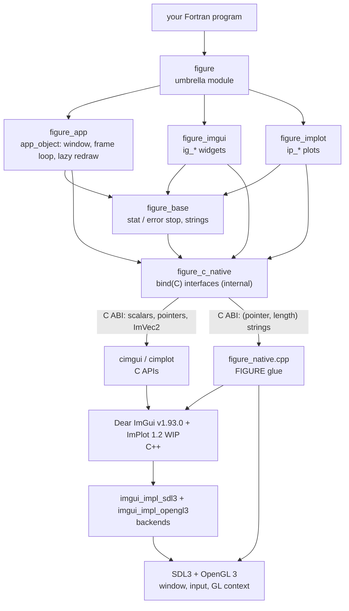
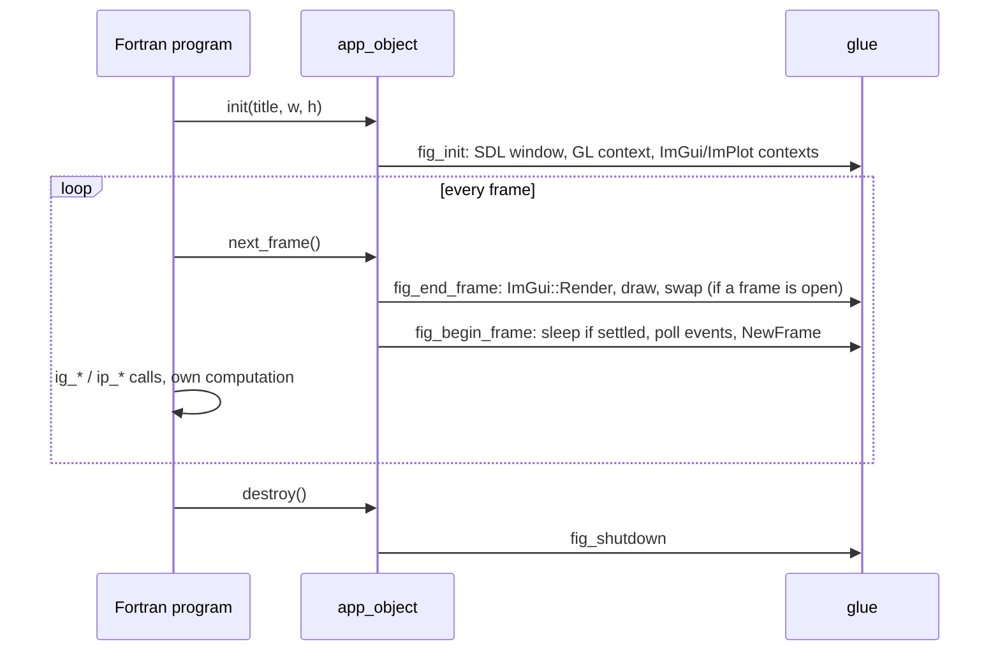

# Architecture

## Layers

- **Fortran API** (`figure`, `figure_app`, `figure_imgui`, `figure_implot`, `figure_base`): Fortran arguments and
  kinds (`int32`, `real32`, `real64`, `logical`, `character(len=*)`), optional arguments, generic interfaces. Strings
  are converted here (NUL-terminated for cimgui and cimplot), `logical` to `c_bool` and back, values copied into C
  locals for the call.
- **Raw layer** (`figure_c_native`): `bind(C)` interfaces, status codes and the few Dear ImGui enumeration values used.
  Internal: milestone M2 will generate it from cimgui's and cimplot's metadata.
- **C APIs** (cimgui, cimplot): the C functions generated from Dear ImGui and ImPlot, compiled into
  `libfigure_native.a`.
- **Glue** (`native/figure_native.cpp`, `native/figure_native.h`): what the C APIs cannot offer to Fortran directly
  (see below), and everything the platform needs.
- **Platform**: SDL3 (window, input, display scale) and OpenGL 3, through the official Dear ImGui backends.

## The boundary

Fortran calls only C functions, through `bind(C)` interfaces; no C++ type, exception or ABI crosses. A cimgui or
cimplot function is bound **directly** when all its arguments are scalars, pointers or the two-float `ImVec2_c`
(declared in Fortran as the interoperable `im_vec2`). Functions that take larger structures by value, such as
ImPlot's item functions with their `ImPlotSpec_c`, go through the **glue**, which builds the structure in C++:
`ip_line` calls `fig_plot_line`, which calls `ImPlot::PlotLine`.

Glue conventions (`figure_native.h`):

- every function is plain C (`extern "C"`) and returns an `int` status unless documented otherwise;
- no C++ exception escapes: each function catches them and returns `FIG_ERR_EXCEPTION`;
- strings from Fortran arrive as a pointer and a byte length, without NUL terminator;
- the glue owns the SDL window, the OpenGL context and the Dear ImGui/ImPlot contexts: Fortran never sees them.

The OpenGL calls the glue makes itself (viewport, clear) are loaded through SDL at run time: there is no link-time
dependency on `libGL` or `opengl32`.

## Lifecycle

The native layer owns the lifecycle state (not initialized, window, headless; frame open or not) and rejects
out-of-order calls with `FIG_ERR_STATE`. `app_object` mirrors only whether a frame is open, because `next_frame` must
know whether to close one before opening the next.

## Builds

The native layer is built once by CMake (`scripts/build_native.sh`): static libraries, pinned versions fetched with
`FetchContent`, compiled with the same configuration cimgui and cimplot were generated with (`cimconfig.h`,
`IMGUI_DISABLE_OBSOLETE_FUNCTIONS`), so that their C structures match the C++ ones bit for bit. The Fortran library
is built by FoBiS or fpm, which only link `figure_native SDL3 stdc++ dl pthread m`. `scripts/check_sync.py` checks
that fobos and `fpm.toml` agree on those libraries and on the programs they build.
