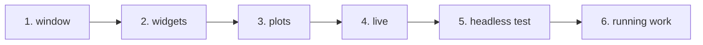

# Tutorial

Six short programs, from an empty window to a tested panel and work run beside the window. Each chapter is a complete program of
[`docs/examples/src`](https://github.com/szaghi/figure/tree/main/docs/examples/src), compiled against the library
by `docs/examples/build.sh`.

| Chapter | You learn |
|---|---|
| [1. A first window](./tutorial/01-first-window) | `app_object`, the frame loop, a window with text |
| [2. Widgets and state](./tutorial/02-widgets) | sliders, inputs, check boxes, buttons bound to your variables; labels and `##` |
| [3. Plots](./tutorial/03-plots) | ImPlot line plots of Fortran arrays |
| [4. A live computation](./tutorial/04-live) | advancing a computation inside the loop; `request_frames` |
| [5. Testing without a display](./tutorial/05-headless) | `init_headless`, synthetic mouse input, a testable panel |
| [6. Running work](./tutorial/06-running-work) | a tool started from a button, its output in a log view; a computation run as a task |



## Building the chapters

Every chapter builds the same way, against the static library (see [Installation](/guide/install#use-the-library)):

```bash
fobis build --mode figure-static-gnu
gfortran -I lib/mod tut01_window.F90 lib/libfigure.a -L lib -lfigure_native -lSDL3 -lstdc++ -ldl -lpthread -lm \
         -o tut01_window
```

or all at once, from the repository root, with `bash docs/examples/build.sh` (the programs land in
`build/docs-examples/bin`).

## Then

The [Cookbook](./cookbook) answers one task per recipe; the [Reference](/guide/features) lists every procedure.
