# Tutorial

Three parts. **Part one**, six short programs, goes from an empty window to a tested panel and work run beside the
window. **Part two** grows one application, a small *solver studio*, chapter by chapter: it opens a case, edits its
input, runs a solver, follows its residuals, shows the field it computed in 2-D and 3-D, and runs on a cluster with
its interface in a browser. **Part three** grows the same studio with what FIGURE v0.4.0 added: usage errors
reported, keys routed by the focus, fields committed when left, sizes in em, tables that sort and have menus, a
canvas, a monitor with two axes, a field coloured once and a player of snapshots. Each chapter is a complete program of
[`docs/examples/src`](https://github.com/szaghi/figure/tree/main/docs/examples/src), compiled against the library by
`docs/examples/build.sh`; in part two each chapter's program is the previous one with something added, and the page
shows what is new.

## Part one: the basics

| Chapter | You learn |
|---|---|
| [1. A first window](./tutorial/01-first-window) | `app_object`, the frame loop, a window with text |
| [2. Widgets and state](./tutorial/02-widgets) | sliders, inputs, check boxes, buttons bound to your variables; labels and `##` |
| [3. Plots](./tutorial/03-plots) | ImPlot line plots of Fortran arrays |
| [4. A live computation](./tutorial/04-live) | advancing a computation inside the loop; `request_frames` |
| [5. Testing without a display](./tutorial/05-headless) | `init_headless`, synthetic mouse input, a testable panel |
| [6. Running work](./tutorial/06-running-work) | a tool started from a button, its output in a log view; a task with a progress bar; a notification |

## Part two: a solver studio

| Chapter | The studio gains | You learn |
|---|---|---|
| [7. The studio's own window](./tutorial/07-window) | its own window | the frame drawn by FIGURE: icon, title, buttons on the platform's side, drag, double-click, resize edges; asking before quitting; the frame checked headless |
| [8. The application's shell](./tutorial/08-shell) | a shell | menus in the title bar, shortcuts, a side bar of workspace buttons, docking, a layout kept between runs, looks and palettes, icons |
| [9. The case](./tutorial/09-case) | a case | FIGURE's file browser and the system's dialogs, drops, recent cases, the window's title, asking before discarding changes |
| [10. The input editor](./tutorial/10-input) | an input editor | a tree, forms, sliders, drop-down lists, a table, undo, multi-line text in the monospace font |
| [11. Running the solver](./tutorial/11-run) | runs | a process and its log, a live residual plot, a status bar, progress, notifications, stop |
| [12. The result field](./tutorial/12-field) | the result | a heatmap, colormaps (and why not Jet), a legend, contour lines, probe lines and points, error bars |
| [13. The field in 3-D](./tutorial/13-view3d) | a 3-D view | `view3d_object`: a surface coloured by a field, the camera, a cut, picking |
| [14. Heavy work off the frame](./tutorial/14-task) | large results | a task reading a large file, its progress and stop; only the main thread draws |
| [15. Robustness](./tutorial/15-robust) | error handling | `stat` or stop, `figure_last_error`, checks of the input, exit codes, a history of the messages |
| [16. The studio tested](./tutorial/16-tested) | a test | the studio driven headless: keys, the file browser, a drop, a popup, the title bar; scripted recordings |
| [17. The studio on a cluster](./tutorial/17-remote) | remote mode | the interface in a web browser over SSH, the access token, what a browser allows, bandwidth |

## Part three: the studio grows

| Chapter | The studio gains | You learn |
|---|---|---|
| [18. Mistakes reported, keys that respect the focus](./tutorial/18-checks) | usage checks, routed keys | `next_frame(stat)` reporting a wrong end by the Fortran calls; a test failing on any; `ig_shortcut` scopes, a button that owns a key |
| [19. Fields, lists and sizes](./tutorial/19-layout) | commit on leave, sizes in em | `ig_last_item`, `ig_focus_here`, `ig_scroll_here`, `ig_text_link`; `ig_em`, `ig_frame_height`, `ig_align_begin` |
| [20. Tables that act](./tutorial/20-tables) | a list of runs | a sortable table with a frozen header, row colours, context menus, tooltips with a plot; radio buttons, drag boxes, a log slider |
| [21. A sketch and a monitor](./tutorial/21-monitor) | a sketch, a monitor | a canvas and drawing primitives; a second y axis, integer abscissae, the pointer read in plot units, tags, drag lines |
| [22. The field and its snapshots](./tutorial/22-player) | snapshots | `ip_field_image`, `ip_colormap_legend_edit`, `player_object` and `ig_player` |
| [23. Windows and layouts](./tutorial/23-windows) | a View menu, layouts, settings kept | `app%add_window`, `app%add_layout`, `app%view_menu`, layouts built on `ig_dock_layout_begin`; `app%open_prefs`, `save_pref`, `load_pref` |
| [24. The input in an editor, the help in Markdown](./tutorial/24-editor) | a code editor, a help page | `code_editor_object`: highlighting, completion, marks on lines; `markdown_view_object`: a page with contents, find, links |
| [25. A clip plane by hand, the studio as a picture](./tutorial/25-clip) | a gizmo, a picture test | `view%gizmo`, `view%view_cube`, `view%clip`; `test_item_click` by path; `test_capture` and `test_compare_image` with masks |

```mermaid
flowchart LR
  subgraph one [Part one]
    A[1. window] --> B[2. widgets] --> C[3. plots] --> D[4. live] --> E[5. headless test] --> F[6. running work]
  end
  subgraph two [Part two: the solver studio]
    G[7. window] --> H[8. shell] --> I[9. case] --> J[10. input] --> K[11. run] --> L[12. field]
    L --> M[13. 3-D] --> N[14. task] --> O[15. robustness] --> P[16. tested] --> Q[17. remote]
  end
  subgraph three [Part three: the studio grows]
    R[18. checks, keys] --> S[19. fields, sizes] --> T[20. tables] --> U[21. sketch, monitor] --> V[22. field, player]
    V --> W[23. windows, layouts] --> X[24. editor, help] --> Y[25. gizmo, picture test]
  end
  F --> G
  Q --> R
```

## Building the chapters

Every chapter builds the same way, as chapter 1 shows: with FIGURE installed by the
[one-line installer](/guide/install), `gfortran tut01_window.F90 $(pkg-config --cflags --libs figure) -o tut01_window`;
the testing module of chapter 5 (`figure_testing`) is in the same library. In a clone of the repository, all of them
at once, from its root, with `bash docs/examples/build.sh`: it needs FoBiS and the native layer
(`scripts/build_native.sh` first), puts the programs in `build/docs-examples/bin`, runs the headless ones, and
regenerates the snippets and outputs these pages include (`docs/examples/snippets`, `docs/examples/output`).

Part two's solver, `tut11_heat`, and part three's, `tut21_heat`, are programs of their own, built next to the studio;
run a chapter's studio from that folder, with `--examples DIR` to write the example cases and `--case DIR/plate` to
open one.

## Then

The [Cookbook](./cookbook) answers one task per recipe; the [Reference](/guide/features) lists every procedure.
